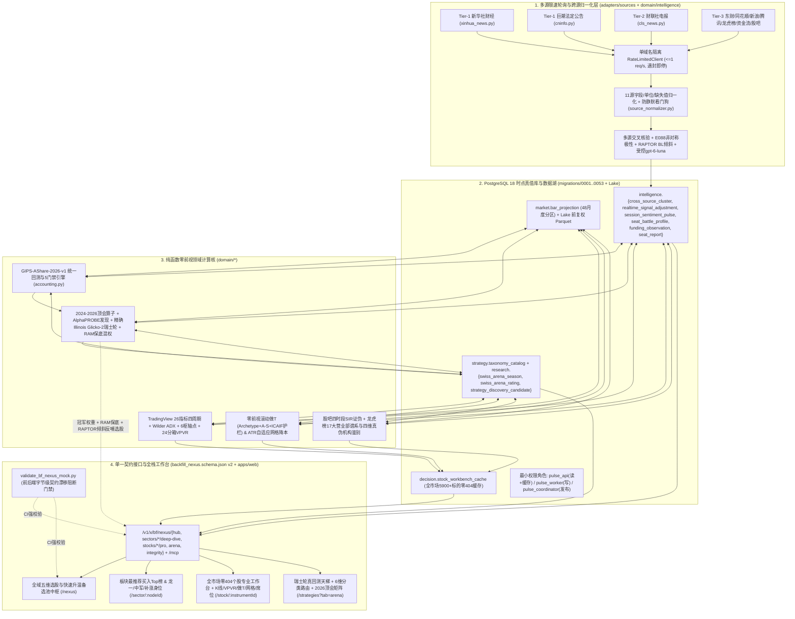

# Pulse 3.5 Nexus — 2026 教科书级多智能体原生（Agent-Native）全栈选股与交易工作台架构白皮书

> **核心定位（Product vs. Engineering Paradigm）**：Pulse 3.5 Nexus 是一个**面向 A 股实盘微观结构的全栈选股、板块龙头梯队、个股多周期深度研判、底仓做T/网格降本与策略优胜劣汰闭环平台**（绝非聊天机器人套壳）。文中所称「Agent-Native（多智能体原生）」指的是其**工程组织范式**——通过**无环分层 DAG、单一 JSON Schema 代数契约、纯函数零前视领域核、三端（React 19 ↔ FastAPI ↔ PostgreSQL 18）强校验贯通与车道级隔离测试**，让未来的超级编程智能体（如 GPT-6.1 Aster、Claude Fable 5.1、Opus 5.5）能够以多路并行、零上下文污染、零契约漂移的方式极速协同演进。

---

## 1. 全局闭环数据流与系统拓扑



---

## 2. 面向未来超级智能体的并行协同架构（Agent-Native DAG）

为使多路前沿编程智能体（GPT-6.1 Aster / Claude Fable 5.1 / Opus 5.5）能够**同时并行改造不同子系统而不产生语义冲突或契约漂移**，系统强制遵守五项教科书级架构约束：

| 架构层次 | 目录边界（Ownership Lane） | 依赖方向（严格无环 DAG） | 并行修改安全约束 | 独立验收门禁 |
|---|---|---|---|---|
| **L0 契约层** | `src/pulse/contracts/data/backfill_<lane>.schema.json` | 零代码依赖（纯 JSON Schema 2020-12） | 修改必升 `x-contract-version`，作为前后端唯一真值源 | `contracts.check()` + `validate_bf_*_mock.py` |
| **L1 领域核** | `src/pulse/domain/{benchmark,arena,technical,execution,intelligence}` | 仅依赖标准库与 `domain/market_rules`；**零 DB / 零 HTTP / 零系统时钟** | 纯函数确定性、零前视、参数显式传入 `as_of` | 毫秒级纯单测（无需 PG） |
| **L2 存储与源** | `migrations/`、`src/pulse/adapters/{sources,postgres,lake,models}` | 依赖 `domain` 与数据库驱动 | 单域名独立 `RateLimitedClient`；所有 SQL 列严守 `numeric(38,12)` 与 `timestamptz`；严守 `0007` RBAC 最小权限 | `test_roles.py` + `test_contract_sql_consistency.py` |
| **L3 应用编排** | `src/pulse/application/`、`src/pulse/workers/` | 编排 `adapters` ↔ `domain` ↔ `contracts` | 严禁在只读 API 路径隐式写表；LLM 调用必经 `model_guard`（仅 `gpt-6-luna`）+ 开关文件 + 配额账本 | `tests/bf_nexus/` 实时 PG18 端到端集成测试 |
| **L4 接口与界面** | `src/pulse/api/routes_bf_*.py`、`apps/web/src/pages/bf/*` | API 仅做参数校验与 `respond_backfill`；Web 仅做视图与交互 | 禁止前端自造脱节 mock；所有 mock 响应必过后端 JSON Schema 校验器 | `tsc --noEmit` + `vitest run` + `vite build` + `validate_bf_nexus_mock.py` |

---

## 3. 既有代码深度审计与根因级修复全录

本次重构对 `pulse3/` 全量代码、SQL 迁移与真实 PostgreSQL 18 数据（5,941 只标的、868,274 条日线覆盖 494 交易日、60,023 份龙虎榜报告）进行了逐行审计，彻底根治了以下真实缺陷：

| 编号 | 所在模块 | 根因缺陷描述 | 根因级修复方案 |
|---|---|---|---|
| **FIX-01** | `application/release_service.py` | 候选池循环存在 N+1 查询；且此前草稿将未校验模板计划（`TEMPLATE_PLAN_NOT_VALIDATED`）误标为 `plan_validated=True`，破坏风控门禁 | 保留单次预取 `rel_times` 消除 N+1，严格仅对 `state == 'actionable'` 的真实已校验计划置 `plan_validated=True` |
| **FIX-02** | `domain/market_state/outcomes.py` & `application/market_today_service.py` | 前向路径守卫原硬编码 `11.1%` 误杀双创/北交所，且 `evaluate_outcomes` 仅加载了主板标的元数据 | 全板别路径守卫（主板 `11.1%` / 双创 `22.2%` / 北交所 `33.3%`），并在 `evaluate_outcomes` 中加载全市场板别映射与日线 |
| **FIX-03** | `application/account_service.py` & `adapters/postgres/ingest_repo.py` | `open_paper_account` 写 Outbox 与建账分属两个事务；`save_health` 递增 `aggregate_version` 无锁存在并发撞键隐患 | `open_paper_account` 纳入单事务保存点保证原子性；`save_health` 写前加 `pg_advisory_xact_lock(hashtext(agg_id))` |
| **FIX-04** | `migrations/0053_nexus_platform_upgrade.sql` & `nexus_service.py` | 此前草稿在每次 GET 中执行 `INSERT INTO core.source`，在生产 `pulse_api` 最小权限角色下必然 `InsufficientPrivilege` 报错 500 | 回收 `pulse_api` 对研究/策略/情报表的写权限（仅保留只读 + `decision.stock_workbench_cache` 写）；初始化迁至 `workers.nexus seed` 与容错只读回退 |
| **FIX-05** | `adapters/sources/registry.py`, `xinhua_news.py`, `workers/nexus.py` | `xinhua_news` 未注册进 `registry.py`；4 个不同域名共用同一个 `RateLimitedClient` 导致一源被封全源熔断；异常被静默吞掉 | `xinhua_news` 通过无环 `register()` 接入注册表；`workers/nexus.py` 为每个域名独立分配 `RateLimitedClient`，真实提取股票/板块实体并持久化至 `document_revision`、`cross_source_cluster` 与 `source_health` |
| **FIX-06** | `domain/benchmark/accounting.py` & `domain/arena/swiss_glicko.py` | 原瑞士轮只比较硬编码 `base_mu`，未跑真实回测且未反馈权重给选股；`accounting.py` 无统一回测循环且 `audit_entrypoints` 为静态文本 | 实装 `UnifiedBacktestEngine`（`GIPS-AShare-2026-v1`）+ 5 门禁验证器 + 精确 Illinois Glicko-2 + 经验相关矩阵聚类 + RAM 保底混权；真实回测结果落库并直接驱动 `/hub` 与 `/sectors/*/deep-dive` 选股权重 |
| **FIX-07** | `domain/execution/grid_and_t.py` | 历史回测用期末最后 14 日 ATR 倒推过去 60/90 天（样本内前视）；高价股（>400元）强制买 1 手导致负现金透支 | 改为严格因果滚动 `bars[:idx]` 回测 + A 股涨跌停/低开跳空撮合 + 高价股预算守卫（`budget_insufficient` 零透支）+ ICAIF 2026 流动性溃散与神经符号护栏 |
| **FIX-08** | `application/nexus_service.py` | `adjustment_mode` 被忽略；`market_regime`/`surge_comps`/`cap_sc`/板块推荐分硬编码；个股新闻过滤失效泄露全市场快讯；股吧读不到真实标题；龙虎榜未传流通市值与成交额 | 全部接线真实 PostgreSQL + Lake Parquet（支持真前复权、真 `market_regime`、真 `funding_observation`、真流通市值 `float_cap`、真股吧标题与 `session_sentiment_pulse` 持久化、真板块正交合成评分） |
| **FIX-09** | `apps/web/src/pages/bf/nexus/*` & `PriceChart.tsx` & `StockPage.tsx` | 前端 5 大接口字段与后端 JSON Schema 严重错位（上线即白屏）；兜底工作台无 K 线图；分钟线切入触发 400 | 以 `backfill_nexus.schema.json` v2.0.0 为单一真值源统一前后端，兜底工作台集成完整 `PriceChart` K 线图，并新增 `validate_bf_nexus_mock.py` 强制门禁 |

---

## 4. TradingView 专业能力逆向拆解与 Pulse 3.5 集成对照

| TradingView 核心能力 | TradingView 原生架构 | Pulse 3.5 Nexus 集成实现与 A 股增强 |
|---|---|---|
| **Supercharts 多周期 K 线与叠加层** | Lightweight Charts WebGL/Canvas + 多窗格 | `PriceChart.tsx`（Lightweight Charts 5）+ MA/EMA/BOLL/MACD/KDJ/RSI + 买卖区间/止损/止盈/POC 锚点线 + SuperTrend/挤压/背离/倍量信号标记；**全市场 5,900+ 标的零 404 工作台全覆盖** |
| **Technical Ratings 26 指标仪表盘** | 15 均线 + 11 震荡等权评分 `[-1, +1]` | `domain/technical/tv_pro.py` 跨 `日线/周线/月线/年线` 四周期共振评分，Wilder RMA `ADX(14)`，样本不足置 `unavailable` 绝不补 0 |
| **Volume Profile (VPVR) 筹码峰** | 可见区间价格分箱 + 70% 价值区 | 24 分箱 VPVR 筹码分布（POC 控制点、贪心双指针 70% `[VAL, VAH]`、获利盘比例、平均筹码成本、90% 集中度、HVN/LVN 峰谷识别） |
| **6 大枢轴点支撑阻力体系** | Traditional/Classic/Fibonacci/Camarilla/Woodie/DeMark | `compute_all_pivot_points` 全量实装，日线收盘后直接输出次日精准支撑阻力阶梯 |
| **Screener & Heatmaps 选股与热点** | 服务端筛选 + Treemap 热力图 | `/nexus` 四赛道选股总榜 + 任意板块点入即得的**板块最推荐买入 Top 榜**（自动标注龙一/龙二/容量中军/异动先锋/低位补涨）+ **火速晋升板块提前备选池** + 既有 `/themes` Treemap |
| **Strategy Tester 回测评估** | 沙箱撮合 + 手续费 + 净值回撤 | `UnifiedBacktestEngine`（`GIPS-AShare-2026-v1`）+ 5 门禁验证（RRE/PFS/2x 成本压力/三档封板队列/三段归因/MetaTrader CVaR）+ 瑞士轮 Glicko-2 天梯 |
| **Real-Time Alerts & Community Ideas** | 云端守护监控 + 社区观点流 | 多源轮询防静默看门狗 + RAPTOR Black-Litterman 实时调权 + 受控 `gpt-6-luna` 证据摘要 + **股吧盘前/盘中/午休/盘后四时段 SIR 证伪** + **龙虎榜 17 大营业部博弈拆解** |

---

## 5. 数据库性能、跨源字段规范与统一记账标准

### 5.1 PostgreSQL 18 高吞吐与统一标准设计
- **分区与索引**：`market.bar_projection` 按月分区（2024-01 至 2027-12 共 48 分区）；`0053` 补齐 6 大高频 PIT 复合索引与 JSONB `jsonb_path_ops` GIN 索引，支撑 5,900+ 标的、百万级日线与高频情报毫秒级检索。
- **零浮点与时区红线**：全库金额、价格、比率统一 `numeric(38, 12)`，全时间戳统一 `timestamptz`（UTC 存储，展示转 `Asia/Shanghai`），缺失值严格留 `NULL` 绝不补 0。
- **11 源跨源归一化与防错执行器（`source_normalizer.py`）**：统一纳管 `xinhua_finance`, `cninfo_announcements`, `cls_telegraph`, `eastmoney_news_724`, `ths_news_724`, `sina`, `tencent`, `eastmoney_lhb_disclosure`, `eastmoney_guba_comments`, `eastmoney_fund_flow`, `eastmoney_calendar`。运行时通过 `normalize_record()` 强制完成手→股（×100）、万元→元（×10,000）、缺失哨兵（`""`/`"--"`/`"0.000"`→`None`）转换与 OHLC 序关系守卫，并记录每次纠正原因。

### 5.2 统一国际公认记账基准 `GIPS-AShare-2026-v1`
- **成交时序**：T 日收盘 PIT 锁定信号 → T+1 日开盘价成交；严格 T+1 锁仓与 100 股整手取整；剔除收盘 `< 2.0` 元面值退市风险标的。
- **涨跌停制度**：主板 ±10%（**2026-07-06 起主板 ST/\*ST 由 ±5% 调整为 ±10%**，历史段严格保留 5%）；创业板/科创板（含 ST）±20%；北交所 ±30%。一字涨停 0% 成交，非一字封板报告 0%/30%/100% 三档排队敏感性，炸板 100% 逆向成交，跌停卖出最多顺延 8 个交易日。
- **费用与冲击**：双边券商佣金（基准 2.5 bps 或 `user_account_2026` 5 bps，单笔最低 5 元人民币）+ 卖出印花税 5.0 bps + 双边过户费 0.1 bps + 半价差 2.5 bps + Almgren-Chriss 平方根市场冲击 $\eta \sigma_d \sqrt{Q/V}$；同步校验 2x 压力测试。

---

## 6. 运维与自动化闭环命令速查

在 `d:\zuomian\idea\trading\pulse3` 下可直接执行（生产服务器通过 `deploy/windows/run_nexus_intel.ps1` 计划任务调度）：

```powershell
# 1. 执行数据库迁移（含 0053 Nexus 全套索引与业务表）
.\.venv\Scripts\python.exe -m pulse.adapters.postgres.migrate

# 2. 幂等初始化 11 源归一化规则、17 大龙虎榜席位谱系与策略分类路由目录
.\.venv\Scripts\python.exe -m pulse.workers.nexus seed

# 3. 多源限速轮询(单域名独立限速 <=1 req/s) + 交叉核验 + RAPTOR 实时调权
.\.venv\Scripts\python.exe -m pulse.workers.nexus poll-intel --offline
.\.venv\Scripts\python.exe -m pulse.workers.nexus realtime-adjust

# 4. 基于 PostgreSQL 真实历史 K 线运行 GIPS-AShare-2026-v1 回测 + 瑞士轮 Glicko-2 晋升
.\.venv\Scripts\python.exe -m pulse.workers.nexus run-arena --rounds 5

# 5. AlphaPROBE 自动策略发现 + 5 门禁正交筛选入池
.\.venv\Scripts\python.exe -m pulse.workers.nexus discover-strategies

# 6. 动态 7 入口记账口径对账与数据库健康审计
.\.venv\Scripts\python.exe -m pulse.workers.nexus audit-integrity
```
