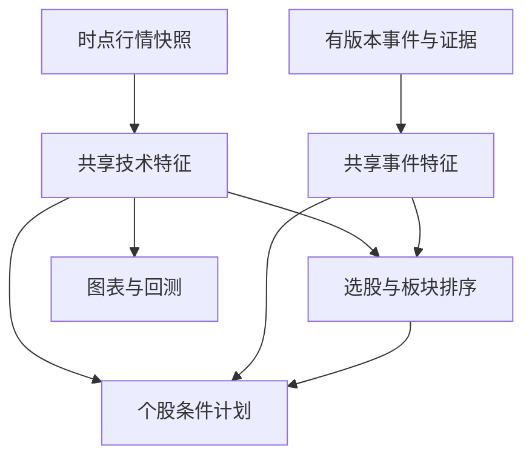

# Pulse A股选股平台完整重写与实施规范 v3.2

补充核查截止2026年11月11日。主文与Word主体一致；新增第十八至二十部分整合十一卷，末尾另附Word未展开的590条完整审查。可执行参考、SQL、JSON、来源卡、完整字段字典和验证日志见配套实施包。


# Pulse A股选股与个股交易计划平台最终实施规范

版本 3.2　基础研究核查截止2026年11月10日　补充核查截止2026年11月11日

## 1 产品决定与交付口径

本项目重写为一个贯通消息、情绪、技术、资金的A股选股平台。用户先看到全市场或板块内的推荐顺序，再进入个股工作台，查看同一份证据下的买点、卖点、持有、做T和网格计划；计划经过统一成交与经济账本验证，结果反哺策略池。策略池负责发现、归类、实验、比较、组合、晋级和退役，形成可复算的闭环。

Agent用于未来并行开发。产品运行期采用有确定输入、输出、超时和版本的分析服务；需要语言理解时调用模型，不把用户工作台改成开放式Agent聊天或自治系统。未来模型能力通过能力注册与评测接入，模型商品名不是业务协议，也不预设尚未核实的GPT或Claude版本已经存在。

采用全新目录和依赖边界实现。旧仓库的代码审计、问题复现、用户需求、数据样例与经验证的业务事实作为证据；不要求新架构继承旧模块调用关系。旧数据导入是独立适配任务，不把旧收益或旧策略分数直接认定为新内核下的合格结果。

本交付包含可实施的规范、SQL种子、字段字典、接口目录、契约、策略与研究目录，以及针对数据传播和统一账本的可运行参考程序。它不是已经部署的新网站。参考测试证明所覆盖的确定性行为；数据库SQL静态解析不等于真实迁移、性能实测或完整供应商接入。方案、已实现参考、未实现集成、已完成审计分别登记，避免开发者误读完成度。

### 1.1 当前产品范围

首发用户股票池以沪深主板为默认，创业板、科创板、新股等由UniversePolicy显式选择；价格不高于100元、流通市值不高于100亿元（circulating_market_cap）保留为可配置用户偏好。它们不是已验证的最优阈值。交易规则、股票池偏好和策略统计结论分别版本化，不能把用户偏好写成交易所规则。

首页分全市场精选、板块机会、快速升温候选、自选与持仓四个入口。短线、波段、长期明确分榜；同一股票可以在不同期限得到不同结论。推荐分是同一目标和母集中的相对顺序，只有经过事件定义和校准的概率才能显示为上涨概率。

“覆盖所有影响因素”落实为持续扩展的因素本体、来源覆盖矩阵、未覆盖项及自动发现任务。现有105类因素与61类策略种子用于启动，不宣称世界上全部可影响A股的因素已穷尽。每个新因素需要作用机制、可观测代理、可得时点、适用证券、检验目标和失效条件；没有可观察数据的因素保持研究假说，不虚构数值。

### 1.2 唯一规范入口

本文件与数据库、消息板块、统一执行、策略联赛专项组成v3正式规范。`contracts/v3.schema.json`与`contracts/api_bindings.json`是新接口种子；SQL与字段字典提供存储对应；integration/all_fields.json汇总四份DDL中每一列的实际类型、空值、默认值、外键与业务含义。`authority_manifest.json`逐项列出权威文件。v1/v2文件保留作审计历史，不能与v3混用为另一套生产合同。共享特征参考只有正式迁入reference_features并统一v3字段的副本继续作为有效参考，旧账户参考归档；账本权威是execution/unified_ledger.py。旧fixture中的可读ID不自动变成生产UUID；字段重命名通过显式映射完成。

## 2 架构与依赖方向

推荐一个模块化单仓，业务API、摄取、分析、投影和研究按职责隔离。小机器可合并轻任务运行，重研究独立限额；不把职责数量强制等同进程数量。模块按业务职责隔离，数据通过共享契约和版本引用联通；不是每个模块独立采集、独立计算同名指标、独立记账。研究批量计算可以扩容，页面和消息摄取不会被一次长回测拖住。

| 模块 | 唯一职责 | 主要产物 |
| --- | --- | --- |
| instruments 与 market_rules | 证券身份、时点分类、交易日历、交易规则 | Instrument、UniverseSnapshot、MarketRules |
| ingestion 与 evidence | 来源接入、原始保存、规范化、多源核对、消息主张与事件 | Observation、EvidenceRevision、Reconciliation |
| features 与 market_state | 统一K线、指标、市场情绪、行业与龙头生命周期 | FeatureSnapshot、MarketState、SectorState |
| strategies 与 research | 策略定义、标签、能力路由、实验、联赛和准入 | StrategyVersion、Evaluation、PromotionDecision |
| selection 与 planning | 同目标排序、账户目标合成、个股条件计划 | Ranking、TradePlan、AnalysisRelease |
| execution 与 accounting | 委托、模拟或实际成交事件、预留、唯一账本与业绩 | Fill、Journal、AccountProjection、Performance |
| workspace 与 delivery | 页面投影、图表查询、用户布局、订阅与版本更新 | WorkspaceProjection、Layout、UpdateCursor |

领域逻辑不直接导入数据库连接、HTTP SDK或模型供应商SDK。应用服务通过端口调用适配器；API只做输入输出和权限作用域，不能复制因子公式、选股分数或利润算法。跨模块共享只读的规范对象与服务入口，不让一个模块私改另一个模块的表。

首发小规模组合为TypeScript/React前端、Python应用与研究、单PostgreSQL业务事务、不可变本地对象与Parquet、DuckDB/Polars计算、事务outbox轮询。DuckLake目录、对象存储服务与NATS JetStream是按实测增长启用的适配器，不是小机启动前置条件。具体框架版本在实施时锁定受支持稳定版本及生成器兼容矩阵。PostgreSQL 18为本SQL种子的兼容基线，不宣称它是核查日期的最新大版本。FastAPI/Pydantic等可作为API与数据校验实现；架构的长期稳定性来自合同和依赖方向，不来自堆叠框架。

首发不强制Kubernetes、图数据库、独立向量数据库、ClickHouse或运行期多Agent框架。产业关系先用可版本化关系表；全文检索与向量检索按真实数据量评测。满足数据库专项的混合负载触发条件后，才增加ClickHouse等专用读投影，已有业务合同保持不变。[DB01][DB04][DB05][DB06][DB07][DB08]

## 3 一次完整的业务闭环

以一条盘中政策消息为例：适配器先保存原始内容与来源时间，记录接收和规范可用时间；解析器抽取可核对的主张；来源核对服务识别独立原稿、转发和修订。影响分析将政策映射到行业、产品、公司暴露和可能的期限，区分事实、推断和待证条件。

共享特征服务读取同一截止时点的行情、量能、市场状态、资金代理和社区测量，重新计算受影响证券及板块。路由器选择数据条件满足且已经准入的策略版本。selection产出机会排序，planning产出可执行条件或观察条件，必要时根据持仓合成做T或网格子计划。

投影构建器为本次发布声明必需的全市场榜、板块榜、重点股票轻量工作台、证据与计划引用。完整后提交AnalysisRelease、发布指针与outbox；推送只通知客户端新版本可取。客户端以同一个release_id读取一组页面数据，不把旧计划与新理由拼在一起。

observed可得性政策下，派生结果的available_at不得早于所有输入的available_at与本次computed_at的最大值。decision_as_of是输入截点，不是结果已经对外可用的时刻；published_at记录实际发布。持久原始/规范记录的available_at始终表示真实完成可用时间。历史重建在研究查询中另派生policy_usable_at，绑定availability_policy_version和计算/传播延迟假设；不把actual available_at改成公告日期，也不把今天才算出的模型结果回填成过去线上已知。

新的报价、账户库存和当前委托使用独立的live_quote_version与account_version覆盖层。触发买卖提示时重新核对条件、可卖库存、现金、未完成委托和计划有效性。完整的研究快照不能假装是最新可成交价格；最新报价也不能悄悄改写旧分析依据。

成交或模拟结果进入唯一账本，再进入净值、收益、归因和实验评价。新的策略研究只能新增候选版本；经过统一数据与执行验证后，才产生正式晋级与路由更新。线上消息触发的是重分析或新计划版本，不是让模型随意热改生产代码。

## 4 数据标准与数据库的一致语义

数据库专项提供完整字段字典和主要DDL。这里固定跨模块共同约束：SQL与JSON使用lower_snake_case；证券使用稳定instrument_id；交易所代码、名称和板块归属有业务生效时间与系统可得时间。金额、价格和比率用十进制字符串跨API传输；数量用整数股；日期与时刻不混合。

每份数据至少声明来源、精确接口、原结构版本、映射版本、规范合同版本、原文定位、内容摘要、修订关系和可得时间。字段同名不代表同口径。同一家Tushare的daily.vol为手、daily.amount为千元，而rt_k.vol为股、rt_k.amount为元，已在官方文档核实。[DB09][DB10] 因此统一层按完整接口身份换算，不能配置一个“tushare统一单位”。

原始对象、规范观测、事实选择、派生指标和页面投影分别存在。补齐来自第二源时保留其字段血缘和可得时间；单位转换只做有定义的转换；未知保持null。质量、时效、源健康分别表示，避免把“HTTP成功”“没有新消息”“字段缺失”“行情休市”压成一个绿色状态。

首次可用时间不能被后来更正倒填。历史研究必须使用snapshot_id、decision_as_of、availability_policy_version三者；只冻结文件而不按可得时间过滤，仍可能看到未来发布的财报、修订新闻或后来加入的行业分类。

### 4.1 原始价与多周期行情

执行和经济账本使用原始成交价；技术研究可以使用带版本的前复权/后复权/总回报序列。图表明确显示复权方式，所有买卖价区间映射回原始可交易价格。历史复权因子、分红、送转和参考昨收分别保存，不能把除权跌幅当成策略亏损，也不能在复权价格收益上重复计入现金分红。

bar键包含证券、周期、会话、开闭时刻、价格基准和数据快照。分钟量必须是区间量，不直接把累计快照相加。周、月、季、年线按交易日历聚合；当前未完成周期标is_final=false。年/月/周/日/分钟图共用同一聚合与指标服务，不由图表库另算一套MA/MACD。

停牌、源缺失和真实零成交分别编码。缺一分钟不能无依据前值填充成一根有真实成交的K线。指标算法固定窗口、热身长度、空值政策、EMA初始化与浮点/Decimal政策。科学计算可以用明确精度的浮点向量；资金和账本仍保持Decimal，不能为了矩阵速度改写金额精度合同。

### 4.2 图表与工作台缓存

用户布局、画线、模板、指标参数、自选分组和复盘笔记是持久用户资产，进入PG。技术指标结果、图表窗口、排名解释和工作台payload是可重建的版本投影；可放PG热表与有界缓存，历史真相保留在Lake和原始证据中。

缓存键至少包含证券、用户或账户作用域、release_id、时间范围、周期、会话、复权版本、策略目标/期限、投影版本和相关规则版本。不能只以stock_code作为全页缓存键。浏览器Query Cache是短期显示层；清空它不应丢失用户布局。服务端返回ETag与release_id，推送丢失后可用版本轮询恢复。

如果缓存不存在，先返回已知旧版本与其时间，或显示指定部分计算中；不能把缺失投影包装成最新完整结果。重建按照清单校验完整范围，只有ready窗口可供图表使用。缓存淘汰不删除被实验引用的数据manifest。

## 5 消息 情绪 技术 资金如何汇合

四个维度都使用统一Observation、Evidence、Feature与Evaluation合同，但保留各自经济含义。新闻数量、社区热度、资金代理和MACD数值不能因为进入同一个模型就被当成同一种投票。

消息面覆盖国内政策、央行与财政、监管交易制度、公司公告与财务、产业供需、商品能源、汇率利率、海外市场、地缘与贸易、突发事件。每条影响关系描述“什么事实→影响哪项业务或估值变量→哪些公司暴露→预期发生在哪个期限→什么观察可证伪”。只有关键词命中“半导体”不足以推定所有半导体公司受益。

情绪面包括市场涨跌分布、连板与炸板结构、成交集中度、行业扩散、社区讨论强度及立场。社区测量记录采样覆盖、平台、时间窗口、讨论对象、去重方法和抽样缺口；独立作者数、讨论增速、观点分歧和证据密度可以是特征，不能把评论人数直接称为真实买入人数。

技术面包括价格结构、多周期趋势、MA/EMA、MACD及其柱线、量价关系、波动率、换手、支撑阻力、突破/回撤、相对强度、成交分布和可获得的盘口指标。不同期限的信号先校准到明确预测目标，再参与同一榜单；长期趋势与分钟做T信号分层使用。

资金面同时保留交易所披露、ETF份额与基金持仓、融资融券、股东变化、大宗交易、龙虎榜、平台计算资金流和成交量代理。资金流产品具有方法依赖，平台的大单归类不代表已经识别最终资金所有者。东方财富官方FAQ说明相关资金流算法由软件计算，不能把不同平台的“净流入”直接相加当成同一事实。[NS06]

### 5.1 多源核对与讨论

新华社、交易所、上市公司及政府部门可提供其职责内的原始事实；财联社、证券时报、上海证券报、东方财富等提供新闻整理与解释；社区提供可测量讨论和研究线索。新华社官方说明存在API、RSS、FTP等供稿方式，但公开产品介绍不等于本项目已经取得端点和实时SLA。[NS01][NS03][NS04][NS05]

核对单位是“主张”，不是网页篇数：事实是否相同，原始发布者是谁，是否转载，同一数字是否同口径，后续有没有更正或撤回。三家转载不能算三个独立证人。对无法证实的社区说法给出支持、反证、时间与数据不足状态；模型解释和模型投票都不升级为原始事实。

盘前形成当日事件日历与讨论主题；盘中更新事实、热度与反证；午间调整需要新的版本；盘后评价当时的判断、实际路径及未实现条件。默认只读采集与分析讨论，不将复盘自动发布为外部评论。

### 5.2 龙虎榜与席位风格

龙虎榜是满足披露条件的交易信息，站内“龙头榜”是强势股票排序，两个对象分开命名。席位实体保留营业部完整名称、报告范围、单日/多日窗口、买卖方向和金额、发布日期、可得时间及更名关系。相同地区的多家营业部不能合并成一个人；机构专用、深股通专用等席位也不能擅自归因到某个自然人。

“拉萨席位次日砸盘”等说法进入带版本的SeatStyleHypothesis。按准确席位、市场状态、板块、首板/连板位置、报告时间、持有期限和样本量估计条件分布；用同条件对照、成本后可成交结果、区间估计和滚动稳定性验证。披露在收盘后得到的特征不得回填为当日下午已知。用户口述“前东路”没有唯一实体匹配时保持unresolved，不猜测成其他营业部。[NS11][NS12][NS13]

个股被已登记席位买卖时，系统生成研究卡和计划重评触发；卡片展示历史条件概率与数据覆盖，不输出“必跌”或“必拉升”的硬编码结论。角色标签用于条件路由，不能成为未经验证的交易指令。

## 6 选股排序 板块榜 与快速升温池

选择一个明确目标，例如“未来5个交易日、满足流动性和股票池条件、扣除声明费用后的相对机会”。各方法先输出同一目标下的预期收益或排序证据、分布/不确定性、适用状态、数据覆盖和版本。传统规则、机器学习、LLM和强化学习通过相同StrategyPort接入；方法来源不决定优先级。

排序使用两条可区分结果：alpha_rank表示研究机会顺序；action_rank表示该发布时点、该上下文下满足计划条件的顺序，发布后不原地改写。当前账户的account_action_rank另外放入ActionabilitySnapshot，绑定基础release_id、account_version、quote_snapshot_id、适用政策与有效期；该榜分页固定actionability_id。涨停无可成交对手、关键数据缺失或买入条件未触发时，保留研究排名并说明买入尚不可行动。买单检查现金与权限，卖单检查可卖库存，做T分别检查每一腿；空仓没有可卖库存不能成为拒绝普通买入的理由。暂时不可交易也不等于研究观点必然错误。

首发排序采用可解释的分组标准化、校准和受约束组合：先在相同母集与目标内归一化，再消除同源重复特征与高度相似策略的重复权重，最后按数据覆盖和可行动性形成展示顺序。学习型ranker、状态路由与RL只在统一基线之上检验边际价值。每次排名变化要能解释来自新事实、数据修订、市场状态、策略权重还是账户条件。

板块存在三类榜：板块之间的机会榜、每个板块内的股票榜、快速升温板块的提前关注池。行业分类、概念分类和自定义主题各有taxonomy_id/version；不把不同提供者口径强行合并。重叠成分保留多重身份，组合层另算集中度，不能让同一股票贡献被重复当成多份分散化。

快速升温用相对强度变化、成交与换手的异常加速、上涨家数扩散、龙头确认、消息新颖性、社区讨论增速和资金代理共同评价。阈值从训练窗口校准；首发候选队列允许数据不足和复核状态，不把每个热词都推上买入榜。领先特征的提前量必须按真实可得时点检验，不能用日终板块归类解释早盘成功。

板块入池同时生成其内部股票候选：优先级基于产业暴露、流动性、走势结构、相对强度、消息直接性和策略适配。股票的升降级理由、时间和证据保留事件历史。候选池不是复制一套证券主表，而是对已有instrument_id的有时点标签与研究任务。

## 7 个股工作台与条件交易计划

工作台上部显示证券身份、当前报价时点、分析发布时间、目标期限和计划状态。主体是多周期图表、四维证据、策略贡献、条件计划、验证记录与复盘。证据抽屉可回到原始来源和当时可得版本；对有争议、缺失或过期的关键数据直接标识其影响范围。

TradePlan采用 watching、actionable、holding、superseded、expired五种正式状态。draft/compiled属于提案和编译流程，不混入正式计划状态。一个计划包含触发条件树、原始价格区间、数量或仓位规则、持有期限、退出条件、失效条件、需要的证据与特征、适用账户版本及有效期。

条件树支持all/any/not、数值比较、穿越、会话与事件状态，采用TRUE/FALSE/UNKNOWN三值语义。缺失MACD不能按0参与比较；跨越判断需要前后两个已确认时点，不能只看当前值。单次触发与重复触发、冷却、同日次数、触发bar是否闭合、订单未完成时能否再次触发都写进TriggerPolicy。

每个模型分析结果绑定输入manifest、analysis_as_of、model_policy_version、提示与检索配置、开始完成时间和结构化输出摘要。模型重放优先复用当时保存的结构化输出与内容哈希，再运行确定性计划和账本；相同外部模型名、参数和seed不保证服务重新调用返回逐字相同输出。慢结果到达时检查输入是否被撤回、关键数据是否过期、计划是否已经被替代；允许保留作历史解释，但不能覆盖更新的正式计划。

### 7.1 多策略合成

六种职责为selection、allocation、entry、holding、execution、exit。先路由职责，再在相同职责、目标和期限内比较或组合。长期选股策略可以选择标的，短线entry策略可以选择分批进入时机，execution策略可以改善委托方式；不能把三者的裸分数平均后称为一个概率。

PortfolioCoordinator唯一合成一个物理账户的目标。策略sleeve只做虚拟归因，不拥有另一份真实现金。长期底仓与日内T操作共享库存和可卖额度；两个模块不能分别认为自己可以卖出同一批股票。退出指令和新的买入建议根据已声明的优先级与目标差额协调，不用“哪个模型说得更强”决定。

组合策略本身形成新StrategyVersion，保存父策略、权重、路由政策和交互约束。单策略各自赚钱不证明组合赚钱；组合需重测资金占用、换手、同时触发、相关性、容量和账户终值。没有正的边际贡献就不因为“新论文”或“新模型”而进入正式池。

### 7.2 做T 网格与持有

做T定义为在已有库存与可卖额度下的成组操作，包含卖出腿、回补腿、剩余腿和到期处理。A股当天买回不会恢复已使用的旧库存可卖额度。证券可卖时间、卖出款可复用时间和现金可取时间分别由MarketRules、CashUsePolicy及交收事实确定，不能用一个T+1字段代表三种限制。持有基线与主动策略使用同一初始现金和库存、同一终值价格比较；未买回造成的少持仓损失必须计入。

网格参数包括锚点来源、步长单位、层级、每层数量、最大库存、现金预算、单日可卖额度、费用阈值、重新锚定条件、价格跳空和一根bar跨多格时的处理。重锚会产生新版本，不能移动历史格线美化回测。趋势退出、计划过期和公司行动会使旧网格失效，未成交订单需先核对再取消或替换。

持有计划记录最短/最长周期、复查事件、核心假说与证伪条件。买卖点输出情景条件与当前状态，不承诺未来一定能按某一个价格成交。业务重点是可追踪、可验证的行动计划。

## 8 统一执行 经济账本和Benchmark

所有认证回放、在线paper和规范化券商回报共享一个ExecutionKernel和LedgerReducer。数据粒度与MatcherPort可替换，但订单状态、费用、账户、T+1、收益与归因不允许入口各自实现。粗筛向量收益明确为screening_only，不能替代统一内核认证。

经济账本采用复式分录与数量子账，借鉴IFRS确认/计量概念、GIPS业绩计算和FIX订单状态，各自负责其适用问题；本项目不宣称因此取得IFRS或GIPS合规认证，也不存在一个同时规定全部A股撮合和业绩评价的单一国际标准。[EXS01][EXS02][EXS03][EXS04][EXS05]

核心不变量包括：借贷平衡；总库存、可卖库存、预留库存有明确关系；未成交买单预留现金；同一账户单调版本；重复成交不重复记账；撤单请求不释放资源，需确认累计成交；分红只确认一次；成交价已含滑点时不重复扣现金费用；外部入金不算收益；更正追加而不改写历史分录。真实成交原文先永久保存；缺少订单、库存或序号依赖时进入对账和恢复，不重新经过模拟撮合筛掉真实成交，也不静默丢弃实际负债。

Benchmark分为手工golden、独立经济恒等式、同事件多入口一致性、真实适配与数据库集成、策略样本外评价。参考包已经提供有限Decimal账本及手算样例；生产撮合、实际券商字段、全部税费、资金交收和交易日历仍按正式规则和渠道数据集成，不能从合成fixture推导出实盘成交精度。

基准至少同时包括不交易现金、同一股票池的买入持有或等权基线、简单传统策略、冻结的当前冠军、相同计算预算的新方法。做T增加同底仓纯持有对照；板块模型增加固定板块归属与无社区/无消息消融。所有结果记录基准成分、价格基准、现金处理、费用、再平衡和可得时点。

## 9 分类 路由 与瑞士轮式策略联赛

所有策略入库先完成定义、身份与标签。基础维度包括职责、方法族、时间频率、预测期限、交易期限、证券范围、数据需求、适用市场状态、龙头生命周期、资金容量、换手、方向、执行粒度、解释方式、模型依赖、实现/复现/生命周期/健康状态。标签通过有版本的分类体系管理，中文名字只用于展示。

策略联赛按可比组运行。每组固定role、horizon、universe、forecast_target、EvaluationContext和资源预算；不让日内网格与长期价值策略通过同一收益总分争夺一个冠军。候选家族先聚类，微调参数产生的几百个近似策略不能占满对手和晋级名额。

瑞士轮式安排是本站研究调度规则：有限轮次优先让当前表现接近、尚未充分比较的候选在同一数据窗口和预算上对比；保存配对种子、对手历史、轮空处理、统计区间与成本。积分和Elo类评分仅用于安排下一轮实验。正式晋级必须独立通过数据、账本、执行、样本外、前向观察和组合增量条件。

一个候选可在某状态胜出而在另一状态退场。因此产出通常是“按场景路由的一组互补策略”，而非一个永久全市场冠军。未分辨的结果允许平局或insufficient_evidence；不能为了淘汰而夸大微小差异。持有期未结束的标签先标pending，不提前授予胜负。

连续调参、重复查看测试集会消耗独立信息。记录全部试验、淘汰候选和预算；冻结保留时间段，采用适合标签重叠的purge/embargo及按时间/状态分块比较；训练/验证期确定阈值与组合，最终验证只执行事先确定的方案。序贯统计方法需要其假设成立，不能给任意自适应试验套一个“显著”标签。

晋级事件包含旧状态、新状态、策略版本、实验集合、基准、统计方法、准入政策和原因。正式生命周期固定discovered→specified→data_ready→screened→validated→shadow→active；paused与retired可由规则触发，并保留重新评估路径。实现状态、复现状态和运行健康另列，不把“代码写完”当成“策略有效”。

## 10 论文和策略持续发现

研究来源包括正式会议/期刊、作者代码、交易平台公开策略、经典量化方法、社区战法和用户假说。每个条目记录正式发表时间、首次公开时间、版本、全文读取程度、代码来源和许可证、数据/实验设定、成本与成交假设、可迁移机制、适用条件、复现计划和当前状态。

本版在原38篇核心方法基础上新增8篇经官方会议页与指定全文章节核验的计算机论文，包含ICML、COLT、AISTATS的观测动作设计、课程学习、非平稳bandit、动作记忆、最优候选识别、重尾变化检测、测试时离线RL和检索器组合。它们进入研究假说与实验排期，不标为已实盘验证策略。[CS01][CS02][CS03][CS04][CS05][CS06][CS07][CS08]

新技术要回答一个具体问题：更准确的事实检索、更少的研究成本、更稳定的状态识别、更好的排序校准、真实成交后的组合增量。原始论文在机器人或问答任务上的收益不能直接迁移成A股盈利。方法借鉴与理论保证分别标识；例如论文中的几何相邻臂不等于联赛积分相近的策略。[CS05][CS08]

持续发现任务按日增量查官方论文目录和登记来源，按周核对版本、代码与复现任务；按月回顾覆盖空白与淘汰原因。任务输出候选，不自动发布未经验证的新策略。所有定时任务属于部署清单，本轮没有声称已经在用户服务器启动常驻采集或训练。

## 11 API 前端和数据库的接口闭环

前端使用OpenAPI生成客户端，后端使用同一JSON Schema及语义校验，数据库以类型、约束和应用事务保障持久化。所有操作登记operation_id、路径、请求/响应合同、应用服务、读写表、事件、幂等政策、作用域和一致性级别。不存在某个前端字段在数据库里找不到定义，或一个数据库版本由两个页面各自解释。

API“对应”是业务资源的完整映射，不是把每张表暴露成CRUD。一个个股工作台响应可以聚合多个投影，但必须带统一发布版本和独立报价/账户覆盖层。字段别名仅允许在适配器或显式序列化映射内存在，不能进入策略算子内部。

稳定响应元数据包含request_id、contract_version、release_id、decision_as_of、generated_at、quality_status、freshness_state、input_snapshot_refs与trace_id。列表还含母集、目标、期限、分页游标和排序政策版本。错误返回结构化Error.code与受影响资源，不让前端解析自然语言错误来决定交易状态。

榜单分页必须固定ranking_id/release_id；当前账户可行动榜还必须固定actionability_id，不能用户翻到第二页时自动换成另一批排序。个股跳转携带当前release_id；用户可选择跟随最新版本，页面显示版本变化及旧观点失效原因。推送包括事件ID、聚合版本和cursor；断线恢复用Last-Event-ID或游标请求差量，服务端保留期之外返回需要完整重取的明确响应。

## 12 来源运行与更新完整性

所有来源注册有enabled、credential/configured状态、传输类型、会话政策、请求限额、轮询间隔、回看窗口、游标、最后成功与内容时间。desired enabled与实际健康分开；仅配置表存在不表示已经连通。

推送源保留低频对账轮询，拉取源按许可和发布周期轮询；心跳失联或序号缺口触发补拉；重连使用重叠窗口和事件去重。原始数据持久化、批次成员和游标推进遵循可恢复协议。源没有历史重放能力时应保留缺口范围，不能声称轮询可以恢复供应商从未提供的数据。

更新检查覆盖四层：源事件到原文、原文到规范观测、观测到特征/计划、计划到页面投影。每层比较预期集合、完成数量、哈希、最旧未处理时间、连续水位和失败原因。HTTP200或队列为空不证明页面完整。多个订阅模块拥有独立consumer_id；一个模块消费完成不代表其他模块也收到了。

AnalysisRelease只有声明的必需组件都ready才可整体发布。可选组件缺失采用明确降级政策，页面指出当前结论未使用该维度；不能悄悄以旧数据填满新包。外部源更正或撤回触发新的manifest和受影响依赖重算，旧实验仍能重现当时已知信息。

## 13 调度 算力与运行目标

摄取、用户查询、关键重分析、研究回测按队列和资源预算隔离。股票工作台优先读已发布投影，后台补齐较重解释；批量研究不占用API连接池，不持数据库锁等待模型。共享特征按完整FeatureKey去重，多个策略订阅同一结果；失败结果不是空数组成功，任务租约以fencing epoch阻止过期worker覆盖新计算。

首发服务目标作为待实测验收参数：已发布榜单查询P95≤300ms；热个股轻量工作台P95≤800ms；规定窗口热图表P95≤500ms；事件规范落地到相应投影的时延单列，不与供应商发布时延混合。以上不是已测成绩，也不包括上游不可控等待或重型模型冷推理。最终值通过数据库专项混合负载测试确定。

刷新政策按对象设置：报价和盘中bar跟随供应商会话；新闻24小时采集；全市场排序采用节流后的微批与重要事件触发；账户预留和成交按事件即时处理；行业成员和财务更新按实际发布时间；论文发现与大规模复现放在独立研究预算。不能所有模块统一每秒全量刷新。

指标必须同时记录接收时延、规范化时延、计算时延、发布时延、消费时延与浏览器显示时延。综合耗时可以相加，供应商未知发布时间不能编成0。监控输出具体哪条链缺口，恢复任务能从持久断点重放；不是只显示一个“系统运行正常”图标。

## 14 实施目录与并行开发

推荐目录为apps/web、apps/api、workers/ingest、workers/analysis、workers/research、packages/contracts、packages/domain、packages/adapters、packages/data、packages/execution、packages/evaluation、migrations、fixtures、benchmarks和docs。各领域在domain内有清楚边界；SQL适配、HTTP、队列和模型SDK只存在于adapters。命名用于说明职责，不要求为了目录对称制造空包。

开发Agent分为契约集成、数据库、来源消息、行情特征、策略研究、决策计划、执行账本、前端工作台、板块推荐、独立验收等工作包。每个任务有唯一写入范围、上游合同版本、输入fixture、输出清单、验证命令和非目标。并行度以依赖图和资源预算决定；不能让多个Agent同时改同一个合同文件再靠人工猜测合并。

Contract Owner先冻结最小纵向链；下游用真实schema fixture开发，接口扩展以版本变更提交。集成者逐项检查UI字段、OpenAPI、应用对象、SQL列、事件与验收对应。每次合并要求ReasonRecord解释该组件解决什么问题、依据是什么、为何不是重复能力、怎样验证；它不要求给每个括号写一段解释，也不能借“逐行有理由”声称所有代码已人工证明正确。

## 15 从空仓库到可交付系统

当前统一里程碑以traceability/milestones_v32.json为准：M0冻结首发范围、合同、数字/时间政策与迁移基座；M1接通可追溯真实数据与来源能力；M2落实唯一成交与经济账本；M3贯通共享特征、全市场/板块/升温池排名、条件计划和研究联赛后端；M4连接统一发布、页面与用户持久状态；M5执行平行对账、恢复负载及真实前向观察；M6在同一数据、发布、账户与消费游标切点切换并验证回退。

里程碑是退出门槛，不强制所有任务串行开始。M0后数据与账本可并行，前端可先用明确标注的合成样本。完成数据与唯一内核后，先以明确基线打通排名和条件计划；研究联赛建立后，新方法按同一合同逐项加入，无需等待全部论文复现。工程连续运行不自动证明策略有效，切换也不要求先培养出盈利的新冠军。旧编号及通过记录保留版本，不能改名当成新门槛已经通过。

旧仓库审计保留精确版本与范围：文件清单、符号索引、人工重点阅读、自动扫描、已复现问题和修复patch分别标记。导入历史数据先核对单位、证券身份、时间和版本；导入旧策略只保留定义和研究线索，重新经过统一认证。不会因为重写就丢失用户已完成的产品思想，也不会把旧代码结构当成新系统约束。

## 16 最终验收与交付定义

可交付网站至少证明一条真实链：外部信息到原始数据、规范观测、四维特征、全市场和板块排序、个股计划、统一验证、结果反馈和策略版本演进。任意排名与买卖点可追溯到证据、数据manifest、策略/模型/规则版本；相同输入在同一确定性内核里能重放相同结果。

必须实际演示：供应商单位变化被检测；来源断流后补拉且不重复；重复/乱序推送不覆盖新数据；缺一项必需投影不发布完整榜；页面断线后恢复版本；同一账户两策略不重复花现金或卖库存；部分成交撤单正确释放；分红/费用/入金不重复计收益；板块成分与龙虎榜只在可得时点之后用于选择；策略联赛与盲测分离；新模型升级先过能力与系统评测。

本规范与spec/ADDENDUM_V31.md及spec/REFERENCE_RECONCILIATION_V32.md共同生效；本轮物理部署、主干连续性及证据范围的明确修订按v3.2执行。交付包内已执行参考测试与尚待执行的集成场景分别记录。未取得源合同、真实数据库或训练资源的事项有明确接口、依赖和验收，不补写虚假的完成证明。开发者可以据此分工实施；完成整站时仍须满足真实集成与压力测试，这是任务的工程完成条件。


# Pulse v3 数据库、数据标准与发布一致性设计

核查日期：2026-11-11。本文是可开发的数据库专项规范。`core_schema.sql` 是 PostgreSQL 语法种子，`field_dictionary.json` 覆盖其全部字段；此轮完成语法解析，没有执行 PostgreSQL 迁移、供应商真实接入或生产吞吐测试。设计针对选股、板块榜与个股工作台，模型是分析能力，Agent 是开发协作方式。

## 1. 先确定数据职责，再确定数据库

首发小规模档采用 **单PostgreSQL业务事务 + 不可变本地Parquet与manifest + 事务outbox轮询**；DuckLake、对象存储服务及NATS作为增长后可选适配器。DuckDB/Polars 是分析执行器，Arrow 是进程间批量数据格式。ClickHouse 保留为经过实测后添加的在线分析投影，不是首发又一套主数据。数据库变多并不自动消除瓶颈；没有统一时点、单位和发布协议，速度越快越容易把错误传播到多个页面。

| 负载 | 首发存放/执行 | 原因与边界 |
|---|---|---|
| 证券身份、来源配置、字段合同、策略定义、分类、决策发布、用户布局 | PostgreSQL `pulse_app` | 唯一性、外键、版本更新、短事务；必须能在一次业务事务中提交 |
| 现金、持仓、预留、分录、成交、账户版本 | PostgreSQL `execution` 域，由统一执行专项定义 | 不允许不同回测入口自建收益与现金表；本文件不重复账本 |
| 供应商原始 JSON/HTML/PDF、评论/新闻原文、映射前记录 | 本地不可变对象（扩展档可迁对象存储）；PG保存定位、哈希、批次和血缘 | 能重新解析、核查修订、避免把大量正文放进消息 |
| 日/分钟行情、特征矩阵、历史事件、实验切片 | Parquet + 不可变成员manifest；DuckLake目录可选；DuckDB/Polars worker | 批量列式扫描，按不可变快照复算；不让批量回测扫描业务主库 |
| 榜单、个股页面、近期图表窗口 | PG 小型版本投影 + 有界内存/本地列式缓存 | 有完整输入版本、可重建，页面无需重复计算策略 |
| 模块通知、失效提示、补算任务 | PG事务outbox轮询；扩展时可接JetStream | 小事件和引用；持久真相仍在业务库与不可变对象中 |
| 全市场高并发分钟/逐笔筛选 | 达到实测条件后增加 ClickHouse | 仅在线分析投影，不代替 PG 事务或 DuckLake 研究快照 |

Arrow 的列式格式解决语言间的类型与数据传递，不负责跨库提交。DuckLake 有自身事务和快照，也不会把一个独立 PostgreSQL 业务事务自动变成跨系统原子事务。[DB06][DB07][DB13]

### 首发物理部署

默认小规模档如下，逻辑职责与物理进程分开管理。

1. `web-api`：前端/BFF与模块化API，连接共享应用服务；查询不执行重回测。
2. `app-db`：一个PostgreSQL18兼容状态库，保留金额、外键、发布和账本事务；不是一开始部署第二个目录数据库。
3. `data-dir`：内容寻址的原始对象、不可变Parquet和成员manifest；只在校验、落盘和发布后成为可读版本。
4. 摄取、分析、投影和研究worker按配额运行；可合并轻任务，研究独立进程并限制峰值与临时磁盘。
5. 更新分发首先消费同库事务outbox，保留幂等、游标、重放与反压。跨机器或消费积压经测量成为瓶颈后再加NATS。

输入材料的Windows Server2025、2核8GB作为待确认目标档；C盘可用空间和其他应用负载须现场测量。PostgreSQL官方Windows安装器测试平台列出PG18对应Server2025/2022；扩展与驱动另做兼容验收。无需把WSL或Linux当成必须前置。当前未运行生产负载，不能宣称这档硬件足够承载所有历史分钟与LLM研究。

扩展档可采用DuckLake目录、独立对象存储、NATS及额外分析worker；只有达到容量、连接、尾延迟或恢复目标触发条件后才拆资源。目录可先共用PG实例中的独立数据库/配额，不强制从第一天多实例。ClickHouse、Redis也仅添加实测有收益的可重建投影或缓存。SQLite是可选实现路径，但当前SQL和账本不能只换驱动；精确金额、FK、延迟约束、并发和恢复必须完整适配。

## 2. 容量、分区、写入与读隔离

使用公开可复算的容量公式：

`rows_per_year = instrument_count × trading_days × observations_per_instrument_day`

`stored_bytes = rows × measured_bytes_per_row × retained_revisions × replica_factor + indexes + raw_objects + WAL + temporary_spill`

以下只用于估算，假设 6,000 支证券、250 个交易日、常规连续交易 240 分钟，不代表当前证券数量或全部交易会话；集合竞价、盘后、停牌、上市退市、源缺口需由实际日历修正：

| 数据 | 行数/年 | 示例每行压缩字节假设 | 单副本数据体积估算 |
|---|---:|---:|---:|
| 日线 | 1,500,000 | 80 | 120 MB |
| 1 分钟 | 360,000,000 | 80 | 28.8 GB |
| 3 秒快照 | 7,200,000,000 | 200 | 1.44 TB |

这些体积没有包含上述附加项，且 Parquet 压缩比须用实际样本测量。分钟数据和快照差约 20 倍，不能把“股票只有几千支”误当成数据量小。历史数据复权、修订和新特征也不能每次全表复制。

**Parquet与可选DuckLake：** 先按交易月/日与稳定证券桶组织数据；文件大小由真实扫描与对象请求测试校准，避免每证券每分钟一小文件。保留原始未复权行情；复权由有版本的权益事件/因子派生。快照引用已经存在的文件与目录版本，不能为每次榜单刷新复制全历史。研究任务固定目录和快照，临时溢写到独立预算盘。

**PostgreSQL：** 身份、策略、发布包等短表先用精确 B-tree 与唯一约束，不把每张表都分区。`market.bar_projection` 是按交易月分区的**有界图表热投影**，其唯一键包含分区键，符合 PG 分区唯一约束的要求；查询必须给出日期范围，否则分区剪枝没有收益。BRIN 只辅助与物理顺序相关的范围读，不能替代单证券窗口 B-tree。过多分区会增加规划及维护开销。[DB01]

**图表投影的完整性：** 不把“热表里找到了几行”当成完整图表。窗口键包含证券、周期、会话、区间、复权、快照、可用性政策；`market.feature_result` 的 `feature_id=bars.window` 保存窗口完整结果与行数清单引用。READY 才可用热行返回；不完整则从固定 Lake 快照重建。PG 只保留被实际请求的窗口及有限版本，旧发布包仍可从 Lake 重建。不能为每个新分钟快照向 PG 重拷全市场多年历史。

**写入：** 原始对象落盘→批次成员提交→游标 CAS 推进；批量规范数据用有界批次落列式文件。小型业务写入保持短事务；大批 `COPY` 写 staging，再校验和发布引用，不能持锁等待模型推理。SQL 种子不带默认分区，缺分区应显式报错；部署任务提前创建未来月份并确认历史范围。

**读取：** 页面读取主库的 READY 投影；重型扫描走分析 worker。只读副本可以承担允许滞后的页面，但必须比较请求发布包是否可见，不能在副本缺少新包时拼接旧图表。多条 SQL 共同构建一个响应时使用同一固定 `release_id`；需要对可变元数据作一致读取时使用短 `REPEATABLE READ` 事务。PG 默认 Read Committed 的两条查询可看到不同提交结果，不能靠“同一请求”自然获得一致性。[DB02]

### 添加 ClickHouse 的明确条件

先记录真实混合负载基线，再进行相同数据、相同修订口径的候选对比。只有当下列问题持续出现，且已经解决查询范围、文件布局和无界并发问题，才提交引入决策：

- 全市场分钟筛选/聚合在目标并发下超出产品验收延迟，任务积压影响新一轮选股；
- 热工作集和交互分析并发明显超出有界 DuckDB worker 的经济容量；
- 相同费用和硬件预算下，ClickHouse 给出可重现的改善，并通过修订、回放和双读一致性测试。

引入后按主要过滤条件选排序键，例如 `(instrument_id, timeframe, session_scope, trade_date, bar_open_time)`，再对跨证券扫描另测投影。MergeTree 主键不是唯一约束；ReplacingMergeTree 后台合并并不提供立即去重。必须保留观测修订键、明确版本选择查询，不能把“最终会合并”当成页面与账本的即时正确性。[DB04][DB05]

压测必须同时报告 P50/P95/P99、数据覆盖规模、并发、冷/热缓存、磁盘和内存、查询内容、摄取延迟、故障恢复与一致性差异。若只是单线程读 CSV，不得写成生产基准。

## 3. 一套规范字段，保留每个来源的事实

### 身份、数值、时间

- SQL 与 JSON 使用 `lower_snake_case`；证券统一 `instrument_id` UUID。交易所代码是有时间范围的别名；简称、ST 状态、行业成员都保留历史版本。
- 金额和价格采用 Decimal，SQL 共同使用 numeric(38,12) 基线，与执行专项对齐。写入前由合同校验尺度与范围，禁止依赖数据库强制类型转换悄悄舍入超精度输入。API 金额/价格用十进制字符串，避免 JS/Python 二进制浮点产生不同账本。`volume_shares` 使用非负整数，JSON 合同限制在安全整数范围。原始供应商若已把金额转成浮点，则记下精度受限，不能声称重新获得丢失的小数。
- `price_raw` 是通用未复权价格语义；K 线用 `open_price_raw/high_price_raw/low_price_raw/close_price_raw`，报价用 `last_price_raw`。同时传币种与 `adjustment_mode`。`turnover_amount_cny` 单位人民币元，比例以 fraction 表示，2% 是 `0.02`。
- `event_time` 是事实发生时刻；`published_at` 是可证明的源发布时间；`first_seen_at` 是本系统首次接收；`available_at` 是规范版本完成可用的时间；`recorded_at` 是入库时刻。不能把它们混成一个 `timestamp`。
- 数据库瞬时统一 `timestamptz`/UTC；交易日使用交易所日历与时区推导。只有日期的公告记录精度为 date，不编造 00:00:00 为真实发布时间。历史实验需显式选择 observed/reconstructed 可得性政策，重建历史不能冒充真实线上观察。

### 已核实的单位反例

| 来源与精确接口 | 原字段 | 官方单位 | 规范转换 |
|---|---|---|---|
| Tushare `daily` | `vol` | 手 | ×100 → `volume_shares` |
| Tushare `daily` | `amount` | 千元 | ×1000 → `turnover_amount_cny` |
| Tushare `rt_k` | `vol` | 股 | 原值 → `volume_shares` |
| Tushare `rt_k` | `amount` | 元 | 原值 → `turnover_amount_cny` |
| AKShare `stock_zh_a_hist`，东方财富来源 | `成交量` | 手 | ×100 → `volume_shares` |
| 同接口 | `成交额` | 元 | 原值 → `turnover_amount_cny` |

Tushare 同一供应商两个接口的同名字段已经不同；因此映射主键必须包含 **source_id + endpoint_id + source_schema_version + mapping_version**。Tushare 日线 `pre_close` 文档标注为除权参考价，应进入 `exchange_reference_price_raw`，不能伪装成上一根未复权收盘价。AKShare 原始、前复权、后复权由请求参数区分，必须进入不同数据口径。[DB09][DB10][DB11]

附带 JSON 使用合成数值，验证换算逻辑，不声称已经购买权限或拉取供应商实盘。盘中累计快照与完整日线即使单位相同，也不自动成为可比较的同一对象；先对齐证券、期间、会话、终结状态和复权，才能比较。不得把连续累计成交量相加，分钟量应按同会话、同源、无缺口的累计差分或源明确区间量得到，并保留 reset/修订处理政策。

### 缺失、异常、补齐与冲突

`field_quality` 的状态是 observed / derived / missing / invalid / not_applicable / disputed。新鲜度和来源健康是独立维度。

1. 字段不存在或值缺失：记录 missing。业务不适用：记录 not_applicable。源提供了坏类型/负量/NaN：记录 invalid。三者不统一填 0。
2. 可确定的单位换算、日期解析属于规范化；显式计算指标属于 derived。大模型不能补造价格、成交量、公告时间、财务指标或引用。
3. 来自另一个对齐来源的补齐仍为 observed，另记 `value_origin=alternate_source`，必须保留那个来源的原文、版本与转换。不能把补齐后表伪称成第一来源的完整记录。
4. 冲突保留全部原值和比较痕迹。按“原始发布者、字段职责、会话范围、修订顺序、质量”形成版本化选择政策，不多数投票。三家转发同一新华社稿件仅有一个原始事实源；AKShare 与同样转发东方财富的渠道也不是两个独立事实源。
5. 未能对齐时输出 `unverifiable`，不是 matched。容差由字段精度定义，不用统一 5% 容忍把千元误作元。
6. 新增可忽略字段保留原始值并报 schema drift；必需字段重命名、单位改变或结构破坏则暂停该端点的规范发布，保留原文采集；修复映射后重放，不停掉不相关市场数据。

## 4. 前端、接口、数据库怎样逐一对应

这里的“一一对应”是同一个领域对象和口径贯穿三层，不是一张表机械暴露一个 CRUD 接口。所有对外操作登记 `core.api_binding`：OpenAPI operation_id → 应用服务 → 读取投影/账本 → 合同版本。OpenAPI 负责结构，语义由字段字典、PIT 与发布协议共同约束。选择已验证代码生成链支持的 OpenAPI 版本，不能因为规范更新就让前后端生成器各用不同子集。[DB12]

| 前端用途 | API/operation_id（最终合同优先） | 唯一应用入口与读模型 | 一致性要求 |
|---|---|---|---|
| 市场选股榜 | `GET /v1/rankings` / `getMarketRanking` | RankingQuery → ranking_run/entry | scope、目标、期限、release 必传回 |
| 板块榜与成分推荐 | `GET /v1/sectors/{node_id}/rankings` / `getSectorRanking` | 同一 RankingQuery | taxonomy_id/version、PIT 成分 snapshot |
| 个股工作台 | `GET /v1/stocks/{instrument_id}/workspace` / `getStockWorkspace` | WorkspaceQuery → workspace_projection | 同包取行情、计划、证据、数据质量 |
| 当前报价 | `GET /v1/stocks/{instrument_id}/quote` / `getStockQuote` | QuoteQuery → market.quote_projection + READY manifest | 报价事实固定quote_snapshot_id，时效按请求时刻派生；无L1不编造 |
| 图表窗口 | `GET /v1/stocks/{instrument_id}/bars` / `getStockBars` | BarsQuery → 有界窗口投影/Lake | 明确区间、周期、会话、复权、snapshot |
| 策略池与角色筛选 | `GET /v1/strategies` / `listStrategies` | StrategyRegistry | definition 与 instance 分离 |
| 买卖与持有计划 | `GET /v1/plans/{plan_id}/versions/{plan_version}` / `getTradePlan` | PlanQuery → 版本化 TradePlan | 账户身份与expected_account_version成对，决策包可追踪 |
| 自定义图表布局 | `PUT /v1/workspace-layouts/{layout_id}` / `saveWorkspaceLayout` | LayoutService → workspace_layout | If-Match/layout_version 比较更新 |
| 来源覆盖和同步状态 | `GET /v1/data-status` / `getDataStatus` | DataStatusQuery → health/coverage | enabled、runtime、freshness 分别显示 |

最终路由、operation_id 与响应结构以 contracts/openapi.json、contracts/api_bindings.json 为唯一权威；本表是领域映射摘要，不另创接口。完整目录还包括当前报价、实时可行动性、自选、注释、实验和任务接口。禁止各团队再增加同义接口。前端不直连数据库。HTTP、WebSocket/SSE、批量 Arrow 读取共享同一应用查询语义。大矩阵走对象/Arrow，消息只发摘要和引用。

统一响应至少带：`request_id`、`contract_version`、`release_id`、`decision_as_of`、`availability_policy_version`、`input_snapshot_refs`、`coverage`、`freshness`、`warnings`。错误采用可机读 `code`，如 `SOURCE_UNCONFIGURED`、`SNAPSHOT_NOT_READY`、`VERSION_CONFLICT`，不能用 HTTP200+空数组掩盖失败。

## 5. 不完整推送、重复消息与缓存如何真正修复

### 数据摄取：游标不能越过未持久化原文

供应商游标是不透明值，按 source/endpoint/schema/mapping/partition 隔离。一次批次先保存不可变对象与哈希，再事务写 batch_member 和 RAW_COMMITTED 状态，最后比较 `cursor_version` 推进连续游标。对象已写而事务未成功，可以按内容哈希复用；事务前不可先更新游标。网络重试的重复拉取保留批次观察记录，不产生重复事实。供应商回滚/修订追加新对象和观测，不修改旧版本。

### 本地文件与PG的可恢复发布

写临时对象、落盘并校验哈希、在同一文件系统原子重命名，再提交不可变成员manifest；PG保存storage_uri并在事务内将完整依赖与outbox一同发布。market.dataset_manifest已允许storage_uri作为READY存储引用，因此小规模档不伪造lake_snapshot_id。文件写入和PG提交不是一个跨系统原子事务，恢复器按内容哈希和批次识别未引用对象。

暂存和待发布批次也持对象pin/lease，GC与publish按同一目录锁或CAS协调；无READY引用不等于可删。历史快照固定成员清单或严格文件可见区间；压缩退役不修改过去的成员集合。读者pin与已发布引用未释放时不回收旧对象。不得用“snapshot_seq<=N且当前active”来选择历史文件。容量必须包含压缩新旧并存、WAL、备份和归档积压；保留策略只有一个版本来源。

### 可选DuckLake与PG的可恢复发布

1. PG 登记 batch/INGESTING；Lake 写入并在目录事务中提交，commit_extra_info 记录 batch_id。
2. 获得确切 `(lake_catalog_id, lake_snapshot_id)`，验证文件清单、行数、覆盖、字段合同；目录快照号不能跨目录单独使用。
3. PG 先建 COMMITTED_UNPUBLISHED manifest 并写依赖引用；校验完成后，在同一发布事务里 UPDATE 为 READY 并写 outbox。不可先 INSERT READY 再追加依赖，READY 依赖闭包已被冻结。若 Lake 成功但 PG 未完成，该快照是 COMMITTED_UNPUBLISHED；恢复者按 batch_id 查目录并补登记，不能重复追加整批数据。
4. 页面只读 PG 已发布引用。暂存对象或未发布目录快照不成为“最新可用数据”。DuckLake 的快照及提交附加信息支持此恢复设计，但恢复协调逻辑仍需本项目实现。[DB07]

### 业务发布：完整版本包才成为最新

`decision.release` 绑定同一 `decision_as_of`、股票池/市场规则版本和必需组件；组件包含市场状态、榜单、计划、证据、分类成分与所需行情引用。PublishService 锁定 release 行，验证组件与依赖闭包、合同、有效期，再最后将 BUILDING 改为 READY，并在同一事务插入 outbox。SQL 延迟约束拦截缺少必需组件的提交；已 READY 的发布包、组件、manifest 及其输入依赖闭包不允许原地改写。排名条目与计划的证券/发布身份由写入约束校验，已发布排名不能增删改；正式计划变化追加新 plan_version。新消息触发新 release，旧 release 可被标记 SUPERSEDED，内容仍可重放。

页面先获得一个 READY release，再取该包引用；多个接口不能各自选择 latest。刷新采用“后台准备下一包→整页切换”，不把新计划、旧 MACD、未更新板块成分拼在一个结果里。策略评分输入数据的历史可得性还必须由服务逐项检查；外键并不能证明没有未来数据。

### Outbox / inbox / 重放

业务状态与 outbox 同事务。首发小规模档由消费者轮询持久outbox，以事务内inbox和业务效果登记完成情况；领取租约与连续完成游标支持重试，不能把一次轮询当作已交付。启用JetStream适配器时，发布器获得broker确认后才写published_at；确认后登记失败可能重发，该字段也不代表所有消费者已经完成。[DB08]

每个逻辑消费者将 `consumer_inbox(consumer_id,event_id,payload_hash)` 和业务效果放在同一事务中；同ID同hash重复不重复执行，同ID异hash明确冲突。持久完成游标在提交后推进；使用broker时也只在提交后ack。两种传输共享事件身份、重放、幂等与缺口检查语义，切换传输不另造业务口径。

aggregate_version 允许 0 表示开户/引导事件；聚合内按 aggregate_version/event_ordinal 检查缺口，跨聚合不存在天然全局业务顺序。并行消费检查点只能推进**连续完成水位**，不能拿最大已处理序号。PG sequence/serial 不是提交顺序，失败事务也不会把序列号回滚，因此不使用 `id > last_seen_max_id` 作为不会漏事件的 outbox 提交水位。[DB02]

这实现可重试、可去重、可对账的业务处理；不宣称任何系统、外部接口或模型调用都获得通用 exactly-once。外部副作用要有其自身幂等键和结果登记。

### 缓存与用户工作区分开

- 用户布局、指标配置、画线、自选股和显式保存计划是持久数据，不能因缓存到期丢失。`ui.workspace_layout` 采用乐观版本比较；个人数据按 principal/account 作用域隔离。
- 行情图、MACD、量能、工作台摘要是版本化投影。键含定义、参数、依赖快照、可得性、会话、复权、市场规则、作用域等完整条件；保留 full_key，不能只有无法解释的哈希。
- 数据修订生成新快照和依赖闭包 hash，旧缓存仍代表旧历史；当前页面切换新发布包。TTL 用于资源回收，不能替代正确失效规则。
- worker 使用 lease_epoch 提交，旧任务超时恢复后不能覆盖更新版本。KeyValue、内存缓存、PG 投影和对象结果都不能绕过同一版本判断。

## 6. 轮询、源健康和覆盖检查

推流、轮询与定时对账互补。每个端点都有 enabled 配置、runtime 状态和 freshness 状态；已启用并不等于有权限、进程存活并不等于新数据可用。分别记录最近尝试、传输成功、新原文、规范 READY 与下次重试。HTTP200 但一直返回昨天内容应变 stale；休市或端点尚未到其公布时段可为 not_expected，避免无意义刷新。

调度政策包括交易日历、源配额、随机抖动、有限指数退避、最大并发和回看重叠窗口。端点恢复后从已提交游标补采，并用小范围对账找遗漏/修订；若源不支持历史重放，记录缺口，不能假装补齐。流中断触发补拉必须尊重该源接口能力与权限。

校验层次固定为：结构/单位→单条语义→时序与会话→批次数量和覆盖→跨来源对齐→派生结果与榜单依赖。公开新闻、交易所公告、行情、社区讨论、龙虎榜和资金指标各自有字段合同、发布节奏和独立性规则，不能以一个全站健康灯概括。

健康记录还要驱动选股：如果某策略必需的资金/消息输入 stale，只暂停受影响实例或降低到其预定义可运行模式；其他已满足条件的策略继续。最终榜单提供 coverage 与策略参与集合，使用户知道排序基于哪些有效输入，不输出假完整证据。

## 7. 分类、板块排名与公共策略池的数据衔接

行业、概念、方法、持有期限、交易职责和市场状态使用不同 taxonomy_id；不同供应商分类并存，映射另存，不直接抹平。成员关系包含 effective_from/to 与 available_at，历史板块榜按当时已知成员生成，避免把今天的强势股塞回去年行业池。

策略定义固定 role：selection/allocation/entry/holding/execution/exit；method_family、目标、期限、数据依赖通过标签与规范 specification 检索。定义版本与参数实例分开，研究晋级 lifecycle、实现状态、复现状态、运行健康分开，避免“已收集论文”变成“线上可交易策略”。RoutingPolicy 按市场状态、输入覆盖、期限和目标筛选可组合实例；不同预测目标的原始分数不能直接相加。

每个 ranking_run 明确市场/板块/板块总榜/自选/账户母集、目标与期限；sector scope 必须有 taxonomy 版本和 membership_snapshot_id。sector_overview 表示排序对象为板块，采用明确体系版本与成分快照，node_id 留空；其条目在扩展 decision.sector_rank_entry，不能塞入只允许证券的 ranking_entry。alpha_rank 表达研究优先级；action_rank 冻结为发布时的可行动顺序，实时账户排序另固定actionability_id。相对排名分不等同上涨概率，只有经过明确校准的目标事件才填 calibrated_probability。榜单中的计划引用固定 plan_id+plan_version，进入个股页面仍属相同 release。

## 8. 验收、迁移和交付边界

`acceptance_scenarios.json` 提供字段、游标、源恢复、PIT、发布、缓存、分类与吞吐验收。门槛以可验证行为为主，不写虚构测试通过。迁移必须先执行干净建库与升级建库，再验证类型、外键、延迟触发器和两个并发事务；SQL parser 只证明语法可解析。

合并统一执行专项时添加 execution.account_head 与身份域外键；共同事件与版本语义只定义一次。跨源区间不重叠、taxonomy 无环、数据依赖 DAG、排名的证券成分归属、合同 JSON 实例验证等，需要服务约束或后续专门约束迁移，不能因为种子用了 JSONB/外键就宣称已经全被数据库强制。

合同升级采用 expand→双读/影子校验→切换消费者→contract；单位或事件语义变更必须新 major 或明确 mapping version，不静默改原字段意义。发布回滚须使用独立版本化 rollback 命令/事件重新选择已验证旧 release，不删除新事实或改写旧账。本轮普通 publish_release_stage 仅实现前向发布，不含回滚命令；不能把旧 READY 包交给普通 stage 假装完成回滚。恢复演练需验证原始对象、目录快照、PG manifest、账本和 outbox 能关联恢复，不能只证明数据库进程能重启。

**本轮交付的可验证成果：** 37 表/352 字段 SQL 种子、全字段字典、3 个有官方文档依据的映射 profile、12 个映射反例、官方依据卡与验收清单。吞吐、供应商实际权限、数据库触发器实跑和混合负载结果仍必须由开发环境执行，状态明确保留为未执行。

## 官方依据索引

证据卡详见 `evidence.json`，每条包含实际读取范围与断言边界。本文架构/资源/路由/验收数字是设计决定；数据库和源单位的事实依据分别为：

数据库依据：DB01/02/03（PostgreSQL分区、隔离与建表），DB04/05（ClickHouse MergeTree与ReplacingMergeTree），DB06/07/15（DuckLake事务、快照与冲突）。

传输、合同与单位依据：DB08（NATS JetStream），DB09/10（Tushare daily/rt_k），DB11（AKShare stock_zh_a_hist），DB12/13（OpenAPI规范与Arrow列式格式）。

## v3.2输入核对与未连接能力

十一卷中的字段表作为语义需求映射到本库及其不可变数据集，不另造ref/mkt/intel等同义主库。字段修复必须保存逐字段来源路径、原单位、修订与选值理由；不同源补齐不能仅保留行级source。真实available_at不可按回放模式改写。价格以外的跨资产单位还需币种、报价单位和合约乘数等实体属性，不能把所有海外指数、商品和利率统一强转成人民币股票价。详见spec/REFERENCE_RECONCILIATION_V32.md与review_v32/dataset_job_page_mapping.json。


# 消息、情绪、资金、席位与板块榜：v3 可实施规范

版本：2026-11-10。范围：选股平台的信息获取、证据整合、主题/行业推荐与候选池；接入统一数据库、事件总线、策略池、排名和个股工作台。本文没有把开发用的多 Agent 协作改成产品本体。

本文使用三种标记：**事实**表示有来源支持的观测；**设计**表示本项目决定；**研究假设**表示需要本项目的数据与共同回测环境验证、尚不能用于断言收益的命题。证据编号 NS01—NS18 对应 `evidence.json`。机器目录 `source_catalog_v3.json` 是接入清单与契约草案，**没有任何真实数据源在本次研究中被宣布已经接通**。

## 1. 核心决定

1. 每份原始材料只进入一次规范化数据链。消息、板块榜、全市场选股、个股分析、策略回测都消费同一批有版本的数据；业务模块不能另建一个口径不同的“资金流接口”。
2. 事实、观点、预测、热度和交易资金分类各自有类型。它们可以在评分器中组合，不能在数据层互相冒充。
3. 实时性由源端发布时间、实际收到时间、入库时间、特征完成时间、投影版本共同证明。一个定时器在运行，不等于信息完整；接口返回 200，也不等于成功。
4. 排名必须明确目标、期限与适用范围。`sector_opportunity_rank`、`within_sector_alpha_rank`、`account_action_rank` 分开存储，引用相同输入快照。板块最强、个股预期表现最好、某个账户此刻最适合买入，可以是不同结果。
5. 龙虎榜营业部是披露单位，不是已识别的最终账户或固定交易人格。“前东路”目前无法唯一解析；“拉萨次日必砸”进入研究假设登记，不作为硬编码交易规则。

## 2. 已核验的来源能力与口径

| 数据 | 核验结果 | 本项目的接入决定 |
|---|---|---|
| 新华社供稿 | 官方页面列出 API、RSS、FTP 推送/下载、Web、APP、Email；支持 XML、CNML、NewsML 等供稿形式。产品接入需要开通服务。[NS01] | 优先采用已授权的供稿链；保留原稿 ID、修订与撤稿关系。公开网页存在不等于匿名 API 可用。 |
| 新华财经/中经社 | 官方数据服务涵盖资讯、证券、宏观、行业与定制接口产品。[NS02] | 作为候选机构数据服务；与新华社共享原稿时不算独立事实票数。 |
| 证券时报 | 官方披露“实时财经资讯库（机构版）”已在深圳数据交易所挂牌。[NS03] | 记录产品存在；接口契约、历史深度、授权用途、价格和延迟等待服务合同确认。 |
| 上海证券报 | 官方报道其数据产品在上海数据交易所挂牌。[NS04] | 同上；机构不同不自动代表原始事实来源不同。 |
| 财联社 | 官方介绍有 7×24 财经电报；本次没有核验出开放的官方批量 API。[NS05] | 采用获许可的产品或明确允许的入口；第三方抓取库不能登记成官方 API。 |
| 东方财富资金流 | 官方 FAQ 明确该类资金流是各软件自行计算；大单识别还涉及原始委托及拆单归属。[NS06] | 保留供应商、算法版本、委托/成交依据、阈值、时段和单位；不同算法不能拼接成一条历史序列。 |
| 东方财富人气榜 | 官方索引规则描述访问、关注、社区互动；索引说每 2 分钟更新，同 URL 直接打开页脚却说每 10 分钟，粉丝指标说每小时。[NS07] | 标记 `cadence_disputed`；正式合同或版本实测确认前，不把 2 分钟写成刷新承诺。热度是关注度，不是净买入。 |
| 雪球社区 | 官方服务与社区规则可以读取；没有核验出开放批量数据 API。[NS08] | 默认只读；采用允许的访问、授权导出或用户提供材料。没有自动发帖执行器。 |
| 沪股通披露 | 上交所页面将 2024 年调整通知标为现行有效：北向盘后成交总额/笔数等，持股按季末并于后续指定交易日发布；南向披露不同。[NS09] | 保留方向、统计期和发布日。不能从这些字段合成实时“北向净买入”。 |
| 龙虎榜 | 上交所公开页注明该口径只含竞价交易，不包括大宗与盘后固定价格交易；巨潮页面示例以元为单位，交易所某些席位页以万元显示。[NS10][NS11] | 源单位、成交范围、披露窗口及金额方向必须结构化。界面标签不能替代完整接口契约。 |
| 席位历史统计 | 东方财富提供上榜后 1/2/3/5/10 天等统计说明，但公开页未完整说明成交可实现性及成本。[NS12] | 可借鉴展示，不能直接作为本站统一回测的认证收益。 |
| 行业体系 | JR/T 0020—2024 有正式标准条目；上交所行业统计页明确采用中国上市公司协会分类指引。[NS14][NS15] | 行业、投资行业、供应商概念、内部主题分命名空间，使用有时点的多对多映射，不混作同一棵树。 |

完整证据同时记录原始发布日期与本次检索日期。2021 年或 2024 年的有效官方说明不会被重写成“2026 新发布技术”。

## 3. 数据层：来源、原文、主张、事件、特征的边界

### 3.1 公共字段

每份输入观察必须能追溯到实际主键、来源、原始对象、规范合同、版本与采集批次。正式字段按SQL与v3合同：`ingest.raw_object`保存`raw_object_id/source_id/endpoint_id/source_record_key/storage_uri/content_hash`；`ingest.observation`保存`observation_id/schema_version/mapping_version/observation_revision/quality_status`并引用原始对象；新闻修订使用`document_revision_id/document_id/source_record_id/revision`。来源与批次可通过公共关联表追溯，不给每种对象再添加一套record_id或raw_object_uri别名。金额使用精确十进制，JSON传输为字符串；单位由字段合同明确，跨币种数据同时给出currency，股数与手数不混用。

时间统一为带时区的 UTC 时间戳，额外保留来源时区与交易日。至少区分：

| 字段 | 含义与使用约束 |
|---|---|
| `event_time` | 现实事件发生或市场观测对应时间，可能不精确或未知。 |
| `published_at` | 来源声称的发布时间；保留精度、来源时区与可信度。 |
| `first_seen_at` | 本平台首次实际观察到该版本的时间。 |
| `ingested_at` | 原始记录成功持久化的时间。 |
| `available_at` | 本平台实际完成可用的时间；原始与规范记录保留真实时钟，不能按历史政策改写成公告日期。 |
| `computed_at` | 特征或模型输出完成时间；模型输出不能把其依赖的晚到资料伪装成早已可知。 |
| `effective_from/to` | 名称、成分、标签等事实在业务世界的生效范围。 |
| `available_at + snapshot_id` | 以实际可得时间和固定版本快照表达历史所知状态；不另公开known_from/to同义列。 |

历史补录仍保存实际导入/处理的 `available_at`，标记 `availability_basis=import_observed`，不能仅凭网页日期把该字段回填到历史盘中。研究重建另派生 `policy_usable_at`，绑定 `availability_policy_version`、可信历史发布时间、延迟假设与误差说明。真实观测模式按 `available_at` 过滤，重建模式按 `policy_usable_at` 过滤并明确不是实际发生过的实时观察。所有模型输入绑定 `snapshot_id + decision_as_of + availability_policy_version`；模型产物同样保留实际完成时间与研究模拟时间的区别。

### 3.2 不补造数据

缺失值为`null`，在`FieldQualityEntry`记录`status=missing`与`reason`；未知资金量不是0。领域表已有的missing_reason通过Repository映射到这一公共原因字段。字段补齐只允许三类：来自主数据的确定映射、可重算的派生计算、另一个有证据的来源补充。正式字段记录`FieldQualityEntry.value_origin/source_id/raw_object_id/mapping_version/conversion`；另源补齐使用`value_origin=alternate_source`，不另建donor_source_id同义字段。推测性情绪、主题关联和事件影响不能填进原始事实字段。

更正保留旧值、新值、理由和证据；原始对象不可覆盖。跨源冲突先在规范化后比单位、范围、时段、复权、币种、修订版本，再判断是否真实矛盾。网页四舍五入误差不需要制造一条重大冲突事件。

### 3.3 最小逻辑表

| 逻辑对象 | 主键/重要字段 | 使用者 |
|---|---|---|
| `source_registry` | `source_id`；产品、权限、能力、日历、契约版本 | 接入调度、数据运维、来源展示 |
| `source_health` / `ingest_batch` | `source_id + endpoint_id + partition_key` 与批次 ID；响应类型、游标、耗时、接触/持久化/投影水位 | 看门狗、补漏与延迟诊断 |
| `raw_document_revision` | `source_id + source_record_id + revision`；原文引用、发布时间、撤稿/更正 | 解析、审计、重放 |
| `claim` / `claim_evidence` | `claim_id`；主语、谓语、客体、数值/单位、立场、证据跨度 | 事实核验、事件图与解释 |
| `event_cluster` | `event_id + revision`；`origin_group`、实体、主张、影响窗口 | 新闻分析、股票/板块特征 |
| `community_observation` | `platform_id + post_id + revision + sampled_at`；观点、互动快照、采样覆盖 | 情绪与注意力指标 |
| `funding_observation` | `instrument_id + metric_namespace + observation_window + revision` | 策略、资金面、图表 |
| `disclosure_report` / `seat_disclosure_row` | 报告窗口、原因、发布版本、买/卖榜、金额、席位解析状态 | 龙虎榜分析与条件研究 |
| `sector_definition` / `sector_membership` | 分类体系、版本、成分有效/知悉时间、关系类型 | 行业/主题路由与板块榜 |
| `ranking_run` / `ranking_entry` | 目标、期限、输入快照、模型、策略组合、解释与可得时间 | 总榜、板块榜、个股工作台 |
| `candidate_pool_event` | 池、标的、状态、触发、原状态、运行版本 | 快速晋升板块与预选池 |

这些逻辑数据契约已有 `sources_sectors_schema.sql` 的 12 张扩展表及 `sources_sectors_fields.json` 字段字典落实；原文、来源健康、行业成分、股票榜单复用公共表。板块本身使用 `ranking_scope=sector_overview` 和 `decision.sector_rank_entry`；板块内个股使用 `ranking_scope=sector` 与已有 `ranking_entry`。不另指定一套和主方案冲突的存储引擎。主数据库保存主数据、版本、引用、任务与状态；大规模原文/时序按统一存储分层；缓存只是共享投影的加速层。

## 4. 来源不断流：push + poll + backfill

### 4.1 静态能力和运行状态必须分开

来源注册项包含产品、接入方式、权限/配额、是否支持推送/增量游标/历史分页/修订、原生时区、交易日历、发布时间分布、已知历史起点和模式版本。`enabled=true` 只表示希望采集，不能被显示为“运行正常”。

与公共数据库对齐，`runtime_state` 为 `healthy, degraded, unavailable, auth_required, paused, unconfigured`；`freshness_state` 为 `current, stale, unknown, not_expected`。采集阶段 `starting/live/backfilling` 另外记录，启停是配置字段。正常静默的传输状态可以是 `healthy`；没有确定内容发布时间或有效覆盖证明时，内容时效为 `unknown`，不把“没有新闻”判成异常。交易会话不应产生该类数据时为 `healthy + not_expected`。本枚举与策略生命周期无关。

每次尝试记录 `success_data, success_empty, not_modified, rate_limited, auth_required, transport_error, parse_error, schema_changed, partial_page`。200 返回登录页、验证码、空壳页面、字段丢失，不得算成功。304 表示成功联系且无新版本，不刷新“最后一条资讯的时间”。没有新消息可以是健康状态，不应产生假故障。

分别监测采集进程心跳、源端可达性、数据新鲜度、连续性与下游处理延迟。至少保留 `last_attempt_at, last_transport_ok_at, last_new_record_at, last_persisted_at, last_canonical_ready_at, last_projected_at, last_delivered_at`。心跳检查由独立调度器完成，避免一个死掉的进程同时负责证明自己活着。

### 4.2 一次完整写入

1. 按来源配额和日历领取租约，读取最后已提交游标。
2. 推送事件或轮询结果先验证文档类型、分页完整性、字段与时间，再规范化来源身份。
3. 以来源原生 ID 和版本去重；无 ID 时采用稳定 URL/时间/规范化正文哈希，并保存匹配可信度。
4. 原始对象、入库记录、已提交游标及待发布事件在可恢复的一致性边界内落盘；采用 outbox/inbox 对接平台统一事件链。
5. 成功持久化后才确认推送或推进游标。崩溃重试允许再次收到数据，不允许静默漏过数据。
6. 规范化、事件聚合、特征、排名、前端投影各自保留输入/输出版本；失败重放不会要求再次向供应商付费抓同一原始内容。

`max_seen_event_time` 不是完整性水位。遇到 10:05 的事件，不能据此认定 10:04 已完整。有序序列源维护最后连续序号与缺口表；时间分页源维护已验证区间、分页清单和重叠回扫。无连续序号的资讯源只能报告“在这些入口和窗口内完成检查”，不能证明“全网绝无遗漏”。

### 4.3 轮询与补漏

配置采用 `provider_limit → dataset_calendar → allowed_poll_policy`。推送源仍运行低频对账；允许条件请求时使用 ETag/Last-Modified。限流按响应与合同节奏退避，加随机抖动；授权失效进入明确状态，不通过轮换身份掩盖失效。[NS18]

初始工程参数可以设为：已授权实时资讯推送加每 120 秒游标对账；允许轮询的公开资讯初始每 1—5 分钟；低频公告按发布时间窗口和允许配额采集。**这些是等待合同和压测校准的项目参数，不是新闻机构的承诺或统一抓站许可。** 来源没有授权或没有可用接口时，采集器维持 `unconfigured`。

断流恢复流程为：检测 → 标记影响数据集与特征 → 尝试恢复 → 从已提交水位向前补采 → 对账 → 重算受影响特征/排名 → 原子发布新投影。补采带重叠窗口，覆盖迟到与更正；较旧稿件撤稿/修订另有 ID 扫描或修订通道，不能只扫“最新发布时间”。跨源故障转移保留来源变化与算法差异，不能偷偷把 A 供应商资金流替换成 B 供应商的同名列。

### 4.4 交易会话与全天新闻

行情采集与策略触发依赖共享交易日历；不要在消息模块再写一套固定开闭市判断。盘前、集合竞价、连续交易、午间、收盘与盘后是日历中的会话状态。午休缺少新的连续竞价 tick 可能正常；午休、周末、海外夜间没有新闻采集心跳并不正常。

| 阶段 | 必做工作 | 输出 |
|---|---|---|
| 盘前 | 合并隔夜国际/政策/公司事件，按实际可得时间重算影响；检查昨日最终数据与补漏 | 当日事件日历、板块预选池、个股计划新版本 |
| 盘中 | 接受新闻与完成的行情窗口；按受影响实体增量重算；社区只处理新采样 | 排名变动、条件触发、带时效的计划 |
| 午间 | 对账上午数据、审查热点扩散与拥挤、记录预期与事实偏差 | 午间复盘快照 |
| 收盘后 | 完成价格/成交数据校验，等待各源真实发布时间收录公告、龙虎榜与资金披露 | 盘后解释、条件研究样本、次日观察池 |
| 夜间/休市 | 持续收取新闻；处理国际市场与定时事件；历史补采和策略研究 | 次交易日准备状态 |

不能把“16:30 必有全量龙虎榜”作为数据保证；使用实际发布记录、源日历与迟到窗口管理。

### 4.5 完整推送与检查

每个排名/工作台发布批次包含 `batch_id, input_snapshot_id, expected_item_count, completed_item_count, source_coverage, feature_version, projection_version`。只有完成检查的批次成为可见最新版。客户端断线后按事件序号恢复；若缺口超出留存范围，则拉取完整快照。分区消费失败只重算相应分区。

每日对账分四层：源端页面/序列与原始落地、原始与规范化、规范化与特征、特征与业务投影。数量一致仍不等于内容正确，另外抽验实体、金额单位、修订和前后时间关系。检查看板应能回答“哪个源、哪个窗口、哪一步落后、影响哪些股票/板块/策略”。

## 5. 消息面：先还原主张，再讨论影响

### 5.1 可扩展影响因子分类

第一版覆盖：货币/财政/产业/监管政策；经济数据及预期差；利率、汇率、流动性；国际政治、贸易、关税及供应限制；海外权益/债券/商品市场；能源与原材料；行业供需、库存、价格、技术与产能；公司业绩、订单、融资、分红、回购、减持、并购和治理；指数调整与被动资金；交易制度与市场结构；重大灾害、供应链中断与公共事件；社区注意力和情绪。

这是版本化覆盖目录，不声称枚举“所有可能影响因素”。新因素通过事件类别、实体/敞口图和特征契约扩展，无须给每一类再建一个网站模块。

国际事件到 A 股的路径记录为 `event → transmission_channel → sector/instrument exposure → expected_horizon`。例如能源价格冲击同时可能提高上游收入和下游成本，不能用同一个正负标签覆盖整条产业链。币种、成本转嫁、套保、业务地区与已兑现预期都需要可证实字段；没有字段则输出待验证假设。

### 5.2 多源验证不是媒体投票

原稿、转载与引用构成 `origin_group`。新华社稿件被五个平台转发，对同一事实仍是一个原始来源，另外五条只证明传播。相同公司公告在巨潮、交易所、财经门户出现也不构成三份独立公司陈述。

每个主张保存 `subject, predicate, object, numeric_value, unit, period, evidence_span, assertion_type, provenance`。至少区分 `official_disclosure, independently_reported, attributed_statement, opinion, forecast, rumor`，结论状态为 `supported, contradicted, disputed, unverified, not_falsifiable_yet`。权威单一原始披露可先发布带来源的事实，二次核验异步补充；没有必要为等待媒体转载而推迟真实公告。

冲突处理优先看是否同一统计期、口径和修订；若仍冲突，保留双方材料、影响字段与争议状态。不让大模型直接把不同数字平均后生成一个“确定值”。发布撤回或纠正后，对依赖该主张的特征和计划发出失效事件，再生成新版本。

消息模型产物为结构化解释：`facts_used, competing_explanations, exposure_path, horizon, catalyst_status, priced_in_hypothesis, dependencies, uncertainty_reason`。模型供应商可更换，公共契约、事实引用和回测可得性不变。

## 6. 社区与情绪：把讨论变成可检验的测量

### 6.1 只读讨论工作流

用户可以在本站查看不同平台的观点、证据和分歧，系统生成支持/反对论点与待核实问题；默认不代用户向股吧、雪球或媒体评论区发帖，也不主动联系作者。产品没有默认的外部发帖任务。

原文按获许可范围保存引用或链接；采样记录必须包含平台、入口、时间窗、分页覆盖、排序方式、帖子版本、互动统计的采样时间。作者仅使用必要的平台匿名标识，不推断真实账户、持仓、资产或真实身份。

### 6.2 指标契约

| 指标 | 计算对象 | 不能解释成 |
|---|---|---|
| `attention_level` / `attention_change` | 同平台同口径访问、发帖、评论、关注等 | 实际资金净流入 |
| `sentiment_distribution` | 公开样本的观点方向与强度，带模型版本 | 全体投资者真实持仓方向 |
| `disagreement` | 同一事件/标的观点分歧 | 股价必然反转 |
| `novel_claim_count` | 去重后新主张数量 | 新事实数量 |
| `participation_breadth` | 可观测去重作者/互动覆盖 | 全网散户人数 |
| `attention_price_divergence` | 注意力与价格/成交变化的统计关系 | 可保证赚钱的因果规则 |

热度在每个平台内部按股票自身基线、同期市场基线和时间窗标准化；不能把 A 平台 1 万评论与 B 平台 1 万访问直接相加。平台隐藏去重人数时，字段保留未知，不用帖子数冒充人数。对于截图、复制稿、反讽、谐音、机器人式重复与删改内容，保留识别置信度和样本覆盖变化。

历史研究使用当时已观察到的互动快照，不能把发布三天后的点赞数放到发布后十分钟的样本。复盘检验应区分“讨论先于价格”“价格先于讨论”和共同受第三事件影响。没有足够样本时只展示观点结构，不伪造稳定的情绪胜率。

## 7. 资金面：每条指标先声明自己是什么

定义三类 `measurement_class`：

- `disclosed_observation`：交易所、基金、公司等正式披露的融资余额、份额、成交额、持股或交易记录，各有自己的时间范围。
- `provider_derived`：供应商按主动买卖、大单委托等规则计算的资金流。
- `research_inference`：从行情、持仓变动、注意力等推断的研究量。

统一结构包含 `metric_namespace, metric_name, provider_id, methodology_id, methodology_version, measurement_class, side_convention, trade_or_order_basis, session_scope, aggregation_window, currency, unit, original_value, canonical_value`。

东方财富 FAQ 所说“交易所不提供资金流向”，在此只指其介绍的软件资金流指标，不能扩大成“交易所不披露任何资金相关数据”。其大单算法涉及原始委托，不能用已成交金额阈值复刻后声称完全一致。[NS06]

沪股通与港股通必须分方向。盘后成交总额不含买卖方向，不能据此计算净买入；季末持股在后续日期披露，也不能回填为季内每天已知仓位。[NS09] ETF 成交额、份额变动、申赎和某类投资者的身份不是同一个字段。任何身份归因都需要另有证据。

策略输入声明所需指标的精确命名空间；源切换时，只有方法、时段、单位和可得性满足兼容契约才直接替换，否则启用另一个模型/重新校准，或标记该特征暂不可用。

## 8. 龙虎榜与营业部：可追踪，不能替席位编造身份

### 8.1 报告模型

`disclosure_report` 至少含交易所、股票、报告窗口起止、披露原因、交易范围、首次可得时间、修订与来源。`seat_disclosure_row` 含买/卖榜方向、榜内名次、原始营业部名称、原始金额、原始单位、标准金额及实体解析结果。

同一营业部同时上买入和卖出榜时，各边记录都保留；净额在同一报告范围内派生，不能先去掉一边。三日累计报告与单日报告有重叠时不能相加充作四日交易。前五名榜单之外的交易未知，不能通过加总榜单推算市场全部买卖方结构。[NS10][NS11]

### 8.2 席位实体解析

确定实体至少要求 `broker_id + branch_name + city + effective_date_range` 与证据。原始名称始终保留；别名、券商更名、分支迁移与合并分别留边，不凭相似字符串永久合并历史主体。

解析状态使用 `resolved, ambiguous, unresolved, report_local_label`。通用“机构专用 1”等在没有稳定官方编码时只作报告局部标签，不能跨日拼成某个机构的风格曲线。

用户所说“前东路”当前只有一个文本片段，没有券商、城市和证据，必须是 `unresolved`，候选实体可以为空；不得自动改成“上塘路”或其他知名游资席位。“拉萨”可以作为地区分组，但要有显式成员与版本，不能等同一个账户。2026 年证券时报评论也指出现有披露不是最终资金主体与账户数量的完整展示；该文是评论而非交易所规则。[NS13]

### 8.3 从风格传闻到条件研究

研究假设示例：某些明确营业部在某一市场状态下进入买方榜，是否改变下一可交易窗口的成本后收益分布。每项研究保存样本区间、报告窗口、进入时点、持有期限、基准、成本与不可成交处理。

至少分开：上榜后次日开盘缺口、次日收盘相对前收、实际可买入价格后的收益、盘中最大有利/不利波动。这些不是同一个“次日涨跌率”。用成交额、市值、波动率、板块、连板阶段、市场状态等做匹配或控制；披露触发本身导致选择偏差，不能只看上榜后的均值。

输出样本数、置信区间、收缩后的估计、样本外稳定性与试验登记编号；对大量席位/窗口同时搜索需要纳入多重比较。所有撮合、费用、可卖数量与收益计算复用主方案的唯一执行/记账引擎。东方财富席位统计页面未披露完整可成交与成本细节，因此只能作为参考展示。[NS12]

当日盘后龙虎榜不能供当日盘中选股回放使用；计划只可在 `available_at` 之后引用。研究结果最多形成条件特征或策略组件，不得生成“出现该营业部必然下跌”的保证。

## 9. 板块榜与快速晋升候选池

### 9.1 板块主数据与时点

行业、投资行业、主题、地域、指数、产业链敞口使用core.taxonomy的taxonomy_kind与taxonomy_id/version区分。一个股票可属于多个概念；实际成员记录使用core.instrument_tag的assignment_id、instrument_id、taxonomy_id/version、node_id、effective_from/to、available_at、assertion_kind、evidence_ref和weight。主要行业与其他暴露按分类定义区分，weight的具体含义随合同声明，不兼作未定义的置信度。历史查询固定成分快照与可得时点；今天成立的AI主题标签不能自动用于往年回测。

板块价格指数与收益必须注明成分快照、权重、再平衡、停牌/缺数处理、价格或全收益口径。小板块与大行业的涨停数量不可直接比；使用成员比例、成交覆盖与集中度，并保留原始计数。

### 9.2 三种排名契约

| 排名 | 问题 | 必填维度 |
|---|---|---|
| `sector_opportunity_rank` | 哪些板块在指定期限更值得研究/配置？ | 宇宙、板块体系、期限、目标、成分版本、覆盖 |
| 板块内 `alpha_rank` | 该板块内哪些股票在同一期限的预测目标最好？ | 板块、股票池、期限、目标、执行前提、输入快照 |
| `account_action_rank` | 给定现金、持仓、成本、可卖股数和当前状态，哪些动作更合适？ | 账户快照、行动空间、执行规则与计划版本 |

板块内序号使用`RankingEntry.alpha_rank`并固定`ranking_scope=sector`；板块机会序号使用`SectorRankEntry.rank`，类型为`rank_kind=sector_opportunity_rank`；当前账户序号来自`ActionabilityEntry.account_action_rank`，绑定actionability_id。另外提供 `sector_attention_rank` 与 `sector_rising_rank`两种板块rank_kind；不能把热度的第一名改名成“最值得买”。全市场排名与板块内排名可以因比较范围而不同，但同一个特征、同一目标、同一输入快照必须给出相同数值。

每个板块页默认展示同一期限下的推荐 Top N、观察名单、已错过/等待条件的候选。每项含理由、最新证据、触发条件、适用期限、失效条件、数据时效、计划版本，并链接个股工作台。缺关键输入时展示观察状态，不强行填满“可以买入”的名额。

### 9.3 板块快速晋升的特征

候选特征包括相对市场强度、成员上涨广度、同一日内进度下的成交加速、流通换手、涨停/开板结构、领涨持续性、事件新颖性、原创来源独立性、资金指标、社区关注增量、收益集中度与行业/主题重叠。

单只微小股票极端波动不能自动把整个主题抬成最强板块；宽度、成交覆盖和单股权重上限共同约束。日内成交量比较要按已经经过的交易时长匹配，不用上午成交量直接除以昨日全天成交量。模型阈值通过统一验证环境选择，冻结为 `pool_policy_version`，不用拍脑袋“万能权重”。

### 9.4 候选池状态机

状态为 `observing → qualified → actionable → cooling → removed`，允许条件恢复进入 `qualified`；状态名属于候选池，不覆盖个股 `TradePlan.state`。

- `observing`：出现催化日历、关注/相对强度变化或相关消息，提前列入观察。
- `qualified`：基本宇宙、数据覆盖和板块/个股联合条件通过。
- `actionable`：已通过统一交易约束与计划验证，存在当前适用的行动条件。
- `cooling`：热度/优势回落或条件暂失效，保留历史与退出原因。
- `removed`：过期、明确反证、标的不再适用或策略退出；不是删除历史。

进入阈值与退出阈值分开，至少记录持续窗口、最短驻留、冷却时间与过期策略，形成滞回，避免每根分钟线进出池。重大事实纠正和硬约束变化可立即失效，不能被最短驻留强制维持。阈值具体值在验证后落库；合成 fixture 中数值仅用于验证状态转换。

预选池可在定时事件前依据当时已知的政策日程、行业敞口、公司订单/业绩日历准备名单；事件落地后再更新事实与计划。“提前挑选”是可观测的预期管理，不是使用未来已经确认的热点成员。

### 9.5 发布与工作台一致性

消息、行情窗口完成、资金披露、成分修订触发局部重算，并在短时间窗内合并重复触发。每次 `ranking_run` 固化输入快照、范围、期限、目标、策略组合和模型版本，计算完成后原子发布。榜单点击进个股默认携带该 `ranking_id`，工作台可解释“上榜时判断”；实时页另显示最新版本与变化原因。

## 10. 分类、标签与路由

`taxonomy.json` 定义稳定分类维度及带时点的赋值契约。策略方法（规则/监督学习/强化学习/大模型/混合）、角色（选股/配置/入场/持有/执行/退出）、持有期、输入信息轴、适用市场状态与执行等级相互正交，不能把“短线”当成一套唯一策略。

股票标签分主数据事实、时点关系、派生观测与研究标签。每个标签有 ID、命名空间、版本、类型、单位、有效/知悉时间、来源、计算方式与可信度。营业部解析状态、信息质量和来源健康也是受控枚举；不得把未经解析的名称强行装进已确认实体表。

路由顺序为：硬兼容（市场/品种/会话/期限/执行能力）→ 数据契约（特征命名空间、覆盖、可得性）→ 策略生命周期与验证资格 → 可组合角色 → 已验证的组合政策。一个缺少龙虎榜或社区数据的策略应被明确路由为不适用或使用预先验证的降级版本，不能默默用 0 代替缺值。

组合策略共享因子时登记依赖与相关性；多个策略都读取同一原创新闻并不形成多份独立证据。最终排序和交易计划解释应能追溯到组件贡献与冲突裁决。

## 11. 数据库迁移与发布约束

全包迁移顺序为`database/core_schema.sql`、`execution/ledger_schema.sql`、本专题`sources_sectors_schema.sql`、`integration/integration_schema.sql`。扩展表包括文稿版本、主张版本、证据、聚合事件与依赖、社区采样、资金观测、席位实体版本、披露报告与行、候选池事件、板块排名行。完整正文引用公共原始对象；来源与原始对象采用组合外键，防止把 B 源材料挂到 A 源。龙虎榜金额转换通过数据库精确等式校验。

数据库 CHECK 负责行内不变量；板块排名通过子表与父run两组触发器，锁定公共release行后校验对象类型、分类/成分快照、单run的rank_kind，并禁止READY/SUPERSEDED资料包的增删改。跨行的证据可得性、候选池并发状态连续性、计划归属与依赖快照READY状态等，由字段字典所列 SS-G01—SS-G12 发布事务门槛执行。这些写入与发布事务固定使用 PostgreSQL `READ COMMITTED`，获得父release锁之后以新的SQL语句读取需要校验的最新父/子行。`REPEATABLE READ` 等其他级别尚未通过本种子的并发不变量认证，不能假设等待行锁会刷新旧事务快照。验收包括两个事务写入不同rank_kind、与发布并发、插子行后改父定义。通用 JSONB 类型检查不能冒充完整 Schema 验证；开发实现必须注册并调用对应版本的 JSON Schema。迁移文件是可执行结构种子，没有为未连接的数据源造出假生产记录。

## 12. 工程验收与交付边界

`acceptance_cases.json` 给出功能级验收条件；`fixtures.json` 是合成样本；`validate_fixtures.py` 只验证样本中的去重、单位、时点、来源独立性、候选池滞回和未知席位等不变量，不是生产连接器或真实策略收益测试。验证脚本使用 Python 标准库和开发依赖 `pglast==8.7`；在安装该依赖的环境运行 `python validate_fixtures.py`，结果写入同目录 `validation_result.json`。本次使用的是独立SQL解析环境，不要求生产服务安装解析器。

上线前最少覆盖以下链路：源端成功空结果/登录页/限流、推送轮询重复、迟到更正、持久化前崩溃、行情休市与全天资讯不同日历、同源多次转载、多源金额单位、供应商资金算法分离、热度刷新冲突、龙虎榜可得性和重叠报告、未知席位、历史行业成员、排名批次一致性与社区互动时间穿越。

上线门槛：已配置来源有能力与权限记录；必需数据集有完成度与可得性证明；能定位源故障影响、关联榜单与工作台快照、重放原始事实，并以真实样本完成对账与延迟验收。本轮完成规范和合成验证，真实来源未接通。


# 统一执行 记账与基准验证

## 1 一个产品内核与四层标准

Pulse是选股与个股交易计划平台。推荐榜、板块榜、个股计划、策略实验和模拟持仓共用一套确定性执行与经济账本。模型负责解释和提出结构化计划，不能另写一套成交、费用或收益算法。开发Agent只是实施方式。

统一的对象是可验证的语义与版本，不要求不同粒度的数据凭空产生完全相同的成交结果。相同规范事件、时钟、规则、成本、随机种子及已冻结的模型结构化产物必须在确定性内核生成一致结果；外部模型同名同参数重新调用不属于这一确定性保证。日线回放、逐笔仿真和实际回报采用不同成交证据时，应显示差异及原因。

| 依据 | 实际负责的内容 | Pulse采用方式 |
| --- | --- | --- |
| 复式记账 | 每笔经济变化借贷平衡、账户与分录可核对 | 唯一追加式Journal，现金、应收应付、持仓成本、收益与费用分账户；库存另有数量子账 |
| IFRS 9 | 金融资产的分类、确认和计量；交易成本处理与分类有关 | 借鉴明确的确认和计量政策，不把个人模拟账户称为IFRS财务报表，也不宣称所有资产费用都应资本化 [EXS01] |
| IFRS 13 | 公允价值的定义与计量框架 | 估值使用声明的原始价格、时点及质量；停牌或缺报价时标明估值政策与陈旧程度 [EXS02] |
| GIPS | 业绩计算与展示原则，包含交易成本、外部现金流及一致方法 | 建立版本化PerformancePolicy；成本后、含现金和收入的总收益，按现金流时点计算TWR；不把采用部分计算原则称为GIPS合规认证 [EXS03][EXS04][EXS08] |
| FIX | 订单、成交和撤改单状态语义 | 借鉴ClOrdID、ExecID、CumQty、LeavesQty与更正链；券商即使提供其他格式，也映射到同一内部事件 [EXS05] |
| 沪深交易所与账户服务规则 | A股时段、价格、数量、交收前卖出限制、特殊证券、实际费用和可用资金 | MarketRules、CostProfile、CashUsePolicy按证券、渠道和有效日期取版本 [EXS06][EXS07] |

没有一份国际标准同时规定A股撮合、券商资金可用性、财务报表和策略晋级。本站把它们合成明确的`ExecutionPolicyVersion + LedgerPolicyVersion + PerformancePolicyVersion`，每个运行结果绑定这些版本。标准参考是事实；具体科目、精度、成本方法与服务分层是本项目的工程决策。

## 2 所有入口共用的调用链

统一链路为`分析提案 → PortfolioCoordinator → PlanCompiler → OrderPlanner → ExecutionKernel → Fill/OrderEvent → LedgerReducer → Valuation/Performance → ReadModel`。PortfolioCoordinator唯一合成物理账户目标；PlanCompiler提交正式计划；OrderPlanner只处理已批准目标与持仓、未成交订单之间的委托差额。账户版本、已有委托和实际触发条件在最后资源预留时再次核对。

| 入口 | 可以变化的适配部分 | 必须共用的部分 |
| --- | --- | --- |
| 选股研究快筛 | 因子矩阵与粗筛计算 | 输出标记screening_only，不发布为认证可执行收益 |
| 日线或分钟回放 | HistoricalClock、市场数据粒度、声明的成交模型 | 规则、订单状态机、费用政策、账户与收益口径 |
| 逐笔或盘口仿真 | 队列与冲击模型、延迟与容量参数 | 相同OrderIntent、Fill、Journal和Performance合同 |
| 在线paper | 实时数据和模拟成交适配器 | 与认证回放相同的执行内核和账本 |
| 券商回报适配 | 原始回报解析、身份映射、对账和补报 | 唯一成交事实入口、账本与估值；不再次模拟已发生的实际成交 |
| 个股工作台 | 查询、触发提示、账户上下文 | 读取相同DecisionSnapshot、PlanVersion和AccountVersion；前端不重算利润 |

`ExecutionKernel`内部有`RuleEngine、OrderStateMachine、ReservationBook、MatcherPort、CostEngine、LedgerReducer`。MatcherPort在回放/paper中产生带模型版本的模拟成交，在实际账户中接收对账后的成交事实。共用事件合约，不把真实成交交回模拟撮合器筛掉。

一个物理账户由单一序列驱动。在PostgreSQL短事务内锁定或比较`account_version`，校验现金/可卖库存，写入订单预留、规范事件、数量变化、会计分录、账户新版本和outbox。网络调用、模型推理与行情等待均在事务外。重复消息只重放原结果；相同来源成交ID但内容不同进入更正流程，不当作新成交累加。

真实券商成交先永久保存原始事实。若当前投影缺订单、漏成交或资源不匹配，记录reconciliation差异并补齐依赖，不能静默丢弃真实成交或改成未成交。完整产品需要支持外部成交导入与恢复；本轮有限参考程序只接受已排序、已规范化且符合其现金账户范围的事件。

共同接口的最小责任如下。字段名字在正式Schema中固定，接口实现和客户端由该Schema生成；数据库列名映射只发生在Repository内。

| 接口 | 输入 | 输出与唯一责任 |
| --- | --- | --- |
| ExecutionKernel.submit | OrderIntent、expected_account_version、规则/成本/日历版本、输入快照 | 接受或明确原因；原子预留现金/可卖库存并发布OrderEvent；不等待网络成交 |
| ExecutionKernel.ingest_execution | 来源身份、原始回报引用、规范ExecutionReport | 来源去重/更正识别、累计成交协调、规范Fill；真实事实待对账时保留可恢复状态 |
| ExecutionKernel.advance_session | 经CalendarService验证的会话与有效时刻 | 只推进合法会话、更新可卖投影；不能靠任意客户端日期解锁库存 |
| CostEngine.resolve | 订单累计成交、证券/渠道/日期、CostProfile、实际费用证据 | 分项增量费用及估计/实际标记；不同成交颗粒度不重复收累计最低费 |
| LedgerReducer.apply | 一份已协调的账户事件、前一AccountVersion | 同事务内新增Journal、数量变化、预留变化与新AccountVersion；事件重发不二次记账 |
| Valuation.snapshot | 精确AccountVersion、原始价格快照、ValuationPolicy | NAV、成本/已实现/未实现/费用/股息桥接及估值证据 |
| Performance.calculate | 版本化估值序列、外部流量、PerformancePolicy | TWR与持有基线增量等正式指标；前端与策略不得复制另一套公式 |

当前Python reference采用简化事件字段`kind/sequence`分别表达生产合同的`event_type/account_sequence`，属于明确的参考入口映射。所有三种fixture入口都映射到同一个apply；生产不保留多个平行命名的公开API。`recorded_at`、来源身份与各政策版本在生产account_event持久化，本轮精简输入不冒充完整业务消息Schema。

## 3 交易规则与成交证据

2026年沪深规则于7月6日生效。正式通知同时要求关注暂缓实施条文，不能把一份规则文件出现的全部条款都当作已启用功能。[EXS06][EXS07]

规则注册表至少包含交易所、证券种类、板块、证券状态、有效区间、交易会话、价格单位、数量步长、涨跌幅、有效申报价、停牌状态、T+规则及来源。深交所2026规则明确交收前卖出限制和回转例外、价格时间优先、部分成交后余量处理及除权参考价；这些都进入规则适配，不散落在各策略常量里。[EXS07]

统一`Fill`至少含来源成交ID、订单与父订单、账户、证券、方向、数量、原始成交价格、交易/结算日期、实际或模拟标记、来源等级、费用分项、执行模型版本和输入快照。成交价格已经体现的价差/滑点不得再作为现金费用重复扣除；策略优化中的换手惩罚另外命名。

费用表独立于策略配置版本化。上交所2026年1月收费表列A股竞价经手费为成交金额的0.00341%双向，深交所同月表以等价的0.0341‰表述；这是交易所经手费，不等于最终客户全部佣金。上交所投资指南另外列印花税、过户费及券商佣金，并说明交易规费可能包含在佣金中。[EXS09][EXS10][EXS11] 所以CostProfile必须表达`commission_includes_exchange_fee`、各费用的方向、基数、有效期、最低额、聚合范围、舍入规则和实际渠道合同。fixture里的每单5元只是合成费用输入，用来证明分笔成交不能把同一累计最低收费重复收取；它不是给全市场设置统一费率。税费正式落地前仍需核验税务和登记结算机构的适用通知、客户合同与成交对账单。

D1数据只能证明日线可支持的情景；一根K线同时跨过多个网格或止盈止损，必须指定路径情景或使用更细粒度，不能挑最有利顺序。封死涨停、无对手流动性、集合竞价和停牌按各自模型处理。每个成交模型保持同样的经济账本，模型差异通过`execution_model_id`和情景记录解释。

## 4 复式经济账本与数量子账

金额与价格用十进制字符串跨API传输。种子数据库使用`numeric(38,12)`，参考计算使用Decimal精度50、12位金额尺度和明确舍入。证券数量为整数股，动作数量严格为正。币种、单位、原始价/复权价不能隐式转换。

公开金额查询与写入使用同一数值上下文；调用方改变Decimal精度不能改变余额。事件时间转换到Asia/Shanghai后的日期须匹配当前会话，session.open的日期与事件有效日期须一致，且不能早于开户；完整节假日和特别会话仍由CalendarService提供。独立冷审发现并修复这两个边界后，本轮共43项单元测试通过。

首发内部交易分析采用`weighted_average_gross`成本政策：成交毛价进入持仓成本，费用单独计入费用账户。它方便比较成本与费用，也能保持总净值桥接；这不是IFRS对全部资产类别强制规定的成本方法。改变成本法可能改变已实现/未实现拆分，不应改变同一经济事件下的总净值。

| 经济事件 | 借方 | 贷方 | 数量与可用性 |
| --- | --- | --- | --- |
| 买入成交 | 证券成本、交易费用 | 应付交易款 | 总库存增加；按eligible_on记录未来可卖日期 |
| 卖出成交盈利 | 应收净交易款、交易费用 | 移出证券成本、已实现毛收益 | 扣减已预留的可卖库存；亏损时收益科目反向记借方 |
| 交易交收 | 应付交易款或结算现金 | 结算现金或应收交易款 | 改变现金形态，不再确认一次收益 |
| 确认分红权利 | 股息应收 | 股息收入 | 权益数量来自登记日快照，不用当前持仓重新推算 |
| 分红到账 | 结算现金 | 股息应收 | 仅资产转换；税款按实际事实单独追加 |
| 外部入金 | 结算现金 | 外部投入资本 | 属于外部现金流，不算投资收益 |
| 纯拆股 | 金额分录无需变化 | 金额分录无需变化 | 数量与单位成本变化，总成本不变；实际送转股可卖日另定 |

这张表中的“结算现金”是互斥资产账户；交易应收和应付另列。可交易现金由渠道政策投影，例如允许复用卖出款时可包含合格应收，同时扣除已确认应付和未成交委托预留。券商返回的available、settled、unsettled和withdrawable可能是重叠视图，不能直接相加。

库存保持`0 ≤ reserved_sell_quantity ≤ sellable_quantity ≤ quantity`。买入只增加总库存；做T卖出旧库存后，即使同日买回同样数量，可卖额度也不会因此恢复。买单同样要预留现金，避免两个策略通过各自检查后同时使用一份资金。

撤单请求与撤单确认是不同事件。FIX正式状态样例包含pending cancel期间继续成交，因此释放预留前必须对齐累计成交；不能仅因本地发送撤单请求就释放。[EXS05]

历史分录不可更新或删除。费用更正追加新的差额分录；成交撤销/更正需要关联原ExecID，并对受影响的持仓成本、后续卖出分配和业绩重新生成可追踪的更正版本。不能只把最早一笔现金反向改掉而忽略后续成本链。

`ledger_schema.sql`给出账户事件、Journal、数量批次、预留及投影的PostgreSQL种子。分录在同事务内建立，延迟约束检查借贷平衡，历史行禁止更新/删除，已提交分录不能追加新行。金额排除NaN/Infinity。账户版本连续性、数量汇总和业务规则仍由统一服务与集成验收共同保证，不能仅靠DDL声称完整OMS已实现。

开户成本快照对应sequence=0的opening事件。参考fixture使用可读字符串ID，生产映射到稳定UUID并保留来源ID。参考程序将纯拆股记为空金额Entry以保留内存事件轨迹；SQL保存其account_event与数量变化，不创建空Journal。零资产开户同样只有事件。SQL禁止空金额分录与参考的这两种无金额事件是同一经济语义。

## 5 业绩与做T的唯一口径

所有策略最终报告使用现金、全部持仓市值、应收应付和收入构成的总净值。价格采用同一估值政策。分红及费用已进入账本后不得另加一遍；复权价格用于分析时，执行与账户仍用原始价格和独立公司行动。

参考中的opening是带已有成本的期初账簿，`pnl_from_cost_origin`明确表示相对记录成本的损益，不能当作研究区间收益。研究区间起点须用当时原始价格估值，再计算其后的收益；导入已有持仓时，历史浮盈也不能计为平台导入后的新利润。一般实物资产转入、历史留存收益和完整开户资本桥接仍由生产账户导入协议补齐。

对于没有外部现金流的完整区间，净值变化用于评价策略。存在入金或出金时，按现金流前后估值切段计算TWR并几何连接；收益、交易费用和投资产生的收入不作为外部本金流移除。GIPS资料要求费用处理和计算方法一致，并区分TWR与资金加权收益；本站主策略比较使用TWR，个人实际资金体验可另报MWR/XIRR及其假设。[EXS03][EXS04][EXS08]

分段示例：本金10000先涨到11000，入金9000后净值20000，再涨到22000，TWR为`1.1 × 1.1 - 1 = 21%`。单纯计算`22000/10000-1`会把入金误记为120%收益。参考实现只计算已有精确流量边界估值的TWR，不提供XIRR求根器。

做T与网格增量必须使用相同起始资产、相同外部现金流和相同终值估值。比较`主动账户净值 - 持有基线净值`，同时报告现金差、库存市值差、费用和未完成腿。底仓1000股时，卖200股后未买回，后续上涨造成的少持仓损失必须保留；显示成本下降不是收益指标。

收益字段至少区分`signal_forward_return、executed_strategy_twr、account_mwr、active_vs_hold_increment、gross_realized_pnl、unrealized_pnl、transaction_cost、withholding_tax`。GIPS的gross-of-fees本身仍扣交易成本，因此本站不把“交易成本前收益”随意标成GIPS gross-of-fees。[EXS03][EXS04]

## 6 Benchmark的四个验证层

| 层次 | 检查 | 通过依据 |
| --- | --- | --- |
| 事件与单位 | 类型、十进制、单位、时钟、证券/账户身份、去重和版本 | 无隐式float/单位转换；冲突可定位，失败不部分入账 |
| 经济正确性 | 手算golden、逐笔借贷平衡、数量守恒、现金与净值桥接 | 精确值与独立恒等式同时通过，不能只比较两个共用错误函数的结果 |
| 入口一致性 | 历史、paper、规范化券商回报入口输入同一事件序列 | Journal摘要、AccountVersion和净值相同；当前只是fixture harness，真实适配器还需集成测试 |
| 交易与研究有效性 | 时点数据、真实规则、费用、部分成交、容量、样本外、状态切片 | 每个实验固定ExecutionPolicy及数据等级；晋级结果必须可重放，且与简单基线、持有基线比较 |

`benchmark_spec.json`明确哪些验证已在参考程序运行，哪些属于生产验收。10个手算场景覆盖完整往返、部分成交撤单、做T未闭合、资金复用、股息与税、拆股、外部现金流、先买后卖、累计费用及退款。测试另外核对现金/库存重复占用、缺失成交的撤单确认、消息重发、成本子账、独立现金数量公式、数值上下文和不支持事件的失败原子性。

开发晋级先通过内核benchmark，再通过真实数据适配器与数据库事务验收，最后进入策略样本外与前向观察。所谓“瑞士轮”策略竞争只能安排研究预算和可比对手；不能代替这些账本与数据正确性检查。

## 7 本轮参考实现的交付边界

`unified_ledger.py`是v3唯一经济账本参考，取代v2账户参考的权威位置；v1/v2作为审计历史归档。共享特征算法只有正式迁入v3的reference_features、统一字段并纳入authority_manifest的副本继续作为有效参考，旧路径不保留第二套权威。产品实现不得同时运行两套账户并选取表现更好的结果。

已实现：单个CNY现金账户、排序后的规范事件、毛价加权平均成本、费用与收入分账、交易日应收应付和交收、买卖预留、可卖批次、明确累计成交的撤单确认、现金复用政策、股息登记与到账、税、纯拆股、费用现金调整、精确流量边界TWR与三种传输harness。

尚待生产实现：真实交易所撮合/排队与冲击、完整费用引擎、证券交易日历和全部规则、真实券商接口、分布式持久事务、外部未匹配成交恢复、一般成交撤销更正、融资融券、多币种、现金替代零股、A股送转股登记/上市全部细节、借券与税法完整计算。参考中的纯拆股继承已有批次可卖日期，不能直接替代实际送股可卖日政策。

实际运行日志与benchmark输出随包提供。SQL在本环境无PostgreSQL服务，按种子迁移交付并明确待执行；不会把文件存在或静态检查写成数据库事务测试已通过。

本文件与唯一unified_ledger.py继续为经济权威。上传规格中的按日简单入金TWR、退市末日无条件清仓、炸板必全额成交及FIFO已实现政策均未采纳。TWR按外部现金流切段连乘；未成交库存保持真实状态。75/78技术规则样本有重叠，不当153个独立试验；费用算例22bp减5.2bp仍为16.8bp。完整证据和适用边界见本轮逐项审查及整合决定。


# 特征与策略公共协议

公共合同版本：3.0.0；实施增补：3.1；更新日期：2026-11-11。本文是重写方案的共享工程契约。61 个策略和 105 个因素仍是研究候选，尚未实现、训练、回测、影子运行或证明收益。

## 1. 一个特征结果必须有完整身份

一个 MACD 名称不够区分计算结果。相同参数下，不同股票、周期、复权版本、当时已知数据或实现版本都可能得到不同结果。所有消费者使用同一 `FeatureKey`，不能由榜单、图表和策略各自凭名称建立缓存。

| 维度 | 原因 |
|---|---|
| `feature_id` | 稳定特征身份，不能只用页面显示名。 |
| `definition_version` | 公式、EMA 初始化、MACD 柱是否乘 2 等语义版本。 |
| `implementation_digest` | 实际实现内容身份，不能靠开发分支名代表代码。 |
| `parameter_digest` | 规范 JSON 参数摘要，保留数组顺序并拒绝非有限值。 |
| `instrument_ids` | 有顺序的稳定标的集合；顺序可能影响向量或矩阵输出。 |
| `timeframe` | 例如 1m、1d、1w；行情事件流使用明确事件窗口定义。 |
| `adjustment_mode` | raw 或已定义的复权方式；避免图表口径进入撮合价。 |
| `snapshot_id` | 不可变输入数据快照。 |
| `decision_as_of` | 带时区的决策截止时间，键内统一为 UTC。 |
| `availability_policy_version` | 历史可得性选择规则。 |
| `session_policy_version` | 竞价、连续交易、盘后等时段纳入规则。 |
| `input_revision` | 同一数据集的纠错/补采修订身份。 |
| `input_schema_version` | 输入字段与含义的合同版本。 |
| `dependency_digest` | 上游特征、代码、参数、模型产物和依赖边的闭包摘要。 |
| `universe_policy_version` | 股票池筛选规则版本；与具体成分快照不同。 |
| `calendar_version` | 交易会话、节假日与临时安排。 |
| `adjustment_version` | 公司行动与复权数据版本。 |
| `market_rules_version` | 对象当时适用的交易规则。 |
| `numeric_policy_version` | 精度、舍入与单位转换政策。 |

没有使用的维度也填写显式 `not-applicable`，不通过空值暗中启用默认政策。不同截止时间不会共享一个以未来输入算出的结果；同一时刻的 UTC 和 UTC+8 表达应归一为同一个键。

这 19 维足以表达参考样例要求的身份槽位，**不是“给了这些字符串便自动证明时点正确”**。真实观测模式的查询层仍需过滤 `available_at <= decision_as_of`；显式的历史重建模式改用派生 `policy_usable_at <= decision_as_of`，绑定 `availability_policy_version` 与延迟假设，并标记为研究重建结果。原始/规范记录的 `available_at` 始终是实际完成可用时间，不被改写成公告日期。两种模式都需校验实际输入快照、完成 K 线、当时行业成分和所选政策；上游依赖遗漏了一个模型或原始来源，依赖摘要再长也不完整。

## 2. 依赖图与跨模块复用

每个特征定义登记输入合同、上游特征键、输出合同和单位、计算实现、参数以及可得性规则。调度器拓扑排序并拒绝环，先完成上游再计算下游。模型输出只有实际完成并登记为不可变产物后才能进入依赖图。



所有节点引用相同合同和精确输入版本。图表订阅和策略判断可以共享技术值；这不表示它们使用相同的展示时效或行动权限。个股工作台需继续绑定完整 `release_id`，不能只凭某个缓存里的 MACD 是最新就混入一个更晚的解释。

原文更正、撤稿、公司行动或成分变更使相应依赖闭包失效，形成新快照和新键；旧结果保留供复盘。并行请求只能合并**完整键一致**的计算，不能合并“名字相同但期限、策略目标或来源方法不同”的任务。

外部大模型推理作为有版本的推理产物管理。`latest` 模型别名、未固定提示词和随时变化的检索结果不能充作确定输入。特征计算可读取冻结的推理产物或进行确定性派生；本参考存储器没有实现模型调用、模型训练或供应商调度。

## 3. 数据缺失与 UNKNOWN 是四种不同概念

| 层次 | 受控值 | 用途 |
|---|---|---|
| 字段状态 | `observed / derived / missing / invalid / not_applicable / disputed` | 这个值如何得到，或为何没有值。 |
| 记录质量 | `valid / partial / disputed / invalid` | 记录是否满足其合同。 |
| 新鲜度 | `current / stale / unknown / not_expected` | 是否在该数据集日历和更新预期内。 |
| 条件逻辑 | `TRUE / FALSE / UNKNOWN` | AST 条件能否被确认。 |

旧候选因素中的 `quality_state=unknown` 被替换为：`value=null`、字段 `missing`、记录质量 `partial`、条件 `UNKNOWN`。`unknown` 不再是 `quality_status` 的候选枚举，也不是比率的计量单位。

缺值不等于 0，UNKNOWN 不等于 FALSE。三值逻辑保留：`NOT UNKNOWN=UNKNOWN`、`TRUE AND UNKNOWN=UNKNOWN`、`FALSE AND UNKNOWN=FALSE`、`TRUE OR UNKNOWN=TRUE`。只有最终 TRUE 才满足入场条件。已有持仓和订单按其版本化缺数据政策处理，不能因新特征缺值自动撤销原退出安排或把缺值编成新的买卖动作。

`None` 在参考缓存里可作为已完成计算的结果被缓存；业务层应将其包装成上述有原因的字段/质量结果。若输入后来补齐，必须增加输入修订或快照身份生成新键，而非无限复用原缺值结果。

缺数据代理必须使用另一个已登记特征 ID，并保存代理来源和验证状态。例如只有按成交金额估算的大单量，不能填入某供应商依据原始委托归属定义的同名资金流。

## 4. 单位、向量与流通市值

金额为明确币种的元，股数为 shares，万/亿、百分数、基点和百分点在规范层显式转换。`bps` 对应比率 0.0001，`percentage_point` 对应比率 0.01，`ratio` 是小数比值。相对分值 `dimensionless_score` 不能默认当作概率。

库存的吨与桶不能共用一个没有品种绑定的 physical_units 字符串；产品成本价差必须登记 CNY/具体产品单位；包含 RSI、ATR、波动率的向量必须分别定义分量单位。目录因此在这些尚待绑定的条目使用 `output_unit=null + unit_contract`，运行前必须完成单位登记。概率向量另需类别、归一与校准依据。

默认股票池沿用 **`circulating_market_cap`（流通市值）**，不是自由流通市值。旧字段名 `float_market_cap` 的真实 basis 已是 circulating，因此 v3 只是改为不含糊的字段名。候选阈值仍是未经验证的研究约束，不能被称为最优参数。`shares.float` 等旧逻辑依赖名需映射到有时点的流通股数据，不默换为 investable free-float。

## 5. 六种职责与类型化输出

| 职责 | 拥有的决定 | 输出 | 必须交给下游的内容 |
|---|---|---|---|
| `selection` | 候选集合或同期限同目标排序 | SelectionResult | 账户权重与真实委托 |
| `allocation` | 资产/策略预算和目标仓位 | TargetPortfolio，或明确的策略预算子类型 | 具体触发、拆单与成交 |
| `entry` | 入场、失效条件及适用窗口 | EntryConditionPlan | 可用现金、实际数量、委托合法性 |
| `holding` | 已有持仓上的做 T、网格等调整组件 | InventoryOverlayIntent | 两腿独立成交、T+1 与账户合并记账 |
| `execution` | 已有目标下的拆单、时机和价格 | ExecutionSchedule | 投资方向和目标总量变更 |
| `exit` | 减仓/退出条件与数量意图 | ExitIntent | 当时能否卖出、是否真实成交 |

每个对象都有版本、输入快照、`decision_as_of`、`available_at`、目标、期限、质量、依赖与证据。六类输出不是六种可直接平均的分数。

正式 role 仅为 `selection / allocation / entry / holding / execution / exit`；`holding_overlay` 只能是 holding 下的策略形式或操作标签。61 条目录分别登记 `primary_role` 与 `supporting_roles`。原候选把选股、入场和退出写在同一段时，v3 要求分离角色合同后实现；没有实现的支持角色不被“默认存在”。仓位配置与执行依赖需显式绑定已经验证的组件版本。

一些容易误归类的候选已特别处理：

- S050 先输出 EventImpactAssessment，位于新闻证据到选股特征的路径；模型置信度不能直接当收益概率。
- S051 产出待编译的条件计划，入场/退出分树后由统一编译器验证。
- S052 学习仓位分配；S053 学习已有 OrderIntent 的执行。二者不能共用“强化学习选股”这个模糊名字。
- S054 是固定持有退出基线；S056 是 ATR 退出组件；它们消费另一个入场组件，不自行证明选股优势。
- S058/S059 是已有底仓上的正 T / 倒 T。标签里的 intraday 是覆盖操作窗口，基础仓位的投资期限从上游继承。
- S060 输出策略预算路由，不用回看同一测试段挑出事后赢家，也不把策略裸分数求平均。

## 6. 合法组合与验证

可研究的类型化组合示例：S046 同目标收益排序 → S004 入场条件 → S052 仓位分配 → 附加 S056 退出条件 → 统一 Plan/Intent 编译 → S053 执行。它只表示合同可设计成相接，**并不表示这些候选已经实现或组合收益成立**。

同一股票的 MACD 价格差、RSI 数值、新闻置信度、席位统计和排名序号不能直接平均。合法方式是先登记输入特征含义与单位，采用训练窗拟合的变换和组合器；或将各自输出校准为同一期限、同一目标、同一执行与费用定义下的预测，再使用冻结的组合政策。标准化和权重必须在样本外冻结；共享新闻原稿和相似参数的策略不能当作多份独立证据。

策略路由依次检查市场/会话/角色、所需数据与可得性、精确目标与期限、组件资格、账户约束和组合冲突。未知状态或输入不足采用明确降级或关闭该路由；代码实现和数据接通并不自动使策略从 discovered 变成 active。

## 7. 目录身份与生产 UUID

`catalog_id` 保留 S001—S061，便于读者、任务和证据互相引用。生产 `strategy_id` 使用固定命名空间 UUIDv5，名称为 `strategy/{catalog_id}`；命名空间与算法写在 `strategy_catalog_v3.json.identity_policy`。同一假设更新版本不换稳定身份；全新假设分配新目录号。支持组件可按 `component/{catalog_id}/{role}` 生成独立登记身份。

这些 UUID 是可重复生成的登记键，不代表已经向数据库写入记录，也不代表策略已部署。所有条目仍是 `discovered / not_implemented / unvalidated`，`production_route_enabled=false`。

## 8. 参考实现证明什么

19 项测试证明内存参考样例的键身份、并发共享、失败与取消处理和缓存隔离。它没有实现 105 个因素、61 个策略、依赖图调度器、分布式锁、真实 PIT 查询、模型训练、生产数据库或券商连接。

生产特征服务应把结果与依赖登记在公共 feature_result/manifest 层，以持久任务与公共事件链驱动；本样例可以作为进程内重复计算合并机制的参考。字段更名是本轮新编写参考样例的契约统一，原交易网站的旧业务实现没有被带入。


# 策略分类 联赛 路由与组合实施细则

## 1 三个问题分别建模

研究系统需要决定哪些候选值得继续计算；产品系统需要决定当前状态下哪些已验证方法参与选股与计划；账户系统需要决定如何把多个提案合成为一个真实目标。三者共享数据、实验与账本，但目标不同。把研究冠军直接等同最大仓位，或让每个策略单独花一份账户资金，都会破坏闭环。

“瑞士轮”在这里是候选比较的排程方法，不是一份金融业公认认证标准。来自2026论文的最优候选识别、变化检测与预算分配机制用于提出实验；它们的理论假设单独登记。[CS01][CS03][CS04][CS05][CS06]

## 2 候选登记与归类

策略目录的S编号是设计候选ID，正式注册后另有稳定UUID。一次可复现运行需要StrategyDefinition、StrategyInstance和EvaluationContext。定义给出职责、输入和输出语义；实例固定定义版本、参数、模型、股票池与政策；实验上下文固定当时可见数据和全部经济口径。

每个候选必须声明primary_role，其他用途列为supporting_roles并通过显式组合使用。选股策略的输出是同目标同期限的排序证据；allocation输出组合目标；entry输出进入条件；holding输出持仓管理条件；execution输出委托或成交方式；exit输出退出条件。相同代码可注册多个职责不同的定义版本，但不能用一个无类型payload在运行时随意变换含义。

标签可以多选，关键路由属性必须有唯一可检查语义。短线、波段、长线的中文标签旁保存精确horizon定义、交易日计数、首笔成交锚点和标签成熟时间。1日预测、当日买入次日退出和当日对旧库存做T并非同一种期限。

数据需求包含精度、频率、必需字段、最低覆盖、最大年龄、是否要求真实available_at、是否要求盘口或逐笔。只有日线的环境不能把依赖排队和盘中量价的策略登记为data_ready。低数据版本可保留为独立近似策略，并在ID、定义与评估等级上区分。

## 3 EvaluationContext完整内容

| 内容 | 为什么必须固定 |
| --- | --- |
| snapshot集合与依赖闭包 | 所有候选比较同一事实版本；保留退市股与历史成分 |
| decision_as_of与availability_policy | 防止后发新闻、修订财报和次日开盘进入前一日选股 |
| universe与目标期限 | 保证比较母集及预测标签相同 |
| 初始现金、库存、成本与可卖批次 | 做T和持有比较的经济起点相同 |
| MarketRules与Calendar | 数量、限价、交易时段和跨日规则一致 |
| Matcher与ExecutionPolicy | 分钟、逐笔、排队和缺失路径按明确情景比较 |
| CostProfile、CashUsePolicy、LedgerPolicy、PerformancePolicy | 成本、资金复用、记账和收益口径一致 |
| 基准、种子、资源预算、训练/验证/保留区间 | 不把更多试验机会或更多计算误当方法本身更好 |
| 代码、依赖环境、参数、模型输出与哈希 | 能复算确定性部分，并审计非确定性模型输出 |

估计执行模型允许随机性时，候选采用共同随机数或成组种子，报告跨种子分布；不能只挑最有利种子。实际成交复盘直接使用实际事实，不重新抽签撮合。

## 4 按职责建立指标

| 职责 | 首要评价 | 必须同时查看 |
| --- | --- | --- |
| selection | 同期限成本后排名贡献、Top-K组合增量、横截面排序质量 | 覆盖、行业/风格暴露、换手、涨停不可成交比例、概率校准 |
| allocation | 统一账户成本后TWR与基准差 | 资金利用、集中度、收益来源、再平衡成本、状态切片 |
| entry | 相对相同标的与持有策略的进入改善 | 未成交机会、等待时间、追价成本、后续库存约束 |
| holding | 相同底仓下的终值改善 | 未完成操作腿、错失上涨、费用、库存与可卖额度 |
| execution | 相对声明的决策/到达基准的实现差额 | 成交率、延迟、冲击、排队假设和取消后剩余风险 |
| exit | 相同入场和持有任务下的退出改善 | 卖出失败、过早卖出损失、现金再利用和样本依赖 |

预测误差、IC、分类准确率和回测收益属于不同指标。研究快筛可以用前几类指标，但策略晋级使用统一执行后的经济结果。年化、Sharpe等必须声明频率、样本长度、无风险或基准定义和序列相关处理；不足一年的外推数字不当成实际实现的年收益。较短实验优先展示真实区间收益和分布。[EXS03][EXS04]

## 5 瑞士轮式实验安排

先将候选按role、horizon、universe、forecast_target、数据等级和关键执行假设分组；不同组分别保留前沿。组内先合并完全相同的代码/参数/数据身份，再标记高度相关家族。每轮只调度具有相同EvaluationContext的候选配对；没有共同可用数据的配对记为不可比。

第一轮用固定随机种子进行分层配对，避免人工挑有利对手。后续按当前探索评分、区间不确定性和未比较覆盖安排；同一对手重复次数有上限，家族对内与跨家族都有预算，轮空不自动产生收益胜利。实验资源耗尽时允许结果未定，保留下一轮预算候选。

每场记录pairing_id、round_id、双方instance_id、context_id、数据窗口、种子、预算、run_id、成本后差值、区间估计、结果及理由。结果可为A胜、B胜、平局、证据不足、不可比或执行失败。实现故障与经济表现分开：缺关键数据不能记为真实零收益；无法成交保留账户现金可能是真实经济结果。

积分只决定研究优先级。全站看到的精选排名来自当前已准入策略在当前市场的推断结果，不来自某策略的联赛积分。榜单不能把“策略胜率高”转写成“每只推荐股上涨概率高”。

## 6 晋级与反复试验

正式晋级至少具备：定义可执行且可追溯；数据与规则满足；内核benchmark通过；训练和验证完整登记；保留时段相对合理基线有可重复增量；成本与执行敏感性可解释；前向shadow与研究结果差异在政策范围内；加入组合后仍有边际贡献。

具体阈值写入PromotionPolicy并由训练/验证窗口确定。不能临时降低门槛来让某篇论文“集成成功”；也不预先编造一个适合所有策略的Sharpe、胜率或样本数。依据持有期、有效独立样本、标签重叠和市场状态覆盖设置检验。重复试验、淘汰者与失败训练都进入研究账本，防止仅保留最好结果。

序贯检验和置信序列可以用于提前停止或追加预算，但需要匹配其依赖、矩条件和自适应采样假设。瑞士轮积分本身没有这些保证。检测到分布变化时，可以暂停、降权或要求重评；先排除数据断流、费用口径改变和源修订，再讨论策略衰减。[CS03][CS06]

## 7 组合与场景路由

路由顺序固定为：证券与数据资格→职责→期限与目标→市场/板块/龙头状态→策略准入状态→账户和执行能力→同组组合。输入不足时返回UNKNOWN或原因码；未覆盖状态可使用已验证基础策略或仅观察，不能由模型临时编造一套未经测试的参数。

组合采用可解释的少量机制起步：同目标分数校准、相似策略降重复权重、状态条件切换、目标仓位约束优化。学习路由、bandit、离线RL逐项替换可比较的环节。组合生成新的版本，记录父版本、权重、切换规则、数据校准窗口和退回基线；收益必须从统一账户重跑，不能相加独立策略净值曲线。

价格创新高时的趋势策略、震荡时的网格和事件刚发生时的消息策略可以在不同状态工作。状态判断需要稳定性与切换成本：采用训练期确定的滞回或最短驻留条件，避免每次小波动反复切换。低质量或冲突信号可以降低置信度，但不能通过无限堆叠条件让策略永远无法触发而获得虚假的低回撤。

## 8 策略结果如何反馈产品

每次正式路由和组合变更产生一个新版本与发布事件。市场榜和板块榜显示主要贡献方法、适用状态、证据变化与验证等级；个股页显示当前计划使用的确切版本、未采纳信号及冲突处理理由。用户可以查看历史某一刻为何选择这只股票，而不是只看到今天被修订后的解释。

退役不删除策略与实验。保留失效原因、适用过的状态、数据版本和后续重新观察条件。新研究可以引用失败经验，防止每隔数月重新训练出同一个已淘汰的同质因子。

## 9 本轮交付与生产实现

本规范与集成DDL提供实验、联赛、配对、晋级、策略谱系与模型运行的持久对象。目录是候选登记，未提供经过真实市场证明的冠军池。按统一里程碑，M3接通研究联赛后端，M4连接研究界面，M5形成真实前向记录；工程通过不自动授权策略。先用固定样本验证记录与重放，再接真实研究任务。

采用spec/REFERENCE_RECONCILIATION_V32.md第6至9节：候选融合份额不自动归一，baseline失效阻止完整新发布；预测性VETO/减仓与排序同样需要明确证据和权限。四个证据展示词与生命周期分开；旧失败绑定实现和实验域，不永久禁止整个方法家族。成本权威保持weighted_average_gross，做T与网格评价总NAV和持有对照，不以显示成本下降证明收益。


# v3 集成边界、发布协议与合同登记

本目录补齐前述三个领域种子之间的实际关联。正式 API 只有 `../contracts/v3.schema.json`、`openapi.json`、`api_bindings.json`、`naming_migration.json` 四份权威文件；历史 v1/v2 合同不参与新生产接口验证。本轮交付是规范、数据库种子与结构验证，没有部署 API、连接 PostgreSQL 或接通真实行情源。

## 1. 文件与迁移顺序

顺序固定为：

1. `database/core_schema.sql`：证券、源、规范观测、快照、策略、发布包、排名、工作台、outbox 等。
2. `execution/ledger_schema.sql`：实际存在的 `execution.account_head`、账户事件、账本、数量与预留。
3. `sources_sectors/sources_sectors_schema.sql`：消息、主张、讨论、资金代理、龙虎榜、板块总榜与候选池。
4. `integration/integration_schema.sql`：跨领域外键、发布代次、实验联赛、用户持久数据、模型/任务与报价投影。

四份文件均自行包含事务；部署工具按顺序逐个执行，不把某份后置迁移漏掉。集成增加 `TradePlan.account_id → account_head`，并把期望账户版本关联到确切 account_event；执行域的证券列关联同一个 core.instrument。不存在另一个虚构的 execution.account 或独立股票主表。

`field_dictionary.json` 覆盖本次新增表。`all_fields.json` 从四份实际 SQL AST 汇总所有表与字段，包括类型、NULL、默认值、PK/FK、注释来源与明确单位；没有说明的字段标记需要领域文档，不能根据名字猜一个业务定义。SQL约束与当前正式合同不一致时应修复源文件后重新生成字典，不能手改生成字典掩盖问题。

## 2. 发布时间与任务代次

### 2.1 为什么只比较 as_of 或现读指针不够

两个任务可以具有相同 decision_as_of，却使用不同修订或模型结果。旧任务完成较晚，若临时读取最新 pointer_generation 并把它当作自己的 CAS 期望，就能覆盖较新的结果。时间大小比较不能阻止这种“重新绑定旧任务”。

因此分开三个持久对象：

| 对象 | 含义 | 何时可变 |
|---|---|---|
| release_slot | 作用域的当前包、指针代次、最新签发任务代次 | 仅协调服务的短事务更新 |
| release_stage | 一次任务固定的 release、输入闭包、as_of 与创建时 base | 创建后不可更新/删除 |
| release_publication | 一次成功发布的永久事实与 outbox 引用 | 追加后不可变，重试返回原记录 |

`begin_release_stage` 先锁 slot，捕获当时的 current_release_id 和 pointer_generation，再签发新的 stage_generation。调用方不提供“新的期望base”。后续 job_run 的 stage/参数/定义不可改；model_run 的 stage/输入/政策/as_of 不可改，带stage的模型运行还必须匹配stage输入摘要和as_of。

`publish_release_stage` 在同一 slot 锁下同时要求：

- stage_generation 等于最新已签发代次；
- 固定 base_pointer_generation 与 current pointer 一致；
- 固定 base_release_id 与 current release 一致；
- 新 release 仍属于此任务、处于 BUILDING，as_of 没有后退。

最新任务失败时保留前一个完整发布包；不会为了“看起来总有最新结果”自动让已被新任务取代的旧worker发布。需要重算时签发一个新的、可追踪的stage。重试一个已经成功的stage必须使用相同event_id和release_hash，否则报冲突。

### 2.2 正确的提交顺序

分析、模型调用、对象上传都在数据库发布事务外完成。短事务按下面顺序进行：

1. 建立 BUILDING release；调用 `begin_release_stage` 获取固定基准。
2. worker 在此stage内产生不可变结果引用；组件仍绑定原输入闭包。
3. 在发布事务中写齐 BUILDING release 的必需组件与排名，完成合同、PIT、有效期及输入闭包核验。
4. 调用 `publish_release_stage`，得到发布记录；函数将包改为 READY 并更新指针。
5. **同一事务内**写 `ops.outbox` 的 `decision.published` 事件，使用发布记录的 event_id、slot_key、pointer_generation，payload 至少匹配 release_id 和 stage_id。
6. COMMIT 时，核心完整性触发器和publication/outbox延迟检查共同执行；缺组件、缺outbox或身份不符不能提交。

发布函数不会自行发网络消息。Outbox publisher 在提交后发送，消息重试与 consumer_inbox 语义沿用核心专项。业务发布事实保留在 release_publication，不依赖消息流或outbox的清理期限。

运行角色应仅通过协调/Registry服务使用这些入口，不能给一般worker任意更新slot指针的权限。种子没有替部署创建身份与GRANT策略；实际权限、双会话竞争和崩溃恢复仍需数据库集成验收。

**回滚边界：** 普通stage仅支持前向发布。把已 READY 的旧release交给普通stage不构成回滚功能。本轮尚未实现独立rollback命令/事件；实施时应追加明确的补偿发布事实、原因和指针代次，而不是修改旧分录或伪造新任务as_of。

## 3. 历史可见性与真实可用时间

原始/规范记录的 available_at 始终表示实际处理完成并可用的时刻。回测不得把它改成多年以前的预测时刻。observed 模式按真实记录可见性过滤；reconstructed 模式由版本化 AvailabilityPolicy 在查询/manifest中派生 policy_usable_at，并保存来源时间依据、延迟假设和限制。

EvaluationContext 存 availability_policy_version 及其规则引用/假设文档。API可以返回可选的派生 policy_usable_at，但它没有替代任何数据库里的实际 available_at，也没有另建一套“推测事实库”。不知道源实际发布时间或覆盖时，应保留未知并说明可重建范围。

19维 FeatureKey 与共享特征参考保持相同语义：规范化序列化而保留 instrument_ids 声明顺序。只有特征定义明确声明集合无序时才能稳定排序，该规则进入 definition_version。生产名称统一为 instrument_ids、timeframe、adjustment_mode、universe_policy_version；旧别名仅存在迁移说明中。

## 4. 报价、工作台与可行动排序

### 4.1 报价事实与新鲜度

CanonicalQuote 包含实际来源与端点映射、稳定证券、未复权 last/bid/ask 价、可空的源时刻、first_seen_at/available_at、挂单数量和质量。没有L1能力就返回null，不能用日线close填成实时价格，也不能把最近一次HTTP200时间伪装成源行情时刻。

quote_snapshot_id 固定行情事实；live_quote_version 仅在同证券、同 quote_policy_version 的序号空间中比较。QuoteSnapshot 的 freshness_state 按 freshness_evaluated_at 派生；同一份旧报价随时间变 stale 不表示市场产生了新报价。Actionability始终引用明确quote_snapshot_id和自身checked_at。

`market.quote_projection` 和 `market.bar_projection` 都是可重建热投影，**不是规范行情的最终事实库**。不可变对象/列式快照和manifest是事实依据。读服务必须通过经过验证的canonical artifact、hash和完整范围登记来使用缓存；不能只凭“热表有几行”宣布快照完整、或信任任何更新后的缓存行。缓存可清理重建，源修订通过新规范观测和新manifest表达。数据库种子没有把热缓存DML等同于不可变事实写入保护。

图表已有 `feature_result(feature_id=bars.window)` 的READY窗口登记。报价读服务需要相同的验证纪律：从指定READY manifest的canonical报价记录重建/核对热行，绑定来源、证券、quote_policy_version与版本；校验失败丢弃缓存并重建，不改变原manifest。该物化/核对服务仍是实现任务，本轮没有假称已经跑过真实报价更新。

### 4.2 冻结分析与实时叠层

Workspace.projection_hash 只绑定持久化的冻结分析核心。冻结artifact中的 quote_overlay 与 actionability_id 为null；API可以叠加独立当前报价/可行动快照，但不能重写原projection_hash、release component或历史排名。ResponseMeta.generated_at 是本次响应时间，不是新的分析发布时间。

release中的 action_rank 是发布时上下文中的排序。当前账户条件下的 account_action_rank 存于 ActionabilitySnapshot，固定 account_version、quote_snapshot_id、政策、checked_at/valid_until。分页固定actionability_id；报价或账户变化产生新叠层，不能在翻到第二页时偷偷换排序基准。

买方向检查可用现金、权限与订单资源，卖方向检查可卖库存；叠层中的eligible不是已成交或已经预留。提交真实/模拟订单时仍须由统一执行协调器在账户事务内做最后检查。

## 5. 研究协议与策略晋级

paper_revision区分元数据、摘要、指定全文章节、全文、代码审阅和实际复现。full_text_sections必须在method_card记录读过哪些章节；部分章节核验不能被写成通读全文。论文作者的结果与本站实验结果分别保存。

假设先预登记可证伪命题、目标、期限和输入要求。EvaluationContext先创建未封存对象，再写精确evaluation_input快照，最后设置sealed_at；只有所有输入已发布才能封存。封存后不能追加输入或改协议，实验只引用sealed环境。

ExperimentRun 固定实例、假设、比较环境、代码、随机种子和清单；输入不允许原地换。指标在实验完成前写齐，再标completed；completed运行与指标不可改。一次错误复现应保留为失败结果，新参数或定义另开运行。

联赛只安排可比目标中的研究预算。配对验证同一evaluation_context、同一实例的completed实验，并拒绝把blind_final作为每轮反复比较的数据。每个实例在一轮最多出现一次；已结束轮次不能通过删除配对、搬到另一轮或重新开放状态来改历史。

PromotionDecision记录主验收实验、逐门槛依据及from/to状态。它不是一个仅凭Swiss排名自动激活策略的开关。StrategyRegistry在应用时仍需检查政策、预算、多重比较、影子观察、所需盲测与当前生命周期，并与outbox同事务CAS更新。策略家族DAG的完整无环检查和统计门槛不是几个外键可以证明的事项。

## 6. 合同、命名与字段来源

OpenAPI 3.1.0是本种子的生成器兼容目标，不声称它是最新规范。JSON Schema采用2020-12。结构验证包括金额字符串的26位整数/12位小数界限、UUID证券身份、UTC输出、五种TradePlan状态、四种freshness、字段质量以及条件树。

金额、价格和账户收益跨API采用十进制字符串；份额采用安全整数。研究浮点矩阵的数值政策需要单独声明，不以JSON浮点替换账本金额。条件树使用类型对象Clock，bar_close保留周期/会话，FeatureOperand是可解析的语义引用；initial_feature_key_hash仅锚定编译解释，后续触发必须按解析政策得到新的明确FeatureKey，不能永远比较旧MACD。

AccountProjection直接映射唯一Ledger：settled现金、交易应收应付、股息应收、已实现毛收益、未实现损益、股息收入、交易费用、税和外部资本。`pnl_from_cost_origin_cny`用于成本起点净值桥接，不自动等于区间TWR。历史account_version必须按事件/版本投影重放；不能简单过滤当前position_projection.applied_sequence就假装得到历史持仓。

SQL列名到API展示名的显式例子：

| SQL/唯一领域结果 | API字段 | 转换性质 |
|---|---|---|
| account_head.current_sequence | AccountProjection.account_version | 同一序号的领域名称 |
| position_projection.quantity | AccountPosition.quantity_shares | 明示股数单位 |
| position_projection.sellable_quantity | AccountPosition.sellable_quantity_shares | 明示股数单位 |
| position_projection.reserved_sell_quantity | AccountPosition.reserved_sell_quantity_shares | 明示股数单位 |
| Ledger.snapshot.dividend_income | dividend_income_cny | 同一内核结果，十进制字符串 |
| Ledger.snapshot.pnl_from_cost_origin | pnl_from_cost_origin_cny | 明确成本起点，不混作区间回报 |
| journal/trial_balance + CashUsePolicy | cash_available_cny | 统一政策投影，不是另一个现金资产科目 |
| quote_projection.source_event_time | CanonicalQuote.source_event_time | 真实源时钟，null保留 |
| market.feature_result.full_key | FeatureKey | 完整19维规范对象，不只给hash |

core.contract_version先登记完整v3 bundle，再登记需要单独引用的响应/参数合同；组件合同可使用指向已登记bundle的URN引用。SchemaRegistry在本地注册该bundle并解析，不在每次请求时上网寻找URN。core.api_binding按api_bindings.json登记operation_id、路径、应用服务、响应合同和读取模型；生产API不能把这张登记表当作绕过领域服务的自动CRUD生成器。

PUT/POST的Idempotency-Key由principal+operation作用域限定。ops.command_receipt和业务更新、outbox同事务保存已提交响应；同键不同请求摘要报冲突。乐观expected_*_version防多端覆盖，幂等receipt解决提交成功后响应丢失的重试，两者各有职责。保留窗口须在服务政策中公布，不能假装无限保存。

## 7. 验证与明确待实现项

可重跑命令：

```bash
python integration/build_contracts.py --contracts-dir contracts
python integration/validate_integration.py --contracts-dir contracts --schema-root .
```

依赖见requirements-validation.txt；环境不带包时在独立虚拟环境安装。研究工作区本次使用的pglast与OpenAPI验证包是临时依赖，交付不依赖它们的绝对路径。

validation.json保存实际数量、SQL哈希、结构校验、FK目标与API表名检查。pglast不能在无catalog时解析部分自定义域/复合行类型函数，记录中单独列出这些函数；没有用替换类型的“伪解析”冒充实库通过。所有DDL仍需在PostgreSQL执行建库、升级、两个并发会话和故障注入后才能验收。

标为seed-extension-point的策略参数、主张对象、社区分析、编辑器文档等仍需各自具体JSON Schema。认证主表与所有权、源接入、真实交易日历与费用、模型供应商、报价物化服务、推送游标保留/恢复、显式指针回滚以及生产负载均未由这些文件实现。它们已映射到领域入口和验收要求；不会因为Schema存在就把功能状态改为implemented。


# 2026论文方法与本站研究路线

本章保留前轮核验的38篇方法卡和阅读范围。与下一章8篇增量合计46篇；它们是研究与复现候选，未转化成已验证的A股盈利策略。文中的运行期Agent方法仅是可选分析方法，产品与开发边界以第一部分为准。


截至2026年11月10日，核心证据集为38篇：29篇定向阅读方法、实验或指定附录，7篇仅摘要，2篇摘要及出版方正文节选。没有在本轮执行作者训练或收益回测。正式出版、已录用、Findings、Workshop和预印本在每张卡中分别标记；2026正式发表也可能起源于更早工作。

该集合来自定向系统检索，不能宣称穷尽尚未结束的2026全年。覆盖日志同时保留查过而未找到可核实相关方法的venue、仅题名候选、旧基础方法和未取得全文的项目。全部原始方法卡、查询日志及复现步骤在research/；正文将核心思想逐项映射到本站模块。

## 1 研究证据如何改变设计

第一，因子发现要保存成功与失败经验、检测池内相关性，并检验对组合的新增信息。第二，新闻解释质量、方向识别和延迟后可交易收益是不同目标。第三，LLM历史收益需要检查记忆、风格暴露与当时可得信息。第四，预测、配置和执行分别采用匹配的目标和约束。第五，多Agent的价值由互补信息及成本后增量证明，不用票数替代证据。第六，研究次数与选择过程本身进入评估记录。[AP01][AP06][AP10][AP19][AP23][EP11]

这些是从文献与本项目需求形成的工程取舍。没有一篇论文证明本站在A股全市场已经盈利；也不把某基准的失败结论外推成所有未来模型无效。

## 2 值得先做的六组复现

| 研究组 | 借鉴方法 | 必须检验的本站增量 |
| --- | --- | --- |
| 因子研究 | AlphaBench、AlphaMaster、FactorMiner、AlphaSAGE | 相同搜索预算下，独立信息与成本后样本外组合增量 |
| 消息与事实 | FinRAQ、Fin-RATE、FinAuditing、JFE新闻研究 | 首发与延迟分开；数字正确；消息加入后是否改变可执行结果 |
| 模型验证 | KTD-Fin、AlphaForgeBench、AgenticFinBench | 匿名/记忆控制、重复运行差异、风格归因与冻结前瞻 |
| 配置与路由 | STABLE、决策导向稀疏组合、ReCAP、FineFT、MRC | 加入A股现金/库存/换手约束后是否胜过简单等权与状态规则 |
| 执行与环境 | DASRL、连续时间RL、LOB-Impact、MACE | 真实规则、涨跌停日、部分成交、容量与冲击下的净值和成交质量 |
| 研究晋级与持仓操作 | PROMOTE、RFS可实施前沿、网格研究 | 反复试验记录、净财富而非已实现价差、独立样本验证 |

## 3 核心方法逐篇说明

### AP01 AlphaBench

AlphaBench: Benchmarking Large Language Models in Formulaic Alpha Factor Mining。状态：ICLR 2026 Conference；conference_published_main。阅读：定向全文。[论文原始来源](https://proceedings.iclr.cc/paper_files/paper/2026/hash/4f3820576130a8f796ddbf204c841487-Abstract-Conference.html)。

核心思想：把因子生成、因子质量判断、迭代搜索分开评测；以可执行金融 DSL 和统一回测比较提示、推理配置及搜索范式。

本站映射：先把自然语言研究假说编译为带类型与单位的因子表达式；所有模型调用同一 as-of 数据快照、算子定义和评估服务。语义解释只供研究，不替代收益验证。

关键边界：基准能力不等于策略经济价值。；同一基准反复优化可能耗尽样本外信息；需另设本项目保留集。

### AP02 VTA

Reasoning on Time-Series for Financial Technical Analysis。状态：ICLR 2026 Conference；conference_published_main。阅读：定向全文。[论文原始来源](https://proceedings.iclr.cc/paper_files/paper/2026/hash/68c1b9784d982fa5575bb45ace7bd64e-Abstract-Conference.html)。

核心思想：将价格序列转为文字标注，训练语言推理，再把推理属性作为时间序列骨干的条件；推理奖励与预测误差相关。

本站映射：做技术分析专家：数值指标由统一行情算子计算，模型解释趋势和情景，并输出预测分布、适用周期与反证；与纯时序/树模型按同数据比较。

关键边界：优化 MSE 不自动优化排序与成本后收益。；解释流畅与实际因果归因不是同一指标。

### AP03 FinSearchComp

FinSearchComp: Towards a Realistic, Expert-Level Evaluation of Financial Search and Reasoning。状态：ICLR 2026 Conference；conference_published_main。阅读：定向全文。[论文原始来源](https://proceedings.iclr.cc/paper_files/paper/2026/hash/4d42358702dff82e1436550a05ade260-Abstract-Conference.html)。

核心思想：用实时数据获取、简单历史检索、复杂历史调查三类任务测金融搜索与推理。

本站映射：建立中文金融检索回归集：公告、宏观发布日期、跨公司财务口径、国际事件传导；每题冻结 answer_as_of、证据链接、单位和实体主键。

关键边界：排行榜是特定检索时间/产品配置的快照。；本次未完整核实每项最新问答的截止时刻与网页修订版本。

### AP04 AlphaSAGE

AlphaSAGE: Structure-Aware Alpha Mining via GFlowNets for Robust Exploration。状态：ICLR 2026 Conference；conference_published_main。阅读：定向全文。[论文原始来源](https://proceedings.iclr.cc/paper_files/paper/2026/hash/06115011841a8d500050261c0ac4b1e4-Abstract-Conference.html)。

核心思想：RGCN 编码因子表达式图，GFlowNet 探索多个有价值表达式区域，密集多目标奖励同时考虑预测与多样性。

本站映射：作为因子候选生成器，和 GP/LLM 候选共享 DSL、预算与同一评估器；不能把不同公式文字当成独立经济信号。

关键边界：美国样本止于 2020。；生成分布多样性仍需在本项目用实际收益/暴露相关性检验。

### AP05 AlphaMaster

AlphaMaster: Dual-Chain Feedback for Scalable and Diverse Alpha Factor Discovery。状态：KDD 2026 V.2；conference_published_track_unverified。阅读：摘要。[论文原始来源](https://doi.org/10.1145/3770855.3818120)。

核心思想：生成链与优化链分工，联合 RL、GFlowNet、LLM 符号生成和 GP；用相关性约束减少同质因子。

本站映射：借鉴研究编排：多生成器提供候选，统一评估器筛选，优化器只看训练/验证反馈；公共因子库记录相关簇与替换历史。

关键边界：没有全文验证，暂不能确认回测协议和数据时点。；组合多种生成器本身不证明收益独立。

### AP06 FactorMiner

FactorMiner: A Self-Evolving Agent with Skills and Experience Memory for Financial Alpha Discovery。状态：KDD 2026；conference_published_track_unverified。阅读：定向全文。[论文原始来源](https://kdd2026.kdd.org/papers/)。

核心思想：可执行研究技能加成功/失败经验库；快速 IC 筛选、池内相关性检查、批内去重、完整验证和近邻因子替换。

本站映射：优先实现完整试验台账与失败记忆。日内因子先映射为机会评分；做 T 只使用可卖底仓，长周期选股另外构建目标。数据计算缓存共享，避免各 Agent 重算相同特征。

关键边界：10 分钟预测收益不等于 A 股买入后可同日卖出。；绝对 IC 汇总需与有符号、训练期固定方向的结果分清。

### AP07 Fin-RATE

Fin-RATE: A Real-world Financial Analytics and Tracking Evaluation Benchmark for LLMs on SEC Filings。状态：KDD 2026 Datasets and Benchmarks；conference_published_benchmark。阅读：定向全文。[论文原始来源](https://doi.org/10.1145/3770855.3817528)。

核心思想：区分单文档细节推理、跨企业比较、跨期追踪，并把检索、实体、时间与推理错误拆开。

本站映射：为公告/财务服务建立 entity_id、period、accounting_basis、unit、revision 约束；表格数值由程序复算，跨期比较必须记录重述版本。

关键边界：美国 SEC 与中国财报格式、会计口径不同。；生成题目和评分器也需要人工抽检。

### AP08 FinRAQ

FinRAQ: Financial News Reasoning through Importance Ranking and Socratic Questioning。状态：Findings of EMNLP 2026；findings_published。阅读：定向全文。[论文原始来源](https://aclanthology.org/2026.findings-emnlp.1432/)。

核心思想：NewsRank 以时间图的语义/时间双通道聚合新闻重要性；多空视角使用结构化 Socratic 提问相互检查假设。

本站映射：将消息重要性、方向、持续期分开建模；事件关系进入共享图，给新闻、选股与个股策略共同使用。辩论仅增加新证据或可检验反证时继续，用等预算单 Agent 作对照。

关键边界：网页摘要写 6 股票，正式 PDF 写 21 资产；本记录按 PDF，保留冲突。；资产范围有限、模型训练记忆与历史新闻重叠尚需单独审计。

### AP09 FinEvo

FinEvo: Financial Language Agents Shape the Markets That Evaluate Them。状态：11th FinNLP Workshop 2026；workshop_published。阅读：摘要。[论文原始来源](https://aclanthology.org/2026.finnlp-1.5/)。

核心思想：把新闻驱动的异质金融 Agent 放入连续双向拍卖市场，并通过资本重分配使参与者种群变化。

本站映射：用于策略拥挤、新闻传播与流动性变化的压力实验；保留独立真实历史回放，评估一组策略同时使用后是否抵消收益。

关键边界：模拟内生成的价格不是观察到的真实 A 股价格。；不能从仿真种群胜出直接推断实盘 alpha。

### AP10 KTD-Fin

From Knowing to Doing: A Memory-Controlled Benchmark for LLM Trading Agents on Stock Markets。状态：arXiv；preprint。阅读：定向全文。[论文原始来源](https://arxiv.org/abs/2605.28359)。

核心思想：股票标识和日期匿名化控制历史记忆，再用 Barra 风格归因区分市场、风格和选股贡献。

本站映射：给所有研究保留模型版本/训练截止信息；同时做匿名、原始实体和真正未来的冻结预测。股票排名应展示成本后超额、风格解释和独立选股贡献。

关键边界：不能据此否定有真实新闻和基本面输入的 LLM 增量。；匿名不保证抹除全部训练记忆；只有部分窗口严格晚于锚模型 cutoff。

### AP11 AlphaForgeBench

AlphaForgeBench: Benchmarking End-to-End Trading Strategy Design with Large Language Models。状态：KDD 2026 Datasets and Benchmarks；conference_published_benchmark。阅读：定向全文。[论文原始来源](https://kdd2026.kdd.org/papers/)。

核心思想：把可执行因子与组合策略代码作为研究结果，固定执行环境来区分研究能力与逐次动作波动。

本站映射：保存结构化计划、状态、策略代码版本与输入快照，避免同一信号反复买卖；保留可执行策略和实时 Agent 两条实验路线，统一比较收益增量与动作稳定性。

关键边界：其直接 Agent 实验配置不代表所有具备持仓记忆的未来 Agent。；无费收益不能作为 A 股上架依据。

### AP12 AgenticFinBench

AgenticFinBench: Benchmarking Financial Agents on Diverse Tasks from Real-World Requests。状态：arXiv；preprint。阅读：定向全文。[论文原始来源](https://arxiv.org/abs/2611.04813)。

核心思想：问题专属 rubric 加两阶段原子声明核验，区分缺少轨迹证据与被外部证据反驳。

本站映射：把推荐和个股计划拆为可核查声明：事实、计算结果、推断、情景与动作条件。每项事实指向证据版本，数值附计算口径；跨源冲突保留而非直接平均。

关键边界：样本规模与任务集有限；方差分解不是任意产品的普遍因果比率。；预印本发布仅一周，尚无本项目复现。

### AP13 PRISM-VQ

Vector-Quantized Discrete Latent Factors Meet Financial Priors: Dynamic Cross-Sectional Stock Ranking Prediction for Portfolio Construction。状态：IJCAI 2026 Main Track；conference_published_main。阅读：定向全文。[论文原始来源](https://ijcai.org/proceedings/2026/492)。

核心思想：金融先验因子与 VQ 离散潜变量结合，结构条件 MoE 动态生成因子载荷。

本站映射：进入中短期横截面排名专家池；MoE 路由输出保留状态与解释。先验因子先经 PIT 验证，不把 latent code 直接解释成固定经济因果。

关键边界：5 日重叠收益标签的依赖结构与多重试验需在项目中统一处理。；使用 JKP 因子先验需核对中国市场可用版本和真正可得时间。

### AP14 TransAlpha

TransAlpha: Lightweight Design Empowers Stock Return Forecasting。状态：IJCAI 2026 Main Track；conference_published_main。阅读：定向全文。[论文原始来源](https://ijcai.org/proceedings/2026/580)。

核心思想：横截面去噪、时间注意力门控、聚合与混合损失，降低日内高维因子预测计算量。

本站映射：优先抽取轻量去噪/门控思路，在本项目公开定义的因子上重新训练；作为 15 分钟机会预测，执行由持仓可卖数量、费用及价位确定。

关键边界：专有因子的生成过程限制真实在线复刻；匿名矩阵不等于完整实时数据管线。；简单多空收益不能直接当普通 A 股账户收益。

### AP15 Kronos

Kronos: A Foundation Model for the Language of Financial Markets。状态：AAAI 2026 Technical Track；conference_published_main。阅读：定向全文。[论文原始来源](https://ojs.aaai.org/index.php/AAAI/article/view/39730)。

核心思想：把金融 K 线离散为同时表达价量的 token，使用自回归预训练支撑价格、波动与生成任务。

本站映射：做可替换的价格/波动专家；保留原始数值与交易日语义，不将生成 K 线当未来事实。用概率分布辅助买卖区间和网格间距，和传统波动模型比较。

关键边界：预训练规模不是 A 股未来样本外有效性的证据。；跨交易所时间、复权及训练重叠需要查明。

### AP16 FinRpt

FinRpt: Dataset, Evaluation System and LLM-based Multi-agent Framework for Equity Research Report Generation。状态：AAAI 2026 Technical Track；conference_published_main。阅读：定向全文。[论文原始来源](https://ojs.aaai.org/index.php/AAAI/article/view/37014)。

核心思想：聚合公司、财报、公告、新闻及行情等资料生成研究报告，配套报告评价与专用 Agent 训练。

本站映射：个股页面按证据组织可持续更新的研究档案；事实与计算一次生成、多视图复用，新增公告只重算受影响段落与策略条件。

关键边界：数据时间跨度短，集中在特定行情。；报告生成/评分可能共享模型偏差，需要独立事实审查。

### AP17 TiMi

Trade in Minutes! Rationality-Driven Agentic System for Quantitative Financial Trading。状态：ICLR 2026；conference_accepted_official_catalog。阅读：定向全文。[论文原始来源](https://iclr.cc/Downloads/2026)。

核心思想：语义分析、编程与数学推理 Agent 生成并优化交易程序，降低每次执行对连续大模型推理的依赖。

本站映射：区分低延迟执行程序与随新事件更新的研究计划；重大消息可触发模型重写计划，执行器读取已经版本化的条件与预算，不必每个 tick 重做全链研究。

关键边界：未完整确认 A 股专属成交约束。；代码发布承诺不等同本次确认已公开可运行。

### AP18 Market-JEPA

Joint-Embedding Predictive Learning of Latent Market States in U.S. Equities。状态：ICML 2026 / PMLR 306；conference_published_main。阅读：摘要。[论文原始来源](https://proceedings.mlr.press/v306/mahns26a.html)。

核心思想：把每日无序资产特征编码为一组因子 token，时序 JEPA 学习紧凑市场状态。

本站映射：作为行情状态/专家路由候选特征，与简单波动、涨跌广度和相关性基线比较；同时保留新闻事件通道识别突发变化。

关键边界：关联不等于可利用的方向性 alpha。；全文未读，不能确认其状态标签的所有构造细节。

### AP19 Biased-Consensus

Emergence of Biased Consensus in Multi-Agent LLM Debates。状态：ICML 2026 / PMLR 306；conference_published_main。阅读：摘要。[论文原始来源](https://proceedings.mlr.press/v306/okawa26a.html)。

核心思想：用受控实验与社会动力学模型研究偏差、从众和采样噪声怎样形成多 Agent 共识，并测试异质性。

本站映射：按独立数据、技能和模型家族形成专家；存储最初独立判断后再允许互评。融合权重依据样本外误差相关性、校准和增量，不依据同意人数。

关键边界：未证明所有多数投票或所有辩论都无效。；角色换名不一定产生统计独立信息。

### AP20 Market-Regime-Council

Market Regime Council for Dynamic Credit Assignment in Multi-Agent LLM Decision Systems。状态：NeurIPS 2026 (accepted/in press; exact track unverified)；accepted_in_press_track_unverified。阅读：定向全文。[论文原始来源](https://neurips.cc/Downloads/2026)。

核心思想：三个专家的单体/双体/全体输出用于 Shapley 贡献估计，配合指数加权历史、贝叶斯冷启动和状态权重。

本站映射：作为专家贡献归因与动态权重实验；仅在收益标签已成熟后更新信誉。可对少量策略簇做精确贡献，多策略用近似贡献或分层路由，保留最强单策略对照。

关键边界：加密市场和 A 股规则不同，不能搬运其回报水平。；三个专家的精确 coalition 枚举不能无代价扩大到任意多策略。

### AP21 FinAuditing

FinAuditing: A Financial Taxonomy-Structured Multi-Document Benchmark for Evaluating LLMs。状态：SIGIR 2026 Resource Track；conference_published_resource。阅读：摘要。[论文原始来源](https://doi.org/10.1145/3805712.3808578)。

核心思想：用 XBRL/会计分类结构评测语义匹配、关系抽取和数值一致性，跨文档核对财务事实。

本站映射：财务数据层保存科目、合并/母公司、累计/单季、单位与校验等式；模型负责定位证据和解释，数值关系由可执行计算器校验，结果供所有策略共享。

关键边界：US-GAAP 分类不直接对应中国会计口径。；预印本与正式引用的作者列表有变动；本记录不拼接作者名单。

### AP22 FC4FinQA

Data-Driven Function Calling Improvements in Large Language Model for Online Financial QA。状态：The Web Conference 2026 Industry Track；conference_published_industry。阅读：定向全文。[论文原始来源](https://www2026.thewebconf.org/accepted/industry)。

核心思想：从真实查询构建工具调用样本，用 AugFC 补参数分布盲点，再 SFT/RL 训练函数选择与参数提取。

本站映射：公共工具目录统一名称、输入输出、证券实体与 as_of 参数；选股、新闻、个股和回测都调用同一数据产品。记录错选工具/错单位/错时点样本，持续修复调用能力。

关键边界：私有接口和用户查询不等于可公开复现完整产品。；模型互相同意只是标注线索，仍需真实工具结果核验。

### AP23 JFE-LLM-News

Can ChatGPT forecast stock price movements? Return predictability and large language models。状态：Journal of Financial Economics 184 (2026), 104335；journal_published。阅读：摘要及正文节选。[论文原始来源](https://www.sciencedirect.com/science/article/pii/S0304405X26001066)。

核心思想：用 LLM 新闻标题评分研究初始价格反应与后续漂移，并分析模型规模、消息类型和收益随普及变化。

本站映射：新闻因子分别记录初始解释、发布后漂移与加入数据/推理/下单延迟后的可交易收益；测公司规模、消息类别及流动性分层，避免使用已发生价格反应做买点标签。

关键边界：90% 不是逐只股票可交易买点胜率。；不能把早期 GPT 模型的知识截止当所有新模型的截止。

### EP01 AlphaQuanter

AlphaQuanter: An End-to-End Tool-Augmented Agentic Reinforcement Learning Framework for Stock Trading。状态：Findings of ACL 2026，正式论文；不是 ACL 主会论文；详见原卡。阅读：定向全文。[论文原始来源](https://aclanthology.org/2026.findings-acl.456/)。

核心思想：以 GRPO 训练单个工具调用型语言模型，按需查询行情、基本面、新闻及宏观工具后输出日频买入/卖出/持有。

本站映射：采纳按需工具路由与结构化证据输出；将选股预测和账户下单权限分开。；输入必须带 available_at；同一时点的新闻事实由全站共享，避免每个 Agent 重建不一致消息库。

关键边界：作者明确承认单资产范围、固定工具集合和上下文增长限制。；五只美国大盘股不能验证 A 股全市场选股；新闻字段的原始可见时间及版本需单独复核。

### EP02 STABLE

STABLE: Shift-Tolerant Allocation via Black-Litterman Using Conditional Diffusion Estimates。状态：ICLR 2026，正式会议论文；详见原卡。阅读：定向全文。[论文原始来源](https://proceedings.iclr.cc/paper_files/paper/2026/hash/4d4dbc5c955c5d273eed12d565335068-Abstract-Conference.html)。

核心思想：宏观与个股条件扩散生成收益轨迹，估计联合收益分布，再将均值/协方差信息送入 Black–Litterman 配置。

本站映射：保留分布预测、观点不确定性和宏观信息融合；把最终配置交给统一约束优化器。；宏观数据使用当时发布版本，回测股票池使用历史时点成分；需重做完整时间外测试。

关键边界：按测试期末规模与完整历史选择股票存在事后成分/存活者问题。；标准归一化逆协方差权重表达式没有自动施加 A 股长仓、手数与换手约束。

### EP03 Decision-focused Sparse Portfolio

Decision-focused Sparse Tangent Portfolio Optimization。状态：ICML 2026，PMLR 306 正式论文；详见原卡。阅读：定向全文。[论文原始来源](https://proceedings.mlr.press/v306/jeon26a.html)。

核心思想：将可微稀疏 Sharpe 优化层接入预测模型，以决策损失与预测误差混合训练，并用可微 top-k 选择持股。

本站映射：把可微决策层当可插拔研究实现，与不可微但约束完整的优化器公平比较。；稀疏持股数、行业限额、单股上限和现金缓冲均为显式账户参数。

关键边界：数据池过滤有存活者偏差。；作者代码取当前成分并删除不完整历史，重新下载会随数据版本改变。

### EP04 PSGA/STCO

A Linearly Convergent Proximal Subgradient Algorithm for Sparse Portfolio Optimization with Transaction Cost。状态：ICML 2026，PMLR 306 正式论文；详见原卡。阅读：定向全文。[论文原始来源](https://proceedings.mlr.press/v306/yao26s.html)。

核心思想：以稀疏持股与交易成本构造优化问题，采用差分凸松弛和近端次梯度算法；理论给出特定条件下的线性收敛。

本站映射：采纳成本和稀疏度进入同一目标函数的思想，作为可解释 CPU 基准。；对账成本单位、单边/双边换手和现金权重；保留显式的 no-trade 区域。

关键边界：旧小样本市场集不能验证当前 A 股表现。；Best/BCRP 等事后最优基准只是诊断上界，不能作为可部署竞争者。

### EP05 ReCAP

Regime-Adaptive Continual Learning for Portfolio Management。状态：KDD 2026 正式录用/会议论文；DOI 10.1145/3770855.3817620；详见原卡。阅读：定向全文。[论文原始来源](https://arxiv.org/abs/2606.00143)。

核心思想：ReCAP 用在线状态变化检测器维护市场阶段，保存 PPO 的策略参数增量；门控混合阶段经验，适配新阶段并合并相似增量。

本站映射：用过去信息估计阶段概率，并登记检测延迟、置信度和阶段切换费用。；把任意策略的组合统一为预测或目标权重接口；只有同骨架模型才可以研究参数增量合成。

关键边界：连续上市筛选存在存活者偏差。；代码明确是最小可运行版本，训练规模与完整论文复现存在差别。

### EP06 FineFT

FineFT: Efficient and Risk-Aware Ensemble Reinforcement Learning for Futures Trading。状态：KDD 2026 正式论文；DOI 10.1145/3770854.3780187；思想首次公开于 2025；详见原卡。阅读：定向全文。[论文原始来源](https://arxiv.org/abs/2512.23773)。

核心思想：以选择性 TD 更新训练专家，筛选各状态中表现较好的策略，再用能力/分布外状态路由决定采用哪个专家。

本站映射：采用“符合条件的专家路由”而不是买卖票数相加。；专家输出统一为预期增量收益、持有期限及目标库存；统一组合器处理现金与可卖持仓。

关键边界：24 小时双向杠杆合约与 A 股现金股票交易条件不同。；筛选、路由与评估阶段必须清楚隔离，避免按测试收益选择专家。

### EP07 DigMA

Controllable Financial Market Generation with Diffusion Guided Meta Agent。状态：AAAI 2026 正式论文（DigMA）；DOI 10.1609/aaai.v40i1.37009；首次公开于 2024；详见原卡。阅读：定向全文。[论文原始来源](https://ojs.aaai.org/index.php/AAAI/article/view/37009)。

核心思想：条件扩散生成中间价收益和订单到达参数，再由带经济先验的元 Agent 生成订单流。

本站映射：将生成器作为压力情景和模型训练的补充，不替代真实历史回放。；按时间、股票和未见市场阶段分层留出，并加入 LOB-Impact 式自身订单干预测试。

关键边界：Wind 完整数据受许可约束，公开代码不意味着原数据可任意再分发。；同年股票日随机划分不能证明跨时期泛化。

### EP08 DASRL

Dynamic Action Space Reinforcement Learning for Optimal Trading Execution。状态：AAMAS 2026 Research Track，正式论文；DOI 10.65109/GFLB4392；详见原卡。阅读：定向全文。[论文原始来源](https://ifaamas.org/Proceedings/aamas2026/pdfs/GFLB4392.pdf)。

核心思想：根据当前市场状态缩减执行动作集合，结合自适应探索与经验回放重整，学习大额卖出母单的拆分执行。

本站映射：让 RL 只决定已批准母单的拆分、时机和价格类型，不让执行器重新发明选股方向。；动作可行域来自实时可卖量、涨跌停、交易时段、板块手数和已保留订单。

关键边界：十年前的八股样本且排除涨跌停日，不能验证当前全 A 股执行。；母单数量规模与市场参与率须逐例重核；数据单次回放不一定完整模拟自身冲击。

### EP09 Continuous-time Execution RL

Reinforcement learning for continuous-time optimal execution: actor–critic algorithm and error analysis。状态：Finance and Stochastics 30:597–655，正式期刊论文；不是 JF/JFE/RFS；详见原卡。阅读：定向全文。[论文原始来源](https://link.springer.com/article/10.1007/s00780-026-00589-5)。

核心思想：在熵正则的均值—二次变差执行控制下构造可解析的策略/价值参数化，通过 actor–critic 与重校准学习执行路径。

本站映射：作为有解析结构的 RL 执行基准，与复杂神经网络进行同成本比较。；按 A 股交易时段重新标定波动、冲击和可用库存；午休不能当普通连续交易时段。

关键边界：理论依赖模型、步长及正则假设。；得到的是执行时间表/速率决策，不自动解决真实限价单排队。

### EP10 LOB-Impact

LOB-Impact Benchmark: Emergent Market Impact in Generative Limit Order Book Models。状态：ICAIF 2026 官方名单确认 oral 录用；截至 2026-11-10 会议尚未举行；作者预印本可读；详见原卡。阅读：定向全文。[论文原始来源](https://arxiv.org/abs/2610.27100)。

核心思想：通过向生成订单簿注入母单，并比较可见/隐藏订单干预，测量自身市场冲击和执行后的恢复。

本站映射：把订单干预、冲击恢复和容量响应列为模拟器验收指标。；针对 A 股加入涨跌停、集合竞价、午间停盘与有限可卖量，并按市场状态验证。

关键边界：只有五只美股与一个测试月份。；实验中用测试月校准干预规模用于诊断，不能偷换为实时交易策略可预知参数。

### EP11 PROMOTE

Can We Stop the Backtest Yet? Anytime-Valid Promotion Tests for Adaptive Financial Research Agents。状态：ICAIF 2026 官方名单确认 poster 录用；截至截止日会议未举行；作者预印本；详见原卡。阅读：定向全文。[论文原始来源](https://arxiv.org/abs/2611.03384)。

核心思想：PROMOTE 给新候选登记不可返还的检验预算，只用出生后净收益的有界分数更新 e-process，以控制持续搜索中的错误晋级概率。

本站映射：采纳策略版本、候选出生时刻、数据快照、费用模型及全部淘汰历史的可追溯登记。；区分统计检验预算与账户资金；冠军资金配置不由 e 值机械决定。

关键边界：被检验对象是裁剪后的有界净分数，其条件均值与未裁剪平均收益不是同一命题。；长期累积证据不会自动随优势衰退而失效；直接滚动删除旧乘积破坏原定理。

### EP12 MACE

Realistic Market Impact Modeling for Reinforcement Learning Trading Environments。状态：arXiv 2026 预印本；未核实正式会议/期刊录用；详见原卡。阅读：定向全文。[论文原始来源](https://arxiv.org/abs/2603.29086)。

核心思想：MACE 以可替换执行成本模块比较固定比例费用、Almgren–Chriss 类冲击和衰减冲击，记录交易参与率与换手。

本站映射：优先建设全站共享的费用/滑点/冲击插件；选股、配置、做T与回测使用同一版本。；加入板块、交易通道和券商收费，参数按生效日期而非全历史常数存储。

关键边界：作者承认静态成分的存活者偏差。；“每轮 OOS 评估/选择最佳 OOS Sharpe”与“最终未见2025”需用代码澄清是否不同数据段；不能直接接受完全未触碰的测试集说法。

### EP13 Implementable Efficient Frontier

Machine Learning and the Implementable Efficient Frontier。状态：The Review of Financial Studies 39(10):3035–3078，正式顶级金融期刊；DOI 10.1093/rfs/hhag022；不是2026首次提出；详见原卡。阅读：摘要及正文节选。[论文原始来源](https://academic.oup.com/rfs/article/39/10/3035/8524346)。

核心思想：把机器学习收益预测放入含交易成本与多期持有决策的组合问题，评价可实施有效前沿及经济意义上的特征贡献。

本站映射：将“给现有账户增加多少净收益/效用”作为因子、模型和策略的统一经济检验。；长短周期预测共同服务同一目标库存和交易成本函数；不要让各期限互相高频打架。

关键边界：作者仓库工作论文版本早于最终期刊版，需核对配置差异。；原始金融数据许可与计算资源需要单独落实。

### EP14 Grid Wealth Decomposition

Volatility Harvesting or Inventory Risk? Market-Wide Evidence on Grid Trading in China's Equity ETF Market。状态：SSRN 7429819 工作论文/预印本；未核实正式录用；详见原卡。阅读：摘要。[论文原始来源](https://papers.ssrn.com/sol3/papers.cfm?abstract_id=7429819)。

核心思想：将网格交易和相同初始风险敞口的静态组合比较，重点区分波动收益与额外库存风险。

本站映射：立即采用匹配初始库存/现金的全账户净值比较，不以“已完成网格价差”代替盈利。；将剩余库存按同一时点市价计入；正T、倒T和只完成一条腿均不能隐藏。

关键边界：工作论文且本次只读摘要，不能据此支持任何特定网格收益数字。；经济机制可能受样本 ETF 退出、分红、交易限制与初始敞口定义影响，需阅读全文复核。

### EP15 EDGMGT

Decoupling Grid Triggers from Trade Decisions: A Constrained Event-Driven Reinforcement Learning Architecture for ETF Trading。状态：SSRN 7313639 工作论文/预印本；未核实正式录用；详见原卡。阅读：摘要。[论文原始来源](https://papers.ssrn.com/sol3/papers.cfm?abstract_id=7313639)。

核心思想：EDGMGT 将网格越界作为事件，之后由有动作掩码的 PPO 选择买/卖/持有；不要求每次越界都成交。

本站映射：可以直接采用“触发事件 ≠ 下单命令”的接口。；掩码由全账户可卖量、保留资金和交易规则产生，策略不能自己创建独立钱包。

关键边界：单 ETF、较短测试、摘要读取深度，不支持“RL 网格已经有效”的结论。；可行动作掩码是否阻止全部非法交易，需要代码和账户转移测试。

## 4 多方核验中的具体差异

FinRAQ的Anthology网页摘要写6只股票，正式PDF写21个资产；记录采用PDF并保留冲突。FactorMiner的十分钟预测目标不能自动变成新买A股的十分钟可卖操作。AlphaForgeBench主评估零交易成本，不能直接拿其收益晋级。KTD-Fin的主要设定是价格输入，不能替代新闻增量试验。[AP08][AP06][AP11][AP10]

ICML稀疏组合论文原版尚未包含普通A股账户所需的全部长仓、杠杆和换手约束；AAMAS执行实验排除了涨跌停日；MACE对最终OOS与跨epoch选择OOS的表述有待代码澄清。这些限制决定复现任务如何改写，不是简单给论文贴好坏标签。[EP03][EP08][EP12]

ICAIF官方会议时间为2026年11月14至17日，因此截止日只能标注官方确认录用与可读作者稿，不能说会议已召开。两篇SSRN网格工作未取得全文，只纳入机制研究候选，不补造实验细节。[EP10][EP11][EP14][EP15]

## 5 持续发现与晋级

官方proceedings/作者稿更新后，先按DOI、arXiv版本和规范题名合并，再检查发表状态、公开日期和读深度。每一项思想生成Hypothesis，绑定数据可得性、比较基线、费用、规则和消融。去掉无法复现的收益承诺，保留可验证方法；失败试验进入负结果库。跨源状态不一致时保持disputed，不因自动检索而擅自升级正式状态。

完整发现记录包括query、provider、executed_at、venue/year、命中数、已读/未读、排除理由和下一检查时间。发现服务可以按日/周自动运行；本次没有声称该任务已在服务器持续执行。论文原文术语仅作证据记录，本站正式字段和接口以contracts/v3.schema.json及contracts/openapi.json为准。

# 2026计算机研究增补：可迁移机制与验证方案

本增补纳入8篇正式会议论文，读取了官方会议页以及全文中的指定方法、假设或实验设定页。检索截止2026-11-10；未运行作者实验，未验证A股盈利。每条将论文结论与本项目迁移设计分开。

## CS01 · LOAM / LOAM-Race

**论文**：Designing Observation and Action Models for Efficient Reinforcement Learning with LLMs。ICML 2026。[CS01](https://proceedings.mlr.press/v306/yoon26b.html)。

**精读范围**：全文第1,2,3,4,5页；全文共34页。

**原始机制与实验**：由大模型设计观测和动作接口；以学习曲线外推及不确定性分配训练预算，减少对所有候选完整训练的开销。原始实验是 HumanoidBench、Isaac Lab 连续控制；论文采用 FastTD3，并比较观测/动作设计及计算预算。不是股票收益实验。

**迁移判断**：为离线交易环境生成可解释的候选观测组合，动作必须经过固定交易规则映射；采用均匀预算、successive-halving和学习曲线外推三组对照。对训练慢而后期更好的策略保留探索份额。

**适用条件与边界**：观察空间、动作空间、训练预算和选择目标明确；学习曲线外推可能偏好早熟候选。 论文记录训练过程中的评估 return 历史，最终按 max_k max(R_k) 选择候选；金融应用仍必须另做未参与选择的时间保留集验证。

**本项目实验**：同一PIT数据、初始资产、时间切分、候选数量、环境步数和模型调用预算。 比较找到合格候选的总成本、候选多样性及未接触区间成本后增量；不能只比较训练最大收益。 大模型不能生成交易所规则、补造行情或改变账本。

**对照**：uniform_budget, successive_halving, fixed_feature_action_baseline。

**当前状态**：方案已指定；实现未开始；作者实验未复现；A股收益未验证。

## CS02 · PATH

**论文**：Active Curriculum Refinement for Reinforcement Learning。ICML 2026。[CS02](https://proceedings.mlr.press/v306/liu26j.html)。

**精读范围**：全文第3,4,5页；全文共23页。

**原始机制与实验**：把环境先修关系表示成课程DAG，先沿多条随机路径扩大覆盖，再用学习潜力信号集中训练未掌握区域。原始任务包括 MiniGrid、BipedalWalker，正文使用 PPO；报告训练效率、泛化、均值/IQM和完成率，非证券交易。

**迁移判断**：构造交易机制训练课程：价格观测→手续费→资金库存→部分成交→T+1→涨跌停和停牌→跨日计划失效。把已经通过的机制场景作为先修节点，市场状态仍来自真实历史样本。

**适用条件与边界**：先修结构和掌握阈值需要由领域定义，不保证适用于任何市场状态。 简单到复杂的课程不能让测试期收益或未来市场状态进入训练集。

**本项目实验**：相同训练更新数下比较随机训练、固定课程、PATH式课程。 验收实际订单合法率、持仓与现金一致性、未见机制组合下的净收益和失败率。 课程只是训练安排，不能通过放宽实盘交易规则制造高分。

**对照**：uniform_scenario_sampling, fixed_curriculum, replay_prioritization。

**当前状态**：方案已指定；实现未开始；作者实验未复现；A股收益未验证。

## CS03 · DAL

**论文**：DAL: A Practical Prior-Free Black-Box Framework for Piecewise Stationary Bandits。ICML 2026。[CS03](https://proceedings.mlr.press/v306/gerogiannis26a.html)。

**精读范围**：全文第1,2,3,4页；全文共28页。

**原始机制与实验**：将平稳 bandit 算法、变化检测和强制探索组成框架；检测到变化后重启当前 bandit 学习器并清空所有检测历史。本项目设计另要求：平台已登记的历史实验成绩不随之改写。覆盖多种参数化/核/上下文bandit，比较合成分段变化与漂移情景下动态遗憾和运行时间。

**迁移判断**：在影子组合和已成熟收益标签上实验变化检测，将已验证策略路由权重随状态变化更新；把变化证据记为新路由版本，不修改策略历史成绩。

**适用条件与边界**：理论的噪声、变化间距与覆盖集合假设不自动适用于有持仓依赖、延迟回报的股票策略。 原始框架要求探索；真实账户不可为了算法探索而被迫执行差策略。

**本项目实验**：以固定权重、滑窗权重、折扣权重为对照，统一切换成本与延迟奖励。 分别检验误报警率、检测延迟、切换次数和成本后增量。 先在研究/影子环境探索，正式计划仅采用已经准入的动作。

**对照**：fixed_router, sliding_window_router, discounted_router。

**当前状态**：方案已指定；实现未开始；作者实验未复现；A股收益未验证。

## CS04 · GLBM-SCB

**论文**：Generalized Linear Bandits with Memory。ICML 2026。[CS04](https://proceedings.mlr.press/v306/ann26a.html)。

**精读范围**：全文第2,3页；全文共28页。

**原始机制与实验**：用过去动作构成记忆矩阵，研究动作对未来奖励的影响；把一个反馈区间内的动作当作整体，构造分块估计与置信界。理论与数值实验分析线性及广义线性bandit中的记忆、非线性反馈与延迟更新。

**迁移判断**：把库存、最近交易、费用累计、剩余可卖额度加入策略路由上下文，检验无记忆路由与有限记忆路由差异；暂不以该论文理论为A股盈利保证。

**适用条件与边界**：模型的记忆矩阵和连接函数是具体数学假设，不能直接等同真实库存冲击。 收益与操作历史相关时，简单把每个策略当独立臂可能错误。

**本项目实验**：构造相同价格但不同库存/执行历史的配对场景。 将动作影响和市场外生变化分开消融，检查动作反馈何时真实可见。 评价联合账户权益，不相加互相占用同一资金的独立回测结果。

**对照**：memoryless_router, fixed_history_features, shared_account_policy。

**当前状态**：方案已指定；实现未开始；作者实验未复现；A股收益未验证。

## CS05 · Nonstationary Linear BAI

**论文**：On the Complexity of Best-Arm Identification in Non-Stationary Linear Bandits。COLT 2026。[CS05](https://proceedings.mlr.press/v336/maynard-zhang26a.html)。

**精读范围**：全文第1,2,3,4页；全文共32页。

**原始机制与实验**：区分累计遗憾最小化与固定预算下识别最优臂；分析非平稳线性奖励中由候选几何相邻关系决定的识别难度。主问题为固定预算、有限线性动作集、独立零均值 sub-Gaussian 噪声；目标是在给定参数序列下识别累计期望线性奖励最优的臂，研究错误概率，而非累计噪声实现值最优的臂。

**迁移判断**：为策略池分别设“研究候选识别”和“已准入策略在线分配”两个任务；瑞士轮只安排可比候选的实验顺序，晋级仍依赖统一执行、独立验证和组合增量。

**适用条件与边界**：论文的相邻指动作凸包上相邻顶点，不能说瑞士轮积分接近就是满足其理论。 固定预算挑冠军与在线分配资本是不同优化目标，不能共用一个评价分数。

**本项目实验**：同预算比较全量轮询、瑞士轮式调度和模型化候选筛选。 统计选错冠军率、计算耗时和最终盲测表现，不用积分替代经济价值。 所有配对保留共同样本、种子、费用、成交分辨率和候选家族身份。

**对照**：round_robin_equal_budget, swiss_style_equal_context, fixed_budget_selection。

**当前状态**：方案已指定；实现未开始；作者实验未复现；A股收益未验证。

## CS06 · Robust-CPD-UCB

**论文**：Catoni-Style Change Point Detection for Regret Minimization in Piecewise-Stationary Heavy-Tailed Bandits。AISTATS 2026。[CS06](https://proceedings.mlr.press/v300/genalti26a.html)。

**精读范围**：全文第2,3,4页；全文共25页。

**原始机制与实验**：用适合重尾分布的Catoni式估计与置信序列进行变化检测，再结合平稳阶段的bandit学习处理突变。理论讨论有界(1+epsilon)阶中心绝对矩、分段平稳环境、检测延迟与误报的关系；并有数值实验。

**迁移判断**：对成熟的成本后相对收益、命中率校准误差和成交偏差分别做稳健漂移研究；数据中断先由数据质量层处理，不由策略退役机制背锅。

**适用条件与边界**：重尾矩界、变化幅度和有效样本要求需要验证；股票标签重叠与相关性不能忽略。 极端行情造成的大波动不等于策略失效，需区分市场状态变化和数据错误。

**本项目实验**：以普通均值CUSUM、滑窗检验、稳健检测做对照。 报告误报/漏报、恢复时长、降权损失和被避免的损失，按市场状态分组。 使用固定训练阈值及独立状态区间，检测后产生可审计的暂停/重评原因。

**对照**：rolling_mean_detector, cusum_detector, robust_change_detector。

**当前状态**：方案已指定；实现未开始；作者实验未复现；A股收益未验证。

独立冷审另补读 CS06 的第5–6页：完整 Robust-CPD-UCB 还包含循环均匀探索与全重置。本站先研究 Catoni-FCS-detector 的稳健漂移检测价值；这不等于复现完整 bandit 分配算法。原始卡片读取页码与本轮补读范围分别记录。

## CS07 · GC-TTT

**论文**：Test-time Offline Reinforcement Learning on Goal-related Experience。ICML 2026。[CS07](https://proceedings.mlr.press/v306/bagatella26a.html)。

**精读范围**：全文第2,3,4页；全文共19页。

**原始机制与实验**：在测试时从既有离线经验中选择与当前状态及目标相关的子轨迹，用少量梯度步局部调整策略，并以滚动方式重复。原始研究是目标条件离线强化学习，使用导航/控制/操作类基准及既有离线RL骨干；比较测试计算与扩大模型。

**迁移判断**：仅在研究环境尝试按市场状态检索历史片段的局部策略适配，记录每次适配消耗、训练数据manifest和参数版本；正式计划仍经统一编译及账户约束。

**适用条件与边界**：本文并不要求使用未来测试轨迹标签；金融迁移也必须冻结可用历史集和更新规则。 市场目标及状态距离不像机器人目标距离那样自然，局部相似不代表因果相同。

**本项目实验**：冻结模型、相同FLOPs大模型、历史检索但不微调、局部微调四组比较。 更新可用数据严格available_at<=decision_as_of，禁止吸收未来持有期结果。 将训练/推理延迟计入可行动时间，比较净增量而非只看离线预测。

**对照**：frozen_policy, larger_equal_compute_policy, retrieval_only_policy。

**当前状态**：方案已指定；实现未开始；作者实验未复现；A股收益未验证。

## CS08 · Retriever Portfolios

**论文**：Retriever Portfolios: A Principled Approach to Adaptive RAG。ICML 2026。[CS08](https://proceedings.mlr.press/v306/stouras26a.html)。

**精读范围**：全文第2,3,4页；全文共21页。

**原始机制与实验**：离线选择一小组互补检索器，以查询集合上best-of-k覆盖为目标；在线路由到少量检索器并组合回答。原始验证为HotpotQA、2WikiMultihopQA、TriviaQA、MuSiQue等问答检索；不是金融资产配置。

**迁移判断**：按公告、政策、海外影响、公司事实和社区主张分类检索，学习小型互补检索组合；把事实原始来源数、证据支持率、延迟、调用成本作为验收指标。

**适用条件与边界**：best-of-k目标有已知分数和抽样假设；线上路由未必知道哪个检索器最好。 多检索器找到同一篇转载不能增加独立证据数；理论覆盖率不等于事实正确率。

**本项目实验**：单检索器、全部并行、固定分组和学习路由按相同时间/成本比较。 使用有发布日期、实体歧义和转载链的A股验证题。 只把检索结果当证据入口，不能由回答模型投票创造事实共识。

**对照**：single_retriever, all_retrievers, fixed_category_router。

**当前状态**：方案已指定；实现未开始；作者实验未复现；A股收益未验证。

## 增补检索的排除与去重

NeurIPS 2026官方目录出现 Learning-Augmented Online Portfolio Selection: Optimal Robustness-Consistency Tradeoffs；当前只核验题名，未取得对应全文，记为发现候选，未编造方法卡。检索同时命中 Online Portfolio Selection with ML Predictions，但官方页面属于NeurIPS 2025，不归入2026新增核心集。TiMi等已在原核心集中的论文不重复计数。

这里的bandit与瑞士轮式实验调度属于不同层面：论文用于启发预算分配、漂移和选择目标；瑞士轮只是本站用于管理候选比较的调度设计。检索portfolio指检索器组合，不得据题名误记为股票投资组合算法。


# 主流平台能力继承与产品取舍

核验截止2026年11月10日。对标10个平台、56项公开能力、42个官方来源。54项纳入分期规划、2项先研究；这些数量不是已实现功能数。没有登录收费账户或声称知道私有实现。全部证据、读取边界、接口需求和验收见research/platforms.json。

## 1 平台分别贡献什么

| 平台 | 条目数 | 对本站有用的部分 |
| --- | ---: | --- |
| TradingView | 13 | 图表、脚本、筛选、警报、回放及组合交互 |
| TrendSpider | 6 | 规则共享、多周期叠加、可视扫描与AI辅助 |
| QuantConnect | 6 | 策略角色、组合融合与历史/在线引擎 |
| IBKR TWS | 4 | 联动交易工作台、条件订单及组合情景 |
| 通达信 | 6 | A股公式语义、盘中选股、热点与产业链 |
| 同花顺 / iFinD | 4 | 结构化数据、问财入口及研究查询 |
| 东方财富 Choice | 5 | 资讯与日历接口、条件选股及数据浏览器 |
| 富途牛牛 / Futubull | 5 | 行情订阅、账户交易接口及网格模板 |
| Wind | 4 | 数据服务、跨资产输入及专业质量核对 |
| 雪球 | 3 | 观点、研究组合及外部策略证据口径 |

## 2 必须保留的产品边界

TradingView完整产品、可嵌入图表库和Pine执行环境是不同产品边界。图表交互可以借鉴；多资产组合与账户执行必须由本站统一内核承担。TrendSpider的条件复用与QuantConnect的模块角色支持我们的接口分层选择，但做T/网格还需要有状态持仓政策。数据接口提供某市场行情，不等于同一账户具备该市场交易权限。[TV05][TS01][QC01]

公开能力是来源事实；下面的组合工作台、数据共享和A股适配是本站设计。对于动态网页只读到官方索引片段的条目，保留相应evidence_scope，不描述成已实测接口。

## 3 十二项优先能力的可开发定义

### TS-F03 选股、测试、预警共用可视规则

公开事实：Visual Scripts及同一规则界面可用于回测、扫描和多因素警报。 [TS01]

本站实现：这是最值得继承的交互原则：用户只定义一次条件树，编译为特征查询、历史评估和流式触发。 A股适配：条件类型包含可交易状态、已结算持仓及公告可用时间；前端可视块不能绕过这些字段。

数据与责任：规则AST、特征注册表、类型系统、版本化编译产物；decision。验收：同一输入快照下，选股命中、回测触发和在线警报一致；规则变化统一生成新版本。

### TV-F01 多周期图表与同步分组

公开事实：多图可同步证券、周期、十字光标及时间范围；同一证券可同步绘图。 [TV01]

本站实现：做年/月/周/日/分钟联动工作台；用带 group_id 的选择事件联动，不把全部组件强行绑定。 A股适配：跨午休、节假日及未完结周/月K线明确标识；允许同股不同周期。

数据与责任：标准证券ID、交易日历、带完结标志的多周期 OHLCV、图形对象；market。验收：日/周/月图切换证券同步，周期保持各自设定；指向同一时刻时缺失数据不平移伪对齐。

### QC-F02 多Alpha统一合成

公开事实：多个Alpha可各自输出带名称的Insight，合并后的集合交给组合构建。 [QC02]

本站实现：增加预测期限、校准收益分布、成本、相关性与策略归属；按可比较目标融合，保持分歧可见。 A股适配：短线事件信号和长线价值信号分期限建模；共同生成账户可执行目标。

数据与责任：Alpha预测、期限、校准报告、协方差/相关性、费用估计；decision。验收：高度相关策略不会因数量多就放大同一观点；冲突信号能显示取舍及最终权重。

### IF-F01 统一数据字段与多频查询

公开事实：接口提供基础数据、时间序列、板块报表、宏观、高频与实时行情。 [IF01]

本站实现：DataHub的查询面统一证券集合、字段、时间区间和快照；字段注册说明单位、频率、版本及来源。 A股适配：A股主数据为锚，国际市场和宏观系列作为解释输入；不同频率不强行前向填充为实时值。

数据与责任：字段字典、证券映射、数据版本、查询适配器；data。验收：同一字段在选股、图表、模型上下文中值和单位一致；查询明确返回时效和缺失原因。

### TV-F11 持仓关联新闻与事件日历

公开事实：组合页面提供持仓相关资讯及收益/分红日历等视图。 [TV09]

本站实现：同一 EventRecord 供持仓日历、图表、选股解释和策略触发使用；重要消息到达后按暴露关系重算相关计划。 A股适配：扩展财报、解禁、股东会、回购、停复牌及政策事件；未来预告和已经发生分开。

数据与责任：统一事件表、证券/行业/供应链映射、公告时间、预定时间；intelligence。验收：一个事件在四个页面显示同一来源和版本；仅受影响计划失效重算，其他证券结果可继续使用。

### TV-F06 可恢复的历史交易回放

公开事实：Replay Trading 可设初始资金和费用，并在历史图表上交易；官方说明当前会话结果不持久保存，可导出。 [TV06]

本站实现：建立持久化 ReplaySession，保存时间游标、当时可见消息、计划版本、操作与账本；支持从任一检查点继续。 A股适配：回放切到历史交易日时，只展示当时已公布且已取得的资讯、财务与证券状态。

数据与责任：point-in-time数据快照、行情事件、消息可用时间、持仓账本；research。验收：暂停、退出、恢复后结果一致；未来新闻不能出现在回放侧栏或模型上下文中。

### TV-F04 可解释的策略回测报告

公开事实：策略测试使用模拟撮合；默认按图表OHLC推断柱内路径，也可使用较低周期数据增加细节。 [TV04]

本站实现：成交假设要进入 BacktestSpec；报告展示数据粒度、延迟、成交约束及逐笔原因，图表点击可回到决策输入。 A股适配：通过统一撮合内核应用 T+1、停牌、涨跌停、数量及费用规则；触价不直接等于成交。

数据与责任：原始行情、交易规则版本、费用表、企业行动、订单与成交事件；research。验收：同一模拟引擎在单步回放与批量回测下账本一致；柱内先后无法判定时显示假设，不能伪装成已知成交。

### FU-F01 可视化网格策略模板

公开事实：牛牛量化教程包含网格预设、可视条件、回测和启动/停止。 [FU01]

本站实现：PositionPolicy提供网格模板，明确价格区间、间距、层数、资金、底仓和退出条件；网格只是可组合操作策略。 A股适配：以可卖底仓支持盘中操作；新增买入的结算状态、费用后有效间距及当日累计操作单独计算。

数据与责任：原始价、账户库存、费用、网格状态、订单事件；execution。验收：震荡样例可完成往返；单边上/下行情不无限追加资金；每层订单可追踪且不会重复挂单。

### FU-F02 账户/订单/成交完整接口

公开事实：交易API覆盖账户、资金、持仓、下撤改单与订单/成交回调。 [FU02]

本站实现：定义BrokerAdapter最小接口及能力矩阵；订单意图、券商订单和成交分层存储，真实成交驱动账本。 A股适配：账户及证券的真实交易权限逐项核实；不因支持行情就推断能交易同市场。

数据与责任：账户/持仓、订单ID、成交ID、费用、能力矩阵；execution。验收：部分成交、撤单、拒单及乱序回报可正确更新；重复回调不重复记账。

### TV-F10 持仓导入与收益归因

公开事实：Portfolios支持手工或文件导入交易，显示持仓、收益、费用及基准对比。 [TV09]

本站实现：用成交、现金流、分红等记账事件重建组合；同时展示已实现、未实现、费用、基准超额及策略贡献。 A股适配：按A股企业行动和现金流记账；区分原始成本、摊薄成本与做T净收益。

数据与责任：成交、资金流水、费用、分红送转、基准行情；execution。验收：一次导入可重复执行而不重复记账；收益分解之和与账户净值变化核对一致。

### IB-F03 组合情景分析工作台

公开事实：Risk Navigator可对真实或假设组合查看风险及情景变化。 [IB02]

本站实现：将行业冲击、指数下跌、流动性变化和事件影响施加于当前/拟议组合；比较操作前后暴露。 A股适配：先实现A股行业/风格/集中度及跌停可卖性情景；复杂期权希腊值暂不进入主线。

数据与责任：持仓、行业/风格暴露、情景定义、相关性、流动性；decision。验收：同一场景下能对比当前与拟议组合的变化，列出各持仓贡献和假设。

### XQ-F02 公开策略证据与计算假设

公开事实：官方FAQ说明停牌估值、分红再投入及调仓成交等特定收益计算口径。 [XQ01]

本站实现：任何外部策略先登记数据口径与可复现性；截图/公开组合收益不能直接进入冠军策略排行。 A股适配：重算包含成本、实际可卖、涨跌停及历史成分；缺失依据会标为待补证据。

数据与责任：来源链接、收益口径、策略描述、交易/权重历史；research。验收：每个候选可显示证据等级、缺失项和复现差异；未复现者不被标成已验证策略。

## 4 全部56项能力索引

| 条目 | 能力 | 纳入决定 | 模块 |
| --- | --- | --- | --- |
| TV-F01 | 多周期图表与同步分组 [TV01] | P0 / 规划 | market |
| TV-F02 | 可保存的研究工作区 [TV02] | P1 / 规划 | market |
| TV-F03 | 自定义指标选股与排序 [TV03] | P0 / 规划 | decision |
| TV-F04 | 可解释的策略回测报告 [TV04] | P0 / 规划 | research |
| TV-F05 | 单股策略与组合策略边界 [TV05] | P0 / 规划 | decision |
| TV-F06 | 可恢复的历史交易回放 [TV06] | P0 / 规划 | research |
| TV-F07 | 图表操作计划与订单标记 [TV06] | P1 / 规划 | execution |
| TV-F08 | 指标、事件与成交警报 [TV07] | P0 / 规划 | market |
| TV-F09 | Webhook外部信号入口 [TV08] | P1 / 规划 | data |
| TV-F10 | 持仓导入与收益归因 [TV09] | P0 / 规划 | execution |
| TV-F11 | 持仓关联新闻与事件日历 [TV09] | P0 / 规划 | intelligence |
| TV-F12 | 自选分组与增强列表 [TV10] | P0 / 规划 | market |
| TV-F13 | 可组合研究看板 [TV11] | P0 / 规划 | market |
| TS-F01 | 跨周期指标与结构叠加 [TS01] | P1 / 规划 | market |
| TS-F02 | 自动形态与关键位候选 [TS01] | P2 / 研究 | research |
| TS-F03 | 选股、测试、预警共用可视规则 [TS01] | P0 / 规划 | decision |
| TS-F04 | 动态扫描与智能自选 [TS01] | P1 / 规划 | decision |
| TS-F05 | 多因素动态警报 [TS02] | P1 / 规划 | market |
| TS-F06 | AI研究助手与工具行动 [TS02] | P1 / 规划 | assistant |
| QC-F01 | 分角色策略模块协议 [QC01] | P0 / 规划 | decision |
| QC-F02 | 多Alpha统一合成 [QC02] | P0 / 规划 | decision |
| QC-F03 | 事件时间推进与数据切片 [QC03] | P0 / 规划 | data |
| QC-F04 | 回测与在线逻辑复用 [QC03] | P0 / 规划 | research |
| QC-F05 | 实盘重启与状态恢复 [QC04] | P0 / 规划 | execution |
| QC-F06 | 策略框架与状态策略共存 [QC01] | P0 / 规划 | decision |
| IB-F01 | 行情、研究、账户与订单同屏联动 [IB01] | P0 / 规划 | market |
| IB-F02 | 条件订单与组合订单 [IB03] | P1 / 规划 | execution |
| IB-F03 | 组合情景分析工作台 [IB02] | P1 / 规划 | decision |
| IB-F04 | 面板联动方向与工作区分组 [IB04] | P1 / 规划 | market |
| TD-F01 | 有类型的公式角色 [TD01] | P0 / 规划 | decision |
| TD-F02 | 盘中条件选股与预警 [TD02] | P1 / 规划 | market |
| TD-F03 | 大事热点与行情回顾 [TD03] | P1 / 规划 | intelligence |
| TD-F04 | 产业链研究视图 [TD03] | P1 / 规划 | intelligence |
| TD-F05 | 组合策略统一评测 [TD03] | P0 / 规划 | research |
| TD-F06 | 行情订阅与策略消息接口 [TD04] | P0 / 规划 | data |
| IF-F01 | 统一数据字段与多频查询 [IF01] | P0 / 规划 | data |
| IF-F02 | 问财式自然语言研究入口 [IF01] | P1 / 规划 | assistant |
| IF-F03 | 组合动态与净值分析 [IF01] | P1 / 规划 | execution |
| IF-F04 | 数据能力与策略执行解耦 [IF02] | P0 / 规划 | data |
| CH-F01 | 截面、序列、宏观及订阅接口统一 [CH01] | P0 / 规划 | data |
| CH-F02 | 证券与行业资讯查询 [CH02] | P0 / 规划 | intelligence |
| CH-F03 | 集中交易日历与日期运算 [CH03] | P0 / 规划 | data |
| CH-F04 | 结构化条件选股表达式 [CH04] | P1 / 规划 | decision |
| CH-F05 | 数据浏览器与研究模板 [CH05] | P1 / 规划 | market |
| FU-F01 | 可视化网格策略模板 [FU01] | P1 / 规划 | execution |
| FU-F02 | 账户/订单/成交完整接口 [FU02] | P0 / 规划 | execution |
| FU-F03 | 行情订阅、盘口与逐笔回调 [FU03] | P0 / 规划 | data |
| FU-F04 | 行情订阅额度与生命周期 [FU04] | P1 / 规划 | data |
| FU-F05 | K线复权与时区显式参数 [FU05] | P0 / 规划 | data |
| WI-F01 | 数据入库、API及组件多层交付 [WI01] | P0 / 规划 | data |
| WI-F02 | 宏观、跨资产及另类数据研究 [WI01] | P1 / 规划 | intelligence |
| WI-F03 | 财务与新闻的结构化研究接口 [WI02] | P1 / 规划 | intelligence |
| WI-F04 | 专业研究数据核对工具 [WI01] | P0 / 规划 | data |
| XQ-F01 | 研究组合与调仓时间线 [XQ01] | P1 / 规划 | research |
| XQ-F02 | 公开策略证据与计算假设 [XQ01] | P0 / 规划 | research |
| XQ-F03 | 标的、作者与讨论关联 [XQ02] | P2 / 研究 | intelligence |

每项详细的输入、来源、设计理由和验收由research/platforms.json保留。P0/P1/P2表示本站实施顺序，不是对平台质量的排名。


# 现有代码审计与已完成修复

本章是绑定旧仓库提交的历史审计证据，保留当时问题、局部补丁及验证结果。当前新系统不复用其中的旧业务依赖；现行字段、范围、时间和账本按v3规范。旧回归测试不计入v3参考测试数量。


## 1 审计结论与依据

现有工程已经积累了战法纯函数、前后端契约、时间切分、部分无前视测试、新闻原始响应与版本记录、库存和排队原型、冻结前向主书及实验档案。最需要改进的部分，是把这些能力接成同一条可追溯的产品链：**原始证据 → 影响分析 → 排名快照 → 交易计划 → 成交与持仓 → 实验反馈**。目前不同入口仍使用不同的策略、价格、费用和记录语义，页面的表现不能直接由某一个实验账本的收益来证明。

建议按 GREENFIELD_SPEC.md 全新实现业务代码，并迁移旧数据和实验资产。以下18项均有可定位的代码依据；其中3项完成窄修复，其余15项纳入重写。P0表示优先建立正确的数据、结果或闭环含义，P1表示需要在相应功能交付前落实，并不意味着增加逐次人工审批。

**审计基线：** Git commit `6f5c57f8df73c58f0340dab6977b95c05d21740c`，Git提交日期2026-11-10，提交说明“sync: 修复实时行情卡死，个股K线改用本地真实日线”。代码来源：[Choysang/tradingview](https://github.com/Choysang/tradingview/tree/6f5c57f8df73c58f0340dab6977b95c05d21740c)。C01–C18中的行号指该基线，路径相对仓库根目录；补丁验证部分另标当前工作区行号。Git提交日期是仓库元数据，审计以提交哈希确定对象。

**审阅范围：** 已读 AGENTS.md 与 docs/ARCHITECTURE.md；按 AGENTS.md 前言将旧架构草案视为历史记录。检查推荐、研究与冻结前向账本、交易与费用、时点数据、行情标准化、新闻录制和告警、日线同步与个股图表。结论区分实现缺陷、架构缺口及已披露建模限制。未声称全仓库每一行均已审计，也未执行生产交易、付费模型调用或对外通知。

| 编号 | 主要问题 | 优先级 | 本次状态 |
| --- | --- | --- | --- |
| C01 | 网页推荐与冻结主书不是同一策略 | P0 | 待按新协议统一并保留独立归因 |
| C02 | 推荐计划与“实盘记录”收益语义不同 | P0 | 待重写 |
| C03 | 推荐入口未统一限制沪深主板 | P1 | 已窄修复；保留旧缓存入口限制 |
| C04 | 同日推荐可覆盖已发布历史 | P1 | 待重写 |
| C05 | 最新证券属性回填历史特征 | P0 | 待时点主数据迁移与补建 |
| C06 | LIVE字段存在未标明估算和默认状态 | P0 | 待重写 |
| C07 | 主板ST后备涨停规则硬编码 | P1 | 待统一规则版本 |
| C08 | 新闻任务并非全天连续采集 | P1 | 待重写 |
| C09 | 分类异常后消息被永久标为完成 | P0 | 已窄修复；模型失败状态另列限制 |
| C10 | 慢模型阻塞同批规则消息 | P1 | 待拆规则与模型任务 |
| C11 | 消息告警未进入推荐和计划更新 | P0 | 待完成产品闭环 |
| C12 | 多个回测入口执行规则不同 | P1 | 待统一执行协议 |
| C13 | 回测期末清仓被用于前向估值 | P1 | 待分开持仓估值与实际成交 |
| C14 | 复权价兼任按股成交和现金记账 | P1 | 待原始价与公司行动账本 |
| C15 | 成本配置与绩效描述多套口径 | P1 | 待版本化费用协议 |
| C16 | 15:05即把当天日线视为完成 | P1 | 已延后到15:30并测试 |
| C17 | 同日新增数据无法使历史缓存失效 | P1 | 待数据版本缓存 |
| C18 | 个股仅日K，缺多周期及详情自动更新 | P1 | 待扩展；现有指标与量能应承认 |

## 2 逐项证据、影响与验收方法

## C01 网页推荐与冻结主账本执行不同的策略

- 类型与优先级：架构缺口，P0。
- 代码证据：`backend/app/playbooks/picks.py:443-458` 从 catalog 战法的轮换验证/fitness 获取权重，再 ensemble_day 排名；`scripts/lab/forward_book.py:28-45` 固定读取 fusion_static40_safe，持有5日、20仓、每日4只、top40和20日净值门控0.25。`backend/app/api/picks.py:10-17` 网站只接前者。
- 具体影响：研究主书的效果不能作为网页推荐的效果；网站排名并非冻结实验的建议清单。两个研究产品本身都可以合理，但缺少显式 policy_id 与单一 DecisionSnapshot，使用户很容易理解成同一策略。
- 改法：统一策略注册与决策快照接口，允许 frozen_baseline 与 adaptive_policy 同时存在、各自独立归因。网站明确显示当前策略版本、信号时间、计划和绩效。不要改写冻结主书去迎合新网站。
- 核实方法：在同一输入快照上分别调用两条路径，比较候选、持有期和门控；统一后同一 policy_id 在 API、回放、前向任务中应得到相同决策哈希。

## C02 推荐卡的买卖计划与所谓实盘记录不是同一口径

- 类型与优先级：产品语义/评测缺陷，P0。
- 代码证据：`backend/app/playbooks/picks.py:347-362` 每只股票携带 lead 战法优化后的 entry、ExitRules、holding_days；但 `backend/app/playbooks/picks.py:648-659` 只传(code,horizon)，用全局 HOLD(short=3,swing=10,long=40，见66行)；`backend/app/playbooks/picks.py:701-709` 存档评测丢弃实际买卖计划。`backend/app/playbooks/picks.py:618-635` 只做次日开盘→固定期末收盘收益。前端 `frontend/src/features/picks/PicksView.tsx:231,255` 标签为“实盘记录”。
- 具体影响：展示持有4日的股票，在波段战绩中可能按10日计算；回踩未成交、止损止盈、分批卖出、跌停卖不出都没有按推荐计划执行。该结果是推荐后固定窗口收益，不能表述为计划执行业绩或券商真实成交。
- 改法：保留并命名 signal_forward_return；新增以不可变 TradePlan/OrderIntent/Fill 为输入的 plan_execution_record；实盘仅指真实执行回报，纸面成交单独命名。
- 核实方法：构造一个持有4日、波段标签、第二日止损的推荐，核对计划收益与固定10日收益分开输出。

## C03 网站推荐未统一过滤沪深主板

- 类型与优先级：实现缺陷，P1，可窄修复。
- 代码证据：`backend/app/playbooks/picks.py:167-175` _eligible 只过滤ST、上市根数、成交额；`backend/app/playbooks/evaluate.py:76-109` context 读取完整 research_panel；例如 `backend/app/playbooks/library.py:113-120` 首板策略本身没有板块限制。与 `scripts/lab/harness.py:45-48,119` 的 LAB_UNIVERSE=main 路径不同。
- 具体影响：仓库包含20cm/30cm股票时，它们可进入网站推荐；这与用户仅沪深主板的核心条件不一致。
- 改法：在推荐共同入口使用证券主数据的 board=='10cm' 筛选，缺失板块不猜；保持名字为A/B的测试数据有效，通过显式board字段表达身份，不靠硬编码测试代码。此项已完成有限补丁，见文末验证记录。长期改用 instrument_type、exchange、board 的完整主数据。
- 核实方法：同分输入主板、创业板、科创板、北交所、ST、新股，确认只有合格主板推荐。回放同样受入口约束。

## C04 已发布推荐会被同日重算覆盖

- 类型与优先级：实现/记录缺口，P1。
- 代码证据：`backend/app/playbooks/picks.py:540-555` force 或数据版本改变时重建同一 trade_date；`backend/app/warehouse/store.py:163-170` write_doc 用 os.replace 覆盖 `<date>.json`；`backend/app/playbooks/picks.py:701-709` 战绩只读取当前文件内容。
- 具体影响：当日早先实际看过的推荐、生成时间与规则可丢失；后续再计算的推荐可能被当作原始发布记录。不是每次必然发生，但实现明确允许。
- 改法：decision_id/revision_id 追加式存储，latest作为投影；保留 published_at、effective_at、input_snapshot_id、policy_version、supersedes。历史绩效引用实际已发布的具体版本。
- 核实方法：同日生成两次不同推荐，两个版本都应可读取，已发布版本绩效不能随latest移动。

## C05 部分历史特征仍用今天的证券主数据

- 类型与优先级：已披露但未解决的时间点数据限制，P0。
- 代码证据：`backend/app/playbooks/panel.py:16-18,166-201` 把最新 securities 按code连到所有历史，cap_est=今天总市值×历史价/最新价；`backend/app/playbooks/crowd.py:82-94` 当前行业成分回连历史，114-120用当前名称建立字辈簇。`backend/app/warehouse/store.py:34-44,135-144` securities唯一键仅code，boards无valid_from/to，扫描只保留最新ingest，没有as_of接口。
- 具体影响：股本变化、行业变更、改名题材、历史上市/退市成分不能精确还原。截断行情测试不会发现“从今天静态表带入过去”的泄漏。README所称“行业成分、市值都按当时的数据”不应覆盖这些近似字段。
- 改法：证券、股本、行业、概念、名称、ST、退市均有有效时间和知识时间；扫描支持known_at。无历史来源时明确字段为proxy并在实验卡暴露，不称精确PIT。
- 核实方法：向主数据加入未来改名/增发/行业调整，固定过去as_of重新查询，历史特征应完全不变。

## C06 LIVE 行情中存在未标识的估算与默认状态

- 类型与优先级：实现缺陷，P0。
- 代码证据：`backend/app/market/live.py:320-342` 将自由流通市值写成流通市值×0.62，将 is_new=False、is_suspended=False，theme_tags固定“A股全市场”。
- 具体影响：用户强调的自由流通盘筛选可把估算当事实；新股/停牌过滤在来源缺失时失效。与“缺失即null、从不估算”的总体说明冲突。
- 改法：真实值、估算值分字段，free_float_cap_source/method可追溯；无数据为unknown；证券主数据补上市日与停复牌状态；筛选明确允许/禁止proxy，不把不同口径混成一列。
- 核实方法：真实快照缺自由流通/上市/停牌字段时，输出unknown而非0.62系数或False；已有真实字段应原样保留。

## C07 实时后备涨停规则仍硬编码主板 ST 5%

- 类型与优先级：规则实现不一致，P1。
- 代码证据：`backend/app/market/simulation.py:25-30` price_limit对主板ST固定5%；`backend/app/market/live.py:324-326,424-428` LIVE标准化复用该函数。腾讯真实涨停价可在 `backend/app/market/live.py:180-207` 覆盖，因此不能声称每条LIVE都错误。另一方面 `backend/app/playbooks/library_factor.py:38` 已记录2026-07-06规则切换日期，表明仓内不同路径已不同步。
- 改法：证券+日期驱动的TradingRules，优先采用交易所发布价；SIM按其模拟日期调用同一规则。规则生效日期及适用范围参见 GREENFIELD_SPEC.md 第3、7节与来源目录中的交易所原文；规则本身也应版本化。
- 核实方法：同一ST标的跨生效日前后、不提供腾讯覆盖时验证涨停价；普通主板/双创/BSE独立校验。

## C08 新闻源叫 7×24 但采集与告警不是全天连续运行

- 类型与优先级：需求缺口，P1。
- 代码证据：`backend/app/warehouse/news.py:54` STOP_AT=22:00，注释任务08:00启动；`backend/app/warehouse/news.py:374-395` 非交易日返回、到时退出；`backend/app/warehouse/news_alerts.py:55-56,696-724` 每30秒判读，非交易日跳过、22:30退出。
- 具体影响：夜间美股、FOMC及周末政策消息无法保证在发生时录到；下次首屏只返回源最近一页，不能保证补齐整段缺口。不能因源名称含724就说系统已7×24。
- 改法：新闻采集使用独立24小时日历与按日期滚动文件；交易时钟只限制下单/策略应用。跨夜和非交易日持续收集，盘前生成变化摘要。
- 核实方法：模拟周六和23:00/跨零点输入，源轮询、归档、事件分析持续运行；交易计划有效期按交易日历等待。

## C09 新闻分类异常被永久标成已处理

- 类型与优先级：实现缺陷，P0，可窄修复。
- 代码证据：`backend/app/warehouse/news_alerts.py:568-574` 先seen.add再safe_judge，再把整个fresh写入alerts_seen；`backend/app/warehouse/news_alerts.py:603-608` 异常返回[]，与成功但中性的[]无区别；读取时 `backend/app/warehouse/news_alerts.py:295-301` 的 raw_messages 原地前移游标，`backend/app/warehouse/news_alerts.py:334` 的 parquet_messages 标part已读。
- 具体影响：一次临时分类错误即永久跳过该消息版本；只移动seen.add还不够，因为输入游标已前移。
- 改法：成功与失败返回值分开；成功项才记录seen；失败时回退这批输入游标，成功项的seen仍保留，下次/重启重读只重试失败项。未来统一inbox状态可显式pending/done/failed。意外分类异常的有限补丁已完成；模型正常返回失败状态的情况仍未覆盖，见文末。
- 核实方法：首条抛一次、第二条成功，验证首条下一轮与重启均能重试、第二条无重复；parquet也覆盖；中性[]应只处理一次。

## C10 规则判读与大模型串行共用一个批处理阻塞链

- 类型与优先级：吞吐架构缺口，P1。
- 代码证据：`backend/app/warehouse/news_alerts.py:572` 对整个fresh串行safe_judge；`backend/app/warehouse/news_alerts.py:450-475` 同步httpx.post，timeout30秒；`backend/app/warehouse/news_alerts.py:573` 要等整批完成才一次写告警。
- 具体影响：批内前面的LLM慢消息会延迟后面的确定性P0规则告警；轮询每30秒不是最大告警延迟。数十条消息需LLM时，积压明显。
- 改法：规则快路立即落库发事件，LLM由独立受限并发任务处理，输出作为新的事件修订。不要在模型调用返回前阻塞规则与UI刷新。
- 核实方法：mock一个慢LLM消息后跟规则P0，规则事件应在模型完成前可见；测真实capture→rule→plan时延而非轮询间隔。

## C11 消息处理结束于告警日志 没有推动排名与计划更新

- 类型与优先级：核心产品闭环缺口，P0。
- 代码证据：`backend/app/warehouse/news_alerts.py:1-24,558-582,619-628` 输出alerts/summary/seen/state日志，无决策事件发布；`backend/app/playbooks/picks.py:443-458` 输入为仓库日线/战法/市场周期，不消费消息判读；现有 `ActionSignal` 在contracts/news.py与测试出现，领域库存/排队主要由 scripts/lab/paper_replay.py 调用。
- 正面核实：`scripts/lab/daily_forward.py:235-259` 已将冻结主书持仓与观察池派生到服务器book.json，新闻→持仓关联并非完全缺失，应该保留。
- 改法：事件映射产生结构化ImpactAssessment，按instrument/theme关联使DecisionSnapshot失效并重算，输出带supersedes的TradePlan；规则在热路执行，模型异步解释及提出变更。
- 核实方法：注入持仓负面公告，观察事件→影响→新计划→网页更新全链trace，旧计划仍可追溯。

## C12 多个回测入口对同一市场规则有不同实现

- 类型与优先级：实现分叉，P1。
- 代码证据：`backend/app/research/backtest.py:45-59` 用9.5%/19.5%/29.5%阈值、未覆盖92开头BSE；`backend/app/warehouse/features.py:18-26,56-68` 用分币涨跌停价和半分容差；`backend/app/playbooks/backtest.py:136-137` floor_lock仅检查开盘和收盘都跌停。`backend/app/playbooks/backtest.py:383` 无论回踩买法是否盘中到价，只要开盘涨停便跳过。
- 具体影响：实验室、组合与盘中回放会给同一策略不同成交；开盘跌停→盘中打开→收盘跌停被当全天锁死；9.5%近涨停也可能被判不可成交。
- 改法：同一ExecutionModel接口按数据粒度实现日线/分钟/逐笔，交易规则与成本统一；有局限的日线执行注明场景范围，不把推断当实际成交。
- 核实方法：提供开盘9.6%但未涨停、跌停开盘中途开板、涨停开盘后回踩等确定轨迹，各引擎应遵循同一声明口径。

## C13 期末强制卖出用于前向主书 会把估值当成交

- 类型与优先级：回测与前向复用的语义问题，P1。
- 代码证据：`backend/app/playbooks/backtest.py:468-472` 最末日无条件按收盘清仓，忽略当日买入/停牌/跌停；`backend/app/research/backtest.py:196-198` 同样；`scripts/lab/forward_book.py:45,53,61-64` 从exit_reason=end反推持仓，NAV使用已扣人工清仓费的末日值。
- 具体影响：终点平仓可以作为回测统计约定，却不能成为前向账户的真实成交状态；持仓市值、未实现损益、实际现金与绩效混在一个结果里。日线次日补进后，昨天曾作为end的人工成交又消失。
- 改法：引擎显式返回open_positions与mark_to_market_nav；终点清仓作为独立研究选项，默认前向关闭，不能绕过T+1与交易日状态。
- 核实方法：最后一天买入或停牌/一字跌停时，前向账户保留持仓，无虚构成交；次日重放昨天NAV不因回测终点变化。

## C14 复权价格同时承担研究信号与按股成交记账

- 类型与优先级：已披露建模限制，P1。
- 代码证据：`backend/app/playbooks/backtest.py:61` 明确输入前复权，`backend/app/playbooks/panel.py:187-203` 只有一套OHLC；`backend/app/playbooks/backtest.py:193-194,401-409` 按其价格计算100股整手、费用与现金；没有逐笔公司行动现金/股数账本。
- 具体影响：调整后历史价格适合指标与收益比较，但不能精确代表当时每手所需现金、实际成交价、价格门槛、分红送转与持仓股数。低价/高分红股票和跨公司行动时期尤需区分。
- 改法：保留原始OHLC、因子/总回报视图和公司行动；撮合记账只用当时未复权价格与股数，指标可选择稳定复权视图。
- 核实方法：构造现金分红和送转事件，现金+原始价×股数的权益守恒，信号视图无伪跳跃，股数不因显示复权发生变化。

## C15 成本与绩效描述之间有多套口径

- 类型与优先级：配置/披露不一致，P1。
- 代码证据：`backend/app/playbooks/backtest.py:28-38` DEFAULT_COSTS=双边2.5bp/卖出5bp/双边5bp滑点/过户0；USER_COSTS=佣金5bp、过户0.1bp；simulate默认DEFAULT_COSTS(149行)。`backend/app/playbooks/picks.py:611-612` 又手写费用因子，并且未包含transfer；冻结主书有意沿用历史DEFAULT。README“成本按真实账户算”描述用户费用。
- 具体影响：网站、冻结基准和后续实验可以有不同成本，但不能显示成单一用户账户成本，也不能只比较不一致费率后的收益。
- 改法：cost_profile_id贯穿实验、决策、计划、成交与报告；冻结基准保留原版本，再并列统一用户成本重算视图；费用直接调用同一函数，按订单金额处理最低佣金。
- 核实方法：相同订单回放每一路径，输出成本构成和profile；声明USER_COSTS的报告不得实际用DEFAULT_COSTS。

## C16 当日日线在15:05被过早视为最终数据

- 类型与优先级：当前交易时段规则与数据完成标志不一致，P1，已窄修复。
- 基线代码证据：`backend/app/warehouse/sync.py:47` 将 SESSION_DONE 固定为15:05；`backend/app/warehouse/sync.py:225-234` 的 session_cut / _complete 因而从15:05起允许存入当日日线。2026年盘后固定价格交易时段以及量额计入口径见 GREENFIELD_SPEC.md 第3、7、12节及官方来源目录。
- 具体影响：15:05至15:30之间，价格已形成但成交量和成交额仍可能变化；过早写入的日线可能被后续特征和推荐当作完成数据。问题是结束边界和数据版本，不能仅用15:00收盘价判断整根日线是否最终完成。
- 已实施改法：当前 `backend/app/warehouse/sync.py:47-49` 将界限设为15:30，保持 session_cut 的UTC到中国标准时间转换；使用同一入口的回填和日常同步共同受益。
- 核实方法：`backend/tests/test_warehouse.py:410-419` 覆盖15:05、15:15、15:29:59及15:30，包含UTC等价输入；同时运行既有完整仓库同步测试。此补丁仅更新当前完成边界，没有把旧周内判断改成完整的历史交易日历。新实现仍应按日期、市场、会话和源数据水位确定 is_final，不能只用一个全历史常量。

## C17 历史图表缓存只按创建日期判断新鲜度

- 类型与优先级：数据更新和缓存失效缺口，P1。
- 代码证据：`backend/app/market/history.py:32-34` 仅检查 DataProvenance.as_of 的日期等于今天；`backend/app/market/history.py:47-55` 一旦命中就直接返回当日缓存。`backend/app/market/history.py:76` 的LIVE面板缓存键包含日期和证券代码集合，不包含数据内容版本；`backend/app/market/history.py:149-157` 的预热同样跳过当天已有缓存。
- 具体影响：上午读入昨日数据后，即使下午仓库新增当天日线或更正同日数据，同一进程仍可能一直返回先前版本。前端手动刷新只重新发请求，无法自动越过服务端的同日缓存。该结论来自命中条件，不代表每次刷新一定陈旧。
- 改法：缓存键包含 instrument、timeframe、adjustment、session_scope 和 dataset_revision；数据发布事件更新最新版本映射。历史as_of查询仍绑定原manifest，不因新数据污染过去。TTL可以用于无版本来源，不能替代仓库已知版本。
- 核实方法：同日先读旧manifest，再导入新增K线和一个修订版本，最新查询应变化，固定旧as_of查询应不变；面板在代码集合不变但数据版本变化时也应失效。

## C18 个股图表已有指标，但缺少多周期工作台与自动同步

- 类型与优先级：用户目标的功能缺口，P1。
- 代码证据：`frontend/src/features/stock/StockSheet.tsx:87-112` 标题固定“日 K”，已提供 MA/BOLL 主图切换与 MACD/KDJ/RSI 副图；`frontend/src/features/stock/KChart.tsx:80-82` 已绘制成交量，`frontend/src/features/stock/KChart.tsx:96-106` 已绘制指标。`frontend/src/features/stock/StockSheet.tsx:122-123` 对详情请求使用 useLive(..., false)，报价请求则保持live；`frontend/src/core/live.ts:85-114` 明确false不随行情sequence刷新；`frontend/src/features/stock/StockSheet.tsx:175` 提供手动刷新。
- 具体影响：现有页面并非没有技术分析。真实缺口是周、月、年等周期选择、完整的数据周期语义，以及报价更新与K线/指标/分析详情更新之间的同步。只打开股票页面，不能保证详情随新消息或数据版本自动变化。
- 改法：按 GREENFIELD_SPEC.md 第3、6、11节实现分钟至年线、完整/未完成状态、复权视图、会话范围、消息标记和计划版本。页面消费 snapshot_id 与增量失效事件；缓存按 C17 的版本更新。周期切换不是对320根日线直接重新贴标签，历史长度和聚合时间边界必须满足所选周期。
- 核实方法：同一证券切换日/周/月/年和分钟周期，检查OHLCV、交易日历、未完成K线及指标种子；新消息或新manifest到达后，详情和计划更新且保留原snapshot可回看。保留现有MA、BOLL、MACD、KDJ、RSI和量能能力的行为验收。

## 3 本次已完成的六文件补丁

补丁位于 `patches/legacy_fixes.patch`，用途是在旧系统继续运行期间修复已复现的有限问题。它不构成新架构的业务实现，也不是复制旧代码进入新仓的模板。

| 文件 | 已完成变更 |
| --- | --- |
| backend/app/playbooks/picks.py | DAY_COLUMNS带入board；推荐统一只接纳已知10cm主板；REPORT_FORMAT从3升到4；更新过滤说明 |
| backend/tests/test_picks.py | 测试证券显式提供board；新增主板/创业板/科创板/北交所/ST/新股/未知板块的行为场景 |
| backend/app/warehouse/news_alerts.py | 保存输入游标；分类异常返回None；成功中性[]和失败分开；只标记成功项；失败批回退raw/parquet游标 |
| backend/tests/test_news_alerts.py | raw/parquet × 同进程/重启四种恢复，验证失败重试、成功和中性消息不重复 |
| backend/app/warehouse/sync.py | 当日日线完成边界15:05改15:30 |
| backend/tests/test_warehouse.py | 新增盘后期间和UTC边界测试，调整旧完成时刻样例 |

### 3.1 验证结果

推荐及新闻先加5个回归场景，在旧实现上观察到5个失败；修复后运行两个对应测试文件，结果为 **201 passed, 1 skipped**。日线同步对应完整测试文件为 **47 passed**。两组共 **248 passed, 1 skipped**，不等同于全仓库测试。跳过项是本地缺少申万行业数据文件的 `test_macro_industries_exist_in_the_sw_table`。

独立审查再运行3个测试入口（新闻入口展开为4个参数场景），得到 **6 passed**；这是对同一补丁的重复窄验证，未累加为254。独立审查还检查了6文件diff与直接调用链，结论为有限范围内通过。`git diff --check` 通过。没有commit、push、部署、生产通知或生产交易。

可复现的测试范围，在仓库根目录且装好项目测试依赖后执行：

```bash
python -m pytest backend/tests/test_picks.py backend/tests/test_news_alerts.py -q
python -m pytest backend/tests/test_warehouse.py -q
```

### 3.2 两个必须保留的补丁边界

**旧报告入口没有统一格式检查。** 当前 `backend/app/playbooks/picks.py:551` 的 generate_report 会检查格式，`backend/app/playbooks/picks.py:571` 的 latest_report 直接读取旧报告；`backend/app/scheduler.py:138` 和 `backend/app/api/notify.py:34` 仍可能优先使用旧报告。因此REPORT_FORMAT升级会使主推荐生成入口重建，但不能宣称所有通知或历史缓存入口立即统一。新架构应对“当前版本”统一新鲜度判断，同时保留历史发布记录，不能批量改写旧推荐。

**模型HTTP失败状态不属于新增异常恢复。** 当前 `backend/app/warehouse/news_alerts.py:650,667` 相关调用路径把网络超时/HTTP失败转换为正常返回状态；在无规则命中时，可能仍成为[]并由step标记完成。新增修复覆盖的是 judge 实际抛出的异常。独立离线MockTransport验证一次ConnectTimeout后，第二次step没有重发模型请求。新架构需分别保存规则完成与模型待分析状态，确保模型暂不可用时继续热路径、稍后补分析；这一机制未在旧系统补丁内实现。

## 4 重写与迁移的直接约束

1. 所有页面、研究、纸面执行共享 DecisionSnapshot、PlanVersion、OrderIntent、Fill 和账本合同，保留signal_return与executed_plan_return的区别。
2. 数据具有真实获知时间与版本；旧近似市值、当前行业回填等资产保留来源和限制，不包装成精确历史PIT数据。
3. 模型按能力接入，实际ModelRun输入输出可回放；确定性规则和行情不等待大模型返回。模型增强通过模块与政策版本增长，不要求重写核心账本。
4. 原始数据、冻结前向主书、实验失败记录、历史推荐和原文版本作为独立资产迁移；冻结策略与新策略分别归因。业务实现从新目录开始，迁移工具可以读取旧格式。
5. 审计发现是验收场景的来源。新实现不需要沿用旧类名、文件树或算法实现，但要能说明C01–C18分别由哪个新合同、场景或明确的待补数据解决。

完整分工、阶段验收与迁移步骤见 IMPLEMENTATION_GUIDE.md；业务目标和运行语义以 GREENFIELD_SPEC.md 为准。

# v2 增量审计：连接方式、共享计算与策略执行

本章补足共享计算、广播、行情时点、库存边界和研究入口问题。合计30项发现；435文件与3484声明是静态清点规模，不能理解为全部代码已经逐行语义验证。


## 1 范围和结论

本轮在同一基线提交6f5c57f8df73c58f0340dab6977b95c05d21740c继续审查，新增C19–C30共12项。连同首版18项，共30项发现。部分是已确认的实现缺陷，部分是旧原型适用范围与新需求之间的差距，不能一概称为生产故障。首版3项局部补丁仍保留，未在本轮重写旧业务系统。

已经存在并应承认的能力包括：带SIM/LIVE来源的行情投影、队列丢旧留新的UI广播、因子依赖排序、纯函数库存账本、覆盖率判定、三种排队成交情景、市场状态研究、Q-learning配置与FQI选股。重写要保留这些研究和产品意图，统一它们的时间、数据、状态与执行语义。

以下路径相对旧仓库根目录；符号锚点与traceability中的文件摘要一起定位证据。静态搜索没有发现调用只说明已搜索范围内未找到，不证明未来或外部项目没有使用。

## C19 UI广播不能直接升级成跨项目业务总线

**证据：** backend/app/core/bus.py 的 Broadcaster 使用进程内订阅集合和maxsize=8队列，满时丢最旧项目；backend/app/api/stream.py 的_encode只输出event/data，没有SSE id或Last-Event-ID回放逻辑。当前消息是刷新心跳和事件数量，不是成交持久记录。

**判断：** 作为UI最新状态通道合理；对跨项目、独立消费、崩溃恢复、成交完整性是架构缺口。多Worker进程不会自动共享这个Python对象。

**新实现：** 保留可合并的UI投影，另建JetStream领域流、PostgreSQL outbox/inbox和快照恢复。验收V2-05、V2-07。不要为了“统一消息”把高频心跳与不可丢的成交混为一类。

## C20 事件带缺少跨重启身份和完整时间

**证据：** core/events.py 的EventTape是长度300的deque；_row_events的id由sequence/code/kind组成，time只含当天时钟；core/engine.py的sequence从0开始，跨SIM/LIVE清空带。EventTape.latest按sequence读取内存尾部。

**判断：** 当前实现适合最近行情变化展示，不能作为历史事件、计划触发和重启后幂等的唯一依据。相同序列在不同进程运行或日期可能重复。

**新实现：** 持久event_id、来源/会话/时间、修订关系及业务aggregate_version；UI截断视图从持久事件投影。保留SpeedGate的重新武装意图，但冷却用声明的交易时间语义，不以当前刷新速度隐式决定分钟数。

## C21 行情更新和所有投影共享长临界区

**证据：** core/engine.py的refresh在同一RLock中采集快照、compute_factors、差分与情绪统计；overview、query和多个聚合函数也在同一锁内扫描、排序并构造响应。main.py的_ticker用to_thread避免阻塞async事件循环，这一点已有处理。

**判断：** 没有在本轮实测出特定毫秒延迟；结论是扩展大量指标、多个Agent和大查询时会竞争同一锁，不能把to_thread等同于数据计算已独立。

**新实现：** 在锁外构建不可变版本快照，以短锁或CAS发布指针；API在同一快照上读；重计算交给共享特征Worker。并行查询不写行情状态；用实际负载衡量延迟和一致性。

## C22 因子注册器会执行全集，缺按需共享与故障边界

**证据：** factors/registry.py的execute_factors遍历所有注册因子并做依赖排序，没有requested集合、参数版本、数据快照键和跨请求缓存；插件发现失败记日志并跳过，依赖缺失/循环使本次完整计算失败。discover_plugins在导入完成前设已发现标记。

**判断：** 已有依赖拓扑，不是完全没有因子框架；但不能保证100个策略共用一次特征计算，也不能明确区分插件不可用和字段不存在。

**新实现：** FeatureDefinition、所需子图、single-flight、版本缓存和每个特征状态；缺依赖影响所属子图，错误明确传播到依赖策略。验收V2-01至03。

## C23 缺失维度重新归一化的说明与部分实现不一致

**证据：** factors/engine.py的scores对seal_to_amount_ratio、seal_success_rate_1y、open_board_count先fill_null(0)，所以数据全缺时score_quality为0且仍被available权重计入。liquidity的volume_ratio也以0补缺；只有最终维度null才被归一化排除。

**判断：** 这会把“未知封板质量”与“已知质量得分0”混为一谈。函数注释声称无数据维度退出计分，但对quality并未完全成立。不是数学加权公式本身错误，而是缺失语义不一致。

**新实现：** 每个维度输出value、coverage和quality；明确部分字段缺失时是否仍可估计，并记录估计政策。缺失与真实零的排序测试必须分别覆盖，不沿用旧固定权重作为新系统默认最优参数。

## C24 心跳时间不能替代行情可获知时间

**证据：** core/engine.py的refresh每次更新_ticked_at；provenance用其输出as_of和trade_date。_acquire可以使用已有且陈旧的live快照，并通过status/detail显示age。当前确实提示陈旧，但主as_of仍是本次处理时间。

**判断：** UI“最近刷新”可以使用这个时间；策略判断或PIT回放若把它理解成数据源时间，就混淆采样、收到与处理时刻。

**新实现：** source_event_time、first_observed_at、processed_at、snapshot_published_at分别记录；页面显示适当时间；计划TTL按真实依赖年龄求值。市场收盘后运行心跳不生成一份新的日线事实。

## C25 覆盖率规则已有实现，但入口统一尚未完成

**证据：** domain/coverage_gate.py提供decide、重试及ok/degraded/refuse；脚本daily_forward.py和forward_monitor.py已有调用，因此不能说从未接入。对backend/app的调用搜索未发现服务调度入口接入；该模块注释也注明未接服务器任务。

**判断：** 这是研究/前向脚本与网站生产链不一致的连接缺口。98%/95%阈值是当前政策参数，不是从金融理论必然导出的常数。

**新实现：** CoveragePolicy随数据集和策略声明必需字段与覆盖；expected来自时点证券状态和日历；数据发布、特征和计划读取同一质量结论。原阈值可作为候选配置，需按具体数据源故障影响校准。

## C26 市场状态研究绕开统一涨跌停规则

**证据：** domain/market_state.py的daily_counts直接按上一根close×1.1再四舍五入推断涨停；函数仅要求主板daily bars，没有规则版本、除权参考价或ST有效期参数。

**判断：** 可作为研究近似，但不覆盖历史规则变化、除权日参考价等情况。它并没有继承domain/board_rules.py中已有的统一规则意图。

**新实现：** 从RuleBook和原始行情取得当日有效限价；历史版本随available_at查询。市场热度分位和失败率仍可保留为候选状态特征，先用精确标签与旧近似做敏感性对照。

## C27 库存纯函数缺少输入边界和订单级预留归属

**证据：** domain/inventory.py 的reserve_buy、reserve_sell、fill和release检查总余额/数量关系，但没有在函数入口统一拒绝负数量、负金额；预留是证券/账户汇总，不携带order_id。contracts/core.py的OrderPlan有正数量验证，但直接调用领域函数不会经过该类型。

**实际复现：** 对示例账户先reserve_buy(100股,1000元)，再直接调用reserve_buy(-50股,-500元)，函数成功返回：可用现金9000→9500，预留现金1000→500，待买100→50。状态仍通过PortfolioState校验。复现见traceability/ledger_negative_input_repro.py；它不代表发现对外API可利用路径。

**新实现：** 保留纯函数、Decimal、sellable与acquired_today分离的优点；入口验证正数量/有效价格/费用，按订单或预留id分配金额与库存，成交幂等落库，跨日由交易日历驱动。原函数只检查next_session字符串变大，不自行验证它是真实交易日，调用者责任要写成契约。新版参考实现覆盖相关库存与资金不变量，完整订单账本仍由开发实现。

## C28 排队情景仍需明确首个快照区间的不确定性

**证据：** domain/queue_fill.py已提供OPTIMISTIC/BASE/PESSIMISTIC，明确10秒快照不能精确恢复排队。_one对跨越arrive的第一段使用整段volume差；_queue_ahead的BASE/PESSIMISTIC使用到达后快照估计排队量，后者还读k+1。

**判断：** 这些是成交估计假设，不能描述成逐笔重建。尤其到达前后混合区间的整段成交量，不全是委托到达后可消耗队列的量；三个情景名称也不能证明覆盖所有真实情况。

**新实现：** 保留情景范围和不确定性；对首区间显式设成交量分配假设，报告敏感性；有逐笔/L2时再使用更精细模型。任何未来快照只能用于事后成交评估，不得返回信号生成器作为当时已知特征。新品种与新费用下重新校准。

## C29 FQI决策阶段使用了下一开盘状态

**证据：** scripts/lab/rl_fqi.py 的policy_book先定义blocked=shift(open_at_limit,-1)，再在生成t时刻target时跳过这些股票并继续选下一名；scripts/lab/book.py的fixed_hold也在排名前加入同类未来开盘mask。book.holdings又在执行阶段检查一次。脚本声明决策使用t收盘、成交下一开盘。

**判断：** 如果target被解释为t收盘已经确定的推荐，这是前视可交易性选择；如果真正含义是下一开盘观察到状态后重选，必须把决策时点、延迟和成交价相应移动。不能同时拥有收盘已知的选股和开盘后观察才知道的可成交性。

**新实现：** 收盘生成与未来状态无关的固定候选/目标；下一时点执行器处理拒单、限价不可达、保留现金或重新规划。构造两份截至t完全一致但t+1开盘不同的数据，t的SignalProposal必须一致。该结论针对这条研究路径，不据此否定仓库所有其他实验。

## C30 RL组合回报近似尚未接到账户执行

**证据：** scripts/lab/rl_alloc.py已正确把训练分箱限定在训练集，动作延迟t+2且持有K天；reward使用prod(1+seg@w)，按选择前后的权重差扣一次COST。区间内每日使用同一w，隐含恒定组合权重；并未逐日生成再平衡委托和跟踪真实现金/库存。book.py也明确卖出总能成交是偏乐观研究简化，最终数字需其他引擎。

**判断：** 这是有价值的配置研究原型，不能把其简化收益直接当多策略真实账户结果。K日持有权重自然漂移与每日再平衡是两种不同可执行政策，成本也不同。

**新实现：** RL输出PortfolioTarget，经统一Coordinator和执行器生成变化；同一目标分别跑固定份额与显式再平衡政策，比较净收益、换手、现金占用及失败成交。训练reward和上线评测尽量共用同一经济含义。

## 2 本轮审计如何进入开发

C19–C24进入数据/消息和特征工作包；C25–C26进入发布质量和市场规则；C27–C30进入账户、统一回放和研究协议。每项都有明确的替代责任，不要求把旧实现逐块缝合。旧脚本、结果和前向记录保存为研究资产，参数与收益结论不自动晋级。

本轮没有重新运行整套首版回归来制造更多计数。首版记录为248项通过、1项数据缺失跳过；本轮新增参考模型的测试数与覆盖范围单列于reference_models/validation.log。两者分别证明局部补丁和新协议样例，不证明完整网站已经上线。

# 实施顺序 并行开发与交付验收

## 1 从这里启动

先读FINAL_SYSTEM_SPEC、authority_manifest和本文件，再按负责的工作包读取专项。新业务实现从独立空目录开始，不导入旧仓库模块。旧仓库只提供审计证据和可选历史资产导入来源。新代码必须围绕统一证券身份、可得时点、数据manifest、AnalysisRelease、TradePlan与唯一账本建立。

第一条纵向闭环限定为：一组沪深主板合成与真实历史样本、日线和分钟、一个官方事件类型、一个传统选股基线、一个板块及其成分、一个有底仓的账户、一个做T或条件持有计划。闭环通过后扩充来源、股票池和模型；无需先实现所有候选策略。

## 2 十个可并行的工作包

| 工作包 | 独占输出 | 上游依赖与验收 |
| --- | --- | --- |
| W01 契约与集成 | contracts、应用端口、兼容矩阵 | 所有schema、OpenAPI、SQL、事件引用闭合；枚举与数值精度一致 |
| W02 数据库 | migrations、事务适配、发布协议 | 真实PG迁移、回滚/恢复、并发唯一性与跨行约束 |
| W03 来源与消息 | source adapters、原文、主张、事件 | 精确端点映射；缺失/修订/断流重放；至少一条真实官方源 |
| W04 行情与特征 | bars、indicators、shared feature jobs | 多周期/复权/PIT、按需依赖、共享计算与分布式提交权 |
| W05 选股与板块 | ranking、sector state、候选池 | 同目标排序、历史成分、全市场与板块同发布包 |
| W06 计划与组合 | conditions、PortfolioCoordinator、PlanCompiler | 三值条件、六职责组合、旧结果拒绝、账户可行动快照 |
| W07 执行与账本 | rules、orders、fills、ledger、performance | golden、独立恒等式、三入口共内核、真实回报对账 |
| W08 工作台与前端 | web、持久布局、画线、订阅恢复 | 生成客户端、同版本分页、实时覆盖层、缺失/陈旧展示 |
| W09 研究与联赛 | experiment、paper discovery、league | 同上下文与预算、所有试验登记、保留集和晋级闭环 |
| W10 独立验收 | integration fixtures、回放、压测、证据 | 与作者分工；反例回归；真实环境性能和端到端证明 |

多个开发Agent可以在不冲突的工作包内运行。一个合同文件、一个迁移序列和一个账户归约器始终只有一个当前写入负责人。提议变更用具体补丁、版本差异和消费者影响说明交给负责人，不由多个Agent各自建立替代字段。

## 3 每个任务的输入输出合同

任务包含task_id、owner、allowed_paths、base_contract_versions、input_fixtures、deliverables、dependencies、acceptance_commands、evidence_requirements、out_of_scope和integration_note。结果必须交付具体文件、运行日志、已知边界与未解决事项，不能只返回建议。

代码理由台账记录需求、业务规则或研究假说、替代方案、组件职责、不变量、验证与状态。新算法必须指向精确论文/公开方法版本；新字段必须指向输入或派生公式；新数据库和服务必须说明它解决了哪种已定义负载。工具类代码由所属组件理由与docstring解释即可，不能用大量重复注释代替清晰结构。

## 4 迁移顺序与事务契约

迁移顺序固定为：database/core_schema.sql → execution/ledger_schema.sql → sources_sectors/sources_sectors_schema.sql → integration/integration_schema.sql。外键必须指向真实存在的表与唯一键；执行账本账户头是execution.account_head。DDL种子不是生产迁移框架：M0需要在目标PG版本实跑、建立月分区、运行角色权限和并发用例，再生成正式迁移版本。

发布与板块排名写入采用已声明的READ COMMITTED和共同父release锁/CAS路径，跨语句检查需使用锁后新语句可见的快照。多表只读响应可以使用固定release_id及适当的短一致读取。不能任意把写入隔离级别换成REPEATABLE READ，就声称等待行锁后能看见其他事务提交的全部子记录。另选SERIALIZABLE时要显式处理序列化失败与重试。[DB02]

业务库与Lake目录是两个事务域。原始落盘、Lake提交、PG发布各有批次身份和中间状态。恢复任务用原batch_id识别已提交结果；不要对网络超时盲目创建新的逻辑批次。对象文件可早于发布存在，但只有完整READY清单可被业务读取。

## 5 真实来源接入清单

每个来源先完成endpoint、鉴权、字段、单位、时区、修订、分页、限额、历史深度、允许使用范围和会话范围的接入记录。目录中的产品存在、公开页面可读、第三方适配库可用、正式接口可调用是不同状态。

以Tushare日线/实时日线映射样例开始测试，不把字段同名当兼容。新闻采用原始稿件ID与改撤关系；股吧和社区使用声明的采样窗口，不把网页首页样本称为全体散户。传输成功先验证响应类型、错误载荷和分页完整性，不能把登录页HTTP200当数据成功。

接通一条来源后使用另一条适合该字段职责的来源或官方原文做校验。同源转载只比较转发完整性，不增加独立事实票数。相互矛盾时进入可追踪的校验记录，规范选择保存依据；未决项不通过模型补造。

## 6 先实现可解释基线

首条链建议采用固定股票池、简单趋势/相对强度、已注册事件类型与明确费用，不依赖复杂训练。它的价值是检验前后端、数据库和账本是否共同工作。指标公式和回测数量级对齐以后，再让LLM、树模型、时序模型、bandit和RL逐项增加解释、排序或动作的边际价值。

每个新候选先注册定义，再完成数据要求，最后运行统一实验。模型可以协助写研究代码和解释证据，生产方法版本由同一研究/准入流程管理。自动发现任务只创建候选和复现任务，不自行把未验证结果加入当前可行动榜。

## 7 七个里程碑的退出条件

唯一编号与完整退出证据见traceability/milestones_v32.json。M0：首发范围、合同与目标PG迁移基座固定，数字/身份/时间/版本检查可运行。M1：两类行情路径和一条官方事件链可追溯、重放并显示来源能力，断流/重复/修订通过。M2：唯一账本通过手算、经济恒等式、预留、成交更正、费用、交收及现金流TWR验证。M3：基线、试用预算、排名与计划编译可运行，策略注册、实验、配对、统一评价、晋级/暂停及组合增量贯通。

M4：首发清单内页面与命令连接正式合同和持久对象，共享发布，布局、推送与断线恢复可验收。M5：相同截点逐键对账、真实混合负载与恢复通过；预注册shadow任务形成真实前向记录及到观察节点的评价，结果可以是证据不足。M6：入口、发布、账户和消费游标在一致切点切换，未解释差异关闭或明确排除，回退及切换后读写验证通过。M1/M2可并行；M5工程窗口不授予策略生产权限。

里程碑不是日历承诺。开发速度取决于实际来源、硬件、模型与团队并行度；给定依赖图和退出证据，比在没有实测基础时保证几天完工更可执行。

## 8 参考程序的重复运行

实施包提供run_verification.py和validate_package.py。前者执行包内明确范围的参考测试与合成检查；后者检查结构、来源、映射和权威清单。依赖写在requirements-validation.txt，包内路径以解压目录为根；不依赖作者机器的绝对工作目录。

这些程序不启动真实网站、连接供应商或进行券商交易。已运行结果见verification/；部署方应为实际采用的PG、事务outbox、本地不可变存储、数据源与前端追加integration和负载测试。NATS、DuckLake等适配器仅在选用时加入集成验收。

## 9 交付给开发Agent的约束

保持一个最终契约、一个物理账户、一套成交与记账语义。共享数据使用快照与内容引用，不以进程内全局对象代替系统总线。真实成交先留存再对账。不可为了提升回测成绩改变可得时间、复权口径、持有基线或费用。代码、数据库或模型升级均产生新的可追踪版本。

涉及页面显示时，把实现细节留在诊断或证据抽屉；普通用户看到的是推荐理由、期限、当前条件、更新时间和计划变化。用户不需要了解队列或数据库才能使用个股工作台。


# 实际验证结果与生产实施门槛

核查截止2026年11月11日，实施包版本3.2。以下结果来自实施包内实际运行日志。它们的对象是设计合同、静态SQL和有限参考程序；整站、真实数据库、真实供应商和生产吞吐没有在本轮运行。

## 1 已交付的结构

| 交付对象 | 实际规模 | 解释 |
| --- | --- | --- |
| 数据库种子 | 80表、883列 | 四份实际DDL汇总；全字段字典含类型、空值、默认、关系与业务描述，未解释字段0 |
| 正式接口 | 31操作、30路径、142个Schema定义 | 唯一contracts目录，31操作逐一绑定应用服务和实际读表；不是已运行的31个HTTP handler |
| 策略与因素 | 61策略候选、105因素候选 | 已统一身份、六职责、数据要求、路由和缺失语义；未声明策略已实现或盈利 |
| 来源与分类 | 24来源或产品候选、41分类维度、20事件类型 | 全部实际接入状态仍为unconfigured；含8个字段合同与12类质量检查 |
| 论文研究集 | 46篇 | 37篇定向正文、7篇仅摘要、2篇摘要与正文节选；复现实验未开始 |
| 平台对标 | 10个平台、56项能力 | 公开资料支持，54项纳入分期、2项先研究；不是56项已实现功能 |
| 资料索引 | 304条来源记录、288个去重URL | 记录数不等于独立新闻来源数，也不等于已接通数据流 |
| 需求与开发组织 | 38项基础需求映射、12个基础组件理由记录、10个工作包 | 既有工作包附v3.1与v3.2实施任务；没有宣称每行代码已被形式证明 |
| 前次补充方案 | 50项采用与替换决议 | 每项有理由、实施位置和验收；不是50个新漏洞 |
| 十一卷逐项审查 | 590条决定覆盖1524个实质单元 | 11个原文hash、零遗漏/重复；复合条目另展开，不等于所有旧代码已逐行证明 |
| 本轮参考文献 | 55条文献/引擎/标准引用 | 按实际读取层级登记，与核心46篇去重后使用；1项原始身份未成功核实 |
| 产品扩展设计 | 21项子功能、16类资源、20条数据集作业页面映射 | 41个拟议操作、40个类型与14个拟议新增表均是设计，不计入现有31操作及80表 |
| 内部严格扩展 | 5个业务payload、1个ASOF政策Schema | 复用原SQL/API扩展位置；不计入142个不变公共定义 |
| 补充方法名称核查 | 10项名称，9项可识别、1项未唯一定位 | 与46篇核心集独立保存，不简单相加为55篇已复现论文 |

## 2 已运行的验证

| 验证层 | 结果 | 精确覆盖范围 |
| --- | --- | --- |
| 经济账本单元测试 | 43个用例通过 | Decimal、复式分录、现金数量恒等式、预留、T+1、重复乱序、失败原子性、公司行动和TWR等已编码子集 |
| 数据传播单元测试 | 39个用例通过 | 三端点合成映射、单位精度、字段漂移、版本发布、SQLite outbox/inbox和来源状态参考 |
| 特征共享单元测试 | 19个用例通过 | 19维键、同键并发合并、快照隔离、取消/失败、可变对象与LRU；单进程范围 |
| ASOF对齐作者测试 | 27个用例通过，另8个政策Schema fixture通过 | 向后匹配、修订、时点、过期/缺失、会话、单位、派生范围和Decimal上下文；合成observed模式 |
| 严格payload作者测试 | 26个用例通过 | 概率、证据身份、限定合同token、时间、Brier、图层语义、复权值及MACD参数；未计算真实指标 |
| 排序连续性参考 | 13个用例通过 | Decimal绝对预算、失效回退、baseline不可用及显式完整替代；不分配资金或重算账户 |
| 十一卷完整性 | 跨文件静态检查通过 | 原文hash、单元归属、决定、文献/产品映射、真实表名/API/owner与未实现状态；检查数见review_v32_validation.json |
| ASOF独立复核 | 16个独立用例通过 | 独立fixture检验同一有限参考；不属于第二个生产引擎 |
| payload独立探针 | 13条符合声明边界 | 10条核对已实现边界，3条明确演示Repository未实现；后3项不能算生产通过 |
| 手算账本benchmark | 10案例全部通过 | 三个传输入口共用一个账本，30次入口检查；不是三个独立账本引擎 |
| 来源与板块样例 | 21项合成检查通过 | 转载去重、修订、单位、席位披露时点、评论测量、历史成分与入退池阈值 |
| 策略因素目录 | 20项一致性检查通过 | UUID、六职责、标签、因素引用、单位、缺失与未实现状态 |
| SQL静态解析 | 209条语句解析 | CREATE及其声明被解析；未连接PostgreSQL执行 |
| PLpgSQL函数体 | 26个可静态解析，3个明确未解析 | 无catalog的parser无法解析特定自定义域/复合类型；未替换类型来伪造通过 |
| 作者合同检查 | Schema元校验、local refs、OpenAPI正式校验、23个边界实例通过 | 数值字符串、UUID、状态、时钟、条件和API表名；仅结构层 |
| 独立合同复核 | 149处FK及18个额外边界实例通过 | 来源/目标字段、精确SQL类型、唯一目标键，OpenAPI DTO与正式Schema一致；仍为静态检查 |
| 增补静态集成 | 131项检查通过 | 5个真实存储/消费绑定、15个结构正反例、来源与决议、8个基线文件及附件hash；3个Repository缺口不计通过 |
| 合成纵向贯通 | 28次Schema校验、11个响应样例 | 同release的全市场、板块、工作台、计划、报价/账户覆盖层与Evaluation引用；复用唯一Ledger |

作者单元测试合计167个用例：43个账本、39个数据传播、19个特征共享、27个ASOF、26个payload、13个排序连续性；账本43项已包含10个按手算fixture生成的测试。另有16个独立ASOF单元用例。两组执行数合计183，但来源分别列示，不把fixture、探针、静态assert和旧仓库回归混入。详细命令、Python版本、输出与退出码在verification/run_results.json及对应.log。

补充静态集成检查另见verification/supplement_validation.json：使用实际SQL AST及正式OpenAPI逐级解析扩展路径，检查来源、目录、决议锚点、历史基线hash和原文输入hash；没有把all_fields的一份声明当数据库真实执行。verification/benchmark_profiles_v31.json的5种性能负载仍为specified_not_run，未登记实测成绩。

合成纵向案例使用已公开推导的B01：初始现金10000元，买100股每股10元、费用5元；下一合格会话卖100股每股11元、费用5元；终值10090元、净损益90元、无外部流时TWR为0.009。这是账本手算验证，不是选股策略收益。fixture使用明确的假设时钟，不把其未来日期当成已观察市场。

## 3 独立复核实际改变了什么

规范化参考修正了外部Decimal上下文导致精度变化、旧任务重取CAS基准覆盖新发布、未来心跳/内容时点被接受三个问题。执行参考修正了公共现金查询受外部Decimal精度影响，以及会话日期超前于事件时点可提前解锁库存的问题；修复后独立重跑通过。

数据库/集成复核纠正了READY依赖闭包可被追加、相同包内跨对象身份与枚举不一致、发布幂等重试未核hash、已结束联赛配对可换轮次或删除等具体约束问题。跨文件复核还统一了命名、发布事务顺序、历史可得性政策以及真实成交先保存再对账的要求。各项原问题、修订和边界保留在database/review_execution.md、execution/review_database.md、execution/review_final_spec.md与sources_sectors/review_data_plane.md。

当前报价另有QuoteSnapshot与getStockQuote；工作台冻结核心、实时报价和账户可行动快照分开。API序列化将时区统一为UTC Z，并规范化负零；没有为适配API另建第二份账本。

论文冷审核对8份新增官方PDF的hash和页数，明确LOAM候选选择目标、DAL全重置范围、非平稳最优臂的期望奖励定义，以及稳健变化检测与完整bandit算法的区别。正文、补读页码和本站迁移判断分别登记。来源PDF仅用于研究核验，没有把整篇版权论文复制进交付包。

本轮增补的独立复核发现并修正了默认Decimal上下文污染、正价格下溢为零、旧冲突挡住新观察、观点证据ordinal歧义、两类claim合同版本无法唯一分派，以及复权枚举重新引入别名等问题。原预测时点、平台实际可得时点、规范payload哈希与原文原始字节哈希也已分别定义。修复前问题、对应变更及实际复验保留在verification/final_contract_fixes.md和相关结果中。

仍明确缺少的Repository能力有三类：把能力绑定到本次具体artifact；核实该artifact的证券、窗口、覆盖和决策截点；核实该artifact的合同身份与版本。这三类待实施项已进入绑定合同及工作包，有限参考不对外部数据真实性作保证。

本次十一卷冷审修订了baseline失效后的发布条件、排序预算与资金混同、FIFO与既有平均成本口径冲突、重复技术规则计数、产品子功能缺映射，以及暂存对象与GC的发布竞态。修订后进行了对应窄回读，记录在review_v32/qa。文献复查还纠正Kronos成本、DRL随机种子和Quant-Arena摘要与表格不一致；旧冷审意见保留为历史，最终决定以修订卡为准。

## 4 旧仓库审计的真实范围

旧仓库基线为6f5c57f8df73c58f0340dab6977b95c05d21740c。435个文件和3484个声明完成静态清点；389个文件只做清点，31个做定向阅读，15个做针对性全文语义审阅。共30项发现，包含实现缺陷和原型到新需求的架构差距。

此前3项局部修复涉及6个文件，历史验证为248通过、1跳过。补丁与日志仍在历史附件；这些数字不表示其余旧问题已经修完，也不混入当前参考单元测试。新系统按本版契约独立实现。

本轮另对上传41条编号发现、52条领域规则和相关台账逐项复核其证据与结论。上传作者称基于3fc555d，但本轮未取得该对象；可确定结论绑定实际6f5c57f。原有三项局部补丁不完整覆盖上传六项过渡缺陷，也未部署到生产。

## 5 进入生产实现需要完成的验收

1. 在实际PostgreSQL版本执行全部DDL，验证触发器、外键、分区、运行权限、两个会话竞争及恢复。三个未静态解析函数体必须在此完成真实验证。
2. 接通精确供应商端点，记录权限、单位、修订、分页、源时间、历史深度和限额；至少用实际原文与另一合适来源核对字段，完成断流、重复、缺页、晚到和撤稿回放。
3. 实现正式API handler、生成客户端和前端工作台；验证同release加载、固定分页、报价覆盖层、持久布局与断线重连。
4. 实现完整A股规则、费用、会话与撮合假设，接收实际broker回报并完成对账；同内核下区分真实成交证据和模拟估计。
5. 运行登记过的基线与论文复现任务，固定训练、验证、保留和前向区间；策略候选只有通过共同政策后才进入产品路由。
6. 按混合读写、研究并发、新闻突发、补采和重连负载执行容量与延迟测试；文中的P95目标与硬件示例是验收假设，不是本轮实测值。

这些项目已给出所有者、输入、数据合同和退出条件。它们是从可开发规格到生产系统的实施清单，不需要重新讨论产品主线。


# 规则 方法与技术资料索引

来源核查截止2026年11月11日。资料用于支持具体规则、方法或公开能力；它不证明本项目已经连接数据流、执行论文实验或完成生产验收。全部304条记录、288个去重URL及读取范围见research/source_index.json。论文方法卡与平台条目自带原始链接；下表集中列出规则、技术及v3与v3.1增补来源。

旧仓库代码证据C01至C30绑定提交6f5c57f8df73c58f0340dab6977b95c05d21740c。旧审计中的命名和产品偏好属于历史描述，当前实现统一按v3合同与FINAL_SYSTEM_SPEC。

## A股规则与来源

**A01  正式2026规则 2026-07-06生效及部分此前条文继续暂缓**

[原始文档](https://www.sse.com.cn/lawandrules/sselawsrules2025/trade/universal/c/c_20260424_10816492.shtml)。用途：正式2026规则 2026-07-06生效及部分此前条文继续暂缓。

**A02  官方说明ST 5%改10% 盘后固定价扩容**

[原始文档](https://www.sse.com.cn/aboutus/mediacenter/hotandd/c/c_20260424_10816474.shtml)。用途：官方说明ST 5%改10% 盘后固定价扩容。

**A03  深证上〔2026〕551号 2026-07-06生效**

[原始文档](https://investor.szse.cn/lawrules/rule/trade/t20260424_620190.html)。用途：深证上〔2026〕551号 2026-07-06生效。

**A04  正式深交所2026交易规则全文 时段/数量/价格/T+1/盘后**

[原始文档](https://docs.static.szse.cn/www/lawrules/rule/trade/current/W020260424690713155663.pdf)。用途：正式深交所2026交易规则全文 时段/数量/价格/T+1/盘后。

**A05  现行交易时段 主板10% 创业板20%**

[原始文档](https://www.szse.cn/English/services/trading/tradOverview/)。用途：现行交易时段 主板10% 创业板20%。

**A06  沪市A股盘后固定价15:05–15:30**

[原始文档](https://one.sse.com.cn/onething/gptz/)。用途：沪市A股盘后固定价15:05–15:30。

**A07  北向实时买卖及总成交不再提供 季度持股披露**

[原始文档](https://www.hkex.com.hk/News/Market-Communications/2024/2404122news?sc_lang=en)。用途：北向实时买卖及总成交不再提供 季度持股披露。

**A08  2024披露调整实际生效日期**

[原始文档](https://www.hkex.com.hk/-/media/HKEX-Market/News/News-Release/2025/250227news/250227_FY-Results_e.pdf)。用途：2024披露调整实际生效日期。

**A09  L2包含逐笔/订单关联等 专网协议**

[原始文档](https://www.sseinfo.com/services/assortment/level2/)。用途：L2包含逐笔/订单关联等 专网协议。

**A10  news来源 最大1500条 需独立新闻权限**

[原始文档](https://tushare.pro/document/2?doc_id=143)。用途：news来源 最大1500条 需独立新闻权限。

**A11  积分与独立权限分离 分钟/公告/新闻非同一权限**

[原始文档](https://tushare.pro/document/1?doc_id=290)。用途：积分与独立权限分离 分钟/公告/新闻非同一权限。

**A12  2026发布日程 数据库更新与新闻首发有时差**

[原始文档](https://www.stats.gov.cn/sj/fbrc/bnxxfb/)。用途：2026发布日程 数据库更新与新闻首发有时差。

**A13  官方货币政策/讲话/统计RSS**

[原始文档](https://www.federalreserve.gov/feeds/feeds.htm)。用途：官方货币政策/讲话/统计RSS。

**A14  ALFRED当时已知版本 realtime_start/end**

[原始文档](https://fred.stlouisfed.org/docs/api/fred/realtime_period.html)。用途：ALFRED当时已知版本 realtime_start/end。

**A15  FRED API key和参数**

[原始文档](https://fred.stlouisfed.org/docs/api/fred/series.html)。用途：FRED API key和参数。

**A16  BLS官方HTTPS GET/POST JSON数据API**

[原始文档](https://www.bls.gov/audience/developers.htm)。用途：BLS官方HTTPS GET/POST JSON数据API。

**A17  BLS API限制和API可用延迟说明**

[原始文档](https://www.bls.gov/bls/api_features.htm)。用途：BLS API限制和API可用延迟说明。

**A18  EIA APIv2 免费key及接口结构**

[原始文档](https://www.eia.gov/opendata/documentation.php)。用途：EIA APIv2 免费key及接口结构。

**A19  EIA库存报告API可能滞后至两小时 秒级首发另有服务**

[原始文档](https://www.eia.gov/opendata/faqs.php)。用途：EIA库存报告API可能滞后至两小时 秒级首发另有服务。

**A20  GDELT2.0 65语言 15分钟更新**

[原始文档](https://gdeltproject.org/data.html)。用途：GDELT2.0 65语言 15分钟更新。

**A21  YouTube官方API配额机制**

[原始文档](https://developers.google.com/youtube/data/getting-started)。用途：YouTube官方API配额机制。

**A22  Reddit数据API须批准/认证 商业需对应权限**

[原始文档](https://support.reddithelp.com/hc/en-us/articles/14945211791892-Developer-Platform-Accessing-Reddit-Data)。用途：Reddit数据API须批准/认证 商业需对应权限。

**A23  Reddit开发者批准和使用条件**

[原始文档](https://support.reddithelp.com/hc/en-us/articles/16471395473812-Moderation-Bots-Tooling)。用途：Reddit开发者批准和使用条件。

**A24  巨潮公开数据/API/商城入口**

[原始文档](https://www.cninfo.com.cn/new/index?lang=en)。用途：巨潮公开数据/API/商城入口。

**A25  抖音视频搜索接口与scope**

[原始文档](https://developer.open-douyin.com/docs/resource/zh-CN/dop/develop/openapi/douyin-search-capability/)。用途：抖音视频搜索接口与scope。

**A26  抖音搜索能力页面仍标实验不对外开放**

[原始文档](https://partner.open-douyin.com/docs/resource/zh-CN/dop/ability/search-management/item-search)。用途：抖音搜索能力页面仍标实验不对外开放。

**A27  CFFEX 2020沪深300股指期货交易细则 历史背景**

[原始文档](https://www.cffex.com.cn/u/cms/www/202003/27165505w3j5.pdf)。用途：仅支持历史规则背景；2026现行合约日历和规则仍须另行核实。

**A28  财政部政策发布和政策解读栏目**

[原始文档](https://www.mof.gov.cn/zhengwuxinxi/)。用途：财政部政策发布和政策解读栏目。

**A29  发改委政策通知栏目**

[原始文档](https://www.ndrc.gov.cn/xxgk/zcfb/tz/wap_index.html)。用途：发改委政策通知栏目。

**A30  BLS发布日历 美国东部时区 可订阅ICS**

[原始文档](https://www.bls.gov/schedule/2026/11_sched_list.htm)。用途：BLS发布日历 美国东部时区 可订阅ICS。

## 架构和研究基础

**T01  Temporal Workflow Definition**

[原始文档](https://docs.temporal.io/workflow-definition)。用途：Workflow须确定性；外部API/LLM/DB交互应放Activity。

**T02  Temporal Activity Definition**

[原始文档](https://docs.temporal.io/activity-definition)。用途：Activity会重试、多次执行；幂等由业务端实现。

**T03  NATS JetStream**

[原始文档](https://docs.nats.io/concepts/jetstream)。用途：持久化、回放、至少一次交付、消费者独立进度。

**T04  Polars Lazy API**

[原始文档](https://docs.pola.rs/user-guide/lazy/using/)。用途：整体查询优化、流式与schema检查。

**T05  DuckDB Parquet**

[原始文档](https://duckdb.org/docs/stable/data/parquet/overview)。用途：直接读写Parquet，按列/过滤扫描。

**T06  TradingView Product Comparison**

[原始文档](https://www.tradingview.com/charting-library-docs/latest/getting_started/product-comparison/)。用途：Lightweight Charts不自带行情或指标。

**T07  Qlib PIT**

[原始文档](https://qlib.readthedocs.io/en/latest/advanced/PIT.html)。用途：修订财报版本的时点读取；当前主要季/年因子。

**T08  Bailey & López de Prado DSR paper**

[原始文档](https://www.davidhbailey.com/dhbpapers/deflated-sharpe.pdf)。用途：多重试验选择偏差与非正态修正。

**T09  Bailey et al PBO paper**

[原始文档](https://www.davidhbailey.com/dhbpapers/backtest-prob.pdf)。用途：回测过拟合概率与CSCV方法。

**T10  Microsoft Qlib**

[原始文档](https://github.com/microsoft/qlib)。用途：ML量化研究管线与模型/数据/回测组织。

**T11  Microsoft RD-Agent**

[原始文档](https://github.com/microsoft/RD-Agent)。用途：因子/模型提出、实现与联合研究流程。

**T12  vectorbt**

[原始文档](https://vectorbt.dev/)。用途：数组化批量策略与参数研究；注意免费和PRO能力差别。

**T13  LEAN Trade Fills**

[原始文档](https://www.quantconnect.com/docs/v2/writing-algorithms/reality-modeling/trade-fills/key-concepts)。用途：fill与slippage职责；默认完全成交、部分成交自定义。

**T14  NautilusTrader Backtesting**

[原始文档](https://nautilustrader.io/docs/latest/concepts/backtesting/)。用途：回测共享核心组件，流数据驱动。

**T15  NautilusTrader Fill Models**

[原始文档](https://nautilustrader.io/docs/latest/concepts/backtesting/fill-models/)。用途：book type、触价成交概率、滑点、流动性消耗约束。

**T16  FinRL Training Testing Trading**

[原始文档](https://github.com/AI4Finance-Foundation/FinRL/blob/master/docs/source/finrl_meta/overview.rst)。用途：DRL训练、测试、交易的阶段分离。

**T17  MCP Tools Specification**

[原始文档](https://github.com/modelcontextprotocol/modelcontextprotocol/blob/main/docs/specification/2026-07-28/server/tools.mdx)。用途：工具定义有inputSchema/outputSchema，稳定工具顺序有利缓存。

**T18  A2A Specification**

[原始文档](https://github.com/a2aproject/A2A/blob/main/docs/specification.md)。用途：Agent Card、任务、跨独立Agent系统交互。

**T19  QuantConnect Research Guide**

[原始文档](https://www.quantconnect.com/docs/v2/writing-algorithms/key-concepts/research-guide)。用途：财务发布日期、复权价格、动态股票池与生存偏差。

**T20  PostgreSQL Transaction Isolation**

[原始文档](https://www.postgresql.org/docs/current/transaction-iso.html)。用途：事务隔离含义；作为交易与版本状态库的基础。

## 共享数据与账户资料

**X01  NATS JetStream事件持久化与独立消费者**

[原始文档](https://docs.nats.io/concepts/jetstream)。用途：区分Core NATS与JetStream；独立消费游标、至少一次投递和回放。

**X02  DuckLake官方FAQ**

[原始文档](https://ducklake.select/faq)。用途：2026年1.0生产可用声明、多实例共享Parquet和SQL目录；业务表不提供主外键约束。

**X03  DuckLake事务与快照**

[原始文档](https://ducklake.select/docs/stable/duckdb/advanced_features/transactions)。用途：数据及目录快照隔离、多表事务；不能推导与业务数据库天然跨库原子。

**X04  上交所2026交易规则发布与正式附件**

[原始文档](https://www.sse.com.cn/lawandrules/sselawsrules2025/trade/universal/c/c_20260424_10816492.shtml)。用途：2026年7月6日生效，按品种与规则版本处理交易。

**X05  深交所2026交易规则正式PDF**

[原始文档](https://docs.static.szse.cn/www/lawrules/rule/trade/current/W020260424690713155663.pdf)。用途：交收前卖出限制及回转例外、会话和盘后交易规则。

**X06  恒生A股通服务常见问题**

[原始文档](https://www.hangseng.com/zh-cn/investment/securities-services/stock-connect/faq-stock-connect/)。用途：该服务未交收卖款不可再买A股；只用于特定渠道，不能推广全部账户。

**X07  东方财富证券投资者教育基础知识**

[原始文档](https://edu.18.cn/CaiFuShuYuan/JiChuZhiShi)。用途：官方索引片段说明国内卖出款可交易使用与可取不同；正文打开遇重定向，接入账户时仍须核对券商政策。

## 数据库 字段与数据标准

**DB01  PostgreSQL Table Partitioning**

[原始文档](https://www.postgresql.org/docs/current/ddl-partitioning.html)。用途：Partition pruning depends on partition bounds and query predicates; Partitioned-table unique/primary constraints must include partition key columns; Partition count and application workload affect the tradeoff; partitioning is not an unconditional speedup。

**DB02  PostgreSQL Transaction Isolation**

[原始文档](https://www.postgresql.org/docs/current/transaction-iso.html)。用途：Read Committed statements may see different committed snapshots within one transaction; Repeatable Read provides a stable transaction snapshot, and serialization conflicts require application handling; Sequence increments are visible independently of transaction rollback and cannot establish commit order。

**DB03  PostgreSQL CREATE TABLE**

[原始文档](https://www.postgresql.org/docs/current/sql-createtable.html)。用途：Column and table constraints have distinct semantics; Foreign keys and unique constraints enforce declared relations, not arbitrary JSON payload or PIT meanings。

**DB04  ClickHouse MergeTree**

[原始文档](https://clickhouse.com/docs/reference/engines/table-engines/mergetree-family/mergetree)。用途：MergeTree sorting and sparse index design is workload-dependent; Primary keys do not impose row uniqueness; TTL processing is tied to background processing and is not an instantaneous application guarantee。

**DB05  ClickHouse ReplacingMergeTree**

[原始文档](https://clickhouse.com/docs/reference/engines/table-engines/mergetree-family/replacingmergetree)。用途：Replacement/deduplication occurs through merges and is not immediate uniqueness; ORDER BY determines duplicate identity; a version column can select a revision。

**DB06  DuckLake Transactions**

[原始文档](https://ducklake.select/docs/stable/duckdb/advanced_features/transactions)。用途：DuckLake has transactional snapshot semantics for its own catalog/data operations。

**DB07  DuckLake Snapshots**

[原始文档](https://ducklake.select/docs/stable/duckdb/usage/snapshots)。用途：Committed change sets create catalog snapshots; Snapshots expose ID, commit metadata and optional extra information; Catalog identity must accompany a snapshot identifier in a multi-catalog application。

**DB08  NATS JetStream pull consumers**

[原始文档](https://docs.nats.io/learn/jetstream/pull-consumers)。用途：Pull consumers support explicitly acknowledged batch fetching and continuously driven pull consumption; Fetch size, timeout and consumer bounds must be set by application workload。

**DB09  Tushare daily**

[原始文档](https://tushare.pro/document/2?doc_id=27)。用途：daily vol is in hands and amount is in thousand yuan; pre_close is described as an ex-rights reference price, and pct_chg is in percent; Daily raw/unadjusted data and postclose fields have endpoint-specific publication/coverage meanings。

**DB10  Tushare rt_k**

[原始文档](https://tushare.pro/document/2?doc_id=372)。用途：rt_k vol is in shares and amount is in yuan, unlike daily; The endpoint exposes cumulative intraday fields and a trade count; optional trade_time may be absent。

**DB11  AKShare stock_zh_a_hist**

[原始文档](https://akshare.akfamily.xyz/data/stock/stock_quote.html)。用途：Chinese field 成交量 is in hands and 成交额 in yuan; The adjust parameter distinguishes raw/forward-adjusted/backward-adjusted outputs; AKShare documents Eastmoney as this endpoint underlying source。

**DB12  OpenAPI Specification directory**

[原始文档](https://spec.openapis.org/oas/)。用途：The official specification has multiple published versions; a contract must select an explicit supported version。

**DB13  Apache Arrow Columnar Format**

[原始文档](https://arrow.apache.org/docs/format/Columnar.html)。用途：Arrow defines a language-independent typed columnar representation, including decimal and timestamp types。

**DB15  DuckLake Conflict Resolution**

[原始文档](https://ducklake.select/docs/stable/duckdb/advanced_features/conflict_resolution)。用途：Concurrent metadata/data operations can require retries or conflict handling rather than unconditional success。

## 成交 经济账本与业绩口径

**EXS01  IFRS 9 Financial Instruments — official issued-standard summary**

[原始文档](https://www.ifrs.org/issued-standards/list-of-standards/ifrs-9-financial-instruments/)。用途：IFRS 9 concerns recognition/classification/measurement of financial instruments; Initial transaction-cost treatment depends on classification; FVTPL is an exception to capitalizing directly attributable transaction costs。

**EXS02  IFRS 13 Fair Value Measurement — official issued-standard summary**

[原始文档](https://www.ifrs.org/issued-standards/list-of-standards/ifrs-13-fair-value-measurement/)。用途：Fair value uses an orderly-transaction exit-price concept and a measurement framework。

**EXS03  GIPS Standards Handbook for Firms**

[原始文档](https://www.gipsstandards.org/standards/gips-standards-for-firms/gips-standards-handbook-for-firms/)。用途：Trade-date accounting values transactions before cash settlement; Transaction costs are included even in gross-of-fees returns; TWR treatment should neutralize external capital flows with consistent methodology。

**EXS04  2026 CFA curriculum: Overview of the Global Investment Performance Standards**

[原始文档](https://www.cfainstitute.org/insights/professional-learning/refresher-readings/2026/overview-of-the-global-investment-performance-standards)。用途：The 2026 refresher explains the 2020 GIPS edition; Return calculation, cash and fees, valuation and verification are distinct GIPS subjects。

**EXS05  FIX Order State Changes — FIX Latest as of EP258 July 2020**

[原始文档](https://www.fixtrading.org/wp-content/uploads/download-manager-files/Order-State-Changes.pdf)。用途：A pending cancellation can overlap further executions; Order state uses cumulative and remaining quantities; Trade corrections/cancellations reference prior execution identity。

**EXS06  关于发布《上海证券交易所交易规则（2026年修订）》的通知**

[原始文档](https://www.sse.com.cn/lawandrules/sselawsrules2025/trade/universal/c/c_20260424_10816492.shtml)。用途：2026 revised rules take effect 2026-07-06 and replace the 2023 edition; Notice separately identifies provisions whose implementation remains deferred。

**EXS07  深圳证券交易所交易规则（2026年修订）**

[原始文档](https://docs.static.szse.cn/www/lawrules/rule/trade/current/W020260424690713155663.pdf)。用途：Securities generally cannot be resold before settlement except permitted revolving-trading instruments; Price/time priority and distinct auction/continuous matching apply; Unfilled quantity/cancellation confirmation require explicit handling; Mainboard and ChiNext price-limit profiles differ and include exceptions; Ex-right/ex-dividend reference pricing has explicit rules; Effective date is 2026-07-06。

**EXS08  GIPS Q&A: external cash flow clarification**

[原始文档](https://www.gipsstandards.org/qadatabase/4807/)。用途：External flows are capital entering/exiting a portfolio; Income receipts and transaction costs are not external flows; Fee/expense treatment differs by gross-of-fees versus net-of-fees presentation and must be declared。

**EXS09  上海证券交易所收费一览表（2026年1月）**

[原始文档](https://www.sse.com.cn/services/tradingservice/charge/ssecharge/)。用途：A-share competitive-auction handling fee is 0.00341% of consideration in each direction in the shown schedule; The exchange charges members/other specified participants; this is not the complete client commission。

**EXS10  深交所收费及代收税费标准（2026年1月）**

[原始文档](https://www.szse.cn/marketServices/deal/payFees/)。用途：Search-exposed official table lists A-share handling fee 0.0341 per mille, equivalent to SSE 0.00341%; Schedule distinguishes exchange handling and regulatory charges。

**EXS11  上海证券交易所 股票投资一件事 — 交易收费说明**

[原始文档](https://one.sse.com.cn/onething/gptz/)。用途：Guide separately explains stamp tax, regulatory/exchange fees, transfer fee and broker commission; Guide explains exchange/regulatory charges may be contained in broker commission。

## 消息 社区与板块证据

**NS01  新华社供稿技术方式**

[原始文档](https://www.xinhuanet.com/xinhuashe/ggjs.htm)。用途：新华社官方列出 API、RSS、FTP push/download、Email 等供稿方式; 文档提到 XML、CNML、NewsML 等格式和稿件更正/撤回相关服务。

**NS02  中经社数据服务**

[原始文档](https://www.ceis.cn/xzy/detail/20210705/3209023_1.html)。用途：官方数据服务介绍涵盖资讯、证券、宏观、行业与定制数据服务。

**NS03  证券时报实时财经资讯库（机构版）挂牌**

[原始文档](https://stcn.com/article/detail/1450627.html)。用途：证券时报官方报道其实时财经资讯库机构产品在深圳数据交易所挂牌; 报道描述原创财经资讯以及展示、加工、舆情监测、模型训练等应用场景。

**NS04  上海证券报数据产品挂牌**

[原始文档](https://paper.cnstock.com/html/2024-01/17/content_1867502.htm)。用途：上证报官方报道其数据产品在上海数据交易所挂牌。

**NS05  财联社版权与服务介绍**

[原始文档](https://www.cls.cn/our?nav=copyright)。用途：官方页面介绍 7×24 财经电报及其内容授权。

**NS06  东方财富终端常见问题：资金流向**

[原始文档](https://emdesk.eastmoney.com/pc_activity/Pages/VIPTrade/pages/answer.html)。用途：FAQ 说明其介绍的实时/盘后个股资金流向由各软件自行计算，算法差异会带来不同结果; 大单分类可能依据原始大额委托归属，不能单看成交金额; 主力净流入的 FAQ 公式组合大单与超大单流入流出。

**NS07  东方财富人气榜规则与刷新口径冲突**

[原始文档](https://guba.eastmoney.com/rank/)。用途：官方索引规则描述访问、关注、社区互动构成人气; 同 URL 官方索引写每 2 分钟，直接打开页脚写每 10 分钟，粉丝指标写每小时。

**NS08  雪球官方 FAQ 与服务规则**

[原始文档](https://www.xueqiu.com/about/faq)。用途：官方资料介绍投资讨论社区及其服务规则; 服务条款对未经授权的自动化采集和绕过访问限制设有约束。

**NS09  上交所沪港通交易信息披露调整通知**

[原始文档](https://www.sse.com.cn/lawandrules/sselawsrules2025/global/hkexsc/c/c_20250613_10781806.shtml)。用途：页面标示上证发〔2024〕106号现行有效，相关调整自 2024-08-19 起实施; 沪股通盘后披露成交总额、总笔数等及活跃证券总额；季度末持股于后续指定交易日披露; 港股通披露安排与沪股通不同。

**NS10  上交所交易公开信息页面**

[原始文档](https://www.sse.com.cn/disclosure/diclosure/public/inquirydata/index.shtml?secCode=605136)。用途：该页注明交易公开信息口径为竞价交易，不包括大宗交易和盘后固定价格交易; 官方查询页索引显示营业部、买卖方向、金额等字段；部分金额以万元显示。

**NS11  巨潮资讯交易公开信息**

[原始文档](https://www.cninfo.com.cn/new/commonUrl?url=data/public-information)。用途：官方公开信息页面列出证券、交易日、披露原因等，金额页面单位为元; 巨潮页面提供到官方数据 API 平台的入口; 官方索引示例包含营业部同时出现于买/卖榜及报告局部机构标签。

**NS12  东方财富席位历史排行口径说明**

[原始文档](https://emdata.eastmoney.com/lhb/businessranking.html)。用途：页面定义上榜后 1 天等统计，并提供多个持有窗口与统计区间。

**NS13  证券时报：以差异化披露推动龙虎榜高质量发展**

[原始文档](https://epaper.stcn.com/att/202601/27/32414cf2-254b-42a3-87ed-8bca8b4cb000.pdf)。用途：作者指出营业部/交易单位展示并不完整揭示背后资金主体与账户数量。

**NS14  上市公司行业统计分类与代码标准条目**

[原始文档](https://www.csisc.cn/zbscbzw/c100177/202411/aefc8a590c7647b5b5aad487768bd099.shtml)。用途：标准条目列出 JR/T 0020—2024，发布日期/实施日期为 2024-11-20。

**NS15  上交所行业统计分类说明**

[原始文档](https://www.sse.com.cn/assortment/stock/areatrade/trade/)。用途：上交所行业统计页说明采用中国上市公司协会的上市公司行业统计分类指引。

**NS16  深交所深港通披露机制调整说明**

[原始文档](https://investor.szse.cn/szhk/hkbussiness/news/t20240726_608353.html)。用途：官方索引内容与 2024 年北向信息披露调整方向一致。

**NS17  上交所行情服务**

[原始文档](https://www.sse.com.cn/transparency/services/)。用途：官方行情服务入口说明产品介绍、授权、费用、技术文档及申请流程，覆盖 Level-1、Level-2 等。

**NS18  HTTP 条件请求和限流标准入口**

[原始文档](https://www.rfc-editor.org/rfc/rfc9110.html)。用途：RFC 9110 为 HTTP Semantics 官方标准文档入口。

## 2026计算机与强化学习增量资料

**CS01  Designing Observation and Action Models for Efficient Reinforcement Learning with LLMs**

[原始文档](https://proceedings.mlr.press/v306/yoon26b.html)。用途：由大模型设计观测和动作接口；以学习曲线外推及不确定性分配训练预算，减少对所有候选完整训练的开销。

**CS02  Active Curriculum Refinement for Reinforcement Learning**

[原始文档](https://proceedings.mlr.press/v306/liu26j.html)。用途：把环境先修关系表示成课程DAG，先沿多条随机路径扩大覆盖，再用学习潜力信号集中训练未掌握区域。

**CS03  DAL: A Practical Prior-Free Black-Box Framework for Piecewise Stationary Bandits**

[原始文档](https://proceedings.mlr.press/v306/gerogiannis26a.html)。用途：将平稳 bandit 算法、变化检测和强制探索组成框架；检测到变化后重启当前 bandit 学习器并清空所有检测历史。本项目设计另要求：平台已登记的历史实验成绩不随之改写。

**CS04  Generalized Linear Bandits with Memory**

[原始文档](https://proceedings.mlr.press/v306/ann26a.html)。用途：用过去动作构成记忆矩阵，研究动作对未来奖励的影响；把一个反馈区间内的动作当作整体，构造分块估计与置信界。

**CS05  On the Complexity of Best-Arm Identification in Non-Stationary Linear Bandits**

[原始文档](https://proceedings.mlr.press/v336/maynard-zhang26a.html)。用途：区分累计遗憾最小化与固定预算下识别最优臂；分析非平稳线性奖励中由候选几何相邻关系决定的识别难度。

**CS06  Catoni-Style Change Point Detection for Regret Minimization in Piecewise-Stationary Heavy-Tailed Bandits**

[原始文档](https://proceedings.mlr.press/v300/genalti26a.html)。用途：用适合重尾分布的Catoni式估计与置信序列进行变化检测，再结合平稳阶段的bandit学习处理突变。

**CS07  Test-time Offline Reinforcement Learning on Goal-related Experience**

[原始文档](https://proceedings.mlr.press/v306/bagatella26a.html)。用途：在测试时从既有离线经验中选择与当前状态及目标相关的子轨迹，用少量梯度步局部调整策略，并以滚动方式重复。

**CS08  Retriever Portfolios: A Principled Approach to Adaptive RAG**

[原始文档](https://proceedings.mlr.press/v306/stouras26a.html)。用途：离线选择一小组互补检索器，以查询集合上best-of-k覆盖为目标；在线路由到少量检索器并组合回答。

## 补充方案架构与合同证据

**CR01  Polars ASOF官方接口**

[原始文档](https://docs.pola.rs/api/python/stable/reference/dataframe/api/polars.DataFrame.join_asof.html)。用途：ASOF 的方向、分组与容差接口；金融可得性仍由本项目政策定义。

**CR02  DuckDB2.0正式发布**

[原始文档](https://duckdb.org/2026/10/21/announcing-duckdb-200)。用途：DuckDB 2.0 正式发布、异步读取与文件兼容能力；不代表项目负载成绩。

**CR03  Polars2.1正式发布**

[原始文档](https://pola.rs/posts/polars-2-1-changelog/)。用途：Polars 2.1 外存分组与磁盘溢写；不证明全部历史可常驻 500MB 内存。

**CR04  Pydantic下一版本计划**

[原始文档](https://pydantic.dev/articles/pydantic-validation-next-steps)。用途：Pydantic 官方对 V3 发布时间和现行演进方向的说明。

**CR05  PostgreSQL19 RC1公告**

[原始文档](https://www.postgresql.org/about/news/postgresql-19-rc-1-released-3409/)。用途：PostgreSQL 19 RC 状态及计划正式发布日期。

**CR06  PostgreSQL精确和浮点类型**

[原始文档](https://www.postgresql.org/docs/current/datatype-numeric.html)。用途：numeric 精确数值与浮点近似数值的类型区别。

**CR07  Arrow数据共享边界**

[原始文档](https://arrow.apache.org/docs/format/Intro.html)。用途：Arrow C Data Interface 的同进程共享边界，区别于 IPC 与网络传输。

**CR08  GIPS业绩标准概述**

[原始文档](https://www.cfainstitute.org/insights/professional-learning/refresher-readings/2026/overview-of-the-global-investment-performance-standards)。用途：GIPS 业绩计算、外部现金流、费用与展示口径。

**CR09  GIPS合规适用范围**

[原始文档](https://www.gipsstandards.org/standards/)。用途：GIPS 合规需要满足适用要求，不能由单个计算公式推定。

## 补充方法与论文证据

**VM-S01  MERA official WWW2025 Companion metadata and abstract**

[原始文档](https://www.sigweb.sigweb.hosting.acm.org/toc/www25b.html)。用途：MERA 的历史检索、专家表示与门控；来源为 WWW 2025 Companion 条目。

**VM-S02  UMI author institution method summary**

[原始文档](https://www.bigscity.com/publications/learning-universal-multi-level-market-irrationality-factors-to-improve-stock-return-forecasting/index.html)。用途：UMI 的多层潜在非理性表示；作者摘要支持方法身份，不等于直接观察投资者心理。

**VM-S02a  UMI author code and input descriptions**

[原始文档](https://github.com/lIcIIl/UMI)。用途：UMI 作者代码说明中的输入及实现线索。

**VM-S02b  KDD2025 research paper registry**

[原始文档](https://kdd.org/kdd2025/research-track-papers-2/)。用途：KDD 2025 官方目录中的 UMI 论文身份。

**VM-S03  SAMBA IEEE publication metadata**

[原始文档](https://ieeexplore.ieee.org/document/10888749/)。用途：SAMBA 的 IEEE 正式发表记录。

**VM-S03a  SAMBA author fulltext**

[原始文档](https://arxiv.org/html/2410.03707v2)。用途：SAMBA 正文的日频特征图和美国市场实验设定；不等同于个股产业链图。

**VM-S04  HRFT ACM publication**

[原始文档](https://doi.org/10.1145/3701716.3715235)。用途：HRFT 的公式化因子生成线索及 WWW 2025 Companion 发表身份。

**VM-S04a  HRFT/IRFT author code**

[原始文档](https://github.com/wencyxu/IRF-LLM-accepted-at-WWW25-)。用途：IRFT 作者代码与公式搜索实现线索。

**VM-S05  Hawkes-Structured Network fulltext**

[原始文档](https://arxiv.org/html/2610.16524v1)。用途：Hawkes 订单流记忆与 PPO 做市任务的正文方法和实验范围。

**VM-S05a  Hawkes-Structured Network author metadata**

[原始文档](https://arxiv.org/abs/2610.16524)。用途：Hawkes 结构网络论文的 arXiv 提交和版本记录。

**VM-S05b  ICAIF2026 accepted papers**

[原始文档](https://icaif2026.org/accepted-papers/)。用途：ICAIF 2026 官方接受论文目录。

**VM-S06  DeepScalper author fulltext**

[原始文档](https://arxiv.org/html/2201.09058v3)。用途：DeepScalper 的动作分解、辅助任务、训练奖励及六类期货实验设定。

**VM-S06a  DeepScalper official CIKM2022 registry**

[原始文档](https://www.sigweb.org/toc/cikm22.html)。用途：CIKM 2022 官方目录中的 DeepScalper 论文身份。

**VM-S06b  DeepScalper author metadata**

[原始文档](https://arxiv.org/abs/2201.09058)。用途：DeepScalper 的 arXiv 提交和修订记录。

**VM-S07  RAM NeurIPS2025 official abstract**

[原始文档](https://papers.neurips.cc/paper_files/paper/2025/hash/76981cb7a06b5ad53639f5bbe9924388-Abstract-Conference.html)。用途：RAM 的终值财富比较结论；不提供路径最大回撤上限。

**VM-S08  TradingAgents author version history**

[原始文档](https://arxiv.org/abs/2412.20138)。用途：TradingAgents 的角色设计及 arXiv 版本历史。

**VM-S09  FinMem AAAI Symposium Series publication**

[原始文档](https://ojs.aaai.org/index.php/AAAI-SS/article/view/31290)。用途：FinMem 的 AAAI 2024 正式发表记录。

**VM-S09a  FinMem first preprint**

[原始文档](https://arxiv.org/abs/2311.13743)。用途：FinMem 于 2023 年提交 arXiv 的版本历史。

**VM-S10  TradingView volume profile measurement semantics**

[原始文档](https://www.tradingview.com/support/solutions/43000502040-volume-profile-indicators-basic-concepts/)。用途：TradingView 成交量分布所用低周期聚合与方向估计方法。

**VM-S11  Broker CYQ approximation explanation**

[原始文档](https://www.essence.com.cn/axhelp/jbtx_5.jsp)。用途：CYQ 成本分布的模型估计性质，不能当成真实持有人仓位。

**VM-S12  TradingView pivot/repainting semantics**

[原始文档](https://www.tradingview.com/pine-script-docs/v5/concepts/repainting/)。用途：pivot 的后续确认与图上回画位置不同，避免把事后位置当早已可用信号。

**VM-S13  CFA information ratio definition**

[原始文档](https://www.cfainstitute.org/insights/professional-learning/refresher-readings/2026/using-multifactor-models)。用途：信息比率使用主动收益与跟踪误差的定义。

**VM-S14  Qlib signal and portfolio benchmark metrics**

[原始文档](https://github.com/microsoft/qlib/blob/main/examples/benchmarks/README.md)。用途：Qlib 中预测 IC 与组合收益评价的区分。

**VM-S15  SciPy randomized permutation p-value conventions**

[原始文档](https://docs.scipy.org/doc/scipy/reference/generated/scipy.stats.permutation_test.html)。用途：置换检验与随机化 p 值的前提；随机抽样次数本身不保证统计有效。

## 补充来源与图表产品证据

**SP-S01  上交所交易规则2026及生效通知**

[原始文档](https://www.sse.com.cn/lawandrules/sselawsrules2025/fund/trading/c/c_20260424_10817739.shtml)。用途：现行通知2026-07-06施行；部分条文暂缓。对应正式DOCX已下载并抽取3.3.1、5.2.1、5.4.8。

**SP-S02  上交所ETF常见问题**

[原始文档](https://www.sse.com.cn/assortment/fund/etf/question/)。用途：第2问二级市场买卖；第5-7问一级市场申赎与份额创造，不能互换。

**SP-S03  上交所ETF申赎清单栏目**

[原始文档](https://www.sse.com.cn/disclosure/fund/etflist/)。用途：栏目开市前8:30披露、由基金公司提供；不是分钟级实际净申赎事实流。

**SP-S04  上交所ETF清单实例588690**

[原始文档](https://www.sse.com.cn/disclosure/fund/etflist/detail.shtml?fundid=588690)。用途：搜索索引读取到申赎允许情况、最小单位和额度上限；再次打开为JS空壳，读取边界保留search excerpt。

**SP-S05  上交所2025可转债交易细则**

[原始文档](https://www.sse.com.cn/lawandrules/sselawsrules2025/bond/convertible/trading/c/c_20250606_10782995.shtml)。用途：正式DOCX已下载并读第五、六条：当日回转；每百元面值价格；100元一张；最小变动0.001元。不证明领先正股。

**SP-S06  TradingView产品比较**

[原始文档](https://www.tradingview.com/charting-library-docs/latest/product-comparison/)。用途：Lightweight Charts是客户端库，不含行情，不带内置指标，能力不能等同完整终端。

**SP-S07  TradingView插件目录**

[原始文档](https://tradingview.github.io/lightweight-charts/plugins)。用途：插件扩展画线、序列、图层、UX能力；不等于现成包含全部目标图表。

**SP-S08  新华社供稿方式**

[原始文档](https://www.xinhuanet.com/xinhuashe/ggjs.htm)。用途：API、RSS、FTP等接入方式确有产品依据，具体接入账户、端点和SLA仍待配置。

**SP-S09  东方财富官方FAQ33-37**

[原始文档](https://emdesk.eastmoney.com/pc_activity/Pages/VIPTrade/pages/answer.html)。用途：资金流由软件自行计算，方法不同；不采信其营销词为真实最终账户识别证明。

**SP-S10  上交所龙虎榜查询范围说明**

[原始文档](https://www.sse.com.cn/disclosure/diclosure/public/inquirydata/index.shtml?secCode=900901)。用途：只含竞价交易，不含大宗交易和盘后固定价格交易。

## 十一卷文献引用核验

**R32-P01  Detecting Lookahead Bias in LLM Forecasts**

[原始文档](https://arxiv.org/abs/2512.23847)。用途：标题已由旧称A Test改为Detecting；采用LAP与预测交互的污染诊断。检测未发现不等于绝无记忆，样本外检验也不能自动验证交易净收益。

**R32-P02  The Memorization Problem Can We Trust LLMs Economic Forecasts**

[原始文档](https://arxiv.org/html/2504.14765v2)。用途：采用模型记忆与输入时点分离、遮蔽重识别诊断；全文明确遮蔽需future-invariance和detectable skill，失败重识别不证明没有通道。拒绝仅用假装截止日提示证明回测有效。

**R32-P03  Assessing Look Ahead Bias in Stock Return Predictions Generated By GPT Sentiment Analysis**

[原始文档](https://arxiv.org/abs/2309.17322)。用途：保留前视与分心效应的区分及匿名化对照；该样本匿名化表现改善不是通用去泄漏保证，也不能与另一研究的记忆结果简单互相否定。

**R32-P04  Chronologically Consistent Large Language Models**

[原始文档](https://arxiv.org/abs/2502.21206)。用途：ChronoBERT/ChronoGPT严格时间训练值得列为研究输入模型选择；其美股/新闻结果不是A股可交易收益或目前服务器可训练的保证。

**R32-P05  Scaling Point in Time Language Models**

[原始文档](https://www.nber.org/papers/w35247)。用途：NBER35247身份与2026年5月工作论文确认；时间过滤语料和月度checkpoint支持模型时间边界设计，不要求本项目自行训练4B模型或复制作者Sharpe。

**R32-P06  DatedGPT Preventing Lookahead Bias with Time Aware Pretraining**

[原始文档](https://arxiv.org/abs/2603.11838)。用途：确认十二个年度截止模型与DatedInstruct方法；3.20Sharpe和26.4bp泄漏溢价属于作者特定实验，不能进入平台默认收益或当本轮复现。

**R32-P07  Look Ahead Bench**

[原始文档](https://arxiv.org/abs/2601.13770)。用途：采用时间外推、基线与任务级评测；作者对其PiT模型的优越性仍是自报，alpha decay还可能混入市场制度变化，不能当纯记忆量。

**R32-P08  From Knowing to Doing KTD Fin**

[原始文档](https://arxiv.org/html/2605.28359v1)。用途：正文归因段确认十个模型九个负选股alpha，一个约+0.2%近零；采用匿名化与市场/风格/选择归因。结论限CSI300与2024–2026设置，不能泛化为未来所有模型无选股能力。 原文price-only观察不含归档新闻/公告/宏观；Common是截面回归截距的单位暴露，不能替代外部市场指数。

**R32-P09  Quant Arena Benchmarking LLM Agents for Quantitative Trading Research**

[原始文档](https://arxiv.org/html/2610.30113v1)。用途：确认2026年10月预印本、2022–2023反馈与封存2024；采用封存年度和统一现金评估。输入的“所有模型未跑赢等权”不成立：Table 2 的 GPT-6 Sol medium 列为18.4%年化、对毛等权参照的超额栏为+1.4个百分点。结果多数弱，不能删掉这项例外或将基准差异消去，更不能据此否定本项目排序能力。 论文等权参考为gross of costs，参赛策略承担成本和模拟冲击；不能声称在同成本可执行基准下全面失败。

**R32-P10  Can LLM based Financial Investing Strategies Outperform the Market in Long Run FINSABER**

[原始文档](https://arxiv.org/abs/2505.07078)。用途：v6注明KDD2026 Datasets and Benchmarks Oral，并修过FinAgent结果；采用长时期/宽截面/制度分段与简单基线，不能从其负面结果推出状态路由不值得研究。

**R32-P11  StockBench**

[原始文档](https://arxiv.org/abs/2510.02209)。用途：多数模型难赢buy-and-hold而部分改善；保留连续决策、回撤与Sortino比较，不能删掉原文少数成功例外或把静态金融问答分数当交易能力。

**R32-P12  AlphaForgeBench**

[原始文档](https://arxiv.org/abs/2602.18481)。用途：采用研究代码生成与确定执行分离，符合开发Agent而非必须运行交易Agent；可重复执行并不能自动证明公式经济有效，仍需独立评估。

**R32-P13  AI Trader Benchmarking Autonomous Agents in Real Time Financial Markets**

[原始文档](https://arxiv.org/abs/2512.10971)。用途：确认美国/A股/加密实时benchmark和多数模型弱收益的作者结论；采用实时冻结评测与信息成本记录，不照搬其自治范围或作盈利承诺。

**R32-P14  Stop Overvaluing Multi Agent Debate**

[原始文档](https://arxiv.org/abs/2502.08788)。用途：从二手升级为原始摘要；采用强单模型基线、同预算及异质模型对照。论文是五种debate、九benchmark的比较，不否定工程并行分工或独立代码审查。

**R32-P15  LLM crypto trading contest media report**

[原始文档](https://protos.com/llm-crypto-trading-contest-finds-llms-cant-trade-crypto/)。用途：保留媒体线索作为动机，不作为模型表现或架构选择的定量证据；比赛范围、账户设置与市场不同，未取得可复核原始评测记录。

**R32-P16  Can ChatGPT Forecast Stock Price Movements**

[原始文档](https://arxiv.org/abs/2304.07619)。用途：最新摘要明确约90%组合—日命中率是不可交易的初始反应，随后漂移才是另一个目标；采用首发/已反应价格/可交易漂移分离，不把标题打分当已实现买点。

**R32-P17  Large Language Models and Return Prediction in China**

[原始文档](https://lintan-tsinghua.github.io/talk/preprint2/)。用途：作者页确认中国新闻模型与约两日吸收；90%/69%为多空组合年化、未在此页提供充分费用/可借券细节，保留文本候选不移植绩效。

**R32-P18  All the News Thats Fit to Reprint**

[原始文档](https://users.nber.org/~confer/2007/bff07/tetlock.pdf)。用途：本次确认2007工作稿而不是直接阅读全文2011期刊终版；采用旧闻/新信息与短期反转区分，稿次及样本要保留，不将周反转写成当前A股必然规律。

**R32-P19  When can the market identify old news**

[原始文档](https://www.sciencedirect.com/science/article/pii/S0304405X23000685)。用途：采用直接重印与旧内容重组分别标注及来源链；摘要支持差异反应与反转，没有在此核到“近一半”数字，删除该比例作为已核事实。

**R32-P20  投资者有限关注与股票收益 以百度指数作为关注度的一项实证研究**

[原始文档](https://search.napstic.cn/literature/periodical/010jryj201208013)。用途：作者发布目录和期刊目录支持2012文章身份；给定论文页本次不可达，收益方向原文未核。仅保留候选，不把该断言用作热度反向交易证据。

**R32-P21  Retail Investor Attention and Stock Returns Evidence from Market Industry and Individual Stock Perspectives**

[原始文档](https://xtglxb.sjtu.edu.cn/EN/10.3969/j.issn.2097-4558.2026.02.016)。用途：原刊摘要确认2026年35卷2期525–542，三层注意力当日关系与后续差异；采纳市场/行业/个股分层，不能把股吧评论量当论文搜索码数据或统一反向信号。

**R32-P22  Retail Trading and Return Predictability in China**

[原始文档](https://www.cambridge.org/core/journals/journal-of-financial-and-quantitative-analysis/article/abs/retail-trading-and-return-predictability-in-china/37449FE025B0DA87A92A9BF9D30ED0FF)。用途：论文使用全面账户级数据、分五组，小账户与大账户表现不同；采纳异质性，拒绝把所有散户/社区意见一律反向。成本可抵消大账户选股能力也需并列说明。 摘要仅支持异质性，原输入所称精确负向系数/周期/显著性尚未核；该原主张不标全量核实。

**R32-P23  资金优势账户可以利用投资者注意力获利吗**

[原始文档](https://qks.sufe.edu.cn/J/CJYJ/Article/Details/A44c2c628-9dee-45e0-b8ab-0f112001e2d9/CN)。用途：摘要确有2015–2019某券商营业部个人账户级成交与龙虎榜事件证据；采纳披露后行为研究，公开席位表不等同其私有账户数据，不能反演真实持仓天数。

**R32-P24  券商龙虎榜营业部大洗牌 头部席位资金聚焦三大方向**

[原始文档](https://finance.sina.cn/2026-10-14/detail-inivchzv7280878.d.html)。用途：证券时报转载页确有线上个人账户归集的报道；它是媒体解释，不提供每个席位当前账户构成证明，更不支持次日必跌。保留实体背景为媒体来源。

**R32-P25  Replicating and Digesting Anomalies in the Chinese A Share Market**

[原始文档](https://research.polyu.edu.hk/en/publications/replicating-and-digesting-anomalies-in-the-chinese-a-share-market/)。用途：原始收益83.37%、CAPM84.22%、FF3 86.99%不显著；修正笼统84–87%。采用主板断点/容量/权重敏感性，不能声称所有策略的普遍失败率。

**R32-P26  Size and Value in China**

[原始文档](https://faculty.wharton.upenn.edu/wp-content/uploads/2018/03/Size-and-Value-in-China.pdf)。用途：作者2018工作稿支持中国市场规模/价值因子及壳价值等设计；采用中国风格归因对照，反转与换手未解释细节需正文核查，不据旧稿声明最新实证成立。

**R32-P27  Replicating Anomalies**

[原始文档](https://www.nber.org/papers/w23394)。用途：447变量、微盘处理、64%常规不显著及更高t门槛85%属该研究；与中国469项不可混数。采用全试验登记和容量约束，不自动拒绝全部新增因子。

**R32-P28  Is There A Replication Crisis In Finance**

[原始文档](https://www.nber.org/papers/w28432)。用途：保留反方证据，多数因子可复现、13主题与93国样本支持相关簇和多地区测试；不同加权/统计方法不能多数票决定谁正确。

**R32-P29  and the Cross Section of Expected Returns**

[原始文档](https://www.nber.org/papers/w20592)。用途：采用相关多重检验；作者约t>3是其建模与因子发现环境，不是所有本项目策略/持有期的统一硬门槛。

**R32-P30  Machine Learning and the Implementable Efficient Frontier**

[原始文档](https://papers.ssrn.com/sol3/papers.cfm?abstract_id=4187217)。用途：采用净交易成本下风险收益前沿与经济特征贡献；模型优化对象为权重不是仅预测精度，仍需本平台资金量、整手及费用下复现。

**R32-P31  Machine learning in the Chinese stock market**

[原始文档](https://www.sciencedirect.com/science/article/pii/S0304405X21003743)。用途：原文摘要、样本与结论页明确2000–2020及long-only扣费结果；与旧项目的短样本负结果有差异，不能认定论文被证伪。采用同母集/时期/费用对照定位差异。

**R32-P32  Momentum Reversals and Investor Clientele**

[原始文档](https://revfin.org/momentum-reversals-and-investor-clientele/)。用途：期刊作者说明支持A/B股客户差异与A股月度反转；用于持有期/投资者结构分层，不能排除所有短线动量或2026后结构变化。

**R32-P33  Daily Price Limits and Destructive Market Behavior**

[原始文档](https://www.nber.org/papers/w24014)。用途：账户级历史证据支持大户涨停买入次日卖出机制；旧样本ST5%是当时规则，不应用于2026-07-06后的主板ST。采纳机制候选而非席位身份必然行为。

**R32-P34  T plus 1 trading mechanism causes negative overnight return**

[原始文档](https://www.sciencedirect.com/science/article/pii/S0264999319307023)。用途：采用隔夜与日内收益分解及T+1真实库存约束；历史均值负不等于每股每天必跌，也不自动构成可实施T策略。文中旧制度背景不得覆盖现行交易规则。

**R32-P35  Dissecting the lottery like anomaly Evidence from China**

[原始文档](https://onlinelibrary.wiley.com/doi/10.1111/acfi.13354)。用途：采纳彩票型、隔夜/日内与套利限制的交互假设；不是全部股票隔夜规律或该用户主板小市值池已经验证。

**R32-P36  Homemade Foreign Trading**

[原始文档](https://www.nber.org/papers/w35095)。用途：明确研究2018北向投资者识别改革后的可预测性变化，不是2024北向披露调整。保留制度分段与托管构成研究，实时北向不可得问题另依港交所通知处理。

**R32-P37  Machine Learning Enhanced Multi Factor Quantitative Trading A Cross Sectional Portfolio Optimization Approach with Bias Correction**

[原始文档](https://arxiv.org/abs/2507.07107)。用途：18% IC、0.44 Sharpe和213因子均为作者v2自报，真实数据专有；采用动作可交易性评估，拒绝把不可成交价格从所有历史特征中统一抹除，观察/动作/标签掩码应分开。

**R32-P38  AlphaAgent: LLM-Driven Alpha Mining with Regularized Exploration to Counteract Alpha Decay**

[原始文档](https://arxiv.org/html/2502.16789v2)。用途：原文支持AST相似约束、假设与表达式语义一致性、复杂度控制。采用研究去重与形式化机制；AST相似不是经济等价，也不能把改错或符号反转的新候选自动删除。

**R32-P39  R&D-Agent-Quant: A Multi-Agent Framework for Data-Centric Factors and Model Joint Optimization**

[原始文档](https://proceedings.neurips.cc/paper_files/paper/2025/hash/ac5c2b6e423883cbcacbcccf88491b78-Abstract-Datasets_and_Benchmarks_Track.html)。用途：官方会论文页明确Research提出假设、Development由Co-STEER生成代码、真实市场回测反馈和bandit方向调度；支持Agent参与开发与研究闭环，不支持禁止Agent写实现代码。

**R32-P40  AlphaMemo: Structured Search-Process Memory for Self-Evolving Alpha Mining Agents**

[原始文档](https://arxiv.org/html/2606.20625v2)。用途：“失败记忆”方向正确但原文更细：记录parent-context下AST差分编辑模式，置信门控残差记忆，并对重复失败作有限惩罚；原文明确单次失败不足形成可复用否决。

**R32-P41  Agora 原始身份待核**

[原始文档](https://arxiv.org/abs/2606.29194)。用途：原始abs、v1 abs、PDF、HTML与export入口均未成功获取；第三方索引指向题名AI Trading’s Alpha Singularity与Agora/SJS、单种子、91日持出，但不能把索引转述冒充已读原文。封存评估思想可由其它已核原文独立支持。

**R32-P42  AQuA: Recursively Self-Improving Quantitative Trading Research Agents**

[原始文档](https://arxiv.org/html/2608.12841v3)。用途：原文明确固定数据切分、特征、标签和评估器，Agent只能提交受限表达式或配置差异；适合研究沙盒与证据闭环。

**R32-P43  AlphaEval: A Comprehensive and Efficient Evaluation Framework for Formula Alpha Mining**

[原始文档](https://arxiv.org/html/2508.13174v2)。用途：原文确有无需组合回测的并行评价，考察预测能力、稳定、扰动稳健性、金融逻辑、多样性，覆盖生成的因子集合；作为预筛比仅IC更完整。

**R32-P44  Kronos: A Foundation Model for the Language of Financial Markets**

[原始文档](https://arxiv.org/html/2508.02739v1)。用途：K线基础模型身份正确；“官方回测不含成本”与原文D.3 Parameters and Costs直接矛盾：CSI300/CSI800每笔应用0.15%成本。README要求更高保真建模成本/滑点/冲击，不能被转述为论文零成本。

**R32-P45  Re(Visiting) Time Series Foundation Models in Finance**

[原始文档](https://arxiv.org/abs/2511.18578)。用途：输入只保留了负结论。摘要还明确从金融数据从头预训练可显著改善预测和经济表现；因此应采用领域适配与强基线比较，不能把现成模型表现差推广为整个基础模型路线无效。

**R32-P46  Benchmarking Robustness of Deep Reinforcement Learning approaches to Online Portfolio Management**

[原始文档](https://arxiv.org/html/2306.10950v1)。用途：正文提出多种子必要性，但Results实际报告多数方法跨5 seeds表现相近、spread较低。实测主要问题是验证到回测下降、随时间退化和记住训练期赢家；“多数算法换种子结果就变”不能作为该文主结果。

**R32-P47  Deep Reinforcement Learning for Cryptocurrency Trading: Practical Approach to Address Backtest Overfitting**

[原始文档](https://arxiv.org/abs/2209.05559)。用途：摘要支持把回测过拟合检测形式化为假设检验、估计过拟合概率并过滤Agent。用作研究流程候选有依据。

**R32-P48  Dynamic Grid Trading Strategy: From Zero Expectation to Market Outperformance**

[原始文档](https://arxiv.org/html/2506.11921v1)。用途：零期望结论依赖等概率上下移动、有限等比网格、特定边界终止清仓且理论推导不计费用。原文随后提出动态重设网格，并报告BTC/ETH分钟数据收益；不能抽掉这些假设后写成所有网格无收益来源。

**R32-P49  Good and bad properties of the Kelly criterion**

[原始文档](https://www.stat.berkeley.edu/~aldous/157/Papers/Good_Bad_Kelly.pdf)。用途：原文支持Kelly短期风险与参数误差敏感、fractional Kelly的增长/安全权衡。它指出某连续时间近似中押到两倍Kelly的增长降至无风险率；不是“存在估计误差时全Kelly增长必为零”。

**R32-P50  The Deflated Sharpe Ratio: Correcting for Selection Bias, Backtest Overfitting and Non-Normality**

[原始文档](https://www.davidhbailey.com/dhbpapers/deflated-sharpe.pdf)。用途：DSR不是普通“收缩夏普”。原文将其定义为经试验选择门槛修正的PSR，使用样本长度、偏度/峰度、各试验Sharpe方差及有效独立试验数，处理多重选择与非正态造成的膨胀。

**R32-P51  The Probability of Backtest Overfitting**

[原始文档](https://carmamaths.org/resources/jon/backtest2.pdf)。用途：PBO衡量样本内选中的最优策略在样本外低于候选中位数的概率，CSCV是论文具体非参数实现；“过拟合概率”简写可保留，但不能解释成下一期亏损概率。

**R32-P52  NautilusTrader: Fill Models**

[原始文档](https://nautilustrader.io/docs/latest/concepts/backtesting/fill-models/)。用途：官方文档支持limit触价成交概率、L1一tick滑点和random_seed复现随机抽取；L2/L3直接走可见簿层，prob_slippage不生效。不能把“概率成交”误读为真实排队的已知概率。

**R32-P53  RQAlpha / RQAlphaPlus simulation configuration**

[原始文档](https://www.ricequant.com/doc/rqalpha-plus/api/config)。用途：原始raw GitHub及blob入口未成功读取；官方RQAlphaPlus配置文档直接给price_limit、volume_limit及volume_percent=.25，官方教程解释其为每bar/tick累计参与率配置，因此机制可确认。

**R32-P54  Microsoft Qlib: qlib/backtest/exchange.py**

[原始文档](https://github.com/microsoft/qlib/blob/main/qlib/backtest/exchange.py)。用途：直接核读_update_limit：float阈值分别用涨幅>=阈值限制buy、跌幅<=负阈值限制sell，或tuple表达式；另有min_cost与trade_unit处理，输入所称机制有依据。

**R32-P55  Overview of the Global Investment Performance Standards**

[原始文档](https://www.cfainstitute.org/insights/professional-learning/refresher-readings/2026/overview-of-the-global-investment-performance-standards)。用途：官方导读明确通常采用TWR、合格特定情形可MWR、不足一年收益不得年化、包含现金、扣交易成本以及不得把模拟与实际绩效链接。输入核心主张可确认。

## 十一卷规则与组件原文核验

**R32-S01  Tushare积分价格与独立权限**

[原始文档](https://tushare.pro/document/2?doc_id=290)。用途：5000积分约500元每年；不等于全部接口权限。

**R32-S02  Tushare历史ST列表**

[原始文档](https://tushare.pro/document/2?doc_id=397)。用途：3000积分起、按日列表及历史无法全部补齐说明。

**R32-S03  Tushare开盘啦题材成分**

[原始文档](https://tushare.pro/document/2?doc_id=351)。用途：5000积分及日期/成分字段。

**R32-S04  Tushare盘前股本**

[原始文档](https://tushare.pro/document/2?doc_id=329)。用途：明确需要独立权限；2024-05-01起数据与更新时间。

**R32-S05  深交所风险警示板业务指南2026**

[原始文档](https://docs.static.szse.cn/www/lawrules/service/member/W020260630577988348432.pdf)。用途：退市整理期及可能未能卖出的业务说明。

**R32-S06  PostgreSQL Windows安装器**

[原始文档](https://www.postgresql.org/download/windows/)。用途：PG18安装器测试平台含Server2025/2022；扩展兼容另验。

**R32-S07  Python官方版本下载**

[原始文档](https://www.python.org/getit/)。用途：检索时3.15.2已发布；非项目依赖兼容保证。

**R32-S08  SQLite发布历史**

[原始文档](https://www.sqlite.org/chronology.html)。用途：3.54.1等2026版本发布日期；精度语义不因版本号自动改变。

**R32-S09  DuckDB发布日历**

[原始文档](https://duckdb.org/release_calendar)。用途：2.0.0 LTS发布与维护窗口。

**R32-S10  Pydantic官方2.14.3发布**

[原始文档](https://github.com/pydantic/pydantic/releases/tag/v2.14.3)。用途：2.14.3发布身份，不能将计划中的V3当已发布。

**R32-S11  uv官方0.13.7发布**

[原始文档](https://github.com/astral-sh/uv/releases/tag/0.13.7)。用途：版本身份；兼容性按锁文件测试。

**R32-S12  Ruff官方发布页**

[原始文档](https://github.com/astral-sh/ruff/releases)。用途：官方列表检索到0.17.3；不把缓存最新等于永久最新。

**R32-S13  React官方版本页**

[原始文档](https://react.dev/versions)。用途：React19.3发布身份。

**R32-S14  Vite官方8.3.7发布**

[原始文档](https://github.com/vitejs/vite/releases/tag/v8.3.7)。用途：Vite8.3系列版本身份。

**R32-S15  Tailwind官方4.3.5发布**

[原始文档](https://github.com/tailwindlabs/tailwindcss/releases/tag/v4.3.5)。用途：Tailwind4.3系列版本身份。

**R32-S16  Lightweight Charts官方5.3.0发布**

[原始文档](https://github.com/tradingview/lightweight-charts/releases/tag/v5.3.0)。用途：最新入口指向5.3.0，附件5.2.1不再称最新。

**R32-S17  MCP协议版本**

[原始文档](https://modelcontextprotocol.io/docs/2026-07-28/learn/versioning)。用途：当前协议2026-07-28；应用API不因此必须MCP化。

**R32-S18  上交所融资保证金比例2026通知**

[原始文档](https://www.sse.com.cn/lawandrules/sselawsrules2025/trade/specific/margin/c/c_20260114_10805174.shtml)。用途：新合约2026-01-19起最低100%；存续合约及展期保留旧规定。


# 补充方案校核与实施增补

版本3.1，核查日期2026年11月11日。本次增补吸收用户补充材料中可形成明确数据对象、计算定义和验证任务的内容。数据库、公共API、发布模型与唯一经济账本继续使用已经核对的v3合同；版本3.1表示实施规范和候选目录升级，公共wire contract仍为v3。每一项纳入、修正或替换的理由，完整记录在下一部分的P01至P50及机器可读决议清单中。

本轮结论是：保留平台主干，补齐异步数据对齐、可评分社区观点、可解释图层和具体因素条目；将无依据的固定胜率、身份归因、论文保证和性能成绩替换为可执行实验定义。这能增加可用功能，并避免新功能把原来已经统一的数据和账本重新拆开。

## 1 本次实际变化

策略候选由60条扩展至61条，新增S061库存约束ATR网格；因素候选由96条扩展至105条，新增F097至F105。它们仍为未实现、未连接或未验证的研究候选，正式路由关闭。原有80张表、883列、31项API操作、142个公共Schema定义保持不变。五个严格业务payload与一个内部对齐政策Schema补充既有扩展位置，没有新增HTTP操作或第二个账本。

| 增补对象 | 为什么加入 | 与原有模块的关系 |
| --- | --- | --- |
| 字段级ASOF对齐参考 | 把晚到修订、过期值和不能填充的流量落实为可执行边界 | 复用数据标准、19维FeatureKey、reconciliation与manifest |
| F097 注意力与资金代理背离 | 把“讨论很热但流量代理不跟随”变成可测量研究对象 | 组合既有注意力、立场和指定资金口径，保留消融 |
| F098 板块升温分量 | 将排名改善、资金加速度和广度拆开解释 | 给现有快速升温榜及候选池提供特征 |
| F099 锚定VWAP | 明确事件锚点后的成交价格参照 | 补充F078会话VWAP偏离，二者不能互相覆盖 |
| F100 价位成交量分布 | 展示指定窗口成交集中在哪些价格 | 逐笔聚合与OHLCV分配估计有不同标签 |
| F101 换手成本分布估计 | 给筹码图一个可复算模型和假设 | 不把模型密度登记成真实持有人库存 |
| F102 ETF成交脉冲 | 观察与个股关联的宽基或行业成交异常 | 与F061披露份额变化、实际申赎、身份披露分开 |
| F103 债股相对信号 | 增加可转债与正股之间的研究信息 | 首期辅助主板正股，债券执行不包含在本次范围 |
| F104 题材群体生命周期 | 区分整个题材状态与单个龙头状态 | 与F071、F072做消融，避免重复权重 |
| F105 社区明确预测到期评分 | 使盘前、盘中、午间、盘后观点能够回看对账 | 原观点进入claim，评分进入不可变特征artifact |
| S061 ATR库存网格 | 补正文已有网格、目录缺条目的实际断点 | holding职责，统一账户、统一费用与成交链 |

本轮独立复核又修正了新参考中的具体问题，包括Decimal上下文干扰、正价格下溢为零、旧冲突阻断新观察，以及观点证据仅按ordinal定位导致歧义。验证结果与仍未实现的Repository、真实来源和整站任务在验证报告中分别列出。

## 2 数据对齐是本轮优先落实的底层增补

附件提出ASOF和缺值补齐是有价值的，但数据库不能把所有缺口都前向填充。Polars官方的ASOF提供向后、向前或最近匹配、分组与容差；这些功能并没有自动定义金融数据的历史可得性。[CR01] 本项目只在经过登记的字段政策下选用向后匹配。

**状态和区间事实分别处理。** 流通股本等状态值允许在生效区间内向后查询，保留原始时间、可得时间、来源与最大年龄。分钟成交量、成交额、OHLC及逐笔事件不能拿上一个区间的数据补成新事实。跨源补齐仍记录实际观测来源；一个is_imputed布尔值不能取代既有字段质量、整体质量和新鲜度三套语义。

**先选当时可得的修订，再判断数值。** 对每个自然键剔除决策时点尚不可得的版本，选当时可得的最高修订。该修订为invalid或missing时，默认显式暴露，不能悄悄跳回一个过期但“看起来正常”的版本。无关旧自然键的冲突也不应阻断一个更新且无歧义的事实。

**派生量要求相同范围。** 当前VWAP参考的金额与股数必须具有完全相同的证券、来源端点、映射版本、统计方法及版本、快照、窗口、会话和原始价格口径；它没有实现自动跨源等价仲裁。分母为零、输入缺失或正价格量化为零时不得输出valid。历史换手率使用当时已知的流通股本，明确流通与自由流通口径。参考对窗口内发生的股本生效变化返回`DENOMINATOR_CHANGED_WITHIN_WINDOW`缺失结果，要求更细区间；生产若采用加权分母，需要另登记算法及验证。

`reference_alignment/alignment.py` 是纯Python合成参考，覆盖上述边界，不是全量时序数据库或生产连接器。其唯一政策Schema在同目录，登记时使用`core.contract_version`；版本进入`ops.reconciliation_result.alignment_policy_version`及特征参数/依赖摘要。数据库不为这项能力重复建证券表、行情表或API。

## 3 如何让新因素具有可比较的数学含义

### 3.1 注意力与资金代理背离

F097的首个研究基线在同一已完成窗口中计算去重独立作者频率、看多作者比例，以及指定供应商的区间净流量占成交额比例。分别用决策前冻结的同会话统计量归一后取差。所有作者去重、立场模型、时间桶、数据覆盖和资金methodology均须固定版本。

两个标准分之差不自动是标准正态变量。若两者方差都为1、相关系数为rho，差的方差是`2 − 2 × rho`。因此附件的“RFD大于2”不能直接解释为某个固定砸盘概率。样本不足、方差为零或采样中断时输出UNKNOWN，不用任意极小分母制造大信号。交易价值由attention-only、flow-only、combined及不使用该因素的对照决定。

### 3.2 板块升温和题材状态

F098明确“名次1最好”。同一板块母集数量N大于1时，可用`1 − (rank − 1)/(N − 1)`表达位置；从20名到5名应为正向改善。母集或成分变更时先建立可比集合，不能将新增、删失或改名造成的名次变化当成资金涌入。

资金代理先区分累计值与区间值，再计算指定交易时间步长上的增量和加速度。平滑只使用过去数据，午休、隔夜、断源和计数器重置按会话政策处理。名次/分钟、元/分钟平方和龙头确认不能未经归一就相加。原来的10秒、15名和三到五分钟只保留为trial候选；选择它们需要实际数据频率与样本外验证。

F104描述冻结成分下的题材群体状态，允许未知、回退或跳转，记录滞回和最短驻留政策。它不取代F071单股龙头状态，也不重复计入F072的扩散证据。状态辨识是否稳定、状态是否帮助选股和持有，是两项不同验收。

### 3.3 锚定价格 成交分布和筹码估计

F099是锚点后成交额与成交股数的比值，必须保存锚点确定时间、实际可得时间、范围、价格基准和公司行动政策。若锚点是收盘后才知道的龙虎榜或事后确认的极值，不能把该线作为当日更早的已知买点。

F100按价格分箱汇总交易。完整逐笔可以直接按成交价聚合，只有bar时需声明如何在高低区间分配成交量。用户拖动可视范围会改变VPVR，因此视窗范围必须进入计算参数与缓存身份，策略使用的范围则要冻结。TradingView官方也解释了其成交量分布使用更低周期数据、方向代理等方法，不能把所有分布都叫真实买卖账户结构。[VM-S10]

F101是基于换手留存等假设的成本密度模型。模型应检验归一性、初始分布、参数敏感性、热身、股本变更和公司行动。没有持有人级数据时，它不等于真实筹码分布，也不能证明某游资持仓成本。[VM-S11] 本项目保留该图表价值，同时明确它测量的对象。

### 3.4 MACD背离必须区分图上位置和确认时间

五个新增业务payload之一`MacdProfile`登记快慢周期、信号周期、EMA初始化、柱倍率、最小已完成bar数、左右pivot确认长度。复权、数据、数值和实现版本继续由完整FeatureKey负责。图表、选股、计划和回测读取同一特征结果。

例如需要右侧五根K线确认的低点，只能在第五根完成且数据实际可得之后参与策略判断。可以把几何锚点画在五根之前，但不能把“当时可用信号”也画回去。TradingView的官方repainting说明直接给出了这种pivot回绘的区别。[VM-S12] 高周期未闭合值另外标记provisional，不能事后用最终值覆盖当时输入。

## 4 社区观点 席位与ETF的证据闭环

### 4.1 从四时段报告变成可检验观点

原始帖子和互动采样仍进入`intelligence.community_observation`。有明确对象、目标和期限的预测进入`intelligence.claim_revision`，使用严格的`CommunityForecastPayload`，包括证券身份、目标规格artifact、原预测信息截点、开始/结束时间、原文概率是否存在、失效条件及精确证据定位。

`forecast_as_of`是有原文发布和版本证据支持的原预测信息截点，不是平台接收或解析完成时间。09:45发布、预测09:45至10:00的原帖，即使09:45:03才接收，也保留原预测截点；平台`document_revision.available_at`和`claim_revision.available_at`仍记实际完成时间，09:45:01的平台决策不可读取它。后来发现的历史预测可以进入独立的回顾样本，但不能冒充前向收集记录；原文时点或版本无证明时保留未确认状态。有限参考只校验传入的可信时刻和可见性，实际原文证明及样本分组仍由Repository负责。

概率出处必须由当前`claim_revision_id`、`source_document_revision_id`、`source_evidence_ordinal`共同定位，因为同一主张可以引用多篇各自ordinal为1的文档。没有明确概率的“看好”保留为无概率观点，不能由大模型随意赋80%后再评价原作者准确率。

到期结果使用`CommunityOutcomePayload`保存按本项目规范JSON序列化政策生成的预测payload内容哈希、目标artifact哈希、结果快照、标签可得时间及评分政策。规范payload采用固定UTF-8、键排序和分隔符生成并保存字节；它与原文HTTP或文档的原始字节hash分别保留，不宣称RFC8785兼容。当前有限参考仅支持二元Brier误差的`brier_binary_decimal12_v1`，不把未知评分版本默认为已实现。未到期为pending；有结果但原文没有概率时仍可对照方向，却不生成Brier分。

F105只汇总相同目标与期限、满足数据条件的有效评分。**事实被支持、预测概率准确、采用该观点后经济收益改善，分别记录。** 一条真实利好可能已被价格反映；一条偶然正确预测也未必具有长期交易价值。评价交易增量时才接真实策略实例和研究实验，不为了普通评论打分伪造策略实例。

### 4.2 席位研究的变量需要改名和改口径

保留买卖榜范围内的集中度、已登记席位条件收益、双向活跃度、关联出现和后续表现。将“拉萨浓度”明确为特定披露报告的买五金额占比，不解释为所有流通筹码中的散户占比。未上榜表示没有该项公开观察，不表示该席位没有交易。[SP-S10]

“机构专用”不自动对应一个固定账户，营业部名称也不自动对应自然人。附件的78%+、45%及次日无条件清仓没有可核查的目标和样本定义，不能进入事实库。旧仓库E048/E049/E051已经留下条件研究和组合交集检查；保留这些历史记录作为重测线索，不能把它们当成本轮已完成的新验证。

### 4.3 ETF和债股联动

ETF页面分成二级成交脉冲、已披露份额变化、实际取得的申赎记录、投资者身份披露四栏。上交所资料明确二级买卖和一级申赎是不同流程；开市前PCF清单提供申赎参数，不等于当分钟已发生的净申赎。[SP-S02][SP-S03] F102只观察成交异常；没有身份披露时不出现“国家队已买入”的事实标签。

F103先登记债券与正股的关系，并在关系有效且当时已知时计算同步窗口的相对收益、成交变化或基于过去拟合的残差。关系payload复用claim表，不伪称数据库已存在专门债股表。转股价、下修、赎回等条款须另有版本化证据；关系存在本身不补出这些数值。可转债规则与股票不同，不能把“张”“面值”改名为volume_shares就投入现有股票账本。[SP-S05]

领先30至60秒、领先1至3分钟都进入待检验假说。只有按真实接收时点、共同市场状态、异步滞后和交易成本验证后，才能报告实际领先分布与经济效果。

## 5 新功能如何连入现有数据库和API

| 新内容 | 持久或引用位置 | 公共消费路径 |
| --- | --- | --- |
| 观点预测payload | claim_revision.object_payload及claim_schema_version | getStockEvidence的claims |
| 到期结果payload | feature_result.result_uri及result_hash | getStockWorkspace的features.artifact |
| 债股关系payload | claim_revision，predicate为convertible_underlying_of | getStockEvidence的claims |
| 图层能力描述 | 冻结workspace投影中的chart_window_refs引用严格artifact | getStockWorkspace的chart_window_refs |
| MACD参数 | 不可变参数artifact，full_key仅保存parameter_digest | getStockWorkspace的features.key |
| ASOF政策 | contract_version注册，reconciliation保存政策版本 | 内部输入服务，沿用现有结果合同 |

精确表名、列名、公共Schema路径与Repository检查在`contracts/extension_bindings.json`。这份表不代表HTTP handler已实现；它明确开发时必须沿哪条现有链路接入。JSON里的UUID不会自动获得SQL外键，Repository必须验证实体存在、类型、时点和引用哈希。

现有claim表没有独立contract_id列，因此`claim_schema_version`必须保存限定命名的wire token：`pulse.community_forecast@1.0`或`pulse.convertible_relation@1.0`。绑定表将其唯一解析为`core.contract_version(contract_id,schema_version)`及对应payload定义；只存`1.0`、未知token或自动选择latest均不可接受。预测使用`community_binary_forecast`谓词和forecast断言类型；债股关系使用`convertible_underlying_of`及已登记事实断言类型，同时校验instrument主体。该规则复用原字符串列和公共DTO，不新增表或字段。

`ChartLayerDescriptor`按图层声明输入能力及available/partial/unavailable状态。筹码成本层必须是estimated；仅有OHLCV的价位量分布不能标为逐笔观测；社区层需要历史社区样本，撤单层需要完整订单事件。价格型图层的`price_basis`直接复用已有`AdjustmentMode`的raw、forward_adjusted、backward_adjusted值；非价格层可以not_applicable，不引入未映射的qfq/hfq别名。数据不足时保留缺口说明和可用部分。

有限参考校验传入的能力和可得时间，不证明外部数据真实性。生产Repository还必须把每个artifact的能力、证券集合、窗口、完整性和可得时点绑定到当前manifest；禁止使用另一数据集拥有的L2能力来证明当前bar文件包含L2。该关联读取、真实性和实际覆盖的验证仍属待实施项，不能把本轮局部fixture通过理解成已完成全链回放。

工作台继续由冻结AnalysisRelease、独立实时报价和账户可行动性覆盖层组成。新消息可先显示“事实已到达、分析处理中”，旧计划仍有明确发布时间；正式新分析必须完整发布。事件重复转载合并处理，后完成的旧输入模型结果不得覆盖新版本。没有为了“三秒更新”改回部分字段原地写入。

## 6 ATR网格与策略晋升的实际要求

S061为holding职责下的库存覆盖形式，基础版本使用ATR、会话和流动性；锚定VWAP或筹码模型是可选变体，不让昂贵新数据阻塞基本网格。上下网格步长、锚点、层数、数量、预算、重新锚定及在途订单处理全部注册为参数。附件的固定值只作试验候选。

它与相同初始库存、现金和共同终点的纯持有、固定步长网格、无重锚版本比较。第一腿完成但第二腿未完成、卖出后没接回、尾盘额外库存、税费和最低佣金都影响最终财富。账面平均成本变低不等于经济增益，不能只累计“每格降本”而忽略库存差额。

瑞士式联赛继续用于研究调度。前20%不自动代表有用；每个职责、期限和目标分别设置基准。IR与ICIR分别衡量主动收益效率和预测IC稳定性，不能混名。板块等权不是ETF本身；做T和执行策略也不应仅以是否跑赢沪深300判优。

匹配随机对照须预先固定可投资母集、行业/规模/流动性条件、日期、持有期、资金、再平衡、费用与采样政策。1000次是计算预算候选；时间相关、重叠持有、多次筛选和选择偏差不能靠次数自动消失。保留全部trial，冻结最终验证；只有在零假设模拟可交换等假设成立时才采用对应经验p值约定。[VM-S15]

## 7 论文核查改变了哪些工程选择

本轮核查附件10个命名条目，其中9个可确认具体工作，“Stock-Pretrain”仍不能唯一定位。此核查集单独保存，原46篇核心研究的数量与阅读深度不被改写成已经完成更多训练复现。每项的发表状态、读取范围与实验迁移要求在`supplemental_method_review.json`。

| 附件线索 | 核验后采用的理解 | 对项目的决定 |
| --- | --- | --- |
| MERA | WWW2025 Companion的检索增强专家表示与门控 | 借鉴冻结历史检索与同目标路由，不硬编码五个相似交易日 [VM-S01] |
| UMI | KDD2025的多层潜在非理性表征 | 当模型代理研究，不解释为直接观察处置效应持仓 [VM-S02] |
| SAMBA Graph-Mamba | ICASSP2025，图建在日频特征而非个股供应链 | 高效时序模型与产业关系图分开实验 [VM-S03] |
| HRFT | WWW2025 Companion的公式化因子生成线索 | 借鉴有类型公式搜索，不声称已能辨识诱多挂单 [VM-S04] |
| Hawkes结构网络 | ICAIF2026接受工作，Hawkes订单流记忆与PPO做市 | 先比较订单流表征，不把做市任务直接改名为A股高低点预测 [VM-S05] |
| DeepScalper | CIKM2022，六类金融期货实验 | 借鉴动作分解和辅助任务；训练未来奖励不得进入线上状态 [VM-S06] |
| RAM组合方法 | NeurIPS2025，比较终值财富 | 不宣称提供路径最大回撤上限 [VM-S07] |
| TradingAgents与FinMem | 前者arXiv首次提交2024后修订，后者arXiv首次提交2023、正式发表2024 | 借鉴正反证据和分层记忆，不变更选股产品定位 [VM-S08][VM-S09] |

金融论文和计算机论文都保留研究价值；是否采纳工程机制取决于解决什么具体问题，是否生产启用则取决于本系统数据、规则和统一账户评价。会议名、发布日期和模型规模都不能代替这两项判断。

## 8 性能与技术版本采用政策

截至本次核查，DuckDB2.0.0和Polars2.1已正式发布，新增异步读取和外存聚合等能力值得纳入兼容与负载评估。[CR02][CR03] Pydantic官方10月30日仍称V3没有发布日期；PostgreSQL19计划11月19日正式发布，当前不以计划冒充已发布。[CR04][CR05] 本项目保留PG18兼容基线，并对新引擎锁定依赖、扩展和实际合同测试。

Arrow C Data Interface主要用于同进程共享列式缓冲区；跨进程或机器使用不同通路。[CR07] 因此采用Arrow不能推出数据库提交、网络、模型及浏览器全链路小于一毫秒。Rust/PyO3/WASM仅迁移实测热点，迁移前后同数值政策的golden结果应一致。

按假设6000只证券、250个交易日、每天240分钟、10年估算，分钟线约36亿行；仅每行一列8字节已是28.8GB未压缩逻辑值。该估算用于划定量级，未声称实际存量。缓存、预聚合、压缩或只读少数列可以显著缩短查询；完整状态回测则还包含路径和账户计算，不能与一次缓存查询混报。

新增benchmark配置要求分开测量单股历史图窗、全市场横截面排名、历史扫描、统一账本回放和事件到发布传播。每次记录数据规模、列裁剪、冷热缓存、硬件、并发、实际扫描与返回量、峰值内存和磁盘溢写，再报告延迟分位数。目前配置是可实施的测量协议，成绩为not_run。

## 9 实施优先顺序与交付边界

第一批先完成真实数据合同与ASOF参考向生产查询的迁移、严格payload注册和图层能力绑定；这些直接减少多个新模块同时依赖数据时的歧义。随后实现S061、F099/F100及可评分社区观点的最小纵向链路，用手算与现有唯一账本验证。F097/F098/F102再进入历史样本与前向观测，最后安排成本分布、债股残差、主题状态及学习型路由的增量研究。

这些工作归入既有W01至W10，不新增与现有职责重叠的“全能Agent服务”。合同所有者负责注册，数据工作包负责可得性，特征工作包负责定义和共享，工作台负责显示引用，研究包负责效果评估，集成包负责共同版本与真实运行验收。新增模型可以改善其中任一能力，而不需要重写公共事实和经济账本。

本次已更新文档、候选目录、严格载荷、参考程序和验证入口。真实来源接入、数据库迁移运行、外部模型调用、生产压测、策略历史收益复现及整站部署仍需按实施工作包执行。本轮没有把设计完成写成这些运行工作已经完成。


# 补充方案逐项评审决议

复核日期2026年11月11日。下列50项逐一说明处置、理由、证据范围和验收。纳入设计不代表生产接入或盈利验证；用户原文用于追踪取舍，现行权威按authority_manifest.json。外部来源只支持所列事实，设计推理与数学反例另行标记，不借文献名义证明整个架构。

## P01 从零重写是唯一正确的工程决策

**决议：修正后吸收。** 继续独立重写新业务实现，保留旧研究的可追溯证据。

**理由：** 重写适合用户已经明确的产品重构目标，但“唯一正确”不能由愿景推导。旧实验中的失败条件、数据口径和有效假说具有信息价值；丢弃它们会重复试错。继承证据不要求导入旧业务代码。

**验收：** 新依赖图不导入旧站业务模块；历史实验必须标明旧输入、规则与未复现状态。

**证据范围：** 独立重写与保留历史证据是本项目工程选择；不声称存在证明“唯一正确”的外部研究。旧研究未由本轮重新执行。

实施定位：`spec/FINAL_SYSTEM_SPEC.md`。

## P02 52套剧本和61条实验及所列旧代码漏洞

**决议：修正后吸收。** 校正基线、路径与数量，附件诊断只作待核对线索。

**理由：** 基线6f5c57f中剧本文件实际为backend/app/playbooks/picks.py；experiments.jsonl已有92条可解析记录至E092。E048/E049/E051已有席位研究，不能称完全缺失。calendar_sync.ps1和所述15:33:33在此次可检索基线没有定位，不能编为已证漏洞。

**验收：** 保留附件原文与哈希；旧代码事实绑定提交和实际文件；未重跑的旧收益不登记为新系统成绩。

**证据范围：** 独立读取本地 Git 提交6f5c57f8df73c58f0340dab6977b95c05d21740c：picks.py位于backend/app/playbooks；experiments.jsonl解析为92条，最后E092；E048/E049/E051内容存在。git树未定位calendar_sync.ps1，git grep未定位15:33:33。搜索未定位不等于证明所有历史版本不存在；没有重跑旧实验。

实施定位：`spec/CODE_AUDIT_V2.md`。

## P03 OLTP OLAP Stream三层存储

**决议：已有覆盖并保留，部署档按v3.2修订。** 首发使用单PostgreSQL、不可变本地对象与Parquet、研究worker和事务outbox轮询；DuckLake目录与NATS为实测增长后可选适配器。

**理由：** v3已经将事务状态、分析扫描和通知职责拆开。新增Redis、TimescaleDB、DragonflyDB只有在可测负载改善且责任唯一时才有意义；同时全上会增加副本口径和恢复路径。单数据库也不是在所有规模下必然堵塞。

**验收：** 每种存储列出唯一事实或可重建投影职责；实测连接池、读写争用、扫描和恢复后才决定扩容。

**证据范围：** T03仅支持JetStream持久化/回放/消费者语义，DB06仅支持DuckLake内部事务语义。分层职责和何时增加缓存或数据库由现有设计及负载验收决定，不由产品文档证明任意规模性能。 [T03] [DB06]

实施定位：`database/database_design.md`。

## P04 十年全市场分钟线数百毫秒且500MB内存

**决议：替换原提案做法。** 换成分工作负载的benchmark合同，不登记无测量的性能成绩。

**理由：** 按6000证券、250日、240分钟、10年估算约36亿行；仅每行一列8字节即28.8GB逻辑数据。压缩、列裁剪和流式执行可以减内存或I/O，但既不能推出任意全量回测的延迟，也不能把预聚合缓存命中当完整扫描。

**验收：** 同时记录查询/回测范围、裁剪列、实读字节、冷热缓存、CPU/RAM/磁盘、并发、峰值RSS、spill及p50/p95/p99。

**证据范围：** 6000×250×240×10=3,600,000,000行，×8字节=28.8GB是声明假设下的十进制逻辑容量估算，不是实测市场行数或文件大小。CR03明确外存分组会溢写磁盘；不能推出500MB容纳全部数据或任意回测延迟。附件性能数值没有可复现工作负载。 [CR03]

实施定位：`database/database_design.md`。

## P05 PostgreSQL17 DuckDB2 Polars2.1 Pydantic3固定技术栈

**决议：修正后吸收。** 使用核验过的版本能力与兼容矩阵，保留PG18合同基线。

**理由：** 截至2026-11-11，DuckDB2.0和Polars2.1已有官方发布，值得测试异步读取与外存聚合；Pydantic官方尚未给V3发布日期。PG19仍为RC阶段。版本存在证明可评估，不证明本包已经运行其生产工作负载。

**验收：** 锁定依赖与扩展版本后执行真实迁移、合同往返、数值一致性和负载基准；未执行项目显式为not_run。

**证据范围：** 独立再次打开四个官方页面：DuckDB2.0于2026-10-21发布；Polars2.1于10-27发布；Pydantic10-30公告称V3尚无发布日期；PG19公告仍为RC，GA计划11-19。上述是截至11-11的版本事实，不是本项目已完成兼容或负载验证。PG18是保留的项目合同基线。 [CR02] [CR03] [CR04] [CR05]

实施定位：`spec/IMPLEMENTATION_GUIDE_V3.md`。

## P06 Protobuf Pydantic Zod都做唯一契约

**决议：修正后吸收。** 保留JSON Schema/OpenAPI唯一公共合同，其他语言类型由其生成。

**理由：** 多个手写类型源会重新产生字段漂移。Arrow承载批量列式数据，Protobuf在有具体RPC需求时才增加映射；C Data Interface的零拷贝是同进程边界，不是网络传输零成本。

**验收：** 生成类型的CI差异可检验；禁止另建第二套独立金额、时间或状态定义；claim_schema_version以限定命名token唯一定位合同注册项，不能只存1.0。

**证据范围：** Arrow官方资料支持类型化列式表示及同进程共享与IPC的边界；不证明网络零成本。JSON Schema/OpenAPI作为唯一公共合同及其他类型生成是本项目设计决策。 [CR07] [DB13]

实施定位：`contracts/v3.schema.json`。

## P07 用SH.600519一类symbol_id作全局主键

**决议：替换原提案做法。** 保留稳定instrument_id UUID，展示码放版本化别名。

**理由：** 证券代码是来源/交易场所的外部标识，历史更名、来源编码差异及关系对象不应传播为全库主键变更。v3已经能解析这些展示码；替换UUID会破坏现有外键和历史身份。

**验收：** 同一证券不同供应商代码能映射同一UUID；别名按业务有效期和available_at查询。

**证据范围：** 稳定UUID与版本化外部别名由现有数据库身份合同支持。这里是身份及迁移设计理由，不宣称UUID比所有证券代码体系在所有场景都优越。

实施定位：`database/core_schema.sql`。

## P08 仅事件和入库两个时间戳足以杜绝未来函数

**决议：替换原提案做法。** 保留业务时间、实际可得时间、修订、决策截点及重建政策。

**理由：** 事后导入的历史新闻、后来修订的财务、今天计算的指标和未来成分仍可能在两时间戳系统中泄漏。附件还混用了微秒说明与DDL毫秒说明。必须明确单位，并对所有输入及模型完成时间实行可得性过滤。

**验收：** 晚到修订和未来分母不能进入旧决策；重建只能使用policy_usable_at，不能改写actual available_at。

**证据范围：** ALFRED版本时间和Qlib PIT支持“历史观察存在修订/当时可得版本”的外部事实。实际available_at、决策截点及重建policy_usable_at区分由本项目合同规定；两时间戳不足的反例是逻辑构造。 [A14] [T07]

实施定位：`spec/FINAL_SYSTEM_SPEC.md`。

## P09 价格DECIMAL12,4但宽表和指令使用DOUBLE/float

**决议：修正后吸收。** 原始金额、计划价和账务保留规范Decimal；浮点限于声明过误差政策的分析计算。

**理由：** 附件自述精度与示例代码不一致，固定四位也无法覆盖所有计算中间结果。分析用FLOAT64不自动有错，但订单价格须按实际tick及舍入政策编译，账务不能依赖二进制浮点偶然结果。

**验收：** Decimal字符串往返不丢精度；NaN/Infinity、超界、数量非整数和错误tick在相应层得到明确结果。

**证据范围：** PostgreSQL明确numeric精确、float非精确；SP-S05可转债最小价格变动0.001元支持“不同产品不可统一按分处理”。Decimal精度、舍入和分析FLOAT64政策属于项目规范，不是数据库替项目保证会计正确。 [CR06] [SP-S05]

实施定位：`execution/execution_standard.md`。

## P10 行情宽表同时放MA MACD CYQ且未知封单默认0

**决议：替换原提案做法。** 事实行情和有定义版本的特征分离，热投影可按查询重建。

**理由：** 不同周期、复权、参数和算法版本会共享同一bar事实；塞入一个无版本宽表会相互覆盖。未知封单与确实为0含义不同。冗余宽投影可以提速，但它不是第二个事实源。

**验收：** 同一bar可产生多个MACD参数版本；缺失不变0；投影可从manifest与特征引用重建。

**证据范围：** 有参数/复权/周期版本的特征与事实bar分离、missing不等于0，是本项目数据语义与可重建投影设计；无需借指标文档作为架构正确性的证明。

实施定位：`database/core_schema.sql`。

## P11 三家实时价多数投票和统一0.01%差值熔断

**决议：替换原提案做法。** 按可比时点、同字段语义、独立原始来源和端点精度进行对账。

**理由：** 异步行情的差异可能是真实时间差，三家也可能转引同一源。低价股一个最小价位变化可能远大于0.01%。仅看价格接近不能证明正确，固定3秒也不能适用于所有产品和会话。

**验收：** 对齐交易所序号或时间容差后比较；停牌/静默不误熔断；争议保存各值和裁决理由。

**证据范围：** 交易所规则提供产品tick与交易会话依据；低价股一个tick可超过0.01%是可手算反例。异步时点、转引同源与固定阈值的局限属于对账设计推理，不能从三家数值接近推出真实性。 [SP-S01] [SP-S05]

实施定位：`sources_sectors/sources_sectors_design.md`。

## P12 腾讯f58固定乘100等示例适配

**决议：修正后吸收。** 只按经过核验的精确端点结构配置映射，不按供应商品牌猜字段。

**理由：** 附件没有给f58所属端点、版本和实际样本，不能确认为盘后量；同一个供应商的不同接口也可用不同单位。v3已用Tushare daily与rt_k展示这种真实差异。

**验收：** 每个mapping绑定source_id、endpoint_id、source_schema_version、mapping_version和fixture；未证单位不进入valid。

**证据范围：** Tushare官方daily文档与rt_k文档分别使用手/千元及股/元，直接支持同名字段单位不同。附件腾讯f58未提供精确端点/版本/fixture，保持未核实；本包映射示例是官方定义加合成fixture，并未调用真实行情接口。 [DB09] [DB10]

实施定位：`database/source_mapping_examples.json`。

## P13 ASOF和前向填充补齐不同频率数据

**决议：采纳并补齐。** 新增字段级时点对齐政策与有反例的可运行参考。

**理由：** v3有时点与缺失原则，但没有独立可执行的ASOF边界示例。明确只能向后、最大年龄、会话和修订选择，可以防止把停更旧值当新值，或把累计量/区间量填成虚假成交。

**验收：** 测试未来修订、过期值、跨会话、错误来源口径、最新invalid观测、量价不同窗口与派生可得时间；VWAP参考要求来源端点、方法和快照完全相同，窗口内股本生效变化返回明确缺失。

**证据范围：** Polars官方ASOF支持backward/forward/nearest、分组与tolerance。只允许因果向后、会话隔离、可得性及最新invalid处理是本项目参考实现规定；库的ASOF函数本身不自动证明金融PIT正确。 [CR01]

实施定位：`reference_alignment/alignment.py`。

## P14 全源1到3秒轮询加代理Header轮换

**决议：修正后吸收。** 采纳令牌桶、抖动、退避、推送对账和补录，按真实端点合同设频率。

**理由：** 更新周期与请求额度差异决定合理频率。轮换网络身份无法让受限接口成为稳定数据合同，也无法修复字段或历史缺口。应把鉴权失败、429、网络中断、源端静默分开处理。

**验收：** 推送仍活但数据不新、轮询返回重复、单源异常和补录失败均能定位，不把成功HTTP当完成更新。

**证据范围：** BLS限制/延迟、EIA接口滞后及GDELT15分钟更新支持来源刷新和额度不相同。HTTP标准只支持条件请求等协议语义；令牌桶、抖动、分类故障、补录是本项目设计，不承诺全源秒级更新。NS18不是429专用规范，不用于宣称特定限流实现保证。 [A17] [A19] [A20] [NS18]

实施定位：`reference_system/source_health.py`。

## P15 180秒没有两家印证即谣言

**决议：替换原提案做法。** 时间触发复核任务，事实类型由原始来源和证据决定。

**理由：** 官方首次公告可能只有一个来源，多个转载也可能只源于一条错误消息。未经二次报道不等于谣言，等待转载也不增加事实原始性。

**验收：** 官方单源仍可为official_disclosure；转载聚为同origin；反证进入新revision而非简单减少票数。

**证据范围：** 官方首发可以暂时单源、多个转载可以同源是逻辑反例；没有引用某个未验证具体谣言案例。证据原始性、origin聚类及revision处理来自现有主张合同，不用报道数量定义事实真伪。

实施定位：`sources_sectors/sources_sectors_schema.sql`。

## P16 国内来源1.0与国外来源0.80统一权重

**决议：修正后吸收。** 将事实可信度、与标的相关性和预测效用分开估计。

**理由：** 美联储发布自己的决议是原始事实，不因国际来源就应低于国内转载。新闻真实也不等于影响方向确定，报道量大更不自动增加收益预测能力。

**验收：** 每个评分都有定义、校准目标和来源版本；不把一个媒体等级直接当买入置信度。

**证据范围：** 美联储官方RSS支持其决议/讲话可作为原始发布源这一例子。事实可信度、标的相关性与预测效用分离是设计推理；没有给任何国家或媒体未经校准的普适分数。 [A13]

实施定位：`sources_sectors/sources_sectors_design.md`。

## P17 全球宏观到行业动态因果矩阵

**决议：修正后吸收。** 保留暴露图、关联及传导假说，因果结论单独立项验证。

**理由：** 公告、价格和行业联动可共同受第三因素影响；图结构或LLM解释不能自行证明因果。首期用有证据的业务暴露和滚动关联完成选股辅助，因果识别须给出识别假设与对照。

**验收：** 事实边、估计边和假说边可区分；样本外增益超过无图及简单相关基线才升级。

**证据范围：** 共同原因可以造成价格联动，图/LLM解释不能独立识别因果，是识别逻辑；本项目先登记可观察暴露与关联假说，再另行设计识别实验。没有宣称已经得到实证因果矩阵。

实施定位：`catalogs/factor_catalog_v3.json`。

## P18 RFD大于2就是散户接盘陷阱

**决议：修正后吸收。** 新增F097注意力与资金代理背离，保留研究含义。

**理由：** 评论样本不代表所有持仓者，平台净流也不是最终账户身份。两个Z分数需要同窗、冻结归一和足够样本；阈值2只有在明确统计分布下才有意义，不能直接等同卖点。

**验收：** 冻结训练统计、处理零方差/小样本/重复文本/采样中断，比较无评论和无资金代理消融。

**证据范围：** 东方财富官方FAQ直接支持资金流为软件方法计算且算法不同。评论不等于全体持仓者、Var(Za-Zf)=2-2ρ、同窗/零方差/小样本约束是本项目方法推导；来源不支持“散户接盘概率”或阈值2的盈利性。 [SP-S09]

实施定位：`catalogs/factor_catalog_v3.json`。

## P19 四时段评论区复盘

**决议：采纳并补齐。** 增加冻结观点、到期结果及校准评分的严格payload合同。

**理由：** v3已经安排四时段使用流程，新价值是让同一观点有可检验的目标、期限和事后结果，避免每个时段生成无法对账的新故事。事实核验、预测校准和交易增益分别保存。

**验收：** 事后编辑不覆盖原预测；按项目规范JSON政策核验payload内容哈希；原预测截点与平台实际available_at分开，晚到不倒填、事后发现样本单列；无概率观点不伪造Brier分；未到期标签为pending；不自动外部发帖。

**证据范围：** 会话观点冻结和严格二元Brier评分是本项目可检验机制；(p-y)^2是声明的评分定义，不把无概率的态度文本编成概率。实际原文解析、来源获取、历史标签和生产评分服务未实现。

实施定位：`sources_sectors/sources_sectors_schema.sql`。

## P20 拉萨3席或45%导致78%砸盘并无条件清仓

**决议：替换原提案做法。** 保留席位条件研究，删除无样本证明的概率和一票否决。

**理由：** 买五金额占比不是总持仓或散户占比；附件没有支持78%的样本定义。旧E051还记录席位过滤与原主书几乎无交集，说明必须验证特定母集的边际价值。

**验收：** 报告范围、已披露时点、条件样本、区间和对照可追溯；未上榜不解释为未买入。

**证据范围：** SP-S10支持龙虎榜披露范围仅竞价成交，NS12支持席位统计窗口定义；均不能证明总持仓或最终投资者身份。E051旧记录确有与主书几乎无交集结论，未重新执行、不能升级为独立复现。附件78%未附样本/分母/时点，未采信。 [SP-S10] [NS12]

实施定位：`sources_sectors/sources_sectors_design.md`。

## P21 机构专用真假识别与游资自然人映射

**决议：替换原提案做法。** 改为可观察行为画像和实体解析状态，身份线索单独核验。

**理由：** 公开席位金额不能证明最终账户身份、资金意图或自成交。跨报告机构专用标签也不保证是同一主体。“前东路”仍不唯一，不能猜成上塘路或佛山系。

**验收：** report_local_label不跨报告伪合并；双向活跃度不命名对倒概率；身份标签需要独立证据。

**证据范围：** 官方披露示例支持报告内标签、营业部与买卖金额对象；汇总披露不能唯一还原最终账户身份的结论是可识别性推理。“前东路”未唯一解析，不猜自然人、席位或资金意图。 [NS11] [SP-S10]

实施定位：`sources_sectors/sources_sectors_schema.sql`。

## P22 ETF成交放大就是申赎和国家队且领先30到60秒

**决议：修正后吸收。** 增加F102 ETF成交脉冲，四类观测分栏。

**理由：** 二级市场成交、份额变动、一级市场申赎与投资者身份是四种对象。PCF申赎清单也不是执行流水。成交脉冲有观察价值，但领先时间及资金所有者需要额外证据。

**验收：** 成交额放大不生成净申赎字段；份额数据按真实披露时点入模；费用后增益与同市场状态对照。

**证据范围：** 上交所ETF FAQ区分二级成交和一级申赎；PCF栏目规定披露清单属性，不能解释为分钟实际执行流水。30至60秒领先及国家队身份未验证。F102是成交脉冲候选，未接入或训练。 [SP-S02] [SP-S03]

实施定位：`sources_sectors/sources_sectors_schema.sql`。

## P23 可转债领先正股1到3分钟的套利

**决议：修正后吸收。** 增加F103债股关系研究及严格关系payload，首期辅助正股分析。

**理由：** 相关品种可能传递信息，现有目录没有明确此项；但异步报价、转股溢价、赎回与不同交易制度都能产生假领先。可转债数量和价格单位也不能冒充股票shares。

**验收：** 关系与条款有有效期及可得性；关系claim以pulse.convertible_relation@1.0唯一定位合同，并校验主体、谓词与断言类型；真实同步样本检验领先；不据此宣称已支持可转债下单。

**证据范围：** 上交所可转债细则支持当日回转、每百元面值报价、100元一张及0.001元tick等制度单位。该来源不证明领先正股或套利收益；债股相对信号与同步/零尺度校验是待研究定义，首期未开放转债下单。 [SP-S05]

实施定位：`contracts/supplemental.schema.json`。

## P24 板块二阶导和排名跃升15位立即买入

**决议：修正后吸收。** 增加F098板块升温分解特征，沿用候选池及可行动性。

**理由：** 排名变好应是旧rank减新rank；母集大小或成分变化会使名次不可比。累计净流的二阶差分易放大噪声，需同会话规则和冻结归一。升温只提出候选，不替代个股成交条件。

**验收：** 同母集重算、处理午休/缺失/不等间隔/同名次；比较简单涨幅榜，验证真实提前量和误报率。

**证据范围：** rank方向、母集变化和二阶差分尺度是明确公式的数学性质。F098只登记升温分量与冻结比较身份，尚无真实提前量、误报率或净收益证据。

实施定位：`catalogs/factor_catalog_v3.json`。

## P25 每板块Top10与20cm弹性先锋

**决议：修正后吸收。** 继承板块角色与榜单，观察母集和用户推荐母集分别执行。

**理由：** 空间龙可定义为最高连板，容量核心可由成交规模定义；“机构主导”需证据。用户默认沪深主板，观察到创业板强势不能把它自动塞进买入榜；不足10个应返回实际数量。

**验收：** 每榜绑定universe_policy_version和taxonomy版本；研究参照股与可推荐股有明确身份。

**证据范围：** 深交所正式规则支持不同板块涨跌幅制度及例外；用户可推荐母集、观察母集和Top10不足时返回实际数量由项目政策规定。“机构主导”不由成交规模推定。 [A04]

实施定位：`sources_sectors/sources_sectors_schema.sql`。

## P26 五阶段题材生命周期就是最佳买卖规则

**决议：修正后吸收。** F104细化题材状态估计、转移理由和滞回。

**理由：** v3已覆盖龙头生命周期与题材扩散，增量是把主题级状态单独编入候选与评估。状态可不确定、反复或跳转，不能预设分歧即最佳买点或高潮必卖。

**验收：** 状态只用当时数据；无状态模型作基线；稳定性和对实际选股/持有的增益分别测量。

**证据范围：** 主题群体状态是F071/F072的新增组合作用域，不是已证最优阶段规则。最终标签、概率向量与校准必须注册；任何未校准启发式分数不能冒充已校准概率。

实施定位：`catalogs/factor_catalog_v3.json`。

## P27 多周期MACD背离共振A级S级买点

**决议：修正后吸收。** 增加MACD与背离参数合同，预热和pivot确认时间必须显式。

**理由：** 不同EMA种子、hist倍率和未闭合周期会产生不同信号。需要右侧k根bar确认的pivot只能在第k根完成后使用；把箭头画回峰底不代表当时已知。等级是校准结果，不是规则自带胜率。

**验收：** 同输入同参数图表/选股/回测数值一致；短样本和未来pivot不能生成已确认背离。

**证据范围：** TradingView官方repainting文档直接支持需要右侧bar确认的pivot与回画位置的区别。EMA种子、hist倍率和共振等级是版本化指标/评估合同；当前没有胜率校准结果，等级若宣称概率必须另行验证。 [VM-S12]

实施定位：`reference_features/FEATURE_STRATEGY_PROTOCOLS.md`。

## P28 AVWAP是主力游资平均成本线

**决议：修正后吸收。** 新增F099锚定VWAP，称为锚点后的成交加权参考价。

**理由：** 成交加权均价包含不同交易者和反复换手，没有账户持仓成本识别能力。锚点若由未来高低点选取，还会泄漏未来。该线本身有交易结构分析价值。

**验收：** 锚点身份、确定时间、窗口、单位及价格基准固定；消息首次可得前不能启用该锚点。

**证据范围：** AVWAP是指定锚点和成交加权公式的定义；公开汇总不能识别某主力平均持仓成本是信息不足的推理。锚点确认时间约束防止未来选择，不以外部文献冒称该线有已证净收益。

实施定位：`catalogs/factor_catalog_v3.json`。

## P29 VPVR可视范围成交分布

**决议：采纳并补齐。** 增加F100价位成交量分布及图层能力声明。

**理由：** 该图可帮助观察成交集中区域，补充单根K线和量柱的信息。逐笔成交可按真实价格聚合，只有OHLCV时必须声明bar内分配估计；可视范围变化本来就应生成不同结果。

**验收：** 结果绑定可见区间与分箱政策；复权值复用既有AdjustmentMode，不增加未映射qfq/hfq别名；不同缩放不污染缓存；估计与逐笔重建分开对比。

**证据范围：** TradingView官方解释其volume profile使用较低周期bar估计价位成交，up/down不是实际买卖主体。F100逐笔聚合/仅bar时估计、区间与分箱身份是项目合同；成交分布不等于剩余持仓。 [VM-S10]

实施定位：`contracts/supplemental.schema.json`。

## P30 CYQ筹码峰获利盘是真实持仓结构

**决议：修正后吸收。** 增加F101换手成本分布估计，保留估计模型及假设。

**理由：** 公开OHLCV无法唯一还原谁仍持有哪些筹码。火焰山可作为周转模型的可视化，但不能当股东真实成本数据库；获利比例是模型估计量。

**验收：** 固定换手衰减、价位分配和公司行动政策；不同初始化和参数敏感性可见；未知误差不编区间。

**证据范围：** 券商CYQ说明明确使用近似换手计算；其说明只能支撑“估计模型”属性，不能证明真实账户持仓成本。衰减/初始化/公司行动与敏感性验收是项目研究协议。 [VM-S11]

实施定位：`catalogs/factor_catalog_v3.json`。

## P31 ATR非对称网格和每格降本

**决议：采纳并补齐。** 新增S061库存约束ATR网格holding候选，仍经唯一账本。

**理由：** 原正文已有网格设计但策略目录缺少独立条目，补齐后才能统一分类、路由和排期。附件给出的1.5%/1.8%与0.35/0.45是候选参数，不是所有股票的最优值。单格赚钱不证明总财富改善。

**验收：** 与同底仓持有、固定步长和无重锚基线比较；未配对腿、跨格、跳空、费用、T+1和期末库存全部计入。

**证据范围：** 网格在旧设计正文已有，但v3目录未独立注册此ATR库存策略；新增S061解决分类和路由缺口。1.5%/1.8%与0.35/0.45×ATR来自附件试验参数，未证明最优。经济总财富/未配对库存对照由统一账本定义，未运行策略收益回测。

实施定位：`catalogs/strategy_catalog_v3.json`。

## P32 精确到分且无条件止损与Kelly仓位

**决议：修正后吸收。** 保留条件价格区间、有效期、账户适配和统一委托编译。

**理由：** 不同产品tick不能统一写死分位；止损是触发条件，跌停无流动性时不保证成交。Kelly需有可校准的收益分布，不能把未校准Alpha分直接当胜率。

**验收：** 模型只提议参数或依据；价位按规则取整；资金库存、挂单和成交不确定性由现有执行层处理。

**证据范围：** 交易所规则支持按产品tick和成交机制处理；触发条件不等于保证成交。Kelly所需概率/收益分布与未校准Alpha分不可混用是模型输入语义，项目未计算验证任何Kelly最优仓位。 [SP-S01] [SP-S05]

实施定位：`database/core_schema.sql`。

## P33 每事件三秒内大模型完成买卖点刷新

**决议：修正后吸收。** 区分数据到达、轻量重算、解释完成与完整发布的延迟。

**理由：** 上游供稿时间不由网站控制，模型延迟也随输入变化。可以快速显示新事实与当前条件状态，较慢分析独立完成，但每次正式发布仍必须完整且版本一致。

**验收：** 同事件合并、幂等、超时与晚到结果不覆盖新版本；每阶段分别报告实测分位数。

**证据范围：** EIA官方接口延迟说明直接示范上游可得时间不受本站控制；不是说全部来源都有同样延迟。阶段延迟拆分、幂等与晚到不覆盖是设计要求，三秒内完整大模型发布没有实测证明。 [A19]

实施定位：`integration/integration_schema.sql`。

## P34 GIPS规定FIFO复式和统一订单状态

**决议：替换原提案做法。** 保留复式经济账本、FIX订单状态和GIPS业绩口径的职责分工。

**理由：** GIPS不是全市场撮合、库存成本法或FIFO的通用规格。v3已明确加权平均经济成本政策；为迎合名称改FIFO会改变归因口径。实际税务和券商展示有需要时应做独立映射，不另建一套资产真相。

**验收：** 唯一账本不变；成本方法版本化；成交更正与订单状态按具体事件语义测试。

**证据范围：** GIPS官方范围支持业绩计算/呈现与合规要求；FIX官方订单状态文件支持状态、累计量及成交更正语义，不能当A股清算账本。加权平均经济成本及复式分录是本项目政策，并非声称GIPS强制FIFO或本包获得GIPS认证。 [CR08] [CR09] [EXS05]

实施定位：`execution/execution_standard.md`。

## P35 佣金万1.5最低5元和所有税费写死

**决议：修正后吸收。** 税费以市场生效规则、券商账户配置和历史日期驱动。

**理由：** 佣金不是统一固定常数，最低费和费率可能按账户及产品变化，历史回测还可能跨费率变更。金额显示与实际扣款舍入也应一致。

**验收：** 同一天同账户同事件重放得到同费用；跨生效期选对规则；手续费与价格内滑点不重复扣。

**证据范围：** 上交所费表区分具体产品与支付主体，官方投资者说明区分券商佣金和其他费用及可能包含关系。客户账户实际费率仍需合同核验；不把附件万1.5/5元写成全市场事实，也不把交易所向会员费用再无条件重复加到佣金。 [EXS09] [EXS11]

实施定位：`execution/execution_standard.md`。

## P36 看不到卖一即一字涨停且能精确重建排队

**决议：修正后吸收。** 按订单簿与逐笔覆盖能力选择撮合粒度，显示假设。

**理由：** 缺失报价不能自动解释为零卖单，一张快照不能恢复完整排队位置。只有足够逐笔序列与自有订单时点才能作更细仿真；分钟OHLC无法证明限价排队必成。

**验收：** 同bar多路径、数据缺口、封板部分成交有明确结果；真实券商成交仍先留存再对账。

**证据范围：** L2产品和Nautilus官方撮合文档支持订单/逐笔能力及仿真需按book类型、流动性等设置；不能据此宣称本站已有完整队列。缺失≠零、单快照不能唯一还原排队、同bar多路径是可识别性与仿真设计理由。 [A09] [T15]

实施定位：`execution/execution_standard.md`。

## P37 瑞士轮前20%自动晋级和20日IC负自动淘汰

**决议：替换原提案做法。** 保留瑞士式实验调度，晋升依据独立样本及组合增量。

**理由：** 排名总有前20%，即便所有策略都差；20日IC也不适合长期持有或执行策略。对不同职责和期限使用同一阈值会错误晋退。

**验收：** 同EvaluationContext比较；不足证据可平局；成熟标签才计成绩；正式准入不依赖联赛名次单一条件。

**证据范围：** 即便所有候选差也必有前20%是排名性质；不同职责/期限不应一律20日IC是目标匹配推理。瑞士轮仅分配实验，正式准入尚需独立样本及组合增量，未宣称当前已经检验成功。

实施定位：`spec/STRATEGY_LEAGUE_SPEC.md`。

## P38 信息比率等于ICIR和Calmar定义混称

**决议：修正后吸收。** 区分Information Ratio、ICIR与Calmar并固定估计窗口。

**理由：** Information Ratio是主动收益均值相对跟踪误差；ICIR描述预测信号IC的稳定性。Calmar通常关联年化收益与最大回撤，短样本年化尤其不稳定。混名会把不同策略能力误比较。

**验收：** 指标名称、收益频率、样本数量、年化方式和零分母政策在评估合同中唯一。

**证据范围：** CFA直接支持Information Ratio的主动收益/跟踪误差定义；Qlib官方基准区分IC/ICIR与组合IR。Calmar需由项目明确年化收益、最大回撤绝对值、窗口和零分母约定，不能让IR或ICIR来源为所有Calmar实现背书。 [VM-S13] [VM-S14]

实施定位：`spec/STRATEGY_LEAGUE_SPEC.md`。

## P39 指数板块随机三基准加1000次p小于0.05

**决议：修正后吸收。** 加入同条件随机对照的实验协议，保留职责适配基线。

**理由：** 板块等权篮子不等于实际ETF；日内执行策略应比同账户同任务基线。随机抽样需匹配日期、当时母集、规模、流动性、暴露、换手和费用，并处理时间依赖与多次选择，1000次本身不会消除数据窥探。

**验收：** 零假设/分层/分块/随机种子/总trial预注册；保存全部结果，另有最终留出和前向检验。

**证据范围：** DSR/PBO研究支持多重搜索/选择偏差问题，SciPy官方permutation_test解释随机检验的有限抽样p值约定。匹配同当时母集/成本/换手等是项目零假设设计；1000次或p<0.05不能自动消除依赖、窥探和选择偏差，也没有已运行1000次实盘样本。 [T08] [T09] [VM-S15]

实施定位：`spec/STRATEGY_LEAGUE_SPEC.md`。

## P40 同簇策略权重不超过35%即可消除拥挤

**决议：替换原提案做法。** 保留相关性与因子暴露约束，比例作为待验证配置。

**理由：** 固定35%不能从名称标签推出；不同簇也可能持同一股票或共用同一消息。拥挤取决于实际持仓、暴露、成交容量和市场状态，硬常数没有通用保证。

**验收：** 对真实合成账户测量集中度及边际贡献，不能以标签数作为独立性证明。

**证据范围：** 同一簇35%是附件候选常数，没有普适去拥挤保证；跨簇持同股票或同信息的反例是逻辑构造。实际集中/容量/暴露仍需组合数据，未提供已验证最优阈值。

实施定位：`database/core_schema.sql`。

## P41 附件所有论文都属2025到2026顶会

**决议：修正后吸收。** 逐项校正完整题名、年份、会场和读取范围。

**理由：** MERA与HRFT属于WWW2025 Companion；DeepScalper为CIKM2022；FinMem正式发表2024。Graph-Mamba和Stock-Pretrain不能合并成一个未经核实的方法名。准确元数据是复现和归因前提。

**验收：** 每个条目有一手链接；标题简写不能替代作者/正式论文身份；不可定位的主张保持unresolved。

**证据范围：** 对应支持MERA/HRFT的WWW2025 Companion身份、DeepScalper的CIKM2022、FinMem的2024 Symposium以及SAMBA的ICASSP2025。Stock-Pretrain缺完整身份且检索未唯一定位，保留unresolved；不把未定位等同证明论文不存在。完整10名称/9识别/1未识别在补充审阅表，未增加46篇核心论文。 [VM-S01] [VM-S04] [VM-S06a] [VM-S09] [VM-S03]

实施定位：`research/supplemental_method_review.json`。

## P42 论文理论保证等于最大回撤或最优A股买卖点

**决议：替换原提案做法。** 只迁移已读到的方法机制与假设，不扩大理论或实验结论。

**理由：** 终值财富竞争界不是路径最大回撤保证；做市的Hawkes订单流模型不等于预测A股未来15到30分钟高低点。A股输入、约束、成本与可得性仍须独立实验。

**验收：** 论文保证对象、市场、数据、假设和项目迁移步骤逐项对应；全部新增候选不宣称盈利。

**证据范围：** RAM官方摘要给出财富比较对象而非最大回撤上界；HSN已读方法是Hawkes做市环境下记忆滤波与PPO报价。迁移到A股T+1、库存网格或15至30分钟价位属于新任务假说，不能扩大理论保证；未复现作者训练。 [VM-S07] [VM-S05]

实施定位：`research/supplemental_method_review.json`。

## P43 全网脚本自动编译后上生产

**决议：修正后吸收。** 自动发现进入研究队列，规范化后按统一候选生命周期推进。

**理由：** 公开策略可能缺成本、历史版本、可用数据或准确执行语义；高点赞不等于可复现。自动提取逻辑有价值，但编译成功不证明它比已有策略更好。

**验收：** 原文/代码版本、来源和用途保存；适配AST与fixture后才能实验；晋升仍有独立准入。

**证据范围：** 自动发现到AST/fixture/实验/独立准入是本项目生命周期；“编译成功不等于有效策略”是逻辑区分，不需把任何论文或高点赞帖子当普适证明。未上线自动下载后发布代码管线。

实施定位：`spec/FINAL_SYSTEM_SPEC.md`。

## P44 JSON Schema足以杜绝模型编造数字

**决议：修正后吸收。** 补充引用绑定、单位、时点与推导数值的语义检查。

**理由：** 结构合法的数字仍可来自别的股票、过期快照或错误单位。定量输出引用唯一特征结果；模型可提出待试参数，但不得把参数假说包装为已观察价格或胜率。

**验收：** 甲股数字引用乙股、现价引用昨收、百分数倍数错误、未取得证据均不能标为已支持事实。

**证据范围：** 结构合法而股票/时点/单位错误是可构造反例。Schema与可信Repository语义验证分工由合同及独立反例说明；参考实现只检查提供的已验证上下文，不证明来源原文真实性或生产历史回放。

实施定位：`integration/integration_schema.sql`。

## P45 一股票唯一工作台行存用户画线与持仓成本

**决议：替换原提案做法。** 保留发布投影、用户布局注释及账户账本分层。

**理由：** UNIQUE(symbol_id)会让多个用户、账户、布局、发布互相覆盖。持仓成本和可卖量属于账户，不能由工作台JSON成为第二个账本。v3的scope_key/principal_id/account版本已解决这个边界。

**验收：** 同股不同用户或账户状态隔离；清缓存不丢画线；页面读账本投影而不独立计算成本。

**证据范围：** PostgreSQL唯一约束约束指定列的语义支持UNIQUE(symbol_id)只能保留单一身份的问题。多用户/账户/布局分离、账本唯一资产真相与投影缓存是项目设计，未声明新的生产数据库已经部署。 [DB03]

实施定位：`database/core_schema.sql`。

## P46 Lightweight Charts等于完整TradingView专业终端

**决议：修正后吸收。** 保留渲染适配器，登记图层能力与数据缺口。

**理由：** 官方插件接口可实现自定义序列与图层，但库本身不提供本项目的行情、全部指标和历史社区数据。把已有库与待建功能分开有助于真实估算工作量。

**验收：** 图层输入能力不足时返回明确状态；回放不偷用今天数据；插件与数据合同各自版本化。

**证据范围：** TradingView官方比较与插件文档支持Lightweight Charts为渲染库，可扩展但不自带本项目行情/指标/历史社区数据库。图层所需artifacts、范围和可得时点必须由Repository验证；库插件存在不等于本包已实现全部终端功能。 [SP-S06] [SP-S07]

实施定位：`contracts/supplemental.schema.json`。

## P47 八或十个Agent零冲突且十五分钟锁完合同

**决议：替换原提案做法。** 保留10个按依赖分工的工作包与单一合同负责人。

**理由：** 共享合同、迁移序列和纵向联调存在真实依赖，并行数量不构成零冲突保证。用可编译契约、独占写入范围和独立复核减少冲突，才能让更强模型直接加速。

**验收：** 每包输入/输出/写入范围/依赖/验收明确，结束时给实际日志与未完成范围，不写时间空头承诺。

**证据范围：** 10工作包、单合同负责人、独占写入边界是本项目并行开发设计；并发数和15分钟完成时间不构成可验证的零冲突保证。未以模型能力或名称虚构已完成开发速度。

实施定位：`traceability/work_packages.json`。

## P48 未来模型商品名成为系统依赖

**决议：已有覆盖并保留。** 维持能力接口和版本化模型政策，模型名仅为适配器配置。

**理由：** 用户强调未来模型更强，因此架构应允许替换能力而不依赖某个预测名称。已有保存输入输出和版本的机制可以保持重放，不需另建通用自治Agent产品。

**验收：** 替换模型不改变公共价格/账本语义；旧输出可回放；能力评估决定是否升级。

**证据范围：** 模型能力适配器、版本政策与重放由现有设计支持。用户列举的未来模型名是愿景，不是本轮已核验发布事实或依赖条件，也未据此增加runtime自治Agent。

实施定位：`integration/integration_schema.sql`。

## P49 统一六维标签但示例只列四维

**决议：已有覆盖并保留。** 沿用41个分类维度和六种正式策略职责，新增候选登记在同目录。

**理由：** 现有taxonomy已经覆盖方法、期限、状态、角色、执行粒度和数据需求。再定义一套大写标签枚举会割裂路由；展示名称可以变化，内部身份应稳定。

**验收：** 新候选标签属于共享受控值；holding_overlay仍是holding的形式，不新增第七个职责。

**证据范围：** 直接计数共享taxonomy有41个facets，strategy catalog有6个role_contracts；holding_overlay作为holding形式。计数来自包内结构，不是外部分类标准授予项目的完备性。

实施定位：`catalogs/taxonomy.json`。

## P50 价格与情绪四维总分可直接混成最优操作

**决议：修正后吸收。** 保持按职责、目标和期限组合，显示证据贡献及可行动性。

**理由：** 消息真实性、评论热度、收益预测和执行质量量纲不同；雷达图可解释构成，但平均百分制不自动得到概率。选股和持有可以协作，最终账户与委托由统一协调器汇总。

**验收：** 同目标预测校准后才做组合；输出贡献可追溯；新因素必须显示相对旧基线的成本后增量。

**证据范围：** 事实可信度、热度、收益预测和执行质量是不同目标/量纲；百分制均值不自动成为概率。职责组合、共享账户与成本后增量是项目合同，未宣称已得到“最优操作”或盈利性。

实施定位：`spec/STRATEGY_LEAGUE_SPEC.md`。


# 十一卷参考规格逐项复核与整合决定

本次将上传的十一卷作为主要设计输入，保留原始文件和哈希，逐个文件、段落、列表条目、表格记录和代码块核对。输入共2836行、1984个结构单元，其中1524个为实质审查单元。正文给出影响实施的决定，完整逐项理由、来源、适用范围、验收条件及覆盖检查放在 `review_v32/`。单元完整覆盖表示每条意见得到处置，不表示所有历史收益、服务器状态、第三方数据或论文结果已经独立复现。

本版仍交付可实施的重写规格及有限参考实现。用户目标保持为A股选股、板块榜、个股计划及策略验证闭环。开发Agent可以并行工作；产品无需依赖某个未来模型名称或常驻多Agent交易系统。

## 1 这次采用与替换的总体结论

采用干净重写、共享契约、统一经济账本、不可变输入与发布、策略按职责分类、每日前向记录，以及数据集到作业和页面的责任矩阵。将部署进一步简化到小机器可选择的配置。继承旧台账、规则来源、历史记录和能说明问题的实现语义，而不是把旧模块复制进新业务依赖。

替换六类推理：把单次失败推广成整个方法家族无效；认为否决与减仓没有损失所以可降低证据门槛；只看新数据体积就判断磁盘足够；把低频采样当完整分钟行情；把席位披露推成真实持仓；把短期运行通过写成策略收益验证。每项替换都有对应的逐项决定和检验条件。

现有80张表、883列、31项公共API操作、142个公共Schema定义及唯一经济账本继续作为已检查的合同基线。新增意见涉及的产品能力逐项映射到现有操作或明确的后续合同扩展卡，不把尚未生成的端点写成已有API。61条策略和105条因素仍是候选登记；本轮新增参考线索单独登记，不通过改数量伪装成已实现特征。

## 2 审计对象与历史证据

上传审计声明基于 `3fc555d`。本次可访问仓库HEAD及公开远端HEAD均为 `6f5c57f8df73c58f0340dab6977b95c05d21740c`，没有取得前一提交的完整对象。因此，对能在当前HEAD重现的语义分叉作确定结论；对版本不同或仅有台账描述的条目标明证据范围。不把另一个版本的行号冒充当前源码位置。

上传正文实际列出41条编号发现，不能沿用摘要中的“35条”作为本轮计数。所谓“15套成交与计分逻辑”包含撮合、标签生成、收益汇总和入口包装，应按语义职责列差异，不等于15个独立交易引擎。“52条验证过的规则”混有交易事实、实施政策、经验假设、旧实验结果和修复意图；逐条保留出处与证据等级。“92条台账”可作为研究记录继承，独立收益复现状态另列。约4300因子的注册产物未完整取得，不以估算当正式候选池大小。

原文费用脱节问题值得修复，但其中“原净收益+0.22%，换用户费率即转负”的算例不成立：若20bp变25.2bp，差额为5.2bp，+22bp减去5.2bp仍为+16.8bp。只有明确原数为费前、另含额外成本或统计口径不同，才能重新推导。修正论据不消除费率未进入生产路径这一独立问题。

旧工作树现有六文件补丁涉及推荐池过滤、新闻告警失败后的重试状态及完整日线15:30边界。上传六项过渡修补并未因此全部完成；来源熔断恢复不是告警去重恢复，报告格式版本也不等于不可变发布。具体差异见审计复核记录。本轮没有连接生产服务器或宣称这些缺陷已部署修复。

## 3 物理部署简化并保持唯一逻辑契约

首发小规模档采用一个PostgreSQL状态库、不可变本地文件及Parquet、DuckDB或Polars分析执行器、数据库事务outbox和受限轮询消费者。API、摄取、分析、研究、发布是五种逻辑运行职责，可以按负载合并轻任务；重研究独立进程并限额。不要把五种职责误读成五个数据库或五套业务逻辑。

NATS JetStream、独立DuckLake目录服务、对象存储服务、ClickHouse和Kubernetes都不是小规模档的必要条件。outbox行的业务身份、重放、幂等和游标语义仍与扩展档一致。增长后可换传输、存储适配器及读投影，不改股票身份、特征定义、成交和记账标准。

保留PostgreSQL的理由是当前金额精度、外键、延迟约束和发布事务已经按它定义，复用能减少兼容差异；不是因为SQLite不能多进程读写，也不是已证明它在这台机器更快。DuckLake的SQLite目录允许多个本地客户端，写入需要锁与冲突重试。若选择全SQLite状态库，必须完成精确金额编码、FK开启、约束语义、写冲突、恢复及快照一致性适配，不能把 `NUMERIC(38,12)` 照搬后当成同等精度。

附件描述Windows Server 2025、2核8GB及C盘约50GB可用。前两项有旧文档背景，磁盘和当前负载不是本轮现场测量。Windows原生运行可以作为部署选项；原生驱动、Parquet读写和第三方扩展兼容性须在目标环境验收。无需为了“优雅”先引入一层未评估的虚拟化环境。

`market.dataset_manifest`已有 `storage_uri` 路径可表达本地不可变对象，小规模档不伪造DuckLake快照号。启用DuckLake时才填写确切目录身份与目录快照号。两种实现都以平台 `snapshot_id`、内容哈希和发布状态为语义边界。

## 4 数据快照和字段血缘的修正

不能用“序号不大于N且当前仍active的文件”重放旧快照。文件压缩后，当前文件清单与历史清单不同，旧文件退役会把历史读空。每个数据快照必须指向不可变成员清单，或具有严格的 `valid_from_snapshot` 和 `valid_to_snapshot` 可见区间。读者持有snapshot pin；只在引用、保留政策和备份条件均允许时回收旧对象。

本地发布按以下顺序执行：写临时文件并落盘；完成校验和；原子重命名到内容寻址位置；提交不可变成员清单；最后在PG事务中发布manifest、依赖和outbox。跨文件系统重命名不能假装原子。崩溃产生的未引用对象由延迟清理任务回收；清理前须再次确认没有已发布引用。文件落盘并不自动与数据库事务同原子。

暂存和COMMITTED_UNPUBLISHED批次也必须持有对象pin或有期限租约。GC与publish在同一目录/对象引用的事务锁或CAS状态下决定删除资格；不能“先查无READY引用、随后删文件”而与正在发布的批次竞态。过期租约的回收先确认对应作业无有效owner，再重查完整引用闭包。这是统一存储适配器必须实现的协议，不需要新增独立服务。

实际 `published_at`、`first_seen_at`、`available_at` 保留观测事实。历史补采可以通过有版本的availability policy计算 `policy_usable_at`，明确它是重建假设；不能切换知识模式后改写实际available_at。查询结果必须带观察模式、政策版本与输入快照，使“当时系统知道”与“假设当时可取得”可区别。

多源补齐不能只保留一行source_id或冲突位。每个被纠正字段记录原字段路径、原单位、原值、选定来源修订、转换规则、选择理由和规范值。价格、量、额以及股本的来源时间可不同；不能拼出看似同时的高置信记录。冲突解决以字段含义、原始发布者和可得时点为依据，不按转载数量投票。

证券仍用稳定UUID，600000.SH等为有生效区间的来源别名与显示格式。A股规范行情及CNY账户金额统一人民币元，股票数量统一股，百分数与小数比例显式区分；流通市值与自由流通市值不可互换。跨市场指数、外汇、商品与衍生品保留原币种、报价单位及合约乘数，不强转为人民币元或股；汇率换算另外记录汇率时点和版本。缺失没有依据时保留缺失，不用0、固定0.62或大模型猜值补齐。

## 5 容量模型和数据能力

磁盘预算必须包含原始响应、规范数据、日线与分钟、全市场快照、热池、特征、事件及社区正文、状态库、WAL、备份、压缩新旧并存、研究溢写、发布平行期、日志，以及归档目标离线时积压。年度快照15GB最多是其中一项，不能推出无需扩容。

上传预算若按状态库2GB和七份完整日备份计算，仅列明的常驻项上界就约36.5GB，尚未计若干分钟、热池和临时项目；20–25GB的结论因此不能保留。这里是对附件假设的算术核对，不是对服务器的实测容量报告。

保留策略采用一个有版本的配置：可设raw热保留20个交易日、全量快照热保留6个月，但须明确交易日/自然日转换、源频率与字节率。删除前先确认归档对象哈希、恢复抽验及快照引用条件。08卷90天与04/D13的20交易日冲突已取消，不再维护两套默认。PC离线时，积压直接计入容量和可持续天数；不得宣称依赖PC归档同时又不依赖PC在线。

60秒或10秒快照不能重建真实1分钟OHLC和逐笔路径。采样数据可以计算“采样近似K线”和相应特征，但必须带采样间隔、观测覆盖、estimated标志及不支持的用途。无法看到的一分钟内最高价、最低价、开板、排队或成交先后，不由插值补成事实。真实成交仿真需按日线、分钟、L1或逐笔能力路由。

完整周线在该周最后交易日收盘、数据实际完成后即可用，不必人为拖到下一周。月线、年线同理；未完成周期必须标provisional。最终日线边界结合2026盘后交易及供应商完成时间，不固定写15:05。

## 6 排序主干连续性和策略权限

冻结旧排序时，需要完整manifest：因子ID与定义哈希、公式DSL及依赖、原始方向、选因子规则、缺失IC处理、IC/ICIR窗口、标准化、停牌与异常样本、并列处理、调仓日期、股票池和成本profile。旧脚本黑盒输出可用于迁移比较，但“看起来Top40接近”不足以定义新主干。

候选进入排序时先通过统一数据和评价协议，获得明确的试用预算。以原文10%为试用总上限举例：批准候选占0.10时，baseline保留0.90；候选全部降级或不可用时，baseline回到1.00。不得将仅存候选的0.10重新归一到1.00，也不得出现一个试用策略便退出baseline。新主干只有在其获准承接完整责任后才能替换。

上述回退的前提是baseline自身输入和实现仍有效。baseline缺必需数据、快照不完整或运行失败时，阻止新的完整READY榜单；旧版仅可只读显示并标stale，不得从它派生新的actionable计划。只有预先登记、满足同一完整性要求且已经获准的替代基线可以接任，不能临时让候选填满预算。

该预算是排序融合预算，不是资金仓位，也不是上涨概率。相同母集和期限内，将可比较输出经固定校准政策映射到共同分数，才允许融合。每一候选必须满足输入覆盖；不因个别股票缺特征就按行重新归一权重。缺失处理与停用规则须在冻结前确定。已授权硬约束仍在排名前后按职责执行。

法律及交易规则、账户可卖库存、明确的用户股票池属于确定性约束。由新闻情绪、净值均线或席位假设触发的否决/减仓则是投资政策，也必须验证。减仓可能错过收益，也可能锁定损失、增加换手或改变后续路径；没有“只减不增就不亏”的通行证。未获准的政策以影子结果展示，不能借VETO角色绕过验证。

默认推荐仍为沪深主板、价格不高于100元、流通市值不高于100亿元，并按新股等既有政策筛选。旧研究使用200亿元门槛可以保存为历史实验域，不能覆盖用户的推荐默认。全市场数据用于情绪、行业和相对强度，不意味着全市场都进入推荐榜。

## 7 策略证据与联赛

“已验证、检验中、未检验、已证伪”保留为简明展示词。后台至少记录：claim_id、命题、实现版本、数据范围、股票池、持有期、目标、可得性模式、撮合/成本profile、搜索次数或试验族、检验方法、校正、样本外/前向范围、结论与适用界限。实施状态、数据健康、运行许可和证据等级分别管理。

追涨、153条技术规则、近期冠军追随、市场状态路由、倒T等旧失败，只能绑定相应实现和实验。相邻月名次相关+0.11也只是特定样本描述，不是所有策略排名不稳定的常数。新的数据、公式、持有期或机制假设可以申请重新检验；重复改名并不算新独立证据。失败记忆中同时保存复活条件和重复实验指纹。

“153条”来自75与78两批测试数量，其中包含重测和重叠，不能当153条互相独立的技术规则。试验族和重复实现按规范指纹登记，多重检验的次数不能简单照抄展示条数。

瑞士轮保留分赛道、轮次及相近者配对，胜负用与职责相符的净收益或增量价值检验。避免/减仓策略相对合适的暴露对照比较，空仓在市场下跌时超过负基准并非天然记账错误。排名决定观察和晋升状态，不直接映射权重；高度相关策略按簇控制重复贡献。20交易日一轮和两轮晋级只是初始调度参数，长持有期需足够独立结果。

多重搜索、序列相关、重叠持有、市场与风格暴露、费用和容量统一进入评价。有限Monte Carlo实验的假阳性率有随机区间，不能要求一次样本精确低于名义值。统计门槛及证据窗变更必须保留版本。

## 8 技术面 资金面 消息面与社区的具体边界

技术指标由共享特征层计算，图表、选股、个股计划及回测共用定义和输入快照。年、月、周、日和可用的分钟周期均支持；前端可渲染，不另算经济收益或擅自生成正式买卖点。MACD等指标的画法一致只证明实现一致，能否增益由共同基准决定。

龙虎榜披露的是特定条件下的交易席位信息，不能恢复营业部所有账户、真实库存或持仓天数。可计算披露后条件收益、再出现间隔、买卖额、与市场/板块的交互及置信区间；不可把“拉萨次日必砸”写成事实。论文中利用账户级数据得到的结论，也不自动能由公开席位表复现。

社区热度衡量注意力代理，评论多不等于资金净买入，情绪标签不等于真实投资者心理。按独立作者、原创、转发、时间、刷量异常和样本覆盖拆开。评论区观点先冻结原话、明确目标、期限和概率；模型总结是派生内容。到期按统一行情和目标对账，不反向修改原预测。

消息核对按主张而不是整篇文章。新华社、监管与交易所公告、财经媒体和社区可以互相补充；同一稿件的多次转载合并。官方原始公告单源可确认公告行为，多家媒体同源转载不自动提高真实性。事实可信度、影响方向、价格是否反应和可交易动作是四件事。

事件的“+/-”只作为待校准先验，不能决定必涨必跌。供给收缩对上游与下游影响可能相反；回购要区分计划、实施、资金量和预期；辟谣要保留谁否认什么。影响因素、来源和事件类型已按输入命名条目展开，映射到现行目录或研究扩展队列，没有把“全集”当成已穷尽因果因素。

## 9 统一成交 记账与T和网格

保留唯一 `execution/unified_ledger.py` 及SQL账本语义。外部框架可以提供策略或撮合思想，但不得再建独立现金、成本和收益计算入口。GIPS有业绩计算与展示要求，并不提供统一的A股撮合算法，也不证明所有券商使用FIFO。项目的成本方法由账户政策明确，并要求库存、总成本、已实现与未实现结果始终一致。

时间加权收益必须在外部现金流发生时切段再连乘。`end/(start+day_flow)-1`只在明确的流入时点等特殊条件下成立，不能覆盖任意盘中入金。权威已实现损益继续采用既有 `weighted_average_gross`；批次仅用于库存可卖资格、持有期和税务处理，不再生成第二套FIFO已实现损益。券商显示摊薄成本是另有定义的展示字段，不能冒充唯一经济成本或收益。

退市整理末日强制“按收盘价清仓”会捏造成交；未能卖出应保留库存和估值/处置状态，直到真实可成交或合法公司行为处理。日线同bar同时触发止盈止损、炸板后成交、涨跌停队列等必须用明确的路径或场景假设，不能把保守规则叫作市场事实。

做T和网格保留条件计划、库存约束、挂单梯度与回放。A股新买库存当日不能卖出，底仓可卖量与当日新买分开。评价至少比较同一初始库存和资金下的总NAV、增量利润、现金、剩余库存、费用及持有基准。卖出盈利后“成本价下降”并不独立证明利润率提高；倒T旧失败也不否定所有库存策略。

每个计划修订追加版本并声明supersedes。用于比较的独立纸面试验可以隔离资金；正式组合模拟必须统一预算与持仓，不因每张卡自动建账户而重复用钱。计划评分、执行可行性和经济账户结果分开存储但可关联。

## 10 交易规则和数据采购的原文核验

上交所正式2026规则及说明确认，2026年7月6日起主板风险警示股票涨跌幅由5%调整到10%，盘后固定价格交易扩展到全部A股及ETF。现行规则按生效日期使用，历史样本不追溯替换。[A01][A02] 深交所正式规则与风险警示板业务指南须按相应交易所范围使用；退市整理期股票可能未能在期限内卖出，不能在回测中强制伪造成交。

Tushare官方价格页确认5000积分档约500元/年，但权限逐端点判断：`stock_st`页面写3000积分起、按日期取得历史列表并说明较早历史无法补齐；`kpl_concept_cons`写5000积分；`stk_premarket`盘前股本明确要求单独开通，其数据起于2024-05-01。新闻、分钟与公告也不能从积分档直接推出已授权。[R32-S01][R32-S02][R32-S03][R32-S04]

退市证券清单不等于退市历史行情齐全；有按日参数不等于提供当时未修订版本；可访问网页不等于服务器成功订阅。接入验收分别核对权限、首末覆盖、退市/停牌/历史ST样本、修订、单位、延迟和服务器连通。资料采购不阻塞本地契约、账本和合成垂直切片；本轮没有执行购买。

Python、Pydantic、React、Vite等组件版本按官方发布记录复核。DuckDB2.0和Polars2.1沿用前轮核验；PostgreSQL18仍为当前SQL兼容目标，不把预发布19当正式版本。Lightweight Charts的官方latest已指向5.3.0，附件5.2.1不再称最新。具体版本表见本轮来源登记；锁定兼容矩阵比追逐小版本重要，不能以版本新推断负载更快。

## 11 论文怎样进入系统

09卷55项文献/引擎/标准引用逐项登记。新登记与既有46篇研究卡分开，交叉项去重，不相加成“101篇已全文验证”。上传作者自述的全文读取不转写成本轮全文读取；正式发表、工作论文、预印本、官方软件文档和媒体报道分别标记。

LLM前视研究支持三项实现要求：实际输入可得性和模型训练记忆分开；实体/年份遮蔽是诊断而非绝对去污染；真正前向或有严格时间训练边界的模型才可能提供更强时点证据。KTD-Fin和Quant-Arena等用于改进测试设计与收益归因，不证明任何未来模型都无法选股。AlphaForgeBench将研究代码生成与逐步交易决策分离，与本项目开发Agent定位相容。[R32-P01][R32-P02][R32-P08][R32-P09][R32-P12]

KTD-Fin的当前输入是price-only，不含归档新闻、公告或宏观序列；其Common归因项是截面回归截距的单位暴露，不是外部市场指数收益。Quant-Arena中的等权参照为未扣成本毛收益，参赛策略则承担成本和模拟冲击；且Table 2实际列出GPT-6 Sol medium取得18.4%年化、超额栏为+1.4个百分点。因而“所有配置未跑赢”本身也不成立，更不能转述成“同成本可执行基准下所有模型失败”。这些边界已经逐篇校正，不能借它们否定本项目消息面能力。

因子复现研究结论不同，不能只摘取失败率支持预设观点。中国469异象研究采用特定分组与市值加权，原始收益不显著约83.37%，CAPM约84.22%，三因子约86.99%；不是所有A股策略84%–87%失败。另一研究支持多数因子可复现并聚为13主题。系统同时保留这些证据，用不同母集、权重、成本和样本外比较定位差异。[R32-P25][R32-P28]

采用可交易性评价，但不盲从“删除所有不可交易日价格”作为全局特征规则：可观察市场信息、可以买/卖的动作约束、训练标签与成交事件是不同掩码。涨停价可能是有效观测且包含情绪信息；不能为交易不可成交而从历史特征里抹去市场事实。论文自报的IC改善比例不能作为本平台收益承诺。

失败记忆、公式去重、有限复杂度、封存样本、多随机种子、成本敏感优化和RL稳健性检验吸收进研究工作流。Kronos、AlphaMemo、AQuA等先形成可复现候选卡；未经本平台数据、成本和前向协议验证，不获得排序权限。DSR是对选择偏差及非正态性等作调整的Sharpe统计，不能简单翻译成一般意义的“收缩夏普”。网格与Kelly理论必须保留模型假设，不能外推出真实A股必盈利或永远无效。

本轮撤回两处具体误引。Kronos附录D.3对CSI300/CSI800逐笔计0.15%交易成本，不能说官方回测不含成本；这仍不等于已经建模所有A股佣金、排队与冲击。DRL Robustness正文说多数方法跨五个种子表现相近、离散较低，其重要问题是验证到回测的退化及记住历史赢家，不能把“多数算法换种子就变”写成该文发现。AlphaMemo的有限搜索惩罚也是研究机制，不能替代生产策略VETO的证据与授权。[R32-P44][R32-P46][R32-P40]

## 12 页面与接口的逐项联通

上传产品页和现行契约采用相同业务对象：稳定证券、时点快照、事件主张、因子、策略版本、计划版本、账户和发布包。市场榜、板块榜、升温候选池及工作台必须携带同一release及对应母集版本。用户偏好、布局、标注和自选经持久API保存，浏览器缓存不成为唯一事实。

上传的 `/api/v1/...` 是示意路由，不能直接覆盖现行 `/v1/...`。`review_v32/product_api_mapping.json`逐行列出现有operationId、可复用读模型、额外所需应用服务和实现卡。已覆盖能力不造同义API；现有31操作缺少的用户写命令和独立产品资源明确标为待实施合同扩展，不能用“模块已打通”掩盖。完整平台的上线验收必须消除这些缺口。

SSE或轮询更新至少携带event_id、cursor、scope、aggregate/version、release_id和event_time，客户端处理重复、乱序、游标失效和整包切换。现有 `pollUpdates` 保持有效，SSE只是同一更新日志的传输适配器。旧数据可继续显示但明确stale，不能混进新计划冒充完整新分析。

## 13 数据集到作业到页面的责任链

接受08卷矩阵并扩展为：数据集/字段合同、来源适配器、规范作业、共享特征或分析作业、发布组件、API/页面、触发与新鲜度、owner和失败传播。具体逐行映射收录在 `review_v32/dataset_job_page_mapping.json`。每张必需表都有真实生产者，每个页面知道输入不足时如何展示。

消息源监控同时区分enabled、权限、传输成功、新内容、规范READY和freshness。HTTP200反复返回旧内容不是恢复；休市和未到公布时刻不等于故障。推送、定时轮询、心跳和补洞对账互补。一个端点失败只阻断它所支持的计算，数据与模型任务依赖按DAG传播；不能下游照常读旧产物并再推送。

通知的业务意图与发送尝试分开，幂等键绑定内容版本和目标范围。重试只增加attempt，不新增业务结论。历史补采不能触发“刚发生”告警；重新解析内容须保留修订关系和新的实际可用时间。

## 14 迁移对账与开发任务

开发继续按隔离工作树、明确owner和契约先行。上传L0–L14车道是可细分任务职责，映射现行W任务包；不是需要15个常驻Agent。负责人可在必要时修复集成问题，权限不被人为角色限制卡住。

当前统一编号和退出证据见traceability/milestones_v32.json。M0冻结首发范围与合同；M1建立真实数据和capability；M2落实唯一账本；M3重建排名、条件计划、试用路由与研究联赛后端；M4连接统一发布与产品页面；M5进行平行对账、真实恢复及前向观察；M6在同一数据、发布、账户与消费游标切点迁移。M1/M2可并行；前端可用明确标为synthetic的样本先行。旧编号保留版本，不通过改名继承验收。

对账至少逐键覆盖证券母集、剔除理由、数据时间、缺失、因素原值/标准化值、并列处理、排序、目标持仓、订单、成交、费用、现金、库存和NAV。Top40重合率和相关性只作辅助指标。差异归类为旧缺陷修复、规则版本变化、精度容差、数据版本差异或未解释项；最后一类不得静默放行。新系统不需要复制已证明错误的旧行为。

连续10个交易日可作为操作连续性的初始窗口，不是新策略已有效的统计依据。历史截断测试要排除末端强平、估值时间和数据修订带来的合法变化；只有相同信息与政策条件下的历史决策才应保持一致。回退也应固定数据、发布、账本和消费游标的一致点。

## 15 验收与交付状态

本轮验收包含输入哈希和实质单元覆盖、每项理由与权威绑定、原文核验登记、跨卷冲突扫描、容量/快照/权重反例、既有参考测试回归和修订后独立冷审。新参考只证明其声明的边界，不用合成测试宣称真实源吞吐、券商成交或赚钱能力。

完整实施的退出条件仍包括真实数据库迁移与事务约束、真实源权限与历史覆盖、目标机器资源与恢复演练、端到端页面数据一致性、遗漏的正式产品API实现、统一成本成交基准以及前向证据积累。这些是明确的开发验收任务，不需要再靠反复问用户补架构定义。

每条未解决事实只阻塞受影响的实现。可以立即推进已授权的干净重写、公共合同和内核；实际购买数据、使用凭据、部署和向外发送内容遵循相应真实操作授权。资料不再以“三项未拍板所以一切停工”作为入口条件。


# 十一卷引用逐篇核验

55项引用逐项保留实际读取等级及可采用边界，与原有46篇核心卡分开，不累加冒称全文阅读。

## R32-P01 Detecting Lookahead Bias in LLM Forecasts

原输入行71；实际读取：primary_abstract。

标题已由旧称A Test改为Detecting；采用LAP与预测交互的污染诊断。检测未发现不等于绝无记忆，样本外检验也不能自动验证交易净收益。

[来源](https://arxiv.org/abs/2512.23847)。独立复现与生产有效性均未完成。

## R32-P02 The Memorization Problem Can We Trust LLMs Economic Forecasts

原输入行72；实际读取：targeted_full_text。

采用模型记忆与输入时点分离、遮蔽重识别诊断；全文明确遮蔽需future-invariance和detectable skill，失败重识别不证明没有通道。拒绝仅用假装截止日提示证明回测有效。

[来源](https://arxiv.org/html/2504.14765v2)。独立复现与生产有效性均未完成。

## R32-P03 Assessing Look Ahead Bias in Stock Return Predictions Generated By GPT Sentiment Analysis

原输入行73；实际读取：primary_abstract。

保留前视与分心效应的区分及匿名化对照；该样本匿名化表现改善不是通用去泄漏保证，也不能与另一研究的记忆结果简单互相否定。

[来源](https://arxiv.org/abs/2309.17322)。独立复现与生产有效性均未完成。

## R32-P04 Chronologically Consistent Large Language Models

原输入行74；实际读取：primary_abstract。

ChronoBERT/ChronoGPT严格时间训练值得列为研究输入模型选择；其美股/新闻结果不是A股可交易收益或目前服务器可训练的保证。

[来源](https://arxiv.org/abs/2502.21206)。独立复现与生产有效性均未完成。

## R32-P05 Scaling Point in Time Language Models

原输入行75；实际读取：primary_abstract。

NBER35247身份与2026年5月工作论文确认；时间过滤语料和月度checkpoint支持模型时间边界设计，不要求本项目自行训练4B模型或复制作者Sharpe。

[来源](https://www.nber.org/papers/w35247)。独立复现与生产有效性均未完成。

## R32-P06 DatedGPT Preventing Lookahead Bias with Time Aware Pretraining

原输入行76；实际读取：primary_abstract。

确认十二个年度截止模型与DatedInstruct方法；3.20Sharpe和26.4bp泄漏溢价属于作者特定实验，不能进入平台默认收益或当本轮复现。

[来源](https://arxiv.org/abs/2603.11838)。独立复现与生产有效性均未完成。

## R32-P07 Look Ahead Bench

原输入行77；实际读取：primary_abstract。

采用时间外推、基线与任务级评测；作者对其PiT模型的优越性仍是自报，alpha decay还可能混入市场制度变化，不能当纯记忆量。

[来源](https://arxiv.org/abs/2601.13770)。独立复现与生产有效性均未完成。

## R32-P08 From Knowing to Doing KTD Fin

原输入行78；实际读取：targeted_full_text。

正文归因段确认十个模型九个负选股alpha，一个约+0.2%近零；采用匿名化与市场/风格/选择归因。结论限CSI300与2024–2026设置，不能泛化为未来所有模型无选股能力。 原文price-only观察不含归档新闻/公告/宏观；Common是截面回归截距的单位暴露，不能替代外部市场指数。

[来源](https://arxiv.org/html/2605.28359v1)。独立复现与生产有效性均未完成。

## R32-P09 Quant Arena Benchmarking LLM Agents for Quantitative Trading Research

原输入行79；实际读取：targeted_full_text。

确认2026年10月预印本、2022–2023反馈与封存2024；采用封存年度和统一现金评估。输入的“所有模型未跑赢等权”不成立：Table 2 的 GPT-6 Sol medium 列为18.4%年化、对毛等权参照的超额栏为+1.4个百分点。结果多数弱，不能删掉这项例外或将基准差异消去，更不能据此否定本项目排序能力。 论文等权参考为gross of costs，参赛策略承担成本和模拟冲击；不能声称在同成本可执行基准下全面失败。

[来源](https://arxiv.org/html/2610.30113v1)。独立复现与生产有效性均未完成。

## R32-P10 Can LLM based Financial Investing Strategies Outperform the Market in Long Run FINSABER

原输入行80；实际读取：primary_abstract。

v6注明KDD2026 Datasets and Benchmarks Oral，并修过FinAgent结果；采用长时期/宽截面/制度分段与简单基线，不能从其负面结果推出状态路由不值得研究。

[来源](https://arxiv.org/abs/2505.07078)。独立复现与生产有效性均未完成。

## R32-P11 StockBench

原输入行81；实际读取：primary_abstract。

多数模型难赢buy-and-hold而部分改善；保留连续决策、回撤与Sortino比较，不能删掉原文少数成功例外或把静态金融问答分数当交易能力。

[来源](https://arxiv.org/abs/2510.02209)。独立复现与生产有效性均未完成。

## R32-P12 AlphaForgeBench

原输入行82；实际读取：primary_abstract。

采用研究代码生成与确定执行分离，符合开发Agent而非必须运行交易Agent；可重复执行并不能自动证明公式经济有效，仍需独立评估。

[来源](https://arxiv.org/abs/2602.18481)。独立复现与生产有效性均未完成。

## R32-P13 AI Trader Benchmarking Autonomous Agents in Real Time Financial Markets

原输入行83；实际读取：primary_abstract。

确认美国/A股/加密实时benchmark和多数模型弱收益的作者结论；采用实时冻结评测与信息成本记录，不照搬其自治范围或作盈利承诺。

[来源](https://arxiv.org/abs/2512.10971)。独立复现与生产有效性均未完成。

## R32-P14 Stop Overvaluing Multi Agent Debate

原输入行84；实际读取：primary_abstract。

从二手升级为原始摘要；采用强单模型基线、同预算及异质模型对照。论文是五种debate、九benchmark的比较，不否定工程并行分工或独立代码审查。

[来源](https://arxiv.org/abs/2502.08788)。独立复现与生产有效性均未完成。

## R32-P15 LLM crypto trading contest media report

原输入行85；实际读取：media_page。

保留媒体线索作为动机，不作为模型表现或架构选择的定量证据；比赛范围、账户设置与市场不同，未取得可复核原始评测记录。

[来源](https://protos.com/llm-crypto-trading-contest-finds-llms-cant-trade-crypto/)。独立复现与生产有效性均未完成。

## R32-P16 Can ChatGPT Forecast Stock Price Movements

原输入行91；实际读取：primary_abstract。

最新摘要明确约90%组合—日命中率是不可交易的初始反应，随后漂移才是另一个目标；采用首发/已反应价格/可交易漂移分离，不把标题打分当已实现买点。

[来源](https://arxiv.org/abs/2304.07619)。独立复现与生产有效性均未完成。

## R32-P17 Large Language Models and Return Prediction in China

原输入行92；实际读取：author_abstract。

作者页确认中国新闻模型与约两日吸收；90%/69%为多空组合年化、未在此页提供充分费用/可借券细节，保留文本候选不移植绩效。

[来源](https://lintan-tsinghua.github.io/talk/preprint2/)。独立复现与生产有效性均未完成。

## R32-P18 All the News Thats Fit to Reprint

原输入行93；实际读取：author_working_paper_abstract。

本次确认2007工作稿而不是直接阅读全文2011期刊终版；采用旧闻/新信息与短期反转区分，稿次及样本要保留，不将周反转写成当前A股必然规律。

[来源](https://users.nber.org/~confer/2007/bff07/tetlock.pdf)。独立复现与生产有效性均未完成。

## R32-P19 When can the market identify old news

原输入行94；实际读取：publisher_abstract。

采用直接重印与旧内容重组分别标注及来源链；摘要支持差异反应与反转，没有在此核到“近一半”数字，删除该比例作为已核事实。

[来源](https://www.sciencedirect.com/science/article/pii/S0304405X23000685)。独立复现与生产有效性均未完成。

## R32-P20 投资者有限关注与股票收益 以百度指数作为关注度的一项实证研究

原输入行95；实际读取：identity_only。

作者发布目录和期刊目录支持2012文章身份；给定论文页本次不可达，收益方向原文未核。仅保留候选，不把该断言用作热度反向交易证据。

[来源](https://search.napstic.cn/literature/periodical/010jryj201208013)。独立复现与生产有效性均未完成。

## R32-P21 Retail Investor Attention and Stock Returns Evidence from Market Industry and Individual Stock Perspectives

原输入行96；实际读取：primary_abstract_search_result。

原刊摘要确认2026年35卷2期525–542，三层注意力当日关系与后续差异；采纳市场/行业/个股分层，不能把股吧评论量当论文搜索码数据或统一反向信号。

[来源](https://xtglxb.sjtu.edu.cn/EN/10.3969/j.issn.2097-4558.2026.02.016)。独立复现与生产有效性均未完成。

## R32-P22 Retail Trading and Return Predictability in China

原输入行97；实际读取：publisher_abstract。

论文使用全面账户级数据、分五组，小账户与大账户表现不同；采纳异质性，拒绝把所有散户/社区意见一律反向。成本可抵消大账户选股能力也需并列说明。 摘要仅支持异质性，原输入所称精确负向系数/周期/显著性尚未核；该原主张不标全量核实。

[来源](https://www.cambridge.org/core/journals/journal-of-financial-and-quantitative-analysis/article/abs/retail-trading-and-return-predictability-in-china/37449FE025B0DA87A92A9BF9D30ED0FF)。独立复现与生产有效性均未完成。

## R32-P23 资金优势账户可以利用投资者注意力获利吗

原输入行98；实际读取：publisher_abstract。

摘要确有2015–2019某券商营业部个人账户级成交与龙虎榜事件证据；采纳披露后行为研究，公开席位表不等同其私有账户数据，不能反演真实持仓天数。

[来源](https://qks.sufe.edu.cn/J/CJYJ/Article/Details/A44c2c628-9dee-45e0-b8ab-0f112001e2d9/CN)。独立复现与生产有效性均未完成。

## R32-P24 券商龙虎榜营业部大洗牌 头部席位资金聚焦三大方向

原输入行99；实际读取：media_page。

证券时报转载页确有线上个人账户归集的报道；它是媒体解释，不提供每个席位当前账户构成证明，更不支持次日必跌。保留实体背景为媒体来源。

[来源](https://finance.sina.cn/2026-10-14/detail-inivchzv7280878.d.html)。独立复现与生产有效性均未完成。

## R32-P25 Replicating and Digesting Anomalies in the Chinese A Share Market

原输入行107；实际读取：institutional_abstract。

原始收益83.37%、CAPM84.22%、FF3 86.99%不显著；修正笼统84–87%。采用主板断点/容量/权重敏感性，不能声称所有策略的普遍失败率。

[来源](https://research.polyu.edu.hk/en/publications/replicating-and-digesting-anomalies-in-the-chinese-a-share-market/)。独立复现与生产有效性均未完成。

## R32-P26 Size and Value in China

原输入行108；实际读取：primary_abstract。

作者2018工作稿支持中国市场规模/价值因子及壳价值等设计；采用中国风格归因对照，反转与换手未解释细节需正文核查，不据旧稿声明最新实证成立。

[来源](https://faculty.wharton.upenn.edu/wp-content/uploads/2018/03/Size-and-Value-in-China.pdf)。独立复现与生产有效性均未完成。

## R32-P27 Replicating Anomalies

原输入行109；实际读取：primary_abstract。

447变量、微盘处理、64%常规不显著及更高t门槛85%属该研究；与中国469项不可混数。采用全试验登记和容量约束，不自动拒绝全部新增因子。

[来源](https://www.nber.org/papers/w23394)。独立复现与生产有效性均未完成。

## R32-P28 Is There A Replication Crisis In Finance

原输入行110；实际读取：primary_abstract。

保留反方证据，多数因子可复现、13主题与93国样本支持相关簇和多地区测试；不同加权/统计方法不能多数票决定谁正确。

[来源](https://www.nber.org/papers/w28432)。独立复现与生产有效性均未完成。

## R32-P29 and the Cross Section of Expected Returns

原输入行111；实际读取：primary_abstract。

采用相关多重检验；作者约t>3是其建模与因子发现环境，不是所有本项目策略/持有期的统一硬门槛。

[来源](https://www.nber.org/papers/w20592)。独立复现与生产有效性均未完成。

## R32-P30 Machine Learning and the Implementable Efficient Frontier

原输入行112；实际读取：primary_abstract。

采用净交易成本下风险收益前沿与经济特征贡献；模型优化对象为权重不是仅预测精度，仍需本平台资金量、整手及费用下复现。

[来源](https://papers.ssrn.com/sol3/papers.cfm?abstract_id=4187217)。独立复现与生产有效性均未完成。

## R32-P31 Machine learning in the Chinese stock market

原输入行113；实际读取：targeted_publisher_text。

原文摘要、样本与结论页明确2000–2020及long-only扣费结果；与旧项目的短样本负结果有差异，不能认定论文被证伪。采用同母集/时期/费用对照定位差异。

[来源](https://www.sciencedirect.com/science/article/pii/S0304405X21003743)。独立复现与生产有效性均未完成。

## R32-P32 Momentum Reversals and Investor Clientele

原输入行114；实际读取：publisher_summary。

期刊作者说明支持A/B股客户差异与A股月度反转；用于持有期/投资者结构分层，不能排除所有短线动量或2026后结构变化。

[来源](https://revfin.org/momentum-reversals-and-investor-clientele/)。独立复现与生产有效性均未完成。

## R32-P33 Daily Price Limits and Destructive Market Behavior

原输入行115；实际读取：primary_abstract。

账户级历史证据支持大户涨停买入次日卖出机制；旧样本ST5%是当时规则，不应用于2026-07-06后的主板ST。采纳机制候选而非席位身份必然行为。

[来源](https://www.nber.org/papers/w24014)。独立复现与生产有效性均未完成。

## R32-P34 T plus 1 trading mechanism causes negative overnight return

原输入行116；实际读取：targeted_publisher_text。

采用隔夜与日内收益分解及T+1真实库存约束；历史均值负不等于每股每天必跌，也不自动构成可实施T策略。文中旧制度背景不得覆盖现行交易规则。

[来源](https://www.sciencedirect.com/science/article/pii/S0264999319307023)。独立复现与生产有效性均未完成。

## R32-P35 Dissecting the lottery like anomaly Evidence from China

原输入行117；实际读取：publisher_abstract。

采纳彩票型、隔夜/日内与套利限制的交互假设；不是全部股票隔夜规律或该用户主板小市值池已经验证。

[来源](https://onlinelibrary.wiley.com/doi/10.1111/acfi.13354)。独立复现与生产有效性均未完成。

## R32-P36 Homemade Foreign Trading

原输入行118；实际读取：primary_abstract。

明确研究2018北向投资者识别改革后的可预测性变化，不是2024北向披露调整。保留制度分段与托管构成研究，实时北向不可得问题另依港交所通知处理。

[来源](https://www.nber.org/papers/w35095)。独立复现与生产有效性均未完成。

## R32-P37 Machine Learning Enhanced Multi Factor Quantitative Trading A Cross Sectional Portfolio Optimization Approach with Bias Correction

原输入行119；实际读取：primary_abstract。

18% IC、0.44 Sharpe和213因子均为作者v2自报，真实数据专有；采用动作可交易性评估，拒绝把不可成交价格从所有历史特征中统一抹除，观察/动作/标签掩码应分开。

[来源](https://arxiv.org/abs/2507.07107)。独立复现与生产有效性均未完成。

## R32-P38 AlphaAgent: LLM-Driven Alpha Mining with Regularized Exploration to Counteract Alpha Decay

原输入行125；实际读取：targeted_full_text。

原文支持AST相似约束、假设与表达式语义一致性、复杂度控制。采用研究去重与形式化机制；AST相似不是经济等价，也不能把改错或符号反转的新候选自动删除。

适用边界：论文报告CSI500与S&P500特定2021–2024实验及费用下结果；没有独立复现，不能继承其收益或宣称永久抵抗因子衰减。

[来源](https://arxiv.org/html/2502.16789v2)。独立复现与生产有效性均未完成。

## R32-P39 R&D-Agent-Quant: A Multi-Agent Framework for Data-Centric Factors and Model Joint Optimization

原输入行126；实际读取：official_proceedings_abstract。

官方会论文页明确Research提出假设、Development由Co-STEER生成代码、真实市场回测反馈和bandit方向调度；支持Agent参与开发与研究闭环，不支持禁止Agent写实现代码。

适用边界：闭环设计可迁移，报告的2倍收益与少70%因子是作者实验结果；不能据此认为本项目任何自动迭代都会提高收益。

[来源](https://proceedings.neurips.cc/paper_files/paper/2025/hash/ac5c2b6e423883cbcacbcccf88491b78-Abstract-Datasets_and_Benchmarks_Track.html)。独立复现与生产有效性均未完成。

## R32-P40 AlphaMemo: Structured Search-Process Memory for Self-Evolving Alpha Mining Agents

原输入行127；实际读取：targeted_full_text。

“失败记忆”方向正确但原文更细：记录parent-context下AST差分编辑模式，置信门控残差记忆，并对重复失败作有限惩罚；原文明确单次失败不足形成可复用否决。

适用边界：文中至少5次观察与0.8经验失败率是其实验参数，不是通用准入定律。这里的process veto限制搜索提案，不等于赋予未验证策略生产交易否决权。

[来源](https://arxiv.org/html/2606.20625v2)。独立复现与生产有效性均未完成。

## R32-P41 Agora 原始身份待核

原输入行128；实际读取：primary_fetch_failed_secondary_discovery_only。

原始abs、v1 abs、PDF、HTML与export入口均未成功获取；第三方索引指向题名AI Trading’s Alpha Singularity与Agora/SJS、单种子、91日持出，但不能把索引转述冒充已读原文。封存评估思想可由其它已核原文独立支持。

适用边界：本轮未完成该条原始身份/具体方法/单种子结论的原文核验；不对其收益与peer-review状态作确认。不是据此判论文不存在。

[来源](https://arxiv.org/abs/2606.29194)。独立复现与生产有效性均未完成。

## R32-P42 AQuA: Recursively Self-Improving Quantitative Trading Research Agents

原输入行129；实际读取：targeted_full_text。

原文明确固定数据切分、特征、标签和评估器，Agent只能提交受限表达式或配置差异；适合研究沙盒与证据闭环。

适用边界：所读原文报告加密资产因子与美股模型的不同系统，不能把验证IC或long/short Sharpe映射成A股T+1主板长仓收益。固定沙盒不能证明数据本身无泄漏或真实交易可成交。

[来源](https://arxiv.org/html/2608.12841v3)。独立复现与生产有效性均未完成。

## R32-P43 AlphaEval: A Comprehensive and Efficient Evaluation Framework for Formula Alpha Mining

原输入行130；实际读取：targeted_full_text。

原文确有无需组合回测的并行评价，考察预测能力、稳定、扰动稳健性、金融逻辑、多样性，覆盖生成的因子集合；作为预筛比仅IC更完整。

适用边界：backtest-free不是data-free或future-label-free，也不保证在本项目费用/库存/容量下可赚钱；与回测一致是作者实验范围内结果。不能替代唯一账户最终评价。

[来源](https://arxiv.org/html/2508.13174v2)。独立复现与生产有效性均未完成。

## R32-P44 Kronos: A Foundation Model for the Language of Financial Markets

原输入行131；实际读取：targeted_full_text_and_official_repository。

K线基础模型身份正确；“官方回测不含成本”与原文D.3 Parameters and Costs直接矛盾：CSI300/CSI800每笔应用0.15%成本。README要求更高保真建模成本/滑点/冲击，不能被转述为论文零成本。

适用边界：含一项固定成本不等于已完整实现A股制度、最小佣金、涨跌停排队与本用户母集。作者实验也不是独立复现；“未见独立A股复现”只能作为本次检索边界陈述。

[来源](https://arxiv.org/html/2508.02739v1)。独立复现与生产有效性均未完成。

## R32-P45 Re(Visiting) Time Series Foundation Models in Finance

原输入行132；实际读取：primary_abstract。

输入只保留了负结论。摘要还明确从金融数据从头预训练可显著改善预测和经济表现；因此应采用领域适配与强基线比较，不能把现成模型表现差推广为整个基础模型路线无效。

适用边界：针对所研究全球日度超额收益数据、零样本/微调和从头预训练；没有证明所有K线、分钟级、A股任务同样结论。

[来源](https://arxiv.org/abs/2511.18578)。独立复现与生产有效性均未完成。

## R32-P46 Benchmarking Robustness of Deep Reinforcement Learning approaches to Online Portfolio Management

原输入行133；实际读取：targeted_full_text。

正文提出多种子必要性，但Results实际报告多数方法跨5 seeds表现相近、spread较低。实测主要问题是验证到回测下降、随时间退化和记住训练期赢家；“多数算法换种子结果就变”不能作为该文主结果。

适用边界：研究2021–2022手工选择的20资产、64组合与5 seeds，不是A股全部RL，也不能据其结果禁止RL选股。本文摘要的not robust包含泛化与漂移而非仅seed。

[来源](https://arxiv.org/html/2306.10950v1)。独立复现与生产有效性均未完成。

## R32-P47 Deep Reinforcement Learning for Cryptocurrency Trading: Practical Approach to Address Backtest Overfitting

原输入行134；实际读取：primary_abstract。

摘要支持把回测过拟合检测形式化为假设检验、估计过拟合概率并过滤Agent。用作研究流程候选有依据。

适用边界：10种加密资产、2022-05-01至06-27测试，不能视为A股长期有效性验证；较低PBO并不保证正收益或实盘可用。

[来源](https://arxiv.org/abs/2209.05559)。独立复现与生产有效性均未完成。

## R32-P48 Dynamic Grid Trading Strategy: From Zero Expectation to Market Outperformance

原输入行135；实际读取：targeted_full_text。

零期望结论依赖等概率上下移动、有限等比网格、特定边界终止清仓且理论推导不计费用。原文随后提出动态重设网格，并报告BTC/ETH分钟数据收益；不能抽掉这些假设后写成所有网格无收益来源。

适用边界：数据为Binance BTC/ETH 2021-01至2024-07，回测假设每分钟最多一次交易并用0.0008费用；不是A股T+1、整手和涨跌停市场。理论与作者实证均未由本轮复现。

[来源](https://arxiv.org/html/2506.11921v1)。独立复现与生产有效性均未完成。

## R32-P49 Good and bad properties of the Kelly criterion

原输入行136；实际读取：targeted_full_text。

原文支持Kelly短期风险与参数误差敏感、fractional Kelly的增长/安全权衡。它指出某连续时间近似中押到两倍Kelly的增长降至无风险率；不是“存在估计误差时全Kelly增长必为零”。

适用边界：半Kelly保留约75%增长的图例有具体赌局/近似条件；最优分数依赖估计不确定、分布和约束，0.5不是普适最优或安全保证。

[来源](https://www.stat.berkeley.edu/~aldous/157/Papers/Good_Bad_Kelly.pdf)。独立复现与生产有效性均未完成。

## R32-P50 The Deflated Sharpe Ratio: Correcting for Selection Bias, Backtest Overfitting and Non-Normality

原输入行142；实际读取：targeted_full_text。

DSR不是普通“收缩夏普”。原文将其定义为经试验选择门槛修正的PSR，使用样本长度、偏度/峰度、各试验Sharpe方差及有效独立试验数，处理多重选择与非正态造成的膨胀。

适用边界：不能与把Sharpe向均值收缩的估计器混名，也不自动覆盖序列依赖、未记录试验或未来分布漂移；有效独立N并非一概等于原始试验数M。

[来源](https://www.davidhbailey.com/dhbpapers/deflated-sharpe.pdf)。独立复现与生产有效性均未完成。

## R32-P51 The Probability of Backtest Overfitting

原输入行143；实际读取：targeted_full_text。

PBO衡量样本内选中的最优策略在样本外低于候选中位数的概率，CSCV是论文具体非参数实现；“过拟合概率”简写可保留，但不能解释成下一期亏损概率。

适用边界：需要候选矩阵、选择过程、切分与依赖假设；PBO与OOS亏损概率在原文中明确不同。它是研究选择诊断，不替代逐日前向。

[来源](https://carmamaths.org/resources/jon/backtest2.pdf)。独立复现与生产有效性均未完成。

## R32-P52 NautilusTrader: Fill Models

原输入行144；实际读取：official_documentation_targeted。

官方文档支持limit触价成交概率、L1一tick滑点和random_seed复现随机抽取；L2/L3直接走可见簿层，prob_slippage不生效。不能把“概率成交”误读为真实排队的已知概率。

适用边界：latest动态文档未锁具体发行版本；默认触价可成交、不滑点只是默认假设。liquidity_consumption=False时可重复使用可见量，必须检查场景。该页本身不证明回测与实盘成交等价。

[来源](https://nautilustrader.io/docs/latest/concepts/backtesting/fill-models/)。独立复现与生产有效性均未完成。

## R32-P53 RQAlpha / RQAlphaPlus simulation configuration

原输入行145；实际读取：official_documentation_original_source_fetch_failed。

原始raw GitHub及blob入口未成功读取；官方RQAlphaPlus配置文档直接给price_limit、volume_limit及volume_percent=.25，官方教程解释其为每bar/tick累计参与率配置，因此机制可确认。

适用边界：RQAlphaPlus文档不能证明某个开源RQAlpha固定commit完全一致；25%是该框架默认参数，不是交易所普适成交上限或本站最优参数。

[来源](https://www.ricequant.com/doc/rqalpha-plus/api/config)。独立复现与生产有效性均未完成。

## R32-P54 Microsoft Qlib: qlib/backtest/exchange.py

原输入行146；实际读取：official_source_targeted。

直接核读_update_limit：float阈值分别用涨幅>=阈值限制buy、跌幅<=负阈值限制sell，或tuple表达式；另有min_cost与trade_unit处理，输入所称机制有依据。

适用边界：这是main分支实现与默认参数，不是完整当前A股制度。limit_threshold可缺省，复权模式对trade_unit有显式限制；固定±阈值不能覆盖不同板别/生效日。

[来源](https://github.com/microsoft/qlib/blob/main/qlib/backtest/exchange.py)。独立复现与生产有效性均未完成。

## R32-P55 Overview of the Global Investment Performance Standards

原输入行147；实际读取：official_documentation_targeted。

官方导读明确通常采用TWR、合格特定情形可MWR、不足一年收益不得年化、包含现金、扣交易成本以及不得把模拟与实际绩效链接。输入核心主张可确认。

适用边界：GIPS是投资业绩计算/展示及机构合规框架，不定义交易所撮合或统一会计分录。采用若干计算原则不意味着整个平台或回测通过GIPS认证。

[来源](https://www.cfainstitute.org/insights/professional-learning/refresher-readings/2026/overview-of-the-global-investment-performance-standards)。独立复现与生产有效性均未完成。


# 产品扩展合同与开发分工

本次16类资源的缺口已经写成41个拟议应用操作、40个拟议类型及27个持久化或注册定义，含14个拟议SQL表，其中账户授权表可以由满足同一语义的外部授权提供者替代。这些是完整实施卡，不是现有31项公共操作或80表已经扩容。公共版本仍为3.0.0，下一步由W01和W02将卡片编入唯一正式合同和迁移。

每张卡都有具体输入输出类型、授权、幂等、版本冲突、持久化位置、所有者和验收；24个复用字段已逐个核对DDL。原型中的任意params、任务result和并不存在的表名均不能当成已覆盖接口。

| 资源 | 现有操作数 | 拟议操作数 | 负责工作包 |
| --- | --- | --- | --- |
| 市场状态与今日摘要 | 3 | 1 | W05、W08 |
| 推荐榜与回避榜 | 2 | 2 | W05、W09 |
| 板块 | 3 | 1 | W05 |
| 个股 | 6 | 2 | W04、W09、W08 |
| 交易计划 | 1 | 4 | W06 |
| 操作策略回放 | 2 | 1 | W09、W07 |
| 消息 | 1 | 2 | W03 |
| 龙虎榜与席位 | 1 | 3 | W03、W09 |
| 情绪与社区 | 2 | 2 | W03、W04、W09 |
| 筛选 | 1 | 5 | W05 |
| 策略与联赛 | 4 | 2 | W09、W05 |
| 组合 | 2 | 5 | W07、W06 |
| 告警 | 1 | 2 | W06、W08 |
| 工作区 | 6 | 5 | W08 |
| 数据健康 | 2 | 3 | W02、W03 |
| 实时推送 | 1 | 1 | W01、W08 |

现有操作可能被多类资源复用，表内数量不能相加成公共API总数。拟议操作的命名和类型均见review_v32/product_extension_cards.json；现行operationId与实际表的映射见product_api_mapping.json。

## 组合和路由的共同要求

页面读取冻结release形成研究解释，报价和账户作为独立标时overlay。命令写入经唯一应用服务；写重试使用幂等键，版本冲突返回明确错误。用户的布局、自选、画线、告警与脚本分别有持久资源，不靠浏览器缓存保存唯一状态。

分析计划可以列出进入、退出、持有、T或网格条件；成交和绩效统一引用经济账户。回放模式不得向当前账户下单，研究账户不得复用真实账户预留。任务状态与结果索引分开；只有hash不够重放原任务参数，需持久版本化请求。

## 开发次序

先冻结类型和持久化定义，再让数据、账本、策略和前端按同一竖向切片并行。前端可使用标明synthetic的合同样例；接入验收前不得把样例当真实最新消息。W10按页面到来源及账本的完整链路验收，而不是分别给模块打勾。

工作包的v3.2新增任务、所负责资源卡和数据集矩阵行，以及退出条件，已经写入traceability/work_packages_v32_extension.json。未解决的Agora原始身份与行情供应商套餐能力仅影响对应研究或接入项，不阻止公共合同和内核开发。


# 逐项审查完整附录

下列附录为Markdown扩展内容，未在Word中重复排印。

# Pulse 十一卷参考规格完整逐项审查

核查日期 2026年11月11日。11文件、2836行、1524实质单元，590条决定。所有实质单元恰好分配一次；159因素命名条目、56来源命名条目、70事件条目、21产品子能力另有逐项展开。

完整覆盖不等于独立收益复现。上传审计提交3fc555d未取得，本轮可核提交为6f5c57f8df73c58f0340dab6977b95c05d21740c。

## 文件覆盖

| 文件 | 行数 | 实质单元 | 已审 |
| --- | ---: | ---: | ---: |
| README.md | 90 | 58 | 58 |
| 01-audit.md | 248 | 156 | 156 |
| 02-product.md | 197 | 100 | 100 |
| 03-architecture.md | 291 | 116 | 116 |
| 04-data.md | 414 | 219 | 219 |
| 05-signals.md | 361 | 185 | 185 |
| 06-strategy.md | 429 | 219 | 219 |
| 07-sim-ledger.md | 291 | 154 | 154 |
| 08-build-plan.md | 221 | 127 | 127 |
| 09-evidence.md | 251 | 163 | 163 |
| 10-decisions.md | 43 | 27 | 27 |

## README.md

### RP001 重写授权与旧实现的证据角色

**处置：**修订后采纳。**输入单元与行号：**R00-002（3–4）。

用户当前明确支持完整重写；无需把三项业务讨论都变成开工授权。干净的业务实现仍需读取旧数据和旧实现来辨别语义，不能把未经验证的旧规格当唯一真相。

**实施动作：**保留旧主线运行和版本化迁移；开发使用新契约，取证和对账允许读旧实现。

**验收：**开工不依赖采购；迁移来源、提交、哈希与新代码边界可追溯。

**权威绑定：**spec/FINAL_SYSTEM_SPEC.md；spec/REFERENCE_RECONCILIATION_V32.md。

- internal review_v32/reference_input/README.md:3-4：被审查的准确输入范围；边界：上传材料的自述不自动视为事实

**未确认范围：**设计已明确；外部数据接入、生产负载或策略收益未在本次文档审查中实测。
### RP002 选股到个股计划到策略验证的产品主线

**处置：**现行已覆盖。**输入单元与行号：**R00-004（8）。

与用户目标及v3.1相同；保留四面输入和策略池闭环，不把开发Agent改成必须运行的交易Agent。

**实施动作：**在现行产品主线保留这些能力。

**验收：**每个页面依赖同一AnalysisRelease和数据快照。

**权威绑定：**spec/FINAL_SYSTEM_SPEC.md；spec/REFERENCE_RECONCILIATION_V32.md。

- internal review_v32/reference_input/README.md:8-8：被审查的准确输入范围；边界：上传材料的自述不自动视为事实

**未确认范围：**设计已明确；外部数据接入、生产负载或策略收益未在本次文档审查中实测。
### RP003 继承审计资产而不继承无条件结论

**处置：**修订后采纳。**输入单元与行号：**R00-005（10）。

上传审计提交3fc555d与可访问6f5c57f不同；15套包含标签器/汇总器，52条包含规则与假设，数量不能代替同版本实证。

**实施动作：**按01卷逐条核验结论和语义分叉，原始92条台账按版本保留。

**验收：**每个旧结论绑定仓库提交、证据路径、实验范围和新口径复现状态。

**权威绑定：**spec/FINAL_SYSTEM_SPEC.md；spec/REFERENCE_RECONCILIATION_V32.md。

- internal review_v32/reference_input/README.md:10-10：被审查的准确输入范围；边界：上传材料的自述不自动视为事实

**未确认范围：**设计已明确；外部数据接入、生产负载或策略收益未在本次文档审查中实测。
### RP004 部署首先简化而非凭容量数字拍板

**处置：**修订后采纳。**输入单元与行号：**R00-006（12）。

附件给出小机器约束有价值，但15GB快照并不代表总磁盘，读写并发、备份、WAL及压缩临时空间均要算。SQLite也不是只换驱动即可兼容现有PG契约。

**实施动作：**采用小规模部署档：一个状态库、不可变文件和事务outbox；嵌入式另需适配验收。

**验收：**容量公式包含所有常驻/峰值项目；负载测试后才宣称硬件足够。

**权威绑定：**spec/FINAL_SYSTEM_SPEC.md；spec/REFERENCE_RECONCILIATION_V32.md。

- internal review_v32/reference_input/README.md:12-12：被审查的准确输入范围；边界：上传材料的自述不自动视为事实

**未确认范围：**设计已明确；外部数据接入、生产负载或策略收益未在本次文档审查中实测。
### RP005 限定负面实验结论的外推范围

**处置：**修订后采纳。**输入单元与行号：**R00-007（14）。

单项目、单实现、单时期失败，不能证明整个买点、状态路由、T或网格家族无效；正向排序/风控结论也同样有适用条件。

**实施动作：**拆分实现状态、证据等级、适用域与失效条件。

**验收：**每条已证伪或已验证标签均能定位具体命题和实验版本。

**权威绑定：**spec/FINAL_SYSTEM_SPEC.md；spec/REFERENCE_RECONCILIATION_V32.md。

- internal review_v32/reference_input/README.md:14-14：被审查的准确输入范围；边界：上传材料的自述不自动视为事实

**未确认范围：**设计已明确；外部数据接入、生产负载或策略收益未在本次文档审查中实测。
### RP006 十二原则的保留与收紧

**处置：**修订后采纳。**输入单元与行号：**R00-009（18）, R00-010（19）, R00-011（20）, R00-012（21）, R00-013（22）, R00-014（23）, R00-015（24）, R00-016（25）, R00-017（26）, R00-018（27）, R00-019（28）, R00-020（29）。

统一事实、纯内核、时间因果、未知不造数、版本不可变等均保留；“统一”是语义统一，不要求全部数据同一物理库；负面策略也有行为影响。

**实施动作：**以现行UUID、精确单位、实际available_at、唯一经济账本及Release为权威绑定。

**验收：**不新增第二套证券主键、可得时间或成交记账口径。

**权威绑定：**spec/FINAL_SYSTEM_SPEC.md；spec/REFERENCE_RECONCILIATION_V32.md。

- internal review_v32/reference_input/README.md:18-29：被审查的准确输入范围；边界：上传材料的自述不自动视为事实

**未确认范围：**设计已明确；外部数据接入、生产负载或策略收益未在本次文档审查中实测。
### RP007 十一卷索引完整保存

**处置：**现行已覆盖。**输入单元与行号：**R00-024（35）, R00-025（36）, R00-026（37）, R00-027（38）, R00-028（39）, R00-029（40）, R00-030（41）, R00-031（42）, R00-032（43）, R00-033（44）, R00-034（46）。

目录是输入证据的定位器，应逐文件保留并与现行规范建立映射。

**实施动作：**保存输入哈希、行号及逐项决定；主入口指向当前权威。

**验收：**11文件输入哈希不变，所有实质单元有决定。

**权威绑定：**spec/FINAL_SYSTEM_SPEC.md；spec/REFERENCE_RECONCILIATION_V32.md。

- internal review_v32/reference_input/README.md:33-46：被审查的准确输入范围；边界：上传材料的自述不自动视为事实

**未确认范围：**设计已明确；外部数据接入、生产负载或策略收益未在本次文档审查中实测。
### RP008 需求覆盖矩阵作为实现索引

**处置：**现行已覆盖。**输入单元与行号：**R00-038（52）, R00-039（53）, R00-040（54）, R00-041（55）, R00-042（56）, R00-043（57）, R00-044（58）, R00-045（59）, R00-046（60）, R00-047（61）, R00-048（62）, R00-049（63）, R00-050（64）, R00-051（65）, R00-052（66）, R00-053（67）, R00-054（68）, R00-055（69）, R00-056（70）, R00-057（71）, R00-058（72）, R00-059（73）。

这些功能需求多数已有现行契约；复用现有域边界，比另造11套接口更有利于联通。

**实施动作：**逐行保留需求到现行模块与验收的映射，并补价格及流通市值限制。

**验收：**所有列出的用户功能均有归属，不用“已有”替代实施状态说明。

**权威绑定：**spec/FINAL_SYSTEM_SPEC.md；spec/REFERENCE_RECONCILIATION_V32.md。

- internal review_v32/reference_input/README.md:50-73：被审查的准确输入范围；边界：上传材料的自述不自动视为事实

**未确认范围：**设计已明确；外部数据接入、生产负载或策略收益未在本次文档审查中实测。
### RP009 证据标签与状态分离

**处置：**修订后采纳。**输入单元与行号：**R00-063（79）, R00-064（80）, R00-065（81）, R00-066（82）, R00-067（84）。

四个中文标签适合界面，但不能一一等同策略生命周期；内部证据也可能受旧成交错误污染，不能天然高于独立原始证据。

**实施动作：**保留简明标签，后台记录命题、样本、成本、可得性、校正方法、前向区间及反证。

**验收：**没有证据不得标已证伪；上线生命周期不自动升级收益证据。

**权威绑定：**spec/FINAL_SYSTEM_SPEC.md；spec/REFERENCE_RECONCILIATION_V32.md。

- internal review_v32/reference_input/README.md:77-84：被审查的准确输入范围；边界：上传材料的自述不自动视为事实

**未确认范围：**设计已明确；外部数据接入、生产负载或策略收益未在本次文档审查中实测。
### RP010 披露交付边界

**处置：**采纳。**输入单元与行号：**R00-069（88）, R00-070（89）, R00-071（90）。

尚未运行服务器/旧测试和外部摘要读取等边界应保留，修订后的规格还需再次冷审。

**实施动作：**本次提供覆盖统计、原始来源复核层级与修订后独立检查。

**验收：**验收报告区分文档校验、参考代码测试和生产验证。

**权威绑定：**spec/FINAL_SYSTEM_SPEC.md；spec/REFERENCE_RECONCILIATION_V32.md。

- internal review_v32/reference_input/README.md:88-90：被审查的准确输入范围；边界：上传材料的自述不自动视为事实

**未确认范围：**设计已明确；外部数据接入、生产负载或策略收益未在本次文档审查中实测。

## 01-audit.md

### AL001 固定可复核提交与审计范围，纠正35/41计数

**处置：**修订后采纳。**输入单元与行号：**R01-002（3–6）, R01-018（29）, R01-020（33）, R01-022（37）。

材料自报审计3fc555d，当前本地和公开HEAD为6f5c57f，3fc555d对象不可取；因此可以复核相同代码模式，不能宣称复核其六路审计过程。清单实际编号1至41，与35/30/5统计不一致。所谓11月2日拍板只作旧材料陈述。

**实施动作：**在新增审计首页列两个提交、工作树六文件差异、41条实际发现和逐条结论；旧审计人数与历史拍板标为来源自述。

**验收：**每条发现可回到已取到的commit/path；统计由明细生成。

**权威绑定：**spec/CODE_AUDIT.md；spec/CODE_AUDIT_V2.md。

- repo git:6f5c57f8df73c58f0340dab6977b95c05d21740c:backend/app/market/live.py#_normalise：可核基线包含相关实现。；边界：只读核对所列提交；未重跑相关历史实验，也未连接生产服务器。
- internal review_v32/evidence/github_lsremote.txt：公开HEAD与可核本地提交一致。；边界：不能据此证明3fc555d从未存在。

**未确认范围：**未取得3fc555d；未验证服务器事故时间线。
### AL004 记录经济语义分叉，不把15个入口计成15套独立引擎

**处置：**修订后采纳。**输入单元与行号：**R01-008（15）, R01-085（115）, R01-096（129）, R07-004（8）, R07-007（12）, R07-008（13）。

可以定位组合模拟、单股回测、标签收益、席位标签、轮换汇总及研究简化账本，但标签/包装器/统计器不是独立撮合引擎。“四种持5天”表只列三种，计数缺母表。0.20%与0.252%是给定票面规模近似，研究已有0.252常数，不能写所有路径绝无使用。

**实施动作：**按signal_label/portfolio_sim/queue_sim/performance_aggregator/adapter分类清单，每个给持有钟、入离时刻、费用及核心依赖；共享语义内核。

**验收：**矩阵每行有函数定位；任何15/4/6的计数都能从非重复分类规则重算。

**权威绑定：**execution/execution_standard.md；spec/CODE_AUDIT.md；spec/CODE_AUDIT_V2.md。

- repo git:6f5c57f8df73c58f0340dab6977b95c05d21740c:backend/app/playbooks/backtest.py#Costs,simulate：默认成本及组合模拟。；边界：只读核对所列提交；未重跑相关历史实验，也未连接生产服务器。
- repo git:6f5c57f8df73c58f0340dab6977b95c05d21740c:backend/app/playbooks/picks.py#Prices.forward：次日开盘至信号+1+hold收盘。；边界：只读核对所列提交；未重跑相关历史实验，也未连接生产服务器。
- repo git:6f5c57f8df73c58f0340dab6977b95c05d21740c:scripts/lab/harness.py#features：下一开盘至后horizon开盘标签。；边界：只读核对所列提交；未重跑相关历史实验，也未连接生产服务器。
- repo git:6f5c57f8df73c58f0340dab6977b95c05d21740c:scripts/lab/tail_forward.py#COST：研究前向脚本存在0.252往返常数。；边界：只读核对所列提交；未重跑相关历史实验，也未连接生产服务器。
### AL002 采用新业务内核，保留验证和迁移的阅读权

**处置：**修订后采纳。**输入单元与行号：**R01-004（10）, R01-013（22）, R01-014（24）, R01-015（25）。

代码存在跨入口语义分叉，支持集中重建契约与经济内核；但“无法局部修补”和“任何实现者不应读旧代码”不是已证明事实。先读懂旧经济行为和数据格式才能确保迁移无损；新模块不得运行时依赖旧内核即可，不必禁止参考经过验证的规则。

**实施动作：**沿用现有新规格包为权威基线，逐项补洞；旧实现只作数据迁移/反例/差异对账证据。

**验收：**无新生产依赖指向旧成交模块；每个迁移差异有规则ID。

**权威绑定：**spec/FINAL_SYSTEM_SPEC.md；spec/CODE_AUDIT.md；execution/execution_standard.md。

- internal review_v32/baseline_v31/spec/FINAL_SYSTEM_SPEC.md：现有v3.1已规定新内核及迁移边界。；边界：规格或参考实现状态，不代表已经部署上线。
- repo git:6f5c57f8df73c58f0340dab6977b95c05d21740c:backend/app/playbooks/picks.py#Prices.forward：历史战绩标签不同于组合执行。；边界：只读核对所列提交；未重跑相关历史实验，也未连接生产服务器。
### AL003 产品52项、实验92项可核；因子4300需产物清点

**处置：**修订后采纳。**输入单元与行号：**R01-007（14）。

五个产品库的静态注册合计52项（22+9+5+2+14）；实验JSONL为92个唯一ID。registry.py通过运行产物动态去重表达式，公开代码不能直接证明4300这个运行时数量；因子登记已有fid，故“完全没有编号”过重，缺的是产品与研究统一身份/版本映射。

**实施动作：**建立legacy_id→strategy_version/factor_version映射；4300标为旧材料约数，获取注册产物后再确认。

**验收：**导入92/92，保留全部原文；旧52项逐一映射；表达式数量由实际去重清单计算。

**权威绑定：**spec/STRATEGY_LEAGUE_SPEC.md；catalogs/strategy_catalog_v3.json；catalogs/factor_catalog_v3.json。

- repo git:6f5c57f8df73c58f0340dab6977b95c05d21740c:backend/app/playbooks/library_tech.py#TECH_IDS：技术库14项，其他4库38项。；边界：只读核对所列提交；未重跑相关历史实验，也未连接生产服务器。
- repo git:6f5c57f8df73c58f0340dab6977b95c05d21740c:scripts/lab/registry.py#fid,candidates：已有表达式ID和来源归并；数量来自运行结果。；边界：只读核对所列提交；未重跑相关历史实验，也未连接生产服务器。
- repo git:6f5c57f8df73c58f0340dab6977b95c05d21740c:docs/research/ledger/experiments.jsonl#E001–E092：92个实验记录。；边界：只读核对所列提交；未重跑相关历史实验，也未连接生产服务器。

**未确认范围：**4300表达式及完整主书服务器产物尚未取得。
### AL005 承认契约分裂，去掉零校验和全部未采用的绝对断言

**处置：**修订后采纳。**输入单元与行号：**R01-009（16）, R01-010（17）, R01-097（130）。

news.py有显式Polars模式、入口有Pydantic模型，故写入时零校验过强；证券、bar、新闻时点与金额语义仍不统一，模式类型检查也不等于经济校验。数据体量和类别数不足以证明数据库必须换代。

**实施动作：**建立源字段映射+单位+主键+availability+质量规则，不删除已有效的类型校验；分清契约存在、接入及覆盖率。

**验收：**数值单位转换和主键/时点质量样例均能追溯；坏批隔离。

**权威绑定：**database/database_design.md；database/core_schema.sql；contracts/v3.schema.json。

- repo git:6f5c57f8df73c58f0340dab6977b95c05d21740c:backend/app/warehouse/news.py#MESSAGE_SCHEMA：新闻显式数据类型已经存在。；边界：只读核对所列提交；未重跑相关历史实验，也未连接生产服务器。
- repo git:6f5c57f8df73c58f0340dab6977b95c05d21740c:backend/app/warehouse/store.py#TABLE_KEYS,write：通用仓储写入缺完整业务质量规则。；边界：只读核对所列提交；未重跑相关历史实验，也未连接生产服务器。
- internal contracts/v3.schema.json：当前包已定义统一版本化契约。；边界：规格或参考实现状态，不代表已经部署上线。
### AL006 以产物依赖补齐孤立链路，不声称其他链路不存在

**处置：**修订后采纳。**输入单元与行号：**R01-011（18）, R01-080（107）, R01-081（109）, R01-098（131）。

scheduler同步失败仍report/push是可核缺陷；前向研究由独立脚本驱动、新闻有内部链路，所以“唯一联通”和“7×24已产出”都过度。08–22且仅交易日与7×24说法自相矛盾。

**实施动作：**列真实DAG和页面绑定，完成release后发事件，依赖不满足只显示明确旧版本/过期状态。

**验收：**失败同步不发布新版本；每个消息/策略/榜单有消费端和水位。

**权威绑定：**integration/INTEGRATION_GUIDE.md；sources_sectors/sources_sectors_design.md；spec/FINAL_SYSTEM_SPEC.md。

- repo git:6f5c57f8df73c58f0340dab6977b95c05d21740c:backend/app/scheduler.py#run_daily：三步独立执行，未短路。；边界：只读核对所列提交；未重跑相关历史实验，也未连接生产服务器。
- repo git:6f5c57f8df73c58f0340dab6977b95c05d21740c:backend/app/warehouse/news.py#run：非交易日不运行，22点停止。；边界：只读核对所列提交；未重跑相关历史实验，也未连接生产服务器。
- repo git:6f5c57f8df73c58f0340dab6977b95c05d21740c:scripts/lab/daily_forward.py：另有研究前向产出链。；边界：只读核对所列提交；未重跑相关历史实验，也未连接生产服务器。
### AL007 继承原证据与前向记录，不整体继承“52条已验证”标签

**处置：**修订后采纳。**输入单元与行号：**R01-012（20）, R01-016（26）, R01-017（27）, R01-106（141）, R01-164（209）, R01-165（211）。

52条混合交易制度、工程不变量、数据经验、策略政策和待检验参数，不能总称实测验证。92条实验原样保存与原样相信是两件事；旧前向用旧费用/价格语义也不能自动成为新内核验证。平行运行可保持连续性，但错误旧推送仍要止损。

**实施动作：**原始证据不可变导入，另建evidence_grade、scope、reproduction_status和legacy_metric_policy；切换前做双版本归因。

**验收：**52条每条分类有独立结论；旧前向没有被新口径覆盖；冷启动可出探索榜但不标正式验证。

**权威绑定：**spec/STRATEGY_LEAGUE_SPEC.md；spec/FINAL_SYSTEM_SPEC.md；execution/execution_standard.md。

- repo git:6f5c57f8df73c58f0340dab6977b95c05d21740c:docs/research/ledger/experiments.jsonl#E003,E036,E088：记录自身包含局限、回测与待前向状态。；边界：只读核对所列提交；未重跑相关历史实验，也未连接生产服务器。
- internal review_v32/baseline_v31/execution/execution_standard.md：legacy evidence与新经济口径分离。；边界：规格或参考实现状态，不代表已经部署上线。
### AL008 昨日涨停池须真实PIT回取

**处置：**修订后采纳。**输入单元与行号：**R01-026（43）。

prev_limit由今日streak减1后用作昨日池，确有幸存者分母错误；“恒近100%”受盘口修补和涨停判定影响，应写系统性偏高而非数学恒等。

**实施动作：**把昨天池冻结，今日行情只做收益/晋级结果join；无昨池则null。

**验收：**含昨日失败晋级股票的夹具，分母不随今日赢家消失。

**权威绑定：**sources_sectors/sources_sectors_design.md；spec/CODE_AUDIT.md。

- repo git:6f5c57f8df73c58f0340dab6977b95c05d21740c:backend/app/market/live.py#368; core/engine.py:327,537：prev_limit由今日streak减1后用作昨日池，确有幸存者分母错误；边界：只读核对所列提交；未重跑相关历史实验，也未连接生产服务器。
### AL009 连阳前态不能硬编码0

**处置：**采纳。**输入单元与行号：**R01-027（44）。

prev_growth=0会丢历史连续上涨天数，需日线派生而非最新快照可推知。

**实施动作：**使用已完成历史bar计算prev_growth及availability；缺历史null。

**验收：**历史连续3阳当日涨时为4，缺历史不显示1作为事实。

**权威绑定：**reference_features/FEATURE_STRATEGY_PROTOCOLS.md；spec/CODE_AUDIT.md。

- repo git:6f5c57f8df73c58f0340dab6977b95c05d21740c:backend/app/market/live.py#328：prev_growth=0会丢历史连续上涨天数，需日线派生而非最新快照可推知。；边界：只读核对所列提交；未重跑相关历史实验，也未连接生产服务器。
### AL010 删除自由流通市值0.62伪换算

**处置：**采纳。**输入单元与行号：**R01-028（45）。

流通市值乘固定常数没有发行人/时间依据，会污染封流比和筛选。

**实施动作：**float与free_float字段分开，提供真实时点股本或null并保留估算标签。

**验收：**没有来源的free_float为null，不能静默进入依赖该字段的排序。

**权威绑定：**database/core_schema.sql；spec/CODE_AUDIT.md。

- repo git:6f5c57f8df73c58f0340dab6977b95c05d21740c:backend/app/market/live.py#211,320：流通市值乘固定常数没有发行人/时间依据，会污染封流比和筛选。；边界：只读核对所列提交；未重跑相关历史实验，也未连接生产服务器。
### AL011 处理时间不等于交易日期

**处置：**采纳。**输入单元与行号：**R01-029（46）。

engine provenance直接用_ticked_at.date可把重放报价标成当天交易日。

**实施动作：**交易日由会话日历+源事件时间决定，处理/收到/数据时间分字段。

**验收：**周末抓周五报价显示周五，processed_at仍是周末。

**权威绑定：**contracts/v3.schema.json；spec/CODE_AUDIT.md。

- repo git:6f5c57f8df73c58f0340dab6977b95c05d21740c:backend/app/core/engine.py#provenance：engine provenance直接用_ticked_at.date可把重放报价标成当天交易日。；边界：只读核对所列提交；未重跑相关历史实验，也未连接生产服务器。
### AL012 未知涨停价不能用0

**处置：**采纳。**输入单元与行号：**R01-030（47）。

_limit_price遇非法previous返回0，后续比较可把正价当涨停；前置反推常缓解但不修复契约。

**实施动作：**返回null，limit_status=unknown，不进入真假涨停计数。

**验收：**未知昨收、零昨收、非有限值都不产生涨停。

**权威绑定：**contracts/v3.schema.json；spec/CODE_AUDIT.md。

- repo git:6f5c57f8df73c58f0340dab6977b95c05d21740c:backend/app/market/live.py#424：_limit_price遇非法previous返回0，后续比较可把正价当涨停；边界：只读核对所列提交；未重跑相关历史实验，也未连接生产服务器。
### AL013 主题/新股/停牌未知须显式

**处置：**采纳。**输入单元与行号：**R01-031（48）。

填A股全市场、is_new=False、is_suspended=False使未知事实变阴性事实。

**实施动作：**引入status/as_of/provenance，主题空列表和覆盖未知分离。

**验收：**缺失数据不会使停牌股票错误通过可交易过滤。

**权威绑定：**database/core_schema.sql；spec/CODE_AUDIT.md。

- repo git:6f5c57f8df73c58f0340dab6977b95c05d21740c:backend/app/market/live.py#321–342：填A股全市场、is_new=False、is_suspended=False使未知事实变阴性事实。；边界：只读核对所列提交；未重跑相关历史实验，也未连接生产服务器。
### AL014 同步→发布→推送依赖与幂等

**处置：**采纳。**输入单元与行号：**R01-035（54）。

run_daily分别执行三步，push_report只记录内存最后时间，无报告/收件目标幂等键；失败后继续会复推旧报告。

**实施动作：**发布由数据release触发，outbox按report_version+destination+template dedup；失败不覆盖成功水位。

**验收：**同步失败零新发布，网络重试不重复用户消息；旧版推送有旧日期。

**权威绑定：**integration/INTEGRATION_GUIDE.md；spec/CODE_AUDIT.md。

- repo git:6f5c57f8df73c58f0340dab6977b95c05d21740c:backend/app/scheduler.py#91–128; notify/push.py:155：run_daily分别执行三步，push_report只记录内存最后时间，无报告/收件目标幂等键；边界：只读核对所列提交；未重跑相关历史实验，也未连接生产服务器。
### AL015 完成水位不得看报告生成钟

**处置：**采纳。**输入单元与行号：**R01-036（55）。

_mark_done_if_report_is_fresh仅看generated_at≥15:35，旧数据重算可阻止同步恢复。

**实施动作：**持久化job_attempt/input_release/completion状态，以依赖版本判完成。

**验收：**失败生成的报告与进程重启不把未完成数据日标成功。

**权威绑定：**integration/INTEGRATION_GUIDE.md；spec/CODE_AUDIT.md。

- repo git:6f5c57f8df73c58f0340dab6977b95c05d21740c:backend/app/scheduler.py#149–163：_mark_done_if_report_is_fresh仅看generated_at≥15:35，旧数据重算可阻止同步恢复。；边界：只读核对所列提交；未重跑相关历史实验，也未连接生产服务器。
### AL016 跨进程写入所有权统一

**处置：**采纳。**输入单元与行号：**R01-037（56）。

run_sync明确未受start_sync保护，线程锁挡不住CLI进程；应以单写者/数据库租约并 fencing版本约束所有入口。

**实施动作：**同步作业进入统一队列，数据分区提交有租约与CAS。

**验收：**API和CLI同时启动只一个有效提交者，过期租约写入被拒绝。

**权威绑定：**database/database_design.md；spec/CODE_AUDIT.md。

- repo git:6f5c57f8df73c58f0340dab6977b95c05d21740c:backend/app/warehouse/sync.py#153–169：run_sync明确未受start_sync保护，线程锁挡不住CLI进程；边界：只读核对所列提交；未重跑相关历史实验，也未连接生产服务器。
### AL017 健康与数据就绪分开，事故未经复核

**处置：**修订后采纳。**输入单元与行号：**R01-038（57）。

health.status无条件ok属可核事实，但所谓11月8日冻结两天未见服务器证据，不能作为已证明事故。进程存活ok本身可合法，错误在用它代替ready。

**实施动作：**提供liveness、readiness和源水位/延迟独立字段；源停摆触发状态。

**验收：**进程活着而必需数据过期时ready为false或degraded且理由可见。

**权威绑定：**integration/INTEGRATION_GUIDE.md；spec/CODE_AUDIT.md。

- repo git:6f5c57f8df73c58f0340dab6977b95c05d21740c:backend/app/api/admin.py#health：health.status无条件ok属可核事实，但所谓11月8日冻结两天未见服务器证据，不能作为已证明事故。进程存活ok本身可合法，错误在用它代替ready。；边界：只读核对所列提交；未重跑相关历史实验，也未连接生产服务器。
### AL018 第三方网络回退必须有实际可终止超时

**处置：**采纳。**输入单元与行号：**R01-039（58）。

Akshare同步调用没有本层deadline，单纯future.timeout只让调用方返回、未必终止底层占线程。

**实施动作：**网络I/O搬出请求路径，限定连接/读取/总时限和并发；必要隔离worker。

**验收：**模拟挂起时API快速返回旧版+stale，worker资源不会无限累积。

**权威绑定：**integration/INTEGRATION_GUIDE.md；spec/CODE_AUDIT.md。

- repo git:6f5c57f8df73c58f0340dab6977b95c05d21740c:backend/app/market/history.py#204–230：Akshare同步调用没有本层deadline，单纯future.timeout只让调用方返回、未必终止底层占线程。；边界：只读核对所列提交；未重跑相关历史实验，也未连接生产服务器。
### AL019 写接口鉴权依部署边界落实

**处置：**修订后采纳。**输入单元与行号：**R01-040（59）。

模式切换和同步函数无显式依赖鉴权可核；公网暴露、反向代理鉴权和loopback配置未核，不能直接下外部可利用结论。

**实施动作：**统一用户会话/写权限，健康公开与管理写入分开；不额外加逐次人工审批。

**验收：**未授权客户端不能切模式或触发重任务；合法用户正常一键完成。

**权威绑定：**spec/FINAL_SYSTEM_SPEC.md；spec/CODE_AUDIT.md。

- repo git:6f5c57f8df73c58f0340dab6977b95c05d21740c:backend/app/api/admin.py#switch_mode; api/data.py:start_sync：模式切换和同步函数无显式依赖鉴权可核；边界：只读核对所列提交；未重跑相关历史实验，也未连接生产服务器。
### AL020 修复量单位依源文档映射

**处置：**修订后采纳。**输入单元与行号：**R01-044（65）。

东财字段直接float，腾讯/仓储路径另有股单位，确实缺单位归一；乘100应以对应接口官方/包文档与样本量额关系核实后固化，不能泛化所有volume。

**实施动作：**provider contract明确lot_size和volume_shares，原始值保留。

**验收：**同日同证券跨源volume相差100倍的夹具被归一或隔离。

**权威绑定：**database/database_design.md；spec/CODE_AUDIT.md。

- repo git:6f5c57f8df73c58f0340dab6977b95c05d21740c:backend/app/market/history.py#219–230：东财字段直接float，腾讯/仓储路径另有股单位，确实缺单位归一；边界：只读核对所列提交；未重跑相关历史实验，也未连接生产服务器。
### AL021 复权重拉需覆盖范围与原子替换

**处置：**采纳。**输入单元与行号：**R01-045（66）。

readjusted抓取后仍writer.add，接口条数上限可能保留旧日期旧锚；有replace_codes能力未在此路径使用。

**实施动作：**新版本全范围完备才替换，保留raw+factor而非用qfq当原始价格。

**验收：**跨接口上限历史不混锚；缺尾段不commit。

**权威绑定：**database/database_design.md；spec/CODE_AUDIT.md。

- repo git:6f5c57f8df73c58f0340dab6977b95c05d21740c:backend/app/warehouse/sync.py#621–657; warehouse/store.py:replace_codes：readjusted抓取后仍writer.add，接口条数上限可能保留旧日期旧锚；边界：只读核对所列提交；未重跑相关历史实验，也未连接生产服务器。
### AL022 证券主数据保留生效历史

**处置：**采纳。**输入单元与行号：**R01-046（67）。

TABLE_KEYS证券仅code，latest去重确会丢历史；保留历史不是零成本，但成本合理且PIT必要。

**实施动作：**证券身份和状态SCD/双时态化，时点名称、ST、股本独立版本。

**验收：**同证券改名/ST变更查询旧as_of得到旧状态。

**权威绑定：**database/core_schema.sql；spec/CODE_AUDIT.md。

- repo git:6f5c57f8df73c58f0340dab6977b95c05d21740c:backend/app/warehouse/store.py#TABLE_KEYS,scan,compact：TABLE_KEYS证券仅code，latest去重确会丢历史；边界：只读核对所列提交；未重跑相关历史实验，也未连接生产服务器。
### AL023 公司行动不要靠0.5%价格误差探测

**处置：**采纳。**输入单元与行号：**R01-047（68）。

READJUST_TOLERANCE=0.005只是异常诊断，会漏小额分红且混淆源修订与公司行动。

**实施动作：**官方公司行动驱动到账与复权；价格差作辅助告警。

**验收：**0.2%分红仍产生应收和因子，报价舍入不误当分红。

**权威绑定：**execution/execution_standard.md；spec/CODE_AUDIT.md。

- repo git:6f5c57f8df73c58f0340dab6977b95c05d21740c:backend/app/warehouse/sync.py#43,553：READJUST_TOLERANCE=0.005只是异常诊断，会漏小额分红且混淆源修订与公司行动。；边界：只读核对所列提交；未重跑相关历史实验，也未连接生产服务器。
### AL024 缓存按内容版本失效

**处置：**采纳。**输入单元与行号：**R01-048（69）。

_fresh仅同自然日，在盘后数据更新后仍命中旧bar。

**实施动作：**key含instrument/range/adjustment/feature_version/release_id；发布定向失效。

**验收：**同日二次release后展示新bar，重复读取不重算。

**权威绑定：**integration/INTEGRATION_GUIDE.md；spec/CODE_AUDIT.md。

- repo git:6f5c57f8df73c58f0340dab6977b95c05d21740c:backend/app/market/history.py#32–34：_fresh仅同自然日，在盘后数据更新后仍命中旧bar。；边界：只读核对所列提交；未重跑相关历史实验，也未连接生产服务器。
### AL025 回退源不能悄悄更换复权口径

**处置：**采纳。**输入单元与行号：**R01-049（70）。

仓库stale会回退东财再腾讯，名字同为qfq但方法/锚可能不同。

**实施动作：**整段源和调整版本一起替换，跨源对齐后方混用；图表明确修订。

**验收：**单序列不出现混合factor基准，回退产生新release并有差异记录。

**权威绑定：**reference_features/FEATURE_STRATEGY_PROTOCOLS.md；spec/CODE_AUDIT.md。

- repo git:6f5c57f8df73c58f0340dab6977b95c05d21740c:backend/app/market/history.py#183–201：仓库stale会回退东财再腾讯，名字同为qfq但方法/锚可能不同。；边界：只读核对所列提交；未重跑相关历史实验，也未连接生产服务器。
### AL026 修非原子文件路径，不泛化全部仓库

**处置：**修订后采纳。**输入单元与行号：**R01-050（71）。

news.flush等直写最终parquet可留下半文件；store.write与intraday_ext已有tmp+replace，不能说全系统未原子化。

**实施动作：**完整批次提交manifest+checksum，append JSONL尾行恢复，保留已正确路径。

**验收：**写中断后旧release仍可读，不把半文件列入可消费清单。

**权威绑定：**database/database_design.md；spec/CODE_AUDIT.md。

- repo git:6f5c57f8df73c58f0340dab6977b95c05d21740c:backend/app/warehouse/news.py#flush,finish; warehouse/corp_events.py:105：news.flush等直写最终parquet可留下半文件；边界：只读核对所列提交；未重跑相关历史实验，也未连接生产服务器。
### AL027 补缺失全集和质量闸门，593只是相关线索

**处置：**修订后采纳。**输入单元与行号：**R01-051（72）。

plan_daily只遍历quote返回行，少返回证券不进入refetch；有任何写入后大量失败可done。11-05缺593的因果未有日志证明。

**实施动作：**期待证券集合减有效返回集合形成补抓；coverage区分合法停牌/退市/源遗漏。

**验收：**10%股票缺失不会以100%成功发布；有缺失清单且不覆盖旧好版本。

**权威绑定：**database/database_design.md；spec/CODE_AUDIT.md。

- repo git:6f5c57f8df73c58f0340dab6977b95c05d21740c:backend/app/warehouse/sync.py#plan_daily,600–670：plan_daily只遍历quote返回行，少返回证券不进入refetch；边界：只读核对所列提交；未重跑相关历史实验，也未连接生产服务器。
### AL028 离场判定时刻与可成交条件一致

**处置：**采纳。**输入单元与行号：**R01-055（78）。

floor_lock基于开收同跌停，开盘正常而收盘跌停的定时离场可被close_position当成交。

**实施动作：**收盘单用收盘/竞价可用证据，不能用全天开盘状态替代；未成交保留持仓。

**验收：**开正常收一字封跌停不虚构卖出。

**权威绑定：**execution/execution_standard.md；spec/CODE_AUDIT.md。

- repo git:6f5c57f8df73c58f0340dab6977b95c05d21740c:backend/app/playbooks/backtest.py#430–448：floor_lock基于开收同跌停，开盘正常而收盘跌停的定时离场可被close_position当成交。；边界：只读核对所列提交；未重跑相关历史实验，也未连接生产服务器。
### AL029 标签收益与执行战绩分开

**处置：**修订后采纳。**输入单元与行号：**R01-056（79）。

Prices.forward停牌/缺价返回None、收盘跌停未拒绝属实，但它本质是固定窗口标签；不应当真实持仓执行成绩展示。

**实施动作：**标签保留missing/censored；plan_execution经账本，长期停牌继续估值。

**验收：**停牌样本在分母/未结算数可见；执行记录保留实际仓位。

**权威绑定：**execution/execution_standard.md；spec/CODE_AUDIT.md。

- repo git:6f5c57f8df73c58f0340dab6977b95c05d21740c:backend/app/playbooks/picks.py#Prices.forward：Prices.forward停牌/缺价返回None、收盘跌停未拒绝属实，但它本质是固定窗口标签；边界：只读核对所列提交；未重跑相关历史实验，也未连接生产服务器。
### AL030 席位事件效应不能伪装跟单可赚收益

**处置：**修订后采纳。**输入单元与行号：**R01-057（80）。

seat_history只算下一开盘至第N根close标签，未过滤涨停/费用。描述性事件统计可保留毛收益，但应用于可执行排序须重算。

**实施动作：**区分seat_event_return与replicable_follow_return；披露未买到/缺失/费用。

**验收：**同席位有毛事件标签与净可执行对照，不把前者作晋升利润。

**权威绑定：**spec/STRATEGY_LEAGUE_SPEC.md；spec/CODE_AUDIT.md。

- repo git:6f5c57f8df73c58f0340dab6977b95c05d21740c:backend/app/playbooks/crowd.py#seat_history：seat_history只算下一开盘至第N根close标签，未过滤涨停/费用。描述性事件统计可保留毛收益，但应用于可执行排序须重算。；边界：只读核对所列提交；未重跑相关历史实验，也未连接生产服务器。
### AL031 费用脱节成立，+0.22转负算术不成立

**处置：**修订后采纳。**输入单元与行号：**R01-058（81）。

旧默认约20bp、USER_COSTS约25.2bp，增量仅5.2bp；若+0.22%已是旧费后净收益，等价更换后约+0.168%，不会变负。除非0.22%是费前或还含其他费用，必须给底账重算。

**实施动作：**把该例撤为未证；fee_profile贯穿策略、标签和账本，显示gross/net与票面金额。

**验收：**固定零价格变动票面可精确重算各项；不再用混淆费前费后例子。

**权威绑定：**execution/execution_standard.md；spec/CODE_AUDIT.md。

- repo git:6f5c57f8df73c58f0340dab6977b95c05d21740c:backend/app/playbooks/backtest.py#DEFAULT_COSTS,USER_COSTS; playbooks/picks.py:611–612：旧默认约20bp、USER_COSTS约25.2bp，增量仅5.2bp；边界：只读核对所列提交；未重跑相关历史实验，也未连接生产服务器。
### AL032 有效标签须匹配真实统计过程

**处置：**采纳。**输入单元与行号：**R01-059（82）。

stats用逐笔iid t，judge看全样本t和OOS均值，重叠交易/筛选次数未校正，不能等同前向显著。

**实施动作：**以日级组合/事件簇序列、块法/HAC和实验家族校正替换权威有效判定。

**验收：**同步持仓不被当独立样本；报告有效样本量、试验数和检验配置。

**权威绑定：**spec/STRATEGY_LEAGUE_SPEC.md；spec/CODE_AUDIT.md。

- repo git:6f5c57f8df73c58f0340dab6977b95c05d21740c:backend/app/playbooks/evaluate.py#stats,judge：stats用逐笔iid t，judge看全样本t和OOS均值，重叠交易/筛选次数未校正，不能等同前向显著。；边界：只读核对所列提交；未重跑相关历史实验，也未连接生产服务器。
### AL033 固定分割与版本冻结，不滚动伪OOS

**处置：**采纳。**输入单元与行号：**R01-060（83）。

70%分位随新增数据后移可核；是否被研究者反复看过只以台账证明，不从比例本身推断人行为。

**实施动作：**日期/模型/特征/代码/data_release冻结；新版本新前向起点。

**验收：**新增一天不改变已注册边界或把旧研究期变样本外。

**权威绑定：**spec/STRATEGY_LEAGUE_SPEC.md；spec/CODE_AUDIT.md。

- repo git:6f5c57f8df73c58f0340dab6977b95c05d21740c:backend/app/playbooks/evaluate.py#45,445–463：70%分位随新增数据后移可核；边界：只读核对所列提交；未重跑相关历史实验，也未连接生产服务器。
### AL034 状态依赖策略需预注册子域与独立检验

**处置：**修订后采纳。**输入单元与行号：**R01-061（84）。

总体IS/OOS亏损仍可能有局部盈利状态，代码可判regime_dependent再过fitness；不是逻辑上任何子策略都不应存在，缺陷是事后挑子域无独立证据。

**实施动作：**状态标签、路由和子域作为完整策略版本，单独前向；解释不等于权限。

**验收：**事后子域结果不能直接进入排序；合法预注册子域可单独评估。

**权威绑定：**spec/STRATEGY_LEAGUE_SPEC.md；spec/CODE_AUDIT.md。

- repo git:6f5c57f8df73c58f0340dab6977b95c05d21740c:backend/app/playbooks/evaluate.py#236–247; playbooks/picks.py:109–118：总体IS/OOS亏损仍可能有局部盈利状态，代码可判regime_dependent再过fitness；边界：只读核对所列提交；未重跑相关历史实验，也未连接生产服务器。
### AL035 选择规则版本贯穿回放与线上

**处置：**采纳。**输入单元与行号：**R01-062（85）。

in_sample_weight阈值与weights_from_board fitness/rotation路径不同，回放不是上线同版本policy。

**实施动作：**DecisionPolicy唯一实现并有version，历史重放传同一policy和可知输入。

**验收：**逐日同输入同版本线上与回放candidate及权重一致。

**权威绑定：**spec/STRATEGY_LEAGUE_SPEC.md；spec/CODE_AUDIT.md。

- repo git:6f5c57f8df73c58f0340dab6977b95c05d21740c:backend/app/playbooks/picks.py#109,713：in_sample_weight阈值与weights_from_board fitness/rotation路径不同，回放不是上线同版本policy。；边界：只读核对所列提交；未重跑相关历史实验，也未连接生产服务器。
### AL036 50%手工权重需整体消融，不能因单因子无效判组合无效

**处置：**修订后采纳。**输入单元与行号：**R01-063（86）。

BLEND有50%技术/情绪/趋势规则但未提供组合验证。单因子不显著不推出交互/条件组合必无效，故只保留未验证结论。

**实施动作：**冻结融合规格并与去掉子分的嵌套对照评估；冷启动标探索。

**验收：**融合版本和权重可解释，子分增量由独立前向/消融报告支持。

**权威绑定：**spec/STRATEGY_LEAGUE_SPEC.md；spec/CODE_AUDIT.md。

- repo git:6f5c57f8df73c58f0340dab6977b95c05d21740c:backend/app/playbooks/picks.py#BLEND,_day_scores,rank：BLEND有50%技术/情绪/趋势规则但未提供组合验证。单因子不显著不推出交互/条件组合必无效，故只保留未验证结论。；边界：只读核对所列提交；未重跑相关历史实验，也未连接生产服务器。
### AL037 全体适格投票者归一，缺失与弃权分开

**处置：**修订后采纳。**输入单元与行号：**R01-064（87）。

voters只收非空signal；注释说所有投票者实际为所有当日出信号者。修正分母还需区分known abstain与data_missing，否则数据停摆被当0票。

**实施动作：**eligibility roster固定，known_no_signal=0；missing降级或重标coverage，按协议重归一。

**验收：**弱策略独发不能满票；数据故障不伪装反对票。

**权威绑定：**spec/STRATEGY_LEAGUE_SPEC.md；spec/CODE_AUDIT.md。

- repo git:6f5c57f8df73c58f0340dab6977b95c05d21740c:backend/app/playbooks/picks.py#196–222：voters只收非空signal；边界：只读核对所列提交；未重跑相关历史实验，也未连接生产服务器。
### AL038 不把现金跑赢下跌基准当记账错误

**处置：**不采纳该条原结论。**输入单元与行号：**R01-065（88）。

现金收益0减负基准得到正超额是正确算术和可能的择时价值。问题在选股模型/择时模型角色不同，不能把它当选股alpha或忽略cash基准。

**实施动作：**保留相对收益公式，拆selection_alpha/allocation_effect/cash_exposure并做角色对照。

**验收：**全现金策略净收益0、相对跌10%基准超额正，选股IC不因此提高。

**权威绑定：**spec/STRATEGY_LEAGUE_SPEC.md；spec/CODE_AUDIT.md。

- repo git:6f5c57f8df73c58f0340dab6977b95c05d21740c:backend/app/playbooks/rotation.py#169–173,validated：现金收益0减负基准得到正超额是正确算术和可能的择时价值。问题在选股模型/择时模型角色不同，不能把它当选股alpha或忽略cash基准。；边界：只读核对所列提交；未重跑相关历史实验，也未连接生产服务器。
### AL039 指数MA和净值MA是不同假设，独立比较

**处置：**修订后采纳。**输入单元与行号：**R01-066（89）。

代码BEAR_MA60属于市场状态过滤，E036是主书自身净值降新开仓；不能只因一项研究较好直接替换全部策略。

**实施动作：**以同主书同现金/成本比较index gate、NAV gate及无gate，保留历史轨迹。

**验收：**二者决策输入和风险贡献分别可追溯；未前向证实不改权威权重。

**权威绑定：**spec/STRATEGY_LEAGUE_SPEC.md；spec/CODE_AUDIT.md。

- repo git:6f5c57f8df73c58f0340dab6977b95c05d21740c:backend/app/playbooks/picks.py#BEAR_MA：代码BEAR_MA60属于市场状态过滤，E036是主书自身净值降新开仓；边界：只读核对所列提交；未重跑相关历史实验，也未连接生产服务器。
### AL040 读取接口不得改写已发布推荐

**处置：**采纳。**输入单元与行号：**R01-070（95）。

GET调用generate_report，仓库任意表改version可覆写同日文档；推送时内容不可追溯。

**实施动作：**GET只读release；重算写新版本并标supersedes，published不可覆盖。

**验收：**同日增龙虎榜后原report仍可按ID取回，GET无mutation。

**权威绑定：**integration/INTEGRATION_GUIDE.md；spec/CODE_AUDIT.md。

- repo git:6f5c57f8df73c58f0340dab6977b95c05d21740c:backend/app/api/picks.py#picks_today; playbooks/picks.py:548–555：GET调用generate_report，仓库任意表改version可覆写同日文档；边界：只读核对所列提交；未重跑相关历史实验，也未连接生产服务器。
### AL041 旧schema失败隔离迁移，不静默丢证据

**处置：**采纳。**输入单元与行号：**R01-071（96）。

report校验异常直接None让旧记录历史/战绩消失；应保留raw和失败原因。

**实施动作：**schema_version迁移adapter，无法迁移列quarantine而非空。

**验收：**损坏/旧格式各有明确状态，原记录计数守恒。

**权威绑定：**database/database_design.md；spec/CODE_AUDIT.md。

- repo git:6f5c57f8df73c58f0340dab6977b95c05d21740c:backend/app/playbooks/picks.py#559–567：report校验异常直接None让旧记录历史/战绩消失；边界：只读核对所列提交；未重跑相关历史实验，也未连接生产服务器。
### AL042 SSE已有watchdog，缺的是业务版本事件

**处置：**修订后采纳。**输入单元与行号：**R01-072（97）。

live.ts含重连与静默探测，并非完全没有推送/恢复；seq不是数据集/报告release，非live页面不会刷新。

**实施动作：**事件携带topic/entity/version/release_id和cursor；按依赖定向invalidate，断线补拉。

**验收：**榜单/个股/板块同release，不要求每tick刷新整页。

**权威绑定：**integration/INTEGRATION_GUIDE.md；spec/CODE_AUDIT.md。

- repo git:6f5c57f8df73c58f0340dab6977b95c05d21740c:frontend/src/core/live.ts#31,53,90：live.ts含重连与静默探测，并非完全没有推送/恢复；边界：只读核对所列提交；未重跑相关历史实验，也未连接生产服务器。
### AL043 详情与实时头部按字段来源合并

**处置：**采纳。**输入单元与行号：**R01-073（98）。

record整对象优先quote会用null覆盖detail已有历史派生列；优先级应字段化且版本一致。

**实施动作：**实时价来自quote，历史高点来自feature snapshot；显示各自时间与缺失状态。

**验收：**quote缺high_60d时保留详情值，较新真实null不被旧数掩盖。

**权威绑定：**contracts/v3.schema.json；spec/CODE_AUDIT.md。

- repo git:6f5c57f8df73c58f0340dab6977b95c05d21740c:frontend/src/features/stock/StockSheet.tsx#122–126：record整对象优先quote会用null覆盖detail已有历史派生列；边界：只读核对所列提交；未重跑相关历史实验，也未连接生产服务器。
### AL044 新闻熔断半开探测与进程监督

**处置：**采纳。**输入单元与行号：**R01-074（99）。

失败3次stopped、all stopped退出确有实现；要把429/临时timeout/403或契约变化分别处理。

**实施动作：**source health持久化，退避jitter、冷却探测、水位补洞和watchdog。

**验收：**短时3次timeout恢复后补齐缺口；被明确拒绝源不高频轰炸。

**权威绑定：**sources_sectors/sources_sectors_design.md；spec/CODE_AUDIT.md。

- repo git:6f5c57f8df73c58f0340dab6977b95c05d21740c:backend/app/warehouse/news.py#277–287,398–412：失败3次stopped、all stopped退出确有实现；边界：只读核对所列提交；未重跑相关历史实验，也未连接生产服务器。
### AL045 新闻告警接API、页面和授权通知通道

**处置：**采纳。**输入单元与行号：**R01-075（100）。

latest_alerts可读文件，未看到生产API消费者；现有局部patch修resume语义不等于用户已收到消息。

**实施动作：**告警成为共享事件和inbox，有展示/确认/去重/投递状态。

**验收：**合成真实路径从新闻到持仓告警再到页面，用同账户/证券ID。

**权威绑定：**sources_sectors/sources_sectors_design.md；spec/CODE_AUDIT.md。

- repo git:6f5c57f8df73c58f0340dab6977b95c05d21740c:backend/app/warehouse/news_alerts.py#latest_alerts：latest_alerts可读文件，未看到生产API消费者；边界：只读核对所列提交；未重跑相关历史实验，也未连接生产服务器。
### AL046 新闻7×24采集与游标补洞

**处置：**采纳。**输入单元与行号：**R01-076（101）。

代码非交易日返回、22点结束，单页轮询不能保证长停机后补齐。

**实施动作：**新闻会话独立于交易日；游标/分页/回填能力按源登记，缺口可见。

**验收：**周末/隔夜信息不因交易日过滤丢弃，停机后有覆盖报告。

**权威绑定：**sources_sectors/sources_sectors_design.md；spec/CODE_AUDIT.md。

- repo git:6f5c57f8df73c58f0340dab6977b95c05d21740c:backend/app/warehouse/news.py#54,374–416：代码非交易日返回、22点结束，单页轮询不能保证长停机后补齐。；边界：只读核对所列提交；未重跑相关历史实验，也未连接生产服务器。
### AL047 跨源事件簇与原始出处分离

**处置：**采纳。**输入单元与行号：**R01-077（102）。

现hash仅按source+item，未跨源确认；多篇转载不是多份独立证据。

**实施动作：**建立event_cluster/assertion/evidence_origin，官方事件优先且冲突并存。

**验收：**同稿多转载只算一条证据链；修订更新所有相关个股榜单。

**权威绑定：**sources_sectors/sources_sectors_design.md；spec/CODE_AUDIT.md。

- repo git:6f5c57f8df73c58f0340dab6977b95c05d21740c:backend/app/warehouse/news.py#292–300：现hash仅按source+item，未跨源确认；边界：只读核对所列提交；未重跑相关历史实验，也未连接生产服务器。
### AL048 用每批实际收到时间，旧fixed lag标估计

**处置：**修订后采纳。**输入单元与行号：**R01-078（103）。

poll_start+固定2/5秒并不是真实known_time，慢批可前视；正常4秒是旧经验不是有界保证。

**实施动作：**记录batch_received_at/process_available_at，旧录制标estimated并做延迟区间敏感性。

**验收：**慢批不能在返回前被策略读取；不同可知模式不能混写同时间字段。

**权威绑定：**contracts/v3.schema.json；spec/CODE_AUDIT.md。

- repo git:6f5c57f8df73c58f0340dab6977b95c05d21740c:backend/app/warehouse/intraday_view.py#KNOWN_LAG,load_day：poll_start+固定2/5秒并不是真实known_time，慢批可前视；边界：只读核对所列提交；未重跑相关历史实验，也未连接生产服务器。
### AL049 同概念多实现按语义分层，数字仅保留有清单者

**处置：**修订后采纳。**输入单元与行号：**R01-082（111）, R01-086（116）, R01-087（117）, R01-088（118）, R01-089（119）, R01-090（120）, R01-091（121）。

市场状态8种、行业3种、板别4处、组合6种、持仓4处是不同口径集合，数量本身不证明都应合成一个值。行业多分类、市场多尺度、多个账户合法；错误是缺分类ID、适用域、版本和上下游转换。涨停算法必须统一规则服务，不允许9.5/9.7%替代法定价。

**实施动作：**逐概念建立provider/role/taxonomy/account ID矩阵，聚合数量从清单生成；合法行业体系并存并显式映射。

**验收：**每字段注明来源与分类版本；不把不同市场状态误当重复数据；同规则ID在所有执行入口一致。

**权威绑定：**spec/FINAL_SYSTEM_SPEC.md；database/core_schema.sql；execution/execution_standard.md；spec/STRATEGY_LEAGUE_SPEC.md。

- repo git:6f5c57f8df73c58f0340dab6977b95c05d21740c:backend/app/research/backtest.py#_limit_ratio,_blocked_by_limit：单股阈值法与按价判定不同。；边界：只读核对所列提交；未重跑相关历史实验，也未连接生产服务器。
- repo git:6f5c57f8df73c58f0340dab6977b95c05d21740c:backend/app/warehouse/features.py#limit_ratio：另一涨跌停口径。；边界：只读核对所列提交；未重跑相关历史实验，也未连接生产服务器。
- repo git:6f5c57f8df73c58f0340dab6977b95c05d21740c:backend/app/playbooks/picks.py#BEAR_MA,build_report：产品状态与推荐模型。；边界：只读核对所列提交；未重跑相关历史实验，也未连接生产服务器。

**未确认范围：**原材料8/3/4/6/4数目没有完整枚举，本次不背书精确总数。
### AL050 工作台共享状态入库，瞬时UI和缓存各归其层

**处置：**修订后采纳。**输入单元与行号：**R01-092（123）, R01-102（135）。

个股工作台没有完整持久实体不等于每个抽屉缓存都须SQL持久化。布局/自选/注释/计划需要跨设备版本；查询缓存可重建；请求loading等瞬态本地即可。

**实施动作：**stock_workspace存用户配置/计划引用/最新release偏好；query缓存键含版本，UI状态不伪作事实数据库。

**验收：**更换设备能恢复自选/图层/计划；缓存清空不丢事实或交易记录。

**权威绑定：**database/database_design.md；database/core_schema.sql；integration/INTEGRATION_GUIDE.md。

- repo git:6f5c57f8df73c58f0340dab6977b95c05d21740c:frontend/src/features/stock/StockSheet.tsx#useLive：抽屉本地请求状态。；边界：只读核对所列提交；未重跑相关历史实验，也未连接生产服务器。
- internal database/core_schema.sql：当前包有用户工作区/账户等持久对象设计。；边界：规格或参考实现状态，不代表已经部署上线。
### AL051 完整推送、源恢复和多源核对已有基线方向

**处置：**现行已覆盖。**输入单元与行号：**R01-099（132）, R01-100（133）, R01-101（134）。

这些是#35/#37/#40的重复需求，当前包已有release/outbox、source health与event evidence设计；这里保留需求追踪但不另造总线。

**实施动作：**把三条验收链接到相应具体发现决议与端到端用例。

**验收：**事件补拉、源恢复、同稿去重分别有验收数据。

**权威绑定：**integration/INTEGRATION_GUIDE.md；sources_sectors/sources_sectors_design.md；reference_system/source_health.py。

- internal integration/INTEGRATION_GUIDE.md：共享发布与版本事件。；边界：规格或参考实现状态，不代表已经部署上线。
- internal sources_sectors/sources_sectors_design.md：源健康和交叉证据方案。；边界：规格或参考实现状态，不代表已经部署上线。
### AL052 策略统一分类和证据驱动状态机

**处置：**采纳。**输入单元与行号：**R01-103（136）, R01-104（137）。

旧产品风格/周期与研究状态缺通用映射，重算不留历史不能解释昨日为何被选。当前v3.1已有角色/方法/周期/证据状态目录，采用材料的版本留痕要求补齐执行路由。

**实施动作：**每次评测/晋升写不可变decision并保留候选输入；策略分类只决定路由，证据状态决定权限。

**验收：**能复现任何日期某策略状态和参与权，不按今天标签改写过去。

**权威绑定：**spec/STRATEGY_LEAGUE_SPEC.md；catalogs/taxonomy.json；catalogs/strategy_catalog_v3.json。

- repo git:6f5c57f8df73c58f0340dab6977b95c05d21740c:scripts/lab/registry.py#status,main：研究登记有自身状态。；边界：只读核对所列提交；未重跑相关历史实验，也未连接生产服务器。
- repo git:6f5c57f8df73c58f0340dab6977b95c05d21740c:backend/app/playbooks/evaluate.py#judge：产品判定另一路。；边界：只读核对所列提交；未重跑相关历史实验，也未连接生产服务器。
### AL053 比例复权保留算法定义，不泛化腾讯所有口径

**处置：**修订后采纳。**输入单元与行号：**R01-108（145）。

raw/factor是该新浪适配器的因子约定，不是所有供应商因子都同方向；腾讯减法复权须绑定特定接口版本，不能全称。

**实施动作：**按adjustment_method/factor_orientation/anchor_version归一，执行仅raw价。

**验收：**两种因子方向各有样例；相同公司行动收益可对账。

**权威绑定：**reference_features/FEATURE_STRATEGY_PROTOCOLS.md。

- repo git:6f5c57f8df73c58f0340dab6977b95c05d21740c:backend/app/warehouse/sina.py#parse_factors,adjust：raw/factor是该新浪适配器的因子约定，不是所有供应商因子都同方向；边界：只读核对所列提交；未重跑相关历史实验，也未连接生产服务器。
### AL054 复权换锚以完整新release替换

**处置：**采纳。**输入单元与行号：**R01-109（146）。

混锚污染长历史；覆盖全部日期与原始价版本比简单删除旧行更可靠。

**实施动作：**新快照完整校验后原子切换manifest；先前版本可复现。

**验收：**写一半失败仍读旧完整版本。

**权威绑定：**database/database_design.md。

- repo git:6f5c57f8df73c58f0340dab6977b95c05d21740c:backend/app/warehouse/store.py#replace_codes：混锚污染长历史；边界：只读核对所列提交；未重跑相关历史实验，也未连接生产服务器。
### AL055 不可变批次与确定版本优先级

**处置：**修订后采纳。**输入单元与行号：**R01-110（147）。

latest-written不能自动等于最可信，迟到旧源可能覆盖更正；文件原子rename也不是多表事务。

**实施动作：**按source_revision/effective_time/quality优先级裁决，release提交一致。

**验收：**迟到旧版本不覆盖正式更正；读者只见完整跨表release。

**权威绑定：**database/database_design.md。

- repo git:6f5c57f8df73c58f0340dab6977b95c05d21740c:backend/app/warehouse/store.py#write,scan：latest-written不能自动等于最可信，迟到旧源可能覆盖更正；边界：只读核对所列提交；未重跑相关历史实验，也未连接生产服务器。
### AL056 不完整全市场回填不得冒充全市场

**处置：**采纳。**输入单元与行号：**R01-111（148）。

可允许局部研究但必须声明eligible universe与覆盖率，拒绝以几百只回填股票当全市场结论。

**实施动作：**回填状态与覆盖清单进入dataset_release，局部报告单独标范围。

**验收：**局部数据不会触发全市场正式榜发布。

**权威绑定：**database/database_design.md。

- repo git:6f5c57f8df73c58f0340dab6977b95c05d21740c:backend/app/warehouse/store.py#live_ready：可允许局部研究但必须声明eligible universe与覆盖率，拒绝以几百只回填股票当全市场结论。；边界：只读核对所列提交；未重跑相关历史实验，也未连接生产服务器。
### AL057 日线完成取会话与源水位，废止通用15:05

**处置：**修订后采纳。**输入单元与行号：**R01-112（149）。

现工作树已将当前界限改15:30；历史/市场/数据源盘后合入方式仍需版本化，不能用工作日时间代替交易日历。

**实施动作：**继承v3.1会话版本方案，15:05仅历史某口径不再硬规则。

**验收：**当前盘后量额未定时标provisional；休日不生成交易日。

**权威绑定：**database/database_design.md。

- repo git:6f5c57f8df73c58f0340dab6977b95c05d21740c:backend/app/warehouse/sync.py#SESSION_DONE,session_cut：现工作树已将当前界限改15:30；边界：只读核对所列提交；未重跑相关历史实验，也未连接生产服务器。
### AL058 拒绝与暂态故障分型，不永久禁止重试

**处置：**修订后采纳。**输入单元与行号：**R01-113（150）。

403、登录HTML、schema变更需要隔离告警；429/超时可按Retry-After和半开恢复。旧强停策略不能扩成所有来源永不恢复。

**实施动作：**按error_class持久化backoff/cooldown/probe，保留游标。

**验收：**重试有界且可恢复，明确拒绝不高频调用。

**权威绑定：**sources_sectors/sources_sectors_design.md。

- repo git:6f5c57f8df73c58f0340dab6977b95c05d21740c:backend/app/warehouse/sync.py#_Breaker：403、登录HTML、schema变更需要隔离告警；边界：只读核对所列提交；未重跑相关历史实验，也未连接生产服务器。
### AL059 未知不写0，估值0须字段语义判定

**处置：**修订后采纳。**输入单元与行号：**R01-114（151）。

unknown=null成立；但所有估值0一概非法过宽，EPS=0、亏损PE不适用等要区别real_zero/not_applicable/source_missing。

**实施动作：**标准值加missing_reason，字段级合法域。

**验收：**真零不变成缺失；未知不会变成0。

**权威绑定：**contracts/v3.schema.json。

- repo git:6f5c57f8df73c58f0340dab6977b95c05d21740c:backend/app/warehouse/tencent.py#parse_quotes：unknown=null成立；边界：只读核对所列提交；未重跑相关历史实验，也未连接生产服务器。
### AL060 不以同名识别北交所新旧证券

**处置：**不采纳该条原结论。**输入单元与行号：**R01-115（152）。

同名并不能证明同证券，不同发行主体/类别可能同名；代码迁移必须以正式身份和有效期映射。

**实施动作：**以instrument_id+exchange+symbol_validity迁移，同名只触发疑似候选。

**验收：**不同证券同名保留，同证券换代码历史连续且原码可追溯。

**权威绑定：**database/core_schema.sql。

- repo git:6f5c57f8df73c58f0340dab6977b95c05d21740c:backend/app/warehouse/tencent.py#_drop_legacy_bse_aliases：同名并不能证明同证券，不同发行主体/类别可能同名；边界：只读核对所列提交；未重跑相关历史实验，也未连接生产服务器。
### AL061 历史ST用时点状态

**处置：**采纳。**输入单元与行号：**R01-116（153）。

今天名称不含过去风险警示区间，必须历史状态表而非回看当前名字。

**实施动作：**接状态生效区间；缺数据时该类回测显式未知。

**验收：**ST进出区间边界按当时有效规则判涨跌幅。

**权威绑定：**database/core_schema.sql。

- repo git:6f5c57f8df73c58f0340dab6977b95c05d21740c:backend/app/warehouse/features.py#limit_ratio：今天名称不含过去风险警示区间，必须历史状态表而非回看当前名字。；边界：只读核对所列提交；未重跑相关历史实验，也未连接生产服务器。
### AL062 按产品tick和规定舍入，避免二进制容差当真值

**处置：**修订后采纳。**输入单元与行号：**R01-117（154）。

股票分币是当前特定范围；原价转整数tick或Decimal比较更确定，半分容差仅适配器输入清洗。

**实施动作：**规则tick_size/rounding_mode按产品及日期查表。

**验收：**5.005按声明规则，非股票不沿用.01。

**权威绑定：**execution/execution_standard.md。

- repo git:6f5c57f8df73c58f0340dab6977b95c05d21740c:backend/app/warehouse/features.py#price_limit：股票分币是当前特定范围；边界：只读核对所列提交；未重跑相关历史实验，也未连接生产服务器。
### AL063 源时间可诊断，不以多数报价替代交易日历

**处置：**修订后采纳。**输入单元与行号：**R01-118（155）。

节假日回放要过滤，但半市场旧报价不决定今天闭市；官方日历和证券停牌表才定义预期。

**实施动作：**calendar决定期待会话，时间戳分布判断staleness；保存实际trade_date。

**验收：**节假日旧池拒作新池，交易日全源旧报价报警而非改休日。

**权威绑定：**database/database_design.md。

- repo git:6f5c57f8df73c58f0340dab6977b95c05d21740c:backend/app/warehouse/intraday.py#run：节假日回放要过滤，但半市场旧报价不决定今天闭市；边界：只读核对所列提交；未重跑相关历史实验，也未连接生产服务器。
### AL064 龙虎榜按公告可用时刻，18点是轮询配置

**处置：**修订后采纳。**输入单元与行号：**R01-119（156）。

未抓到不等于无人上榜成立；18点固定可能错过更早发布或晚到修订，不能作为实际available_at。

**实施动作：**先查发布并记录收到时间，完整空集需源确认，后续修订续收。

**验收：**missing/confirmed_empty/partial/complete四态不同。

**权威绑定：**sources_sectors/sources_sectors_design.md。

- repo git:6f5c57f8df73c58f0340dab6977b95c05d21740c:backend/app/warehouse/lhb.py：未抓到不等于无人上榜成立；边界：只读核对所列提交；未重跑相关历史实验，也未连接生产服务器。
### AL065 缺上市日标左截断，不猜老股真日期

**处置：**修订后采纳。**输入单元与行号：**R01-120（157）。

面板首日已交易只说明上市不晚于该日，不足以证明满足120日或特定上市年龄。

**实施动作：**存listing_date_unknown及age_lower_bound；资格可按可证明下界判断。

**验收：**下界≥要求才放行，否则unknown，不生成伪上市日。

**权威绑定：**database/core_schema.sql。

- repo git:6f5c57f8df73c58f0340dab6977b95c05d21740c:backend/app/warehouse/listing.py：面板首日已交易只说明上市不晚于该日，不足以证明满足120日或特定上市年龄。；边界：只读核对所列提交；未重跑相关历史实验，也未连接生产服务器。
### AL066 时点市值精确式保留，当前股本倒推只用于探索

**处置：**修订后采纳。**输入单元与行号：**R01-121（158）。

快照市值随旧价缩放隐含全历史股本不变；标approx仍不能进入严格PIT基准而不做敏感性。

**实施动作：**优先当时股本；缺失独立approx feature，正式风格匹配排除或分层报告。

**验收：**跨送转/增发样本不会以今日股本作历史真值。

**权威绑定：**reference_features/FEATURE_STRATEGY_PROTOCOLS.md。

- repo git:6f5c57f8df73c58f0340dab6977b95c05d21740c:backend/app/playbooks/library_sentiment.py#float_cap_pit：快照市值随旧价缩放隐含全历史股本不变；边界：只读核对所列提交；未重跑相关历史实验，也未连接生产服务器。
### AL067 异常骤减不得替换主表

**处置：**采纳。**输入单元与行号：**R01-122（159）。

抓取少行可能分页/源故障，完整性闸门合理；但合法退市/市场范围调整需解释差异。

**实施动作：**比较expected universe、页数、水位、来源状态并隔离不完整批。

**验收：**正常成员减少可有事件解释，截断响应不提交。

**权威绑定：**database/database_design.md。

- repo git:6f5c57f8df73c58f0340dab6977b95c05d21740c:backend/app/warehouse/listing.py#sync：抓取少行可能分页/源故障，完整性闸门合理；边界：只读核对所列提交；未重跑相关历史实验，也未连接生产服务器。
### AL068 首见和取消语义保留，日期精度独立字段

**处置：**修订后采纳。**输入单元与行号：**R01-123（160）。

用00:00表示仅日期会与真正午夜发布冲突，需precision=date/datetime而非魔法时间。

**实施动作：**published_at/date与precision分开；first_seen取真实导入。

**验收：**日历删项不等于取消，明确取消事件才变状态。

**权威绑定：**contracts/v3.schema.json。

- repo git:6f5c57f8df73c58f0340dab6977b95c05d21740c:backend/app/warehouse/calendar_events.py：用00:00表示仅日期会与真正午夜发布冲突，需precision=date/datetime而非魔法时间。；边界：只读核对所列提交；未重跑相关历史实验，也未连接生产服务器。
### AL069 公司事件原文与版本快照保留

**处置：**采纳。**输入单元与行号：**R01-124（161）。

每日快照可保来源修订，但需事件身份、有效日与获知日才可用于PIT及账本。

**实施动作：**保raw hash、revision、effective/payable/listing日期。

**验收：**公告修订不覆盖旧可知视图。

**权威绑定：**database/core_schema.sql。

- repo git:6f5c57f8df73c58f0340dab6977b95c05d21740c:backend/app/warehouse/corp_events.py：每日快照可保来源修订，但需事件身份、有效日与获知日才可用于PIT及账本。；边界：只读核对所列提交；未重跑相关历史实验，也未连接生产服务器。
### AL070 98/95覆盖阈值为可配置发布政策

**处置：**修订后采纳。**输入单元与行号：**R01-125（162）。

材料数字缺容量/误差校准；不同特征、板块、source角色允许不同最低覆盖，且分母须合法可交易集合。

**实施动作：**在ReleasePolicy写关键字段和universe覆盖门槛，默认值标设计假设；仅重试缺失。

**验收：**高权重板块缺失不能被全市场98%掩盖；故障明确降级。

**权威绑定：**database/database_design.md。

- repo git:6f5c57f8df73c58f0340dab6977b95c05d21740c:backend/app/domain/coverage_gate.py：材料数字缺容量/误差校准；边界：只读核对所列提交；未重跑相关历史实验，也未连接生产服务器。
### AL071 首见时刻约束真实前向，更正保留独立版本

**处置：**修订后采纳。**输入单元与行号：**R01-127（166）。

条目标识+hash和supersedes有用；received不是所有历史研究唯一可用时间，AS_PUBLISHED可研究但不能冒充本系统当时已知。

**实施动作：**observed/published/estimated三种availability明确模式，派生取max依赖可用时刻。

**验收：**用发布时间的历史实验有可知模式标签；前向不会回填首见。

**权威绑定：**contracts/v3.schema.json。

- repo git:6f5c57f8df73c58f0340dab6977b95c05d21740c:backend/app/warehouse/news.py#MESSAGE_SCHEMA,poll：条目标识+hash和supersedes有用；边界：只读核对所列提交；未重跑相关历史实验，也未连接生产服务器。
### AL072 首轮积压禁止误发旧告警，保留研究与新鲜度判断

**处置：**修订后采纳。**输入单元与行号：**R01-128（167）。

重启不等于首次上线；初次响应也可能含刚发生重大事件，不宜无条件丢掉所有下游，应用cursor和max_lag。

**实施动作：**bootstrap state先持久化，历史归档与当前告警按age/启动策略分开。

**验收：**首轮失败后恢复正确识别bootstrap，重启无重复也不漏新消息。

**权威绑定：**sources_sectors/sources_sectors_design.md。

- repo git:6f5c57f8df73c58f0340dab6977b95c05d21740c:backend/app/warehouse/news.py#poll：重启不等于首次上线；边界：只读核对所列提交；未重跑相关历史实验，也未连接生产服务器。
### AL073 过期持仓不做确定归因，但不能假设无持仓

**处置：**修订后采纳。**输入单元与行号：**R01-129（168）。

忽略过期文件会让用户误认为无风险；应显示持仓未知并保存最后有效版。

**实施动作：**账户snapshot_version/age与告警同显，提醒需刷新而非静默丢弃。

**验收：**过期时不会给错误减仓数量，也不会显示已确认零持仓。

**权威绑定：**execution/execution_standard.md。

- repo git:6f5c57f8df73c58f0340dab6977b95c05d21740c:backend/app/warehouse/news_alerts.py#load_book：忽略过期文件会让用户误认为无风险；边界：只读核对所列提交；未重跑相关历史实验，也未连接生产服务器。
### AL074 E088只支持限定标题规则试验，保留例外与标注独立性

**处置：**修订后采纳。**输入单元与行号：**R01-130（169）。

旧记录包括无标题取120字、严重公司事件取前300字例外，44条开发样本由同作者标注，真实持仓P0命中为0；不能称标题规则已普遍验证。

**实施动作：**按实体/分句否定/事件类型抽取，精确保留版本，另做盲标前向质量评估。

**验收：**标题正文冲突、第三公司引用、否定与更正均有样例；误报漏报按独立标签统计。

**权威绑定：**sources_sectors/sources_sectors_design.md。

- repo git:6f5c57f8df73c58f0340dab6977b95c05d21740c:backend/app/domain/news_rules.py：旧记录包括无标题取120字、严重公司事件取前300字例外，44条开发样本由同作者标注，真实持仓P0命中为0；边界：只读核对所列提交；未重跑相关历史实验，也未连接生产服务器。
- repo git:6f5c57f8df73c58f0340dab6977b95c05d21740c:docs/research/ledger/experiments.jsonl#E088：旧台账中该编号的假设、样本、参数、结果及复活条件；原文和可见脚本列表见 audit_ledger_evidence.json。；边界：这是旧作者记录，结果未重跑。部分 .work 产物不在公开仓库；按来源报告而非独立复现实验结论引用。
### AL075 模型调用账本与截止保留，限流可有界恢复

**处置：**修订后采纳。**输入单元与行号：**R01-131（170）。

鉴权失败需停并提示，429通常按源策略退避；只枚举/数值合法不足以保证证据和股票实体正确。

**实施动作：**request_id幂等、期限、预算、原文证据绑定、缺证拒答，错误脱敏。

**验收：**重启不重复扣同请求；无依据输出不进入事实层，429不必全天停。

**权威绑定：**sources_sectors/sources_sectors_design.md。

- repo git:6f5c57f8df73c58f0340dab6977b95c05d21740c:scripts/lab/llm_ask.py：鉴权失败需停并提示，429通常按源策略退避；边界：只读核对所列提交；未重跑相关历史实验，也未连接生产服务器。
### AL076 完成bar与严格历史窗口

**处置：**采纳。**输入单元与行号：**R01-133（174）。

突破阈值必须明确比较此前N根，其他策略可明确使用本根完成值；不是所有rolling都应一律shift。

**实施动作：**feature定义include_current与closed_only；availability贯穿。

**验收：**突破前N根不包含当根高点，未完成bar不能冒充完成bar。

**权威绑定：**reference_features/FEATURE_STRATEGY_PROTOCOLS.md。

- repo git:6f5c57f8df73c58f0340dab6977b95c05d21740c:backend/app/playbooks/library_tech.py#period_lines：突破阈值必须明确比较此前N根，其他策略可明确使用本根完成值；边界：只读核对所列提交；未重跑相关历史实验，也未连接生产服务器。
### AL077 排队和开板成交是场景假设

**处置：**修订后采纳。**输入单元与行号：**R01-134（175）。

一字零成交、开涨停放弃是保守政策，开板全额必成不成立；成交仍受到达时间、队列、订单价格和容量限制。

**实施动作：**多场景撮合保留但不把经验概率当真实填单；机会账本保留未成交。

**验收：**到达前开板不给后到订单成交；开板量不足部分成交。

**权威绑定：**execution/execution_standard.md。

- repo git:6f5c57f8df73c58f0340dab6977b95c05d21740c:backend/app/domain/queue_fill.py#simulate：一字零成交、开涨停放弃是保守政策，开板全额必成不成立；边界：只读核对所列提交；未重跑相关历史实验，也未连接生产服务器。
### AL078 T+1按批次，止损优先只是日线场景

**处置：**修订后采纳。**输入单元与行号：**R01-135（176）。

新买lot当天禁卖；已有底仓可卖做T。同bar先止损须明确模型，不能声称真实路径。

**实施动作：**同一lot资格表和日线路径敏感性；跌停未成交保留待决意图。

**验收：**入日旧仓可卖、新仓不可卖；止盈先触真实路径不被强行改止损。

**权威绑定：**execution/execution_standard.md。

- repo git:6f5c57f8df73c58f0340dab6977b95c05d21740c:backend/app/playbooks/backtest.py#411–448：新买lot当天禁卖；边界：只读核对所列提交；未重跑相关历史实验，也未连接生产服务器。
### AL079 现金及可卖库存预占已入当前权威内核

**处置：**现行已覆盖。**输入单元与行号：**R01-136（177）。

当前v3.1已以单账户版本和原子事务实现预占不变量；需沿用而非另造库存账。

**实施动作：**以统一Coordinator和ledger映射本条。

**验收：**0≤reserved≤sellable≤quantity与available_cash≥0。

**权威绑定：**execution/execution_standard.md。

- repo git:6f5c57f8df73c58f0340dab6977b95c05d21740c:backend/app/domain/inventory.py：当前v3.1已以单账户版本和原子事务实现预占不变量；边界：只读核对所列提交；未重跑相关历史实验，也未连接生产服务器。
### AL080 做T现金隔离是预算策略，区分可用与可取

**处置：**修订后采纳。**输入单元与行号：**R01-137（178）。

A股卖出资金是否可再买、可取时间与结算不同；隔离倒T款可选但不应当交易制度；不能用当日收盘才到账款倒投早盘。

**实施动作：**cash_available_to_trade/withdraw分别计算，策略子预算可配置。

**验收：**同日时间顺序守恒；卖出所得依实际可用规则入账。

**权威绑定：**execution/execution_standard.md。

- repo git:6f5c57f8df73c58f0340dab6977b95c05d21740c:backend/app/playbooks/backtest.py#do_t,buy_back：A股卖出资金是否可再买、可取时间与结算不同；边界：只读核对所列提交；未重跑相关历史实验，也未连接生产服务器。
### AL081 每日滚动是因子策略一种再平衡政策

**处置：**修订后采纳。**输入单元与行号：**R01-138（179）。

槽数÷持有天数若非整除、现金不足/多次未成需明确rounding/backlog；固定周调仓本身合法，302/1500只是特定旧实现事故。

**实施动作：**每strategy_version固定rebalance_schedule、replacement、capacity，不把所有策略改每日。

**验收：**长假后按真实会话调度；预算不因累计补单超限。

**权威绑定：**spec/STRATEGY_LEAGUE_SPEC.md。

- repo git:6f5c57f8df73c58f0340dab6977b95c05d21740c:scripts/lab/harness.py#evaluate,gate_signals：槽数÷持有天数若非整除、现金不足/多次未成需明确rounding/backlog；边界：只读核对所列提交；未重跑相关历史实验，也未连接生产服务器。
### AL082 延用名单需valid_until与版本

**处置：**修订后采纳。**输入单元与行号：**R01-139（180）。

慢频名单两次调仓间可沿用，但事件失效、停牌/退市/成分变化不能无期限照抄。

**实施动作：**存generated_at/valid_until/invalidating_events，不补算未来名单。

**验收：**过期名单降级并有原因，未调仓时不凭空变名单。

**权威绑定：**spec/STRATEGY_LEAGUE_SPEC.md。

- repo git:6f5c57f8df73c58f0340dab6977b95c05d21740c:scripts/lab/harness.py#evaluate：慢频名单两次调仓间可沿用，但事件失效、停牌/退市/成分变化不能无期限照抄。；边界：只读核对所列提交；未重跑相关历史实验，也未连接生产服务器。
### AL083 2元过滤为可选股票池政策

**处置：**修订后采纳。**输入单元与行号：**R01-140（181）。

低价可能影响风险但2元不保证避免退市；硬编码会改变范围/选股偏差。

**实施动作：**以raw_price门槛和退市状态分别定义，2元默认仅候选配置。

**验收：**不会用qfq历史价筛低价股；报告过滤前后范围。

**权威绑定：**spec/STRATEGY_LEAGUE_SPEC.md。

- repo git:6f5c57f8df73c58f0340dab6977b95c05d21740c:scripts/lab/harness.py#tradable：低价可能影响风险但2元不保证避免退市；边界：只读核对所列提交；未重跑相关历史实验，也未连接生产服务器。
### AL084 降仓控制真实风险敞口，不限定只数

**处置：**修订后采纳。**输入单元与行号：**R01-141（182）。

减新买只数是旧模型一种方法，也可按目标金额/权重；两版结果不同不能单独证明降仓正确，需要敞口/现金轨迹。

**实施动作：**对目标权重、金额、委托生成作差异校验，避免整数round后不生效。

**验收：**降仓期新增资金/风险确实降低且未越预算。

**权威绑定：**execution/execution_standard.md。

- repo git:6f5c57f8df73c58f0340dab6977b95c05d21740c:scripts/lab/curve_gate.py：减新买只数是旧模型一种方法，也可按目标金额/权重；边界：只读核对所列提交；未重跑相关历史实验，也未连接生产服务器。
### AL085 分割净值与标签隔离规则显式

**处置：**修订后采纳。**输入单元与行号：**R01-142（183）。

独立空仓起点适合两个独立实验；真实连续前向账户不应为了测试日期凭空清仓。purge标签泄漏与账户初始化是两件事。

**实施动作：**独立研究账户声明初始化；连续策略用边界估值并保留真实仓位，purge训练标签。

**验收：**跨界标签不训练，新测试无隐形初始盈亏，真实持仓不虚卖。

**权威绑定：**spec/STRATEGY_LEAGUE_SPEC.md。

- repo git:6f5c57f8df73c58f0340dab6977b95c05d21740c:backend/app/playbooks/evaluate.py#454–463：独立空仓起点适合两个独立实验；边界：只读核对所列提交；未重跑相关历史实验，也未连接生产服务器。
### AL086 轮换只用成熟前段样本并共享调度

**处置：**采纳。**输入单元与行号：**R01-143（184）。

股票随机切分不能阻断时间泄漏；期末估值不能当真实已平仓获胜样本。

**实施动作：**同一election policy，matured_at过滤，记录forced_terminal标记。

**验收：**前向选举与回放日期一致，截尾交易不冒充成熟样本。

**权威绑定：**spec/STRATEGY_LEAGUE_SPEC.md。

- repo git:6f5c57f8df73c58f0340dab6977b95c05d21740c:backend/app/playbooks/rotation.py#walk,current_anchor：股票随机切分不能阻断时间泄漏；边界：只读核对所列提交；未重跑相关历史实验，也未连接生产服务器。
### AL087 融合分母和未验证辅助因子权限

**处置：**修订后采纳。**输入单元与行号：**R01-144（185）。

全部适格投票者分母可采用，但未知不等于没选；未回测辅助因子即便不产生名单也可改变排序，不应借此绕过证据门。

**实施动作：**分清eligible/abstain/missing以及rank_effect权限，组合整体需验证。

**验收：**单独不产出但改变名次的因子仍记录贡献并受同门槛。

**权威绑定：**spec/STRATEGY_LEAGUE_SPEC.md。

- repo git:6f5c57f8df73c58f0340dab6977b95c05d21740c:backend/app/playbooks/picks.py#rank：全部适格投票者分母可采用，但未知不等于没选；边界：只读核对所列提交；未重跑相关历史实验，也未连接生产服务器。
### AL088 席位标签钟与持有钟分离

**处置：**修订后采纳。**输入单元与行号：**R01-145（186）。

自己第N根bar只是一种标签定义，会把停牌两个月当无时间成本；经济持仓仍经历日历风险和资金占用。

**实施动作：**label_clock=instrument_bars与execution_clock=exchange_sessions分别存，成熟日期不回填。

**验收：**停牌延长label到期并保留elapsed_days，组合NAV仍逐会话计。

**权威绑定：**execution/execution_standard.md。

- repo git:6f5c57f8df73c58f0340dab6977b95c05d21740c:backend/app/playbooks/crowd.py#seat_history：自己第N根bar只是一种标签定义，会把停牌两个月当无时间成本；边界：只读核对所列提交；未重跑相关历史实验，也未连接生产服务器。
### AL089 周月线完成即可获知，次周期是策略延迟

**处置：**修订后采纳。**输入单元与行号：**R01-146（187）。

上一周/月完成bar在最后交易日收盘后已可计算，不必须等下周一收盘；限制到下一周期可保为旧策略兼容。

**实施动作：**计算available_at和signal_schedule分离。

**验收：**当周未完成周线不读；已完成周线在其真实可知时刻可用。

**权威绑定：**reference_features/FEATURE_STRATEGY_PROTOCOLS.md。

- repo git:6f5c57f8df73c58f0340dab6977b95c05d21740c:backend/app/playbooks/library_tech.py#period_lines：上一周/月完成bar在最后交易日收盘后已可计算，不必须等下周一收盘；边界：只读核对所列提交；未重跑相关历史实验，也未连接生产服务器。
### AL090 截断不变限定因果输入与终值政策

**处置：**修订后采纳。**输入单元与行号：**R01-147（188）。

AS_OBSERVED固定修订、固定参数前缀应一致；更正重述模式、自动期末清仓和未完成bar不同，不应要求全部历史值永远一样。

**实施动作：**分signal_prefix、execution_prefix、restatement三类测试。

**验收：**相同已发布输入重跑前缀一致，变更因果输入有新版本。

**权威绑定：**reference_features/FEATURE_STRATEGY_PROTOCOLS.md。

- repo git:6f5c57f8df73c58f0340dab6977b95c05d21740c:backend/tests/test_playbook_library.py：AS_OBSERVED固定修订、固定参数前缀应一致；边界：只读核对所列提交；未重跑相关历史实验，也未连接生产服务器。
### AL091 短线收益分解保留且精确定义

**处置：**采纳。**输入单元与行号：**R01-148（189）。

入日/隔夜/后日可解释收益来源，几段simple return应连乘而非直接相加，费用不能重复分配。

**实施动作：**存分段因子和cashflow归属，另列成本。

**验收：**各段合成精确回到整笔毛/净收益。

**权威绑定：**execution/benchmark_spec.json。

- repo git:6f5c57f8df73c58f0340dab6977b95c05d21740c:scripts/lab/harness.py#features：入日/隔夜/后日可解释收益来源，几段simple return应连乘而非直接相加，费用不能重复分配。；边界：只读核对所列提交；未重跑相关历史实验，也未连接生产服务器。
### AL092 块长下限不是依赖处理充分条件

**处置：**修订后采纳。**输入单元与行号：**R01-149（190）。

E082已发现DEV有效块过少可使显著性反常增大；持有期只是最低尺度，还要看自相关、公共事件与样本量。

**实施动作：**块法/HAC参数、有效块数、敏感性和CI一并报告。

**验收：**短样本不足时输出inconclusive，不因p小强晋升。

**权威绑定：**spec/STRATEGY_LEAGUE_SPEC.md。

- repo git:6f5c57f8df73c58f0340dab6977b95c05d21740c:scripts/lab/reeval_block.py：E082已发现DEV有效块过少可使显著性反常增大；边界：只读核对所列提交；未重跑相关历史实验，也未连接生产服务器。
- repo git:6f5c57f8df73c58f0340dab6977b95c05d21740c:docs/research/ledger/experiments.jsonl#E082：旧台账中该编号的假设、样本、参数、结果及复活条件；原文和可见脚本列表见 audit_ledger_evidence.json。；边界：这是旧作者记录，结果未重跑。部分 .work 产物不在公开仓库；按来源报告而非独立复现实验结论引用。
### AL093 风格匹配是选股基准，不是所有角色唯一基准

**处置：**修订后采纳。**输入单元与行号：**R01-150（191）。

市值/波动控制有用；T、网格、降仓、执行策略需同底仓/同意图/同目标等角色基准。

**实施动作：**保E062选股匹配协议，按primary_role路由评测。

**验收：**防守收益、选股alpha、执行节省不会跨角色互判。

**权威绑定：**spec/STRATEGY_LEAGUE_SPEC.md。

- repo git:6f5c57f8df73c58f0340dab6977b95c05d21740c:scripts/lab/sameday_base.py：市值/波动控制有用；边界：只读核对所列提交；未重跑相关历史实验，也未连接生产服务器。
- repo git:6f5c57f8df73c58f0340dab6977b95c05d21740c:docs/research/ledger/experiments.jsonl#E062：旧台账中该编号的假设、样本、参数、结果及复活条件；原文和可见脚本列表见 audit_ledger_evidence.json。；边界：这是旧作者记录，结果未重跑。部分 .work 产物不在公开仓库；按来源报告而非独立复现实验结论引用。
### AL094 随机对照共享当时可交易池

**处置：**采纳。**输入单元与行号：**R01-151（192）。

池不同会把范围差异当alpha；同一过滤也不能用未来可成交结果倒筛候选。

**实施动作：**冻结decision-time universe，执行模型对两组一致。

**验收：**随机与策略用同费用/规模/可知数据，均保未成交。

**权威绑定：**execution/benchmark_spec.json。

- repo git:6f5c57f8df73c58f0340dab6977b95c05d21740c:scripts/lab/sameday_base.py：池不同会把范围差异当alpha；边界：只读核对所列提交；未重跑相关历史实验，也未连接生产服务器。
### AL095 截面秩需明确ties、方向、样本和缺失

**处置：**修订后采纳。**输入单元与行号：**R01-152（193）。

rank/N可跨天规模归一，但不保证信号同分布可比；N=1以及秩区间和并列规则要固定。

**实施动作：**percentile policy随feature_version登记，missing独立。

**验收：**N变化不引入明显尺度跳变，ties稳定可复现。

**权威绑定：**reference_features/FEATURE_STRATEGY_PROTOCOLS.md。

- repo git:6f5c57f8df73c58f0340dab6977b95c05d21740c:backend/app/playbooks/picks.py#_pct_rank：rank/N可跨天规模归一，但不保证信号同分布可比；边界：只读核对所列提交；未重跑相关历史实验，也未连接生产服务器。
### AL096 首次发布分数冻结，修订另存

**处置：**采纳。**输入单元与行号：**R01-153（194）。

前向监测须按实际当时发布分数；缺旧分数不能补今天重算值再叫observed。

**实施动作：**write-once rank_release+revision链，首次缺失显式missing。

**验收：**历史首次快照哈希不变；修订报表与原报分开。

**权威绑定：**integration/INTEGRATION_GUIDE.md。

- repo git:6f5c57f8df73c58f0340dab6977b95c05d21740c:scripts/lab/daily_forward.py：前向监测须按实际当时发布分数；边界：只读核对所列提交；未重跑相关历史实验，也未连接生产服务器。
### AL097 固定日期不等于所有版本都在11月2日起OOS

**处置：**修订后采纳。**输入单元与行号：**R01-154（195）。

更晚提出/改动的策略以及回填评分不能继承前向身份，例如E088规则从11月10日起。

**实施动作：**保旧研究窗口作为legacy protocol，新版本以实际freeze_at与first_forward决定。

**验收：**11月9日新模型不能把11月2日记录冒称其前向。

**权威绑定：**spec/STRATEGY_LEAGUE_SPEC.md。

- repo git:6f5c57f8df73c58f0340dab6977b95c05d21740c:scripts/lab/harness.py#period_bounds：更晚提出/改动的策略以及回填评分不能继承前向身份，例如E088规则从11月10日起。；边界：只读核对所列提交；未重跑相关历史实验，也未连接生产服务器。
### AL098 单能力注册表继续生成外部接口

**处置：**现行已覆盖。**输入单元与行号：**R01-156（199）。

现有思想合理，当前v3.1用统一schema/OpenAPI及绑定生成；MCP只是开发/访问接口而非产品变自治Agent。

**实施动作：**统一registry生成API文档及开发工具能力。

**验收：**注册路径有真实处理器且契约匹配。

**权威绑定：**integration/INTEGRATION_GUIDE.md。

- repo git:6f5c57f8df73c58f0340dab6977b95c05d21740c:backend/app/agent/capabilities.py#CAPABILITIES：现有思想合理，当前v3.1用统一schema/OpenAPI及绑定生成；边界：只读核对所列提交；未重跑相关历史实验，也未连接生产服务器。
### AL099 视图注册表统一导航路由

**处置：**采纳。**输入单元与行号：**R01-157（200）。

减少导航/快捷键/权限重复；业务事实仍来自统一API，不能让视图表承载选股算法。

**实施动作：**迁移为typed view registry与路由契约。

**验收：**每个页面入口、命令和快捷键对应唯一view ID。

**权威绑定：**spec/FINAL_SYSTEM_SPEC.md。

- repo git:6f5c57f8df73c58f0340dab6977b95c05d21740c:frontend/src/app/views.ts：减少导航/快捷键/权限重复；边界：只读核对所列提交；未重跑相关历史实验，也未连接生产服务器。
### AL100 旧数据显示版本和陈旧标记

**处置：**修订后采纳。**输入单元与行号：**R01-158（201）。

保留旧UI减少闪烁，但新股票/新账户切换时不能把旧对象数据展示成新对象；中止请求还需响应版本检查。

**实施动作：**key化缓存，stale标签和last_updated；晚响应不覆盖新请求。

**验收：**快速切换个股不会混价/信号。

**权威绑定：**integration/INTEGRATION_GUIDE.md。

- repo git:6f5c57f8df73c58f0340dab6977b95c05d21740c:frontend/src/core/live.ts#useLive：保留旧UI减少闪烁，但新股票/新账户切换时不能把旧对象数据展示成新对象；边界：只读核对所列提交；未重跑相关历史实验，也未连接生产服务器。
### AL101 来源声明须由数据血缘生成

**处置：**修订后采纳。**输入单元与行号：**R01-159（202）。

一段营销文字不是唯一真相，应以每字段/批次实际source、revision、transform证明。

**实施动作：**生成provenance view，不手写与真实源不符的说明。

**验收：**任何榜单分值能追原始证据和计算版本。

**权威绑定：**database/database_design.md。

- repo git:6f5c57f8df73c58f0340dab6977b95c05d21740c:backend/app/api/data.py#NOTES：一段营销文字不是唯一真相，应以每字段/批次实际source、revision、transform证明。；边界：只读核对所列提交；未重跑相关历史实验，也未连接生产服务器。
### AL102 实验只追加且保留失败与复活条件

**处置：**采纳。**输入单元与行号：**R01-160（203）。

可防止反复试到漂亮结果后删除失败；替代不是覆盖原记录。

**实施动作：**迁移原字段和artifact hash，supersedes有向无环并验证。

**验收：**92项均保留，后续修订不改变旧哈希。

**权威绑定：**spec/STRATEGY_LEAGUE_SPEC.md。

- repo git:6f5c57f8df73c58f0340dab6977b95c05d21740c:docs/research/ledger/experiments.jsonl：可防止反复试到漂亮结果后删除失败；边界：只读核对所列提交；未重跑相关历史实验，也未连接生产服务器。
### AL103 重任务按资源池限并发，不全局只许一项

**处置：**修订后采纳。**输入单元与行号：**R01-161（204）。

全局排他会把新闻/行情阻塞在大型回测后；同仓库写入应排他，独立研究可并行。

**实施动作：**CPU/GPU/IO/ingest分别预算，关键数据链有保留容量。

**验收：**并行回测不拖住源轮询与页面API，单分区写锁仍安全。

**权威绑定：**integration/INTEGRATION_GUIDE.md。

- repo git:6f5c57f8df73c58f0340dab6977b95c05d21740c:scripts/lab/daily_forward.py：全局排他会把新闻/行情阻塞在大型回测后；边界：只读核对所列提交；未重跑相关历史实验，也未连接生产服务器。
### AL104 策略证据保留，原始海量产物可按保留策略归档

**处置：**修订后采纳。**输入单元与行号：**R01-162（205）。

不可删除逻辑历史有价值，但永不物理删除全部中间张量/快照不经济；身份、规格、决议和摘要哈希永久保留，原件按可复现与保留期。

**实施动作：**tombstone/archived状态与artifact retention分开。

**验收：**休眠策略可查原结论，清理策略不会破坏发布/前向证据。

**权威绑定：**database/database_design.md。

- repo git:6f5c57f8df73c58f0340dab6977b95c05d21740c:scripts/lab/registry.py：不可删除逻辑历史有价值，但永不物理删除全部中间张量/快照不经济；边界：只读核对所列提交；未重跑相关历史实验，也未连接生产服务器。
### AL105 E067支持特定冻结分排序，不证明可赚钱买点

**处置：**修订后采纳。**输入单元与行号：**R01-168（215）。

540个决策日、IC+.076 t7.37、8段7正可在台账查到；top10匹配超额+.048% t1.12不显著。排名相关不等于扣费用多头利润。

**实施动作：**保留rank evidence与long_only_return evidence两条，不能互代。

**验收：**每个显示结论带实验ID、冻结版本、样本范围、成本、指标、限制；不标未重跑结果为本轮复现。

**权威绑定：**spec/STRATEGY_LEAGUE_SPEC.md；execution/execution_standard.md；research/papers_registry.json。

- repo git:6f5c57f8df73c58f0340dab6977b95c05d21740c:docs/research/ledger/experiments.jsonl#E067：旧台账中该编号的假设、样本、参数、结果及复活条件；原文和可见脚本列表见 audit_ledger_evidence.json。；边界：这是旧作者记录，结果未重跑。部分 .work 产物不在公开仓库；按来源报告而非独立复现实验结论引用。

**未确认范围：**历史结果未重跑；各artifacts的可见性见 evidence 文件。
### AL106 E036/E040净值降仓改善是有范围的回测证据

**处置：**修订后采纳。**输入单元与行号：**R01-169（216）。

-19.5%至-9.4%及12格回撤改善有台账支持；E036从3种风险流程中选择，E040收益并非每格均更高，SELECT一些参数牺牲3–8点收益。

**实施动作：**按同主书、样本、费用、门控基准导入，不把所有风险控制标已验证。

**验收：**每个显示结论带实验ID、冻结版本、样本范围、成本、指标、限制；不标未重跑结果为本轮复现。

**权威绑定：**spec/STRATEGY_LEAGUE_SPEC.md；execution/execution_standard.md；research/papers_registry.json。

- repo git:6f5c57f8df73c58f0340dab6977b95c05d21740c:docs/research/ledger/experiments.jsonl#E036：旧台账中该编号的假设、样本、参数、结果及复活条件；原文和可见脚本列表见 audit_ledger_evidence.json。；边界：这是旧作者记录，结果未重跑。部分 .work 产物不在公开仓库；按来源报告而非独立复现实验结论引用。
- repo git:6f5c57f8df73c58f0340dab6977b95c05d21740c:docs/research/ledger/experiments.jsonl#E040：旧台账中该编号的假设、样本、参数、结果及复活条件；原文和可见脚本列表见 audit_ledger_evidence.json。；边界：这是旧作者记录，结果未重跑。部分 .work 产物不在公开仓库；按来源报告而非独立复现实验结论引用。

**未确认范围：**历史结果未重跑；各artifacts的可见性见 evidence 文件。
### AL107 行为因子方向证据不是全部行为因子通用有效

**处置：**修订后采纳。**输入单元与行号：**R01-170（217）。

记录SALIENCE/ATTN/TOW/CGO的5日IC两段同号，未给现成本、组合容量和独立前向；相关重复因子不能重复计票。

**实施动作：**登记具体表达式版本/IC窗口/重复簇，初始为历史候选。

**验收：**每个显示结论带实验ID、冻结版本、样本范围、成本、指标、限制；不标未重跑结果为本轮复现。

**权威绑定：**spec/STRATEGY_LEAGUE_SPEC.md；execution/execution_standard.md；research/papers_registry.json。

- repo git:6f5c57f8df73c58f0340dab6977b95c05d21740c:docs/research/ledger/experiments.jsonl#E004：旧台账中该编号的假设、样本、参数、结果及复活条件；原文和可见脚本列表见 audit_ledger_evidence.json。；边界：这是旧作者记录，结果未重跑。部分 .work 产物不在公开仓库；按来源报告而非独立复现实验结论引用。

**未确认范围：**历史结果未重跑；各artifacts的可见性见 evidence 文件。
### AL108 E070负事件可保留，E079否决在主书无增量

**处置：**修订后采纳。**输入单元与行号：**R01-171（218）。

E079共1764笔，原否决命中0，V1=V0；不能把全池负收益变成有效组合否决。E082又调整相关p值。

**实施动作：**事件关联与策略增量分别存，组合veto需反事实检验。

**验收：**每个显示结论带实验ID、冻结版本、样本范围、成本、指标、限制；不标未重跑结果为本轮复现。

**权威绑定：**spec/STRATEGY_LEAGUE_SPEC.md；execution/execution_standard.md；research/papers_registry.json。

- repo git:6f5c57f8df73c58f0340dab6977b95c05d21740c:docs/research/ledger/experiments.jsonl#E070：旧台账中该编号的假设、样本、参数、结果及复活条件；原文和可见脚本列表见 audit_ledger_evidence.json。；边界：这是旧作者记录，结果未重跑。部分 .work 产物不在公开仓库；按来源报告而非独立复现实验结论引用。
- repo git:6f5c57f8df73c58f0340dab6977b95c05d21740c:docs/research/ledger/experiments.jsonl#E079：旧台账中该编号的假设、样本、参数、结果及复活条件；原文和可见脚本列表见 audit_ledger_evidence.json。；边界：这是旧作者记录，结果未重跑。部分 .work 产物不在公开仓库；按来源报告而非独立复现实验结论引用。

**未确认范围：**历史结果未重跑；各artifacts的可见性见 evidence 文件。
### AL109 拉萨席位不能当次日必砸规律

**处置：**修订后采纳。**输入单元与行号：**R01-172（219）。

全期3126事件、D+10 -3.84 t-10.3是同日主板均值超额；最新VERIFY25次不显著且重叠t偏高。它在晚间公布，不能回溯指导当日交易。

**实施动作：**保留席位关联候选，控制上榜选择/涨幅/风格/时间及独立前向。

**验收：**每个显示结论带实验ID、冻结版本、样本范围、成本、指标、限制；不标未重跑结果为本轮复现。

**权威绑定：**spec/STRATEGY_LEAGUE_SPEC.md；execution/execution_standard.md；research/papers_registry.json。

- repo git:6f5c57f8df73c58f0340dab6977b95c05d21740c:docs/research/ledger/experiments.jsonl#E048：旧台账中该编号的假设、样本、参数、结果及复活条件；原文和可见脚本列表见 audit_ledger_evidence.json。；边界：这是旧作者记录，结果未重跑。部分 .work 产物不在公开仓库；按来源报告而非独立复现实验结论引用。

**未确认范围：**历史结果未重跑；各artifacts的可见性见 evidence 文件。
### AL110 FOMC效应严格绑定反应日和指数样本

**处置：**修订后采纳。**输入单元与行号：**R01-173（220）。

2010–23上证112事件差-.257 p.006为旧留出分析；CSI500 p.051，不能推所有个股或所有央行日。主书门控前向尚未成熟。

**实施动作：**事件本地时区/发布时刻→A股反应会话映射，单独注册门控。

**验收：**每个显示结论带实验ID、冻结版本、样本范围、成本、指标、限制；不标未重跑结果为本轮复现。

**权威绑定：**spec/STRATEGY_LEAGUE_SPEC.md；execution/execution_standard.md；research/papers_registry.json。

- repo git:6f5c57f8df73c58f0340dab6977b95c05d21740c:docs/research/ledger/experiments.jsonl#E083：旧台账中该编号的假设、样本、参数、结果及复活条件；原文和可见脚本列表见 audit_ledger_evidence.json。；边界：这是旧作者记录，结果未重跑。部分 .work 产物不在公开仓库；按来源报告而非独立复现实验结论引用。

**未确认范围：**历史结果未重跑；各artifacts的可见性见 evidence 文件。
### AL111 75与78条失败不等于153个独立策略或所有技术无效

**处置：**修订后采纳。**输入单元与行号：**R01-174（221）。

E033 supersedes E003，78含重测/扩展而非额外78个独立方法；E003自己写统计力不足、统一持有不公平。两个协议失败只反对当前实现/样本/费用。

**实施动作：**存failure_scope及reactivate_when，保留技术面功能与新版本研究通路。

**验收：**每个显示结论带实验ID、冻结版本、样本范围、成本、指标、限制；不标未重跑结果为本轮复现。

**权威绑定：**spec/STRATEGY_LEAGUE_SPEC.md；execution/execution_standard.md；research/papers_registry.json。

- repo git:6f5c57f8df73c58f0340dab6977b95c05d21740c:docs/research/ledger/experiments.jsonl#E003：旧台账中该编号的假设、样本、参数、结果及复活条件；原文和可见脚本列表见 audit_ledger_evidence.json。；边界：这是旧作者记录，结果未重跑。部分 .work 产物不在公开仓库；按来源报告而非独立复现实验结论引用。
- repo git:6f5c57f8df73c58f0340dab6977b95c05d21740c:docs/research/ledger/experiments.jsonl#E033：旧台账中该编号的假设、样本、参数、结果及复活条件；原文和可见脚本列表见 audit_ledger_evidence.json。；边界：这是旧作者记录，结果未重跑。部分 .work 产物不在公开仓库；按来源报告而非独立复现实验结论引用。

**未确认范围：**历史结果未重跑；各artifacts的可见性见 evidence 文件。
### AL112 追涨失败受日线次日与经验成交假设限定

**处置：**修订后采纳。**输入单元与行号：**R01-175（222）。

7段追涨全负及龙头打板范围可核，但1/.3/0与炸板必成交是模型假设，不是真实逐笔成交复现；原文允许分钟/逐笔新研究。

**实施动作：**保留E027日线次日策略失败，盘口候选需单独前向，不继承失败或胜利。

**验收：**每个显示结论带实验ID、冻结版本、样本范围、成本、指标、限制；不标未重跑结果为本轮复现。

**权威绑定：**spec/STRATEGY_LEAGUE_SPEC.md；execution/execution_standard.md；research/papers_registry.json。

- repo git:6f5c57f8df73c58f0340dab6977b95c05d21740c:docs/research/ledger/experiments.jsonl#E027：旧台账中该编号的假设、样本、参数、结果及复活条件；原文和可见脚本列表见 audit_ledger_evidence.json。；边界：这是旧作者记录，结果未重跑。部分 .work 产物不在公开仓库；按来源报告而非独立复现实验结论引用。

**未确认范围：**历史结果未重跑；各artifacts的可见性见 evidence 文件。
### AL113 冠军和状态路由失败是具体meta-policy失败

**处置：**修订后采纳。**输入单元与行号：**R01-176（223）。

+0.11是该491策略月度排名关系；LightGBM与K20类比样本覆盖不足/子策略高度相关。不能推所有状态条件化或路由永远无效。

**实施动作：**分类路由继续，收益择时meta-policy单独版本评测，默认不用近期冠军直接配权。

**验收：**每个显示结论带实验ID、冻结版本、样本范围、成本、指标、限制；不标未重跑结果为本轮复现。

**权威绑定：**spec/STRATEGY_LEAGUE_SPEC.md；execution/execution_standard.md；research/papers_registry.json。

- repo git:6f5c57f8df73c58f0340dab6977b95c05d21740c:docs/research/ledger/experiments.jsonl#E005：旧台账中该编号的假设、样本、参数、结果及复活条件；原文和可见脚本列表见 audit_ledger_evidence.json。；边界：这是旧作者记录，结果未重跑。部分 .work 产物不在公开仓库；按来源报告而非独立复现实验结论引用。
- repo git:6f5c57f8df73c58f0340dab6977b95c05d21740c:docs/research/ledger/experiments.jsonl#E006：旧台账中该编号的假设、样本、参数、结果及复活条件；原文和可见脚本列表见 audit_ledger_evidence.json。；边界：这是旧作者记录，结果未重跑。部分 .work 产物不在公开仓库；按来源报告而非独立复现实验结论引用。
- repo git:6f5c57f8df73c58f0340dab6977b95c05d21740c:docs/research/ledger/experiments.jsonl#E042：旧台账中该编号的假设、样本、参数、结果及复活条件；原文和可见脚本列表见 audit_ledger_evidence.json。；边界：这是旧作者记录，结果未重跑。部分 .work 产物不在公开仓库；按来源报告而非独立复现实验结论引用。

**未确认范围：**历史结果未重跑；各artifacts的可见性见 evidence 文件。
### AL114 E061前视修正必须继承

**处置：**采纳。**输入单元与行号：**R01-177（224）。

缠三买历史正结果来自未来确认，严格PIT后不显著/DEV负，旧结论必须supersede；这不排除重新定义可知确认策略。

**实施动作：**保留旧/修正两份实验及前视反例，未知确认时间不得生产。

**验收：**每个显示结论带实验ID、冻结版本、样本范围、成本、指标、限制；不标未重跑结果为本轮复现。

**权威绑定：**spec/STRATEGY_LEAGUE_SPEC.md；execution/execution_standard.md；research/papers_registry.json。

- repo git:6f5c57f8df73c58f0340dab6977b95c05d21740c:docs/research/ledger/experiments.jsonl#E061：旧台账中该编号的假设、样本、参数、结果及复活条件；原文和可见脚本列表见 audit_ledger_evidence.json。；边界：这是旧作者记录，结果未重跑。部分 .work 产物不在公开仓库；按来源报告而非独立复现实验结论引用。

**未确认范围：**历史结果未重跑；各artifacts的可见性见 evidence 文件。
### AL115 退出肥尾与收益回撤按目标分开

**处置：**修订后采纳。**输入单元与行号：**R01-178（225）。

移动止损均值低于固定窗口不等于所有目标失败；台账仍记david_fib回撤优势并保留前向复验，常规底背离DEV为正。

**实施动作：**退出策略在同入场/资金基准下比较收益、回撤、尾部、成本；不删整个退出类别。

**验收：**每个显示结论带实验ID、冻结版本、样本范围、成本、指标、限制；不标未重跑结果为本轮复现。

**权威绑定：**spec/STRATEGY_LEAGUE_SPEC.md；execution/execution_standard.md；research/papers_registry.json。

- repo git:6f5c57f8df73c58f0340dab6977b95c05d21740c:docs/research/ledger/experiments.jsonl#E060：旧台账中该编号的假设、样本、参数、结果及复活条件；原文和可见脚本列表见 audit_ledger_evidence.json。；边界：这是旧作者记录，结果未重跑。部分 .work 产物不在公开仓库；按来源报告而非独立复现实验结论引用。

**未确认范围：**历史结果未重跑；各artifacts的可见性见 evidence 文件。
### AL116 未检出外盘开盘后延续不证明信息完全定价

**处置：**修订后采纳。**输入单元与行号：**R01-179（226）。

特定美股指数窗口中开盘跳空关联存在、后续无显著；E072排除A50/CNH/金油因收盘时刻不清，E084另发现待验证盘中反向现象。

**实施动作：**仅记录未检测到预注册延续效应；海外变量按时区精确处理继续独立研究。

**验收：**每个显示结论带实验ID、冻结版本、样本范围、成本、指标、限制；不标未重跑结果为本轮复现。

**权威绑定：**spec/STRATEGY_LEAGUE_SPEC.md；execution/execution_standard.md；research/papers_registry.json。

- repo git:6f5c57f8df73c58f0340dab6977b95c05d21740c:docs/research/ledger/experiments.jsonl#E072：旧台账中该编号的假设、样本、参数、结果及复活条件；原文和可见脚本列表见 audit_ledger_evidence.json。；边界：这是旧作者记录，结果未重跑。部分 .work 产物不在公开仓库；按来源报告而非独立复现实验结论引用。
- repo git:6f5c57f8df73c58f0340dab6977b95c05d21740c:docs/research/ledger/experiments.jsonl#E084：旧台账中该编号的假设、样本、参数、结果及复活条件；原文和可见脚本列表见 audit_ledger_evidence.json。；边界：这是旧作者记录，结果未重跑。部分 .work 产物不在公开仓库；按来源报告而非独立复现实验结论引用。

**未确认范围：**历史结果未重跑；各artifacts的可见性见 evidence 文件。
### AL117 LLM反向失效仅针对600卡片20日期版本

**处置：**修订后采纳。**输入单元与行号：**R01-180（227）。

反向IC均负但不显著，veto降低已测表现；并不能证明其他模型、提示、证据抽取或前向判断方向必错。

**实施动作：**保留特定prompt/model/card输入和负结果；新模型走新版本前向。

**验收：**每个显示结论带实验ID、冻结版本、样本范围、成本、指标、限制；不标未重跑结果为本轮复现。

**权威绑定：**spec/STRATEGY_LEAGUE_SPEC.md；execution/execution_standard.md；research/papers_registry.json。

- repo git:6f5c57f8df73c58f0340dab6977b95c05d21740c:docs/research/ledger/experiments.jsonl#E064：旧台账中该编号的假设、样本、参数、结果及复活条件；原文和可见脚本列表见 audit_ledger_evidence.json。；边界：这是旧作者记录，结果未重跑。部分 .work 产物不在公开仓库；按来源报告而非独立复现实验结论引用。

**未确认范围：**历史结果未重跑；各artifacts的可见性见 evidence 文件。
### AL118 待前向清单必须逐版本核freeze和可知输入

**处置：**修订后采纳。**输入单元与行号：**R01-181（228）。

这些记录含尚未启用、刚恢复、作者标注、缺历史分数等不同状态；“均在记录中”不等于连续完整。

**实施动作：**由实际first_forward_at、有效决策日和mature labels计算状态，未启动与记录中分开。

**验收：**每个显示结论带实验ID、冻结版本、样本范围、成本、指标、限制；不标未重跑结果为本轮复现。

**权威绑定：**spec/STRATEGY_LEAGUE_SPEC.md；execution/execution_standard.md；research/papers_registry.json。

- repo git:6f5c57f8df73c58f0340dab6977b95c05d21740c:docs/research/ledger/experiments.jsonl#E081：旧台账中该编号的假设、样本、参数、结果及复活条件；原文和可见脚本列表见 audit_ledger_evidence.json。；边界：这是旧作者记录，结果未重跑。部分 .work 产物不在公开仓库；按来源报告而非独立复现实验结论引用。
- repo git:6f5c57f8df73c58f0340dab6977b95c05d21740c:docs/research/ledger/experiments.jsonl#E088：旧台账中该编号的假设、样本、参数、结果及复活条件；原文和可见脚本列表见 audit_ledger_evidence.json。；边界：这是旧作者记录，结果未重跑。部分 .work 产物不在公开仓库；按来源报告而非独立复现实验结论引用。
- repo git:6f5c57f8df73c58f0340dab6977b95c05d21740c:docs/research/ledger/experiments.jsonl#E091：旧台账中该编号的假设、样本、参数、结果及复活条件；原文和可见脚本列表见 audit_ledger_evidence.json。；边界：这是旧作者记录，结果未重跑。部分 .work 产物不在公开仓库；按来源报告而非独立复现实验结论引用。
- repo git:6f5c57f8df73c58f0340dab6977b95c05d21740c:docs/research/ledger/experiments.jsonl#E092：旧台账中该编号的假设、样本、参数、结果及复活条件；原文和可见脚本列表见 audit_ledger_evidence.json。；边界：这是旧作者记录，结果未重跑。部分 .work 产物不在公开仓库；按来源报告而非独立复现实验结论引用。

**未确认范围：**历史结果未重跑；各artifacts的可见性见 evidence 文件。
### AL119 只做多超额不显著和成本敏感按同口径表达

**处置：**修订后采纳。**输入单元与行号：**R01-182（229）。

E067 top10风格匹配+0.048%/5日t1.12；E063零/.30/.45成本与不同hold/退出日的结果不能当同一个统计量。0.30时约零针对R0，R1更长持有另有后验结果。

**实施动作：**为每个数字绑定universe/hold/cost/metric；禁止跨实验拼成唯一收益事实。

**验收：**每个显示结论带实验ID、冻结版本、样本范围、成本、指标、限制；不标未重跑结果为本轮复现。

**权威绑定：**spec/STRATEGY_LEAGUE_SPEC.md；execution/execution_standard.md；research/papers_registry.json。

- repo git:6f5c57f8df73c58f0340dab6977b95c05d21740c:docs/research/ledger/experiments.jsonl#E067：旧台账中该编号的假设、样本、参数、结果及复活条件；原文和可见脚本列表见 audit_ledger_evidence.json。；边界：这是旧作者记录，结果未重跑。部分 .work 产物不在公开仓库；按来源报告而非独立复现实验结论引用。
- repo git:6f5c57f8df73c58f0340dab6977b95c05d21740c:docs/research/ledger/experiments.jsonl#E063：旧台账中该编号的假设、样本、参数、结果及复活条件；原文和可见脚本列表见 audit_ledger_evidence.json。；边界：这是旧作者记录，结果未重跑。部分 .work 产物不在公开仓库；按来源报告而非独立复现实验结论引用。

**未确认范围：**历史结果未重跑；各artifacts的可见性见 evidence 文件。
### AL120 优先低换手排序可采纳，停止全称否定买点与风控自动授权

**处置：**修订后采纳。**输入单元与行号：**R01-183（231）。

当前证据相对支持部分排序和特定降仓，但已有只做多不显著、veto冗余；买点尚缺证据不等于技术分析功能没价值，也不等于风控自动有效。

**实施动作：**推荐榜、个股买卖计划、T/网格全部保留角色与证据等级；新功能持续进入统一评测。

**验收：**每个显示结论带实验ID、冻结版本、样本范围、成本、指标、限制；不标未重跑结果为本轮复现。

**权威绑定：**spec/STRATEGY_LEAGUE_SPEC.md；execution/execution_standard.md；research/papers_registry.json。

- repo git:6f5c57f8df73c58f0340dab6977b95c05d21740c:docs/research/ledger/experiments.jsonl#E067：旧台账中该编号的假设、样本、参数、结果及复活条件；原文和可见脚本列表见 audit_ledger_evidence.json。；边界：这是旧作者记录，结果未重跑。部分 .work 产物不在公开仓库；按来源报告而非独立复现实验结论引用。
- repo git:6f5c57f8df73c58f0340dab6977b95c05d21740c:docs/research/ledger/experiments.jsonl#E036：旧台账中该编号的假设、样本、参数、结果及复活条件；原文和可见脚本列表见 audit_ledger_evidence.json。；边界：这是旧作者记录，结果未重跑。部分 .work 产物不在公开仓库；按来源报告而非独立复现实验结论引用。
- repo git:6f5c57f8df73c58f0340dab6977b95c05d21740c:docs/research/ledger/experiments.jsonl#E062：旧台账中该编号的假设、样本、参数、结果及复活条件；原文和可见脚本列表见 audit_ledger_evidence.json。；边界：这是旧作者记录，结果未重跑。部分 .work 产物不在公开仓库；按来源报告而非独立复现实验结论引用。
- repo git:6f5c57f8df73c58f0340dab6977b95c05d21740c:docs/research/ledger/experiments.jsonl#E079：旧台账中该编号的假设、样本、参数、结果及复活条件；原文和可见脚本列表见 audit_ledger_evidence.json。；边界：这是旧作者记录，结果未重跑。部分 .work 产物不在公开仓库；按来源报告而非独立复现实验结论引用。

**未确认范围：**历史结果未重跑；各artifacts的可见性见 evidence 文件。
### AL121 六项过渡修补是待修建议，当前六文件补丁另有三项内容

**处置：**修订后采纳。**输入单元与行号：**R01-185（235）。

现有六文件diff只做主板范围、news_alerts判定异常恢复和当前日线15:30边界及测试。与材料六项并非同一集合；不得因数量都是六说已修。材料内用户确认文字也不约束本轮已授权工作。

**实施动作：**逐项列mapping、剩余待修、是否已验证与未部署状态，作为实施优先级而非重复申请授权。

**验收：**交付说明明确三项工作树patch≠六项过渡补丁。

**权威绑定：**spec/CODE_AUDIT.md；patches/README.md。

- internal review_v32/baseline_v31/patches/README.md：补丁准确列三项修复和六文件。；边界：规格或参考实现状态，不代表已经部署上线。
- internal review_v32/evidence/audit_ledger_worktree_diff.patch：工作树diff和原补丁范围。；边界：本轮只读核对，未部署/未复跑历史全套。
### AL122 调度同步短路与推送幂等

**处置：**采纳。**输入单元与行号：**R01-188（239）。

该建议应纳入过渡修复；当前工作树覆盖状态：scheduler.py/notify/push.py未改。

**实施动作：**登记独立实施任务并按原发现路径实现；不声称已经完成。

**验收：**同步失败零新report/outbox，重启重试不重复；验证范围与部署状态单列。

**权威绑定：**spec/CODE_AUDIT.md；integration/INTEGRATION_GUIDE.md。

- internal review_v32/baseline_v31/patches/README.md：现有patch范围与限制。；边界：规格或参考实现状态，不代表已经部署上线。
### AL123 昨日池与连阳真实状态

**处置：**采纳。**输入单元与行号：**R01-189（240）。

该建议应纳入过渡修复；当前工作树覆盖状态：market/live.py/core/engine.py未改。

**实施动作：**登记独立实施任务并按原发现路径实现；不声称已经完成。

**验收：**昨日失败股也在分母，缺失为null；验证范围与部署状态单列。

**权威绑定：**spec/CODE_AUDIT.md；integration/INTEGRATION_GUIDE.md。

- internal review_v32/baseline_v31/patches/README.md：现有patch范围与限制。；边界：规格或参考实现状态，不代表已经部署上线。
### AL124 自由流通市值去伪常数

**处置：**采纳。**输入单元与行号：**R01-190（241）。

该建议应纳入过渡修复；当前工作树覆盖状态：live.py未改。

**实施动作：**登记独立实施任务并按原发现路径实现；不声称已经完成。

**验收：**0.62不再伪装事实；验证范围与部署状态单列。

**权威绑定：**spec/CODE_AUDIT.md；integration/INTEGRATION_GUIDE.md。

- internal review_v32/baseline_v31/patches/README.md：现有patch范围与限制。；边界：规格或参考实现状态，不代表已经部署上线。
### AL125 来源熔断半开恢复

**处置：**采纳。**输入单元与行号：**R01-191（242）。

该建议应纳入过渡修复；当前工作树覆盖状态：news.py未改；news_alerts异常恢复是另一层。

**实施动作：**登记独立实施任务并按原发现路径实现；不声称已经完成。

**验收：**timeout冷却后成功补洞；验证范围与部署状态单列。

**权威绑定：**spec/CODE_AUDIT.md；integration/INTEGRATION_GUIDE.md。

- internal review_v32/baseline_v31/patches/README.md：现有patch范围与限制。；边界：规格或参考实现状态，不代表已经部署上线。
### AL126 发布推荐不可变

**处置：**采纳。**输入单元与行号：**R01-192（243）。

该建议应纳入过渡修复；当前工作树覆盖状态：picks.py只增格式4/主板过滤，未修发布语义。

**实施动作：**登记独立实施任务并按原发现路径实现；不声称已经完成。

**验收：**GET不改写已推送内容；验证范围与部署状态单列。

**权威绑定：**spec/CODE_AUDIT.md；integration/INTEGRATION_GUIDE.md。

- internal review_v32/baseline_v31/patches/README.md：现有patch范围与限制。；边界：规格或参考实现状态，不代表已经部署上线。
### AL127 history网络回退期限

**处置：**采纳。**输入单元与行号：**R01-193（244）。

该建议应纳入过渡修复；当前工作树覆盖状态：history.py未改。

**实施动作：**登记独立实施任务并按原发现路径实现；不声称已经完成。

**验收：**挂起源不耗尽请求worker；验证范围与部署状态单列。

**权威绑定：**spec/CODE_AUDIT.md；integration/INTEGRATION_GUIDE.md。

- internal review_v32/baseline_v31/patches/README.md：现有patch范围与限制。；边界：规格或参考实现状态，不代表已经部署上线。
### AL128 未核范围必须保留，不能以静态审计冒充运行验证

**处置：**采纳。**输入单元与行号：**R01-195（248）。

本轮补查了所引用函数及实验记录，不代表已连接服务器、读所有研究脚本主体或运行全测试。公开commit、静态可证逻辑和作者报告三种证据分开。

**实施动作：**最终scope声明列未取原commit、未取服务器/.work产物、未重跑历史统计。

**验收：**证据等级和验证日志无“全仓无漏”“全实验复现”不实表述。

**权威绑定：**spec/CODE_AUDIT.md；spec/CODE_AUDIT_V2.md。

- reasoning review_v32/audit_ledger.md：未观测外部部署或重跑结果不应给已验证标签。；边界：逻辑、代数或设计判断，不作为实盘盈利证据。

## 02-product.md

### RP011 产品定位

**处置：**现行已覆盖。**输入单元与行号：**R02-002（3–4）。

用户主要建设选股平台，Agent只作为开发协作方式；产品规范应直接服务这个目标。

**实施动作：**维持Pulse产品范围。

**验收：**导航和首屏以榜单、板块、个股和计划为主。

**权威绑定：**spec/FINAL_SYSTEM_SPEC.md；spec/REFERENCE_RECONCILIATION_V32.md。

- internal review_v32/reference_input/02-product.md:3-4：被审查的准确输入范围；边界：上传材料的自述不自动视为事实

**未确认范围：**设计已明确；外部数据接入、生产负载或策略收益未在本次文档审查中实测。
### RP012 盘前盘中盘后主线与证据入口

**处置：**修订后采纳。**输入单元与行号：**R02-004（8–17）, R02-005（19）, R02-006（21）, R02-007（22）, R02-008（23）。

时间视图与证据可追溯值得保留；四标签须绑定具体命题，来源新鲜度与行情overlay不应让冻结报告静默换版。

**实施动作：**四时段主线复用Release；来源质量、报价与账户分别标时刻。

**验收：**任一结论可回到当时数据、策略和输入版本。

**权威绑定：**spec/FINAL_SYSTEM_SPEC.md；spec/REFERENCE_RECONCILIATION_V32.md。

- internal review_v32/reference_input/02-product.md:8-23：被审查的准确输入范围；边界：上传材料的自述不自动视为事实

**未确认范围：**设计已明确；外部数据接入、生产负载或策略收益未在本次文档审查中实测。
### RP013 全部页面保留并按职责组织

**处置：**现行已覆盖。**输入单元与行号：**R02-012（29）, R02-013（30）, R02-014（31）, R02-015（32）, R02-016（33）, R02-017（34）, R02-018（35）, R02-019（36）, R02-020（37）, R02-021（38）, R02-022（39）, R02-023（40）。

今日、推荐/回避、板块、个股、事件、席位、社区、筛选、策略、账户、复盘与健康都是用户闭环所需；应共享读模型和身份。

**实施动作：**加入页面—数据集—作业—API归属表；不复制业务计算。

**验收：**页面上的同一股票/计划/事件能互相跳转并显示同一版本。

**权威绑定：**spec/FINAL_SYSTEM_SPEC.md；spec/REFERENCE_RECONCILIATION_V32.md。

- internal review_v32/reference_input/02-product.md:27-40：被审查的准确输入范围；边界：上传材料的自述不自动视为事实

**未确认范围：**设计已明确；外部数据接入、生产负载或策略收益未在本次文档审查中实测。
### RP014 个股工作台九区域

**处置：**修订后采纳。**输入单元与行号：**R02-025（44）, R02-029（50）, R02-030（51）, R02-031（52）, R02-032（53）, R02-033（54）, R02-034（55）, R02-035（56）, R02-036（57）。

图表、四面证据、相似案例、策略等可采用；相似案例收益仍是统计预测，需要冻结邻居选择和标签，不能仅以“历史展示”规避验证。

**实施动作：**补年线、半成品K线标记、case cohort及点时选择；前端不自行算收益。

**验收：**同一Release图表特征一致；相似案例不含决策后才可见的信息。

**权威绑定：**spec/FINAL_SYSTEM_SPEC.md；spec/REFERENCE_RECONCILIATION_V32.md。

- internal review_v32/reference_input/02-product.md:44-57：被审查的准确输入范围；边界：上传材料的自述不自动视为事实

**未确认范围：**设计已明确；外部数据接入、生产负载或策略收益未在本次文档审查中实测。
### RP015 交易计划的完整生命周期

**处置：**修订后采纳。**输入单元与行号：**R02-038（61–72）, R02-039（74）, R02-040（75）, R02-041（76）。

结构化条件、失效点和退出计划值得采用；“每卡自动开一纸面账户”会重复用资金，且计划修订可能重复下单；固定min止损组合没有证据最优。

**实施动作：**计划版本与账户意图分离；同组合单一预算和持仓；止损/ATR规则作为可检验参数。

**验收：**修订计划不会复制旧仓位；行情回放按明确撮合能力运行。

**权威绑定：**spec/FINAL_SYSTEM_SPEC.md；spec/REFERENCE_RECONCILIATION_V32.md。

- internal review_v32/reference_input/02-product.md:61-76：被审查的准确输入范围；边界：上传材料的自述不自动视为事实

**未确认范围：**设计已明确；外部数据接入、生产负载或策略收益未在本次文档审查中实测。
### RP016 图表实现与指标一致性

**处置：**修订后采纳。**输入单元与行号：**R02-045（82）, R02-046（83）, R02-047（84）, R02-048（85）, R02-049（86）, R02-050（87）, R02-051（89）。

多周期、画线与事件标注都保留；年线不得遗漏；Charting Library/Lightweight Charts能力和授权不同，不能把整站TradingView当免费组件。

**实施动作：**沿用经验证图表适配层及后端统一特征；新增年度聚合验收。

**验收：**日周月年边界、复权、时区、provisional状态一致；库授权与数据权限分别登记。

**权威绑定：**spec/FINAL_SYSTEM_SPEC.md；spec/REFERENCE_RECONCILIATION_V32.md。

- internal review_v32/reference_input/02-product.md:80-89：被审查的准确输入范围；边界：上传材料的自述不自动视为事实

**未确认范围：**设计已明确；外部数据接入、生产负载或策略收益未在本次文档审查中实测。
### RP017 竞品必须继承的能力

**处置：**现行已覆盖。**输入单元与行号：**R02-053（93）, R02-057（99）, R02-058（100）, R02-059（101）, R02-060（102）, R02-061（103）, R02-062（104）, R02-063（105）, R02-064（106）, R02-065（107）, R02-066（108）, R02-067（109）, R02-068（110）, R02-069（111）, R02-070（112）, R02-071（113）。

多图联动、工作区、搜索筛选、报告和回放等是能力需求；反向理解公开交互不需要复制私有代码或策略。

**实施动作：**沿用十大平台能力矩阵，逐项映射现有页面与域契约。

**验收：**不把开源图表库写成自带行情、股票筛选或Pine执行环境。

**权威绑定：**spec/FINAL_SYSTEM_SPEC.md；spec/REFERENCE_RECONCILIATION_V32.md。

- internal review_v32/reference_input/02-product.md:93-113：被审查的准确输入范围；边界：上传材料的自述不自动视为事实

**未确认范围：**设计已明确；外部数据接入、生产负载或策略收益未在本次文档审查中实测。
### RP018 应该和可选功能分期

**处置：**采纳。**输入单元与行号：**R02-073（117）, R02-075（121）。

15项应该继承与6项可选能力均有逐项决定：画线告警、多图、回放、自然语言筛选、策略扫描、自动形态、参数敏感性、无代码积木、区间统计、快照、日历提醒、命令面板、模拟交易、宽度、Agent接口，以及更多K线、基本面筛选、webhook、问答检索、导出和脚本方言。依据、边界与实施动作见PF01–PF21。

**实施动作：**区分主链、第二批增强、可插拔研究候选。

**验收：**每项有owner和依赖；未接入不显示伪实时结果。

**权威绑定：**spec/FINAL_SYSTEM_SPEC.md；spec/REFERENCE_RECONCILIATION_V32.md；review_v32/product_subfeature_mapping.json；review_v32/product_subfeature_mapping.json。

- internal review_v32/reference_input/02-product.md:117-121：被审查的准确输入范围；边界：上传材料的自述不自动视为事实

**未确认范围：**设计已明确；外部数据接入、生产负载或策略收益未在本次文档审查中实测。
### RP019 不继承清单的边界

**处置：**修订后采纳。**输入单元与行号：**R02-079（127）, R02-080（128）, R02-081（129）。

不复制泛社交、广告、与选股无关的交易终端有助聚焦；不能因此禁止用户已明确提出的社区观点分析和条件计划。

**实施动作：**保留读取与观点对账，发帖不是默认后台能力。

**验收：**功能去留可追溯到用户任务，而不是竞品是否提供。

**权威绑定：**spec/FINAL_SYSTEM_SPEC.md；spec/REFERENCE_RECONCILIATION_V32.md。

- internal review_v32/reference_input/02-product.md:125-129：被审查的准确输入范围；边界：上传材料的自述不自动视为事实

**未确认范围：**设计已明确；外部数据接入、生产负载或策略收益未在本次文档审查中实测。
### RP020 A股特色与交互细节

**处置：**修订后采纳。**输入单元与行号：**R02-083（133）, R02-085（137）。

15项特色功能及快捷键等有用，但“海外产品没有”是未证明的全称断言；改为本项目优先补齐的A股语义。

**实施动作：**以功能映射和中国交易规则约束描述，不贬低或臆测竞品。

**验收：**每项特色能映射到现行数据能力、标签或页面。

**权威绑定：**spec/FINAL_SYSTEM_SPEC.md；spec/REFERENCE_RECONCILIATION_V32.md。

- internal review_v32/reference_input/02-product.md:133-137：被审查的准确输入范围；边界：上传材料的自述不自动视为事实

**未确认范围：**设计已明确；外部数据接入、生产负载或策略收益未在本次文档审查中实测。
### RP021 七类告警与送达对账

**处置：**修订后采纳。**输入单元与行号：**R02-089（143）, R02-090（144）, R02-091（145）, R02-092（146）, R02-093（147）, R02-094（148）, R02-095（149）, R02-096（151）。

类型和价格已反应幅度值得纳入；(类型,对象,版本)不足以表示多接收通道、计划修订和重发，需消费幂等及送达状态。

**实施动作：**绑定现有outbox、notification intent、dedup key、delivery attempt、TTL及supersedes。

**验收：**上游失败不重发旧报告；重试不生成第二份业务告警。

**权威绑定：**spec/FINAL_SYSTEM_SPEC.md；spec/REFERENCE_RECONCILIATION_V32.md。

- internal review_v32/reference_input/02-product.md:141-151：被审查的准确输入范围；边界：上传材料的自述不自动视为事实

**未确认范围：**设计已明确；外部数据接入、生产负载或策略收益未在本次文档审查中实测。
### RP022 前端契约与刷新

**处置：**修订后采纳。**输入单元与行号：**R02-100（157）, R02-101（158）, R02-102（159）, R02-103（160）, R02-104（161）, R02-105（162）, R02-106（163）, R02-107（164）, R02-108（165）, R02-109（166）。

服务端计算、状态持久化、视图注册可保留；SSE只给主题/键/版本缺断线恢复和release一致性；2秒/300ms是目标而非测量。

**实施动作：**SSE增加event_id/cursor/scope/release_id；快照+增量恢复；明确测试负载及前后端预算。

**验收：**断线重连不漏更新、不混版；布局与计划经API进入数据库。

**权威绑定：**spec/FINAL_SYSTEM_SPEC.md；spec/REFERENCE_RECONCILIATION_V32.md。

- internal review_v32/reference_input/02-product.md:155-166：被审查的准确输入范围；边界：上传材料的自述不自动视为事实

**未确认范围：**设计已明确；外部数据接入、生产负载或策略收益未在本次文档审查中实测。
### RP023 统一能力面和API映射

**处置：**修订后采纳。**输入单元与行号：**R02-111（170）, R02-114（174）, R02-115（175）, R02-116（176）, R02-117（177）, R02-118（178）, R02-119（179）, R02-120（180）, R02-121（181）, R02-122（182）, R02-123（183）, R02-124（184）, R02-125（185）, R02-126（186）, R02-127（187）, R02-128（188）, R02-129（189）, R02-130（191）。

HTTP、CLI或MCP可以共用应用服务，但示意路径不应覆盖31条现行正式接口；GET可记录访问指标但不能触发业务发布/成交。

**实施动作：**保留既有OpenAPI为唯一公共契约，新路径先列别名/新增提案并生成客户端。

**验收：**每个示意能力有现行operationId或明确待增原因，无第二套实现。

**权威绑定：**spec/FINAL_SYSTEM_SPEC.md；spec/REFERENCE_RECONCILIATION_V32.md。

- internal review_v32/reference_input/02-product.md:170-191：被审查的准确输入范围；边界：上传材料的自述不自动视为事实

**未确认范围：**设计已明确；外部数据接入、生产负载或策略收益未在本次文档审查中实测。
### RP137 界面说明以证据和数据状态为主

**处置：**修订后采纳。**输入单元与行号：**R02-132（195）。

固定法律式横幅不是准确性机制，也不应遮挡选股主线。保留数据截至、研究性质、费用假设和证据等级的简明说明；如运营政策需要可放一条简短页脚，不以免责声明代替结论校验。

**实施动作：**在统一ResponseMeta及证据区展示适用范围；不新增重复确认弹窗。

**验收：**重要的时点、假设和证据可直接看到，页面不会因过度提示阻断浏览。

**权威绑定：**spec/FINAL_SYSTEM_SPEC.md；spec/REFERENCE_RECONCILIATION_V32.md。

- internal review_v32/reference_input/02-product.md:195-197：被审查的准确输入范围；边界：上传材料的自述不自动视为事实

**未确认范围：**设计已明确；外部数据接入、生产负载或策略收益未在本次文档审查中实测。
### RP024 内容留存按实际权限和证据需求

**处置：**修订后采纳。**输入单元与行号：**R02-133（196）, R02-134（197）。

只存标题链接的简单规则与原始响应重放要求相冲突；可以按来源权限分级保存许可内容、摘要、哈希、定位器，不能假装未存正文也可逐字回放。

**实施动作：**SourceCapability记录可获取/可存储/可展示/可重放范围。

**验收：**证据界面清楚显示正文是否保留，受限来源不阻塞其他模块。

**权威绑定：**spec/FINAL_SYSTEM_SPEC.md；spec/REFERENCE_RECONCILIATION_V32.md。

- internal review_v32/reference_input/02-product.md:195-197：被审查的准确输入范围；边界：上传材料的自述不自动视为事实

**未确认范围：**设计已明确；外部数据接入、生产负载或策略收益未在本次文档审查中实测。

## 03-architecture.md

### AD001 保留逐项有依据的审计方式，区分审计陈述和独立核证

**处置：**修订后采纳。**输入单元与行号：**R03-002（3–4）, R03-013（19）, R04-002（3–4）, R04-007（11）, R04-159（238）。

数据口径、重复记账和陈旧结果确实是设计问题，但本卷的总括语不能自动把全部旧系统判为零校验或把数据规模判为已测。使用固定仓库提交、原文行号、反例和合同差异记录每项结论，避免把此前审计摘要再包装成新证据。

**实施动作：**每项迁移需求保留旧代码定位、证据等级、采用理由和验收；未取得的测量保留为待测参数。

**验收：**报告能从每条需求追到原文与真实绑定；没有以他人审计结论替代执行证据。

**权威绑定：**spec/FINAL_SYSTEM_SPEC.md；database/database_design.md；spec/CODE_AUDIT_V2.md。

- internal review_v32/reference_input/03-architecture.md:3-4; review_v32/reference_input/03-architecture.md:19-19; review_v32/reference_input/04-data.md:3-4; review_v32/reference_input/04-data.md:11-11; review_v32/reference_input/04-data.md:238-238：此处为被逐项审查的输入要求、字段或假设；不把原文自述当成已核实结果。；边界：上传材料是审查对象，其性能、成本和实测主张仍需独立证据。
- internal review_v32/baseline_v31/spec/FINAL_SYSTEM_SPEC.md; review_v32/baseline_v31/database/database_design.md; spec/CODE_AUDIT_V2.md：对应现有合同、字段或参考实现；用于核对语义是否已有定义及是否发生冲突。；边界：参考规格与静态实现不证明生产数据库已执行、服务已上线或真实吞吐达标。
- reasoning review_v32/decisions.json#AD001：数据口径、重复记账和陈旧结果确实是设计问题，但本卷的总括语不能自动把全部旧系统判为零校验或把数据规模判为已测。使用固定仓库提交、原文行号、反例和合同差异记录每项结论，避免把此前审计摘要再包装成新证据。；边界：这是显式的设计推理或反例；不作为收益证据或生产性能实测。

**未确认范围：**无新增事实断言；生产实现与真实源对账仍需对应验收。
### AD002 以历史2核8GB场景提供紧凑部署；内存数值是预算而非保证

**处置：**修订后采纳。**输入单元与行号：**R03-006（10）, R03-007（11）, R03-048（151）, R03-056（166）。

03卷写2核8GB而非4GB；旧仓研究文档也记载2核8GB Windows。但50GB可用、现服务2.7GB、五进程常驻1.9GB均未见本次连机核测。表中四个常驻角色加worker峰值为3.35GB，不能反推1.9GB常驻；还遗漏OS、其他应用、数据库、Python子进程、查询缓冲和文件缓存。

**实施动作：**建立compact-host部署档，记录物理内存、其他应用占用、每角色RSS峰值、系统可用内存、任务时长；PC研究与生产隔离。

**验收：**目标主机并发采集/API/一次重任务时实测内存及恢复时间达标；在测量前不写保证3.5GB运行。

**权威绑定：**spec/FINAL_SYSTEM_SPEC.md；database/database_design.md；verification/benchmark_profiles_v31.json。

- internal review_v32/reference_input/03-architecture.md:10-10; review_v32/reference_input/03-architecture.md:11-11; review_v32/reference_input/03-architecture.md:151-151; review_v32/reference_input/03-architecture.md:166-166：此处为被逐项审查的输入要求、字段或假设；不把原文自述当成已核实结果。；边界：上传材料是审查对象，其性能、成本和实测主张仍需独立证据。
- internal review_v32/baseline_v31/spec/FINAL_SYSTEM_SPEC.md; review_v32/baseline_v31/database/database_design.md; verification/benchmark_profiles_v31.json：对应现有合同、字段或参考实现；用于核对语义是否已有定义及是否发生冲突。；边界：参考规格与静态实现不证明生产数据库已执行、服务已上线或真实吞吐达标。
- reasoning review_v32/decisions.json#AD002：03卷写2核8GB而非4GB；旧仓研究文档也记载2核8GB Windows。但50GB可用、现服务2.7GB、五进程常驻1.9GB均未见本次连机核测。表中四个常驻角色加worker峰值为3.35GB，不能反推1.9GB常驻；还遗漏OS、其他应用、数据库、Python子进程、查询缓冲和文件缓存。；边界：这是显式的设计推理或反例；不作为收益证据或生产性能实测。
- repo tradingview@6f5c57f8df73c58f0340dab6977b95c05d21740c:docs/research/2026-11-01-design-v1-review.md:47,71;docs/EXECUTION.md:219：历史文档记载2核8GB与Windows Server 2025场景。；边界：证明历史约束被记录，不证明当前CPU、内存或可用磁盘。

**未确认范围：**硬件来自历史仓库文档与上传审计，未连接生产主机；50GB和2.7GB原测日志未取得。
### AD003 交易范围、前向数据起点和92实验只作明确边界

**处置：**修订后采纳。**输入单元与行号：**R03-008（12）, R03-009（13）, R03-011（15）。

沪深主板多头可作为首发产品范围，但日历、手数、价格限制必须按证券和生效时间解析。2026-11-02只能作为材料声称的录制起点，旧录制若统一批次时间则不等于每行时点正确；92条实验是待逐条恢复的台账，不能由数量推出任何策略有效或无效。

**实施动作：**把支持市场、交易规则、录制时间质量、历史实验可复现程度分开登记。

**验收：**主板范围外的数据仍可展示但不误用主板撮合；迁移录制保留实际或估计时间等级；实验ID与原台账一致。

**权威绑定：**execution/execution_standard.md；database/database_design.md；spec/STRATEGY_LEAGUE_SPEC.md。

- internal review_v32/reference_input/03-architecture.md:12-12; review_v32/reference_input/03-architecture.md:13-13; review_v32/reference_input/03-architecture.md:15-15：此处为被逐项审查的输入要求、字段或假设；不把原文自述当成已核实结果。；边界：上传材料是审查对象，其性能、成本和实测主张仍需独立证据。
- internal review_v32/baseline_v31/execution/execution_standard.md; review_v32/baseline_v31/database/database_design.md; review_v32/baseline_v31/spec/STRATEGY_LEAGUE_SPEC.md：对应现有合同、字段或参考实现；用于核对语义是否已有定义及是否发生冲突。；边界：参考规格与静态实现不证明生产数据库已执行、服务已上线或真实吞吐达标。
- reasoning review_v32/decisions.json#AD003：沪深主板多头可作为首发产品范围，但日历、手数、价格限制必须按证券和生效时间解析。2026-11-02只能作为材料声称的录制起点，旧录制若统一批次时间则不等于每行时点正确；92条实验是待逐条恢复的台账，不能由数量推出任何策略有效或无效。；边界：这是显式的设计推理或反例；不作为收益证据或生产性能实测。

**未确认范围：**无新增事实断言；生产实现与真实源对账仍需对应验收。
### AD015 接受首发精简：默认单PG+本地不可变文件+事务轮询；SQLite是可测替代

**处置：**修订后采纳。**输入单元与行号：**R03-025（32）, R03-111（243）, R03-112（244）, R03-120（253）, R03-134（272）, R04-008（12）, R04-009（13）, R04-010（14）, R04-028（54）。

附件正确提醒不能把服务拆分当先进性；原方案首发独立目录PG和NATS可以去掉。建议保留现有80表Decimal、外键与唯一账本约束的单PG，目录可先用已定义manifest+不可变本地Parquet，不强制独立DuckLake服务。SQLite WAL/DuckLake SQLite目录可以本机多客户端，但并非只换驱动即可承接numeric(38,12)、JSONB和延迟复式平衡触发器。完全自建目录也有快照、GC及恢复成本。

**实施动作：**增加compact_host配置；NATS和独立目录库变为可选部署适配器；若选SQLite，明确金额编码、关系/触发器等价、并发和恢复验收后只选一个权威写入库。 PostgreSQL可原生安装为Windows服务，不要求先部署WSL/Linux；锁定服务器、驱动和可选扩展兼容矩阵。

**验收：**同一组账本、manifest/ASOF、故障恢复、幂等测试在选定配置通过；比较真实RSS和延迟后定案，不同时维护两个资金权威。

**权威绑定：**database/database_design.md；database/core_schema.sql；execution/ledger_schema.sql；integration/integration_schema.sql；verification/benchmark_profiles_v31.json。

- internal review_v32/reference_input/03-architecture.md:32-32; review_v32/reference_input/03-architecture.md:243-243; review_v32/reference_input/03-architecture.md:244-244; review_v32/reference_input/03-architecture.md:253-253; review_v32/reference_input/03-architecture.md:272-272; review_v32/reference_input/04-data.md:12-12; review_v32/reference_input/04-data.md:13-13; review_v32/reference_input/04-data.md:14-14; review_v32/reference_input/04-data.md:54-54：此处为被逐项审查的输入要求、字段或假设；不把原文自述当成已核实结果。；边界：上传材料是审查对象，其性能、成本和实测主张仍需独立证据。
- internal review_v32/baseline_v31/database/database_design.md; database/core_schema.sql; execution/ledger_schema.sql; integration/integration_schema.sql; verification/benchmark_profiles_v31.json：对应现有合同、字段或参考实现；用于核对语义是否已有定义及是否发生冲突。；边界：参考规格与静态实现不证明生产数据库已执行、服务已上线或真实吞吐达标。
- reasoning review_v32/decisions.json#AD015：附件正确提醒不能把服务拆分当先进性；原方案首发独立目录PG和NATS可以去掉。建议保留现有80表Decimal、外键与唯一账本约束的单PG，目录可先用已定义manifest+不可变本地Parquet，不强制独立DuckLake服务。SQLite WAL/DuckLake SQLite目录可以本机多客户端，但并非只换驱动即可承接numeric(38,12)、JSONB和延迟复式平衡触发器。完全自建目录也有快照、GC及恢复成本。；边界：这是显式的设计推理或反例；不作为收益证据或生产性能实测。
- primary_source https://www.sqlite.org/wal.html：WAL允许读写并发但写者串行，要求同机共享内存。；边界：不能据此推导本应用吞吐与内存。
- primary_source https://ducklake.select/docs/stable/duckdb/usage/choosing_a_catalog_database：DuckLake官方将SQLite列为多个本地客户端的目录选择，并说明单写锁与重试。；边界：不证明本项目当前依赖版本已完成Windows集成。
- primary_source https://www.sqlite.org/datatype3.html：NUMERIC亲和性可转换成REAL，不等于精确38位Decimal。；边界：可另用文本/定标整数实现，但需要额外合同与运算实现。
- internal review_v32/evidence/arch_data_counterexamples.json#sqlite_decimal：当前Python sqlite3微型反例丢失38位输入精度。；边界：只是类型语义反例，不是SQLite全面性能测试。
- primary_source https://www.postgresql.org/download/windows/：PostgreSQL官方提供Windows安装入口，并列出PostgreSQL 18在64位Windows Server 2025/2022的EDB测试平台。；边界：不能据此证明所有扩展、驱动和本系统SQL均已在目标主机通过；具体锁定版本需兼容验证。

**未确认范围：**单PG是否适合现机尚未实测；本结论是兼容性与复杂度推荐，不是假定PG必然低内存。
### AD004 采纳包所有权与显式依赖图，沿用公共v3合同权威

**处置：**修订后采纳。**输入单元与行号：**R03-010（14）, R03-015（22）, R03-034（84–116）, R03-035（118）, R03-036（120–133）, R03-037（135）, R03-038（137）。

契约先行和禁止生产读取研究私有目录有实际价值；目录树可作为职责模板，而不是重开另一套Contract。现有JSON Schema/OpenAPI、SQL关系约束和公共v3名称已互相绑定，Pydantic应生成或校验这些合同。league输出版本化权重数据、strategies读该产物可避免导入环；但数据依赖还须纳入manifest。

**实施动作：**在现有权威清单上定义packages所有权与允许依赖；生产只接收登记且校验通过的研究产物；用导入图检查约束边界。

**验收：**不存在第二份同名v3定义或生产对lab路径的读取；策略可从声明的权重快照完整重放；并行改包不修改其他包内部。

**权威绑定：**contracts/v3.schema.json；contracts/openapi.json；contracts/api_bindings.json；authority_manifest.json；integration/integration_schema.sql；reference_features/FEATURE_STRATEGY_PROTOCOLS.md。

- internal review_v32/reference_input/03-architecture.md:14-14; review_v32/reference_input/03-architecture.md:22-22; review_v32/reference_input/03-architecture.md:84-116; review_v32/reference_input/03-architecture.md:118-118; review_v32/reference_input/03-architecture.md:120-133; review_v32/reference_input/03-architecture.md:135-135; review_v32/reference_input/03-architecture.md:137-137：此处为被逐项审查的输入要求、字段或假设；不把原文自述当成已核实结果。；边界：上传材料是审查对象，其性能、成本和实测主张仍需独立证据。
- internal contracts/v3.schema.json; contracts/openapi.json; contracts/api_bindings.json; review_v32/baseline_v31/authority_manifest.json; integration/integration_schema.sql; reference_features/FEATURE_STRATEGY_PROTOCOLS.md：对应现有合同、字段或参考实现；用于核对语义是否已有定义及是否发生冲突。；边界：参考规格与静态实现不证明生产数据库已执行、服务已上线或真实吞吐达标。
- reasoning review_v32/decisions.json#AD004：契约先行和禁止生产读取研究私有目录有实际价值；目录树可作为职责模板，而不是重开另一套Contract。现有JSON Schema/OpenAPI、SQL关系约束和公共v3名称已互相绑定，Pydantic应生成或校验这些合同。league输出版本化权重数据、strategies读该产物可避免导入环；但数据依赖还须纳入manifest。；边界：这是显式的设计推理或反例；不作为收益证据或生产性能实测。

**未确认范围：**无新增事实断言；生产实现与真实源对账仍需对应验收。
### AD005 一处权威可以有raw、canonical、derived及投影副本

**处置：**修订后采纳。**输入单元与行号：**R03-014（21）, R04-015（22）, R04-016（23）, R04-017（25）, R04-019（29–36）, R04-020（38）, R04-022（40）。

原始响应、规范事实、派生结果本来就是不同对象，不应把一个事实一处误解成只有一份物理文件。应规定谁是权威、其他副本怎样从版本化输入重建。工作台数据库化可保留账户布局和笔记，API缓存可丢弃；但外部LLM结果、已发布决策与随机实验结果不能仅因位于derived就声称可任意丢弃后逐字重建。

**实施动作：**保留raw对象与规范观测；派生结果分可确定重算和需保留决策证据两类；工作台持久化且缓存只存投影。

**验收：**删除缓存后工作台可恢复；已发布榜单、LLM原结果、输入闭包能取回；同一指标权威写入方只有一个。

**权威绑定：**database/database_design.md；database/core_schema.sql；integration/integration_schema.sql；reference_system/release_store.py。

- internal review_v32/reference_input/03-architecture.md:21-21; review_v32/reference_input/04-data.md:22-22; review_v32/reference_input/04-data.md:23-23; review_v32/reference_input/04-data.md:25-25; review_v32/reference_input/04-data.md:29-36; review_v32/reference_input/04-data.md:38-38; review_v32/reference_input/04-data.md:40-40：此处为被逐项审查的输入要求、字段或假设；不把原文自述当成已核实结果。；边界：上传材料是审查对象，其性能、成本和实测主张仍需独立证据。
- internal review_v32/baseline_v31/database/database_design.md; database/core_schema.sql; integration/integration_schema.sql; reference_system/release_store.py：对应现有合同、字段或参考实现；用于核对语义是否已有定义及是否发生冲突。；边界：参考规格与静态实现不证明生产数据库已执行、服务已上线或真实吞吐达标。
- reasoning review_v32/decisions.json#AD005：原始响应、规范事实、派生结果本来就是不同对象，不应把一个事实一处误解成只有一份物理文件。应规定谁是权威、其他副本怎样从版本化输入重建。工作台数据库化可保留账户布局和笔记，API缓存可丢弃；但外部LLM结果、已发布决策与随机实验结果不能仅因位于derived就声称可任意丢弃后逐字重建。；边界：这是显式的设计推理或反例；不作为收益证据或生产性能实测。

**未确认范围：**无新增事实断言；生产实现与真实源对账仍需对应验收。
### AD006 保留纯内核与数据端口，接口不承诺屏蔽数据不可得

**处置：**修订后采纳。**输入单元与行号：**R03-016（23）, R03-027（36–54）, R03-028（56）。

规则、撮合、Decimal记账与指标计算适合把IO放外壳，但真实日历及配置应以不可变输入传给内核；所谓穷举测试只适用于有界状态。DataView消除策略对供应商的耦合，却不能保证缺数据仍能得出合法分数，必须把缺失、争议、过期作为类型化结果返回。

**实施动作：**将依赖图与数据需求声明、失败语义合并；策略声明必需字段、可降级字段和可接受新鲜度。

**验收：**输入缺失的策略返回明确不可评估状态；不会自行联网、拿0替代或回退到当前值。

**权威绑定：**execution/execution_standard.md；reference_features/FEATURE_STRATEGY_PROTOCOLS.md；reference_alignment/alignment.py；spec/FINAL_SYSTEM_SPEC.md。

- internal review_v32/reference_input/03-architecture.md:23-23; review_v32/reference_input/03-architecture.md:36-54; review_v32/reference_input/03-architecture.md:56-56：此处为被逐项审查的输入要求、字段或假设；不把原文自述当成已核实结果。；边界：上传材料是审查对象，其性能、成本和实测主张仍需独立证据。
- internal review_v32/baseline_v31/execution/execution_standard.md; reference_features/FEATURE_STRATEGY_PROTOCOLS.md; reference_alignment/alignment.py; review_v32/baseline_v31/spec/FINAL_SYSTEM_SPEC.md：对应现有合同、字段或参考实现；用于核对语义是否已有定义及是否发生冲突。；边界：参考规格与静态实现不证明生产数据库已执行、服务已上线或真实吞吐达标。
- reasoning review_v32/decisions.json#AD006：规则、撮合、Decimal记账与指标计算适合把IO放外壳，但真实日历及配置应以不可变输入传给内核；所谓穷举测试只适用于有界状态。DataView消除策略对供应商的耦合，却不能保证缺数据仍能得出合法分数，必须把缺失、争议、过期作为类型化结果返回。；边界：这是显式的设计推理或反例；不作为收益证据或生产性能实测。

**未确认范围：**无新增事实断言；生产实现与真实源对账仍需对应验收。
### AD007 真实时间字段不可被知识模式重写

**处置：**修订后采纳。**输入单元与行号：**R03-017（24）, R04-061（99）, R04-062（100）, R04-063（101）, R04-064（102）, R04-065（103）, R04-066（104）, R04-067（105）, R04-068（106）, R04-069（108）。

event_time、发布时间、实际收到、可用于本系统、写入时间与业务有效区间必须分开。AS_PUBLISHED是研究可得性假设，不能把available_at按模式覆写。来源发布时间可能有时区错误或钟差，因此received_at≥published_at不是所有来源的可强制事实；必须保留原值并标异常。历史日期精度不能伪造秒级发布。

**实施动作：**持久化first_seen_at/available_at实际事实；回放由availability_policy推导policy_usable_at并记录假设；对clock异常隔离而非改时间。

**验收：**晚收到的旧公告在as_observed历史时点不可见；as_published结果带重建标签；钟差原值保留；缺少时间精度不得获得伪造提前可用性。

**权威绑定：**database/database_design.md；contracts/v3.schema.json；reference_alignment/alignment.py；reference_alignment/input_alignment_policy.schema.json。

- internal review_v32/reference_input/03-architecture.md:24-24; review_v32/reference_input/04-data.md:99-99; review_v32/reference_input/04-data.md:100-100; review_v32/reference_input/04-data.md:101-101; review_v32/reference_input/04-data.md:102-102; review_v32/reference_input/04-data.md:103-103; review_v32/reference_input/04-data.md:104-104; review_v32/reference_input/04-data.md:105-105; review_v32/reference_input/04-data.md:106-106; review_v32/reference_input/04-data.md:108-108：此处为被逐项审查的输入要求、字段或假设；不把原文自述当成已核实结果。；边界：上传材料是审查对象，其性能、成本和实测主张仍需独立证据。
- internal review_v32/baseline_v31/database/database_design.md; contracts/v3.schema.json; reference_alignment/alignment.py; reference_alignment/input_alignment_policy.schema.json：对应现有合同、字段或参考实现；用于核对语义是否已有定义及是否发生冲突。；边界：参考规格与静态实现不证明生产数据库已执行、服务已上线或真实吞吐达标。
- reasoning review_v32/decisions.json#AD007：event_time、发布时间、实际收到、可用于本系统、写入时间与业务有效区间必须分开。AS_PUBLISHED是研究可得性假设，不能把available_at按模式覆写。来源发布时间可能有时区错误或钟差，因此received_at≥published_at不是所有来源的可强制事实；必须保留原值并标异常。历史日期精度不能伪造秒级发布。；边界：这是显式的设计推理或反例；不作为收益证据或生产性能实测。

**未确认范围：**无新增事实断言；生产实现与真实源对账仍需对应验收。
### AD008 未知、估算与观测按字段质量区分

**处置：**现行已覆盖。**输入单元与行号：**R03-018（25）, R04-057（93）。

用户要多源补齐而不是常数补空；现有field_quality已区分observed、derived、missing、invalid、disputed等。估算成交额可作为独立特征存在，但不能占据真实成交额字段或被撮合、容量计算当成观测量。

**实施动作：**保留统一字段质量与可选估算字段；禁止默认0、固定自由流通比例和未说明占位文案。

**验收：**同一缺失成交额在API、筛选、特征和前端均显示未知，估算只在明确估算字段出现。

**权威绑定：**database/database_design.md；contracts/v3.schema.json；reference_system/normalization.py。

- internal review_v32/reference_input/03-architecture.md:25-25; review_v32/reference_input/04-data.md:93-93：此处为被逐项审查的输入要求、字段或假设；不把原文自述当成已核实结果。；边界：上传材料是审查对象，其性能、成本和实测主张仍需独立证据。
- internal review_v32/baseline_v31/database/database_design.md; contracts/v3.schema.json; reference_system/normalization.py：对应现有合同、字段或参考实现；用于核对语义是否已有定义及是否发生冲突。；边界：参考规格与静态实现不证明生产数据库已执行、服务已上线或真实吞吐达标。
- reasoning review_v32/decisions.json#AD008：用户要多源补齐而不是常数补空；现有field_quality已区分observed、derived、missing、invalid、disputed等。估算成交额可作为独立特征存在，但不能占据真实成交额字段或被撮合、容量计算当成观测量。；边界：这是显式的设计推理或反例；不作为收益证据或生产性能实测。

**未确认范围：**无新增事实断言；生产实现与真实源对账仍需对应验收。
### AD009 事实和决策追加修订，工作区可变状态使用并发版本

**处置：**现行已覆盖。**输入单元与行号：**R03-019（26）, R04-165（246）。

已发报告与决策不能被GET重算覆盖，事实更正需要新revision。并非所有数据都必须永远追加整行副本：可重建投影和布局的当前版本可更新，同时保留必要审计；账本冲正与决策替代则必须可追溯。

**实施动作：**延续不可变manifest/release与supersedes；工作区以expected_version更新；纠错新发版本。

**验收：**历史报告哈希不因刷新改变，旧版本可寻址，客户端并发写返回冲突而非覆盖。

**权威绑定：**database/database_design.md；database/core_schema.sql；integration/integration_schema.sql；reference_system/release_store.py。

- internal review_v32/reference_input/03-architecture.md:26-26; review_v32/reference_input/04-data.md:246-246：此处为被逐项审查的输入要求、字段或假设；不把原文自述当成已核实结果。；边界：上传材料是审查对象，其性能、成本和实测主张仍需独立证据。
- internal review_v32/baseline_v31/database/database_design.md; database/core_schema.sql; integration/integration_schema.sql; reference_system/release_store.py：对应现有合同、字段或参考实现；用于核对语义是否已有定义及是否发生冲突。；边界：参考规格与静态实现不证明生产数据库已执行、服务已上线或真实吞吐达标。
- reasoning review_v32/decisions.json#AD009：已发报告与决策不能被GET重算覆盖，事实更正需要新revision。并非所有数据都必须永远追加整行副本：可重建投影和布局的当前版本可更新，同时保留必要审计；账本冲正与决策替代则必须可追溯。；边界：这是显式的设计推理或反例；不作为收益证据或生产性能实测。

**未确认范围：**无新增事实断言；生产实现与真实源对账仍需对应验收。
### AD010 唯一撮合账本已具备主干，补充表不可再造第二套资金真相

**处置：**修订后采纳。**输入单元与行号：**R03-020（27）, R04-262（381）, R04-263（382）, R04-264（383）, R04-265（384）, R04-277（398）, R04-278（399）, R04-279（400）, R04-280（401）, R04-281（402）。

统一意图→订单→成交→复式分录的方向采纳；附件把debit_account和credit_account放同一ledger_entry行适合简单配对，却不足以替代现有journal_entry/journal_line、多项费用、现金/数量双账及延迟平衡约束。T买先/卖先应是操作计划而非绕过可卖数量或资金冻结的特殊成交引擎。

**实施动作：**将附件动作和场景映射到现有执行标准的OrderIntent→Fill/OrderEvent→LedgerReducer语义；策略提案合同需明确登记，不声称公共v3已有ActionIntent定义。同一原子事务记账户事件、分录、库存批次和outbox，累计成交去重。

**验收：**部分成交、撤单、T+1、分红、送转、费用、重复回报均通过唯一账本基准；账户模式不得混用实盘与纸面状态。

**权威绑定：**execution/execution_standard.md；execution/ledger_schema.sql；execution/unified_ledger.py；contracts/v3.schema.json。

- internal review_v32/reference_input/03-architecture.md:27-27; review_v32/reference_input/04-data.md:381-381; review_v32/reference_input/04-data.md:382-382; review_v32/reference_input/04-data.md:383-383; review_v32/reference_input/04-data.md:384-384; review_v32/reference_input/04-data.md:398-398; review_v32/reference_input/04-data.md:399-399; review_v32/reference_input/04-data.md:400-400; review_v32/reference_input/04-data.md:401-401; review_v32/reference_input/04-data.md:402-402：此处为被逐项审查的输入要求、字段或假设；不把原文自述当成已核实结果。；边界：上传材料是审查对象，其性能、成本和实测主张仍需独立证据。
- internal review_v32/baseline_v31/execution/execution_standard.md; execution/ledger_schema.sql; execution/unified_ledger.py; contracts/v3.schema.json：对应现有合同、字段或参考实现；用于核对语义是否已有定义及是否发生冲突。；边界：参考规格与静态实现不证明生产数据库已执行、服务已上线或真实吞吐达标。
- reasoning review_v32/decisions.json#AD010：统一意图→订单→成交→复式分录的方向采纳；附件把debit_account和credit_account放同一ledger_entry行适合简单配对，却不足以替代现有journal_entry/journal_line、多项费用、现金/数量双账及延迟平衡约束。T买先/卖先应是操作计划而非绕过可卖数量或资金冻结的特殊成交引擎。；边界：这是显式的设计推理或反例；不作为收益证据或生产性能实测。

**未确认范围：**规则和费用的最新官方核证由主审与记账审查协同；本文不新增未经核证费率。
### AD011 证据等级与策略生命周期分离

**处置：**修订后采纳。**输入单元与行号：**R03-021（28）。

已验证、检验中、未检验、已证伪是展示建议，不足以承载策略注册、影子、试用、活跃、暂停等生命周期。一个策略可在某市场证伪而在另一目标未检验；不能给整个代码对象贴永久全局判定，也不能由显示标签直接授予排序权。

**实施动作：**以目标、期限、规则、数据及评估上下文限定EvidenceStatus，并另存生命周期和权限。

**验收：**同策略不同cohort各自证据成立；过期证据自动重审，页面与路由权限由同一已版本化授权读取。

**权威绑定：**spec/STRATEGY_LEAGUE_SPEC.md；contracts/v3.schema.json；integration/integration_schema.sql。

- internal review_v32/reference_input/03-architecture.md:28-28：此处为被逐项审查的输入要求、字段或假设；不把原文自述当成已核实结果。；边界：上传材料是审查对象，其性能、成本和实测主张仍需独立证据。
- internal review_v32/baseline_v31/spec/STRATEGY_LEAGUE_SPEC.md; contracts/v3.schema.json; integration/integration_schema.sql：对应现有合同、字段或参考实现；用于核对语义是否已有定义及是否发生冲突。；边界：参考规格与静态实现不证明生产数据库已执行、服务已上线或真实吞吐达标。
- reasoning review_v32/decisions.json#AD011：已验证、检验中、未检验、已证伪是展示建议，不足以承载策略注册、影子、试用、活跃、暂停等生命周期。一个策略可在某市场证伪而在另一目标未检验；不能给整个代码对象贴永久全局判定，也不能由显示标签直接授予排序权。；边界：这是显式的设计推理或反例；不作为收益证据或生产性能实测。

**未确认范围：**无新增事实断言；生产实现与真实源对账仍需对应验收。
### AD012 模型经结构化网关使用，拒绝把所有数值预测都禁止

**处置：**修订后采纳。**输入单元与行号：**R03-022（29）, R03-118（250）, R04-273（392）。

模型幻觉与输出波动支持结构化校验、依据引用、调用账本和固定评分组合，但不能证明大模型只能输出类别而永远不能输出概率或预测值。可允许有目标定义、训练截止和校准评估的数值预测；它不能自行改规则、资金账或未经验证地改变权重。

**实施动作：**统一model_policy/model_run，记录供应商、模型快照、提示词、输入哈希、延迟、费用、原响应和解析状态；数值预测走独立校准路径。

**验收：**相同已封存模型输出可重放评分；未知模型别名不会替代已固定版本；无依据概率不得显示为上涨胜率。

**权威绑定：**contracts/v3.schema.json；integration/integration_schema.sql；contracts/supplemental.schema.json；spec/STRATEGY_LEAGUE_SPEC.md。

- internal review_v32/reference_input/03-architecture.md:29-29; review_v32/reference_input/03-architecture.md:250-250; review_v32/reference_input/04-data.md:392-392：此处为被逐项审查的输入要求、字段或假设；不把原文自述当成已核实结果。；边界：上传材料是审查对象，其性能、成本和实测主张仍需独立证据。
- internal contracts/v3.schema.json; integration/integration_schema.sql; contracts/supplemental.schema.json; review_v32/baseline_v31/spec/STRATEGY_LEAGUE_SPEC.md：对应现有合同、字段或参考实现；用于核对语义是否已有定义及是否发生冲突。；边界：参考规格与静态实现不证明生产数据库已执行、服务已上线或真实吞吐达标。
- reasoning review_v32/decisions.json#AD012：模型幻觉与输出波动支持结构化校验、依据引用、调用账本和固定评分组合，但不能证明大模型只能输出类别而永远不能输出概率或预测值。可允许有目标定义、训练截止和校准评估的数值预测；它不能自行改规则、资金账或未经验证地改变权重。；边界：这是显式的设计推理或反例；不作为收益证据或生产性能实测。

**未确认范围：**无新增事实断言；生产实现与真实源对账仍需对应验收。
### AD013 统一健康投影，分别计算连接、内容、规范水位和业务可用性

**处置：**修订后采纳。**输入单元与行号：**R03-023（30）, R03-122（257）, R03-123（258）, R04-180（267）, R04-182（271–275）, R04-183（277）, R04-184（279–283）, R04-204（307）, R04-257（376）。

健康与新鲜度应由同一政策计算并映射到UI，现有source_health已有session/not_expected等语义。source健康不能只存单一last_success；连接存活、解析成功、有效新增、数据完成水位、预期发布时间与下游release分别决定不同问题。过期数据可以用于查看，但不能无条件继续驱动买点。

**实施动作：**统一健康函数及交易时段参数；/health提供进程存活与readiness分项，榜单/计划带各自依赖状态。

**验收：**正常休市不误报警；HTTP200空页不被当新鲜；昨日数据不会显示今日已更新；同一数据在多页健康结论一致。

**权威绑定：**database/database_design.md；reference_system/source_health.py；database/core_schema.sql；integration/integration_schema.sql。

- internal review_v32/reference_input/03-architecture.md:30-30; review_v32/reference_input/03-architecture.md:257-257; review_v32/reference_input/03-architecture.md:258-258; review_v32/reference_input/04-data.md:267-267; review_v32/reference_input/04-data.md:271-275; review_v32/reference_input/04-data.md:277-277; review_v32/reference_input/04-data.md:279-283; review_v32/reference_input/04-data.md:307-307; review_v32/reference_input/04-data.md:376-376：此处为被逐项审查的输入要求、字段或假设；不把原文自述当成已核实结果。；边界：上传材料是审查对象，其性能、成本和实测主张仍需独立证据。
- internal review_v32/baseline_v31/database/database_design.md; reference_system/source_health.py; database/core_schema.sql; integration/integration_schema.sql：对应现有合同、字段或参考实现；用于核对语义是否已有定义及是否发生冲突。；边界：参考规格与静态实现不证明生产数据库已执行、服务已上线或真实吞吐达标。
- reasoning review_v32/decisions.json#AD013：健康与新鲜度应由同一政策计算并映射到UI，现有source_health已有session/not_expected等语义。source健康不能只存单一last_success；连接存活、解析成功、有效新增、数据完成水位、预期发布时间与下游release分别决定不同问题。过期数据可以用于查看，但不能无条件继续驱动买点。；边界：这是显式的设计推理或反例；不作为收益证据或生产性能实测。

**未确认范围：**无新增事实断言；生产实现与真实源对账仍需对应验收。
### AD014 同一能力注册表可生成REST/MCP清单，产品API仍为主

**处置：**现行已覆盖。**输入单元与行号：**R03-024（31）, R03-115（247）, R03-139（279）, R03-148（290）。

能力只定义一次能避免管理入口和产品入口分叉；MCP是可选访问适配器，未来Agent协作不要求产品成为自主交易Agent。只读GET不得暗藏重算和写入，写能力沿用权限、幂等与审计。

**实施动作：**以operation_id为能力身份，生成客户端及可选MCP描述，长任务转command/job接口。

**验收：**31个现有操作及新增操作均有真实绑定，未登记操作不暴露；GET调用不修改数据库。

**权威绑定：**contracts/openapi.json；contracts/api_bindings.json；contracts/extension_bindings.json；integration/INTEGRATION_GUIDE.md。

- internal review_v32/reference_input/03-architecture.md:31-31; review_v32/reference_input/03-architecture.md:247-247; review_v32/reference_input/03-architecture.md:279-279; review_v32/reference_input/03-architecture.md:290-290：此处为被逐项审查的输入要求、字段或假设；不把原文自述当成已核实结果。；边界：上传材料是审查对象，其性能、成本和实测主张仍需独立证据。
- internal contracts/openapi.json; contracts/api_bindings.json; contracts/extension_bindings.json; integration/INTEGRATION_GUIDE.md：对应现有合同、字段或参考实现；用于核对语义是否已有定义及是否发生冲突。；边界：参考规格与静态实现不证明生产数据库已执行、服务已上线或真实吞吐达标。
- reasoning review_v32/decisions.json#AD014：能力只定义一次能避免管理入口和产品入口分叉；MCP是可选访问适配器，未来Agent协作不要求产品成为自主交易Agent。只读GET不得暗藏重算和写入，写能力沿用权限、幂等与审计。；边界：这是显式的设计推理或反例；不作为收益证据或生产性能实测。

**未确认范围：**无新增事实断言；生产实现与真实源对账仍需对应验收。
### AD022 事务outbox只能保证库内原子性，Parquet发布需可恢复状态机

**处置：**修订后采纳。**输入单元与行号：**R03-063（182）, R04-021（39）。

状态与事件同库事务可以原子提交；外部文件写入、目录登记和数据库事务不是一个ACID提交。临时文件改名只解决部分文件可见性，仍须处理写成后未登记、登记后文件损坏、磁盘未落稳及跨卷改名非原子等边界。

**实施动作：**执行临时同卷写入→校验/持久化→不可变对象定位→COMMITTED_UNPUBLISHED→READY与outbox同事务；孤儿扫描与失败恢复按batch_id幂等。

**验收：**逐阶段kill后无半文件发布；已READY只指向校验对象；重试不会推进两次源游标或发布两次业务效果。

**权威绑定：**database/database_design.md；database/core_schema.sql；reference_system/release_store.py。

- internal review_v32/reference_input/03-architecture.md:182-182; review_v32/reference_input/04-data.md:39-39：此处为被逐项审查的输入要求、字段或假设；不把原文自述当成已核实结果。；边界：上传材料是审查对象，其性能、成本和实测主张仍需独立证据。
- internal review_v32/baseline_v31/database/database_design.md; database/core_schema.sql; reference_system/release_store.py：对应现有合同、字段或参考实现；用于核对语义是否已有定义及是否发生冲突。；边界：参考规格与静态实现不证明生产数据库已执行、服务已上线或真实吞吐达标。
- reasoning review_v32/decisions.json#AD022：状态与事件同库事务可以原子提交；外部文件写入、目录登记和数据库事务不是一个ACID提交。临时文件改名只解决部分文件可见性，仍须处理写成后未登记、登记后文件损坏、磁盘未落稳及跨卷改名非原子等边界。；边界：这是显式的设计推理或反例；不作为收益证据或生产性能实测。

**未确认范围：**无新增事实断言；生产实现与真实源对账仍需对应验收。
### AD032 修复活动文件过滤破坏历史快照的严重错误

**处置：**修订后采纳。**输入单元与行号：**R03-100（229）, R04-024（44–49）, R04-025（51）, R04-026（52）, R04-027（53）, R04-254（373）。

snapshot_seq≤N且当前active的算法在F1于快照2压缩退役后，读取快照1会漏掉F1。需不可变成员清单或introduced_snapshot≤N<retired_snapshot可见区间；随后按决策可得时间筛版本，再挑合法revision。目录局部序号不等于全平台唯一版本，当前v3的snapshot UUID+lake_catalog_id/local snapshot更明确。

**实施动作：**以已READY的manifest固定文件集合与依赖；压缩新旧清单并存；读者pin/研究pin及备份验证后才GC；明确历史可回放保留窗。

**验收：**压缩前后旧snapshot读取内容哈希一致；晚到修订在早期decision_as_of不可见；被保留研究引用的文件不被回收。

**权威绑定：**database/database_design.md；database/core_schema.sql；reference_system/release_store.py；reference_alignment/alignment.py。

- internal review_v32/reference_input/03-architecture.md:229-229; review_v32/reference_input/04-data.md:44-49; review_v32/reference_input/04-data.md:51-51; review_v32/reference_input/04-data.md:52-52; review_v32/reference_input/04-data.md:53-53; review_v32/reference_input/04-data.md:373-373：此处为被逐项审查的输入要求、字段或假设；不把原文自述当成已核实结果。；边界：上传材料是审查对象，其性能、成本和实测主张仍需独立证据。
- internal review_v32/baseline_v31/database/database_design.md; database/core_schema.sql; reference_system/release_store.py; reference_alignment/alignment.py：对应现有合同、字段或参考实现；用于核对语义是否已有定义及是否发生冲突。；边界：参考规格与静态实现不证明生产数据库已执行、服务已上线或真实吞吐达标。
- reasoning review_v32/decisions.json#AD032：snapshot_seq≤N且当前active的算法在F1于快照2压缩退役后，读取快照1会漏掉F1。需不可变成员清单或introduced_snapshot≤N<retired_snapshot可见区间；随后按决策可得时间筛版本，再挑合法revision。目录局部序号不等于全平台唯一版本，当前v3的snapshot UUID+lake_catalog_id/local snapshot更明确。；边界：这是显式的设计推理或反例；不作为收益证据或生产性能实测。
- internal review_v32/evidence/arch_data_counterexamples.json#compaction_snapshot：两文件最小反例证明当前active过滤在压缩后返回空而可见区间返回F1。；边界：逻辑反例，未调用实际DuckLake或真实数据。

**未确认范围：**无新增事实断言；生产实现与真实源对账仍需对应验收。
### AD016 闭环由可核对的发布与反馈时钟实现

**处置：**修订后采纳。**输入单元与行号：**R03-030（60–76）, R03-031（78）。

采集→标准化→四面分析→排序→计划→统一执行→评估→新权重这条业务闭环应保留。对账不能直接回写正在使用的权重，否则同一榜单在一天内失去可解释性；应产生下一次可用的版本化权限/权重，记录评估截止与生效时点。

**实施动作：**给每个闭环产物绑定发布包、输入manifest、策略权重版本和结果观察窗口。

**验收：**任何推荐可追到当时权重；到期结果只影响规定后续发布，不回写旧推荐或使用尚未到期收益。

**权威绑定：**spec/FINAL_SYSTEM_SPEC.md；spec/STRATEGY_LEAGUE_SPEC.md；integration/integration_schema.sql；database/database_design.md。

- internal review_v32/reference_input/03-architecture.md:60-76; review_v32/reference_input/03-architecture.md:78-78：此处为被逐项审查的输入要求、字段或假设；不把原文自述当成已核实结果。；边界：上传材料是审查对象，其性能、成本和实测主张仍需独立证据。
- internal review_v32/baseline_v31/spec/FINAL_SYSTEM_SPEC.md; review_v32/baseline_v31/spec/STRATEGY_LEAGUE_SPEC.md; integration/integration_schema.sql; review_v32/baseline_v31/database/database_design.md：对应现有合同、字段或参考实现；用于核对语义是否已有定义及是否发生冲突。；边界：参考规格与静态实现不证明生产数据库已执行、服务已上线或真实吞吐达标。
- reasoning review_v32/decisions.json#AD016：采集→标准化→四面分析→排序→计划→统一执行→评估→新权重这条业务闭环应保留。对账不能直接回写正在使用的权重，否则同一榜单在一天内失去可解释性；应产生下一次可用的版本化权限/权重，记录评估截止与生效时点。；边界：这是显式的设计推理或反例；不作为收益证据或生产性能实测。

**未确认范围：**无新增事实断言；生产实现与真实源对账仍需对应验收。
### AD017 重写可隔离工作树，不执行附件中的分支清空或审批口令

**处置：**修订后采纳。**输入单元与行号：**R03-033（82）, R04-208（315）。

用户要消除历史包袱不意味着必须删除旧仓全部代码；保留独立新目录/工作树可以让迁移与回归证据可查。新产品不导入旧业务实现，但代码审查、数据对账和缺陷修复仍需读取旧代码。附件的rebuild分支与旧承诺冲突属方案选择，不是本次自动执行指令。

**实施动作：**文档标明新代码边界与迁移隔离；基线commit封存，不在审查阶段创建破坏性迁移。

**验收：**新运行路径不import旧模块；旧数据转换器可独立停用；对账证据仍能定位旧提交。

**权威绑定：**spec/FINAL_SYSTEM_SPEC.md；traceability/work_packages.json；patches/README.md。

- internal review_v32/reference_input/03-architecture.md:82-82; review_v32/reference_input/04-data.md:315-315：此处为被逐项审查的输入要求、字段或假设；不把原文自述当成已核实结果。；边界：上传材料是审查对象，其性能、成本和实测主张仍需独立证据。
- internal review_v32/baseline_v31/spec/FINAL_SYSTEM_SPEC.md; traceability/work_packages.json; review_v32/baseline_v31/patches/README.md：对应现有合同、字段或参考实现；用于核对语义是否已有定义及是否发生冲突。；边界：参考规格与静态实现不证明生产数据库已执行、服务已上线或真实吞吐达标。
- reasoning review_v32/decisions.json#AD017：用户要消除历史包袱不意味着必须删除旧仓全部代码；保留独立新目录/工作树可以让迁移与回归证据可查。新产品不导入旧业务实现，但代码审查、数据对账和缺陷修复仍需读取旧代码。附件的rebuild分支与旧承诺冲突属方案选择，不是本次自动执行指令。；边界：这是显式的设计推理或反例；不作为收益证据或生产性能实测。

**未确认范围：**无新增事实断言；生产实现与真实源对账仍需对应验收。
### AD031 统一交易日历并按交易所和会话版本使用

**处置：**现行已覆盖。**输入单元与行号：**R03-097（223）, R04-079（124）。

日历缺失退回工作日会把法定假期当开市，并影响T+1、期限、异步市场分析和新鲜度。应保留单一权威日历与可注入时钟，但不同交易所有不同session；某市场缺日历只阻断依赖它的作业。

**实施动作：**日历与session规则版本进入manifest和FeatureKey，明确跨午夜及盘后范围。

**验收：**节假日、半日/特殊安排和不同交易所日期不靠weekday推断；未知日历有可诊断阻断状态。

**权威绑定：**database/database_design.md；execution/execution_standard.md；contracts/v3.schema.json。

- internal review_v32/reference_input/03-architecture.md:223-223; review_v32/reference_input/04-data.md:124-124：此处为被逐项审查的输入要求、字段或假设；不把原文自述当成已核实结果。；边界：上传材料是审查对象，其性能、成本和实测主张仍需独立证据。
- internal review_v32/baseline_v31/database/database_design.md; review_v32/baseline_v31/execution/execution_standard.md; contracts/v3.schema.json：对应现有合同、字段或参考实现；用于核对语义是否已有定义及是否发生冲突。；边界：参考规格与静态实现不证明生产数据库已执行、服务已上线或真实吞吐达标。
- reasoning review_v32/decisions.json#AD031：日历缺失退回工作日会把法定假期当开市，并影响T+1、期限、异步市场分析和新鲜度。应保留单一权威日历与可注入时钟，但不同交易所有不同session；某市场缺日历只阻断依赖它的作业。；边界：这是显式的设计推理或反例；不作为收益证据或生产性能实测。

**未确认范围：**无新增事实断言；生产实现与真实源对账仍需对应验收。
### AD018 五个职责保留，物理进程按实测合并；硬超时用可终止进程

**处置：**修订后采纳。**输入单元与行号：**R03-043（145）, R03-044（146）, R03-045（147）, R03-046（148）, R03-047（149）, R03-119（251）, R04-206（311）。

collector、stream、worker、api、watchdog分工能避免重计算堵采集和消息，但五个Python进程不是必须的产品架构。API没有业务权威状态不等于不需要持久化工作台。线程Future超时不能终止卡死的底层调用；应使用可回收子进程或库级可取消IO，外部服务管理器监督watchdog。

**实施动作：**为角色定义队列优先级、资源预算和恢复边界；Windows服务文件入仓；可选择合并轻角色，重任务受限；超时后租约失效再重启。

**验收：**制造采集卡死与worker崩溃，API可读旧状态且不伪称刷新；被重启旧进程无法迟到提交；不会形成无限重启风暴。

**权威绑定：**spec/FINAL_SYSTEM_SPEC.md；integration/integration_schema.sql；database/database_design.md。

- internal review_v32/reference_input/03-architecture.md:145-145; review_v32/reference_input/03-architecture.md:146-146; review_v32/reference_input/03-architecture.md:147-147; review_v32/reference_input/03-architecture.md:148-148; review_v32/reference_input/03-architecture.md:149-149; review_v32/reference_input/03-architecture.md:251-251; review_v32/reference_input/04-data.md:311-311：此处为被逐项审查的输入要求、字段或假设；不把原文自述当成已核实结果。；边界：上传材料是审查对象，其性能、成本和实测主张仍需独立证据。
- internal review_v32/baseline_v31/spec/FINAL_SYSTEM_SPEC.md; integration/integration_schema.sql; review_v32/baseline_v31/database/database_design.md：对应现有合同、字段或参考实现；用于核对语义是否已有定义及是否发生冲突。；边界：参考规格与静态实现不证明生产数据库已执行、服务已上线或真实吞吐达标。
- reasoning review_v32/decisions.json#AD018：collector、stream、worker、api、watchdog分工能避免重计算堵采集和消息，但五个Python进程不是必须的产品架构。API没有业务权威状态不等于不需要持久化工作台。线程Future超时不能终止卡死的底层调用；应使用可回收子进程或库级可取消IO，外部服务管理器监督watchdog。；边界：这是显式的设计推理或反例；不作为收益证据或生产性能实测。

**未确认范围：**无新增事实断言；生产实现与真实源对账仍需对应验收。
### AD019 冻结主干桥必须在PC离线时有明确权重和发布连续性

**处置：**修订后采纳。**输入单元与行号：**R03-050（155）, R03-051（157）, R03-052（159）, R03-053（161）, R03-054（162）, R04-216（324）, R04-217（326）。

PC研究离线不影响生产的原则与冻结融合分仍依赖PC的过渡例外冲突。第一条试用策略出现不能自动结束旧制桥：若试用权重cap为10%，其余90%未定义。旧主书只能作为标明来源的legacy forward记录；冻结分数必须有生产者、代码/参数/特征版本、as-of、有效期及输入清单，不能假装当前公共v3全套已计算。

**实施动作：**定义LegacyScoreBridge envelope和独立legacy标签；服务端尽早移植固定因子日更；无合格候选/少量候选时剩余权重遵循显式基准或现金政策；切换要求完整权重质量守恒与目标覆盖，不按首条晋级触发。

**验收：**断开PC、过期桥分、仅1条10%试用策略、晚到旧分均不破坏release；不隐式放大到100%；旧主书只读保留；新账本账户与旧制记录不混记。

**权威绑定：**database/database_design.md；integration/integration_schema.sql；spec/STRATEGY_LEAGUE_SPEC.md；reference_features/FEATURE_STRATEGY_PROTOCOLS.md；reference_system/release_store.py。

- internal review_v32/reference_input/03-architecture.md:155-155; review_v32/reference_input/03-architecture.md:157-157; review_v32/reference_input/03-architecture.md:159-159; review_v32/reference_input/03-architecture.md:161-161; review_v32/reference_input/03-architecture.md:162-162; review_v32/reference_input/04-data.md:324-324; review_v32/reference_input/04-data.md:326-326：此处为被逐项审查的输入要求、字段或假设；不把原文自述当成已核实结果。；边界：上传材料是审查对象，其性能、成本和实测主张仍需独立证据。
- internal review_v32/baseline_v31/database/database_design.md; integration/integration_schema.sql; review_v32/baseline_v31/spec/STRATEGY_LEAGUE_SPEC.md; reference_features/FEATURE_STRATEGY_PROTOCOLS.md; reference_system/release_store.py：对应现有合同、字段或参考实现；用于核对语义是否已有定义及是否发生冲突。；边界：参考规格与静态实现不证明生产数据库已执行、服务已上线或真实吞吐达标。
- reasoning review_v32/decisions.json#AD019：PC研究离线不影响生产的原则与冻结融合分仍依赖PC的过渡例外冲突。第一条试用策略出现不能自动结束旧制桥：若试用权重cap为10%，其余90%未定义。旧主书只能作为标明来源的legacy forward记录；冻结分数必须有生产者、代码/参数/特征版本、as-of、有效期及输入清单，不能假装当前公共v3全套已计算。；边界：这是显式的设计推理或反例；不作为收益证据或生产性能实测。

**未确认范围：**历史融合器的准确公式与前向收益有效性由策略/审计负责人逐条恢复；本文只规定桥接合同与切换不变量。
### AD020 官方确认Docker Desktop不支持Windows Server，结论限定在产品范围

**处置：**修订后采纳。**输入单元与行号：**R03-057（167）。

附件以二手资料拒绝容器，官方文档现在可支持Docker Desktop不支持Windows Server这一具体事实；它不能推出Windows Server不能运行任何容器，也不能推出容器必然比原生服务耗费固定内存。首发用原生服务是可行简化选择。

**实施动作：**将原生Windows服务列为紧凑默认，将容器/Linux宿主列为可替换部署，不以桌面版限制裁决所有运行时。

**验收：**安装文档不要求服务器安装Docker Desktop；部署依赖均在选定目标系统验证。

**权威绑定：**spec/FINAL_SYSTEM_SPEC.md；verification/benchmark_profiles_v31.json。

- internal review_v32/reference_input/03-architecture.md:167-167：此处为被逐项审查的输入要求、字段或假设；不把原文自述当成已核实结果。；边界：上传材料是审查对象，其性能、成本和实测主张仍需独立证据。
- internal review_v32/baseline_v31/spec/FINAL_SYSTEM_SPEC.md; verification/benchmark_profiles_v31.json：对应现有合同、字段或参考实现；用于核对语义是否已有定义及是否发生冲突。；边界：参考规格与静态实现不证明生产数据库已执行、服务已上线或真实吞吐达标。
- reasoning review_v32/decisions.json#AD020：附件以二手资料拒绝容器，官方文档现在可支持Docker Desktop不支持Windows Server这一具体事实；它不能推出Windows Server不能运行任何容器，也不能推出容器必然比原生服务耗费固定内存。首发用原生服务是可行简化选择。；边界：这是显式的设计推理或反例；不作为收益证据或生产性能实测。
- primary_source https://docs.docker.com/desktop/troubleshoot-and-support/faqs/windowsfaqs/：Docker Desktop官方明确不支持Windows Server。；边界：仅限Docker Desktop，不适用于所有容器产品或Linux虚拟机。

**未确认范围：**无新增事实断言；生产实现与真实源对账仍需对应验收。
### AD021 采用数据库事件日志轮询，补完整消费身份和顺序语义

**处置：**修订后采纳。**输入单元与行号：**R03-058（168）, R03-061（174）, R03-062（176–180）, R03-064（183）, R03-065（184）, R03-087（210）, R04-255（374）。

低负载单机下outbox/inbox轮询可以取消首发消息服务，但每秒几十事件未测，取决于按帧还是逐证券发布。event_id唯一、载荷哈希、聚合身份/版本、消费者作用域、连续完成水位和重放保留窗不可缺。PG序列号不是事务提交顺序，不能直接沿用seq>last最大ID游标跳过晚提交事务。

**实施动作：**复用ops.outbox、consumer_inbox/checkpoint；紧凑发布器扫描未确认项并按消费者处理；优先每批/每帧事件，不搬运DataFrame；轮询间隔可配置。

**验收：**并发乱序提交、重复投递、同ID异载荷、消费者停机后重放均不漏事件或重复记账；报告真实事件粒度及积压延迟。

**权威绑定：**database/core_schema.sql；database/database_design.md；integration/INTEGRATION_GUIDE.md。

- internal review_v32/reference_input/03-architecture.md:168-168; review_v32/reference_input/03-architecture.md:174-174; review_v32/reference_input/03-architecture.md:176-180; review_v32/reference_input/03-architecture.md:183-183; review_v32/reference_input/03-architecture.md:184-184; review_v32/reference_input/03-architecture.md:210-210; review_v32/reference_input/04-data.md:374-374：此处为被逐项审查的输入要求、字段或假设；不把原文自述当成已核实结果。；边界：上传材料是审查对象，其性能、成本和实测主张仍需独立证据。
- internal database/core_schema.sql; review_v32/baseline_v31/database/database_design.md; integration/INTEGRATION_GUIDE.md：对应现有合同、字段或参考实现；用于核对语义是否已有定义及是否发生冲突。；边界：参考规格与静态实现不证明生产数据库已执行、服务已上线或真实吞吐达标。
- reasoning review_v32/decisions.json#AD021：低负载单机下outbox/inbox轮询可以取消首发消息服务，但每秒几十事件未测，取决于按帧还是逐证券发布。event_id唯一、载荷哈希、聚合身份/版本、消费者作用域、连续完成水位和重放保留窗不可缺。PG序列号不是事务提交顺序，不能直接沿用seq>last最大ID游标跳过晚提交事务。；边界：这是显式的设计推理或反例；不作为收益证据或生产性能实测。

**未确认范围：**无新增事实断言；生产实现与真实源对账仍需对应验收。
### AD023 SSE带游标与发布包，前端失效重取仍需页面版本一致

**处置：**修订后采纳。**输入单元与行号：**R03-066（185）, R03-116（248）。

TanStack Query按主题失效适合服务端状态，但同时重取latest会让榜单、图表和计划各拿不同发布版本。应先接收release变化，再固定同一release_id重取整页；实时行情作为带独立时间标记的叠加层。SSE要支持Last-Event-ID、重复/乱序过滤、断线补拉与超出保留窗重新同步。

**实施动作：**规定SSE envelope及query key包括principal/scope/release/对象版本；主题只触发可验证失效，不承载未登记业务真相。

**验收：**断线重连及新旧事件交错后整页组件仍同release；实时价格不会暗中改变旧推荐解释；跨账户缓存不串。

**权威绑定：**database/database_design.md；integration/INTEGRATION_GUIDE.md；contracts/v3.schema.json；reference_system/release_store.py。

- internal review_v32/reference_input/03-architecture.md:185-185; review_v32/reference_input/03-architecture.md:248-248：此处为被逐项审查的输入要求、字段或假设；不把原文自述当成已核实结果。；边界：上传材料是审查对象，其性能、成本和实测主张仍需独立证据。
- internal review_v32/baseline_v31/database/database_design.md; integration/INTEGRATION_GUIDE.md; contracts/v3.schema.json; reference_system/release_store.py：对应现有合同、字段或参考实现；用于核对语义是否已有定义及是否发生冲突。；边界：参考规格与静态实现不证明生产数据库已执行、服务已上线或真实吞吐达标。
- reasoning review_v32/decisions.json#AD023：TanStack Query按主题失效适合服务端状态，但同时重取latest会让榜单、图表和计划各拿不同发布版本。应先接收release变化，再固定同一release_id重取整页；实时行情作为带独立时间标记的叠加层。SSE要支持Last-Event-ID、重复/乱序过滤、断线补拉与超出保留窗重新同步。；边界：这是显式的设计推理或反例；不作为收益证据或生产性能实测。

**未确认范围：**无新增事实断言；生产实现与真实源对账仍需对应验收。
### AD024 源、数据帧、消息和信号主题需细化聚合身份

**处置：**修订后采纳。**输入单元与行号：**R03-070（191）, R03-071（192）, R03-072（193）, R03-073（194）, R03-074（195）, R03-075（196）, R03-076（197）。

主题分类采纳；market.snapshot只用交易日会把全天帧混为一个key，signals.updated只用信号面+日期也混淆scope、期限和重算。消息/cluster/event都需要revision及可得时间，source健康需endpoint而非只有品牌；dataset.updated必须指READY manifest，不表示所有来源已完成。

**实施动作：**主题映射到EventEnvelope，添加endpoint、dataset+partition+manifest、frame/window、entity/revision、scope/horizon及release引用。

**验收：**同日多帧、同消息更正、两个endpoint健康、两个板块信号互不覆盖；消费者不会把部分更新当完整输入。

**权威绑定：**database/core_schema.sql；sources_sectors/sources_sectors_schema.sql；integration/INTEGRATION_GUIDE.md。

- internal review_v32/reference_input/03-architecture.md:191-191; review_v32/reference_input/03-architecture.md:192-192; review_v32/reference_input/03-architecture.md:193-193; review_v32/reference_input/03-architecture.md:194-194; review_v32/reference_input/03-architecture.md:195-195; review_v32/reference_input/03-architecture.md:196-196; review_v32/reference_input/03-architecture.md:197-197：此处为被逐项审查的输入要求、字段或假设；不把原文自述当成已核实结果。；边界：上传材料是审查对象，其性能、成本和实测主张仍需独立证据。
- internal database/core_schema.sql; sources_sectors/sources_sectors_schema.sql; integration/INTEGRATION_GUIDE.md：对应现有合同、字段或参考实现；用于核对语义是否已有定义及是否发生冲突。；边界：参考规格与静态实现不证明生产数据库已执行、服务已上线或真实吞吐达标。
- reasoning review_v32/decisions.json#AD024：主题分类采纳；market.snapshot只用交易日会把全天帧混为一个key，signals.updated只用信号面+日期也混淆scope、期限和重算。消息/cluster/event都需要revision及可得时间，source健康需endpoint而非只有品牌；dataset.updated必须指READY manifest，不表示所有来源已完成。；边界：这是显式的设计推理或反例；不作为收益证据或生产性能实测。

**未确认范围：**无新增事实断言；生产实现与真实源对账仍需对应验收。
### AD025 产品事件必须绑定不可变发布、权限和通知幂等

**处置：**修订后采纳。**输入单元与行号：**R03-077（198）, R03-078（199）, R03-079（200）, R03-080（201）, R03-081（202）。

榜单发布、板块预选、计划修订、工作台更新、告警可共享总线，但其scope不同。workspace的用户+对象类型不足以定位具体布局/笔记；板块升温必须冻结当时成分与候选；告警送达状态和业务触发不能混为同一已成功状态。

**实施动作：**榜单/计划事件含release_id和精确版本；workspace含owner/object_id/expected_version；sector含taxonomy/member snapshot；alert独立trigger与delivery attempt。

**验收：**旧版本事件不使页面倒退；同一预选池可重放；通知重试不重复创建业务告警；只广播给有权限的作用域。

**权威绑定：**database/core_schema.sql；sources_sectors/sources_sectors_schema.sql；integration/integration_schema.sql；contracts/supplemental.schema.json。

- internal review_v32/reference_input/03-architecture.md:198-198; review_v32/reference_input/03-architecture.md:199-199; review_v32/reference_input/03-architecture.md:200-200; review_v32/reference_input/03-architecture.md:201-201; review_v32/reference_input/03-architecture.md:202-202：此处为被逐项审查的输入要求、字段或假设；不把原文自述当成已核实结果。；边界：上传材料是审查对象，其性能、成本和实测主张仍需独立证据。
- internal database/core_schema.sql; sources_sectors/sources_sectors_schema.sql; integration/integration_schema.sql; contracts/supplemental.schema.json：对应现有合同、字段或参考实现；用于核对语义是否已有定义及是否发生冲突。；边界：参考规格与静态实现不证明生产数据库已执行、服务已上线或真实吞吐达标。
- reasoning review_v32/decisions.json#AD025：榜单发布、板块预选、计划修订、工作台更新、告警可共享总线，但其scope不同。workspace的用户+对象类型不足以定位具体布局/笔记；板块升温必须冻结当时成分与候选；告警送达状态和业务触发不能混为同一已成功状态。；边界：这是显式的设计推理或反例；不作为收益证据或生产性能实测。

**未确认范围：**无新增事实断言；生产实现与真实源对账仍需对应验收。
### AD026 成交、生命周期、联赛和作业事件需可追溯生效顺序

**处置：**修订后采纳。**输入单元与行号：**R03-082（203）, R03-083（204）, R03-084（205）, R03-085（206）。

order/ledger主题应来自唯一账户事务；strategy.status与league.round应引用评估上下文与下一生效权重版本；job.run身份应含作业版本和运行ID，不能只靠作业+分区。一个联赛结算事件不自动表示所有排序策略已经获准上线。

**实施动作：**登记聚合版本/ordinal和权限生效时点，账户事件保留expected_account_version；联赛产生有状态的promotion decision。

**验收：**重复league事件不会叠加权重；成交事件乱序不会破坏账户；已失败job不会出现成功产物。

**权威绑定：**execution/ledger_schema.sql；database/core_schema.sql；integration/integration_schema.sql；spec/STRATEGY_LEAGUE_SPEC.md。

- internal review_v32/reference_input/03-architecture.md:203-203; review_v32/reference_input/03-architecture.md:204-204; review_v32/reference_input/03-architecture.md:205-205; review_v32/reference_input/03-architecture.md:206-206：此处为被逐项审查的输入要求、字段或假设；不把原文自述当成已核实结果。；边界：上传材料是审查对象，其性能、成本和实测主张仍需独立证据。
- internal execution/ledger_schema.sql; database/core_schema.sql; integration/integration_schema.sql; review_v32/baseline_v31/spec/STRATEGY_LEAGUE_SPEC.md：对应现有合同、字段或参考实现；用于核对语义是否已有定义及是否发生冲突。；边界：参考规格与静态实现不证明生产数据库已执行、服务已上线或真实吞吐达标。
- reasoning review_v32/decisions.json#AD026：order/ledger主题应来自唯一账户事务；strategy.status与league.round应引用评估上下文与下一生效权重版本；job.run身份应含作业版本和运行ID，不能只靠作业+分区。一个联赛结算事件不自动表示所有排序策略已经获准上线。；边界：这是显式的设计推理或反例；不作为收益证据或生产性能实测。

**未确认范围：**无新增事实断言；生产实现与真实源对账仍需对应验收。
### AD027 按产物依赖调度，取消时间错开；不承诺编排器迁移机械完成

**处置：**修订后采纳。**输入单元与行号：**R03-089（214）, R03-090（216）, R03-091（217）, R03-094（220）, R03-098（225）。

声明输入输出、触发、分区与资源等级能生成依赖图；同时必须指定期望分区、时段完整性、可接受迟到与必需源，单个READY分区不代表全市场输入齐备。回补和日常可共用应用服务，但事件依赖与循环反馈须显式延后一周期。无需首发独立编排平台，不等于将来迁移没有状态恢复语义成本。

**实施动作：**补dataset→job→milestone→page绑定和阻塞原因码；旧产物只能按明确降级策略引用，不能当本轮成功；保留可移植JobSpec。

**验收：**上游失败下游不重复推旧报告；回补走同校验且不触发历史时点通知；期望分区少一片即能定位原因。

**权威绑定：**integration/integration_schema.sql；integration/INTEGRATION_GUIDE.md；database/database_design.md。

- internal review_v32/reference_input/03-architecture.md:214-214; review_v32/reference_input/03-architecture.md:216-216; review_v32/reference_input/03-architecture.md:217-217; review_v32/reference_input/03-architecture.md:220-220; review_v32/reference_input/03-architecture.md:225-225：此处为被逐项审查的输入要求、字段或假设；不把原文自述当成已核实结果。；边界：上传材料是审查对象，其性能、成本和实测主张仍需独立证据。
- internal integration/integration_schema.sql; integration/INTEGRATION_GUIDE.md; review_v32/baseline_v31/database/database_design.md：对应现有合同、字段或参考实现；用于核对语义是否已有定义及是否发生冲突。；边界：参考规格与静态实现不证明生产数据库已执行、服务已上线或真实吞吐达标。
- reasoning review_v32/decisions.json#AD027：声明输入输出、触发、分区与资源等级能生成依赖图；同时必须指定期望分区、时段完整性、可接受迟到与必需源，单个READY分区不代表全市场输入齐备。回补和日常可共用应用服务，但事件依赖与循环反馈须显式延后一周期。无需首发独立编排平台，不等于将来迁移没有状态恢复语义成本。；边界：这是显式的设计推理或反例；不作为收益证据或生产性能实测。

**未确认范围：**无新增事实断言；生产实现与真实源对账仍需对应验收。
### AD028 作业幂等身份必须覆盖代码、参数、合同和输入闭包

**处置：**修订后采纳。**输入单元与行号：**R03-092（218）, R03-096（222）, R04-256（375）。

作业+分区+输入快照不足以区分代码修复、参数变化、mapping版本、availability政策、股票池和模型输出版本。相同输入也不保证随机训练或外部LLM逐次相同，必须固定种子/环境或封存实际结果。副作用幂等与纯计算缓存是不同键。

**实施动作：**沿用job_version/parameter_hash/stage_id/lease_epoch，补完整输入闭包摘要；重试复用run identity，合法重算创建新版本。

**验收：**同输入不同参数不命中旧结果；同一逻辑重试不重复通知；模型重试原响应可核查而非宣称确定一致。

**权威绑定：**integration/integration_schema.sql；reference_features/FEATURE_STRATEGY_PROTOCOLS.md；contracts/v3.schema.json。

- internal review_v32/reference_input/03-architecture.md:218-218; review_v32/reference_input/03-architecture.md:222-222; review_v32/reference_input/04-data.md:375-375：此处为被逐项审查的输入要求、字段或假设；不把原文自述当成已核实结果。；边界：上传材料是审查对象，其性能、成本和实测主张仍需独立证据。
- internal integration/integration_schema.sql; reference_features/FEATURE_STRATEGY_PROTOCOLS.md; contracts/v3.schema.json：对应现有合同、字段或参考实现；用于核对语义是否已有定义及是否发生冲突。；边界：参考规格与静态实现不证明生产数据库已执行、服务已上线或真实吞吐达标。
- reasoning review_v32/decisions.json#AD028：作业+分区+输入快照不足以区分代码修复、参数变化、mapping版本、availability政策、股票池和模型输出版本。相同输入也不保证随机训练或外部LLM逐次相同，必须固定种子/环境或封存实际结果。副作用幂等与纯计算缓存是不同键。；边界：这是显式的设计推理或反例；不作为收益证据或生产性能实测。

**未确认范围：**无新增事实断言；生产实现与真实源对账仍需对应验收。
### AD029 重任务串行可采用，但文件锁需配合提交租约

**处置：**修订后采纳。**输入单元与行号：**R03-093（219）。

单机重任务串行是合理资源策略；文件锁本身不能阻止失联旧worker在新worker接管后提交结果。账户/数据集锁与全局重任务锁作用域不同，采集轻任务不能被长回测排队饿死。

**实施动作：**全局重任务并发1作为compact配置；使用租约epoch、心跳、提交前校验和轻重队列优先级。

**验收：**故意拖延旧worker直到租约失效，迟到结果被拒；消息采集与API仍能处理。

**权威绑定：**integration/integration_schema.sql；database/core_schema.sql；reference_features/FEATURE_STRATEGY_PROTOCOLS.md。

- internal review_v32/reference_input/03-architecture.md:219-219：此处为被逐项审查的输入要求、字段或假设；不把原文自述当成已核实结果。；边界：上传材料是审查对象，其性能、成本和实测主张仍需独立证据。
- internal integration/integration_schema.sql; database/core_schema.sql; reference_features/FEATURE_STRATEGY_PROTOCOLS.md：对应现有合同、字段或参考实现；用于核对语义是否已有定义及是否发生冲突。；边界：参考规格与静态实现不证明生产数据库已执行、服务已上线或真实吞吐达标。
- reasoning review_v32/decisions.json#AD029：单机重任务串行是合理资源策略；文件锁本身不能阻止失联旧worker在新worker接管后提交结果。账户/数据集锁与全局重任务锁作用域不同，采集轻任务不能被长回测排队饿死。；边界：这是显式的设计推理或反例；不作为收益证据或生产性能实测。

**未确认范围：**无新增事实断言；生产实现与真实源对账仍需对应验收。
### AD030 95%与98%覆盖率只作待定政策，按决策所需范围判定

**处置：**修订后采纳。**输入单元与行号：**R03-095（221）。

固定全市场覆盖百分比无法反映缺失是否恰好集中在高分候选、ST/退市或某板块，也不能表示必需字段完整。需用versioned quality policy说明分母股票池、每字段/时段覆盖、关键源依赖和允许降级；阈值有测量依据后再生效。

**实施动作：**按universe、数据集、字段、session生成coverage_document；区分发布阻断和可展示但不可交易。

**验收：**缺失最关键5%候选时不因总覆盖95%而发买入结论；休市/停牌不作为普通漏行混算。

**权威绑定：**database/database_design.md；database/core_schema.sql；reference_alignment/alignment.py。

- internal review_v32/reference_input/03-architecture.md:221-221：此处为被逐项审查的输入要求、字段或假设；不把原文自述当成已核实结果。；边界：上传材料是审查对象，其性能、成本和实测主张仍需独立证据。
- internal review_v32/baseline_v31/database/database_design.md; database/core_schema.sql; reference_alignment/alignment.py：对应现有合同、字段或参考实现；用于核对语义是否已有定义及是否发生冲突。；边界：参考规格与静态实现不证明生产数据库已执行、服务已上线或真实吞吐达标。
- reasoning review_v32/decisions.json#AD030：固定全市场覆盖百分比无法反映缺失是否恰好集中在高分候选、ST/退市或某板块，也不能表示必需字段完整。需用versioned quality policy说明分母股票池、每字段/时段覆盖、关键源依赖和允许降级；阈值有测量依据后再生效。；边界：这是显式的设计推理或反例；不作为收益证据或生产性能实测。

**未确认范围：**无新增事实断言；生产实现与真实源对账仍需对应验收。
### AD033 DataView沿用19维FeatureKey与ASOF政策，扩展无前视验收

**处置：**修订后采纳。**输入单元与行号：**R03-101（230）, R03-102（231）, R03-103（232）, R03-104（233）。

decision_time、snapshot、知识模式、规则和股票池方向正确，但三项缓存键不够：复权基准、日历、证券顺序、session、参数、特征定义和mapping都可能改变结果。日截断一致性还会漏掉同日盘中信息、修订、训练截止和板块成员漂移；完整数据后算与截断后算也须冻结模型训练版本才有可比性。

**实施动作：**统一DataView与FeatureKey，不另起AS_OF字段；增加盘中前缀不变性、晚修订、当前成员回填、复权及训练截止反例。

**验收：**旧决策在加入未来数据后结果不变；不同policy和账户scope缓存隔离；删除/invalid修订不擅自回落到旧有效值。

**权威绑定：**reference_features/FEATURE_STRATEGY_PROTOCOLS.md；contracts/v3.schema.json；reference_alignment/alignment.py；reference_features/feature_store.py。

- internal review_v32/reference_input/03-architecture.md:230-230; review_v32/reference_input/03-architecture.md:231-231; review_v32/reference_input/03-architecture.md:232-232; review_v32/reference_input/03-architecture.md:233-233：此处为被逐项审查的输入要求、字段或假设；不把原文自述当成已核实结果。；边界：上传材料是审查对象，其性能、成本和实测主张仍需独立证据。
- internal reference_features/FEATURE_STRATEGY_PROTOCOLS.md; contracts/v3.schema.json; reference_alignment/alignment.py; reference_features/feature_store.py：对应现有合同、字段或参考实现；用于核对语义是否已有定义及是否发生冲突。；边界：参考规格与静态实现不证明生产数据库已执行、服务已上线或真实吞吐达标。
- reasoning review_v32/decisions.json#AD033：decision_time、snapshot、知识模式、规则和股票池方向正确，但三项缓存键不够：复权基准、日历、证券顺序、session、参数、特征定义和mapping都可能改变结果。日截断一致性还会漏掉同日盘中信息、修订、训练截止和板块成员漂移；完整数据后算与截断后算也须冻结模型训练版本才有可比性。；边界：这是显式的设计推理或反例；不作为收益证据或生产性能实测。

**未确认范围：**无新增事实断言；生产实现与真实源对账仍需对应验收。
### AD034 冻结兼容矩阵和锁文件，不按每个Agent开工日追最新版

**处置：**修订后采纳。**输入单元与行号：**R03-106（237）, R03-109（241）, R03-110（242）, R03-114（246）。

Python、Polars、uv和类型工具符合团队资产；1.5秒旧回测不能证明本系统全链路性能。每次开工取最新稳定会让并行Agent依赖不同，且Python3.14等版本需验证量化、模型与Windows扩展兼容。Pandera/dataframely只需选满足真实规则的一个，避免长期双实现。

**实施动作：**M0固定兼容矩阵、锁文件及升级窗口；基于实际必要校验比较候选库；只对测到的热点考虑Rust。

**验收：**同锁文件可复现安装；窗口前排序等指标前提有测试；报告性能含机器、数据、口径和阶段。

**权威绑定：**spec/FINAL_SYSTEM_SPEC.md；verification/benchmark_profiles_v31.json；requirements-validation.txt。

- internal review_v32/reference_input/03-architecture.md:237-237; review_v32/reference_input/03-architecture.md:241-241; review_v32/reference_input/03-architecture.md:242-242; review_v32/reference_input/03-architecture.md:246-246：此处为被逐项审查的输入要求、字段或假设；不把原文自述当成已核实结果。；边界：上传材料是审查对象，其性能、成本和实测主张仍需独立证据。
- internal review_v32/baseline_v31/spec/FINAL_SYSTEM_SPEC.md; verification/benchmark_profiles_v31.json; requirements-validation.txt：对应现有合同、字段或参考实现；用于核对语义是否已有定义及是否发生冲突。；边界：参考规格与静态实现不证明生产数据库已执行、服务已上线或真实吞吐达标。
- reasoning review_v32/decisions.json#AD034：Python、Polars、uv和类型工具符合团队资产；1.5秒旧回测不能证明本系统全链路性能。每次开工取最新稳定会让并行Agent依赖不同，且Python3.14等版本需验证量化、模型与Windows扩展兼容。Pandera/dataframely只需选满足真实规则的一个，避免长期双实现。；边界：这是显式的设计推理或反例；不作为收益证据或生产性能实测。

**未确认范围：**本审查未二次核实全部组件最新版本，不以模型记忆填版本号。
### AD041 一个合同权威，不能由Pydantic自动推断全部数据库语义

**处置：**修订后采纳。**输入单元与行号：**R03-113（245）。

统一生成Python/TypeScript/OpenAPI和字段校验值得采纳，但Pydantic行模型无法自动决定分区、索引、跨行分录平衡、延迟约束、外键迁移及事件提交顺序。当前v3 Schema、31操作和80表已经有权威绑定，不应换为第四份相似合同。

**实施动作：**明确JSON Schema/OpenAPI/SQL各自权威边界与可生成文件；生成Pydantic客户端模型并执行字段/枚举/可空性漂移校验。

**验收：**生成物再生成无差异；关系与事务约束有显式实现和测试，不被模型字段生成器覆盖。

**权威绑定：**contracts/v3.schema.json；contracts/openapi.json；database/core_schema.sql；execution/ledger_schema.sql；authority_manifest.json。

- internal review_v32/reference_input/03-architecture.md:245-245：此处为被逐项审查的输入要求、字段或假设；不把原文自述当成已核实结果。；边界：上传材料是审查对象，其性能、成本和实测主张仍需独立证据。
- internal contracts/v3.schema.json; contracts/openapi.json; database/core_schema.sql; execution/ledger_schema.sql; review_v32/baseline_v31/authority_manifest.json：对应现有合同、字段或参考实现；用于核对语义是否已有定义及是否发生冲突。；边界：参考规格与静态实现不证明生产数据库已执行、服务已上线或真实吞吐达标。
- reasoning review_v32/decisions.json#AD041：统一生成Python/TypeScript/OpenAPI和字段校验值得采纳，但Pydantic行模型无法自动决定分区、索引、跨行分录平衡、延迟约束、外键迁移及事件提交顺序。当前v3 Schema、31操作和80表已经有权威绑定，不应换为第四份相似合同。；边界：这是显式的设计推理或反例；不作为收益证据或生产性能实测。

**未确认范围：**无新增事实断言；生产实现与真实源对账仍需对应验收。
### AD035 图表组件选择可吸收，功能与许可逐项核证

**处置：**修订后采纳。**输入单元与行号：**R03-117（249）。

轻量价格图加统计热图适合产品目标；技术指标、画线、回放不能仅凭库支持窗格就认为已提供。必须与原始/复权、月年K聚合、session、快照版本和交易计划交互合同连接，署名与分发要求随具体锁定版本核实。

**实施动作：**建立chart能力矩阵并映射到统一bars/indicator/drawing/replay数据接口；库版本和许可证据由总技术栈审查纳入。

**验收：**同股日周月年切换与复权都引用同一数据闭包；画线重启不丢，回放不会看到未来消息。

**权威绑定：**spec/FINAL_SYSTEM_SPEC.md；spec/PLATFORM_SYNTHESIS.md；contracts/v3.schema.json；integration/integration_schema.sql。

- internal review_v32/reference_input/03-architecture.md:249-249：此处为被逐项审查的输入要求、字段或假设；不把原文自述当成已核实结果。；边界：上传材料是审查对象，其性能、成本和实测主张仍需独立证据。
- internal review_v32/baseline_v31/spec/FINAL_SYSTEM_SPEC.md; spec/PLATFORM_SYNTHESIS.md; contracts/v3.schema.json; integration/integration_schema.sql：对应现有合同、字段或参考实现；用于核对语义是否已有定义及是否发生冲突。；边界：参考规格与静态实现不证明生产数据库已执行、服务已上线或真实吞吐达标。
- reasoning review_v32/decisions.json#AD035：轻量价格图加统计热图适合产品目标；技术指标、画线、回放不能仅凭库支持窗格就认为已提供。必须与原始/复权、月年K聚合、session、快照版本和交易计划交互合同连接，署名与分发要求随具体锁定版本核实。；边界：这是显式的设计推理或反例；不作为收益证据或生产性能实测。

**未确认范围：**未在本分工额外核查图表库v5当前版本与许可细项；不把附件许可断言视为新验证。
### AD036 错误通道统一但不能只有四类和固定冷却

**处置：**修订后采纳。**输入单元与行号：**R03-124（259）, R04-186（286）, R04-187（287）。

拒绝、超时、格式变化、空结果是有效起点，却漏掉401凭证、429额度、Retry-After、5xx、网络/TLS及合法空窗。403可能是凭证配置、区域或WAF问题，不能一律永久停也不能绕过。已知窗口用于解释预期，不应掩盖实际数据缺失。

**实施动作：**按endpoint定义错误类、重试预算、指数退避/抖动、熔断探测、人工需处理码和expected_quiet。

**验收：**429遵循预算；合法空龙虎榜日可发布空集；格式漂移保留raw并停止错误规范化；已知故障仍能统计缺口。

**权威绑定：**database/database_design.md；reference_system/source_health.py；integration/integration_schema.sql。

- internal review_v32/reference_input/03-architecture.md:259-259; review_v32/reference_input/04-data.md:286-286; review_v32/reference_input/04-data.md:287-287：此处为被逐项审查的输入要求、字段或假设；不把原文自述当成已核实结果。；边界：上传材料是审查对象，其性能、成本和实测主张仍需独立证据。
- internal review_v32/baseline_v31/database/database_design.md; reference_system/source_health.py; integration/integration_schema.sql：对应现有合同、字段或参考实现；用于核对语义是否已有定义及是否发生冲突。；边界：参考规格与静态实现不证明生产数据库已执行、服务已上线或真实吞吐达标。
- reasoning review_v32/decisions.json#AD036：拒绝、超时、格式变化、空结果是有效起点，却漏掉401凭证、429额度、Retry-After、5xx、网络/TLS及合法空窗。403可能是凭证配置、区域或WAF问题，不能一律永久停也不能绕过。已知窗口用于解释预期，不应掩盖实际数据缺失。；边界：这是显式的设计推理或反例；不作为收益证据或生产性能实测。

**未确认范围：**无新增事实断言；生产实现与真实源对账仍需对应验收。
### AD037 派生指标声明真实输入与缺失原因

**处置：**现行已覆盖。**输入单元与行号：**R03-125（260）。

晋级率依赖昨日候选和今日结果，单凭当前涨停池计算会改变分母。现有manifest依赖及nullable质量语义可实现统一：不可将当前样本替代缺失历史，也不能用0伪装未算。

**实施动作：**为每个派生指标登记输入字段、观察窗口和null原因；UI解释未可计算原因。

**验收：**删除昨日涨停池后晋级率返回不可计算，实时和回测分母一致。

**权威绑定：**reference_features/FEATURE_STRATEGY_PROTOCOLS.md；database/core_schema.sql；database/database_design.md。

- internal review_v32/reference_input/03-architecture.md:260-260：此处为被逐项审查的输入要求、字段或假设；不把原文自述当成已核实结果。；边界：上传材料是审查对象，其性能、成本和实测主张仍需独立证据。
- internal reference_features/FEATURE_STRATEGY_PROTOCOLS.md; database/core_schema.sql; review_v32/baseline_v31/database/database_design.md：对应现有合同、字段或参考实现；用于核对语义是否已有定义及是否发生冲突。；边界：参考规格与静态实现不证明生产数据库已执行、服务已上线或真实吞吐达标。
- reasoning review_v32/decisions.json#AD037：晋级率依赖昨日候选和今日结果，单凭当前涨停池计算会改变分母。现有manifest依赖及nullable质量语义可实现统一：不可将当前样本替代缺失历史，也不能用0伪装未算。；边界：这是显式的设计推理或反例；不作为收益证据或生产性能实测。

**未确认范围：**无新增事实断言；生产实现与真实源对账仍需对应验收。
### AD038 保留可观测升级决策，淘汰未经实测的硬数量门槛

**处置：**修订后采纳。**输入单元与行号：**R03-129（266）, R03-130（267）, R03-131（268）, R03-132（269）, R03-133（270）。

30次锁重试/分、5万文件、500事件/秒、80作业和60秒打分都可作为实验参数，但没有普适瓶颈意义。多本地写者也不自动要求PG/DuckLake，远程共享、恢复时间、尾延迟和运维负担才构成可解释触发。Rust仅应处理剖析确认的CPU热点。

**实施动作：**用持续p95/p99延迟、积压恢复、锁等待时间、压缩吞吐、故障恢复和资源余量设阶段SLO；超过后对备选方案做同合同benchmark。

**验收：**升级报告包含工作量、当前失败SLO、备选改善及迁移等价结果，不以事件计数本身宣布必须升级。

**权威绑定：**database/database_design.md；verification/benchmark_profiles_v31.json；integration/INTEGRATION_GUIDE.md。

- internal review_v32/reference_input/03-architecture.md:266-266; review_v32/reference_input/03-architecture.md:267-267; review_v32/reference_input/03-architecture.md:268-268; review_v32/reference_input/03-architecture.md:269-269; review_v32/reference_input/03-architecture.md:270-270：此处为被逐项审查的输入要求、字段或假设；不把原文自述当成已核实结果。；边界：上传材料是审查对象，其性能、成本和实测主张仍需独立证据。
- internal review_v32/baseline_v31/database/database_design.md; verification/benchmark_profiles_v31.json; integration/INTEGRATION_GUIDE.md：对应现有合同、字段或参考实现；用于核对语义是否已有定义及是否发生冲突。；边界：参考规格与静态实现不证明生产数据库已执行、服务已上线或真实吞吐达标。
- reasoning review_v32/decisions.json#AD038：30次锁重试/分、5万文件、500事件/秒、80作业和60秒打分都可作为实验参数，但没有普适瓶颈意义。多本地写者也不自动要求PG/DuckLake，远程共享、恢复时间、尾延迟和运维负担才构成可解释触发。Rust仅应处理剖析确认的CPU热点。；边界：这是显式的设计推理或反例；不作为收益证据或生产性能实测。
- primary_source https://duckdb.org/docs/2.0/connect/concurrency：原生DuckDB文件通常单写进程，多客户端还可经服务协议或DuckLake方案实现。；边界：文档能力不证明本项目部署已使用相应版本，不能把多进程笼统判为不可能。

**未确认范围：**无新增事实断言；生产实现与真实源对账仍需对应验收。
### AD039 采用必要鉴权和共享请求预算，不加入额外审批层

**处置：**修订后采纳。**输入单元与行号：**R03-136（276）, R03-137（277）, R03-138（278）, R04-192（292）。

用户要求少过度防护不意味着可把管理写接口裸露或把密钥写入错误；这些直接影响多人页面状态和源可用性。预算不只按hostname，还可能按IP、账号、token、endpoint及订阅额度计，跨进程应共享同一限流状态。回环+隧道是部署选项而非产品必须。

**实施动作：**所有写接口复用principal、权限和幂等收据；密钥统一服务配置并脱敏；rate-limit policy覆盖账号/endpoint/主机合取预算。

**验收：**不同进程不会各自耗尽同一源额度；错误日志不含token或完整敏感响应；普通用户不能触发管理写操作。

**权威绑定：**integration/INTEGRATION_GUIDE.md；integration/integration_schema.sql；database/database_design.md。

- internal review_v32/reference_input/03-architecture.md:276-276; review_v32/reference_input/03-architecture.md:277-277; review_v32/reference_input/03-architecture.md:278-278; review_v32/reference_input/04-data.md:292-292：此处为被逐项审查的输入要求、字段或假设；不把原文自述当成已核实结果。；边界：上传材料是审查对象，其性能、成本和实测主张仍需独立证据。
- internal integration/INTEGRATION_GUIDE.md; integration/integration_schema.sql; review_v32/baseline_v31/database/database_design.md：对应现有合同、字段或参考实现；用于核对语义是否已有定义及是否发生冲突。；边界：参考规格与静态实现不证明生产数据库已执行、服务已上线或真实吞吐达标。
- reasoning review_v32/decisions.json#AD039：用户要求少过度防护不意味着可把管理写接口裸露或把密钥写入错误；这些直接影响多人页面状态和源可用性。预算不只按hostname，还可能按IP、账号、token、endpoint及订阅额度计，跨进程应共享同一限流状态。回环+隧道是部署选项而非产品必须。；边界：这是显式的设计推理或反例；不作为收益证据或生产性能实测。

**未确认范围：**无新增事实断言；生产实现与真实源对账仍需对应验收。
### AD040 保留可插拔扩展路径，删除一个文件便完成全部集成的承诺

**处置：**修订后采纳。**输入单元与行号：**R03-143（285）, R03-144（286）, R03-145（287）, R03-146（288）, R03-147（289）, R03-149（291）。

源、数据集、特征、策略、事件和页面确实应有固定注册入口，但一文件只适于局部纯实现；有效集成还需合同版本、字段映射、权限/证据等级、manifest依赖、样本及产品绑定。新策略注册应进入研究/影子状态，不能仅因存在文件就获得排序影响。

**实施动作：**为六类扩展提供模板与必需登记项，自动生成可生成的类型/清单，关系约束和交易语义保留显式代码审查。

**验收：**新增适配器只有raw样本但无unit mapping时CI阻断；新策略未通过对应门槛只在研究列表可见。

**权威绑定：**reference_features/FEATURE_STRATEGY_PROTOCOLS.md；contracts/v3.schema.json；integration/INTEGRATION_GUIDE.md；spec/STRATEGY_LEAGUE_SPEC.md；traceability/work_packages.json。

- internal review_v32/reference_input/03-architecture.md:285-285; review_v32/reference_input/03-architecture.md:286-286; review_v32/reference_input/03-architecture.md:287-287; review_v32/reference_input/03-architecture.md:288-288; review_v32/reference_input/03-architecture.md:289-289; review_v32/reference_input/03-architecture.md:291-291：此处为被逐项审查的输入要求、字段或假设；不把原文自述当成已核实结果。；边界：上传材料是审查对象，其性能、成本和实测主张仍需独立证据。
- internal reference_features/FEATURE_STRATEGY_PROTOCOLS.md; contracts/v3.schema.json; integration/INTEGRATION_GUIDE.md; review_v32/baseline_v31/spec/STRATEGY_LEAGUE_SPEC.md; traceability/work_packages.json：对应现有合同、字段或参考实现；用于核对语义是否已有定义及是否发生冲突。；边界：参考规格与静态实现不证明生产数据库已执行、服务已上线或真实吞吐达标。
- reasoning review_v32/decisions.json#AD040：源、数据集、特征、策略、事件和页面确实应有固定注册入口，但一文件只适于局部纯实现；有效集成还需合同版本、字段映射、权限/证据等级、manifest依赖、样本及产品绑定。新策略注册应进入研究/影子状态，不能仅因存在文件就获得排序影响。；边界：这是显式的设计推理或反例；不作为收益证据或生产性能实测。

**未确认范围：**无新增事实断言；生产实现与真实源对账仍需对应验收。

## 04-data.md

### AD001 保留逐项有依据的审计方式，区分审计陈述和独立核证

**处置：**修订后采纳。**输入单元与行号：**R03-002（3–4）, R03-013（19）, R04-002（3–4）, R04-007（11）, R04-159（238）。

数据口径、重复记账和陈旧结果确实是设计问题，但本卷的总括语不能自动把全部旧系统判为零校验或把数据规模判为已测。使用固定仓库提交、原文行号、反例和合同差异记录每项结论，避免把此前审计摘要再包装成新证据。

**实施动作：**每项迁移需求保留旧代码定位、证据等级、采用理由和验收；未取得的测量保留为待测参数。

**验收：**报告能从每条需求追到原文与真实绑定；没有以他人审计结论替代执行证据。

**权威绑定：**spec/FINAL_SYSTEM_SPEC.md；database/database_design.md；spec/CODE_AUDIT_V2.md。

- internal review_v32/reference_input/03-architecture.md:3-4; review_v32/reference_input/03-architecture.md:19-19; review_v32/reference_input/04-data.md:3-4; review_v32/reference_input/04-data.md:11-11; review_v32/reference_input/04-data.md:238-238：此处为被逐项审查的输入要求、字段或假设；不把原文自述当成已核实结果。；边界：上传材料是审查对象，其性能、成本和实测主张仍需独立证据。
- internal review_v32/baseline_v31/spec/FINAL_SYSTEM_SPEC.md; review_v32/baseline_v31/database/database_design.md; spec/CODE_AUDIT_V2.md：对应现有合同、字段或参考实现；用于核对语义是否已有定义及是否发生冲突。；边界：参考规格与静态实现不证明生产数据库已执行、服务已上线或真实吞吐达标。
- reasoning review_v32/decisions.json#AD001：数据口径、重复记账和陈旧结果确实是设计问题，但本卷的总括语不能自动把全部旧系统判为零校验或把数据规模判为已测。使用固定仓库提交、原文行号、反例和合同差异记录每项结论，避免把此前审计摘要再包装成新证据。；边界：这是显式的设计推理或反例；不作为收益证据或生产性能实测。

**未确认范围：**无新增事实断言；生产实现与真实源对账仍需对应验收。
### AD042 容量预算重算，15GB只描述一种规范快照假设

**处置：**修订后采纳。**输入单元与行号：**R04-006（10）, R04-221（332）, R04-222（333）, R04-223（334）, R04-224（335）, R04-225（336）, R04-226（337）, R04-227（339）, R04-228（341）, R04-229（342）。

60.2MB×250≈15.05GB、299.9MB×250≈74.975GB算术成立，但未核原样本是否完整一天、含多少证券/列及热点竞价。常驻表若状态2GB另7份完整备份，1+7.5+6+6+2+14=36.5GB，并非20–25GB，且未计分钟、热点长期、WAL、临时文件和其他应用。PC长离线时0.3601GB/交易日只是行情raw+canon示例增量；15/8GB告警不会制造新容量。

**实施动作：**按数据集、cadence、保留窗、副本/备份、压缩峰值和PC离线天数建容量清单；首发在实测空间内缩短可配置热留存或接可靠归档/数据盘；有校验归档才GC唯一raw。

**验收：**完成完整交易日与周末样本测量、构建峰值测量、PC离线增长模拟及恢复演练；days_until_full按实际增量显示，未覆盖容量不声称可持续。

**权威绑定：**database/database_design.md；verification/benchmark_profiles_v31.json；database/core_schema.sql。

- internal review_v32/reference_input/04-data.md:10-10; review_v32/reference_input/04-data.md:332-332; review_v32/reference_input/04-data.md:333-333; review_v32/reference_input/04-data.md:334-334; review_v32/reference_input/04-data.md:335-335; review_v32/reference_input/04-data.md:336-336; review_v32/reference_input/04-data.md:337-337; review_v32/reference_input/04-data.md:339-339; review_v32/reference_input/04-data.md:341-341; review_v32/reference_input/04-data.md:342-342：此处为被逐项审查的输入要求、字段或假设；不把原文自述当成已核实结果。；边界：上传材料是审查对象，其性能、成本和实测主张仍需独立证据。
- internal review_v32/baseline_v31/database/database_design.md; verification/benchmark_profiles_v31.json; database/core_schema.sql：对应现有合同、字段或参考实现；用于核对语义是否已有定义及是否发生冲突。；边界：参考规格与静态实现不证明生产数据库已执行、服务已上线或真实吞吐达标。
- reasoning review_v32/decisions.json#AD042：60.2MB×250≈15.05GB、299.9MB×250≈74.975GB算术成立，但未核原样本是否完整一天、含多少证券/列及热点竞价。常驻表若状态2GB另7份完整备份，1+7.5+6+6+2+14=36.5GB，并非20–25GB，且未计分钟、热点长期、WAL、临时文件和其他应用。PC长离线时0.3601GB/交易日只是行情raw+canon示例增量；15/8GB告警不会制造新容量。；边界：这是显式的设计推理或反例；不作为收益证据或生产性能实测。
- internal review_v32/evidence/arch_data_counterexamples.json#capacity_gb_decimal：保存附件数值的单位化运算、36.5GB上界情景、分钟行数和离线增长示例。；边界：算术假设不是实际测量；7个备份可因压缩/增量较小，需给实测而不是默认为零。

**未确认范围：**15GB与300MB来源目前只有原审计陈述；单机当前空间、其他应用与压缩率未实测。50GB是历史可用空间假设，不是设备容量。
### AD015 接受首发精简：默认单PG+本地不可变文件+事务轮询；SQLite是可测替代

**处置：**修订后采纳。**输入单元与行号：**R03-025（32）, R03-111（243）, R03-112（244）, R03-120（253）, R03-134（272）, R04-008（12）, R04-009（13）, R04-010（14）, R04-028（54）。

附件正确提醒不能把服务拆分当先进性；原方案首发独立目录PG和NATS可以去掉。建议保留现有80表Decimal、外键与唯一账本约束的单PG，目录可先用已定义manifest+不可变本地Parquet，不强制独立DuckLake服务。SQLite WAL/DuckLake SQLite目录可以本机多客户端，但并非只换驱动即可承接numeric(38,12)、JSONB和延迟复式平衡触发器。完全自建目录也有快照、GC及恢复成本。

**实施动作：**增加compact_host配置；NATS和独立目录库变为可选部署适配器；若选SQLite，明确金额编码、关系/触发器等价、并发和恢复验收后只选一个权威写入库。 PostgreSQL可原生安装为Windows服务，不要求先部署WSL/Linux；锁定服务器、驱动和可选扩展兼容矩阵。

**验收：**同一组账本、manifest/ASOF、故障恢复、幂等测试在选定配置通过；比较真实RSS和延迟后定案，不同时维护两个资金权威。

**权威绑定：**database/database_design.md；database/core_schema.sql；execution/ledger_schema.sql；integration/integration_schema.sql；verification/benchmark_profiles_v31.json。

- internal review_v32/reference_input/03-architecture.md:32-32; review_v32/reference_input/03-architecture.md:243-243; review_v32/reference_input/03-architecture.md:244-244; review_v32/reference_input/03-architecture.md:253-253; review_v32/reference_input/03-architecture.md:272-272; review_v32/reference_input/04-data.md:12-12; review_v32/reference_input/04-data.md:13-13; review_v32/reference_input/04-data.md:14-14; review_v32/reference_input/04-data.md:54-54：此处为被逐项审查的输入要求、字段或假设；不把原文自述当成已核实结果。；边界：上传材料是审查对象，其性能、成本和实测主张仍需独立证据。
- internal review_v32/baseline_v31/database/database_design.md; database/core_schema.sql; execution/ledger_schema.sql; integration/integration_schema.sql; verification/benchmark_profiles_v31.json：对应现有合同、字段或参考实现；用于核对语义是否已有定义及是否发生冲突。；边界：参考规格与静态实现不证明生产数据库已执行、服务已上线或真实吞吐达标。
- reasoning review_v32/decisions.json#AD015：附件正确提醒不能把服务拆分当先进性；原方案首发独立目录PG和NATS可以去掉。建议保留现有80表Decimal、外键与唯一账本约束的单PG，目录可先用已定义manifest+不可变本地Parquet，不强制独立DuckLake服务。SQLite WAL/DuckLake SQLite目录可以本机多客户端，但并非只换驱动即可承接numeric(38,12)、JSONB和延迟复式平衡触发器。完全自建目录也有快照、GC及恢复成本。；边界：这是显式的设计推理或反例；不作为收益证据或生产性能实测。
- primary_source https://www.sqlite.org/wal.html：WAL允许读写并发但写者串行，要求同机共享内存。；边界：不能据此推导本应用吞吐与内存。
- primary_source https://ducklake.select/docs/stable/duckdb/usage/choosing_a_catalog_database：DuckLake官方将SQLite列为多个本地客户端的目录选择，并说明单写锁与重试。；边界：不证明本项目当前依赖版本已完成Windows集成。
- primary_source https://www.sqlite.org/datatype3.html：NUMERIC亲和性可转换成REAL，不等于精确38位Decimal。；边界：可另用文本/定标整数实现，但需要额外合同与运算实现。
- internal review_v32/evidence/arch_data_counterexamples.json#sqlite_decimal：当前Python sqlite3微型反例丢失38位输入精度。；边界：只是类型语义反例，不是SQLite全面性能测试。
- primary_source https://www.postgresql.org/download/windows/：PostgreSQL官方提供Windows安装入口，并列出PostgreSQL 18在64位Windows Server 2025/2022的EDB测试平台。；边界：不能据此证明所有扩展、驱动和本系统SQL均已在目标主机通过；具体锁定版本需兼容验证。

**未确认范围：**单PG是否适合现机尚未实测；本结论是兼容性与复杂度推荐，不是假定PG必然低内存。
### AD005 一处权威可以有raw、canonical、derived及投影副本

**处置：**修订后采纳。**输入单元与行号：**R03-014（21）, R04-015（22）, R04-016（23）, R04-017（25）, R04-019（29–36）, R04-020（38）, R04-022（40）。

原始响应、规范事实、派生结果本来就是不同对象，不应把一个事实一处误解成只有一份物理文件。应规定谁是权威、其他副本怎样从版本化输入重建。工作台数据库化可保留账户布局和笔记，API缓存可丢弃；但外部LLM结果、已发布决策与随机实验结果不能仅因位于derived就声称可任意丢弃后逐字重建。

**实施动作：**保留raw对象与规范观测；派生结果分可确定重算和需保留决策证据两类；工作台持久化且缓存只存投影。

**验收：**删除缓存后工作台可恢复；已发布榜单、LLM原结果、输入闭包能取回；同一指标权威写入方只有一个。

**权威绑定：**database/database_design.md；database/core_schema.sql；integration/integration_schema.sql；reference_system/release_store.py。

- internal review_v32/reference_input/03-architecture.md:21-21; review_v32/reference_input/04-data.md:22-22; review_v32/reference_input/04-data.md:23-23; review_v32/reference_input/04-data.md:25-25; review_v32/reference_input/04-data.md:29-36; review_v32/reference_input/04-data.md:38-38; review_v32/reference_input/04-data.md:40-40：此处为被逐项审查的输入要求、字段或假设；不把原文自述当成已核实结果。；边界：上传材料是审查对象，其性能、成本和实测主张仍需独立证据。
- internal review_v32/baseline_v31/database/database_design.md; database/core_schema.sql; integration/integration_schema.sql; reference_system/release_store.py：对应现有合同、字段或参考实现；用于核对语义是否已有定义及是否发生冲突。；边界：参考规格与静态实现不证明生产数据库已执行、服务已上线或真实吞吐达标。
- reasoning review_v32/decisions.json#AD005：原始响应、规范事实、派生结果本来就是不同对象，不应把一个事实一处误解成只有一份物理文件。应规定谁是权威、其他副本怎样从版本化输入重建。工作台数据库化可保留账户布局和笔记，API缓存可丢弃；但外部LLM结果、已发布决策与随机实验结果不能仅因位于derived就声称可任意丢弃后逐字重建。；边界：这是显式的设计推理或反例；不作为收益证据或生产性能实测。

**未确认范围：**无新增事实断言；生产实现与真实源对账仍需对应验收。
### AD007 真实时间字段不可被知识模式重写

**处置：**修订后采纳。**输入单元与行号：**R03-017（24）, R04-061（99）, R04-062（100）, R04-063（101）, R04-064（102）, R04-065（103）, R04-066（104）, R04-067（105）, R04-068（106）, R04-069（108）。

event_time、发布时间、实际收到、可用于本系统、写入时间与业务有效区间必须分开。AS_PUBLISHED是研究可得性假设，不能把available_at按模式覆写。来源发布时间可能有时区错误或钟差，因此received_at≥published_at不是所有来源的可强制事实；必须保留原值并标异常。历史日期精度不能伪造秒级发布。

**实施动作：**持久化first_seen_at/available_at实际事实；回放由availability_policy推导policy_usable_at并记录假设；对clock异常隔离而非改时间。

**验收：**晚收到的旧公告在as_observed历史时点不可见；as_published结果带重建标签；钟差原值保留；缺少时间精度不得获得伪造提前可用性。

**权威绑定：**database/database_design.md；contracts/v3.schema.json；reference_alignment/alignment.py；reference_alignment/input_alignment_policy.schema.json。

- internal review_v32/reference_input/03-architecture.md:24-24; review_v32/reference_input/04-data.md:99-99; review_v32/reference_input/04-data.md:100-100; review_v32/reference_input/04-data.md:101-101; review_v32/reference_input/04-data.md:102-102; review_v32/reference_input/04-data.md:103-103; review_v32/reference_input/04-data.md:104-104; review_v32/reference_input/04-data.md:105-105; review_v32/reference_input/04-data.md:106-106; review_v32/reference_input/04-data.md:108-108：此处为被逐项审查的输入要求、字段或假设；不把原文自述当成已核实结果。；边界：上传材料是审查对象，其性能、成本和实测主张仍需独立证据。
- internal review_v32/baseline_v31/database/database_design.md; contracts/v3.schema.json; reference_alignment/alignment.py; reference_alignment/input_alignment_policy.schema.json：对应现有合同、字段或参考实现；用于核对语义是否已有定义及是否发生冲突。；边界：参考规格与静态实现不证明生产数据库已执行、服务已上线或真实吞吐达标。
- reasoning review_v32/decisions.json#AD007：event_time、发布时间、实际收到、可用于本系统、写入时间与业务有效区间必须分开。AS_PUBLISHED是研究可得性假设，不能把available_at按模式覆写。来源发布时间可能有时区错误或钟差，因此received_at≥published_at不是所有来源的可强制事实；必须保留原值并标异常。历史日期精度不能伪造秒级发布。；边界：这是显式的设计推理或反例；不作为收益证据或生产性能实测。

**未确认范围：**无新增事实断言；生产实现与真实源对账仍需对应验收。
### AD008 未知、估算与观测按字段质量区分

**处置：**现行已覆盖。**输入单元与行号：**R03-018（25）, R04-057（93）。

用户要多源补齐而不是常数补空；现有field_quality已区分observed、derived、missing、invalid、disputed等。估算成交额可作为独立特征存在，但不能占据真实成交额字段或被撮合、容量计算当成观测量。

**实施动作：**保留统一字段质量与可选估算字段；禁止默认0、固定自由流通比例和未说明占位文案。

**验收：**同一缺失成交额在API、筛选、特征和前端均显示未知，估算只在明确估算字段出现。

**权威绑定：**database/database_design.md；contracts/v3.schema.json；reference_system/normalization.py。

- internal review_v32/reference_input/03-architecture.md:25-25; review_v32/reference_input/04-data.md:93-93：此处为被逐项审查的输入要求、字段或假设；不把原文自述当成已核实结果。；边界：上传材料是审查对象，其性能、成本和实测主张仍需独立证据。
- internal review_v32/baseline_v31/database/database_design.md; contracts/v3.schema.json; reference_system/normalization.py：对应现有合同、字段或参考实现；用于核对语义是否已有定义及是否发生冲突。；边界：参考规格与静态实现不证明生产数据库已执行、服务已上线或真实吞吐达标。
- reasoning review_v32/decisions.json#AD008：用户要多源补齐而不是常数补空；现有field_quality已区分observed、derived、missing、invalid、disputed等。估算成交额可作为独立特征存在，但不能占据真实成交额字段或被撮合、容量计算当成观测量。；边界：这是显式的设计推理或反例；不作为收益证据或生产性能实测。

**未确认范围：**无新增事实断言；生产实现与真实源对账仍需对应验收。
### AD009 事实和决策追加修订，工作区可变状态使用并发版本

**处置：**现行已覆盖。**输入单元与行号：**R03-019（26）, R04-165（246）。

已发报告与决策不能被GET重算覆盖，事实更正需要新revision。并非所有数据都必须永远追加整行副本：可重建投影和布局的当前版本可更新，同时保留必要审计；账本冲正与决策替代则必须可追溯。

**实施动作：**延续不可变manifest/release与supersedes；工作区以expected_version更新；纠错新发版本。

**验收：**历史报告哈希不因刷新改变，旧版本可寻址，客户端并发写返回冲突而非覆盖。

**权威绑定：**database/database_design.md；database/core_schema.sql；integration/integration_schema.sql；reference_system/release_store.py。

- internal review_v32/reference_input/03-architecture.md:26-26; review_v32/reference_input/04-data.md:246-246：此处为被逐项审查的输入要求、字段或假设；不把原文自述当成已核实结果。；边界：上传材料是审查对象，其性能、成本和实测主张仍需独立证据。
- internal review_v32/baseline_v31/database/database_design.md; database/core_schema.sql; integration/integration_schema.sql; reference_system/release_store.py：对应现有合同、字段或参考实现；用于核对语义是否已有定义及是否发生冲突。；边界：参考规格与静态实现不证明生产数据库已执行、服务已上线或真实吞吐达标。
- reasoning review_v32/decisions.json#AD009：已发报告与决策不能被GET重算覆盖，事实更正需要新revision。并非所有数据都必须永远追加整行副本：可重建投影和布局的当前版本可更新，同时保留必要审计；账本冲正与决策替代则必须可追溯。；边界：这是显式的设计推理或反例；不作为收益证据或生产性能实测。

**未确认范围：**无新增事实断言；生产实现与真实源对账仍需对应验收。
### AD010 唯一撮合账本已具备主干，补充表不可再造第二套资金真相

**处置：**修订后采纳。**输入单元与行号：**R03-020（27）, R04-262（381）, R04-263（382）, R04-264（383）, R04-265（384）, R04-277（398）, R04-278（399）, R04-279（400）, R04-280（401）, R04-281（402）。

统一意图→订单→成交→复式分录的方向采纳；附件把debit_account和credit_account放同一ledger_entry行适合简单配对，却不足以替代现有journal_entry/journal_line、多项费用、现金/数量双账及延迟平衡约束。T买先/卖先应是操作计划而非绕过可卖数量或资金冻结的特殊成交引擎。

**实施动作：**将附件动作和场景映射到现有执行标准的OrderIntent→Fill/OrderEvent→LedgerReducer语义；策略提案合同需明确登记，不声称公共v3已有ActionIntent定义。同一原子事务记账户事件、分录、库存批次和outbox，累计成交去重。

**验收：**部分成交、撤单、T+1、分红、送转、费用、重复回报均通过唯一账本基准；账户模式不得混用实盘与纸面状态。

**权威绑定：**execution/execution_standard.md；execution/ledger_schema.sql；execution/unified_ledger.py；contracts/v3.schema.json。

- internal review_v32/reference_input/03-architecture.md:27-27; review_v32/reference_input/04-data.md:381-381; review_v32/reference_input/04-data.md:382-382; review_v32/reference_input/04-data.md:383-383; review_v32/reference_input/04-data.md:384-384; review_v32/reference_input/04-data.md:398-398; review_v32/reference_input/04-data.md:399-399; review_v32/reference_input/04-data.md:400-400; review_v32/reference_input/04-data.md:401-401; review_v32/reference_input/04-data.md:402-402：此处为被逐项审查的输入要求、字段或假设；不把原文自述当成已核实结果。；边界：上传材料是审查对象，其性能、成本和实测主张仍需独立证据。
- internal review_v32/baseline_v31/execution/execution_standard.md; execution/ledger_schema.sql; execution/unified_ledger.py; contracts/v3.schema.json：对应现有合同、字段或参考实现；用于核对语义是否已有定义及是否发生冲突。；边界：参考规格与静态实现不证明生产数据库已执行、服务已上线或真实吞吐达标。
- reasoning review_v32/decisions.json#AD010：统一意图→订单→成交→复式分录的方向采纳；附件把debit_account和credit_account放同一ledger_entry行适合简单配对，却不足以替代现有journal_entry/journal_line、多项费用、现金/数量双账及延迟平衡约束。T买先/卖先应是操作计划而非绕过可卖数量或资金冻结的特殊成交引擎。；边界：这是显式的设计推理或反例；不作为收益证据或生产性能实测。

**未确认范围：**规则和费用的最新官方核证由主审与记账审查协同；本文不新增未经核证费率。
### AD012 模型经结构化网关使用，拒绝把所有数值预测都禁止

**处置：**修订后采纳。**输入单元与行号：**R03-022（29）, R03-118（250）, R04-273（392）。

模型幻觉与输出波动支持结构化校验、依据引用、调用账本和固定评分组合，但不能证明大模型只能输出类别而永远不能输出概率或预测值。可允许有目标定义、训练截止和校准评估的数值预测；它不能自行改规则、资金账或未经验证地改变权重。

**实施动作：**统一model_policy/model_run，记录供应商、模型快照、提示词、输入哈希、延迟、费用、原响应和解析状态；数值预测走独立校准路径。

**验收：**相同已封存模型输出可重放评分；未知模型别名不会替代已固定版本；无依据概率不得显示为上涨胜率。

**权威绑定：**contracts/v3.schema.json；integration/integration_schema.sql；contracts/supplemental.schema.json；spec/STRATEGY_LEAGUE_SPEC.md。

- internal review_v32/reference_input/03-architecture.md:29-29; review_v32/reference_input/03-architecture.md:250-250; review_v32/reference_input/04-data.md:392-392：此处为被逐项审查的输入要求、字段或假设；不把原文自述当成已核实结果。；边界：上传材料是审查对象，其性能、成本和实测主张仍需独立证据。
- internal contracts/v3.schema.json; integration/integration_schema.sql; contracts/supplemental.schema.json; review_v32/baseline_v31/spec/STRATEGY_LEAGUE_SPEC.md：对应现有合同、字段或参考实现；用于核对语义是否已有定义及是否发生冲突。；边界：参考规格与静态实现不证明生产数据库已执行、服务已上线或真实吞吐达标。
- reasoning review_v32/decisions.json#AD012：模型幻觉与输出波动支持结构化校验、依据引用、调用账本和固定评分组合，但不能证明大模型只能输出类别而永远不能输出概率或预测值。可允许有目标定义、训练截止和校准评估的数值预测；它不能自行改规则、资金账或未经验证地改变权重。；边界：这是显式的设计推理或反例；不作为收益证据或生产性能实测。

**未确认范围：**无新增事实断言；生产实现与真实源对账仍需对应验收。
### AD013 统一健康投影，分别计算连接、内容、规范水位和业务可用性

**处置：**修订后采纳。**输入单元与行号：**R03-023（30）, R03-122（257）, R03-123（258）, R04-180（267）, R04-182（271–275）, R04-183（277）, R04-184（279–283）, R04-204（307）, R04-257（376）。

健康与新鲜度应由同一政策计算并映射到UI，现有source_health已有session/not_expected等语义。source健康不能只存单一last_success；连接存活、解析成功、有效新增、数据完成水位、预期发布时间与下游release分别决定不同问题。过期数据可以用于查看，但不能无条件继续驱动买点。

**实施动作：**统一健康函数及交易时段参数；/health提供进程存活与readiness分项，榜单/计划带各自依赖状态。

**验收：**正常休市不误报警；HTTP200空页不被当新鲜；昨日数据不会显示今日已更新；同一数据在多页健康结论一致。

**权威绑定：**database/database_design.md；reference_system/source_health.py；database/core_schema.sql；integration/integration_schema.sql。

- internal review_v32/reference_input/03-architecture.md:30-30; review_v32/reference_input/03-architecture.md:257-257; review_v32/reference_input/03-architecture.md:258-258; review_v32/reference_input/04-data.md:267-267; review_v32/reference_input/04-data.md:271-275; review_v32/reference_input/04-data.md:277-277; review_v32/reference_input/04-data.md:279-283; review_v32/reference_input/04-data.md:307-307; review_v32/reference_input/04-data.md:376-376：此处为被逐项审查的输入要求、字段或假设；不把原文自述当成已核实结果。；边界：上传材料是审查对象，其性能、成本和实测主张仍需独立证据。
- internal review_v32/baseline_v31/database/database_design.md; reference_system/source_health.py; database/core_schema.sql; integration/integration_schema.sql：对应现有合同、字段或参考实现；用于核对语义是否已有定义及是否发生冲突。；边界：参考规格与静态实现不证明生产数据库已执行、服务已上线或真实吞吐达标。
- reasoning review_v32/decisions.json#AD013：健康与新鲜度应由同一政策计算并映射到UI，现有source_health已有session/not_expected等语义。source健康不能只存单一last_success；连接存活、解析成功、有效新增、数据完成水位、预期发布时间与下游release分别决定不同问题。过期数据可以用于查看，但不能无条件继续驱动买点。；边界：这是显式的设计推理或反例；不作为收益证据或生产性能实测。

**未确认范围：**无新增事实断言；生产实现与真实源对账仍需对应验收。
### AD022 事务outbox只能保证库内原子性，Parquet发布需可恢复状态机

**处置：**修订后采纳。**输入单元与行号：**R03-063（182）, R04-021（39）。

状态与事件同库事务可以原子提交；外部文件写入、目录登记和数据库事务不是一个ACID提交。临时文件改名只解决部分文件可见性，仍须处理写成后未登记、登记后文件损坏、磁盘未落稳及跨卷改名非原子等边界。

**实施动作：**执行临时同卷写入→校验/持久化→不可变对象定位→COMMITTED_UNPUBLISHED→READY与outbox同事务；孤儿扫描与失败恢复按batch_id幂等。

**验收：**逐阶段kill后无半文件发布；已READY只指向校验对象；重试不会推进两次源游标或发布两次业务效果。

**权威绑定：**database/database_design.md；database/core_schema.sql；reference_system/release_store.py。

- internal review_v32/reference_input/03-architecture.md:182-182; review_v32/reference_input/04-data.md:39-39：此处为被逐项审查的输入要求、字段或假设；不把原文自述当成已核实结果。；边界：上传材料是审查对象，其性能、成本和实测主张仍需独立证据。
- internal review_v32/baseline_v31/database/database_design.md; database/core_schema.sql; reference_system/release_store.py：对应现有合同、字段或参考实现；用于核对语义是否已有定义及是否发生冲突。；边界：参考规格与静态实现不证明生产数据库已执行、服务已上线或真实吞吐达标。
- reasoning review_v32/decisions.json#AD022：状态与事件同库事务可以原子提交；外部文件写入、目录登记和数据库事务不是一个ACID提交。临时文件改名只解决部分文件可见性，仍须处理写成后未登记、登记后文件损坏、磁盘未落稳及跨卷改名非原子等边界。；边界：这是显式的设计推理或反例；不作为收益证据或生产性能实测。

**未确认范围：**无新增事实断言；生产实现与真实源对账仍需对应验收。
### AD032 修复活动文件过滤破坏历史快照的严重错误

**处置：**修订后采纳。**输入单元与行号：**R03-100（229）, R04-024（44–49）, R04-025（51）, R04-026（52）, R04-027（53）, R04-254（373）。

snapshot_seq≤N且当前active的算法在F1于快照2压缩退役后，读取快照1会漏掉F1。需不可变成员清单或introduced_snapshot≤N<retired_snapshot可见区间；随后按决策可得时间筛版本，再挑合法revision。目录局部序号不等于全平台唯一版本，当前v3的snapshot UUID+lake_catalog_id/local snapshot更明确。

**实施动作：**以已READY的manifest固定文件集合与依赖；压缩新旧清单并存；读者pin/研究pin及备份验证后才GC；明确历史可回放保留窗。

**验收：**压缩前后旧snapshot读取内容哈希一致；晚到修订在早期decision_as_of不可见；被保留研究引用的文件不被回收。

**权威绑定：**database/database_design.md；database/core_schema.sql；reference_system/release_store.py；reference_alignment/alignment.py。

- internal review_v32/reference_input/03-architecture.md:229-229; review_v32/reference_input/04-data.md:44-49; review_v32/reference_input/04-data.md:51-51; review_v32/reference_input/04-data.md:52-52; review_v32/reference_input/04-data.md:53-53; review_v32/reference_input/04-data.md:373-373：此处为被逐项审查的输入要求、字段或假设；不把原文自述当成已核实结果。；边界：上传材料是审查对象，其性能、成本和实测主张仍需独立证据。
- internal review_v32/baseline_v31/database/database_design.md; database/core_schema.sql; reference_system/release_store.py; reference_alignment/alignment.py：对应现有合同、字段或参考实现；用于核对语义是否已有定义及是否发生冲突。；边界：参考规格与静态实现不证明生产数据库已执行、服务已上线或真实吞吐达标。
- reasoning review_v32/decisions.json#AD032：snapshot_seq≤N且当前active的算法在F1于快照2压缩退役后，读取快照1会漏掉F1。需不可变成员清单或introduced_snapshot≤N<retired_snapshot可见区间；随后按决策可得时间筛版本，再挑合法revision。目录局部序号不等于全平台唯一版本，当前v3的snapshot UUID+lake_catalog_id/local snapshot更明确。；边界：这是显式的设计推理或反例；不作为收益证据或生产性能实测。
- internal review_v32/evidence/arch_data_counterexamples.json#compaction_snapshot：两文件最小反例证明当前active过滤在压缩后返回空而可见区间返回F1。；边界：逻辑反例，未调用实际DuckLake或真实数据。

**未确认范围：**无新增事实断言；生产实现与真实源对账仍需对应验收。
### AD043 证券UUID、别名、分类体系和交易所概念分开

**处置：**修订后采纳。**输入单元与行号：**R04-030（58）, R04-034（64）, R04-035（65）, R04-036（66）, R04-037（67）, R04-038（68）, R04-039（69）, R04-040（71）, R04-041（73）。

统一各种代码格式和禁止散落前缀判断应采纳，但把instrument_id改为代码.交易所会破坏现有UUID外键，也无法稳定处理换代码、不同市场同代码、期货连续合约。CSI/SI是编制/分类主体，FX/CMD是资产类别，不都是交易所。seat内部整数及其余字符串也不能随表任意选择，公共ID合同优先。

**实施动作：**保留稳定instrument_id，增加display_symbol与有效期alias；exchange/venue、asset_type、index_provider、taxonomy分栏；所有源符号只在适配器及alias出现。

**验收：**同代码跨资产不撞、北交所改代码不换持仓实体、行业体系换版不覆盖旧归属；业务规则不自行解析代码前缀。

**权威绑定：**database/core_schema.sql；contracts/v3.schema.json；contracts/naming_migration.json；sources_sectors/sources_sectors_schema.sql。

- internal review_v32/reference_input/04-data.md:58-58; review_v32/reference_input/04-data.md:64-64; review_v32/reference_input/04-data.md:65-65; review_v32/reference_input/04-data.md:66-66; review_v32/reference_input/04-data.md:67-67; review_v32/reference_input/04-data.md:68-68; review_v32/reference_input/04-data.md:69-69; review_v32/reference_input/04-data.md:71-71; review_v32/reference_input/04-data.md:73-73：此处为被逐项审查的输入要求、字段或假设；不把原文自述当成已核实结果。；边界：上传材料是审查对象，其性能、成本和实测主张仍需独立证据。
- internal database/core_schema.sql; contracts/v3.schema.json; contracts/naming_migration.json; sources_sectors/sources_sectors_schema.sql：对应现有合同、字段或参考实现；用于核对语义是否已有定义及是否发生冲突。；边界：参考规格与静态实现不证明生产数据库已执行、服务已上线或真实吞吐达标。
- reasoning review_v32/decisions.json#AD043：统一各种代码格式和禁止散落前缀判断应采纳，但把instrument_id改为代码.交易所会破坏现有UUID外键，也无法稳定处理换代码、不同市场同代码、期货连续合约。CSI/SI是编制/分类主体，FX/CMD是资产类别，不都是交易所。seat内部整数及其余字符串也不能随表任意选择，公共ID合同优先。；边界：这是显式的设计推理或反例；不作为收益证据或生产性能实测。

**未确认范围：**无新增事实断言；生产实现与真实源对账仍需对应验收。
### AD044 统一命名采纳，单位和枚举沿用v3并显式迁移

**处置：**修订后采纳。**输入单元与行号：**R04-043（77）, R04-044（78）, R04-047（82）, R04-048（83）, R04-049（84）, R04-050（85）, R04-051（86）, R04-052（87）, R04-053（89）, R04-054（90）, R04-055（91）, R04-056（92）。

英文snake_case、股/元/日期/时刻和转换一次可保留；附件_pct=9.98与现有fraction=0.0998相差100倍，价格短名也丢失raw/adjusted/reference语义。大写枚举会与现有公共小写状态冲突。所有数字强制后缀不适于rank、score、factor等无量纲量，应该用字段字典unit而不是制造无谓改名。

**实施动作：**沿用raw价格完整名、turnover_amount_cny、volume_shares和ratio/fraction约定；百分比仅展示变换；确有改名建立单向migration表。

**验收：**同一原始9.98%经所有API只转换一次；时区UTC与交易日分别验证；前后端枚举和单位字典一致。

**权威绑定：**database/database_design.md；contracts/v3.schema.json；database/core_schema.sql；contracts/naming_migration.json。

- internal review_v32/reference_input/04-data.md:77-77; review_v32/reference_input/04-data.md:78-78; review_v32/reference_input/04-data.md:82-82; review_v32/reference_input/04-data.md:83-83; review_v32/reference_input/04-data.md:84-84; review_v32/reference_input/04-data.md:85-85; review_v32/reference_input/04-data.md:86-86; review_v32/reference_input/04-data.md:87-87; review_v32/reference_input/04-data.md:89-89; review_v32/reference_input/04-data.md:90-90; review_v32/reference_input/04-data.md:91-91; review_v32/reference_input/04-data.md:92-92：此处为被逐项审查的输入要求、字段或假设；不把原文自述当成已核实结果。；边界：上传材料是审查对象，其性能、成本和实测主张仍需独立证据。
- internal review_v32/baseline_v31/database/database_design.md; contracts/v3.schema.json; database/core_schema.sql; contracts/naming_migration.json：对应现有合同、字段或参考实现；用于核对语义是否已有定义及是否发生冲突。；边界：参考规格与静态实现不证明生产数据库已执行、服务已上线或真实吞吐达标。
- reasoning review_v32/decisions.json#AD044：英文snake_case、股/元/日期/时刻和转换一次可保留；附件_pct=9.98与现有fraction=0.0998相差100倍，价格短名也丢失raw/adjusted/reference语义。大写枚举会与现有公共小写状态冲突。所有数字强制后缀不适于rank、score、factor等无量纲量，应该用字段字典unit而不是制造无谓改名。；边界：这是显式的设计推理或反例；不作为收益证据或生产性能实测。

**未确认范围：**无新增事实断言；生产实现与真实源对账仍需对应验收。
### AD017 重写可隔离工作树，不执行附件中的分支清空或审批口令

**处置：**修订后采纳。**输入单元与行号：**R03-033（82）, R04-208（315）。

用户要消除历史包袱不意味着必须删除旧仓全部代码；保留独立新目录/工作树可以让迁移与回归证据可查。新产品不导入旧业务实现，但代码审查、数据对账和缺陷修复仍需读取旧代码。附件的rebuild分支与旧承诺冲突属方案选择，不是本次自动执行指令。

**实施动作：**文档标明新代码边界与迁移隔离；基线commit封存，不在审查阶段创建破坏性迁移。

**验收：**新运行路径不import旧模块；旧数据转换器可独立停用；对账证据仍能定位旧提交。

**权威绑定：**spec/FINAL_SYSTEM_SPEC.md；traceability/work_packages.json；patches/README.md。

- internal review_v32/reference_input/03-architecture.md:82-82; review_v32/reference_input/04-data.md:315-315：此处为被逐项审查的输入要求、字段或假设；不把原文自述当成已核实结果。；边界：上传材料是审查对象，其性能、成本和实测主张仍需独立证据。
- internal review_v32/baseline_v31/spec/FINAL_SYSTEM_SPEC.md; traceability/work_packages.json; review_v32/baseline_v31/patches/README.md：对应现有合同、字段或参考实现；用于核对语义是否已有定义及是否发生冲突。；边界：参考规格与静态实现不证明生产数据库已执行、服务已上线或真实吞吐达标。
- reasoning review_v32/decisions.json#AD017：用户要消除历史包袱不意味着必须删除旧仓全部代码；保留独立新目录/工作树可以让迁移与回归证据可查。新产品不导入旧业务实现，但代码审查、数据对账和缺陷修复仍需读取旧代码。附件的rebuild分支与旧承诺冲突属方案选择，不是本次自动执行指令。；边界：这是显式的设计推理或反例；不作为收益证据或生产性能实测。

**未确认范围：**无新增事实断言；生产实现与真实源对账仍需对应验收。
### AD046 多源补字段必须有字段级来源，行source_id和flags不足

**处置：**修订后采纳。**输入单元与行号：**R04-071（112）。

一行价格来自主源、成交额来自备源后，单个source_id无法说明各值依据；仅在quarantine保留冲突还会让正常补缺的追踪丢失。每个被选值应关联原始观测、endpoint、源schema、mapping、单位转换和裁决规则；flags是快速摘要。

**实施动作：**accepted field维护observation_ref/field lineage和selection_policy_version，保留原始值与替代候选，不把整个混合行冒充单源。

**验收：**从个股成交额点击可定位实际备源payload及换算；改mapping后新版本可对账，原值不可覆写。

**权威绑定：**database/core_schema.sql；database/database_design.md；database/source_mapping_examples.json；reference_system/normalization.py。

- internal review_v32/reference_input/04-data.md:112-112：此处为被逐项审查的输入要求、字段或假设；不把原文自述当成已核实结果。；边界：上传材料是审查对象，其性能、成本和实测主张仍需独立证据。
- internal database/core_schema.sql; review_v32/baseline_v31/database/database_design.md; database/source_mapping_examples.json; reference_system/normalization.py：对应现有合同、字段或参考实现；用于核对语义是否已有定义及是否发生冲突。；边界：参考规格与静态实现不证明生产数据库已执行、服务已上线或真实吞吐达标。
- reasoning review_v32/decisions.json#AD046：一行价格来自主源、成交额来自备源后，单个source_id无法说明各值依据；仅在quarantine保留冲突还会让正常补缺的追踪丢失。每个被选值应关联原始观测、endpoint、源schema、mapping、单位转换和裁决规则；flags是快速摘要。；边界：这是显式的设计推理或反例；不作为收益证据或生产性能实测。

**未确认范围：**无新增事实断言；生产实现与真实源对账仍需对应验收。
### AD047 数据集分域与状态表职责明确，名称映射到权威目录

**处置：**现行已覆盖。**输入单元与行号：**R04-073（116）。

ref/mkt/evt/intel/feat/sig/score可作为逻辑数据集分域，SQL schema不必机械同名。数据集名称、行合同、owner、写入作业和消费能力必须唯一登记；交易、研究、工作台状态继续在对应事务表中。

**实施动作：**补输入数据集名到现有dataset_id/SQL/公开操作的映射，不并存两套同义事实。

**验收：**任意数据集可查唯一生产者、键、时间政策、保留策略、下游job及页面。

**权威绑定：**database/database_design.md；database/core_schema.sql；integration/integration_schema.sql；sources_sectors/sources_sectors_schema.sql。

- internal review_v32/reference_input/04-data.md:116-116：此处为被逐项审查的输入要求、字段或假设；不把原文自述当成已核实结果。；边界：上传材料是审查对象，其性能、成本和实测主张仍需独立证据。
- internal review_v32/baseline_v31/database/database_design.md; database/core_schema.sql; integration/integration_schema.sql; sources_sectors/sources_sectors_schema.sql：对应现有合同、字段或参考实现；用于核对语义是否已有定义及是否发生冲突。；边界：参考规格与静态实现不证明生产数据库已执行、服务已上线或真实吞吐达标。
- reasoning review_v32/decisions.json#AD047：ref/mkt/evt/intel/feat/sig/score可作为逻辑数据集分域，SQL schema不必机械同名。数据集名称、行合同、owner、写入作业和消费能力必须唯一登记；交易、研究、工作台状态继续在对应事务表中。；边界：这是显式的设计推理或反例；不作为收益证据或生产性能实测。

**未确认范围：**无新增事实断言；生产实现与真实源对账仍需对应验收。
### AD048 证券主数据保留双时态，主键须容纳知识修订

**处置：**修订后采纳。**输入单元与行号：**R04-077（122）, R04-078（123）, R04-235（352）。

instrument_id+valid_from只表达业务有效期，不能唯一表示后来更正同一生效区间的事实；source+symbol也可能随日期映射到不同实体。需要稳定实体表、版本化属性、别名有效期及first_seen/available_at，不能将历史ST和退市状态更新成今日状态。

**实施动作：**映射core.instrument/alias/state，业务有效区间与知识可见区间同时查询；来源声明与未核字段分开。

**验收：**同一生效日的迟到ST更正不改变早期决策；历史别名换代码可回放；不把交易所/指数编制方写进同一枚举。

**权威绑定：**database/core_schema.sql；database/database_design.md；contracts/v3.schema.json。

- internal review_v32/reference_input/04-data.md:122-122; review_v32/reference_input/04-data.md:123-123; review_v32/reference_input/04-data.md:352-352：此处为被逐项审查的输入要求、字段或假设；不把原文自述当成已核实结果。；边界：上传材料是审查对象，其性能、成本和实测主张仍需独立证据。
- internal database/core_schema.sql; review_v32/baseline_v31/database/database_design.md; contracts/v3.schema.json：对应现有合同、字段或参考实现；用于核对语义是否已有定义及是否发生冲突。；边界：参考规格与静态实现不证明生产数据库已执行、服务已上线或真实吞吐达标。
- reasoning review_v32/decisions.json#AD048：instrument_id+valid_from只表达业务有效期，不能唯一表示后来更正同一生效区间的事实；source+symbol也可能随日期映射到不同实体。需要稳定实体表、版本化属性、别名有效期及first_seen/available_at，不能将历史ST和退市状态更新成今日状态。；边界：这是显式的设计推理或反例；不作为收益证据或生产性能实测。

**未确认范围：**无新增事实断言；生产实现与真实源对账仍需对应验收。
### AD031 统一交易日历并按交易所和会话版本使用

**处置：**现行已覆盖。**输入单元与行号：**R03-097（223）, R04-079（124）。

日历缺失退回工作日会把法定假期当开市，并影响T+1、期限、异步市场分析和新鲜度。应保留单一权威日历与可注入时钟，但不同交易所有不同session；某市场缺日历只阻断依赖它的作业。

**实施动作：**日历与session规则版本进入manifest和FeatureKey，明确跨午夜及盘后范围。

**验收：**节假日、半日/特殊安排和不同交易所日期不靠weekday推断；未知日历有可诊断阻断状态。

**权威绑定：**database/database_design.md；execution/execution_standard.md；contracts/v3.schema.json。

- internal review_v32/reference_input/03-architecture.md:223-223; review_v32/reference_input/04-data.md:124-124：此处为被逐项审查的输入要求、字段或假设；不把原文自述当成已核实结果。；边界：上传材料是审查对象，其性能、成本和实测主张仍需独立证据。
- internal review_v32/baseline_v31/database/database_design.md; review_v32/baseline_v31/execution/execution_standard.md; contracts/v3.schema.json：对应现有合同、字段或参考实现；用于核对语义是否已有定义及是否发生冲突。；边界：参考规格与静态实现不证明生产数据库已执行、服务已上线或真实吞吐达标。
- reasoning review_v32/decisions.json#AD031：日历缺失退回工作日会把法定假期当开市，并影响T+1、期限、异步市场分析和新鲜度。应保留单一权威日历与可注入时钟，但不同交易所有不同session；某市场缺日历只阻断依赖它的作业。；边界：这是显式的设计推理或反例；不作为收益证据或生产性能实测。

**未确认范围：**无新增事实断言；生产实现与真实源对账仍需对应验收。
### AD049 规则与费用独立版本化，按证券、日期与账户解析

**处置：**现行已覆盖。**输入单元与行号：**R04-080（125）, R04-081（126）。

涨跌幅、最小报价、手数、价格笼子和时段不能仅按board固定；上市初期、风险警示、生效日期和临时状态都可能不同。费率还含账户佣金、买卖方向及最小费，不能散落实验常数。现有唯一执行标准已经承接这层。

**实施动作：**沿用执行标准MarketRules/CostProfile概念及其版本引用，正式数据合同需登记；区分规则effective_at和公告available_at，保留官方source与核证状态。

**验收：**所有回测、纸面与个股计划走同解析器；不支持规则的证券显示不可行动，不能套主板默认。

**权威绑定：**execution/execution_standard.md；contracts/v3.schema.json；execution/ledger_schema.sql。

- internal review_v32/reference_input/04-data.md:125-125; review_v32/reference_input/04-data.md:126-126：此处为被逐项审查的输入要求、字段或假设；不把原文自述当成已核实结果。；边界：上传材料是审查对象，其性能、成本和实测主张仍需独立证据。
- internal review_v32/baseline_v31/execution/execution_standard.md; contracts/v3.schema.json; execution/ledger_schema.sql：对应现有合同、字段或参考实现；用于核对语义是否已有定义及是否发生冲突。；边界：参考规格与静态实现不证明生产数据库已执行、服务已上线或真实吞吐达标。
- reasoning review_v32/decisions.json#AD049：涨跌幅、最小报价、手数、价格笼子和时段不能仅按board固定；上市初期、风险警示、生效日期和临时状态都可能不同。费率还含账户佣金、买卖方向及最小费，不能散落实验常数。现有唯一执行标准已经承接这层。；边界：这是显式的设计推理或反例；不作为收益证据或生产性能实测。

**未确认范围：**2026年规则/费率原文核证由主审集中处理，本决议不重复断言生效日期。
### AD050 板块成员以分类版本和时点快照联通榜单

**处置：**修订后采纳。**输入单元与行号：**R04-082（127）, R04-236（353）。

申万、题材、涨停原因并存值得采用，但sector_id自身不足以区分体系版本、供应商与有效成员区间。role_hint属于算法判断，需要其定义/置信度/生成时间，不应当成证券固有属性。现有taxonomy/member snapshot/sector rank合同可承接。

**实施动作：**将体系、版本、节点与成员快照显式外键化，sector热度、预选池、板块榜引用同一成员版本。

**验收：**点击任何板块看到当时同口径榜单；新成员不会回填旧回测；不同题材同名不合并。

**权威绑定：**database/core_schema.sql；sources_sectors/sources_sectors_schema.sql；sources_sectors/sources_sectors_design.md；contracts/v3.schema.json。

- internal review_v32/reference_input/04-data.md:127-127; review_v32/reference_input/04-data.md:353-353：此处为被逐项审查的输入要求、字段或假设；不把原文自述当成已核实结果。；边界：上传材料是审查对象，其性能、成本和实测主张仍需独立证据。
- internal database/core_schema.sql; sources_sectors/sources_sectors_schema.sql; sources_sectors/sources_sectors_design.md; contracts/v3.schema.json：对应现有合同、字段或参考实现；用于核对语义是否已有定义及是否发生冲突。；边界：参考规格与静态实现不证明生产数据库已执行、服务已上线或真实吞吐达标。
- reasoning review_v32/decisions.json#AD050：申万、题材、涨停原因并存值得采用，但sector_id自身不足以区分体系版本、供应商与有效成员区间。role_hint属于算法判断，需要其定义/置信度/生成时间，不应当成证券固有属性。现有taxonomy/member snapshot/sector rank合同可承接。；边界：这是显式的设计推理或反例；不作为收益证据或生产性能实测。

**未确认范围：**无新增事实断言；生产实现与真实源对账仍需对应验收。
### AD051 原始价格配复权因子保留，因子来源、版本和可得性补齐

**处置：**修订后采纳。**输入单元与行号：**R04-083（128）, R04-237（354）。

存原始价与因子避免每次除权重写历史；但vendor累计因子会重定基、修订，instrument+date和f64不能完整代表可追溯版本。原始价成交，展示/收益按明确AdjustmentMode和当时可知的因子序列计算。

**实施动作：**增加factor observation/revision、basis policy、精度及源mapping引用；同一决策固定factor manifest。

**验收：**未来因子重定基不改变封存feature结果；因子缺口不能用今日完整因子伪装实时可得。

**权威绑定：**database/database_design.md；contracts/v3.schema.json；reference_features/FEATURE_STRATEGY_PROTOCOLS.md。

- internal review_v32/reference_input/04-data.md:128-128; review_v32/reference_input/04-data.md:354-354：此处为被逐项审查的输入要求、字段或假设；不把原文自述当成已核实结果。；边界：上传材料是审查对象，其性能、成本和实测主张仍需独立证据。
- internal review_v32/baseline_v31/database/database_design.md; contracts/v3.schema.json; reference_features/FEATURE_STRATEGY_PROTOCOLS.md：对应现有合同、字段或参考实现；用于核对语义是否已有定义及是否发生冲突。；边界：参考规格与静态实现不证明生产数据库已执行、服务已上线或真实吞吐达标。
- reasoning review_v32/decisions.json#AD051：存原始价与因子避免每次除权重写历史；但vendor累计因子会重定基、修订，instrument+date和f64不能完整代表可追溯版本。原始价成交，展示/收益按明确AdjustmentMode和当时可知的因子序列计算。；边界：这是显式的设计推理或反例；不作为收益证据或生产性能实测。

**未确认范围：**无新增事实断言；生产实现与真实源对账仍需对应验收。
### AD052 公司行为需要独立事件身份与多时点，不能仅日期+类型作键

**处置：**修订后采纳。**输入单元与行号：**R04-084（129）。

同股同除权日可有多个同类行为及更正，现金分红、登记、除权、应收确认、到账和送转可交易日不同。仅instrument/ex_date/kind会覆写合法多事件；账本还要知道实际适用数量和执行记录。

**实施动作：**定义corporate_action_id/revision及公告、登记、除权、支付、可用时点，输入manifest关联唯一账本应用事件。

**验收：**同日两事件不冲突；分红应收和到账不重复计收益；取消/修订走新版本与冲正。

**权威绑定：**execution/execution_standard.md；execution/ledger_schema.sql；database/database_design.md；contracts/v3.schema.json。

- internal review_v32/reference_input/04-data.md:129-129：此处为被逐项审查的输入要求、字段或假设；不把原文自述当成已核实结果。；边界：上传材料是审查对象，其性能、成本和实测主张仍需独立证据。
- internal review_v32/baseline_v31/execution/execution_standard.md; execution/ledger_schema.sql; review_v32/baseline_v31/database/database_design.md; contracts/v3.schema.json：对应现有合同、字段或参考实现；用于核对语义是否已有定义及是否发生冲突。；边界：参考规格与静态实现不证明生产数据库已执行、服务已上线或真实吞吐达标。
- reasoning review_v32/decisions.json#AD052：同股同除权日可有多个同类行为及更正，现金分红、登记、除权、应收确认、到账和送转可交易日不同。仅instrument/ex_date/kind会覆写合法多事件；账本还要知道实际适用数量和执行记录。；边界：这是显式的设计推理或反例；不作为收益证据或生产性能实测。

**未确认范围：**无新增事实断言；生产实现与真实源对账仍需对应验收。
### AD053 股本区分生效日与获知日，自由流通缺失保持未知

**处置：**修订后采纳。**输入单元与行号：**R04-085（130）, R04-238（355）。

逐日总/流通/自由流通股本有用，但trade_date不能同时表示公告日、生效日和观测日。自由流通定义还依赖供应商规则，不可用固定0.62或当前比例推历史。数据较稀疏时只在已知有效区间持有旧观测，不伪造当日新发布。

**实施动作：**新增或登记share-capital dataset的definition、effective interval、available_at、observation和字段质量；市值基于同日原始价格。

**验收：**公司行为前后股本时间一致；未提供free_float时相关因子明确missing；历史市值不调用当前市值接口。

**权威绑定：**database/database_design.md；database/core_schema.sql；reference_features/FEATURE_STRATEGY_PROTOCOLS.md。

- internal review_v32/reference_input/04-data.md:130-130; review_v32/reference_input/04-data.md:355-355：此处为被逐项审查的输入要求、字段或假设；不把原文自述当成已核实结果。；边界：上传材料是审查对象，其性能、成本和实测主张仍需独立证据。
- internal review_v32/baseline_v31/database/database_design.md; database/core_schema.sql; reference_features/FEATURE_STRATEGY_PROTOCOLS.md：对应现有合同、字段或参考实现；用于核对语义是否已有定义及是否发生冲突。；边界：参考规格与静态实现不证明生产数据库已执行、服务已上线或真实吞吐达标。
- reasoning review_v32/decisions.json#AD053：逐日总/流通/自由流通股本有用，但trade_date不能同时表示公告日、生效日和观测日。自由流通定义还依赖供应商规则，不可用固定0.62或当前比例推历史。数据较稀疏时只在已知有效区间持有旧观测，不伪造当日新发布。；边界：这是显式的设计推理或反例；不作为收益证据或生产性能实测。

**未确认范围：**无新增事实断言；生产实现与真实源对账仍需对应验收。
### AD054 席位实体、别名与风格画像分离

**处置：**修订后采纳。**输入单元与行号：**R04-086（131）, R04-272（391）。

名称、迁址和机构/陆股通匿名池应持久化，但同名不等于同交易主体，量化候选是有证据的不确定标签。seat_profile属于特定观察窗统计产物，不应覆盖稳定实体身份或以席位地域断言次日必跌。

**实施动作：**复用seat_entity_version、seat_report及row，画像带样本数、窗口、异常解释、可得时点和模型版本。

**验收：**匿名机构席位不会跨股票强行合并成同一人；更名前后有明确证据链接；画像变化不改旧推荐。

**权威绑定：**sources_sectors/sources_sectors_schema.sql；sources_sectors/sources_sectors_design.md；contracts/v3.schema.json。

- internal review_v32/reference_input/04-data.md:131-131; review_v32/reference_input/04-data.md:391-391：此处为被逐项审查的输入要求、字段或假设；不把原文自述当成已核实结果。；边界：上传材料是审查对象，其性能、成本和实测主张仍需独立证据。
- internal sources_sectors/sources_sectors_schema.sql; sources_sectors/sources_sectors_design.md; contracts/v3.schema.json：对应现有合同、字段或参考实现；用于核对语义是否已有定义及是否发生冲突。；边界：参考规格与静态实现不证明生产数据库已执行、服务已上线或真实吞吐达标。
- reasoning review_v32/decisions.json#AD054：名称、迁址和机构/陆股通匿名池应持久化，但同名不等于同交易主体，量化候选是有证据的不确定标签。seat_profile属于特定观察窗统计产物，不应覆盖稳定实体身份或以席位地域断言次日必跌。；边界：这是显式的设计推理或反例；不作为收益证据或生产性能实测。

**未确认范围：**无新增事实断言；生产实现与真实源对账仍需对应验收。
### AD055 日线采用明确原始价与完成状态，prev_close拆出参考价

**处置：**修订后采纳。**输入单元与行号：**R04-090（137）, R04-239（356）。

附件把prev_close定义为交易所除权参考价，却与通常上一交易日实际收盘易混淆。现有exchange_reference_price_raw已区分；OHLC、区间量额、会话边界、is_final、quality、revision和snapshot_id共同决定能否用于回测，单trade_date不足。

**实施动作：**映射market.bar_projection，补raw前收与交易所参考价的单独语义；日线归集按真实会话和源完成政策。

**验收：**除权日涨跌幅按参考价，持仓损益按账本/公司行为；未最终完成日线不会当完整收盘训练。

**权威绑定：**database/core_schema.sql；database/database_design.md；contracts/v3.schema.json。

- internal review_v32/reference_input/04-data.md:137-137; review_v32/reference_input/04-data.md:356-356：此处为被逐项审查的输入要求、字段或假设；不把原文自述当成已核实结果。；边界：上传材料是审查对象，其性能、成本和实测主张仍需独立证据。
- internal database/core_schema.sql; review_v32/baseline_v31/database/database_design.md; contracts/v3.schema.json：对应现有合同、字段或参考实现；用于核对语义是否已有定义及是否发生冲突。；边界：参考规格与静态实现不证明生产数据库已执行、服务已上线或真实吞吐达标。
- reasoning review_v32/decisions.json#AD055：附件把prev_close定义为交易所除权参考价，却与通常上一交易日实际收盘易混淆。现有exchange_reference_price_raw已区分；OHLC、区间量额、会话边界、is_final、quality、revision和snapshot_id共同决定能否用于回测，单trade_date不足。；边界：这是显式的设计推理或反例；不作为收益证据或生产性能实测。

**未确认范围：**无新增事实断言；生产实现与真实源对账仍需对应验收。
### AD056 60秒点样本只能生成采样近似分钟特征，不能生成真实分钟OHLC

**处置：**修订后采纳。**输入单元与行号：**R04-091（138）, R04-142（216）。

两条价格相同的分钟边界样本可对应中间从未上涨或曾冲高再回落，真实high/low无法恢复；每日累计high/low也不能定位新极值发生于哪一分钟。累计量额差分可得观测间隔总量，但不是缺口期间每分钟真实分配。is_synthetic必须约束用途而非只有UI标记。

**实施动作：**区分vendor_1m、sampled_interval和synthetic_bar；保留覆盖窗/缺口/精度；精确买卖触发和封板次数需要足够粒度真实源。

**验收：**采样分钟不能进入要求真high/low的成交基准；断采期间不填零；差分处理盘前/午间/盘后及累计计数重置。

**权威绑定：**database/database_design.md；contracts/v3.schema.json；reference_features/FEATURE_STRATEGY_PROTOCOLS.md；execution/execution_standard.md。

- internal review_v32/reference_input/04-data.md:138-138; review_v32/reference_input/04-data.md:216-216：此处为被逐项审查的输入要求、字段或假设；不把原文自述当成已核实结果。；边界：上传材料是审查对象，其性能、成本和实测主张仍需独立证据。
- internal review_v32/baseline_v31/database/database_design.md; contracts/v3.schema.json; reference_features/FEATURE_STRATEGY_PROTOCOLS.md; review_v32/baseline_v31/execution/execution_standard.md：对应现有合同、字段或参考实现；用于核对语义是否已有定义及是否发生冲突。；边界：参考规格与静态实现不证明生产数据库已执行、服务已上线或真实吞吐达标。
- reasoning review_v32/decisions.json#AD056：两条价格相同的分钟边界样本可对应中间从未上涨或曾冲高再回落，真实high/low无法恢复；每日累计high/low也不能定位新极值发生于哪一分钟。累计量额差分可得观测间隔总量，但不是缺口期间每分钟真实分配。is_synthetic必须约束用途而非只有UI标记。；边界：这是显式的设计推理或反例；不作为收益证据或生产性能实测。
- internal review_v32/evidence/arch_data_counterexamples.json#minute_nonidentifiability：相同边界样本对应不同真实分钟最高价的构造反例。；边界：不是对真实行情源准确性的统计判断。

**未确认范围：**无新增事实断言；生产实现与真实源对账仍需对应验收。
### AD057 报价快照补完整可得时间、采样身份与深度能力

**处置：**修订后采纳。**输入单元与行号：**R04-092（139）, R04-240（357）。

quote_at是源报价时刻，不是每次采集时刻；未成交时多个poll可有相同quote_at。主键只有instrument/quote_at会丢失采集健康与盘口变化。附录遗漏available_at，与全系统PIT要求不一致；五档深度也应声明源capability，不能把所有L1默认当五档。

**实施动作：**使用observation/frame_id、source event time、received/first_seen/available、session、poll_scope和depth字段；累计量额与盘后量额分开。

**验收：**重复quote_at但不同采集/深度版本可追踪；full/hot/auction重叠不双计成交；源未提供的档位保持null。

**权威绑定：**integration/integration_schema.sql；database/database_design.md；contracts/v3.schema.json。

- internal review_v32/reference_input/04-data.md:139-139; review_v32/reference_input/04-data.md:357-357：此处为被逐项审查的输入要求、字段或假设；不把原文自述当成已核实结果。；边界：上传材料是审查对象，其性能、成本和实测主张仍需独立证据。
- internal integration/integration_schema.sql; review_v32/baseline_v31/database/database_design.md; contracts/v3.schema.json：对应现有合同、字段或参考实现；用于核对语义是否已有定义及是否发生冲突。；边界：参考规格与静态实现不证明生产数据库已执行、服务已上线或真实吞吐达标。
- reasoning review_v32/decisions.json#AD057：quote_at是源报价时刻，不是每次采集时刻；未成交时多个poll可有相同quote_at。主键只有instrument/quote_at会丢失采集健康与盘口变化。附录遗漏available_at，与全系统PIT要求不一致；五档深度也应声明源capability，不能把所有L1默认当五档。；边界：这是显式的设计推理或反例；不作为收益证据或生产性能实测。

**未确认范围：**无新增事实断言；生产实现与真实源对账仍需对应验收。
### AD058 涨跌停池保留池类型、观察时刻与修订，不以日末值替代盘中事实

**处置：**修订后采纳。**输入单元与行号：**R04-093（140）, R04-241（358）。

同股同日可从涨停变炸板再回封，日+证券键会覆盖状态；首封、末封、开板次数受采样粒度和接口覆盖限制。涨停原因也是可修订分类，不是交易所确定事实。

**实施动作：**加入pool/type、source observation/revision及as-of；池状态与推断原因分字段；首触时刻标精度/推断方式。

**验收：**盘中回放不会看到收盘后连板数；未观测的炸板不能因快照推断成0；涨停/跌停池可独立查询。

**权威绑定：**sources_sectors/sources_sectors_schema.sql；database/database_design.md；contracts/v3.schema.json。

- internal review_v32/reference_input/04-data.md:140-140; review_v32/reference_input/04-data.md:358-358：此处为被逐项审查的输入要求、字段或假设；不把原文自述当成已核实结果。；边界：上传材料是审查对象，其性能、成本和实测主张仍需独立证据。
- internal sources_sectors/sources_sectors_schema.sql; review_v32/baseline_v31/database/database_design.md; contracts/v3.schema.json：对应现有合同、字段或参考实现；用于核对语义是否已有定义及是否发生冲突。；边界：参考规格与静态实现不证明生产数据库已执行、服务已上线或真实吞吐达标。
- reasoning review_v32/decisions.json#AD058：同股同日可从涨停变炸板再回封，日+证券键会覆盖状态；首封、末封、开板次数受采样粒度和接口覆盖限制。涨停原因也是可修订分类，不是交易所确定事实。；边界：这是显式的设计推理或反例；不作为收益证据或生产性能实测。

**未确认范围：**无新增事实断言；生产实现与真实源对账仍需对应验收。
### AD059 指数、ETF和跨资产共用基础模型，保留各自交易与计价语义

**处置：**修订后采纳。**输入单元与行号：**R04-094（141）, R04-095（142）。

共用OHLC/quote合同有益于消息和资金分析，但ETF、股指期货、汇率、黄金、原油和海外指数不是CNY元/股的同质数据。必须明确币种、乘数、计量单位、时区、交易日、连续合约与实际合约、会话及非重叠时段。

**实施动作：**跨资产使用通用观测合同和各自instrument metadata；A股热表保持明确CNY范围；跨资产因子按本地决策时刻对齐。

**验收：**夜盘/外盘未来收盘不进入早盘A股特征；指数点数不被当人民币价格；连续合约不能进入实际交易账本。

**权威绑定：**contracts/v3.schema.json；database/database_design.md；database/core_schema.sql。

- internal review_v32/reference_input/04-data.md:141-141; review_v32/reference_input/04-data.md:142-142：此处为被逐项审查的输入要求、字段或假设；不把原文自述当成已核实结果。；边界：上传材料是审查对象，其性能、成本和实测主张仍需独立证据。
- internal contracts/v3.schema.json; review_v32/baseline_v31/database/database_design.md; database/core_schema.sql：对应现有合同、字段或参考实现；用于核对语义是否已有定义及是否发生冲突。；边界：参考规格与静态实现不证明生产数据库已执行、服务已上线或真实吞吐达标。
- reasoning review_v32/decisions.json#AD059：共用OHLC/quote合同有益于消息和资金分析，但ETF、股指期货、汇率、黄金、原油和海外指数不是CNY元/股的同质数据。必须明确币种、乘数、计量单位、时区、交易日、连续合约与实际合约、会话及非重叠时段。；边界：这是显式的设计推理或反例；不作为收益证据或生产性能实测。

**未确认范围：**无新增事实断言；生产实现与真实源对账仍需对应验收。
### AD018 五个职责保留，物理进程按实测合并；硬超时用可终止进程

**处置：**修订后采纳。**输入单元与行号：**R03-043（145）, R03-044（146）, R03-045（147）, R03-046（148）, R03-047（149）, R03-119（251）, R04-206（311）。

collector、stream、worker、api、watchdog分工能避免重计算堵采集和消息，但五个Python进程不是必须的产品架构。API没有业务权威状态不等于不需要持久化工作台。线程Future超时不能终止卡死的底层调用；应使用可回收子进程或库级可取消IO，外部服务管理器监督watchdog。

**实施动作：**为角色定义队列优先级、资源预算和恢复边界；Windows服务文件入仓；可选择合并轻角色，重任务受限；超时后租约失效再重启。

**验收：**制造采集卡死与worker崩溃，API可读旧状态且不伪称刷新；被重启旧进程无法迟到提交；不会形成无限重启风暴。

**权威绑定：**spec/FINAL_SYSTEM_SPEC.md；integration/integration_schema.sql；database/database_design.md。

- internal review_v32/reference_input/03-architecture.md:145-145; review_v32/reference_input/03-architecture.md:146-146; review_v32/reference_input/03-architecture.md:147-147; review_v32/reference_input/03-architecture.md:148-148; review_v32/reference_input/03-architecture.md:149-149; review_v32/reference_input/03-architecture.md:251-251; review_v32/reference_input/04-data.md:311-311：此处为被逐项审查的输入要求、字段或假设；不把原文自述当成已核实结果。；边界：上传材料是审查对象，其性能、成本和实测主张仍需独立证据。
- internal review_v32/baseline_v31/spec/FINAL_SYSTEM_SPEC.md; integration/integration_schema.sql; review_v32/baseline_v31/database/database_design.md：对应现有合同、字段或参考实现；用于核对语义是否已有定义及是否发生冲突。；边界：参考规格与静态实现不证明生产数据库已执行、服务已上线或真实吞吐达标。
- reasoning review_v32/decisions.json#AD018：collector、stream、worker、api、watchdog分工能避免重计算堵采集和消息，但五个Python进程不是必须的产品架构。API没有业务权威状态不等于不需要持久化工作台。线程Future超时不能终止卡死的底层调用；应使用可回收子进程或库级可取消IO，外部服务管理器监督watchdog。；边界：这是显式的设计推理或反例；不作为收益证据或生产性能实测。

**未确认范围：**无新增事实断言；生产实现与真实源对账仍需对应验收。
### AD060 龙虎榜按报告窗口和榜内行身份存储，18点不是事实发布时间

**处置：**修订后采纳。**输入单元与行号：**R04-099（148）, R04-242（359）。

双源金额/席位比对值得保留，但18:00后抓取是调度政策，不是所有报告必然此时可得。三日榜与单日榜需区分；side/rank和同一营业部同时买卖的两行可能重复计净额。received/available必须是实际可观测时点。

**实施动作：**保留report_id、report window、reason、source revision、side/rank/raw seat label，净额按报告口径计算；空榜日也发布有覆盖证明的空集。

**验收：**同一席位双侧出现不双算净额；三日累计不当当日资金；迟到更正不会出现在早期回放。

**权威绑定：**sources_sectors/sources_sectors_schema.sql；sources_sectors/sources_sectors_design.md；contracts/v3.schema.json。

- internal review_v32/reference_input/04-data.md:148-148; review_v32/reference_input/04-data.md:359-359：此处为被逐项审查的输入要求、字段或假设；不把原文自述当成已核实结果。；边界：上传材料是审查对象，其性能、成本和实测主张仍需独立证据。
- internal sources_sectors/sources_sectors_schema.sql; sources_sectors/sources_sectors_design.md; contracts/v3.schema.json：对应现有合同、字段或参考实现；用于核对语义是否已有定义及是否发生冲突。；边界：参考规格与静态实现不证明生产数据库已执行、服务已上线或真实吞吐达标。
- reasoning review_v32/decisions.json#AD060：双源金额/席位比对值得保留，但18:00后抓取是调度政策，不是所有报告必然此时可得。三日榜与单日榜需区分；side/rank和同一营业部同时买卖的两行可能重复计净额。received/available必须是实际可观测时点。；边界：这是显式的设计推理或反例；不作为收益证据或生产性能实测。

**未确认范围：**无新增事实断言；生产实现与真实源对账仍需对应验收。
### AD061 公告保留主体多对多、原文修订和精确可用性

**处置：**修订后采纳。**输入单元与行号：**R04-100（149）, R04-243（360）。

公告可能涉及多个证券或尚未完成实体映射，不能强迫一公告只一instrument。源发布时间与收到取晚只在可信同一时钟基础上有意义，仍须保留原报时刻、文本哈希、正文获取状态和附件证据位置。

**实施动作：**公告映射document_revision与claim/evidence，主实体和受影响实体用角色关系；下载正文和标题元数据有不同完成水位。

**验收：**标题先到正文后到产生正确版本；撤回/更正不覆盖原文；个股页引用能定位原公告及片段。

**权威绑定：**sources_sectors/sources_sectors_schema.sql；database/database_design.md；contracts/v3.schema.json。

- internal review_v32/reference_input/04-data.md:149-149; review_v32/reference_input/04-data.md:360-360：此处为被逐项审查的输入要求、字段或假设；不把原文自述当成已核实结果。；边界：上传材料是审查对象，其性能、成本和实测主张仍需独立证据。
- internal sources_sectors/sources_sectors_schema.sql; review_v32/baseline_v31/database/database_design.md; contracts/v3.schema.json：对应现有合同、字段或参考实现；用于核对语义是否已有定义及是否发生冲突。；边界：参考规格与静态实现不证明生产数据库已执行、服务已上线或真实吞吐达标。
- reasoning review_v32/decisions.json#AD061：公告可能涉及多个证券或尚未完成实体映射，不能强迫一公告只一instrument。源发布时间与收到取晚只在可信同一时钟基础上有意义，仍须保留原报时刻、文本哈希、正文获取状态和附件证据位置。；边界：这是显式的设计推理或反例；不作为收益证据或生产性能实测。

**未确认范围：**无新增事实断言；生产实现与真实源对账仍需对应验收。
### AD062 日历预期与实际分版本，不用一次导入时间掩盖历史假设

**处置：**修订后采纳。**输入单元与行号：**R04-101（150）, R04-244（361）。

首次导入当前计划可作为本系统first_seen；历史研究若使用可靠原发布时间，需明确重建政策。actual/previous/expected的参考期、单位和修订不同，不能一组f64覆盖GDP百分比、日期、金额及文字决议；会议延期也要保留原计划版本。

**实施动作：**定义calendar event revision、scheduled precision、reference period、forecast source及released actual版本，actual可用时间独立。

**验收：**宏观修订值不倒填旧决策；只有日期的计划不假装精确到分钟；未来90天窗口内延期/取消可反映。

**权威绑定：**sources_sectors/sources_sectors_schema.sql；database/database_design.md；contracts/v3.schema.json。

- internal review_v32/reference_input/04-data.md:150-150; review_v32/reference_input/04-data.md:361-361：此处为被逐项审查的输入要求、字段或假设；不把原文自述当成已核实结果。；边界：上传材料是审查对象，其性能、成本和实测主张仍需独立证据。
- internal sources_sectors/sources_sectors_schema.sql; review_v32/baseline_v31/database/database_design.md; contracts/v3.schema.json：对应现有合同、字段或参考实现；用于核对语义是否已有定义及是否发生冲突。；边界：参考规格与静态实现不证明生产数据库已执行、服务已上线或真实吞吐达标。
- reasoning review_v32/decisions.json#AD062：首次导入当前计划可作为本系统first_seen；历史研究若使用可靠原发布时间，需明确重建政策。actual/previous/expected的参考期、单位和修订不同，不能一组f64覆盖GDP百分比、日期、金额及文字决议；会议延期也要保留原计划版本。；边界：这是显式的设计推理或反例；不作为收益证据或生产性能实测。

**未确认范围：**无新增事实断言；生产实现与真实源对账仍需对应验收。
### AD063 解禁、停复牌、融资融券、大宗、股东和回购纳入统一事件目录

**处置：**采纳。**输入单元与行号：**R04-102（151）。

这些影响资金、供给和可交易性的结构化事实确实补齐四面分析；不能只注册名称而没有合同，尤其计划回购、已完成回购、解禁予定与实际流通、融券余额与交易量要分开。

**实施动作：**为每类定义业务键、effective/available时间、金额/股数单位、来源覆盖、修订及关联证券，统一映射到事件与特征接口。

**验收：**每类至少有真实样本mapping、缺失/修订样本和消费方；计划与实际值不会混列。

**权威绑定：**database/database_design.md；sources_sectors/sources_sectors_schema.sql；contracts/v3.schema.json；catalogs/source_catalog_v3.json。

- internal review_v32/reference_input/04-data.md:151-151：此处为被逐项审查的输入要求、字段或假设；不把原文自述当成已核实结果。；边界：上传材料是审查对象，其性能、成本和实测主张仍需独立证据。
- internal review_v32/baseline_v31/database/database_design.md; sources_sectors/sources_sectors_schema.sql; contracts/v3.schema.json; catalogs/source_catalog_v3.json：对应现有合同、字段或参考实现；用于核对语义是否已有定义及是否发生冲突。；边界：参考规格与静态实现不证明生产数据库已执行、服务已上线或真实吞吐达标。
- reasoning review_v32/decisions.json#AD063：这些影响资金、供给和可交易性的结构化事实确实补齐四面分析；不能只注册名称而没有合同，尤其计划回购、已完成回购、解禁予定与实际流通、融券余额与交易量要分开。；边界：这是显式的设计推理或反例；不作为收益证据或生产性能实测。

**未确认范围：**无新增事实断言；生产实现与真实源对账仍需对应验收。
### AD019 冻结主干桥必须在PC离线时有明确权重和发布连续性

**处置：**修订后采纳。**输入单元与行号：**R03-050（155）, R03-051（157）, R03-052（159）, R03-053（161）, R03-054（162）, R04-216（324）, R04-217（326）。

PC研究离线不影响生产的原则与冻结融合分仍依赖PC的过渡例外冲突。第一条试用策略出现不能自动结束旧制桥：若试用权重cap为10%，其余90%未定义。旧主书只能作为标明来源的legacy forward记录；冻结分数必须有生产者、代码/参数/特征版本、as-of、有效期及输入清单，不能假装当前公共v3全套已计算。

**实施动作：**定义LegacyScoreBridge envelope和独立legacy标签；服务端尽早移植固定因子日更；无合格候选/少量候选时剩余权重遵循显式基准或现金政策；切换要求完整权重质量守恒与目标覆盖，不按首条晋级触发。

**验收：**断开PC、过期桥分、仅1条10%试用策略、晚到旧分均不破坏release；不隐式放大到100%；旧主书只读保留；新账本账户与旧制记录不混记。

**权威绑定：**database/database_design.md；integration/integration_schema.sql；spec/STRATEGY_LEAGUE_SPEC.md；reference_features/FEATURE_STRATEGY_PROTOCOLS.md；reference_system/release_store.py。

- internal review_v32/reference_input/03-architecture.md:155-155; review_v32/reference_input/03-architecture.md:157-157; review_v32/reference_input/03-architecture.md:159-159; review_v32/reference_input/03-architecture.md:161-161; review_v32/reference_input/03-architecture.md:162-162; review_v32/reference_input/04-data.md:324-324; review_v32/reference_input/04-data.md:326-326：此处为被逐项审查的输入要求、字段或假设；不把原文自述当成已核实结果。；边界：上传材料是审查对象，其性能、成本和实测主张仍需独立证据。
- internal review_v32/baseline_v31/database/database_design.md; integration/integration_schema.sql; review_v32/baseline_v31/spec/STRATEGY_LEAGUE_SPEC.md; reference_features/FEATURE_STRATEGY_PROTOCOLS.md; reference_system/release_store.py：对应现有合同、字段或参考实现；用于核对语义是否已有定义及是否发生冲突。；边界：参考规格与静态实现不证明生产数据库已执行、服务已上线或真实吞吐达标。
- reasoning review_v32/decisions.json#AD019：PC研究离线不影响生产的原则与冻结融合分仍依赖PC的过渡例外冲突。第一条试用策略出现不能自动结束旧制桥：若试用权重cap为10%，其余90%未定义。旧主书只能作为标明来源的legacy forward记录；冻结分数必须有生产者、代码/参数/特征版本、as-of、有效期及输入清单，不能假装当前公共v3全套已计算。；边界：这是显式的设计推理或反例；不作为收益证据或生产性能实测。

**未确认范围：**历史融合器的准确公式与前向收益有效性由策略/审计负责人逐条恢复；本文只规定桥接合同与切换不变量。
### AD064 消息单条文档及修订链复用现有document_revision

**处置：**现行已覆盖。**输入单元与行号：**R04-106（157）, R04-245（362）。

来源ID+源条目ID+revision、内容哈希、正文、URL、原始引用和时点构成可回放消息基础。T0–T3只是来源分类，不等于消息已证实，必须与claim证据状态分开；published_at不要在source_published_at与公共字段间各自漂移。

**实施动作：**沿用document_revision及规范字段映射，保留raw_ref、来源自报时刻和系统实际可得时刻。

**验收：**转载修改标题、正文修订和重复抓取分别得到正确identity/revision；没有原文时明确只到摘要。

**权威绑定：**sources_sectors/sources_sectors_schema.sql；sources_sectors/sources_sectors_design.md；contracts/v3.schema.json。

- internal review_v32/reference_input/04-data.md:157-157; review_v32/reference_input/04-data.md:362-362：此处为被逐项审查的输入要求、字段或假设；不把原文自述当成已核实结果。；边界：上传材料是审查对象，其性能、成本和实测主张仍需独立证据。
- internal sources_sectors/sources_sectors_schema.sql; sources_sectors/sources_sectors_design.md; contracts/v3.schema.json：对应现有合同、字段或参考实现；用于核对语义是否已有定义及是否发生冲突。；边界：参考规格与静态实现不证明生产数据库已执行、服务已上线或真实吞吐达标。
- reasoning review_v32/decisions.json#AD064：来源ID+源条目ID+revision、内容哈希、正文、URL、原始引用和时点构成可回放消息基础。T0–T3只是来源分类，不等于消息已证实，必须与claim证据状态分开；published_at不要在source_published_at与公共字段间各自漂移。；边界：这是显式的设计推理或反例；不作为收益证据或生产性能实测。

**未确认范围：**无新增事实断言；生产实现与真实源对账仍需对应验收。
### AD065 确认规则按具体主张与独立上游判断，不能两家媒体即证实

**处置：**修订后采纳。**输入单元与行号：**R04-107（158）, R04-246（363）。

cluster用于聚合事件线索合理，但T1_PLUS_T2、TWO_T2不自动证明真实性；两个平台可能引用同一通讯社或同一传闻。官方也只对其职权范围的原始事实有相应权威。confirm_level需对claim定义，并保留支持/反驳/修订关系和来源独立性图。

**实施动作：**复用claim_revision/claim_evidence；cluster引用多条有状态claim，确认算法policy/version可审计，不以品牌票数覆盖证据。

**验收：**三家转载同一源只算一条证据链；后续辟谣产生新版本且影响相应计划，原先决策证据保留。

**权威绑定：**sources_sectors/sources_sectors_schema.sql；sources_sectors/sources_sectors_design.md；contracts/v3.schema.json。

- internal review_v32/reference_input/04-data.md:158-158; review_v32/reference_input/04-data.md:363-363：此处为被逐项审查的输入要求、字段或假设；不把原文自述当成已核实结果。；边界：上传材料是审查对象，其性能、成本和实测主张仍需独立证据。
- internal sources_sectors/sources_sectors_schema.sql; sources_sectors/sources_sectors_design.md; contracts/v3.schema.json：对应现有合同、字段或参考实现；用于核对语义是否已有定义及是否发生冲突。；边界：参考规格与静态实现不证明生产数据库已执行、服务已上线或真实吞吐达标。
- reasoning review_v32/decisions.json#AD065：cluster用于聚合事件线索合理，但T1_PLUS_T2、TWO_T2不自动证明真实性；两个平台可能引用同一通讯社或同一传闻。官方也只对其职权范围的原始事实有相应权威。confirm_level需对claim定义，并保留支持/反驳/修订关系和来源独立性图。；边界：这是显式的设计推理或反例；不作为收益证据或生产性能实测。

**未确认范围：**无新增事实断言；生产实现与真实源对账仍需对应验收。
### AD066 结构化事件输出保留依据、时间窗和分类器版本

**处置：**修订后采纳。**输入单元与行号：**R04-108（159）, R04-247（364）。

方向、范围、主体、强度、新颖度、不确定性和依据跨度可让模型分析可核查；已反映程度不是事实标签，需要明确计算窗口、基准收益、成交量口径和可得时间。pre_abnormal_return_pct还要映射当前fraction单位，不能再生第二套百分号字段。

**实施动作：**模型输出结构化验证并连回document/claim，字符位置绑定具体正文revision；反映程度作为有定义的特征而非自动因果结论。

**验收：**文本更正后旧依据跨度仍可定位旧文；未知pre-return保持unknown，不被当低反映；模型重算形成新版本。

**权威绑定：**sources_sectors/sources_sectors_schema.sql；contracts/v3.schema.json；integration/integration_schema.sql；contracts/supplemental.schema.json。

- internal review_v32/reference_input/04-data.md:159-159; review_v32/reference_input/04-data.md:364-364：此处为被逐项审查的输入要求、字段或假设；不把原文自述当成已核实结果。；边界：上传材料是审查对象，其性能、成本和实测主张仍需独立证据。
- internal sources_sectors/sources_sectors_schema.sql; contracts/v3.schema.json; integration/integration_schema.sql; contracts/supplemental.schema.json：对应现有合同、字段或参考实现；用于核对语义是否已有定义及是否发生冲突。；边界：参考规格与静态实现不证明生产数据库已执行、服务已上线或真实吞吐达标。
- reasoning review_v32/decisions.json#AD066：方向、范围、主体、强度、新颖度、不确定性和依据跨度可让模型分析可核查；已反映程度不是事实标签，需要明确计算窗口、基准收益、成交量口径和可得时间。pre_abnormal_return_pct还要映射当前fraction单位，不能再生第二套百分号字段。；边界：这是显式的设计推理或反例；不作为收益证据或生产性能实测。

**未确认范围：**无新增事实断言；生产实现与真实源对账仍需对应验收。
### AD067 社区热度补采样窗口、覆盖、版本与实际可得时点

**处置：**修订后采纳。**输入单元与行号：**R04-109（160）, R04-248（365）。

热度原始计数、排名和关注量适合研究参与度；post/read/follower不能跨平台直接求和。heat_z20需要明确20个什么样本、去重、采样周期和平台覆盖，缺少available_at的样本会造成回放前视；机器人和推荐算法会改变统计基线。

**实施动作：**保留platform/subject/window/raw count、pagination coverage和sampling policy，热度标准化另作feature；评论只读采集。

**验收：**平台改页面或分页漏抓不显示热度崩溃；历史zscore只用当时已收到样本；不自动向评论区发消息。

**权威绑定：**sources_sectors/sources_sectors_schema.sql；sources_sectors/sources_sectors_design.md；contracts/v3.schema.json。

- internal review_v32/reference_input/04-data.md:160-160; review_v32/reference_input/04-data.md:365-365：此处为被逐项审查的输入要求、字段或假设；不把原文自述当成已核实结果。；边界：上传材料是审查对象，其性能、成本和实测主张仍需独立证据。
- internal sources_sectors/sources_sectors_schema.sql; sources_sectors/sources_sectors_design.md; contracts/v3.schema.json：对应现有合同、字段或参考实现；用于核对语义是否已有定义及是否发生冲突。；边界：参考规格与静态实现不证明生产数据库已执行、服务已上线或真实吞吐达标。
- reasoning review_v32/decisions.json#AD067：热度原始计数、排名和关注量适合研究参与度；post/read/follower不能跨平台直接求和。heat_z20需要明确20个什么样本、去重、采样周期和平台覆盖，缺少available_at的样本会造成回放前视；机器人和推荐算法会改变统计基线。；边界：这是显式的设计推理或反例；不作为收益证据或生产性能实测。

**未确认范围：**无新增事实断言；生产实现与真实源对账仍需对应验收。
### AD068 观点账本值得加入，但到期对账要有可判定目标

**处置：**采纳。**输入单元与行号：**R04-110（161）。

从社区抽取观点并观察其事后结果能检验民间解释，而不把热度当正确性。每条观点要有主体、明确预测事件/方向/期限、原文依据、首次可得时间、反证和到期评价；含糊评论不能事后挑价格路径打分。

**实施动作：**把opinion作为研究假设/claim扩展，注册固定评价目标和到期job，保持个人账号信息最小化。

**验收：**只有已预注册的可判定观点进入命中统计；取消/模糊/未到期单列；来源修订不回写原观点。

**权威绑定：**sources_sectors/sources_sectors_schema.sql；integration/integration_schema.sql；spec/STRATEGY_LEAGUE_SPEC.md；contracts/v3.schema.json。

- internal review_v32/reference_input/04-data.md:161-161：此处为被逐项审查的输入要求、字段或假设；不把原文自述当成已核实结果。；边界：上传材料是审查对象，其性能、成本和实测主张仍需独立证据。
- internal sources_sectors/sources_sectors_schema.sql; integration/integration_schema.sql; review_v32/baseline_v31/spec/STRATEGY_LEAGUE_SPEC.md; contracts/v3.schema.json：对应现有合同、字段或参考实现；用于核对语义是否已有定义及是否发生冲突。；边界：参考规格与静态实现不证明生产数据库已执行、服务已上线或真实吞吐达标。
- reasoning review_v32/decisions.json#AD068：从社区抽取观点并观察其事后结果能检验民间解释，而不把热度当正确性。每条观点要有主体、明确预测事件/方向/期限、原文依据、首次可得时间、反证和到期评价；含糊评论不能事后挑价格路径打分。；边界：这是显式的设计推理或反例；不作为收益证据或生产性能实测。

**未确认范围：**无新增事实断言；生产实现与真实源对账仍需对应验收。
### AD069 日频与盘中特征共享定义、缺失政策和输入闭包

**处置：**现行已覆盖。**输入单元与行号：**R04-114（167）, R04-115（168）。

技术指标、量价、时点市值、上市天数和广度应归同一feature注册体系；盘中累计量与分钟增量区别明确，不应因分成日频/盘中表而两套公式。复权收益和成交原价用途不同。

**实施动作：**每特征声明窗口、session、required fields、数学定义、状态与FeatureKey；同公式在批处理与实时增量验证一致。

**验收：**盘中与日终对齐后差异可解释；warmup不足返回未就绪；不把停牌零量与数据缺失混为一谈。

**权威绑定：**reference_features/FEATURE_STRATEGY_PROTOCOLS.md；contracts/v3.schema.json；database/core_schema.sql；reference_features/feature_store.py。

- internal review_v32/reference_input/04-data.md:167-167; review_v32/reference_input/04-data.md:168-168：此处为被逐项审查的输入要求、字段或假设；不把原文自述当成已核实结果。；边界：上传材料是审查对象，其性能、成本和实测主张仍需独立证据。
- internal reference_features/FEATURE_STRATEGY_PROTOCOLS.md; contracts/v3.schema.json; database/core_schema.sql; reference_features/feature_store.py：对应现有合同、字段或参考实现；用于核对语义是否已有定义及是否发生冲突。；边界：参考规格与静态实现不证明生产数据库已执行、服务已上线或真实吞吐达标。
- reasoning review_v32/decisions.json#AD069：技术指标、量价、时点市值、上市天数和广度应归同一feature注册体系；盘中累计量与分钟增量区别明确，不应因分成日频/盘中表而两套公式。复权收益和成交原价用途不同。；边界：这是显式的设计推理或反例；不作为收益证据或生产性能实测。

**未确认范围：**无新增事实断言；生产实现与真实源对账仍需对应验收。
### AD021 采用数据库事件日志轮询，补完整消费身份和顺序语义

**处置：**修订后采纳。**输入单元与行号：**R03-058（168）, R03-061（174）, R03-062（176–180）, R03-064（183）, R03-065（184）, R03-087（210）, R04-255（374）。

低负载单机下outbox/inbox轮询可以取消首发消息服务，但每秒几十事件未测，取决于按帧还是逐证券发布。event_id唯一、载荷哈希、聚合身份/版本、消费者作用域、连续完成水位和重放保留窗不可缺。PG序列号不是事务提交顺序，不能直接沿用seq>last最大ID游标跳过晚提交事务。

**实施动作：**复用ops.outbox、consumer_inbox/checkpoint；紧凑发布器扫描未确认项并按消费者处理；优先每批/每帧事件，不搬运DataFrame；轮询间隔可配置。

**验收：**并发乱序提交、重复投递、同ID异载荷、消费者停机后重放均不漏事件或重复记账；报告真实事件粒度及积压延迟。

**权威绑定：**database/core_schema.sql；database/database_design.md；integration/INTEGRATION_GUIDE.md。

- internal review_v32/reference_input/03-architecture.md:168-168; review_v32/reference_input/03-architecture.md:174-174; review_v32/reference_input/03-architecture.md:176-180; review_v32/reference_input/03-architecture.md:183-183; review_v32/reference_input/03-architecture.md:184-184; review_v32/reference_input/03-architecture.md:210-210; review_v32/reference_input/04-data.md:374-374：此处为被逐项审查的输入要求、字段或假设；不把原文自述当成已核实结果。；边界：上传材料是审查对象，其性能、成本和实测主张仍需独立证据。
- internal database/core_schema.sql; review_v32/baseline_v31/database/database_design.md; integration/INTEGRATION_GUIDE.md：对应现有合同、字段或参考实现；用于核对语义是否已有定义及是否发生冲突。；边界：参考规格与静态实现不证明生产数据库已执行、服务已上线或真实吞吐达标。
- reasoning review_v32/decisions.json#AD021：低负载单机下outbox/inbox轮询可以取消首发消息服务，但每秒几十事件未测，取决于按帧还是逐证券发布。event_id唯一、载荷哈希、聚合身份/版本、消费者作用域、连续完成水位和重放保留窗不可缺。PG序列号不是事务提交顺序，不能直接沿用seq>last最大ID游标跳过晚提交事务。；边界：这是显式的设计推理或反例；不作为收益证据或生产性能实测。

**未确认范围：**无新增事实断言；生产实现与真实源对账仍需对应验收。
### AD070 四面信号统一合同，市场五轴和板块升温是派生视图

**处置：**修订后采纳。**输入单元与行号：**R04-116（169）, R04-117（170）, R04-118（171）, R04-249（366）。

统一Signal可路由进选股、账户和个股计划；五轴状态和板块强度是可评估的表达，不是客观完整市场状态。它们需scope、horizon、target、units、uncertainty和manifest依赖，不能把不同期限不同方向标度直接相加。

**实施动作：**内部Signal与市场状态数据集补登记行合同，不声称公共v3已有Signal/MarketState定义；产品继续暴露已有Ranking、SectorOverview、CandidatePool。状态模型与阈值版本化，信号可用性传到排行。

**验收：**日频风格与分钟情绪不在未经定义的同一score里混算；板块候选和榜单使用同一taxonomy/membership。

**权威绑定：**contracts/v3.schema.json；sources_sectors/sources_sectors_schema.sql；reference_features/FEATURE_STRATEGY_PROTOCOLS.md；spec/STRATEGY_LEAGUE_SPEC.md。

- internal review_v32/reference_input/04-data.md:169-169; review_v32/reference_input/04-data.md:170-170; review_v32/reference_input/04-data.md:171-171; review_v32/reference_input/04-data.md:366-366：此处为被逐项审查的输入要求、字段或假设；不把原文自述当成已核实结果。；边界：上传材料是审查对象，其性能、成本和实测主张仍需独立证据。
- internal contracts/v3.schema.json; sources_sectors/sources_sectors_schema.sql; reference_features/FEATURE_STRATEGY_PROTOCOLS.md; review_v32/baseline_v31/spec/STRATEGY_LEAGUE_SPEC.md：对应现有合同、字段或参考实现；用于核对语义是否已有定义及是否发生冲突。；边界：参考规格与静态实现不证明生产数据库已执行、服务已上线或真实吞吐达标。
- reasoning review_v32/decisions.json#AD070：统一Signal可路由进选股、账户和个股计划；五轴状态和板块强度是可评估的表达，不是客观完整市场状态。它们需scope、horizon、target、units、uncertainty和manifest依赖，不能把不同期限不同方向标度直接相加。；边界：这是显式的设计推理或反例；不作为收益证据或生产性能实测。

**未确认范围：**无新增事实断言；生产实现与真实源对账仍需对应验收。
### AD071 封存原决策分数，同时允许明确区分的修订与再分析

**处置：**修订后采纳。**输入单元与行号：**R04-119（172）, R04-120（174）, R04-250（367）。

首次得分是前向证据，应不可改；但绝不再生成其他版本会妨碍合法修复与回测。decision_date不足以定位盘中评分，score f64/rank_ratio也没有目标、期限、候选分母和模型版本，无法跨策略组合。现有rank score与calibrated probability已分开。

**实施动作：**score记录decision_as_of、computed_at、target/horizon/universe、definition/parameter/model/input hash；original decision与retrospective rerun分别标记，并绑定release。

**验收：**同股同日多次评分不覆盖；修复代码的新结果不冒充当时前向值；排名分不显示成胜率；无合格模型时有显式fallback。

**权威绑定：**contracts/v3.schema.json；database/core_schema.sql；reference_features/FEATURE_STRATEGY_PROTOCOLS.md；spec/STRATEGY_LEAGUE_SPEC.md。

- internal review_v32/reference_input/04-data.md:172-172; review_v32/reference_input/04-data.md:174-174; review_v32/reference_input/04-data.md:367-367：此处为被逐项审查的输入要求、字段或假设；不把原文自述当成已核实结果。；边界：上传材料是审查对象，其性能、成本和实测主张仍需独立证据。
- internal contracts/v3.schema.json; database/core_schema.sql; reference_features/FEATURE_STRATEGY_PROTOCOLS.md; review_v32/baseline_v31/spec/STRATEGY_LEAGUE_SPEC.md：对应现有合同、字段或参考实现；用于核对语义是否已有定义及是否发生冲突。；边界：参考规格与静态实现不证明生产数据库已执行、服务已上线或真实吞吐达标。
- reasoning review_v32/decisions.json#AD071：首次得分是前向证据，应不可改；但绝不再生成其他版本会妨碍合法修复与回测。decision_date不足以定位盘中评分，score f64/rank_ratio也没有目标、期限、候选分母和模型版本，无法跨策略组合。现有rank score与calibrated probability已分开。；边界：这是显式的设计推理或反例；不作为收益证据或生产性能实测。

**未确认范围：**无新增事实断言；生产实现与真实源对账仍需对应验收。
### AD072 适配器只负责源协议与映射，框架统一持久化和恢复

**处置：**修订后采纳。**输入单元与行号：**R04-123（180）, R04-124（182–192）, R04-125（194）。

声明fetch/parse、字段/单位映射与录制样本能约束新数据源接入；单文件形式不是关键。source品牌下不同endpoint具有不同单位、权限、分页、游标和时间语义，应分别登记。parse不得依赖当前时间补齐历史available_at。

**实施动作：**SourceAdapter改为endpoint级能力声明，fetch保存raw与request metadata后parse；网络、重试、cursor commit由框架负责。

**验收：**同源daily和实时endpoint可用不同映射；重试/崩溃后原payload可回放；解析器不自行写数据库。

**权威绑定：**database/database_design.md；database/core_schema.sql；database/source_mapping_examples.json。

- internal review_v32/reference_input/04-data.md:180-180; review_v32/reference_input/04-data.md:182-192; review_v32/reference_input/04-data.md:194-194：此处为被逐项审查的输入要求、字段或假设；不把原文自述当成已核实结果。；边界：上传材料是审查对象，其性能、成本和实测主张仍需独立证据。
- internal review_v32/baseline_v31/database/database_design.md; database/core_schema.sql; database/source_mapping_examples.json：对应现有合同、字段或参考实现；用于核对语义是否已有定义及是否发生冲突。；边界：参考规格与静态实现不证明生产数据库已执行、服务已上线或真实吞吐达标。
- reasoning review_v32/decisions.json#AD072：声明fetch/parse、字段/单位映射与录制样本能约束新数据源接入；单文件形式不是关键。source品牌下不同endpoint具有不同单位、权限、分页、游标和时间语义，应分别登记。parse不得依赖当前时间补齐历史available_at。；边界：这是显式的设计推理或反例；不作为收益证据或生产性能实测。

**未确认范围：**无新增事实断言；生产实现与真实源对账仍需对应验收。
### AD073 单位矩阵按端点和版本核证，不按品牌概括

**处置：**修订后采纳。**输入单元与行号：**R04-129（200）, R04-130（201）, R04-131（202）, R04-136（208）。

代码和量额换算必须写表且测试；Tushare日线量为手不代表其所有实时接口也用手，腾讯/新浪现有parser乘数只证明旧代码怎么理解，不能独立证明供应商当前协议。将各端点官方字段文档、录制payload和跨源对账同时保留才可裁决。

**实施动作：**映射登记source/endpoint/schema/mapping/原单位/规范单位/系数/样本hash；适配器单次转换，schema漂移单独报警。

**验收：**至少一份真实原始样本逐字段换算后可复算；100/1000/10000倍量级错误能被识别而非平均化。

**权威绑定：**database/database_design.md；database/source_mapping_examples.json；database/core_schema.sql。

- internal review_v32/reference_input/04-data.md:200-200; review_v32/reference_input/04-data.md:201-201; review_v32/reference_input/04-data.md:202-202; review_v32/reference_input/04-data.md:208-208：此处为被逐项审查的输入要求、字段或假设；不把原文自述当成已核实结果。；边界：上传材料是审查对象，其性能、成本和实测主张仍需独立证据。
- internal review_v32/baseline_v31/database/database_design.md; database/source_mapping_examples.json; database/core_schema.sql：对应现有合同、字段或参考实现；用于核对语义是否已有定义及是否发生冲突。；边界：参考规格与静态实现不证明生产数据库已执行、服务已上线或真实吞吐达标。
- reasoning review_v32/decisions.json#AD073：代码和量额换算必须写表且测试；Tushare日线量为手不代表其所有实时接口也用手，腾讯/新浪现有parser乘数只证明旧代码怎么理解，不能独立证明供应商当前协议。将各端点官方字段文档、录制payload和跨源对账同时保留才可裁决。；边界：这是显式的设计推理或反例；不作为收益证据或生产性能实测。

**未确认范围：**本审查未独立实时拉取腾讯/新浪端点，旧parser不被当作供应商原始文档。
### AD074 复权供应商差异用收益与公司行为证据核查，不能品牌定性

**处置：**修订后采纳。**输入单元与行号：**R04-132（203）。

材料称腾讯前复权为减法复权及放大历史涨跌幅，这可能对应具体端点/时期，不宜推广整个品牌。应保存adjustment_method与basis，对旧成品价只作为迁移校验；统一原始价+因子政策更利于长期一致性。

**实施动作：**给迁移校验列出具体旧数据集、取数区间和差异公式；不把已复权价再次复权。

**验收：**公司行为样本按来源逐项比较；无法解释的差异隔离并标明源方法未知。

**权威绑定：**database/database_design.md；reference_features/FEATURE_STRATEGY_PROTOCOLS.md；database/source_mapping_examples.json。

- internal review_v32/reference_input/04-data.md:203-203：此处为被逐项审查的输入要求、字段或假设；不把原文自述当成已核实结果。；边界：上传材料是审查对象，其性能、成本和实测主张仍需独立证据。
- internal review_v32/baseline_v31/database/database_design.md; reference_features/FEATURE_STRATEGY_PROTOCOLS.md; database/source_mapping_examples.json：对应现有合同、字段或参考实现；用于核对语义是否已有定义及是否发生冲突。；边界：参考规格与静态实现不证明生产数据库已执行、服务已上线或真实吞吐达标。
- reasoning review_v32/decisions.json#AD074：材料称腾讯前复权为减法复权及放大历史涨跌幅，这可能对应具体端点/时期，不宜推广整个品牌。应保存adjustment_method与basis，对旧成品价只作为迁移校验；统一原始价+因子政策更利于长期一致性。；边界：这是显式的设计推理或反例；不作为收益证据或生产性能实测。

**未确认范围：**附件所称实测未取得完整原始复现材料；因此保留待核而非全盘认定所有腾讯产品。
### AD075 昨收和涨跌停字段按交易所参考语义核证

**处置：**修订后采纳。**输入单元与行号：**R04-133（204）, R04-134（205）。

昨收参考价与实际上一日收盘分开可以避免除权误判；腾讯47/48位置和Tushare字段必须绑定具体endpoint layout版本。多源比对只是检查，不能用简单公式覆盖官方特殊上市日/风险警示规则。

**实施动作：**使用exchange_reference_price_raw及规则版本，官方上下限观测与公式推算上下限分开字段/质量；位置解析有录制fixture。

**验收：**除权、首日无涨跌幅限制及特殊规则样本不误报；字段位移使适配器失败而非错误入库。

**权威绑定：**database/database_design.md；database/core_schema.sql；execution/execution_standard.md。

- internal review_v32/reference_input/04-data.md:204-204; review_v32/reference_input/04-data.md:205-205：此处为被逐项审查的输入要求、字段或假设；不把原文自述当成已核实结果。；边界：上传材料是审查对象，其性能、成本和实测主张仍需独立证据。
- internal review_v32/baseline_v31/database/database_design.md; database/core_schema.sql; review_v32/baseline_v31/execution/execution_standard.md：对应现有合同、字段或参考实现；用于核对语义是否已有定义及是否发生冲突。；边界：参考规格与静态实现不证明生产数据库已执行、服务已上线或真实吞吐达标。
- reasoning review_v32/decisions.json#AD075：昨收参考价与实际上一日收盘分开可以避免除权误判；腾讯47/48位置和Tushare字段必须绑定具体endpoint layout版本。多源比对只是检查，不能用简单公式覆盖官方特殊上市日/风险警示规则。；边界：这是显式的设计推理或反例；不作为收益证据或生产性能实测。

**未确认范围：**无新增事实断言；生产实现与真实源对账仍需对应验收。
### AD076 停牌可显式记录状态，不能凭无bar或冻结价造OHLC

**处置：**修订后采纳。**输入单元与行号：**R04-135（206）。

源无行可能是停牌、尚未上市、漏抓、退市或源故障；冻结价也不证明当日可成交。完整证券×日历格可以有状态行，但不应把上一收盘复制成当日观测OHLC再填零量。

**实施动作：**停牌事实由状态/事件数据集提供，缺bar仍有缺失原因；展示需要平线时标为display carry而非市场观测。

**验收：**停牌不参与成交，漏抓不被误认为停牌；前向持仓估值政策与原始bar缺失分开。

**权威绑定：**database/database_design.md；database/core_schema.sql；execution/execution_standard.md。

- internal review_v32/reference_input/04-data.md:206-206：此处为被逐项审查的输入要求、字段或假设；不把原文自述当成已核实结果。；边界：上传材料是审查对象，其性能、成本和实测主张仍需独立证据。
- internal review_v32/baseline_v31/database/database_design.md; database/core_schema.sql; review_v32/baseline_v31/execution/execution_standard.md：对应现有合同、字段或参考实现；用于核对语义是否已有定义及是否发生冲突。；边界：参考规格与静态实现不证明生产数据库已执行、服务已上线或真实吞吐达标。
- reasoning review_v32/decisions.json#AD076：源无行可能是停牌、尚未上市、漏抓、退市或源故障；冻结价也不证明当日可成交。完整证券×日历格可以有状态行，但不应把上一收盘复制成当日观测OHLC再填零量。；边界：这是显式的设计推理或反例；不作为收益证据或生产性能实测。

**未确认范围：**无新增事实断言；生产实现与真实源对账仍需对应验收。
### AD077 行情主备方案可作候选，付费档能力和稳定性不能仅据材料

**处置：**证据未解决。**输入单元与行号：**R04-140（214）, R04-141（215）。

Tushare补历史参考数据、腾讯盘中、新浪校验是具体接入候选；但个人预算内唯一、5000积分覆盖和现有录制已稳定必须分别核对官方权限、历史起点及连续采样记录。源曾在服务器被拒也只是当时可达性，不等于永久不可用或应绕过。

**实施动作：**将候选源登记为pending_connection/coverage_verified分态，主审核官方套餐与接口，实施时测覆盖/单位/延迟并冻结主备policy。

**验收：**必需退市/ST/股本/上下限字段逐项证明可取得；主备源故障切换保持同合同；付费操作由用户自己完成。

**权威绑定：**catalogs/source_catalog_v3.json；database/database_design.md；database/core_schema.sql。

- internal review_v32/reference_input/04-data.md:214-214; review_v32/reference_input/04-data.md:215-215：此处为被逐项审查的输入要求、字段或假设；不把原文自述当成已核实结果。；边界：上传材料是审查对象，其性能、成本和实测主张仍需独立证据。
- internal catalogs/source_catalog_v3.json; review_v32/baseline_v31/database/database_design.md; database/core_schema.sql：对应现有合同、字段或参考实现；用于核对语义是否已有定义及是否发生冲突。；边界：参考规格与静态实现不证明生产数据库已执行、服务已上线或真实吞吐达标。
- reasoning review_v32/decisions.json#AD077：Tushare补历史参考数据、腾讯盘中、新浪校验是具体接入候选；但个人预算内唯一、5000积分覆盖和现有录制已稳定必须分别核对官方权限、历史起点及连续采样记录。源曾在服务器被拒也只是当时可达性，不等于永久不可用或应绕过。；边界：这是显式的设计推理或反例；不作为收益证据或生产性能实测。

**未确认范围：**本任务不购买、不连服务器；外部费用与权限核证由主审集中完成。
### AD078 涨停池和龙虎榜双源对账保留，精确事件不能由低频采样补全

**处置：**修订后采纳。**输入单元与行号：**R04-143（217）, R04-144（218）。

东财与Tushare可提供互检候选；龙虎榜金额可按报告一致性核对，涨停池首封/开板则依赖采样粒度。历史回补起点、同日与多日榜口径、源更正时间必须列为覆盖说明，不能只写两个源名就算双源验证通过。

**实施动作：**按dataset/source coverage matrix设置比较键与可比字段，量化不一致率和不可比原因。

**验收：**相同报告窗口金额可复核；低频快照只给首封区间估计，不覆盖精确源报告；无报告日有明确空集。

**权威绑定：**catalogs/source_catalog_v3.json；sources_sectors/sources_sectors_design.md；sources_sectors/sources_sectors_schema.sql；database/database_design.md。

- internal review_v32/reference_input/04-data.md:217-217; review_v32/reference_input/04-data.md:218-218：此处为被逐项审查的输入要求、字段或假设；不把原文自述当成已核实结果。；边界：上传材料是审查对象，其性能、成本和实测主张仍需独立证据。
- internal catalogs/source_catalog_v3.json; sources_sectors/sources_sectors_design.md; sources_sectors/sources_sectors_schema.sql; review_v32/baseline_v31/database/database_design.md：对应现有合同、字段或参考实现；用于核对语义是否已有定义及是否发生冲突。；边界：参考规格与静态实现不证明生产数据库已执行、服务已上线或真实吞吐达标。
- reasoning review_v32/decisions.json#AD078：东财与Tushare可提供互检候选；龙虎榜金额可按报告一致性核对，涨停池首封/开板则依赖采样粒度。历史回补起点、同日与多日榜口径、源更正时间必须列为覆盖说明，不能只写两个源名就算双源验证通过。；边界：这是显式的设计推理或反例；不作为收益证据或生产性能实测。

**未确认范围：**无新增事实断言；生产实现与真实源对账仍需对应验收。
### AD028 作业幂等身份必须覆盖代码、参数、合同和输入闭包

**处置：**修订后采纳。**输入单元与行号：**R03-092（218）, R03-096（222）, R04-256（375）。

作业+分区+输入快照不足以区分代码修复、参数变化、mapping版本、availability政策、股票池和模型输出版本。相同输入也不保证随机训练或外部LLM逐次相同，必须固定种子/环境或封存实际结果。副作用幂等与纯计算缓存是不同键。

**实施动作：**沿用job_version/parameter_hash/stage_id/lease_epoch，补完整输入闭包摘要；重试复用run identity，合法重算创建新版本。

**验收：**同输入不同参数不命中旧结果；同一逻辑重试不重复通知；模型重试原响应可核查而非宣称确定一致。

**权威绑定：**integration/integration_schema.sql；reference_features/FEATURE_STRATEGY_PROTOCOLS.md；contracts/v3.schema.json。

- internal review_v32/reference_input/03-architecture.md:218-218; review_v32/reference_input/03-architecture.md:222-222; review_v32/reference_input/04-data.md:375-375：此处为被逐项审查的输入要求、字段或假设；不把原文自述当成已核实结果。；边界：上传材料是审查对象，其性能、成本和实测主张仍需独立证据。
- internal integration/integration_schema.sql; reference_features/FEATURE_STRATEGY_PROTOCOLS.md; contracts/v3.schema.json：对应现有合同、字段或参考实现；用于核对语义是否已有定义及是否发生冲突。；边界：参考规格与静态实现不证明生产数据库已执行、服务已上线或真实吞吐达标。
- reasoning review_v32/decisions.json#AD028：作业+分区+输入快照不足以区分代码修复、参数变化、mapping版本、availability政策、股票池和模型输出版本。相同输入也不保证随机训练或外部LLM逐次相同，必须固定种子/环境或封存实际结果。副作用幂等与纯计算缓存是不同键。；边界：这是显式的设计推理或反例；不作为收益证据或生产性能实测。

**未确认范围：**无新增事实断言；生产实现与真实源对账仍需对应验收。
### AD079 行业与题材历史成员分开，数据起点和有效性必须证据化

**处置：**修订后采纳。**输入单元与行号：**R04-145（219）, R04-146（220）。

有进出日期的申万历史可用于业务有效区间，但仍要来源修订/实际已知时点；当前每日存档题材不能回填更早历史。5000积分可用与2024年底起点等是待官方核证的接口事实，不应成为统一数据库硬编码。

**实施动作：**每体系记录supported_history_start、date semantics、PIT evidence、source endpoint和版本；只有已证实的历史范围进入相应研究。

**验收：**用今日题材成员跑旧回测会明确被拒或标事后模式；成员迁入迁出可复原；板块ID不因同名跨体系合并。

**权威绑定：**sources_sectors/sources_sectors_design.md；sources_sectors/sources_sectors_schema.sql；database/core_schema.sql；catalogs/source_catalog_v3.json。

- internal review_v32/reference_input/04-data.md:219-219; review_v32/reference_input/04-data.md:220-220：此处为被逐项审查的输入要求、字段或假设；不把原文自述当成已核实结果。；边界：上传材料是审查对象，其性能、成本和实测主张仍需独立证据。
- internal sources_sectors/sources_sectors_design.md; sources_sectors/sources_sectors_schema.sql; database/core_schema.sql; catalogs/source_catalog_v3.json：对应现有合同、字段或参考实现；用于核对语义是否已有定义及是否发生冲突。；边界：参考规格与静态实现不证明生产数据库已执行、服务已上线或真实吞吐达标。
- reasoning review_v32/decisions.json#AD079：有进出日期的申万历史可用于业务有效区间，但仍要来源修订/实际已知时点；当前每日存档题材不能回填更早历史。5000积分可用与2024年底起点等是待官方核证的接口事实，不应成为统一数据库硬编码。；边界：这是显式的设计推理或反例；不作为收益证据或生产性能实测。

**未确认范围：**权限与历史起点由主审官方检索核定，本分工不重复给价格/年份保证。
### AD080 公告、快讯和跨资产源分角色组合，补独立性与可达性记录

**处置：**修订后采纳。**输入单元与行号：**R04-147（221）, R04-148（222）, R04-149（223）。

巨潮/交易所原始披露、财经媒体快讯和交易所行情各有不同职责；媒体多家转载不增加事实独立性。PC补抓只适于补研究缺口，不能作为生产即时行情可用性的默认依赖；腾讯/中金所可达性需要当前主机实测。

**实施动作：**source catalog登记原发/转载关系、endpoint、授权能力、时区/会话、覆盖和health；官方事实与媒体解读分别形成claim。

**验收：**主源不可用时页面显示真实覆盖变化；PC关机生产不等待；快讯重要性与真实性分别打标。

**权威绑定：**sources_sectors/sources_sectors_design.md；sources_sectors/sources_sectors_schema.sql；catalogs/source_catalog_v3.json；database/database_design.md。

- internal review_v32/reference_input/04-data.md:221-221; review_v32/reference_input/04-data.md:222-222; review_v32/reference_input/04-data.md:223-223：此处为被逐项审查的输入要求、字段或假设；不把原文自述当成已核实结果。；边界：上传材料是审查对象，其性能、成本和实测主张仍需独立证据。
- internal sources_sectors/sources_sectors_design.md; sources_sectors/sources_sectors_schema.sql; catalogs/source_catalog_v3.json; review_v32/baseline_v31/database/database_design.md：对应现有合同、字段或参考实现；用于核对语义是否已有定义及是否发生冲突。；边界：参考规格与静态实现不证明生产数据库已执行、服务已上线或真实吞吐达标。
- reasoning review_v32/decisions.json#AD080：巨潮/交易所原始披露、财经媒体快讯和交易所行情各有不同职责；媒体多家转载不增加事实独立性。PC补抓只适于补研究缺口，不能作为生产即时行情可用性的默认依赖；腾讯/中金所可达性需要当前主机实测。；边界：这是显式的设计推理或反例；不作为收益证据或生产性能实测。

**未确认范围：**无新增事实断言；生产实现与真实源对账仍需对应验收。
### AD081 四级校验结构可用，失败范围按模式和行级语义区分

**处置：**修订后采纳。**输入单元与行号：**R04-151（227）, R04-154（231）。

schema变更导致无法解释整批时应拒绝；一条未知证券却把全市场批次拒绝会放大局部延迟。主数据比行情稍晚到应进入待映射隔离，而非编造ID，也不该无条件阻断无关有效行。四级规则可同源登记但跨行/跨源执行时机不同。

**实施动作：**定义batch fatal、row quarantine、field disputed及pending reference四类处置；分区质量闸门决定能否发布可用子集。

**验收：**坏列类型整批拒绝；单未知ID保留raw并隔离；同批有效行可按覆盖政策发布，不把部分批伪称全量成功。

**权威绑定：**database/database_design.md；database/core_schema.sql；reference_system/normalization.py。

- internal review_v32/reference_input/04-data.md:227-227; review_v32/reference_input/04-data.md:231-231：此处为被逐项审查的输入要求、字段或假设；不把原文自述当成已核实结果。；边界：上传材料是审查对象，其性能、成本和实测主张仍需独立证据。
- internal review_v32/baseline_v31/database/database_design.md; database/core_schema.sql; reference_system/normalization.py：对应现有合同、字段或参考实现；用于核对语义是否已有定义及是否发生冲突。；边界：参考规格与静态实现不证明生产数据库已执行、服务已上线或真实吞吐达标。
- reasoning review_v32/decisions.json#AD081：schema变更导致无法解释整批时应拒绝；一条未知证券却把全市场批次拒绝会放大局部延迟。主数据比行情稍晚到应进入待映射隔离，而非编造ID，也不该无条件阻断无关有效行。四级规则可同源登记但跨行/跨源执行时机不同。；边界：这是显式的设计推理或反例；不作为收益证据或生产性能实测。

**未确认范围：**无新增事实断言；生产实现与真实源对账仍需对应验收。
### AD082 行内规则按资产、会话、复权模式和规则版本应用

**处置：**修订后采纳。**输入单元与行号：**R04-155（232）。

OHLC包含关系、非负A股量额值得强制；价格正值和tick对齐不是跨资产普适规则，也不能要求复权图价严格落在原始交易tick。涨跌停公式需交易所参考价、舍入规则和特殊证券情形，半tick容差不是所有源统一答案。

**实施动作：**按dataset scope声明验证器，raw可成交价、显示复权价和跨资产观测分别验证；计算限价与官方限价冲突进入裁决。

**验收：**A股原始负价拒绝；允许合同内合法跨资产数值；除权/上市无价格限制样本不被错误剔除。

**权威绑定：**database/database_design.md；execution/execution_standard.md；contracts/v3.schema.json。

- internal review_v32/reference_input/04-data.md:232-232：此处为被逐项审查的输入要求、字段或假设；不把原文自述当成已核实结果。；边界：上传材料是审查对象，其性能、成本和实测主张仍需独立证据。
- internal review_v32/baseline_v31/database/database_design.md; review_v32/baseline_v31/execution/execution_standard.md; contracts/v3.schema.json：对应现有合同、字段或参考实现；用于核对语义是否已有定义及是否发生冲突。；边界：参考规格与静态实现不证明生产数据库已执行、服务已上线或真实吞吐达标。
- reasoning review_v32/decisions.json#AD082：OHLC包含关系、非负A股量额值得强制；价格正值和tick对齐不是跨资产普适规则，也不能要求复权图价严格落在原始交易tick。涨跌停公式需交易所参考价、舍入规则和特殊证券情形，半tick容差不是所有源统一答案。；边界：这是显式的设计推理或反例；不作为收益证据或生产性能实测。

**未确认范围：**无新增事实断言；生产实现与真实源对账仍需对应验收。
### AD083 公司行为以事件和因子联合校验，取消必须出现价格跳变

**处置：**修订后采纳。**输入单元与行号：**R04-156（233）, R04-166（247）。

小额分红可能被报价舍入掩盖，因子供应商又可能整体重定基，所以因子变化必须对应prev_close跳变也不成立。应比较公司行为登记、因子变化方向、参考价公式与源修订；变化可触发调查，不是单一阈值决定是否发生分红。

**实施动作：**将corp action作为账本事实依据，因子/参考价作一致性检查；异常记录具体数学关系和可比来源。

**验收：**股息率低于0.5%仍被识别；整体因子重定基不重复创建公司行为；价差因舍入为零不漏掉合法分红。

**权威绑定：**database/database_design.md；execution/execution_standard.md；reference_features/FEATURE_STRATEGY_PROTOCOLS.md。

- internal review_v32/reference_input/04-data.md:233-233; review_v32/reference_input/04-data.md:247-247：此处为被逐项审查的输入要求、字段或假设；不把原文自述当成已核实结果。；边界：上传材料是审查对象，其性能、成本和实测主张仍需独立证据。
- internal review_v32/baseline_v31/database/database_design.md; review_v32/baseline_v31/execution/execution_standard.md; reference_features/FEATURE_STRATEGY_PROTOCOLS.md：对应现有合同、字段或参考实现；用于核对语义是否已有定义及是否发生冲突。；边界：参考规格与静态实现不证明生产数据库已执行、服务已上线或真实吞吐达标。
- reasoning review_v32/decisions.json#AD083：小额分红可能被报价舍入掩盖，因子供应商又可能整体重定基，所以因子变化必须对应prev_close跳变也不成立。应比较公司行为登记、因子变化方向、参考价公式与源修订；变化可触发调查，不是单一阈值决定是否发生分红。；边界：这是显式的设计推理或反例；不作为收益证据或生产性能实测。

**未确认范围：**无新增事实断言；生产实现与真实源对账仍需对应验收。
### AD084 跨源比较需对齐窗口、口径与容差，质量分不能替代可用性条件

**处置：**修订后采纳。**输入单元与行号：**R04-157（234）, R04-158（236）。

0.01元、量0.5%、额1%仅适于部分相同粒度源。累计快照时间差、含盘后成交与否、单位及修订不同必须先对齐；相对误差在零分母无定义。主源不合法时不应因为主源优先而入可交易区。分区统计可展示，但关键字段失效不能被平均质量分掩盖。

**实施动作：**为dataset/field定义绝对+相对容差、窗口和同源上游关系；把不可比较、缺失、冲突和迟修分开统计。

**验收：**同价不同更新时间不会误标单位错误；100倍错量能被拦截；关键成交额缺失不会靠其他字段高分通过。

**权威绑定：**database/database_design.md；reference_alignment/alignment.py；database/core_schema.sql。

- internal review_v32/reference_input/04-data.md:234-234; review_v32/reference_input/04-data.md:236-236：此处为被逐项审查的输入要求、字段或假设；不把原文自述当成已核实结果。；边界：上传材料是审查对象，其性能、成本和实测主张仍需独立证据。
- internal review_v32/baseline_v31/database/database_design.md; reference_alignment/alignment.py; database/core_schema.sql：对应现有合同、字段或参考实现；用于核对语义是否已有定义及是否发生冲突。；边界：参考规格与静态实现不证明生产数据库已执行、服务已上线或真实吞吐达标。
- reasoning review_v32/decisions.json#AD084：0.01元、量0.5%、额1%仅适于部分相同粒度源。累计快照时间差、含盘后成交与否、单位及修订不同必须先对齐；相对误差在零分母无定义。主源不合法时不应因为主源优先而入可交易区。分区统计可展示，但关键字段失效不能被平均质量分掩盖。；边界：这是显式的设计推理或反例；不作为收益证据或生产性能实测。

**未确认范围：**无新增事实断言；生产实现与真实源对账仍需对应验收。
### AD085 合法备源补缺与凭空填值分开，冲突不自动放行主源

**处置：**修订后采纳。**输入单元与行号：**R04-161（242）, R04-162（243）, R04-164（245）。

第7节主源缺时备源补与观测值不补表面冲突，应解释为可用同一对象同一时窗的独立观测补缺，禁止前值、0或估算冒充观测。主源有值而冲突时保留双值和规则裁决；若主源违反硬约束，不能继续对策略宣称valid。

**实施动作：**定义field selection policy、对齐键与裁决状态；selected observation保留字段级来源和替代原因；未决值可展示争议但受策略使用权限约束。

**验收：**主源缺额备源同窗真实额可补；备源昨天额不能补今天；争议无法裁决时按required field政策暂停相关信号。

**权威绑定：**database/database_design.md；database/core_schema.sql；reference_alignment/alignment.py；reference_system/normalization.py。

- internal review_v32/reference_input/04-data.md:242-242; review_v32/reference_input/04-data.md:243-243; review_v32/reference_input/04-data.md:245-245：此处为被逐项审查的输入要求、字段或假设；不把原文自述当成已核实结果。；边界：上传材料是审查对象，其性能、成本和实测主张仍需独立证据。
- internal review_v32/baseline_v31/database/database_design.md; database/core_schema.sql; reference_alignment/alignment.py; reference_system/normalization.py：对应现有合同、字段或参考实现；用于核对语义是否已有定义及是否发生冲突。；边界：参考规格与静态实现不证明生产数据库已执行、服务已上线或真实吞吐达标。
- reasoning review_v32/decisions.json#AD085：第7节主源缺时备源补与观测值不补表面冲突，应解释为可用同一对象同一时窗的独立观测补缺，禁止前值、0或估算冒充观测。主源有值而冲突时保留双值和规则裁决；若主源违反硬约束，不能继续对策略宣称valid。；边界：这是显式的设计推理或反例；不作为收益证据或生产性能实测。

**未确认范围：**无新增事实断言；生产实现与真实源对账仍需对应验收。
### AD086 淘汰三源独立多数即为规范真值的通用规则

**处置：**不采纳该条原结论。**输入单元与行号：**R04-163（244）。

独立多数是有用异常诊断，但三家相同错误或不同时间/口径仍可形成多数；证券规则、公告披露和资金分类需要按字段权威与定义判定。来源独立性还需追溯上游，而不是仅看域名。

**实施动作：**多数只产生corroboration特征；规范值由类型化裁决政策产生，必要时保持disputed并列值。

**验收：**两个转载与一个原始公告冲突时不按2:1覆盖公告；规则变更以有生效日期的原文核证。

**权威绑定：**database/database_design.md；sources_sectors/sources_sectors_design.md；sources_sectors/sources_sectors_schema.sql。

- internal review_v32/reference_input/04-data.md:244-244：此处为被逐项审查的输入要求、字段或假设；不把原文自述当成已核实结果。；边界：上传材料是审查对象，其性能、成本和实测主张仍需独立证据。
- internal review_v32/baseline_v31/database/database_design.md; sources_sectors/sources_sectors_design.md; sources_sectors/sources_sectors_schema.sql：对应现有合同、字段或参考实现；用于核对语义是否已有定义及是否发生冲突。；边界：参考规格与静态实现不证明生产数据库已执行、服务已上线或真实吞吐达标。
- reasoning review_v32/decisions.json#AD086：独立多数是有用异常诊断，但三家相同错误或不同时间/口径仍可形成多数；证券规则、公告披露和资金分类需要按字段权威与定义判定。来源独立性还需追溯上游，而不是仅看域名。；边界：这是显式的设计推理或反例；不作为收益证据或生产性能实测。

**未确认范围：**无新增事实断言；生产实现与真实源对账仍需对应验收。
### AD087 规范值只转换一次，但原单位信息必须可追溯保留

**处置：**修订后采纳。**输入单元与行号：**R04-167（248）。

禁止业务层反复乘100/10000是正确的；把源单位信息完全丢弃却会失去解析器升级和差异对账依据。规范表业务字段可只暴露统一单位，lineage仍保存raw单位、转换精确系数、mapping版本和原payload。

**实施动作：**normalizer是唯一转换入口；字段字典暴露canonical unit，provenance保存转换链。

**验收：**重复规范化不会二次换算；任一金额能反推原值与因子；端点单位变化生成新mapping版本。

**权威绑定：**database/database_design.md；database/core_schema.sql；database/source_mapping_examples.json。

- internal review_v32/reference_input/04-data.md:248-248：此处为被逐项审查的输入要求、字段或假设；不把原文自述当成已核实结果。；边界：上传材料是审查对象，其性能、成本和实测主张仍需独立证据。
- internal review_v32/baseline_v31/database/database_design.md; database/core_schema.sql; database/source_mapping_examples.json：对应现有合同、字段或参考实现；用于核对语义是否已有定义及是否发生冲突。；边界：参考规格与静态实现不证明生产数据库已执行、服务已上线或真实吞吐达标。
- reasoning review_v32/decisions.json#AD087：禁止业务层反复乘100/10000是正确的；把源单位信息完全丢弃却会失去解析器升级和差异对账依据。规范表业务字段可只暴露统一单位，lineage仍保存raw单位、转换精确系数、mapping版本和原payload。；边界：这是显式的设计推理或反例；不作为收益证据或生产性能实测。

**未确认范围：**无新增事实断言；生产实现与真实源对账仍需对应验收。
### AD088 双时态和接入起点透明化，事后视角独立隔离

**处置：**修订后采纳。**输入单元与行号：**R04-169（252）, R04-170（253）, R04-171（254）, R04-172（255）。

业务生效区间+available_at、每日追加源快照和禁止今日成分回填都应保留。区间折叠不能抹去哪天才知道某成员变动；已知历史发布日期可支持显式重建研究，但不可称真实观测。具体2024年底起点需端点证据，不应作为全题材统一事实。

**实施动作：**区间记录knowledge revision，DataView选择政策后先筛可见再选版本；事后复盘使用独立mode/水印/缓存命名空间。

**验收：**晚得知的早生效成员不出现在早期as_observed；事后视角结果不能被缓存带回生产排名。

**权威绑定：**database/database_design.md；database/core_schema.sql；reference_alignment/alignment.py；contracts/v3.schema.json。

- internal review_v32/reference_input/04-data.md:252-252; review_v32/reference_input/04-data.md:253-253; review_v32/reference_input/04-data.md:254-254; review_v32/reference_input/04-data.md:255-255：此处为被逐项审查的输入要求、字段或假设；不把原文自述当成已核实结果。；边界：上传材料是审查对象，其性能、成本和实测主张仍需独立证据。
- internal review_v32/baseline_v31/database/database_design.md; database/core_schema.sql; reference_alignment/alignment.py; contracts/v3.schema.json：对应现有合同、字段或参考实现；用于核对语义是否已有定义及是否发生冲突。；边界：参考规格与静态实现不证明生产数据库已执行、服务已上线或真实吞吐达标。
- reasoning review_v32/decisions.json#AD088：业务生效区间+available_at、每日追加源快照和禁止今日成分回填都应保留。区间折叠不能抹去哪天才知道某成员变动；已知历史发布日期可支持显式重建研究，但不可称真实观测。具体2024年底起点需端点证据，不应作为全题材统一事实。；边界：这是显式的设计推理或反例；不作为收益证据或生产性能实测。

**未确认范围：**无新增事实断言；生产实现与真实源对账仍需对应验收。
### AD036 错误通道统一但不能只有四类和固定冷却

**处置：**修订后采纳。**输入单元与行号：**R03-124（259）, R04-186（286）, R04-187（287）。

拒绝、超时、格式变化、空结果是有效起点，却漏掉401凭证、429额度、Retry-After、5xx、网络/TLS及合法空窗。403可能是凭证配置、区域或WAF问题，不能一律永久停也不能绕过。已知窗口用于解释预期，不应掩盖实际数据缺失。

**实施动作：**按endpoint定义错误类、重试预算、指数退避/抖动、熔断探测、人工需处理码和expected_quiet。

**验收：**429遵循预算；合法空龙虎榜日可发布空集；格式漂移保留raw并停止错误规范化；已知故障仍能统计缺口。

**权威绑定：**database/database_design.md；reference_system/source_health.py；integration/integration_schema.sql。

- internal review_v32/reference_input/03-architecture.md:259-259; review_v32/reference_input/04-data.md:286-286; review_v32/reference_input/04-data.md:287-287：此处为被逐项审查的输入要求、字段或假设；不把原文自述当成已核实结果。；边界：上传材料是审查对象，其性能、成本和实测主张仍需独立证据。
- internal review_v32/baseline_v31/database/database_design.md; reference_system/source_health.py; integration/integration_schema.sql：对应现有合同、字段或参考实现；用于核对语义是否已有定义及是否发生冲突。；边界：参考规格与静态实现不证明生产数据库已执行、服务已上线或真实吞吐达标。
- reasoning review_v32/decisions.json#AD036：拒绝、超时、格式变化、空结果是有效起点，却漏掉401凭证、429额度、Retry-After、5xx、网络/TLS及合法空窗。403可能是凭证配置、区域或WAF问题，不能一律永久停也不能绕过。已知窗口用于解释预期，不应掩盖实际数据缺失。；边界：这是显式的设计推理或反例；不作为收益证据或生产性能实测。

**未确认范围：**无新增事实断言；生产实现与真实源对账仍需对应验收。
### AD089 采纳比例复权与原价成交，冻结基准并区分价格收益和总回报

**处置：**修订后采纳。**输入单元与行号：**R04-174（259）, R04-175（260）, R04-176（261）, R04-177（262）, R04-178（263）。

原价×因子比是可解释复权方法；基准日和因子版本要随视图固定，不能随latest变动导致水平型特征漂移。因子定义若涵盖现金分红，则计算总回报后又在账本加分红会双计。无除权区间原价/复权价比恒定只是必要测试，不能独立证明全部供应商复权正确。

**实施动作：**AdjustmentMode/basis与factor manifest进入FeatureKey；收益指标标price/total-return口径；账户权益由唯一账本生成。

**验收：**分红跨期、送转、配股、因子重定基和无公司行为区间有黄金用例；图表复权不改变成交价；总回报不双加分红。

**权威绑定：**database/database_design.md；reference_features/FEATURE_STRATEGY_PROTOCOLS.md；execution/execution_standard.md；contracts/v3.schema.json。

- internal review_v32/reference_input/04-data.md:259-259; review_v32/reference_input/04-data.md:260-260; review_v32/reference_input/04-data.md:261-261; review_v32/reference_input/04-data.md:262-262; review_v32/reference_input/04-data.md:263-263：此处为被逐项审查的输入要求、字段或假设；不把原文自述当成已核实结果。；边界：上传材料是审查对象，其性能、成本和实测主张仍需独立证据。
- internal review_v32/baseline_v31/database/database_design.md; reference_features/FEATURE_STRATEGY_PROTOCOLS.md; review_v32/baseline_v31/execution/execution_standard.md; contracts/v3.schema.json：对应现有合同、字段或参考实现；用于核对语义是否已有定义及是否发生冲突。；边界：参考规格与静态实现不证明生产数据库已执行、服务已上线或真实吞吐达标。
- reasoning review_v32/decisions.json#AD089：原价×因子比是可解释复权方法；基准日和因子版本要随视图固定，不能随latest变动导致水平型特征漂移。因子定义若涵盖现金分红，则计算总回报后又在账本加分红会双计。无除权区间原价/复权价比恒定只是必要测试，不能独立证明全部供应商复权正确。；边界：这是显式的设计推理或反例；不作为收益证据或生产性能实测。

**未确认范围：**无新增事实断言；生产实现与真实源对账仍需对应验收。
### AD039 采用必要鉴权和共享请求预算，不加入额外审批层

**处置：**修订后采纳。**输入单元与行号：**R03-136（276）, R03-137（277）, R03-138（278）, R04-192（292）。

用户要求少过度防护不意味着可把管理写接口裸露或把密钥写入错误；这些直接影响多人页面状态和源可用性。预算不只按hostname，还可能按IP、账号、token、endpoint及订阅额度计，跨进程应共享同一限流状态。回环+隧道是部署选项而非产品必须。

**实施动作：**所有写接口复用principal、权限和幂等收据；密钥统一服务配置并脱敏；rate-limit policy覆盖账号/endpoint/主机合取预算。

**验收：**不同进程不会各自耗尽同一源额度；错误日志不含token或完整敏感响应；普通用户不能触发管理写操作。

**权威绑定：**integration/INTEGRATION_GUIDE.md；integration/integration_schema.sql；database/database_design.md。

- internal review_v32/reference_input/03-architecture.md:276-276; review_v32/reference_input/03-architecture.md:277-277; review_v32/reference_input/03-architecture.md:278-278; review_v32/reference_input/04-data.md:292-292：此处为被逐项审查的输入要求、字段或假设；不把原文自述当成已核实结果。；边界：上传材料是审查对象，其性能、成本和实测主张仍需独立证据。
- internal integration/INTEGRATION_GUIDE.md; integration/integration_schema.sql; review_v32/baseline_v31/database/database_design.md：对应现有合同、字段或参考实现；用于核对语义是否已有定义及是否发生冲突。；边界：参考规格与静态实现不证明生产数据库已执行、服务已上线或真实吞吐达标。
- reasoning review_v32/decisions.json#AD039：用户要求少过度防护不意味着可把管理写接口裸露或把密钥写入错误；这些直接影响多人页面状态和源可用性。预算不只按hostname，还可能按IP、账号、token、endpoint及订阅额度计，跨进程应共享同一限流状态。回环+隧道是部署选项而非产品必须。；边界：这是显式的设计推理或反例；不作为收益证据或生产性能实测。

**未确认范围：**无新增事实断言；生产实现与真实源对账仍需对应验收。
### AD090 健康不能只由有效新增决定，主备数量不构成覆盖证明

**处置：**修订后采纳。**输入单元与行号：**R04-185（285）, R04-188（288）。

HTTP200不证明新鲜，但没有新闻的安静窗口也不证明断流；应分别看最近成功探测、内容时效、合法空集和publication expectation。至少两个源是冗余目标，确实只有单一原始披露源时应明示单源，不制造伪备源；提高备源轮询仍受共享额度约束。

**实施动作：**设置endpoint健康和dataset可用性两层；failover/failback带滞回和覆盖对账，保留旧版本来源链。

**验收：**安静夜间不因无新增而无穷报警；源恢复不会不断来回切；只有一个来源时页面如实标单源。

**权威绑定：**database/database_design.md；reference_system/source_health.py；sources_sectors/sources_sectors_design.md。

- internal review_v32/reference_input/04-data.md:285-285; review_v32/reference_input/04-data.md:288-288：此处为被逐项审查的输入要求、字段或假设；不把原文自述当成已核实结果。；边界：上传材料是审查对象，其性能、成本和实测主张仍需独立证据。
- internal review_v32/baseline_v31/database/database_design.md; reference_system/source_health.py; sources_sectors/sources_sectors_design.md：对应现有合同、字段或参考实现；用于核对语义是否已有定义及是否发生冲突。；边界：参考规格与静态实现不证明生产数据库已执行、服务已上线或真实吞吐达标。
- reasoning review_v32/decisions.json#AD090：HTTP200不证明新鲜，但没有新闻的安静窗口也不证明断流；应分别看最近成功探测、内容时效、合法空集和publication expectation。至少两个源是冗余目标，确实只有单一原始披露源时应明示单源，不制造伪备源；提高备源轮询仍受共享额度约束。；边界：这是显式的设计推理或反例；不作为收益证据或生产性能实测。

**未确认范围：**无新增事实断言；生产实现与真实源对账仍需对应验收。
### AD091 全天候增量回补采纳，游标推进必须晚于raw持久化

**处置：**修订后采纳。**输入单元与行号：**R04-189（289）, R04-190（290）, R04-191（291）, R04-193（293）。

周末政策和夜间公告需要持续采集，翻页遇重复不能随意停止。游标既可能是有序序号，也可能不连续opaque token，不能一律凭数值跳号认缺口；必须保存遍历窗口、重叠范围、去重规则和覆盖证据。raw包括拒绝页有诊断价值，但重复巨大错误页应按policy去重，保留哈希和元数据。

**实施动作：**按批RAW_COMMITTED后推进cursor，错误页与正常payload按dataset retention保存；回补走同normalizer并记录actual received，不能回填早收到时间。

**验收：**分页重复/乱序/晚插入、重启中断和source token过期都不丢已收到数据；源无法回补窗口显示永久缺口。

**权威绑定：**database/database_design.md；database/core_schema.sql；integration/integration_schema.sql。

- internal review_v32/reference_input/04-data.md:289-289; review_v32/reference_input/04-data.md:290-290; review_v32/reference_input/04-data.md:291-291; review_v32/reference_input/04-data.md:293-293：此处为被逐项审查的输入要求、字段或假设；不把原文自述当成已核实结果。；边界：上传材料是审查对象，其性能、成本和实测主张仍需独立证据。
- internal review_v32/baseline_v31/database/database_design.md; database/core_schema.sql; integration/integration_schema.sql：对应现有合同、字段或参考实现；用于核对语义是否已有定义及是否发生冲突。；边界：参考规格与静态实现不证明生产数据库已执行、服务已上线或真实吞吐达标。
- reasoning review_v32/decisions.json#AD091：周末政策和夜间公告需要持续采集，翻页遇重复不能随意停止。游标既可能是有序序号，也可能不连续opaque token，不能一律凭数值跳号认缺口；必须保存遍历窗口、重叠范围、去重规则和覆盖证据。raw包括拒绝页有诊断价值，但重复巨大错误页应按policy去重，保留哈希和元数据。；边界：这是显式的设计推理或反例；不作为收益证据或生产性能实测。

**未确认范围：**无新增事实断言；生产实现与真实源对账仍需对应验收。
### AD092 刷新表改成分层SLO，观察延迟与源发布延迟分开

**处置：**修订后采纳。**输入单元与行号：**R04-197（299）, R04-198（300）, R04-199（301）, R04-200（302）, R04-201（303）, R04-202（304）, R04-203（305）。

120秒全市场、15秒热点、16/19点日线、18:30龙虎榜、15分钟公告和08点同步90天日历可作为初始目标，不是可由免费源保证的事实。新闻5分钟无新条目应结合预期发布/heartbeat；公告端到端延迟应从可核原发布时间量到系统可用，固定轮询间隔不是实际延迟。

**实施动作：**SLO注明calendar/session、source available time、poll interval、batch completed watermark、required coverage和告警预算；缺实时能力时标受限。

**验收：**报告p95采集到可用延迟、过期窗口及缺失原因；集合竞价与热点重叠去重；源尚未发布不被说成本系统已取得。

**权威绑定：**database/database_design.md；database/core_schema.sql；reference_system/source_health.py。

- internal review_v32/reference_input/04-data.md:299-299; review_v32/reference_input/04-data.md:300-300; review_v32/reference_input/04-data.md:301-301; review_v32/reference_input/04-data.md:302-302; review_v32/reference_input/04-data.md:303-303; review_v32/reference_input/04-data.md:304-304; review_v32/reference_input/04-data.md:305-305：此处为被逐项审查的输入要求、字段或假设；不把原文自述当成已核实结果。；边界：上传材料是审查对象，其性能、成本和实测主张仍需独立证据。
- internal review_v32/baseline_v31/database/database_design.md; database/core_schema.sql; reference_system/source_health.py：对应现有合同、字段或参考实现；用于核对语义是否已有定义及是否发生冲突。；边界：参考规格与静态实现不证明生产数据库已执行、服务已上线或真实吞吐达标。
- reasoning review_v32/decisions.json#AD092：120秒全市场、15秒热点、16/19点日线、18:30龙虎榜、15分钟公告和08点同步90天日历可作为初始目标，不是可由免费源保证的事实。新闻5分钟无新条目应结合预期发布/heartbeat；公告端到端延迟应从可核原发布时间量到系统可用，固定轮询间隔不是实际延迟。；边界：这是显式的设计推理或反例；不作为收益证据或生产性能实测。

**未确认范围：**无新增事实断言；生产实现与真实源对账仍需对应验收。
### AD093 旧复权仓作为差异校验源，收益容差改为无量纲

**处置：**修订后采纳。**输入单元与行号：**R04-211（319）。

重建原始价+因子是合理迁移；逐日收益率容差不能直接写一个最小报价单位，价格单位与收益率无量纲不匹配。应根据两端价格量化、复权精度、股息方法给出可算误差界，并对重大差异逐笔解释；不保证不同复权惯例完全相同。

**实施动作：**保留旧价、源、区间和方法；新旧并行计算raw/adjusted returns，输出绝对/相对差异及公司行为归因。

**验收：**未除权区间与公司行为区间分别通过对账；差异不能简单在大容差里吞掉；新库价格不直接混入旧成品复权价。

**权威绑定：**database/database_design.md；execution/execution_standard.md；reference_features/FEATURE_STRATEGY_PROTOCOLS.md。

- internal review_v32/reference_input/04-data.md:319-319：此处为被逐项审查的输入要求、字段或假设；不把原文自述当成已核实结果。；边界：上传材料是审查对象，其性能、成本和实测主张仍需独立证据。
- internal review_v32/baseline_v31/database/database_design.md; review_v32/baseline_v31/execution/execution_standard.md; reference_features/FEATURE_STRATEGY_PROTOCOLS.md：对应现有合同、字段或参考实现；用于核对语义是否已有定义及是否发生冲突。；边界：参考规格与静态实现不证明生产数据库已执行、服务已上线或真实吞吐达标。
- reasoning review_v32/decisions.json#AD093：重建原始价+因子是合理迁移；逐日收益率容差不能直接写一个最小报价单位，价格单位与收益率无量纲不匹配。应根据两端价格量化、复权精度、股息方法给出可算误差界，并对重大差异逐笔解释；不保证不同复权惯例完全相同。；边界：这是显式的设计推理或反例；不作为收益证据或生产性能实测。

**未确认范围：**无新增事实断言；生产实现与真实源对账仍需对应验收。
### AD094 旧盘中录制迁移保留真实时间质量，条数一致不足以证明PIT

**处置：**修订后采纳。**输入单元与行号：**R04-212（320）。

新适配器重解析raw可核行数、价格、量额和source，但旧程序若以录制开始+固定秒数覆盖所有批次接收时间，无法事后创造实际每批到达时刻。每分钟最后价一致也不等于五档、重复行、累计量、盘后与可用时点均一致。

**实施动作：**迁移报告比较完整字段和缺口，received_time_quality标actual/estimated/unknown；保留旧采集bug证据，不能把2026-11-02后统称严格PIT。

**验收：**迁移前后字节/行/关键字段哈希可对账，估计时间在严格前向回放中被限制；没有凭空补出的毫秒时间。

**权威绑定：**database/database_design.md；database/core_schema.sql；integration/integration_schema.sql。

- internal review_v32/reference_input/04-data.md:320-320：此处为被逐项审查的输入要求、字段或假设；不把原文自述当成已核实结果。；边界：上传材料是审查对象，其性能、成本和实测主张仍需独立证据。
- internal review_v32/baseline_v31/database/database_design.md; database/core_schema.sql; integration/integration_schema.sql：对应现有合同、字段或参考实现；用于核对语义是否已有定义及是否发生冲突。；边界：参考规格与静态实现不证明生产数据库已执行、服务已上线或真实吞吐达标。
- reasoning review_v32/decisions.json#AD094：新适配器重解析raw可核行数、价格、量额和source，但旧程序若以录制开始+固定秒数覆盖所有批次接收时间，无法事后创造实际每批到达时刻。每分钟最后价一致也不等于五档、重复行、累计量、盘后与可用时点均一致。；边界：这是显式的设计推理或反例；不作为收益证据或生产性能实测。

**未确认范围：**无新增事实断言；生产实现与真实源对账仍需对应验收。
### AD095 新闻和事件迁移检验身份、时点、修订与口径

**处置：**修订后采纳。**输入单元与行号：**R04-213（321）, R04-214（322）。

保留最早真实收到时刻与修订链是正确方向；条数、金额、席位名、日期一致率不足以证明数据语义一致，还需原文哈希、实体别名、报告窗口、公司行为类型、日历计划/实际和知识时间。新增源更正不能覆盖旧记录为当时已知。

**实施动作：**为每源保存迁移batch、原始ref、旧→新ID映射和差异清单，跨源对账用同窗口键。

**验收：**重复转载不重复算事件，三日龙虎榜不变单日，旧观点到期验证可定位原文，日历旧实际修订不会前视。

**权威绑定：**sources_sectors/sources_sectors_schema.sql；sources_sectors/sources_sectors_design.md；database/database_design.md；integration/integration_schema.sql。

- internal review_v32/reference_input/04-data.md:321-321; review_v32/reference_input/04-data.md:322-322：此处为被逐项审查的输入要求、字段或假设；不把原文自述当成已核实结果。；边界：上传材料是审查对象，其性能、成本和实测主张仍需独立证据。
- internal sources_sectors/sources_sectors_schema.sql; sources_sectors/sources_sectors_design.md; review_v32/baseline_v31/database/database_design.md; integration/integration_schema.sql：对应现有合同、字段或参考实现；用于核对语义是否已有定义及是否发生冲突。；边界：参考规格与静态实现不证明生产数据库已执行、服务已上线或真实吞吐达标。
- reasoning review_v32/decisions.json#AD095：保留最早真实收到时刻与修订链是正确方向；条数、金额、席位名、日期一致率不足以证明数据语义一致，还需原文哈希、实体别名、报告窗口、公司行为类型、日历计划/实际和知识时间。新增源更正不能覆盖旧记录为当时已知。；边界：这是显式的设计推理或反例；不作为收益证据或生产性能实测。

**未确认范围：**无新增事实断言；生产实现与真实源对账仍需对应验收。
### AD096 实验和策略登记复用研究主干，保留旧ID但重建评估上下文

**处置：**修订后采纳。**输入单元与行号：**R04-215（323）, R04-258（377）, R04-259（378）, R04-260（379）, R04-261（380）。

不可变StrategySpec、状态历史、实验替代关系与联赛表应保留。92条实验编号属于legacy命名空间，与内部UUID并存；判定原文可以原样保存，但不因此授予新引擎active状态。联赛排名必须可追到规则、账本、数据、样本、目标和统计程序。

**实施动作：**迁移为legacy_external_id/source verdict，创建evaluated context及新引擎复验状态，状态变化记录actor/reason/effective time。

**验收：**全部E编号有一对一来源；未经新条件验证的旧实验不自动生效；重排赛季不改历史轮次。

**权威绑定：**integration/integration_schema.sql；spec/STRATEGY_LEAGUE_SPEC.md；contracts/v3.schema.json。

- internal review_v32/reference_input/04-data.md:323-323; review_v32/reference_input/04-data.md:377-377; review_v32/reference_input/04-data.md:378-378; review_v32/reference_input/04-data.md:379-379; review_v32/reference_input/04-data.md:380-380：此处为被逐项审查的输入要求、字段或假设；不把原文自述当成已核实结果。；边界：上传材料是审查对象，其性能、成本和实测主张仍需独立证据。
- internal integration/integration_schema.sql; review_v32/baseline_v31/spec/STRATEGY_LEAGUE_SPEC.md; contracts/v3.schema.json：对应现有合同、字段或参考实现；用于核对语义是否已有定义及是否发生冲突。；边界：参考规格与静态实现不证明生产数据库已执行、服务已上线或真实吞吐达标。
- reasoning review_v32/decisions.json#AD096：不可变StrategySpec、状态历史、实验替代关系与联赛表应保留。92条实验编号属于legacy命名空间，与内部UUID并存；判定原文可以原样保存，但不因此授予新引擎active状态。联赛排名必须可追到规则、账本、数据、样本、目标和统计程序。；边界：这是显式的设计推理或反例；不作为收益证据或生产性能实测。

**未确认范围：**无新增事实断言；生产实现与真实源对账仍需对应验收。
### AD045 淘汰除主键外全部可空和统一低精度金额的总规则

**处置：**不采纳该条原结论。**输入单元与行号：**R04-231（346）。

未知市场数值可为null，不代表合同版本、来源、实际可用时间、哈希、策略身份及状态都可缺。px(12,3)、amt(20,2)、f64复权因子与现有numeric(38,12)口径不等价；源精度、运算精度、成交最小单位与最终费用舍入应分开，不能在存储入口把所有金额截到分。

**实施动作：**逐字段声明mandatory/nullable及条件必填；沿用精确Decimal/字符串传输，计算结果按明确政策舍入，非财务统计可用有限浮点。

**验收：**缺source/contract/available_at的READY观测拒绝；高精度费用中间量和复权比例不因统一低精度字段提前舍入；NaN/Inf不可入库。

**权威绑定：**contracts/v3.schema.json；database/core_schema.sql；execution/ledger_schema.sql；database/database_design.md。

- internal review_v32/reference_input/04-data.md:346-346：此处为被逐项审查的输入要求、字段或假设；不把原文自述当成已核实结果。；边界：上传材料是审查对象，其性能、成本和实测主张仍需独立证据。
- internal contracts/v3.schema.json; database/core_schema.sql; execution/ledger_schema.sql; review_v32/baseline_v31/database/database_design.md：对应现有合同、字段或参考实现；用于核对语义是否已有定义及是否发生冲突。；边界：参考规格与静态实现不证明生产数据库已执行、服务已上线或真实吞吐达标。
- reasoning review_v32/decisions.json#AD045：未知市场数值可为null，不代表合同版本、来源、实际可用时间、哈希、策略身份及状态都可缺。px(12,3)、amt(20,2)、f64复权因子与现有numeric(38,12)口径不等价；源精度、运算精度、成交最小单位与最终费用舍入应分开，不能在存储入口把所有金额截到分。；边界：这是显式的设计推理或反例；不作为收益证据或生产性能实测。

**未确认范围：**无新增事实断言；生产实现与真实源对账仍需对应验收。
### AD097 组合快照由事件账本派生，账户+日期不足以描述盘中版本

**处置：**修订后采纳。**输入单元与行号：**R04-266（385）。

每日权益与持仓可缓存，但权威是账户事件与复式账。需要account_version、valuation_as_of、价格manifest、估值政策与币种；同日重新估值可以合法形成新版本，而不覆盖日终封存证据。

**实施动作：**生成portfolio projection，引用事件水位和估值来源；未实现损益、现金、冻结、应收与数量各有清晰字段。

**验收：**回放账户事件得出同一持仓；停牌/缺价估值有标记；不同价格快照不会把账本资金改写。

**权威绑定：**execution/ledger_schema.sql；execution/execution_standard.md；contracts/v3.schema.json。

- internal review_v32/reference_input/04-data.md:385-385：此处为被逐项审查的输入要求、字段或假设；不把原文自述当成已核实结果。；边界：上传材料是审查对象，其性能、成本和实测主张仍需独立证据。
- internal execution/ledger_schema.sql; review_v32/baseline_v31/execution/execution_standard.md; contracts/v3.schema.json：对应现有合同、字段或参考实现；用于核对语义是否已有定义及是否发生冲突。；边界：参考规格与静态实现不证明生产数据库已执行、服务已上线或真实吞吐达标。
- reasoning review_v32/decisions.json#AD097：每日权益与持仓可缓存，但权威是账户事件与复式账。需要account_version、valuation_as_of、价格manifest、估值政策与币种；同日重新估值可以合法形成新版本，而不覆盖日终封存证据。；边界：这是显式的设计推理或反例；不作为收益证据或生产性能实测。

**未确认范围：**无新增事实断言；生产实现与真实源对账仍需对应验收。
### AD098 机会账本采纳，研究分母包含未下单和未成交机会

**处置：**修订后采纳。**输入单元与行号：**R04-267（386）, R04-282（403）。

把未触发、未下单、排队未成、部分成交与成交区分，可避免只评成交幸存样本。status/原因应与Order和ExecutionEvent共用受控词汇；乐观/基准/悲观是执行情景维度，不能把三次情景运行合成三个独立机会。

**实施动作：**机会从原始intent建立，随后引用订单/成交/规则拒绝，含scenario/run/context和期望数量；不可成交换为明确blocked reason。

**验收：**同一候选在三个情景有可对照同身份；无现金/涨停买不到计入机会评估；统计分母不只取已成交。

**权威绑定：**execution/execution_standard.md；integration/integration_schema.sql；contracts/v3.schema.json；spec/STRATEGY_LEAGUE_SPEC.md。

- internal review_v32/reference_input/04-data.md:386-386; review_v32/reference_input/04-data.md:403-403：此处为被逐项审查的输入要求、字段或假设；不把原文自述当成已核实结果。；边界：上传材料是审查对象，其性能、成本和实测主张仍需独立证据。
- internal review_v32/baseline_v31/execution/execution_standard.md; integration/integration_schema.sql; contracts/v3.schema.json; review_v32/baseline_v31/spec/STRATEGY_LEAGUE_SPEC.md：对应现有合同、字段或参考实现；用于核对语义是否已有定义及是否发生冲突。；边界：参考规格与静态实现不证明生产数据库已执行、服务已上线或真实吞吐达标。
- reasoning review_v32/decisions.json#AD098：把未触发、未下单、排队未成、部分成交与成交区分，可避免只评成交幸存样本。status/原因应与Order和ExecutionEvent共用受控词汇；乐观/基准/悲观是执行情景维度，不能把三次情景运行合成三个独立机会。；边界：这是显式的设计推理或反例；不作为收益证据或生产性能实测。

**未确认范围：**无新增事实断言；生产实现与真实源对账仍需对应验收。
### AD099 榜单不只按SHORT/SWING/LONG分桶，沿用scope/target/horizon

**处置：**修订后采纳。**输入单元与行号：**R04-268（387）, R04-283（404）。

短中长和回避榜适合展示，但board四枚举会漏板块、关注池、账户、全市场和多预测目标；同一date/board/version也不足表达盘中多批。现有ranking_run与release已定义alpha_rank/action_rank及taxonomy/member snapshot，不能用items裸JSON替代关系。

**实施动作：**榜单视图映射现有ranking_scope/scope_key/horizon/forecast_target，精确关联plan_id/version和release；贡献与证据引用作为解释产物。

**验收：**点击任何板块和股票共用同release；研究排名与可买排名分开；所有榜单展示同一单位和策略状态。

**权威绑定：**database/core_schema.sql；sources_sectors/sources_sectors_schema.sql；contracts/v3.schema.json；integration/INTEGRATION_GUIDE.md。

- internal review_v32/reference_input/04-data.md:387-387; review_v32/reference_input/04-data.md:404-404：此处为被逐项审查的输入要求、字段或假设；不把原文自述当成已核实结果。；边界：上传材料是审查对象，其性能、成本和实测主张仍需独立证据。
- internal database/core_schema.sql; sources_sectors/sources_sectors_schema.sql; contracts/v3.schema.json; integration/INTEGRATION_GUIDE.md：对应现有合同、字段或参考实现；用于核对语义是否已有定义及是否发生冲突。；边界：参考规格与静态实现不证明生产数据库已执行、服务已上线或真实吞吐达标。
- reasoning review_v32/decisions.json#AD099：短中长和回避榜适合展示，但board四枚举会漏板块、关注池、账户、全市场和多预测目标；同一date/board/version也不足表达盘中多批。现有ranking_run与release已定义alpha_rank/action_rank及taxonomy/member snapshot，不能用items裸JSON替代关系。；边界：这是显式的设计推理或反例；不作为收益证据或生产性能实测。

**未确认范围：**无新增事实断言；生产实现与真实源对账仍需对应验收。
### AD100 交易计划沿用公共状态机，用户编辑保留来源与并发版本

**处置：**修订后采纳。**输入单元与行号：**R04-269（388）, R04-284（405）。

附件ACTIVE/INVALIDATED/COMPLETED与现有watching/actionable/holding/superseded/expired冲突，不能简单改名丢失语义。entry/sizing/stop/exits、持有交易日、触发事件与操作策略可以作为内容，执行仍须重新校验账户与市场最新版本。

**实施动作：**保留公共TradePlan状态机和source proposal fields的迁移表；用户修改创建新plan版本，origin标明，不自动改变研究系统推荐。

**验收：**计划修改不覆盖历史；基于过期账户创建的下单被重新验证；达到exit_at与hold_sessions的口径由日历统一。

**权威绑定：**database/core_schema.sql；contracts/v3.schema.json；integration/INTEGRATION_GUIDE.md；execution/execution_standard.md。

- internal review_v32/reference_input/04-data.md:388-388; review_v32/reference_input/04-data.md:405-405：此处为被逐项审查的输入要求、字段或假设；不把原文自述当成已核实结果。；边界：上传材料是审查对象，其性能、成本和实测主张仍需独立证据。
- internal database/core_schema.sql; contracts/v3.schema.json; integration/INTEGRATION_GUIDE.md; review_v32/baseline_v31/execution/execution_standard.md：对应现有合同、字段或参考实现；用于核对语义是否已有定义及是否发生冲突。；边界：参考规格与静态实现不证明生产数据库已执行、服务已上线或真实吞吐达标。
- reasoning review_v32/decisions.json#AD100：附件ACTIVE/INVALIDATED/COMPLETED与现有watching/actionable/holding/superseded/expired冲突，不能简单改名丢失语义。entry/sizing/stop/exits、持有交易日、触发事件与操作策略可以作为内容，执行仍须重新校验账户与市场最新版本。；边界：这是显式的设计推理或反例；不作为收益证据或生产性能实测。

**未确认范围：**无新增事实断言；生产实现与真实源对账仍需对应验收。
### AD101 告警规则、触发实例、送达尝试和到期评价分别记录

**处置：**采纳。**输入单元与行号：**R04-270（389）, R04-285（406）, R04-286（407）。

结构化条件树可复用于画线、价格、事件和持仓；送达成功不是信号正确，外部渠道故障也不应删除业务触发。需要owner、rule version、subject、evidence/input versions、dedup window、触发时点、delivery attempts及评价目标，不能一个delivery_status覆盖所有历史。

**实施动作：**在已有command/job/annotation能力上登记告警合同及持久化映射；推送只在用户配置渠道后启用，事务产生通知待办而不是同步调用外网。

**验收：**重复事件只触发一次业务告警；失败重试留记录；用户停用规则后不再生成新实例；对账不修改原告警内容。

**权威绑定：**integration/integration_schema.sql；contracts/v3.schema.json；contracts/supplemental.schema.json；integration/INTEGRATION_GUIDE.md。

- internal review_v32/reference_input/04-data.md:389-389; review_v32/reference_input/04-data.md:406-406; review_v32/reference_input/04-data.md:407-407：此处为被逐项审查的输入要求、字段或假设；不把原文自述当成已核实结果。；边界：上传材料是审查对象，其性能、成本和实测主张仍需独立证据。
- internal integration/integration_schema.sql; contracts/v3.schema.json; contracts/supplemental.schema.json; integration/INTEGRATION_GUIDE.md：对应现有合同、字段或参考实现；用于核对语义是否已有定义及是否发生冲突。；边界：参考规格与静态实现不证明生产数据库已执行、服务已上线或真实吞吐达标。
- reasoning review_v32/decisions.json#AD101：结构化条件树可复用于画线、价格、事件和持仓；送达成功不是信号正确，外部渠道故障也不应删除业务触发。需要owner、rule version、subject、evidence/input versions、dedup window、触发时点、delivery attempts及评价目标，不能一个delivery_status覆盖所有历史。；边界：这是显式的设计推理或反例；不作为收益证据或生产性能实测。

**未确认范围：**无新增事实断言；生产实现与真实源对账仍需对应验收。
### AD102 工作台状态持久化采纳，补租户、图表坐标和筛选语义

**处置：**修订后采纳。**输入单元与行号：**R04-271（390）, R04-287（408）, R04-288（409）, R04-289（410）, R04-290（411）, R04-291（412）, R04-292（414）。

watchlist、布局、图表、画线、笔记、筛选与复盘是合理产品补齐，owner/version并发不可少；现有watchlist、annotation、workspace_layout能承接多数内容。画线价格锚点需原始/复权基准和timeframe/session，否则切换复权位置漂移；saved_screen条件需类型和单位，不能存可执行任意脚本。

**实施动作：**工作区统一对象ID/owner/expected_version，关注成员关系表，画线绑定价格basis与数据时间坐标；笔记引用精确release/evidence；可执行告警必须单独确认启用状态。

**验收：**跨设备同步不丢编辑，冲突可见；切复权/周期画线不误移；数据库恢复后布局/观察池完整，跨用户无缓存泄漏。

**权威绑定：**integration/integration_schema.sql；database/core_schema.sql；contracts/supplemental.schema.json；contracts/v3.schema.json；integration/INTEGRATION_GUIDE.md。

- internal review_v32/reference_input/04-data.md:390-390; review_v32/reference_input/04-data.md:408-408; review_v32/reference_input/04-data.md:409-409; review_v32/reference_input/04-data.md:410-410; review_v32/reference_input/04-data.md:411-411; review_v32/reference_input/04-data.md:412-412; review_v32/reference_input/04-data.md:414-414：此处为被逐项审查的输入要求、字段或假设；不把原文自述当成已核实结果。；边界：上传材料是审查对象，其性能、成本和实测主张仍需独立证据。
- internal integration/integration_schema.sql; database/core_schema.sql; contracts/supplemental.schema.json; contracts/v3.schema.json; integration/INTEGRATION_GUIDE.md：对应现有合同、字段或参考实现；用于核对语义是否已有定义及是否发生冲突。；边界：参考规格与静态实现不证明生产数据库已执行、服务已上线或真实吞吐达标。
- reasoning review_v32/decisions.json#AD102：watchlist、布局、图表、画线、笔记、筛选与复盘是合理产品补齐，owner/version并发不可少；现有watchlist、annotation、workspace_layout能承接多数内容。画线价格锚点需原始/复权基准和timeframe/session，否则切换复权位置漂移；saved_screen条件需类型和单位，不能存可执行任意脚本。；边界：这是显式的设计推理或反例；不作为收益证据或生产性能实测。

**未确认范围：**无新增事实断言；生产实现与真实源对账仍需对应验收。

## 05-signals.md

### SS001 统一联通合同，避免将一张万能表当全部系统边界

**处置：**修订后采纳。**输入单元与行号：**R05-002（3–4）, R05-004（8）。

共享数据与来源是必要的，但新闻事件、数值特征、交易意图和账本分录有不同主键与生命周期。仅靠sig.signal会丢失修订、输入血缘、模型产物和发布身份；现有包的Observation/Evidence/Feature/Plan边界更完整。

**实施动作：**保留统一信号查询/路由接口；原始事实、规范观察、派生特征、意图分别持久化，并通过稳定ID和snapshot/release关联。

**验收：**同一新闻可被选股、工作台和告警引用；各处回到同一原始修订，不能各生成一份独立事实。

**权威绑定：**spec/FINAL_SYSTEM_SPEC.md；reference_features/FEATURE_STRATEGY_PROTOCOLS.md；sources_sectors/sources_sectors_design.md。

- internal review_v32/reference_input/05-signals.md:L3-L8：本决策逐项审查的原规格内容。；边界：上传文档是被审对象；其中效果、法规、来源可用性不因写在文档内而自动成立。
- internal review_v32/baseline_v31/spec/FINAL_SYSTEM_SPEC.md：既有正式包的相关合同、职责或实现边界，用于判断继承、补充或冲突。；边界：正式包的设计与合成验证不是市场收益验证。
- reasoning review_v32/decisions.json#SS001：共享数据与来源是必要的，但新闻事件、数值特征、交易意图和账本分录有不同主键与生命周期。仅靠sig.signal会丢失修订、输入血缘、模型产物和发布身份；现有包的Observation/Evidence/Feature/Plan边界更完整。；边界：逻辑反例用于否定无条件推广；具体效应大小仍须在指定样本、成本和账户上检验。

**未确认范围：**此为规格审查与实现要求；没有重跑旧系统实验，也不表示已实现生产功能。
### SS002 Signal需类型、期限、目标、缺失状态与发布身份

**处置：**修订后采纳。**输入单元与行号：**R05-005（10–24）, R05-006（26）。

value既可枚举又可数值且只有horizon_sessions，无法区分概率、排序分、事件方向及入场动作。usage的RISK同时表示标签与排序惩罚，会把展示权限变为决策权限。as_of/available_at也缺真实完成时间与研究可用时间的区分。

**实施动作：**映射到现有typed payload与完整FeatureKey；补forecast_target、unit、missing_reason、model/strategy_version、snapshot/release、capability_grant；拆开risk_annotation与rank_penalty。

**验收：**枚举方向不能直接加到MACD；缺失不能记0；历史重建不回填actual available_at；所有应用读取相同版本。

**权威绑定：**reference_features/FEATURE_STRATEGY_PROTOCOLS.md；contracts/v3.schema.json；contracts/supplemental.schema.json。

- internal review_v32/reference_input/05-signals.md:L10-L26：本决策逐项审查的原规格内容。；边界：上传文档是被审对象；其中效果、法规、来源可用性不因写在文档内而自动成立。
- internal reference_features/FEATURE_STRATEGY_PROTOCOLS.md：既有正式包的相关合同、职责或实现边界，用于判断继承、补充或冲突。；边界：正式包的设计与合成验证不是市场收益验证。
- reasoning review_v32/decisions.json#SS002：value既可枚举又可数值且只有horizon_sessions，无法区分概率、排序分、事件方向及入场动作。usage的RISK同时表示标签与排序惩罚，会把展示权限变为决策权限。as_of/available_at也缺真实完成时间与研究可用时间的区分。；边界：逻辑反例用于否定无条件推广；具体效应大小仍须在指定样本、成本和账户上检验。

**未确认范围：**此为规格审查与实现要求；没有重跑旧系统实验，也不表示已实现生产功能。
### SS003 权限统一执行且按用途证据范围授权

**处置：**修订后采纳。**输入单元与行号：**R05-007（28）, R05-008（30）, R05-009（31）。

一个策略的总体状态不能自动授权它在任何股票池、期限、用途上影响决策。原始来源可追溯值得继承，但“回测通过”不等于已证明否决/降仓有增益。须区分事实提醒、制度约束、预测性交易干预。

**实施动作：**建立EvidenceScope与CapabilityGrant关联，用role/target/universe/context限制使用；每个下游判断保存证据与版本。

**验收：**一个通过selection验证的策略不能借同一状态自动获得exit权限；源事实提醒可独立显示，交易干预有独立授权。

**权威绑定：**spec/STRATEGY_LEAGUE_SPEC.md；reference_features/FEATURE_STRATEGY_PROTOCOLS.md；spec/FINAL_SYSTEM_SPEC.md。

- internal review_v32/reference_input/05-signals.md:L28-L31：本决策逐项审查的原规格内容。；边界：上传文档是被审对象；其中效果、法规、来源可用性不因写在文档内而自动成立。
- internal review_v32/baseline_v31/spec/STRATEGY_LEAGUE_SPEC.md：既有正式包的相关合同、职责或实现边界，用于判断继承、补充或冲突。；边界：正式包的设计与合成验证不是市场收益验证。
- reasoning review_v32/decisions.json#SS003：一个策略的总体状态不能自动授权它在任何股票池、期限、用途上影响决策。原始来源可追溯值得继承，但“回测通过”不等于已证明否决/降仓有增益。须区分事实提醒、制度约束、预测性交易干预。；边界：逻辑反例用于否定无条件推广；具体效应大小仍须在指定样本、成本和账户上检验。

**未确认范围：**此为规格审查与实现要求；没有重跑旧系统实验，也不表示已实现生产功能。
### SS004 165项影响清单是覆盖目录，不是165个已验证特征

**处置：**修订后采纳。**输入单元与行号：**R05-011（35）。

清单有助于查漏，但数量不代表可用性或预测价值；发布时间与访问方式仍为记忆级证据。既有105项因子应按经济定义逐项映射，避免增加同义重复投票。

**实施动作：**建立external_factor→canonical_factor交叉表，记录已覆盖/需新增/重复/不可得/待验证，分别登记来源、字段、时点、目标和样本。

**验收：**165条每条有明确去向；不因条目数更多而重复加权，未接通来源不能显示为ready。

**权威绑定：**catalogs/factor_catalog_v3.json；sources_sectors/sources_sectors_design.md。

- internal review_v32/reference_input/05-signals.md:L35-L35：本决策逐项审查的原规格内容。；边界：上传文档是被审对象；其中效果、法规、来源可用性不因写在文档内而自动成立。
- internal catalogs/factor_catalog_v3.json：既有正式包的相关合同、职责或实现边界，用于判断继承、补充或冲突。；边界：正式包的设计与合成验证不是市场收益验证。
- reasoning review_v32/decisions.json#SS004：清单有助于查漏，但数量不代表可用性或预测价值；发布时间与访问方式仍为记忆级证据。既有105项因子应按经济定义逐项映射，避免增加同义重复投票。；边界：逻辑反例用于否定无条件推广；具体效应大小仍须在指定样本、成本和账户上检验。

**未确认范围：**此为规格审查与实现要求；没有重跑旧系统实验，也不表示已实现生产功能。
### SS005 宏观、流动性和政策保留多用途候选，不能由小样本永久限权

**处置：**修订后采纳。**输入单元与行号：**R05-014（39）, R05-015（40）, R05-016（41）。

E073结论是指定样本与阈值下未见一致放大波动，且verdict为inconclusive；它没有检验所有预期差、行业交互或公司暴露。国家队少数事件也不能证明无效；货币量变化不等于可立即交易的股价方向。

**实施动作：**保留宏观/政策事件事实、实际值/预期值/修订值、行业暴露；默认展示与候选研究，任何作用方向均需目标特定验证。

**验收：**同一宏观事件可产生市场与行业暴露候选；不得被写死为永不进入个股排序。

**权威绑定：**catalogs/factor_catalog_v3.json；spec/STRATEGY_LEAGUE_SPEC.md；sources_sectors/sources_sectors_design.md。

- internal review_v32/reference_input/05-signals.md:L39-L41：本决策逐项审查的原规格内容。；边界：上传文档是被审对象；其中效果、法规、来源可用性不因写在文档内而自动成立。
- internal catalogs/factor_catalog_v3.json：既有正式包的相关合同、职责或实现边界，用于判断继承、补充或冲突。；边界：正式包的设计与合成验证不是市场收益验证。
- reasoning review_v32/decisions.json#SS005：E073结论是指定样本与阈值下未见一致放大波动，且verdict为inconclusive；它没有检验所有预期差、行业交互或公司暴露。国家队少数事件也不能证明无效；货币量变化不等于可立即交易的股价方向。；边界：逻辑反例用于否定无条件推广；具体效应大小仍须在指定样本、成本和账户上检验。
- repo git:6f5c57f8df73c58f0340dab6977b95c05d21740c:docs/research/ledger/experiments.jsonl：E073以宏观类别在PRE/DEV同时放大波动为目标，结论inconclusive，方向需多重检验。；边界：本次只读固定HEAD的代码或实验台账；没有重跑、没有取得全部工作区数据，不能把旧自报结果当本轮验证。

**未确认范围：**此为规格审查与实现要求；没有重跑旧系统实验，也不表示已实现生产功能。
### SS006 资金面按观测机制拆分而非统一赋予否决权

**处置：**修订后采纳。**输入单元与行号：**R05-017（42）。

两融余额、ETF交易额、回购计划和席位净额反映不同机制，发布延迟也不同。把它们并列接入是覆盖补充，把它们直接等同净流入或否决依据则超出数据。

**实施动作：**登记每种字段的真实单位、披露时点、经济含义与作用角色；风险/排序用途分别评估。

**验收：**同一证券的资金卡能区分交易额、持仓变化、份额变化和公告计划；缺数据保持unknown。

**权威绑定：**sources_sectors/sources_sectors_design.md；catalogs/factor_catalog_v3.json。

- internal review_v32/reference_input/05-signals.md:L42-L42：本决策逐项审查的原规格内容。；边界：上传文档是被审对象；其中效果、法规、来源可用性不因写在文档内而自动成立。
- internal sources_sectors/sources_sectors_design.md：既有正式包的相关合同、职责或实现边界，用于判断继承、补充或冲突。；边界：正式包的设计与合成验证不是市场收益验证。
- reasoning review_v32/decisions.json#SS006：两融余额、ETF交易额、回购计划和席位净额反映不同机制，发布延迟也不同。把它们并列接入是覆盖补充，把它们直接等同净流入或否决依据则超出数据。；边界：逻辑反例用于否定无条件推广；具体效应大小仍须在指定样本、成本和账户上检验。

**未确认范围：**此为规格审查与实现要求；没有重跑旧系统实验，也不表示已实现生产功能。
### SS007 外盘已定价结论限于E072实际变量与时段

**处置：**修订后采纳。**输入单元与行号：**R05-018（43）。

E072排除了A50、离岸人民币、金油，因为收盘时点不明。其若干日收益回归不显著，不能推成全部跨市场信息已被竞价吸收，尤其不能禁止分钟级行业映射。

**实施动作：**把结论绑定美股指数日收益、样本和回归目标；其他市场、分钟数据和预期差登记新候选。

**验收：**文案不出现“所有隔夜信息均已定价”；每个候选标明时区、真实收盘/可得时间。

**权威绑定：**catalogs/factor_catalog_v3.json；spec/STRATEGY_LEAGUE_SPEC.md。

- internal review_v32/reference_input/05-signals.md:L43-L43：本决策逐项审查的原规格内容。；边界：上传文档是被审对象；其中效果、法规、来源可用性不因写在文档内而自动成立。
- internal catalogs/factor_catalog_v3.json：既有正式包的相关合同、职责或实现边界，用于判断继承、补充或冲突。；边界：正式包的设计与合成验证不是市场收益验证。
- reasoning review_v32/decisions.json#SS007：E072排除了A50、离岸人民币、金油，因为收盘时点不明。其若干日收益回归不显著，不能推成全部跨市场信息已被竞价吸收，尤其不能禁止分钟级行业映射。；边界：逻辑反例用于否定无条件推广；具体效应大小仍须在指定样本、成本和账户上检验。
- repo git:6f5c57f8df73c58f0340dab6977b95c05d21740c:docs/research/ledger/experiments.jsonl：E072明确未使用A50、离岸人民币、金油，且列出分钟级进一步检验条件。；边界：本次只读固定HEAD的代码或实验台账；没有重跑、没有取得全部工作区数据，不能把旧自报结果当本轮验证。

**未确认范围：**此为规格审查与实现要求；没有重跑旧系统实验，也不表示已实现生产功能。
### SS008 行业产业链映射作为共享证据关系

**处置：**采纳。**输入单元与行号：**R05-019（44）。

产品价格、上游成本及海外同业事件可以解释股票暴露，适合放在共享行业关系层；关系存在不自动证明方向与持续期。

**实施动作：**映射行业、产品、上下游及同业角色，保存有效期和来源；影响方向单独形成待验证特征。

**验收：**一条原料涨价消息不会无条件同时把供应商与下游客户标成利好。

**权威绑定：**sources_sectors/sources_sectors_design.md；catalogs/factor_catalog_v3.json。

- internal review_v32/reference_input/05-signals.md:L44-L44：本决策逐项审查的原规格内容。；边界：上传文档是被审对象；其中效果、法规、来源可用性不因写在文档内而自动成立。
- internal sources_sectors/sources_sectors_design.md：既有正式包的相关合同、职责或实现边界，用于判断继承、补充或冲突。；边界：正式包的设计与合成验证不是市场收益验证。
- reasoning review_v32/decisions.json#SS008：产品价格、上游成本及海外同业事件可以解释股票暴露，适合放在共享行业关系层；关系存在不自动证明方向与持续期。；边界：逻辑反例用于否定无条件推广；具体效应大小仍须在指定样本、成本和账户上检验。

**未确认范围：**此为规格审查与实现要求；没有重跑旧系统实验，也不表示已实现生产功能。
### SS009 公司公告不得一概触发否决

**处置：**修订后采纳。**输入单元与行号：**R05-020（45）。

E070研究的是特定超跌群体内的标题分类与后续收益，并未检验所有公司、每一种问询函、预亏或减持的统一5日禁买。预亏可能已预告或好于预期，正式限制交易与研究性负面判断须分开。

**实施动作：**公告事实全收录；监管实施的实际交易约束走RuleSet，其余事件类别按条件、预期差、效应期限分别试验。

**验收：**同一公告的事实提醒可立即显示，但未准入事件规则不能静默改写生产榜单。

**权威绑定：**sources_sectors/sources_sectors_design.md；spec/STRATEGY_LEAGUE_SPEC.md。

- internal review_v32/reference_input/05-signals.md:L45-L45：本决策逐项审查的原规格内容。；边界：上传文档是被审对象；其中效果、法规、来源可用性不因写在文档内而自动成立。
- internal sources_sectors/sources_sectors_design.md：既有正式包的相关合同、职责或实现边界，用于判断继承、补充或冲突。；边界：正式包的设计与合成验证不是市场收益验证。
- reasoning review_v32/decisions.json#SS009：E070研究的是特定超跌群体内的标题分类与后续收益，并未检验所有公司、每一种问询函、预亏或减持的统一5日禁买。预亏可能已预告或好于预期，正式限制交易与研究性负面判断须分开。；边界：逻辑反例用于否定无条件推广；具体效应大小仍须在指定样本、成本和账户上检验。
- repo git:6f5c57f8df73c58f0340dab6977b95c05d21740c:docs/research/ledger/experiments.jsonl：E070为条件反转研究，verdict mixed，提出冻结主书增量否决预注册而非宣布已验证。；边界：本次只读固定HEAD的代码或实验台账；没有重跑、没有取得全部工作区数据，不能把旧自报结果当本轮验证。

**未确认范围：**此为规格审查与实现要求；没有重跑旧系统实验，也不表示已实现生产功能。
### SS010 情绪、日历与交易制度分清预测与强制约束

**处置：**修订后采纳。**输入单元与行号：**R05-021（46）, R05-022（47）, R05-023（48）。

E018失败不等于任何情绪入场无效；E083指数反应日效果不直接证明个股主书避买增益。T+1/涨跌停等有效制度必须执行，情绪与日历则是研究特征；二者不能共用证据豁免。

**实施动作：**制度走effective-dated RuleSet；情绪和FOMC作为限定目标候选，页面展示出处与样本。

**验收：**无验证的日历观点不会变成法律规则；制度变化按生效日期回放。

**权威绑定：**spec/STRATEGY_LEAGUE_SPEC.md；execution/execution_standard.md；catalogs/factor_catalog_v3.json。

- internal review_v32/reference_input/05-signals.md:L46-L48：本决策逐项审查的原规格内容。；边界：上传文档是被审对象；其中效果、法规、来源可用性不因写在文档内而自动成立。
- internal review_v32/baseline_v31/spec/STRATEGY_LEAGUE_SPEC.md：既有正式包的相关合同、职责或实现边界，用于判断继承、补充或冲突。；边界：正式包的设计与合成验证不是市场收益验证。
- reasoning review_v32/decisions.json#SS010：E018失败不等于任何情绪入场无效；E083指数反应日效果不直接证明个股主书避买增益。T+1/涨跌停等有效制度必须执行，情绪与日历则是研究特征；二者不能共用证据豁免。；边界：逻辑反例用于否定无条件推广；具体效应大小仍须在指定样本、成本和账户上检验。
- repo git:6f5c57f8df73c58f0340dab6977b95c05d21740c:docs/research/ledger/experiments.jsonl：E018是指定情绪闸门失败；E083主检验是指数开盘至收盘收益，并要求未来冻结主书另检验。；边界：本次只读固定HEAD的代码或实验台账；没有重跑、没有取得全部工作区数据，不能把旧自报结果当本轮验证。

**未确认范围：**此为规格审查与实现要求；没有重跑旧系统实验，也不表示已实现生产功能。
### SS011 拒绝按因素类别永久禁止排序或默认反向过滤

**处置：**不采纳该条原结论。**输入单元与行号：**R05-024（50）, R05-025（52）, R05-026（53）, R05-027（54）。

“宏观只配仓”“热度默认反向”“减持只否决”把局部负结果变成方法禁令。状态与行业/个股交互可以有可测目标；反向过滤也改变收益，不能比正向跟随少证据。

**实施动作：**保留角色/数据/证据路由，移除类别性永久禁令；对反向、正向和中性用途各设独立假设与对照。

**验收：**新增学习模型可在同一EvaluationContext竞争，不能因技术路线在目录层被拒绝。

**权威绑定：**spec/STRATEGY_LEAGUE_SPEC.md；reference_features/FEATURE_STRATEGY_PROTOCOLS.md；spec/FINAL_SYSTEM_SPEC.md。

- internal review_v32/reference_input/05-signals.md:L50-L54：本决策逐项审查的原规格内容。；边界：上传文档是被审对象；其中效果、法规、来源可用性不因写在文档内而自动成立。
- internal review_v32/baseline_v31/spec/STRATEGY_LEAGUE_SPEC.md：既有正式包的相关合同、职责或实现边界，用于判断继承、补充或冲突。；边界：正式包的设计与合成验证不是市场收益验证。
- reasoning review_v32/decisions.json#SS011：“宏观只配仓”“热度默认反向”“减持只否决”把局部负结果变成方法禁令。状态与行业/个股交互可以有可测目标；反向过滤也改变收益，不能比正向跟随少证据。；边界：逻辑反例用于否定无条件推广；具体效应大小仍须在指定样本、成本和账户上检验。
- repo git:6f5c57f8df73c58f0340dab6977b95c05d21740c:docs/research/ledger/experiments.jsonl：E006/E042/E044仅覆盖具体路由与组合；E036成功的是特定净值规则，不能逻辑排除其他方法。；边界：本次只读固定HEAD的代码或实验台账；没有重跑、没有取得全部工作区数据，不能把旧自报结果当本轮验证。

**未确认范围：**此为规格审查与实现要求；没有重跑旧系统实验，也不表示已实现生产功能。
### SS012 来源分层保留，事实可靠度改为逐条证据判断

**处置：**修订后采纳。**输入单元与行号：**R05-032（62）, R05-033（63）, R05-034（64）, R05-035（65）。

官方原文与媒体/社区有不同职责，但层级不是自动真值。官方也会更正；T1可能只是转载，T3可能提供可核对的一手链接。须将发布主体、上游出处和具体事实证明分开。

**实施动作：**保留来源目录与默认优先级；建立fact_assertion/claim支持、反驳、引用链及correction关系。

**验收：**两篇转载同一稿件只算一个根来源；社区引用的公告回溯原文验证，不因社区身份丢弃原文。

**权威绑定：**sources_sectors/sources_sectors_design.md；sources_sectors/sources_sectors_schema.sql。

- internal review_v32/reference_input/05-signals.md:L62-L65：本决策逐项审查的原规格内容。；边界：上传文档是被审对象；其中效果、法规、来源可用性不因写在文档内而自动成立。
- internal sources_sectors/sources_sectors_design.md：既有正式包的相关合同、职责或实现边界，用于判断继承、补充或冲突。；边界：正式包的设计与合成验证不是市场收益验证。
- reasoning review_v32/decisions.json#SS012：官方原文与媒体/社区有不同职责，但层级不是自动真值。官方也会更正；T1可能只是转载，T3可能提供可核对的一手链接。须将发布主体、上游出处和具体事实证明分开。；边界：逻辑反例用于否定无条件推广；具体效应大小仍须在指定样本、成本和账户上检验。

**未确认范围：**此为规格审查与实现要求；没有重跑旧系统实验，也不表示已实现生产功能。
### SS013 日历触发轮询之外保留健康探测与补拉

**处置：**修订后采纳。**输入单元与行号：**R05-036（67）。

只在预计时刻轮询会遗漏延迟、提前、临时议息、重大政策和日历自身错误；60个源的纸面存在也不等于已稳定接通。

**实施动作：**计划事件在窗口内加密轮询，平时低频增量健康检查；失败有重试、游标恢复、来源替补和缺口回补。

**验收：**模拟官方延迟或错过一个窗口，事件仍能被后续轮询发现并保留真实首次可得时间。

**权威绑定：**sources_sectors/sources_sectors_design.md；spec/FINAL_SYSTEM_SPEC.md。

- internal review_v32/reference_input/05-signals.md:L67-L67：本决策逐项审查的原规格内容。；边界：上传文档是被审对象；其中效果、法规、来源可用性不因写在文档内而自动成立。
- internal sources_sectors/sources_sectors_design.md：既有正式包的相关合同、职责或实现边界，用于判断继承、补充或冲突。；边界：正式包的设计与合成验证不是市场收益验证。
- reasoning review_v32/decisions.json#SS013：只在预计时刻轮询会遗漏延迟、提前、临时议息、重大政策和日历自身错误；60个源的纸面存在也不等于已稳定接通。；边界：逻辑反例用于否定无条件推广；具体效应大小仍须在指定样本、成本和账户上检验。

**未确认范围：**此为规格审查与实现要求；没有重跑旧系统实验，也不表示已实现生产功能。
### SS014 多源确认规则应按声明证据，而不是简单二票制

**处置：**修订后采纳。**输入单元与行号：**R05-038（71）, R05-039（73）, R05-040（74）, R05-041（75）。

T0命中必须确认原文确实支持关键事实；T1无需等待较低级T2才有资格报告事实；两家T2可共同误引，15/30分钟只说明时效而非真伪。数字一致不能代替独立来源。

**实施动作：**用assertion_support、root_source、contradiction、authority、confirmed_at记录状态；多源计数作为特征，时间窗为可调采集参数。

**验收：**同源转载不能确认；一份真实公告无需等转载；两家独立但相互矛盾的报道保留争议状态。

**权威绑定：**sources_sectors/sources_sectors_design.md；contracts/supplemental.schema.json。

- internal review_v32/reference_input/05-signals.md:L71-L75：本决策逐项审查的原规格内容。；边界：上传文档是被审对象；其中效果、法规、来源可用性不因写在文档内而自动成立。
- internal sources_sectors/sources_sectors_design.md：既有正式包的相关合同、职责或实现边界，用于判断继承、补充或冲突。；边界：正式包的设计与合成验证不是市场收益验证。
- reasoning review_v32/decisions.json#SS014：T0命中必须确认原文确实支持关键事实；T1无需等待较低级T2才有资格报告事实；两家T2可共同误引，15/30分钟只说明时效而非真伪。数字一致不能代替独立来源。；边界：逻辑反例用于否定无条件推广；具体效应大小仍须在指定样本、成本和账户上检验。

**未确认范围：**此为规格审查与实现要求；没有重跑旧系统实验，也不表示已实现生产功能。
### SS015 未确认消息不得借“否决例外”绕过交易影响权限

**处置：**不采纳该条原结论。**输入单元与行号：**R05-042（77）。

文本一方面禁止未确认消息改变排序，另一方面允许VETO且又写排序权重上限；VETO删掉第一名就改变了推荐和组合。这既内部矛盾，也与§3.5确认要求冲突。

**实施动作：**未确认消息可以带标签提醒、进入研究与显式用户情景；自动交易影响由独立Policy和EvidenceScope授权，不能凭“只减”豁免。

**验收：**传闻不能被当作已确认事实；删除候选的行为被记录为decision intervention并有可见理由。

**权威绑定：**spec/STRATEGY_LEAGUE_SPEC.md；sources_sectors/sources_sectors_design.md；spec/FINAL_SYSTEM_SPEC.md。

- internal review_v32/reference_input/05-signals.md:L77-L77：本决策逐项审查的原规格内容。；边界：上传文档是被审对象；其中效果、法规、来源可用性不因写在文档内而自动成立。
- internal review_v32/baseline_v31/spec/STRATEGY_LEAGUE_SPEC.md：既有正式包的相关合同、职责或实现边界，用于判断继承、补充或冲突。；边界：正式包的设计与合成验证不是市场收益验证。
- reasoning review_v32/decisions.json#SS015：文本一方面禁止未确认消息改变排序，另一方面允许VETO且又写排序权重上限；VETO删掉第一名就改变了推荐和组合。这既内部矛盾，也与§3.5确认要求冲突。；边界：逻辑反例用于否定无条件推广；具体效应大小仍须在指定样本、成本和账户上检验。

**未确认范围：**此为规格审查与实现要求；没有重跑旧系统实验，也不表示已实现生产功能。
### SS016 独立性与更正链采纳，撤销须追加历史而非抹除

**处置：**修订后采纳。**输入单元与行号：**R05-043（79）, R05-044（81）。

共享上游只算一次是正确的；更正或辟谣应让当前投影变化，但不能删除原告警、过去榜单或当时交易，后者是回放所需事实。旧仓库没有交叉确认的描述仍须限定固定HEAD。

**实施动作：**用事件revision、supersedes/retracts、来源根节点与新发布版本表达更正；下游按游标收到一次补偿更新。

**验收：**更正后当前页面显示更正，旧release仍能恢复原判断；重复推送更正不会重复撤单/告警。

**权威绑定：**sources_sectors/sources_sectors_design.md；spec/FINAL_SYSTEM_SPEC.md。

- internal review_v32/reference_input/05-signals.md:L79-L81：本决策逐项审查的原规格内容。；边界：上传文档是被审对象；其中效果、法规、来源可用性不因写在文档内而自动成立。
- internal sources_sectors/sources_sectors_design.md：既有正式包的相关合同、职责或实现边界，用于判断继承、补充或冲突。；边界：正式包的设计与合成验证不是市场收益验证。
- reasoning review_v32/decisions.json#SS016：共享上游只算一次是正确的；更正或辟谣应让当前投影变化，但不能删除原告警、过去榜单或当时交易，后者是回放所需事实。旧仓库没有交叉确认的描述仍须限定固定HEAD。；边界：逻辑反例用于否定无条件推广；具体效应大小仍须在指定样本、成本和账户上检验。

**未确认范围：**此为规格审查与实现要求；没有重跑旧系统实验，也不表示已实现生产功能。
### SS017 共享流水线与发布/接收时间分离已有基础

**处置：**现行已覆盖。**输入单元与行号：**R05-046（85–87）, R05-049（91）, R05-050（92）。

采集、规范化、原文保留、错误隔离属于现有数据平面；上传卷可补业务流程细节，但不得覆盖真实available_at与历史policy_usable_at的分离。

**实施动作：**把新闻流水线映射到现有版本和作业合同，补实际处理完成时刻与质量原因。

**验收：**晚收到的旧闻不能用发布时间冒充过去线上已知；源故障与没有新消息状态不同。

**权威绑定：**sources_sectors/sources_sectors_design.md；spec/FINAL_SYSTEM_SPEC.md；reference_alignment/alignment.py。

- internal review_v32/reference_input/05-signals.md:L85-L92：本决策逐项审查的原规格内容。；边界：上传文档是被审对象；其中效果、法规、来源可用性不因写在文档内而自动成立。
- internal sources_sectors/sources_sectors_design.md：既有正式包的相关合同、职责或实现边界，用于判断继承、补充或冲突。；边界：正式包的设计与合成验证不是市场收益验证。
- reasoning review_v32/decisions.json#SS017：采集、规范化、原文保留、错误隔离属于现有数据平面；上传卷可补业务流程细节，但不得覆盖真实available_at与历史policy_usable_at的分离。；边界：逻辑反例用于否定无条件推广；具体效应大小仍须在指定样本、成本和账户上检验。

**未确认范围：**此为规格审查与实现要求；没有重跑旧系统实验，也不表示已实现生产功能。
### SS018 聚类保守可取，实体链接失败不能丢弃市场级消息

**处置：**修订后采纳。**输入单元与行号：**R05-051（93）, R05-052（94）。

错误合簇会污染事实，保留新簇合理；但未能链接证券的宏观、战争、产业或同音梗事件仍可能有效。全链路丢弃会让用户关心的间接映射消失。

**实施动作：**允许market/sector/event subject及unresolved_entity；别名/谐音只产生候选关系与证据，不把同音当主营关联。

**验收：**无证券代码的央行事件进入市场时间线；同音概念可展示民间关系，不能自动变成产业事实。

**权威绑定：**sources_sectors/sources_sectors_design.md；contracts/supplemental.schema.json。

- internal review_v32/reference_input/05-signals.md:L93-L94：本决策逐项审查的原规格内容。；边界：上传文档是被审对象；其中效果、法规、来源可用性不因写在文档内而自动成立。
- internal sources_sectors/sources_sectors_design.md：既有正式包的相关合同、职责或实现边界，用于判断继承、补充或冲突。；边界：正式包的设计与合成验证不是市场收益验证。
- reasoning review_v32/decisions.json#SS018：错误合簇会污染事实，保留新簇合理；但未能链接证券的宏观、战争、产业或同音梗事件仍可能有效。全链路丢弃会让用户关心的间接映射消失。；边界：逻辑反例用于否定无条件推广；具体效应大小仍须在指定样本、成本和账户上检验。

**未确认范围：**此为规格审查与实现要求；没有重跑旧系统实验，也不表示已实现生产功能。
### SS019 抽取失败降级，保留原文与可审核错误

**处置：**修订后采纳。**输入单元与行号：**R05-053（95）, R05-054（96）。

规则优先与结构化证据引用可降低成本；没有依据句意味着该模型断言不可信，不能把整条原始新闻删除。一次重试是预算参数，不是事实质量保证。

**实施动作：**失败只撤销对应claim/impact，原document与抽取错误可见；规则/小模型/大模型版本分开登记。

**验收：**抽取失败仍能在原文列表看到新闻，影响分不被偷偷填0，失败统计归于正确模型版本。

**权威绑定：**sources_sectors/sources_sectors_design.md；reference_features/FEATURE_STRATEGY_PROTOCOLS.md。

- internal review_v32/reference_input/05-signals.md:L95-L96：本决策逐项审查的原规格内容。；边界：上传文档是被审对象；其中效果、法规、来源可用性不因写在文档内而自动成立。
- internal sources_sectors/sources_sectors_design.md：既有正式包的相关合同、职责或实现边界，用于判断继承、补充或冲突。；边界：正式包的设计与合成验证不是市场收益验证。
- reasoning review_v32/decisions.json#SS019：规则优先与结构化证据引用可降低成本；没有依据句意味着该模型断言不可信，不能把整条原始新闻删除。一次重试是预算参数，不是事实质量保证。；边界：逻辑反例用于否定无条件推广；具体效应大小仍须在指定样本、成本和账户上检验。

**未确认范围：**此为规格审查与实现要求；没有重跑旧系统实验，也不表示已实现生产功能。
### SS020 “已反映程度”改为可观测先行价格反应代理

**处置：**修订后采纳。**输入单元与行号：**R05-055（97）, R05-056（98）。

消息前异常收益与放量能说明先行反应，不能识别因果、市场已知多少或完整定价比例。首次可见时间必须取事件证据链最早真实可得记录，不是后来的爬取时间或文本自称时间。

**实施动作：**改名pre_event_return/volume_response；若建立priced_in模型则独立注册目标、训练标签与置信度。

**验收：**先涨后新闻不直接输出“100%已定价”；缺行情保留unknown；路由使用的代理定义可回放。

**权威绑定：**catalogs/factor_catalog_v3.json；sources_sectors/sources_sectors_design.md；reference_alignment/alignment.py。

- internal review_v32/reference_input/05-signals.md:L97-L98：本决策逐项审查的原规格内容。；边界：上传文档是被审对象；其中效果、法规、来源可用性不因写在文档内而自动成立。
- internal catalogs/factor_catalog_v3.json：既有正式包的相关合同、职责或实现边界，用于判断继承、补充或冲突。；边界：正式包的设计与合成验证不是市场收益验证。
- reasoning review_v32/decisions.json#SS020：消息前异常收益与放量能说明先行反应，不能识别因果、市场已知多少或完整定价比例。首次可见时间必须取事件证据链最早真实可得记录，不是后来的爬取时间或文本自称时间。；边界：逻辑反例用于否定无条件推广；具体效应大小仍须在指定样本、成本和账户上检验。

**未确认范围：**此为规格审查与实现要求；没有重跑旧系统实验，也不表示已实现生产功能。
### SS021 前向日志与低延迟目标采纳，旧回放不冒充实时收益验证

**处置：**修订后采纳。**输入单元与行号：**R05-057（99）, R05-058（101）, R05-059（103）, R05-060（104）。

E075是无密钥回放与工程测试，158条需要模型的消息被跳过，P0/P1为0；它不支持模型效果或售出规则收益已验证。10/30秒只能是服务目标，要说明起止点和分位。

**实施动作：**记录接收→规范完成→推断完成→发布各时刻与队列长度；超时降级和补完追加版本；前向标签成熟后追加评价。

**验收：**规则和LLM分别报告p50/p95/p99及覆盖率；不把零P0解释为无风险或完美精度。

**权威绑定：**sources_sectors/sources_sectors_design.md；spec/FINAL_SYSTEM_SPEC.md。

- internal review_v32/reference_input/05-signals.md:L99-L104：本决策逐项审查的原规格内容。；边界：上传文档是被审对象；其中效果、法规、来源可用性不因写在文档内而自动成立。
- internal sources_sectors/sources_sectors_design.md：既有正式包的相关合同、职责或实现边界，用于判断继承、补充或冲突。；边界：正式包的设计与合成验证不是市场收益验证。
- reasoning review_v32/decisions.json#SS021：E075是无密钥回放与工程测试，158条需要模型的消息被跳过，P0/P1为0；它不支持模型效果或售出规则收益已验证。10/30秒只能是服务目标，要说明起止点和分位。；边界：逻辑反例用于否定无条件推广；具体效应大小仍须在指定样本、成本和账户上检验。
- repo git:6f5c57f8df73c58f0340dab6977b95c05d21740c:docs/research/ledger/experiments.jsonl：E075 verdict inconclusive；1199条规则回放、158条模型路径跳过，前向需60个交易日。；边界：本次只读固定HEAD的代码或实验台账；没有重跑、没有取得全部工作区数据，不能把旧自报结果当本轮验证。

**未确认范围：**此为规格审查与实现要求；没有重跑旧系统实验，也不表示已实现生产功能。
### SS022 新颖度保留，价格同向不作为所有事实告警的门槛

**处置：**修订后采纳。**输入单元与行号：**R05-061（105）, R05-062（106）, R05-063（107）。

某文献“近一半陈旧”只适用于该语料；单个11-04案例不能决定全局规则。真实负面公告即使股价上涨也仍是真实事件；跨市场与A股不同向可能正是需要解释的信息。

**实施动作：**分开事实确认、文本新颖度、事件影响假设、已观测价格反应；跨市场同向仅作某个候选策略条件。

**验收：**真实公告事实提醒不会因为价格逆向而被压制；新颖度结论附语料与定义。

**权威绑定：**sources_sectors/sources_sectors_design.md；catalogs/factor_catalog_v3.json；spec/STRATEGY_LEAGUE_SPEC.md。

- internal review_v32/reference_input/05-signals.md:L105-L107：本决策逐项审查的原规格内容。；边界：上传文档是被审对象；其中效果、法规、来源可用性不因写在文档内而自动成立。
- internal sources_sectors/sources_sectors_design.md：既有正式包的相关合同、职责或实现边界，用于判断继承、补充或冲突。；边界：正式包的设计与合成验证不是市场收益验证。
- reasoning review_v32/decisions.json#SS022：某文献“近一半陈旧”只适用于该语料；单个11-04案例不能决定全局规则。真实负面公告即使股价上涨也仍是真实事件；跨市场与A股不同向可能正是需要解释的信息。；边界：逻辑反例用于否定无条件推广；具体效应大小仍须在指定样本、成本和账户上检验。

**未确认范围：**此为规格审查与实现要求；没有重跑旧系统实验，也不表示已实现生产功能。
### SS023 抽取字段有用，但需拆来源层级与影响级别并支持多声明

**处置：**修订后采纳。**输入单元与行号：**R05-065（111）, R05-068（115）, R05-069（116）, R05-070（117）, R05-071（118）, R05-072（119）, R05-073（120）, R05-074（121）, R05-075（122）, R05-076（123）, R05-077（124）。

direction对谁、何期限有利并非单一属性；tier把国家级、公司公告与传闻混成一轴。entities需UUID/候选集合，verifiable布尔不足以表达尚未找到、已反证与已证实。

**实施动作：**事件下建多条claim：entity/role/horizon、polarity、source_authority、verification_status、evidence span/hash；短摘要仅展示。

**验收：**同一原料涨价事件可对上游正、下游负；引用位置对应固定文档修订；不把置信词当校准概率。

**权威绑定：**sources_sectors/sources_sectors_design.md；contracts/supplemental.schema.json。

- internal review_v32/reference_input/05-signals.md:L111-L124：本决策逐项审查的原规格内容。；边界：上传文档是被审对象；其中效果、法规、来源可用性不因写在文档内而自动成立。
- internal sources_sectors/sources_sectors_design.md：既有正式包的相关合同、职责或实现边界，用于判断继承、补充或冲突。；边界：正式包的设计与合成验证不是市场收益验证。
- reasoning review_v32/decisions.json#SS023：direction对谁、何期限有利并非单一属性；tier把国家级、公司公告与传闻混成一轴。entities需UUID/候选集合，verifiable布尔不足以表达尚未找到、已反证与已证实。；边界：逻辑反例用于否定无条件推广；具体效应大小仍须在指定样本、成本和账户上检验。

**未确认范围：**此为规格审查与实现要求；没有重跑旧系统实验，也不表示已实现生产功能。
### SS024 模型权限由经过验证的输出任务控制，程序映射不消除模型影响

**处置：**修订后采纳。**输入单元与行号：**R05-078（126）, R05-079（128）。

模型输出“利空”再由代码映射−1仍然是模型驱动评分。全面禁止模型数值预测会与外部打分表、未来模型升级冲突；真正边界是可追溯、可校准、作用范围及准入。66类默认方向只是先验。

**实施动作：**保留抽取模型和预测模型两种任务；后者可以输出经合同和校准验证的概率/收益/排序分，记录模型、提示、输入、费用及重复运行分布。

**验收：**枚举映射也进入模型影响审计；模型没有准入权限时只能研究，不能靠程序包装获得生产权。

**权威绑定：**reference_features/FEATURE_STRATEGY_PROTOCOLS.md；spec/STRATEGY_LEAGUE_SPEC.md；sources_sectors/sources_sectors_design.md。

- internal review_v32/reference_input/05-signals.md:L126-L128：本决策逐项审查的原规格内容。；边界：上传文档是被审对象；其中效果、法规、来源可用性不因写在文档内而自动成立。
- internal reference_features/FEATURE_STRATEGY_PROTOCOLS.md：既有正式包的相关合同、职责或实现边界，用于判断继承、补充或冲突。；边界：正式包的设计与合成验证不是市场收益验证。
- reasoning review_v32/decisions.json#SS024：模型输出“利空”再由代码映射−1仍然是模型驱动评分。全面禁止模型数值预测会与外部打分表、未来模型升级冲突；真正边界是可追溯、可校准、作用范围及准入。66类默认方向只是先验。；边界：逻辑反例用于否定无条件推广；具体效应大小仍须在指定样本、成本和账户上检验。

**未确认范围：**此为规格审查与实现要求；没有重跑旧系统实验，也不表示已实现生产功能。
### SS025 事实提醒、预测性否决与排序准入拆成三条独立能力

**处置：**修订后采纳。**输入单元与行号：**R05-083（134）, R05-084（135）, R05-085（136）。

确认公告且分类抽检通过能支持事实正确性，不能证明否决有增益。反向策略同样需验证。匿名/随机映射“不削弱结论”含义不清：随机映射应破坏证券特定信息，而不是保留正效果。

**实施动作：**事实提醒由来源证据授权；VETO/RANK/POSITION各按目标特定增量测试，明确安慰剂应满足的零假设与拒绝条件。

**验收：**随机事件换股票后仍有同样收益时触发怀疑，不被判为“对照不削弱所以通过”。

**权威绑定：**spec/STRATEGY_LEAGUE_SPEC.md；sources_sectors/sources_sectors_design.md。

- internal review_v32/reference_input/05-signals.md:L134-L136：本决策逐项审查的原规格内容。；边界：上传文档是被审对象；其中效果、法规、来源可用性不因写在文档内而自动成立。
- internal review_v32/baseline_v31/spec/STRATEGY_LEAGUE_SPEC.md：既有正式包的相关合同、职责或实现边界，用于判断继承、补充或冲突。；边界：正式包的设计与合成验证不是市场收益验证。
- reasoning review_v32/decisions.json#SS025：确认公告且分类抽检通过能支持事实正确性，不能证明否决有增益。反向策略同样需验证。匿名/随机映射“不削弱结论”含义不清：随机映射应破坏证券特定信息，而不是保留正效果。；边界：逻辑反例用于否定无条件推广；具体效应大小仍须在指定样本、成本和账户上检验。

**未确认范围：**此为规格审查与实现要求；没有重跑旧系统实验，也不表示已实现生产功能。
### SS026 拒绝从一日跳空与有限追涨实验推成所有盘中消息禁止入场

**处置：**不采纳该条原结论。**输入单元与行号：**R05-086（138）。

T+1需要真实库存/隔夜暴露约束，但没有逻辑推出消息只能保护持仓。−2.38%单日是情景证据；延迟反应、低频行业传播和非追涨入场均需独立检验。

**实施动作：**允许盘中事件entry候选，默认不授权自动执行；将隔夜持有成本与涨跌停情景纳入同一账户比较。

**验收：**新候选能进入研究流程，评价明确T+1与下一日执行；不能被类别性禁令挡住。

**权威绑定：**spec/STRATEGY_LEAGUE_SPEC.md；execution/execution_standard.md；catalogs/strategy_catalog_v3.json。

- internal review_v32/reference_input/05-signals.md:L138-L138：本决策逐项审查的原规格内容。；边界：上传文档是被审对象；其中效果、法规、来源可用性不因写在文档内而自动成立。
- internal review_v32/baseline_v31/spec/STRATEGY_LEAGUE_SPEC.md：既有正式包的相关合同、职责或实现边界，用于判断继承、补充或冲突。；边界：正式包的设计与合成验证不是市场收益验证。
- reasoning review_v32/decisions.json#SS026：T+1需要真实库存/隔夜暴露约束，但没有逻辑推出消息只能保护持仓。−2.38%单日是情景证据；延迟反应、低频行业传播和非追涨入场均需独立检验。；边界：逻辑反例用于否定无条件推广；具体效应大小仍须在指定样本、成本和账户上检验。

**未确认范围：**此为规格审查与实现要求；没有重跑旧系统实验，也不表示已实现生产功能。
### SS027 区分真实前向、可信历史重建和不可信回溯

**处置：**修订后采纳。**输入单元与行号：**R05-088（142）, R05-089（143）, R05-090（144）, R05-091（145）, R05-092（146）。

自录收到时刻是强证据，但只能用自录会废弃可核验历史。当前搜索回测可能泄漏，冻结历史索引与已证明原文版本可单列研究。训练截止日可能未知，匿名也可能被反推；随机映射应比较零分布而非强求恰等于0。

**实施动作：**observed与reconstruction分组，actual available_at不改写；保存模型部署/调用日期和截止披露状态，按事件/行业匹配的多次安慰剂检验。

**验收：**后来补录原文不进入过去线上前向组；未披露cutoff不编造日期；安慰剂输出区间和统计功效。

**权威绑定：**reference_alignment/alignment.py；reference_features/FEATURE_STRATEGY_PROTOCOLS.md；spec/STRATEGY_LEAGUE_SPEC.md。

- internal review_v32/reference_input/05-signals.md:L142-L146：本决策逐项审查的原规格内容。；边界：上传文档是被审对象；其中效果、法规、来源可用性不因写在文档内而自动成立。
- internal reference_alignment/alignment.py：既有正式包的相关合同、职责或实现边界，用于判断继承、补充或冲突。；边界：正式包的设计与合成验证不是市场收益验证。
- reasoning review_v32/decisions.json#SS027：自录收到时刻是强证据，但只能用自录会废弃可核验历史。当前搜索回测可能泄漏，冻结历史索引与已证明原文版本可单列研究。训练截止日可能未知，匿名也可能被反推；随机映射应比较零分布而非强求恰等于0。；边界：逻辑反例用于否定无条件推广；具体效应大小仍须在指定样本、成本和账户上检验。

**未确认范围：**此为规格审查与实现要求；没有重跑旧系统实验，也不表示已实现生产功能。
### SS028 金标回归与持续抽检需隔离开发集和评估集

**处置：**修订后采纳。**输入单元与行号：**R05-093（147）。

把每天看到的错例不断加入同一个固定金标再声称样本外，会逐步把评测变成训练。模型漂移还包括数据与标签漂移。

**实施动作：**固定工程回归集、滚动抽检集、封存评估集分别登记；记录标注版本、冲突裁决及类别覆盖。

**验收：**同一错例可修实现，但最终质量仍在未用于调参的样本上报告。

**权威绑定：**sources_sectors/sources_sectors_design.md；spec/STRATEGY_LEAGUE_SPEC.md。

- internal review_v32/reference_input/05-signals.md:L147-L147：本决策逐项审查的原规格内容。；边界：上传文档是被审对象；其中效果、法规、来源可用性不因写在文档内而自动成立。
- internal sources_sectors/sources_sectors_design.md：既有正式包的相关合同、职责或实现边界，用于判断继承、补充或冲突。；边界：正式包的设计与合成验证不是市场收益验证。
- reasoning review_v32/decisions.json#SS028：把每天看到的错例不断加入同一个固定金标再声称样本外，会逐步把评测变成训练。模型漂移还包括数据与标签漂移。；边界：逻辑反例用于否定无条件推广；具体效应大小仍须在指定样本、成本和账户上检验。

**未确认范围：**此为规格审查与实现要求；没有重跑旧系统实验，也不表示已实现生产功能。
### SS029 继承昨日名单口径并补实时分母、缺报价与终值修订

**处置：**修订后采纳。**输入单元与行号：**R05-095（151）, R05-097（155）, R05-098（157）, R05-099（158）, R05-100（160）。

昨日涨停名单固定优于今天动态涨停池；晋级率同理。但今天盘中暂封、停牌、退市和缺报价的处理若不定义，均值与比例仍会失真。昨日名单还要绑定当时交易规则和复权口径。

**实施动作：**注册yesterday_limit_premium与promotion_rate参数、成员快照、有效报价覆盖率；盘中结果provisional，收盘形成新最终版本。

**验收：**昨日N板股票今天跌停仍留在分母；一只缺报价不得被静默删掉后把覆盖不足当最终比例。

**权威绑定：**catalogs/factor_catalog_v3.json；spec/FINAL_SYSTEM_SPEC.md。

- internal review_v32/reference_input/05-signals.md:L151-L160：本决策逐项审查的原规格内容。；边界：上传文档是被审对象；其中效果、法规、来源可用性不因写在文档内而自动成立。
- internal catalogs/factor_catalog_v3.json：既有正式包的相关合同、职责或实现边界，用于判断继承、补充或冲突。；边界：正式包的设计与合成验证不是市场收益验证。
- reasoning review_v32/decisions.json#SS029：昨日涨停名单固定优于今天动态涨停池；晋级率同理。但今天盘中暂封、停牌、退市和缺报价的处理若不定义，均值与比例仍会失真。昨日名单还要绑定当时交易规则和复权口径。；边界：逻辑反例用于否定无条件推广；具体效应大小仍须在指定样本、成本和账户上检验。

**未确认范围：**此为规格审查与实现要求；没有重跑旧系统实验，也不表示已实现生产功能。
### SS030 情绪默认展示，允许经过验证的entry作用

**处置：**修订后采纳。**输入单元与行号：**R05-101（162）。

一个情绪闸门失败不能永久禁止全部情绪入场；现有六职责合同允许对特定entry增量验证。

**实施动作：**把“不作为入场门”改为“当前未经准入的情绪条件不自动控制入场”，候选有明确定义与基准。

**验收：**同一情绪指标可以用于展示或独立entry实验，两者权限可追踪。

**权威绑定：**spec/STRATEGY_LEAGUE_SPEC.md；catalogs/strategy_catalog_v3.json。

- internal review_v32/reference_input/05-signals.md:L162-L162：本决策逐项审查的原规格内容。；边界：上传文档是被审对象；其中效果、法规、来源可用性不因写在文档内而自动成立。
- internal review_v32/baseline_v31/spec/STRATEGY_LEAGUE_SPEC.md：既有正式包的相关合同、职责或实现边界，用于判断继承、补充或冲突。；边界：正式包的设计与合成验证不是市场收益验证。
- reasoning review_v32/decisions.json#SS030：一个情绪闸门失败不能永久禁止全部情绪入场；现有六职责合同允许对特定entry增量验证。；边界：逻辑反例用于否定无条件推广；具体效应大小仍须在指定样本、成本和账户上检验。

**未确认范围：**此为规格审查与实现要求；没有重跑旧系统实验，也不表示已实现生产功能。
### SS031 社区热度做平台归一，补午间阶段与缺采样

**处置：**修订后采纳。**输入单元与行号：**R05-105（168）, R05-106（169）。

阅读量、帖子数、排名是不同量；排名转z分需先定义方向和范围。删除涨停/上榜日会造成内生选择，20天稀疏样本未必足够。用户需要盘前、盘中、午间、盘后四阶段。

**实施动作：**保存平台原量、同时间段基线、样本数、覆盖；默认同时展示完整基线和事件条件基线；新增午间复盘快照。

**验收：**同一股票排名越靠前不反被当降温；缺采样不算零热度；四阶段均有时间与来源状态。

**权威绑定：**sources_sectors/sources_sectors_design.md；contracts/supplemental.schema.json。

- internal review_v32/reference_input/05-signals.md:L168-L169：本决策逐项审查的原规格内容。；边界：上传文档是被审对象；其中效果、法规、来源可用性不因写在文档内而自动成立。
- internal sources_sectors/sources_sectors_design.md：既有正式包的相关合同、职责或实现边界，用于判断继承、补充或冲突。；边界：正式包的设计与合成验证不是市场收益验证。
- reasoning review_v32/decisions.json#SS031：阅读量、帖子数、排名是不同量；排名转z分需先定义方向和范围。删除涨停/上榜日会造成内生选择，20天稀疏样本未必足够。用户需要盘前、盘中、午间、盘后四阶段。；边界：逻辑反例用于否定无条件推广；具体效应大小仍须在指定样本、成本和账户上检验。

**未确认范围：**此为规格审查与实现要求；没有重跑旧系统实验，也不表示已实现生产功能。
### SS032 社区观点可对账，信誉评价需期限和可识别主体

**处置：**修订后采纳。**输入单元与行号：**R05-107（170）, R05-108（171）, R05-109（172）。

抽取目标价不等于用户给出了可计分概率；发言删除、改帖、账号更名与幸存者偏差会污染“高手评分”。社区与平台并排有解释价值，但经校准后的候选并不应被永久禁止融合。

**实施动作：**复用community claim协议：原文修订、forecast_as_of、target_window、到期标签、身份可信度；只有概率声明用概率评分，其他采用命中/误差等目标匹配评价。

**验收：**09:45预测被09:45:03接收不允许09:45:01使用；事后改帖不能改原预测；午间未到期不提前打分。

**权威绑定：**contracts/supplemental.schema.json；spec/ADDENDUM_V31.md；sources_sectors/sources_sectors_design.md。

- internal review_v32/reference_input/05-signals.md:L170-L172：本决策逐项审查的原规格内容。；边界：上传文档是被审对象；其中效果、法规、来源可用性不因写在文档内而自动成立。
- internal contracts/supplemental.schema.json：既有正式包的相关合同、职责或实现边界，用于判断继承、补充或冲突。；边界：正式包的设计与合成验证不是市场收益验证。
- reasoning review_v32/decisions.json#SS032：抽取目标价不等于用户给出了可计分概率；发言删除、改帖、账号更名与幸存者偏差会污染“高手评分”。社区与平台并排有解释价值，但经校准后的候选并不应被永久禁止融合。；边界：逻辑反例用于否定无条件推广；具体效应大小仍须在指定样本、成本和账户上检验。

**未确认范围：**此为规格审查与实现要求；没有重跑旧系统实验，也不表示已实现生产功能。
### SS033 注意力反转与小账户结论不能自动授权社区反向过滤

**处置：**不采纳该条原结论。**输入单元与行号：**R05-110（174）, R05-111（176）, R05-112（177）, R05-113（178）。

小账户交易记录并非评论者身份；关注与未来反转的总体关联不等于所有话题应逆向。无论跟随或反向都会改变组合，两者需要相同证据强度。

**实施动作：**保留attention/retail_proxy候选和文献范围；默认并列展示，反向过滤必须有独立effect_scope及对照。

**验收：**高热度不会无条件删掉排名第一股票；反向策略的失败同样记入试验族。

**权威绑定：**spec/STRATEGY_LEAGUE_SPEC.md；sources_sectors/sources_sectors_design.md。

- internal review_v32/reference_input/05-signals.md:L174-L178：本决策逐项审查的原规格内容。；边界：上传文档是被审对象；其中效果、法规、来源可用性不因写在文档内而自动成立。
- internal review_v32/baseline_v31/spec/STRATEGY_LEAGUE_SPEC.md：既有正式包的相关合同、职责或实现边界，用于判断继承、补充或冲突。；边界：正式包的设计与合成验证不是市场收益验证。
- reasoning review_v32/decisions.json#SS033：小账户交易记录并非评论者身份；关注与未来反转的总体关联不等于所有话题应逆向。无论跟随或反向都会改变组合，两者需要相同证据强度。；边界：逻辑反例用于否定无条件推广；具体效应大小仍须在指定样本、成本和账户上检验。

**未确认范围：**此为规格审查与实现要求；没有重跑旧系统实验，也不表示已实现生产功能。
### SS034 来源可用性保持可测状态，不把本次失败写成永久事实

**处置：**修订后采纳。**输入单元与行号：**R05-114（180）。

登录、限流和接口稳定性随平台及授权变化；“大多失败”须带探测时间、端点与原因。用户授权访问可以接入正规接口，缺源时平台应局部降级。

**实施动作：**source health保存最近探测、凭证状态、更新游标、成功率、限流与备用路径；未测记unverified。

**验收：**同一源从不可用恢复后可被调度器自动恢复；榜单只降级相关特征而不是全系统停转。

**权威绑定：**sources_sectors/sources_sectors_design.md。

- internal review_v32/reference_input/05-signals.md:L180-L180：本决策逐项审查的原规格内容。；边界：上传文档是被审对象；其中效果、法规、来源可用性不因写在文档内而自动成立。
- internal sources_sectors/sources_sectors_design.md：既有正式包的相关合同、职责或实现边界，用于判断继承、补充或冲突。；边界：正式包的设计与合成验证不是市场收益验证。
- reasoning review_v32/decisions.json#SS034：登录、限流和接口稳定性随平台及授权变化；“大多失败”须带探测时间、端点与原因。用户授权访问可以接入正规接口，缺源时平台应局部降级。；边界：逻辑反例用于否定无条件推广；具体效应大小仍须在指定样本、成本和账户上检验。

**未确认范围：**此为规格审查与实现要求；没有重跑旧系统实验，也不表示已实现生产功能。
### SS035 席位稳定身份、别名有效期和主动个股分析继承

**处置：**现行已覆盖。**输入单元与行号：**R05-117（186）, R05-118（188）。

更名迁址不应新建无关统计身份；昵称不能当真实账户关系。现有来源/板块模型可接收这些实体与证据。

**实施动作：**补seat alias valid-time与名称来源；上榜事件关联工作台/选股发布，昵称仅作带来源的民间称呼。

**验收：**席位更名历史可回放，不能把相似昵称自动合并为同一交易者。

**权威绑定：**sources_sectors/sources_sectors_design.md；sources_sectors/sources_sectors_schema.sql。

- internal review_v32/reference_input/05-signals.md:L186-L188：本决策逐项审查的原规格内容。；边界：上传文档是被审对象；其中效果、法规、来源可用性不因写在文档内而自动成立。
- internal sources_sectors/sources_sectors_design.md：既有正式包的相关合同、职责或实现边界，用于判断继承、补充或冲突。；边界：正式包的设计与合成验证不是市场收益验证。
- reasoning review_v32/decisions.json#SS035：更名迁址不应新建无关统计身份；昵称不能当真实账户关系。现有来源/板块模型可接收这些实体与证据。；边界：逻辑反例用于否定无条件推广；具体效应大小仍须在指定样本、成本和账户上检验。

**未确认范围：**此为规格审查与实现要求；没有重跑旧系统实验，也不表示已实现生产功能。
### SS036 匿名席位不能追成持仓账户；删除不可识别的真实持有天数

**处置：**修订后采纳。**输入单元与行号：**R05-119（189）, R05-120（190）。

机构专用标签可对应多家机构，不能按名称跨日拼成一个永久资金池。龙虎榜只披露上榜日部分买卖额，无法恢复完整仓位及真实持有天数；再出现间隔是不同指标。

**实施动作：**区分reported seat occurrence、可解析营业部实体与匿名类别；画像用可观测后续收益/再上榜间隔/同榜结构，真实持仓字段置不可得。

**验收：**同名“机构专用”不会被拼成连续账户；页面明确“披露再出现间隔”而非实际持有天数。

**权威绑定：**sources_sectors/sources_sectors_design.md；catalogs/factor_catalog_v3.json。

- internal review_v32/reference_input/05-signals.md:L189-L190：本决策逐项审查的原规格内容。；边界：上传文档是被审对象；其中效果、法规、来源可用性不因写在文档内而自动成立。
- internal sources_sectors/sources_sectors_design.md：既有正式包的相关合同、职责或实现边界，用于判断继承、补充或冲突。；边界：正式包的设计与合成验证不是市场收益验证。
- reasoning review_v32/decisions.json#SS036：机构专用标签可对应多家机构，不能按名称跨日拼成一个永久资金池。龙虎榜只披露上榜日部分买卖额，无法恢复完整仓位及真实持有天数；再出现间隔是不同指标。；边界：逻辑反例用于否定无条件推广；具体效应大小仍须在指定样本、成本和账户上检验。

**未确认范围：**此为规格审查与实现要求；没有重跑旧系统实验，也不表示已实现生产功能。
### SS037 席位效果保留候选样本并按执行可行性分层

**处置：**修订后采纳。**输入单元与行号：**R05-121（191）, R05-122（192）。

事后剔除次日买不到事件会改变决策时样本；应保留所有当时信号，另报可成交子集和统一账户。5/30是展示阈值，不是统计充分性；同日同题材高度相关需成簇。

**实施动作：**记录信号总体、订单尝试、成交、未成交；期限按声明交易日历/该股bar二选一版本化；对稀疏席位收缩，按事件/日/板块依赖报告区间。

**验收：**涨停未成交留在机会/执行覆盖报告；30次同一主题共振不冒充30个独立试验。

**权威绑定：**spec/STRATEGY_LEAGUE_SPEC.md；execution/execution_standard.md；sources_sectors/sources_sectors_design.md。

- internal review_v32/reference_input/05-signals.md:L191-L192：本决策逐项审查的原规格内容。；边界：上传文档是被审对象；其中效果、法规、来源可用性不因写在文档内而自动成立。
- internal review_v32/baseline_v31/spec/STRATEGY_LEAGUE_SPEC.md：既有正式包的相关合同、职责或实现边界，用于判断继承、补充或冲突。；边界：正式包的设计与合成验证不是市场收益验证。
- reasoning review_v32/decisions.json#SS037：事后剔除次日买不到事件会改变决策时样本；应保留所有当时信号，另报可成交子集和统一账户。5/30是展示阈值，不是统计充分性；同日同题材高度相关需成簇。；边界：逻辑反例用于否定无条件推广；具体效应大小仍须在指定样本、成本和账户上检验。

**未确认范围：**此为规格审查与实现要求；没有重跑旧系统实验，也不表示已实现生产功能。
### SS038 拉萨席位结果限于旧实验范围，不能变成次日必跌定律

**处置：**修订后采纳。**输入单元与行号：**R05-123（194）, R05-126（198）。

−2.52%与t值是旧样本报告，不是本轮重跑；共同买入阈值、期限、成本与样本选择决定效果。用户直觉可变成候选，但不能由标签认定任何一户散户明天必砸。

**实施动作：**引用E048/E051时带样本、交易可行性、成本、区间和重现状态；对冻结主书做独立增量否决影子。

**验收：**工作台显示条件统计与不确定性；未通过增量测试不把整类席位作为永久禁买规则。

**权威绑定：**sources_sectors/sources_sectors_design.md；spec/STRATEGY_LEAGUE_SPEC.md。

- internal review_v32/reference_input/05-signals.md:L194-L198：本决策逐项审查的原规格内容。；边界：上传文档是被审对象；其中效果、法规、来源可用性不因写在文档内而自动成立。
- internal sources_sectors/sources_sectors_design.md：既有正式包的相关合同、职责或实现边界，用于判断继承、补充或冲突。；边界：正式包的设计与合成验证不是市场收益验证。
- reasoning review_v32/decisions.json#SS038：−2.52%与t值是旧样本报告，不是本轮重跑；共同买入阈值、期限、成本与样本选择决定效果。用户直觉可变成候选，但不能由标签认定任何一户散户明天必砸。；边界：逻辑反例用于否定无条件推广；具体效应大小仍须在指定样本、成本和账户上检验。

**未确认范围：**此为规格审查与实现要求；没有重跑旧系统实验，也不表示已实现生产功能。
### SS039 一日游与知名席位画像避免把账户研究外推成公开席位可识别身份

**处置：**修订后采纳。**输入单元与行号：**R05-127（199）, R05-128（200）, R05-129（201）, R05-130（203）。

账户级研究能观察的行为不一定在公开龙虎榜可见；“没有任何论文/研报”是无法穷尽证明的断言。机构净买入未检验时作为候选合理；跟随与回避应对称评估。

**实施动作：**写成本轮检索未找到足够证据；按可观测席位事件建条件画像，不推断隐含账户身份。

**验收：**每个画像标观察层级与样本；正向和负向用途均能进入独立候选流程。

**权威绑定：**sources_sectors/sources_sectors_design.md；spec/STRATEGY_LEAGUE_SPEC.md。

- internal review_v32/reference_input/05-signals.md:L199-L203：本决策逐项审查的原规格内容。；边界：上传文档是被审对象；其中效果、法规、来源可用性不因写在文档内而自动成立。
- internal sources_sectors/sources_sectors_design.md：既有正式包的相关合同、职责或实现边界，用于判断继承、补充或冲突。；边界：正式包的设计与合成验证不是市场收益验证。
- reasoning review_v32/decisions.json#SS039：账户级研究能观察的行为不一定在公开龙虎榜可见；“没有任何论文/研报”是无法穷尽证明的断言。机构净买入未检验时作为候选合理；跟随与回避应对称评估。；边界：逻辑反例用于否定无条件推广；具体效应大小仍须在指定样本、成本和账户上检验。

**未确认范围：**此为规格审查与实现要求；没有重跑旧系统实验，也不表示已实现生产功能。
### SS040 ETF成交脉冲与两融保持发布时点和代理语义

**处置：**修订后采纳。**输入单元与行号：**R05-134（209）, R05-135（210）。

ETF放量不是申购净流入或国家队身份，E074强反弹子集还是看结果后切分且只有约4段；两融通常迟于对应交易日，不可当盘中实时余额。

**实施动作：**ETF交易额/份额/申赎分字段，实时与次日披露分版本；任何停止减仓规则单独登记。

**验收：**成交脉冲标签不写成“国家队已买入”；今日尚未披露的两融不补成今日实时值。

**权威绑定：**catalogs/factor_catalog_v3.json；sources_sectors/sources_sectors_design.md；reference_alignment/alignment.py。

- internal review_v32/reference_input/05-signals.md:L209-L210：本决策逐项审查的原规格内容。；边界：上传文档是被审对象；其中效果、法规、来源可用性不因写在文档内而自动成立。
- internal catalogs/factor_catalog_v3.json：既有正式包的相关合同、职责或实现边界，用于判断继承、补充或冲突。；边界：正式包的设计与合成验证不是市场收益验证。
- reasoning review_v32/decisions.json#SS040：ETF放量不是申购净流入或国家队身份，E074强反弹子集还是看结果后切分且只有约4段；两融通常迟于对应交易日，不可当盘中实时余额。；边界：逻辑反例用于否定无条件推广；具体效应大小仍须在指定样本、成本和账户上检验。
- repo git:6f5c57f8df73c58f0340dab6977b95c05d21740c:docs/research/ledger/experiments.jsonl：E074为描述性研究，暴跌加放量为结果后切分，仅约4段独立行情，verdict inconclusive。；边界：本次只读固定HEAD的代码或实验台账；没有重跑、没有取得全部工作区数据，不能把旧自报结果当本轮验证。

**未确认范围：**此为规格审查与实现要求；没有重跑旧系统实验，也不表示已实现生产功能。
### SS041 解禁、回购与大宗只在具体定义下产生策略

**处置：**修订后采纳。**输入单元与行号：**R05-136（211）, R05-137（212）, R05-138（213）。

解禁是潜在可售供给，减持计划不等于实际卖出，回购计划不等于已执行，大宗折价可能受交易安排影响。统一接入有价值，固定正负方向缺证据。

**实施动作：**拆计划/实施/完成、数量占比、价格条件、实际可得时点与关系对象；用途登记为候选。

**验收：**未实施回购不会计算成真实现金流入；大宗折价不无条件抵扣推荐分。

**权威绑定：**sources_sectors/sources_sectors_design.md；catalogs/factor_catalog_v3.json。

- internal review_v32/reference_input/05-signals.md:L211-L213：本决策逐项审查的原规格内容。；边界：上传文档是被审对象；其中效果、法规、来源可用性不因写在文档内而自动成立。
- internal sources_sectors/sources_sectors_design.md：既有正式包的相关合同、职责或实现边界，用于判断继承、补充或冲突。；边界：正式包的设计与合成验证不是市场收益验证。
- reasoning review_v32/decisions.json#SS041：解禁是潜在可售供给，减持计划不等于实际卖出，回购计划不等于已执行，大宗折价可能受交易安排影响。统一接入有价值，固定正负方向缺证据。；边界：逻辑反例用于否定无条件推广；具体效应大小仍须在指定样本、成本和账户上检验。

**未确认范围：**此为规格审查与实现要求；没有重跑旧系统实验，也不表示已实现生产功能。
### SS042 披露制度和数据能力按来源版本管理

**处置：**修订后采纳。**输入单元与行号：**R05-139（214）, R05-140（215）, R05-141（216）。

北向披露变化需官方规则逐项核验，不能把可用季度/总量数据一起关闭；主力流向各供应商定义不同；封单衰减一周回放只能支持进一步研究，分钟线不支持真实排队重建。

**实施动作：**停用依赖已不再提供字段的具体FeatureVersion；保存替代口径，不做无声拼接；盘口策略登记L2需求或明确近似等级。

**验收：**源缺失不会变成零流入；缺盘口时封单衰减策略显示不可运行而不是伪造封单。

**权威绑定：**sources_sectors/sources_sectors_design.md；catalogs/factor_catalog_v3.json；execution/execution_standard.md。

- internal review_v32/reference_input/05-signals.md:L214-L216：本决策逐项审查的原规格内容。；边界：上传文档是被审对象；其中效果、法规、来源可用性不因写在文档内而自动成立。
- internal sources_sectors/sources_sectors_design.md：既有正式包的相关合同、职责或实现边界，用于判断继承、补充或冲突。；边界：正式包的设计与合成验证不是市场收益验证。
- reasoning review_v32/decisions.json#SS042：北向披露变化需官方规则逐项核验，不能把可用季度/总量数据一起关闭；主力流向各供应商定义不同；封单衰减一周回放只能支持进一步研究，分钟线不支持真实排队重建。；边界：逻辑反例用于否定无条件推广；具体效应大小仍须在指定样本、成本和账户上检验。

**未确认范围：**此为规格审查与实现要求；没有重跑旧系统实验，也不表示已实现生产功能。
### SS043 153条技术规则结果限定实现，技术展示/因子/计划三职责保留

**处置：**修订后采纳。**输入单元与行号：**R05-144（222）, R05-145（224）, R05-146（225）, R05-147（226）。

有限规则、电池、退出与成本组合未通过，不证明所有技术入场无效；账本结果可约束相同旧实现的地位。技术信号仍可做因子、告警和条件计划，但告警改变持仓也需要权限。

**实施动作：**将每个旧规则映射spec_hash与evaluation_scope，失败记在具体版本；图表和新候选不因同名战法被永久封禁。

**验收：**严格PIT新实现可复检，仍保留旧失败记录；页面不写“技术买点已被全部证伪”。

**权威绑定：**catalogs/factor_catalog_v3.json；catalogs/strategy_catalog_v3.json；spec/STRATEGY_LEAGUE_SPEC.md。

- internal review_v32/reference_input/05-signals.md:L222-L226：本决策逐项审查的原规格内容。；边界：上传文档是被审对象；其中效果、法规、来源可用性不因写在文档内而自动成立。
- internal catalogs/factor_catalog_v3.json：既有正式包的相关合同、职责或实现边界，用于判断继承、补充或冲突。；边界：正式包的设计与合成验证不是市场收益验证。
- reasoning review_v32/decisions.json#SS043：有限规则、电池、退出与成本组合未通过，不证明所有技术入场无效；账本结果可约束相同旧实现的地位。技术信号仍可做因子、告警和条件计划，但告警改变持仓也需要权限。；边界：逻辑反例用于否定无条件推广；具体效应大小仍须在指定样本、成本和账户上检验。
- repo git:6f5c57f8df73c58f0340dab6977b95c05d21740c:docs/research/ledger/experiments.jsonl：E033为78条传统规则与7类退出的具体电池；E061要求严格包含/逐日定笔实现后重测。；边界：本次只读固定HEAD的代码或实验台账；没有重跑、没有取得全部工作区数据，不能把旧自报结果当本轮验证。

**未确认范围：**此为规格审查与实现要求；没有重跑旧系统实验，也不表示已实现生产功能。
### SS044 技术指标目录继承并补可复现数学合同

**处置：**修订后采纳。**输入单元与行号：**R05-151（232）, R05-152（233）, R05-153（234）, R05-154（235）, R05-155（236）。

名称不足以复现EMA种子、MACD柱倍率、KDJ平滑、ATR前收与量比同时间窗口。多周期与价格基准也会改变数值；现有完整FeatureKey比名称更可靠。

**实施动作：**逐指标锁参数、预热、空值、ddof、EMA初始化、跨会话、raw/PIT-adjusted基准；MACD提供DIF、DEA、histogram及国内2×约定显式参数。

**验收：**相同数据与参数跨页面/研究得相同值；2×MACD不能和未放大柱混用阈值；成交量单位为股。

**权威绑定：**reference_features/FEATURE_STRATEGY_PROTOCOLS.md；catalogs/factor_catalog_v3.json；spec/FINAL_SYSTEM_SPEC.md。

- internal review_v32/reference_input/05-signals.md:L232-L236：本决策逐项审查的原规格内容。；边界：上传文档是被审对象；其中效果、法规、来源可用性不因写在文档内而自动成立。
- internal reference_features/FEATURE_STRATEGY_PROTOCOLS.md：既有正式包的相关合同、职责或实现边界，用于判断继承、补充或冲突。；边界：正式包的设计与合成验证不是市场收益验证。
- reasoning review_v32/decisions.json#SS044：名称不足以复现EMA种子、MACD柱倍率、KDJ平滑、ATR前收与量比同时间窗口。多周期与价格基准也会改变数值；现有完整FeatureKey比名称更可靠。；边界：逻辑反例用于否定无条件推广；具体效应大小仍须在指定样本、成本和账户上检验。

**未确认范围：**此为规格审查与实现要求；没有重跑旧系统实验，也不表示已实现生产功能。
### SS045 形态/缠论/筹码须暴露简化和确认延迟

**处置：**修订后采纳。**输入单元与行号：**R05-156（237）, R05-157（238）, R05-158（239）。

逐日增量能避免部分前视，却不能取消顶底分型所需右侧确认；展示锚点与可用于决策的确认时间必须分开。换手推算筹码不是实际账户成本分布。

**实施动作：**形态声明几何/幅度/量能/确认规则；结构保存anchor_at与available_at；筹码保存初始化、衰减、价格分配和估算标记。

**验收：**图中标在过去低点的形态只从确认时刻参与策略；缺历史不能假设所有筹码恰在起点成本。

**权威绑定：**reference_features/FEATURE_STRATEGY_PROTOCOLS.md；spec/ADDENDUM_V31.md；catalogs/factor_catalog_v3.json。

- internal review_v32/reference_input/05-signals.md:L237-L239：本决策逐项审查的原规格内容。；边界：上传文档是被审对象；其中效果、法规、来源可用性不因写在文档内而自动成立。
- internal reference_features/FEATURE_STRATEGY_PROTOCOLS.md：既有正式包的相关合同、职责或实现边界，用于判断继承、补充或冲突。；边界：正式包的设计与合成验证不是市场收益验证。
- reasoning review_v32/decisions.json#SS045：逐日增量能避免部分前视，却不能取消顶底分型所需右侧确认；展示锚点与可用于决策的确认时间必须分开。换手推算筹码不是实际账户成本分布。；边界：逻辑反例用于否定无条件推广；具体效应大小仍须在指定样本、成本和账户上检验。

**未确认范围：**此为规格审查与实现要求；没有重跑旧系统实验，也不表示已实现生产功能。
### SS046 补季年线，并按实际闭合完成时间开放多周期值

**处置：**修订后采纳。**输入单元与行号：**R05-159（240）, R05-160（241）。

一周已在最后交易日收盘闭合，若数据与计算完成即可被收盘后策略使用，无需硬延迟到周一；尚未闭合周/月/年线可显示provisional。封板时刻和次数需要真实事件/快照覆盖。

**实施动作：**统一交易日历聚合分钟/日/周/月/季/年，保存is_final、bar_end、computed/available_at、调整版本；盘口缺口显式报告。

**验收：**周五完成的周MACD可用于周末榜；周四周线未闭合不能冒充最终；跨年聚合经除权和停牌边界检查。

**权威绑定：**spec/FINAL_SYSTEM_SPEC.md；reference_features/FEATURE_STRATEGY_PROTOCOLS.md；catalogs/factor_catalog_v3.json。

- internal review_v32/reference_input/05-signals.md:L240-L241：本决策逐项审查的原规格内容。；边界：上传文档是被审对象；其中效果、法规、来源可用性不因写在文档内而自动成立。
- internal review_v32/baseline_v31/spec/FINAL_SYSTEM_SPEC.md：既有正式包的相关合同、职责或实现边界，用于判断继承、补充或冲突。；边界：正式包的设计与合成验证不是市场收益验证。
- reasoning review_v32/decisions.json#SS046：一周已在最后交易日收盘闭合，若数据与计算完成即可被收盘后策略使用，无需硬延迟到周一；尚未闭合周/月/年线可显示provisional。封板时刻和次数需要真实事件/快照覆盖。；边界：逻辑反例用于否定无条件推广；具体效应大小仍须在指定样本、成本和账户上检验。

**未确认范围：**此为规格审查与实现要求；没有重跑旧系统实验，也不表示已实现生产功能。
### SS047 纯函数与截断测试继承，后端单一权威不等于前端不得算任何数

**处置：**修订后采纳。**输入单元与行号：**R05-161（243）, R05-162（245）。

截断一致性是必要检查但不能证明没有样本泄漏、修订泄漏或错误复权。统一指标权威可避免双口径；前端格式换算/交互预览可以运行已共享算法，只需不伪装生产发布值。

**实施动作：**生产Feature由权威实现发布；前端预览标preview并用同版参数；加入修订、复权、极端空值和确认时刻的golden vectors。

**验收：**服务端与预览同fixture一致，预览不能覆盖冻结release；E061修正反例加入截断样例。

**权威绑定：**reference_features/FEATURE_STRATEGY_PROTOCOLS.md；spec/FINAL_SYSTEM_SPEC.md；spec/ADDENDUM_V31.md。

- internal review_v32/reference_input/05-signals.md:L243-L245：本决策逐项审查的原规格内容。；边界：上传文档是被审对象；其中效果、法规、来源可用性不因写在文档内而自动成立。
- internal reference_features/FEATURE_STRATEGY_PROTOCOLS.md：既有正式包的相关合同、职责或实现边界，用于判断继承、补充或冲突。；边界：正式包的设计与合成验证不是市场收益验证。
- reasoning review_v32/decisions.json#SS047：截断一致性是必要检查但不能证明没有样本泄漏、修订泄漏或错误复权。统一指标权威可避免双口径；前端格式换算/交互预览可以运行已共享算法，只需不伪装生产发布值。；边界：逻辑反例用于否定无条件推广；具体效应大小仍须在指定样本、成本和账户上检验。
- repo git:6f5c57f8df73c58f0340dab6977b95c05d21740c:docs/research/ledger/experiments.jsonl：E061显示全序列分型移除后来被替代实时信号，从而高估三买；其PIT测试仅覆盖抽样。；边界：本次只读固定HEAD的代码或实验台账；没有重跑、没有取得全部工作区数据，不能把旧自报结果当本轮验证。

**未确认范围：**此为规格审查与实现要求；没有重跑旧系统实验，也不表示已实现生产功能。
### SS048 五轴统一默认定义，保留替代模型和状态条件选股研究

**处置：**修订后采纳。**输入单元与行号：**R05-165（251）, R05-166（253）, R05-167（255）。

多轴比单个牛熊标签更能描述市场；全站共享默认状态避免重复实现。但E044 vs E036不意味着状态永不能选股；统一标准应统一合同与版本，而不是禁止新状态模型。

**实施动作：**默认状态版本共享；实验状态另有model_version与目标；状态选择/权重只有在对应EvidenceScope通过后生效。

**验收：**同一release用一份默认状态；研究新状态不重写旧发布，也不被平台永久拒绝。

**权威绑定：**spec/FINAL_SYSTEM_SPEC.md；spec/STRATEGY_LEAGUE_SPEC.md；catalogs/factor_catalog_v3.json。

- internal review_v32/reference_input/05-signals.md:L251-L255：本决策逐项审查的原规格内容。；边界：上传文档是被审对象；其中效果、法规、来源可用性不因写在文档内而自动成立。
- internal review_v32/baseline_v31/spec/FINAL_SYSTEM_SPEC.md：既有正式包的相关合同、职责或实现边界，用于判断继承、补充或冲突。；边界：正式包的设计与合成验证不是市场收益验证。
- reasoning review_v32/decisions.json#SS048：多轴比单个牛熊标签更能描述市场；全站共享默认状态避免重复实现。但E044 vs E036不意味着状态永不能选股；统一标准应统一合同与版本，而不是禁止新状态模型。；边界：逻辑反例用于否定无条件推广；具体效应大小仍须在指定样本、成本和账户上检验。
- repo git:6f5c57f8df73c58f0340dab6977b95c05d21740c:docs/research/ledger/experiments.jsonl：E044仅检验特定新买仓位1/.25/0叠加，不能覆盖所有state×stock交互。；边界：本次只读固定HEAD的代码或实验台账；没有重跑、没有取得全部工作区数据，不能把旧自报结果当本轮验证。

**未确认范围：**此为规格审查与实现要求；没有重跑旧系统实验，也不表示已实现生产功能。
### SS049 板块成分PIT与题材观测时点已有合同

**处置：**现行已覆盖。**输入单元与行号：**R05-169（259）。

行业进出日期与题材每日存档是正确方向，但当日涨停原因常在盘后才生成；不能仅凭日期把它回填盘前。

**实施动作：**映射sector_membership有效期与available_at；供应商改名/修订产生新关系版本。

**验收：**盘前榜不能读取当日晚间新增的涨停原因或题材归类。

**权威绑定：**sources_sectors/sources_sectors_design.md；reference_alignment/alignment.py。

- internal review_v32/reference_input/05-signals.md:L259-L259：本决策逐项审查的原规格内容。；边界：上传文档是被审对象；其中效果、法规、来源可用性不因写在文档内而自动成立。
- internal sources_sectors/sources_sectors_design.md：既有正式包的相关合同、职责或实现边界，用于判断继承、补充或冲突。；边界：正式包的设计与合成验证不是市场收益验证。
- reasoning review_v32/decisions.json#SS049：行业进出日期与题材每日存档是正确方向，但当日涨停原因常在盘后才生成；不能仅凭日期把它回填盘前。；边界：逻辑反例用于否定无条件推广；具体效应大小仍须在指定样本、成本和账户上检验。

**未确认范围：**此为规格审查与实现要求；没有重跑旧系统实验，也不表示已实现生产功能。
### SS050 板块强度基础量补分母与精确定义

**处置：**修订后采纳。**输入单元与行号：**R05-172（263）, R05-173（264）, R05-174（265）, R05-175（266）。

成分数是全成分、可交易还是有效报价应明确；不同板别涨跌停规则不能以固定10%判定。近N相对强度减前N是变化量，未必等于数学加速度；跨市场成交额单位必须一致。

**实施动作：**锁定板块成员快照、缺失分母、ST/停牌规则、价格基准、基准指数及窗口；把名称改相对强度变化或给出真正二阶差分。

**验收：**板块成分缺行情不会被删后虚增广度；同一数值可逐股重算到原事实。

**权威绑定：**catalogs/factor_catalog_v3.json；sources_sectors/sources_sectors_design.md。

- internal review_v32/reference_input/05-signals.md:L263-L266：本决策逐项审查的原规格内容。；边界：上传文档是被审对象；其中效果、法规、来源可用性不因写在文档内而自动成立。
- internal catalogs/factor_catalog_v3.json：既有正式包的相关合同、职责或实现边界，用于判断继承、补充或冲突。；边界：正式包的设计与合成验证不是市场收益验证。
- reasoning review_v32/decisions.json#SS050：成分数是全成分、可交易还是有效报价应明确；不同板别涨跌停规则不能以固定10%判定。近N相对强度减前N是变化量，未必等于数学加速度；跨市场成交额单位必须一致。；边界：逻辑反例用于否定无条件推广；具体效应大小仍须在指定样本、成本和账户上检验。

**未确认范围：**此为规格审查与实现要求；没有重跑旧系统实验，也不表示已实现生产功能。
### SS051 梯队、持续和拥挤度是代理，参数需校准

**处置：**修订后采纳。**输入单元与行号：**R05-176（267）, R05-177（268）, R05-178（269）, R05-179（271）。

梯队可描述连板结构，不能直接证明资金承接；进入强势榜次数若每次刷新都计会膨胀。高换手有时是流动性改善，自动减分需证据。找不到公开最优权重不代表任意等权可当已验证。

**实施动作：**按日或事件去重持续性；拥挤度保持独立特征，候选惩罚系数版本化；权重离线校准并冻结。

**验收：**重复刷新不增加持续天数；未验证惩罚不混进已准入生产分。

**权威绑定：**catalogs/factor_catalog_v3.json；spec/STRATEGY_LEAGUE_SPEC.md。

- internal review_v32/reference_input/05-signals.md:L267-L271：本决策逐项审查的原规格内容。；边界：上传文档是被审对象；其中效果、法规、来源可用性不因写在文档内而自动成立。
- internal catalogs/factor_catalog_v3.json：既有正式包的相关合同、职责或实现边界，用于判断继承、补充或冲突。；边界：正式包的设计与合成验证不是市场收益验证。
- reasoning review_v32/decisions.json#SS051：梯队可描述连板结构，不能直接证明资金承接；进入强势榜次数若每次刷新都计会膨胀。高换手有时是流动性改善，自动减分需证据。找不到公开最优权重不代表任意等权可当已验证。；边界：逻辑反例用于否定无条件推广；具体效应大小仍须在指定样本、成本和账户上检验。

**未确认范围：**此为规格审查与实现要求；没有重跑旧系统实验，也不表示已实现生产功能。
### SS052 升温预选池冻结事件与候选，保留失败和未触发对照

**处置：**采纳。**输入单元与行号：**R05-180（273）。

触发时冻结能避免事后挑赢家；完整评价还要记录无成交、掉队、重复事件与对照板块，否则只保留成功题材。

**实施动作：**保存trigger_id、板块成分、特征快照、规则版本、候选及未来1/3/5/10标签；同类非触发对照预注册。

**验收：**榜单后续移除股票不抹掉原预选记录；未到期标签明确pending。

**权威绑定：**sources_sectors/sources_sectors_design.md；contracts/supplemental.schema.json；spec/STRATEGY_LEAGUE_SPEC.md。

- internal review_v32/reference_input/05-signals.md:L273-L273：本决策逐项审查的原规格内容。；边界：上传文档是被审对象；其中效果、法规、来源可用性不因写在文档内而自动成立。
- internal sources_sectors/sources_sectors_design.md：既有正式包的相关合同、职责或实现边界，用于判断继承、补充或冲突。；边界：正式包的设计与合成验证不是市场收益验证。
- reasoning review_v32/decisions.json#SS052：触发时冻结能避免事后挑赢家；完整评价还要记录无成交、掉队、重复事件与对照板块，否则只保留成功题材。；边界：逻辑反例用于否定无条件推广；具体效应大小仍须在指定样本、成本和账户上检验。

**未确认范围：**此为规格审查与实现要求；没有重跑旧系统实验，也不表示已实现生产功能。
### SS053 角色标签采纳，使用可观察规则与置信度

**处置：**修订后采纳。**输入单元与行号：**R05-182（277）, R05-183（279）, R05-184（280）, R05-185（281）, R05-186（282）, R05-187（283）。

龙头/中军/跟风/补涨便于理解，但规则角色不等于经济领导力；涨停时间缺失、并列和当前未封板必须能表达。中军市值若超用户默认上限可作板块参照，不能进入默认推荐。

**实施动作：**角色记录规则版本、证据、有效时刻、并列与unknown；支持角色多标签及切换，不把角色名当涨幅概率。

**验收：**无封板时间的非涨停股不会被强行判断封板晚；100亿元上限仍约束可推荐池。

**权威绑定：**sources_sectors/sources_sectors_design.md；catalogs/factor_catalog_v3.json；spec/FINAL_SYSTEM_SPEC.md。

- internal review_v32/reference_input/05-signals.md:L277-L283：本决策逐项审查的原规格内容。；边界：上传文档是被审对象；其中效果、法规、来源可用性不因写在文档内而自动成立。
- internal sources_sectors/sources_sectors_design.md：既有正式包的相关合同、职责或实现边界，用于判断继承、补充或冲突。；边界：正式包的设计与合成验证不是市场收益验证。
- reasoning review_v32/decisions.json#SS053：龙头/中军/跟风/补涨便于理解，但规则角色不等于经济领导力；涨停时间缺失、并列和当前未封板必须能表达。中军市值若超用户默认上限可作板块参照，不能进入默认推荐。；边界：逻辑反例用于否定无条件推广；具体效应大小仍须在指定样本、成本和账户上检验。

**未确认范围：**此为规格审查与实现要求；没有重跑旧系统实验，也不表示已实现生产功能。
### SS054 板块同时提供综合候选榜与角色分栏，冷启动标签不冒充验证

**处置：**修订后采纳。**输入单元与行号：**R05-188（284）, R05-189（286）。

用户明确要点进任何板块看到最推荐的股票；只在角色内排会留下跨角色决策空白。可买性与研究机会是不同榜，不能用未来一字板情况提前删股；未验证角色规则也不应污染既有排序。

**实施动作：**提供同目标的sector alpha/action榜和角色分栏；与current account overlay分开；冷启动采用可解释研究榜/准入基线并清晰标状态。

**验收：**每板块有统一候选顺序；角色理由可追溯，不能把“龙头”文字直接加成未经校准分。

**权威绑定：**spec/FINAL_SYSTEM_SPEC.md；sources_sectors/sources_sectors_design.md；spec/STRATEGY_LEAGUE_SPEC.md。

- internal review_v32/reference_input/05-signals.md:L284-L286：本决策逐项审查的原规格内容。；边界：上传文档是被审对象；其中效果、法规、来源可用性不因写在文档内而自动成立。
- internal review_v32/baseline_v31/spec/FINAL_SYSTEM_SPEC.md：既有正式包的相关合同、职责或实现边界，用于判断继承、补充或冲突。；边界：正式包的设计与合成验证不是市场收益验证。
- reasoning review_v32/decisions.json#SS054：用户明确要点进任何板块看到最推荐的股票；只在角色内排会留下跨角色决策空白。可买性与研究机会是不同榜，不能用未来一字板情况提前删股；未验证角色规则也不应污染既有排序。；边界：逻辑反例用于否定无条件推广；具体效应大小仍须在指定样本、成本和账户上检验。

**未确认范围：**此为规格审查与实现要求；没有重跑旧系统实验，也不表示已实现生产功能。
### SS055 国内宏观日历使用官方计划与实际发布时间双记录

**处置：**修订后采纳。**输入单元与行号：**R05-191（290）, R05-194（294）, R05-195（295）, R05-196（296）, R05-197（297）, R05-198（298）。

模板覆盖合理，但固定日期/时刻多为记忆；节假日、临时变化和延迟发布要求scheduled_at与released_at分开。社融“月中”是窗口，不是确定时间。

**实施动作：**日历逐项绑定官方源、时区、预计窗口、修订序列、actual release；预期/实际/前值/修订分字段。

**验收：**LPR遇非工作日不写死20日；错过预期时间仍持续补拉；actual_available_at不等于scheduled_at。

**权威绑定：**sources_sectors/sources_sectors_design.md；sources_sectors/sources_sectors_schema.sql。

- internal review_v32/reference_input/05-signals.md:L290-L298：本决策逐项审查的原规格内容。；边界：上传文档是被审对象；其中效果、法规、来源可用性不因写在文档内而自动成立。
- internal sources_sectors/sources_sectors_design.md：既有正式包的相关合同、职责或实现边界，用于判断继承、补充或冲突。；边界：正式包的设计与合成验证不是市场收益验证。
- reasoning review_v32/decisions.json#SS055：模板覆盖合理，但固定日期/时刻多为记忆；节假日、临时变化和延迟发布要求scheduled_at与released_at分开。社融“月中”是窗口，不是确定时间。；边界：逻辑反例用于否定无条件推广；具体效应大小仍须在指定样本、成本和账户上检验。

**未确认范围：**此为规格审查与实现要求；没有重跑旧系统实验，也不表示已实现生产功能。
### SS056 国际事件与交易日历处理当地时区和非例行发布

**处置：**修订后采纳。**输入单元与行号：**R05-199（299）, R05-200（300）, R05-201（301）, R05-202（302）, R05-203（303）。

美国夏令时不能只靠两套北京时间常量；FOMC有会议日程与声明发布时刻，非例行决定需单列。龙虎榜、新闻联播文本及指数调整还要区分播出/生效/平台可得。

**实施动作：**以IANA时区与官方事件ID转换，保留原时区和变更；披露截止、指数生效及衍生品交割分事件类型。

**验收：**跨DST和中国假期映射到正确A股反应日；无固定披露时刻不伪造精确时间。

**权威绑定：**sources_sectors/sources_sectors_design.md；reference_alignment/alignment.py。

- internal review_v32/reference_input/05-signals.md:L299-L303：本决策逐项审查的原规格内容。；边界：上传文档是被审对象；其中效果、法规、来源可用性不因写在文档内而自动成立。
- internal sources_sectors/sources_sectors_design.md：既有正式包的相关合同、职责或实现边界，用于判断继承、补充或冲突。；边界：正式包的设计与合成验证不是市场收益验证。
- reasoning review_v32/decisions.json#SS056：美国夏令时不能只靠两套北京时间常量；FOMC有会议日程与声明发布时刻，非例行决定需单列。龙虎榜、新闻联播文本及指数调整还要区分播出/生效/平台可得。；边界：逻辑反例用于否定无条件推广；具体效应大小仍须在指定样本、成本和账户上检验。

**未确认范围：**此为规格审查与实现要求；没有重跑旧系统实验，也不表示已实现生产功能。
### SS057 默认参数明确只是可替换设计起点

**处置：**采纳。**输入单元与行号：**R05-205（307）。

不把经验数值伪装成最优值有助于冷启动；参数变更影响定义及评价，必须形成新版本且不追溯改写旧榜。

**实施动作：**把参数集内容哈希与用途scope写入Strategy/FeatureVersion；页面标默认/校准/实验。

**验收：**修改阈值会生成新版本，已有前向评价仍绑定旧参数。

**权威绑定：**reference_features/FEATURE_STRATEGY_PROTOCOLS.md；spec/STRATEGY_LEAGUE_SPEC.md。

- internal review_v32/reference_input/05-signals.md:L307-L307：本决策逐项审查的原规格内容。；边界：上传文档是被审对象；其中效果、法规、来源可用性不因写在文档内而自动成立。
- internal reference_features/FEATURE_STRATEGY_PROTOCOLS.md：既有正式包的相关合同、职责或实现边界，用于判断继承、补充或冲突。；边界：正式包的设计与合成验证不是市场收益验证。
- reasoning review_v32/decisions.json#SS057：不把经验数值伪装成最优值有助于冷启动；参数变更影响定义及评价，必须形成新版本且不追溯改写旧榜。；边界：逻辑反例用于否定无条件推广；具体效应大小仍须在指定样本、成本和账户上检验。

**未确认范围：**此为规格审查与实现要求；没有重跑旧系统实验，也不表示已实现生产功能。
### SS058 市场轴公式、区间和单位必须完整

**处置：**修订后采纳。**输入单元与行号：**R05-209（313）, R05-210（314）, R05-211（315）, R05-212（316）。

MA60斜率可指回归斜率或20日比值，±2%单位不同；55/45需中间区和缺失态；成交额均值比不等于真实新增资金；大小盘差需同回报基准。

**实施动作：**显式斜率公式、众数并列决策、预热、价格基准、边界闭区间与missing；成交额轴命名量能水平。

**验收：**边界2%、55%、45%都有唯一结果；零标准差/历史不足不落到中性伪值。

**权威绑定：**catalogs/factor_catalog_v3.json；reference_features/FEATURE_STRATEGY_PROTOCOLS.md。

- internal review_v32/reference_input/05-signals.md:L313-L316：本决策逐项审查的原规格内容。；边界：上传文档是被审对象；其中效果、法规、来源可用性不因写在文档内而自动成立。
- internal catalogs/factor_catalog_v3.json：既有正式包的相关合同、职责或实现边界，用于判断继承、补充或冲突。；边界：正式包的设计与合成验证不是市场收益验证。
- reasoning review_v32/decisions.json#SS058：MA60斜率可指回归斜率或20日比值，±2%单位不同；55/45需中间区和缺失态；成交额均值比不等于真实新增资金；大小盘差需同回报基准。；边界：逻辑反例用于否定无条件推广；具体效应大小仍须在指定样本、成本和账户上检验。

**未确认范围：**此为规格审查与实现要求；没有重跑旧系统实验，也不表示已实现生产功能。
### SS059 情绪状态冲突和重叠题材集中度必须消歧

**处置：**修订后采纳。**输入单元与行号：**R05-213（317）, R05-214（318）, R05-215（320）。

z>1且回落同时符合高潮与退潮，先后优先会改变状态；top3概念有重叠成员时简单相加可超过100%。旧参数沿用只证明来源，不证明有效。

**实施动作：**固定状态优先级/迟滞转移表；集中度按唯一股票并集或明确分摊权重，两者不同FeatureVersion。

**验收：**同输入只产生一个主情绪状态且理由可解释；集中度始终在0–1且重叠成员可审计。

**权威绑定：**catalogs/factor_catalog_v3.json；reference_features/FEATURE_STRATEGY_PROTOCOLS.md。

- internal review_v32/reference_input/05-signals.md:L317-L320：本决策逐项审查的原规格内容。；边界：上传文档是被审对象；其中效果、法规、来源可用性不因写在文档内而自动成立。
- internal catalogs/factor_catalog_v3.json：既有正式包的相关合同、职责或实现边界，用于判断继承、补充或冲突。；边界：正式包的设计与合成验证不是市场收益验证。
- reasoning review_v32/decisions.json#SS059：z>1且回落同时符合高潮与退潮，先后优先会改变状态；top3概念有重叠成员时简单相加可超过100%。旧参数沿用只证明来源，不证明有效。；边界：逻辑反例用于否定无条件推广；具体效应大小仍须在指定样本、成本和账户上检验。

**未确认范围：**此为规格审查与实现要求；没有重跑旧系统实验，也不表示已实现生产功能。
### SS060 升温分仍缺完整惩罚公式和触发事件语义

**处置：**修订后采纳。**输入单元与行号：**R05-219（326）, R05-220（327）。

四项z分等权可作为研究起点，但90%拥挤惩罚系数未定义；零方差、有效历史不足和相近指标相关性未处理。10日冷却不应禁止重要事实更新。

**实施动作：**补z基准是否含当日、min_count、winsor、惩罚幅度/方向、覆盖要求；冷却仅抑制重复触发，新快照与更正仍发布。

**验收：**同输入得到唯一升温分；参数空缺不能给“完整策略”标签；冷却期仍能看到最新板块证据。

**权威绑定：**catalogs/factor_catalog_v3.json；sources_sectors/sources_sectors_design.md；spec/STRATEGY_LEAGUE_SPEC.md。

- internal review_v32/reference_input/05-signals.md:L326-L327：本决策逐项审查的原规格内容。；边界：上传文档是被审对象；其中效果、法规、来源可用性不因写在文档内而自动成立。
- internal catalogs/factor_catalog_v3.json：既有正式包的相关合同、职责或实现边界，用于判断继承、补充或冲突。；边界：正式包的设计与合成验证不是市场收益验证。
- reasoning review_v32/decisions.json#SS060：四项z分等权可作为研究起点，但90%拥挤惩罚系数未定义；零方差、有效历史不足和相近指标相关性未处理。10日冷却不应禁止重要事实更新。；边界：逻辑反例用于否定无条件推广；具体效应大小仍须在指定样本、成本和账户上检验。

**未确认范围：**此为规格审查与实现要求；没有重跑旧系统实验，也不表示已实现生产功能。
### SS061 角色默认条件补逻辑分支和展示容量

**处置：**修订后采纳。**输入单元与行号：**R05-221（328）, R05-222（329）, R05-223（330）, R05-224（331）。

“涨停或涨幅前20%”含非涨停股，随后却强制比较封板时刻，会把这些股票全变unknown或误用空值。中军/补涨分位取哪个池也需统一。每角色3只只是UI容量。

**实施动作：**分别定义sealed_follower与strong_unsealed；所有分位绑定同一板块/母集；每角色展示限制不改变全榜排名。

**验收：**强势未涨停股可获得明确角色或unknown，不伪造首封时间；角色少于3只时不凑数。

**权威绑定：**sources_sectors/sources_sectors_design.md；catalogs/factor_catalog_v3.json。

- internal review_v32/reference_input/05-signals.md:L328-L331：本决策逐项审查的原规格内容。；边界：上传文档是被审对象；其中效果、法规、来源可用性不因写在文档内而自动成立。
- internal sources_sectors/sources_sectors_design.md：既有正式包的相关合同、职责或实现边界，用于判断继承、补充或冲突。；边界：正式包的设计与合成验证不是市场收益验证。
- reasoning review_v32/decisions.json#SS061：“涨停或涨幅前20%”含非涨停股，随后却强制比较封板时刻，会把这些股票全变unknown或误用空值。中军/补涨分位取哪个池也需统一。每角色3只只是UI容量。；边界：逻辑反例用于否定无条件推广；具体效应大小仍须在指定样本、成本和账户上检验。

**未确认范围：**此为规格审查与实现要求；没有重跑旧系统实验，也不表示已实现生产功能。
### SS062 聚类阈值与确认窗解耦，哈希算法须明确

**处置：**修订后采纳。**输入单元与行号：**R05-228（337）, R05-229（338）, R05-230（339）, R05-231（340）。

64位LSH不是完整算法，汉明距离适用于指定签名而非任意LSH；主体相同且文本相似仍可能是不同季度/金额的事件。6小时适合近重复，不适合长期事件生命周期。

**实施动作：**指定SimHash/MinHash等实际算法、中文预处理及embedding版本；更新/更正/后续事件用relation连接；确认规则独立于聚类相似度。

**验收：**金额或报告期变更不会被误并成重复；长事件后续有关系但保留新的事实时点。

**权威绑定：**sources_sectors/sources_sectors_design.md。

- internal review_v32/reference_input/05-signals.md:L337-L340：本决策逐项审查的原规格内容。；边界：上传文档是被审对象；其中效果、法规、来源可用性不因写在文档内而自动成立。
- internal sources_sectors/sources_sectors_design.md：既有正式包的相关合同、职责或实现边界，用于判断继承、补充或冲突。；边界：正式包的设计与合成验证不是市场收益验证。
- reasoning review_v32/decisions.json#SS062：64位LSH不是完整算法，汉明距离适用于指定签名而非任意LSH；主体相同且文本相似仍可能是不同季度/金额的事件。6小时适合近重复，不适合长期事件生命周期。；边界：逻辑反例用于否定无条件推广；具体效应大小仍须在指定样本、成本和账户上检验。

**未确认范围：**此为规格审查与实现要求；没有重跑旧系统实验，也不表示已实现生产功能。
### SS063 300对标注只作为首批校准样本，不算验证完成

**处置：**修订后采纳。**输入单元与行号：**R05-232（342）。

标注对数不等于独立事件覆盖；随机相似对可能掩盖跨源转载、同名公司、数字变更和旧闻重组的高损失误并。

**实施动作：**按来源/实体/事件类型分层，校准与封存测试分开；报告pair与cluster级precision/recall及误并率。

**验收：**关键反例单列结果；在300对上调参后不能再把同300对报为样本外效果。

**权威绑定：**sources_sectors/sources_sectors_design.md；spec/STRATEGY_LEAGUE_SPEC.md。

- internal review_v32/reference_input/05-signals.md:L342-L342：本决策逐项审查的原规格内容。；边界：上传文档是被审对象；其中效果、法规、来源可用性不因写在文档内而自动成立。
- internal sources_sectors/sources_sectors_design.md：既有正式包的相关合同、职责或实现边界，用于判断继承、补充或冲突。；边界：正式包的设计与合成验证不是市场收益验证。
- reasoning review_v32/decisions.json#SS063：标注对数不等于独立事件覆盖；随机相似对可能掩盖跨源转载、同名公司、数字变更和旧闻重组的高损失误并。；边界：逻辑反例用于否定无条件推广；具体效应大小仍须在指定样本、成本和账户上检验。

**未确认范围：**此为规格审查与实现要求；没有重跑旧系统实验，也不表示已实现生产功能。
### SS064 社区与席位默认阈值是运营参数，不能自动变成策略证据

**处置：**修订后采纳。**输入单元与行号：**R05-236（348）, R05-237（349）, R05-238（350）, R05-239（351）, R05-240（352）。

剔除上涨/上榜日改变热度基线；z≥2不等于95%概率。30次高频双向披露不能识别量化身份，5/30样本档也不足证明预测稳定。并列三个散户代理优于伪合成一个比例。

**实施动作：**保存完整/条件基线与样本量；量化候选改行为标签；将展示阈值与准入统计规则分表。

**验收：**界面称高频双向披露，不称已确认量化；30条同一行情事件不自动授权交易。

**权威绑定：**sources_sectors/sources_sectors_design.md；catalogs/factor_catalog_v3.json；spec/STRATEGY_LEAGUE_SPEC.md。

- internal review_v32/reference_input/05-signals.md:L348-L352：本决策逐项审查的原规格内容。；边界：上传文档是被审对象；其中效果、法规、来源可用性不因写在文档内而自动成立。
- internal sources_sectors/sources_sectors_design.md：既有正式包的相关合同、职责或实现边界，用于判断继承、补充或冲突。；边界：正式包的设计与合成验证不是市场收益验证。
- reasoning review_v32/decisions.json#SS064：剔除上涨/上榜日改变热度基线；z≥2不等于95%概率。30次高频双向披露不能识别量化身份，5/30样本档也不足证明预测稳定。并列三个散户代理优于伪合成一个比例。；边界：逻辑反例用于否定无条件推广；具体效应大小仍须在指定样本、成本和账户上检验。

**未确认范围：**此为规格审查与实现要求；没有重跑旧系统实验，也不表示已实现生产功能。
### SS065 止损比较需量纲一致且服从可卖库存

**处置：**修订后采纳。**输入单元与行号：**R05-244（358）。

8%与2×ATR价格单位不能直接取min；应比较8%与2×ATR/entry_reference。T+1当天买入与跌停无对手时无法保证按止损价成交。

**实施动作：**定义reference_price、ATR基准与触发方式，生成条件意图，由统一执行层处理可卖量与未成交。

**验收：**100元价ATR2元得4%而非2或8元混算；触发止损但不能卖时保留pending和真实净值。

**权威绑定：**execution/execution_standard.md；catalogs/strategy_catalog_v3.json；reference_features/FEATURE_STRATEGY_PROTOCOLS.md。

- internal review_v32/reference_input/05-signals.md:L358-L358：本决策逐项审查的原规格内容。；边界：上传文档是被审对象；其中效果、法规、来源可用性不因写在文档内而自动成立。
- internal review_v32/baseline_v31/execution/execution_standard.md：既有正式包的相关合同、职责或实现边界，用于判断继承、补充或冲突。；边界：正式包的设计与合成验证不是市场收益验证。
- reasoning review_v32/decisions.json#SS065：8%与2×ATR价格单位不能直接取min；应比较8%与2×ATR/entry_reference。T+1当天买入与跌停无对手时无法保证按止损价成交。；边界：逻辑反例用于否定无条件推广；具体效应大小仍须在指定样本、成本和账户上检验。

**未确认范围：**此为规格审查与实现要求；没有重跑旧系统实验，也不表示已实现生产功能。
### SS066 不追高、回踩与分批止盈均为可检验执行政策

**处置：**修订后采纳。**输入单元与行号：**R05-245（359）, R05-246（360）, R05-247（361）。

3%和2%没有天然最优性；开盘低于限价也不保证全部成交，需委托生效时间与流动性。1.5R卖半涉及整手、费用、库存与多个入场批次，成本价未必是账户净盈亏平衡价。

**实施动作：**参数注册，auction/continuous session分开；保本价基于真实费用/数量；每腿预留库存现金，成交由唯一账本完成。

**验收：**分批入场后止盈不重复卖出已预留库存；缺开盘撮合证据采用声明假设而非必成。

**权威绑定：**execution/execution_standard.md；catalogs/strategy_catalog_v3.json；spec/FINAL_SYSTEM_SPEC.md。

- internal review_v32/reference_input/05-signals.md:L359-L361：本决策逐项审查的原规格内容。；边界：上传文档是被审对象；其中效果、法规、来源可用性不因写在文档内而自动成立。
- internal review_v32/baseline_v31/execution/execution_standard.md：既有正式包的相关合同、职责或实现边界，用于判断继承、补充或冲突。；边界：正式包的设计与合成验证不是市场收益验证。
- reasoning review_v32/decisions.json#SS066：3%和2%没有天然最优性；开盘低于限价也不保证全部成交，需委托生效时间与流动性。1.5R卖半涉及整手、费用、库存与多个入场批次，成本价未必是账户净盈亏平衡价。；边界：逻辑反例用于否定无条件推广；具体效应大小仍须在指定样本、成本和账户上检验。

**未确认范围：**此为规格审查与实现要求；没有重跑旧系统实验，也不表示已实现生产功能。

## 06-strategy.md

### SS067 统一策略登记与失败记忆，失败结论必须有范围

**处置：**采纳。**输入单元与行号：**R06-002（3–4）。

让传统战法、学习模型和新想法走同一可执行规格与实验链路，符合用户的继承与优胜劣汰目标。归档失败不应删除历史，也不应把某次失败提升为整个方法族永久无效。

**实施动作：**策略定义、版本、父版本、实验、结果及复活条件全部持久化；失败绑定context和spec_hash。

**验收：**同名方法的新版本保留旧失败可查，但可因新数据或实质改动申请新实验。

**权威绑定：**spec/STRATEGY_LEAGUE_SPEC.md；catalogs/strategy_catalog_v3.json。

- internal review_v32/reference_input/06-strategy.md:L3-L4：本决策逐项审查的原规格内容。；边界：上传文档是被审对象；其中效果、法规、来源可用性不因写在文档内而自动成立。
- internal review_v32/baseline_v31/spec/STRATEGY_LEAGUE_SPEC.md：既有正式包的相关合同、职责或实现边界，用于判断继承、补充或冲突。；边界：正式包的设计与合成验证不是市场收益验证。
- reasoning review_v32/decisions.json#SS067：让传统战法、学习模型和新想法走同一可执行规格与实验链路，符合用户的继承与优胜劣汰目标。归档失败不应删除历史，也不应把某次失败提升为整个方法族永久无效。；边界：逻辑反例用于否定无条件推广；具体效应大小仍须在指定样本、成本和账户上检验。

**未确认范围：**此为规格审查与实现要求；没有重跑旧系统实验，也不表示已实现生产功能。
### SS068 旧52战法与4300因子为导入资产，不直接覆盖新目录

**处置：**修订后采纳。**输入单元与行号：**R06-004（8）。

旧条目数包括候选、失败、重复与不同口径；既有正式包61策略/105因子是规范化候选目录。把所有数字相加会产生重复、混淆研究条目与已准入功能。

**实施动作：**用旧id/spec_hash→新Strategy/FeatureVersion映射表保留原记录、状态证据和迁移结果。

**验收：**每个旧项有映射/待定义/重复/历史归档去向，不能把“4300”当4300个已可用生产因子。

**权威绑定：**catalogs/strategy_catalog_v3.json；catalogs/factor_catalog_v3.json；spec/STRATEGY_LEAGUE_SPEC.md。

- internal review_v32/reference_input/06-strategy.md:L8-L8：本决策逐项审查的原规格内容。；边界：上传文档是被审对象；其中效果、法规、来源可用性不因写在文档内而自动成立。
- internal catalogs/strategy_catalog_v3.json：既有正式包的相关合同、职责或实现边界，用于判断继承、补充或冲突。；边界：正式包的设计与合成验证不是市场收益验证。
- reasoning review_v32/decisions.json#SS068：旧条目数包括候选、失败、重复与不同口径；既有正式包61策略/105因子是规范化候选目录。把所有数字相加会产生重复、混淆研究条目与已准入功能。；边界：逻辑反例用于否定无条件推广；具体效应大小仍须在指定样本、成本和账户上检验。

**未确认范围：**此为规格审查与实现要求；没有重跑旧系统实验，也不表示已实现生产功能。
### SS069 上传卷的六kind作为形式/产物标签，保留现有六职责路由

**处置：**修订后采纳。**输入单元与行号：**R06-005（10）, R06-008（14）, R06-009（15）, R06-010（16）, R06-011（17）, R06-012（18）, R06-013（19）, R06-014（21）。

FEATURE、SELECTOR、VETO、OVERLAY、OPERATOR、ENSEMBLE混合了产物形式、决策权力和组合结构；它们不能替代selection/allocation/entry/holding/execution/exit职责。特征也不是默认能下单的策略。

**实施动作：**primary_role沿用六职责；kind映射form/role_support/artifact_type，组合可含多职责但每个输出有类型。

**验收：**同一网格组合明确entry/holding/execution/exit依赖，不能以OPERATOR无类型payload绕过权限。

**权威绑定：**spec/STRATEGY_LEAGUE_SPEC.md；reference_features/FEATURE_STRATEGY_PROTOCOLS.md；catalogs/taxonomy.json。

- internal review_v32/reference_input/06-strategy.md:L10-L21：本决策逐项审查的原规格内容。；边界：上传文档是被审对象；其中效果、法规、来源可用性不因写在文档内而自动成立。
- internal review_v32/baseline_v31/spec/STRATEGY_LEAGUE_SPEC.md：既有正式包的相关合同、职责或实现边界，用于判断继承、补充或冲突。；边界：正式包的设计与合成验证不是市场收益验证。
- reasoning review_v32/decisions.json#SS069：FEATURE、SELECTOR、VETO、OVERLAY、OPERATOR、ENSEMBLE混合了产物形式、决策权力和组合结构；它们不能替代selection/allocation/entry/holding/execution/exit职责。特征也不是默认能下单的策略。；边界：逻辑反例用于否定无条件推广；具体效应大小仍须在指定样本、成本和账户上检验。

**未确认范围：**此为规格审查与实现要求；没有重跑旧系统实验，也不表示已实现生产功能。
### SS070 StrategySpec补完整身份、目标、输入对齐、模型与输出合同

**处置：**修订后采纳。**输入单元与行号：**R06-016（25–59）。

规格框架有价值，但短字符串示例不是既有稳定UUID主键；版本内容需包含代码/模型artifact、运行环境、数据基准、目标与校准。entry/exits/sizing的默认值会暗中改变选择器评测；单个status不足描述证据范围。

**实施动作：**保留slug展示名；stable id+immutable version；补role、forecast_target、EvaluationContext、InputAlignmentPolicy、typed output、model_digest、capabilities与availability policy；默认交易组件显式引用。

**验收：**任何改变输出经济含义的参数都会换版本；同一选择器可在不同账户上下文评估但不复用错误绩效标签。

**权威绑定：**reference_features/FEATURE_STRATEGY_PROTOCOLS.md；spec/STRATEGY_LEAGUE_SPEC.md；contracts/v3.schema.json。

- internal review_v32/reference_input/06-strategy.md:L25-L59：本决策逐项审查的原规格内容。；边界：上传文档是被审对象；其中效果、法规、来源可用性不因写在文档内而自动成立。
- internal reference_features/FEATURE_STRATEGY_PROTOCOLS.md：既有正式包的相关合同、职责或实现边界，用于判断继承、补充或冲突。；边界：正式包的设计与合成验证不是市场收益验证。
- reasoning review_v32/decisions.json#SS070：规格框架有价值，但短字符串示例不是既有稳定UUID主键；版本内容需包含代码/模型artifact、运行环境、数据基准、目标与校准。entry/exits/sizing的默认值会暗中改变选择器评测；单个status不足描述证据范围。；边界：逻辑反例用于否定无条件推广；具体效应大小仍须在指定样本、成本和账户上检验。

**未确认范围：**此为规格审查与实现要求；没有重跑旧系统实验，也不表示已实现生产功能。
### SS071 可执行规则与同函数回放继承，固定时段和前向门槛需分层

**处置：**修订后采纳。**输入单元与行号：**R06-017（61）, R06-018（63）, R06-019（64）, R06-020（65）, R06-021（66）, R06-022（67）。

自由文本可描述假设但不能当交易条件；同函数还需同模型artifact、输入版本与随机种子。固定评估窗口防选择性，但适用状态也需预注册分析，不能只允许固定月份；旧制例外要有连续供榜政策。

**实施动作：**合同规则由AST/typed callable执行，说明文本保留；预登记主窗口与状态切片、标签成熟和独立持出；端到端hash对齐。

**验收：**回放与线上同输入同artifact产生相同意图；历史补算与实际首次运行的结果分组。

**权威绑定：**spec/STRATEGY_LEAGUE_SPEC.md；reference_features/FEATURE_STRATEGY_PROTOCOLS.md；spec/FINAL_SYSTEM_SPEC.md。

- internal review_v32/reference_input/06-strategy.md:L61-L67：本决策逐项审查的原规格内容。；边界：上传文档是被审对象；其中效果、法规、来源可用性不因写在文档内而自动成立。
- internal review_v32/baseline_v31/spec/STRATEGY_LEAGUE_SPEC.md：既有正式包的相关合同、职责或实现边界，用于判断继承、补充或冲突。；边界：正式包的设计与合成验证不是市场收益验证。
- reasoning review_v32/decisions.json#SS071：自由文本可描述假设但不能当交易条件；同函数还需同模型artifact、输入版本与随机种子。固定评估窗口防选择性，但适用状态也需预注册分析，不能只允许固定月份；旧制例外要有连续供榜政策。；边界：逻辑反例用于否定无条件推广；具体效应大小仍须在指定样本、成本和账户上检验。

**未确认范围：**此为规格审查与实现要求；没有重跑旧系统实验，也不表示已实现生产功能。
### SS072 策略标签映射现有分类，边界与观察结论分开

**处置：**修订后采纳。**输入单元与行号：**R06-027（75）, R06-028（76）, R06-029（77）, R06-030（78）, R06-031（79）, R06-032（80）, R06-033（81）, R06-034（82）, R06-035（83）, R06-036（84）, R06-037（85）, R06-038（86）, R06-039（87）。

标签覆盖丰富，可用于检索；短线1–5与波段5–40重叠，capacity微小中大缺数值条件，公开因子相关高不等于拥挤。作者声称regime_fit与实证支持应分别保存。

**实施动作：**统一受控词表和多轴标签；期限用数值范围+日历；capacity给资金/参与率场景；claimed_fit与observed_fit分字段。

**验收：**5日策略有唯一主期限或明确多标签；“拥挤”不能仅由相关性自动生成。

**权威绑定：**catalogs/taxonomy.json；spec/STRATEGY_LEAGUE_SPEC.md；catalogs/strategy_catalog_v3.json。

- internal review_v32/reference_input/06-strategy.md:L75-L87：本决策逐项审查的原规格内容。；边界：上传文档是被审对象；其中效果、法规、来源可用性不因写在文档内而自动成立。
- internal catalogs/taxonomy.json：既有正式包的相关合同、职责或实现边界，用于判断继承、补充或冲突。；边界：正式包的设计与合成验证不是市场收益验证。
- reasoning review_v32/decisions.json#SS072：标签覆盖丰富，可用于检索；短线1–5与波段5–40重叠，capacity微小中大缺数值条件，公开因子相关高不等于拥挤。作者声称regime_fit与实证支持应分别保存。；边界：逻辑反例用于否定无条件推广；具体效应大小仍须在指定样本、成本和账户上检验。

**未确认范围：**此为规格审查与实现要求；没有重跑旧系统实验，也不表示已实现生产功能。
### SS073 股票标签PIT继承，默认母集与标签权限分离

**处置：**修订后采纳。**输入单元与行号：**R06-041（91）, R06-044（95）, R06-045（96）, R06-046（97）, R06-047（98）, R06-048（99）, R06-049（100）。

股票行业、题材、规模、热度和事件可跨模块共享；被问询、解禁临近属于事件标签，不自动等于不可交易。用户默认沪深主板、价≤100元、流通市值≤100亿元必须独立为UniversePolicy。

**实施动作：**标签写有效时间与真实可得时间；circulating_market_cap与free_float_market_cap分开；事实约束与研究标签分开。

**验收：**同一证券标签在选股、板块、工作台一致；违规默认母集的股票只能作参照或另命名研究池。

**权威绑定：**catalogs/taxonomy.json；sources_sectors/sources_sectors_design.md；spec/FINAL_SYSTEM_SPEC.md。

- internal review_v32/reference_input/06-strategy.md:L91-L100：本决策逐项审查的原规格内容。；边界：上传文档是被审对象；其中效果、法规、来源可用性不因写在文档内而自动成立。
- internal catalogs/taxonomy.json：既有正式包的相关合同、职责或实现边界，用于判断继承、补充或冲突。；边界：正式包的设计与合成验证不是市场收益验证。
- reasoning review_v32/decisions.json#SS073：股票行业、题材、规模、热度和事件可跨模块共享；被问询、解禁临近属于事件标签，不自动等于不可交易。用户默认沪深主板、价≤100元、流通市值≤100亿元必须独立为UniversePolicy。；边界：逻辑反例用于否定无条件推广；具体效应大小仍须在指定样本、成本和账户上检验。

**未确认范围：**此为规格审查与实现要求；没有重跑旧系统实验，也不表示已实现生产功能。
### SS074 确定性能力路由保留，决策模型可作为可检验插件

**处置：**修订后采纳。**输入单元与行号：**R06-051（104）, R06-052（106）, R06-053（107）, R06-054（108）, R06-055（109）, R06-056（110）。

职责、母集、期限、数据质量与权限检查应确定且可回放；但这不要求所有策略选择或组合权重永远是手写规则。缺输入时需执行既有持仓政策，不能因为某模块未运行而静默消失退出责任。

**实施动作：**先做硬能力路由，再运行经准入的规则或学习型选择器；数据缺席原因随release发布，现有计划由缺失政策继续管理。

**验收：**缺新闻模块只影响依赖它的任务；学习路由仍受相同预算、能力与回退约束。

**权威绑定：**spec/STRATEGY_LEAGUE_SPEC.md；reference_features/FEATURE_STRATEGY_PROTOCOLS.md；spec/FINAL_SYSTEM_SPEC.md。

- internal review_v32/reference_input/06-strategy.md:L104-L110：本决策逐项审查的原规格内容。；边界：上传文档是被审对象；其中效果、法规、来源可用性不因写在文档内而自动成立。
- internal review_v32/baseline_v31/spec/STRATEGY_LEAGUE_SPEC.md：既有正式包的相关合同、职责或实现边界，用于判断继承、补充或冲突。；边界：正式包的设计与合成验证不是市场收益验证。
- reasoning review_v32/decisions.json#SS074：职责、母集、期限、数据质量与权限检查应确定且可回放；但这不要求所有策略选择或组合权重永远是手写规则。缺输入时需执行既有持仓政策，不能因为某模块未运行而静默消失退出责任。；边界：逻辑反例用于否定无条件推广；具体效应大小仍须在指定样本、成本和账户上检验。

**未确认范围：**此为规格审查与实现要求；没有重跑旧系统实验，也不表示已实现生产功能。
### SS075 拒绝将有限状态路由失败和论文状态推成永久禁用

**处置：**不采纳该条原结论。**输入单元与行号：**R06-057（111）。

E006、E020、E042分别测试特定模型、固定月份聚类和类比组合；E020还显示状态簇分离弱。失败能否定这些实现，不足否定不同目标的行业交互、在线适应与有基线约束的路由。文献是否同行评审也需逐条核查。

**实施动作：**保留默认简单路由；学习型路由进入allocation/selection候选，用固定对照、跨种子、成本和漂移评价边际增益。

**验收：**新方法可递交同标准实验，不因“市场状态”四字被拒；旧失败仍展示而非删去。

**权威绑定：**spec/STRATEGY_LEAGUE_SPEC.md；catalogs/strategy_catalog_v3.json。

- internal review_v32/reference_input/06-strategy.md:L111-L111：本决策逐项审查的原规格内容。；边界：上传文档是被审对象；其中效果、法规、来源可用性不因写在文档内而自动成立。
- internal review_v32/baseline_v31/spec/STRATEGY_LEAGUE_SPEC.md：既有正式包的相关合同、职责或实现边界，用于判断继承、补充或冲突。；边界：正式包的设计与合成验证不是市场收益验证。
- reasoning review_v32/decisions.json#SS075：E006、E020、E042分别测试特定模型、固定月份聚类和类比组合；E020还显示状态簇分离弱。失败能否定这些实现，不足否定不同目标的行业交互、在线适应与有基线约束的路由。文献是否同行评审也需逐条核查。；边界：逻辑反例用于否定无条件推广；具体效应大小仍须在指定样本、成本和账户上检验。
- repo git:6f5c57f8df73c58f0340dab6977b95c05d21740c:docs/research/ledger/experiments.jsonl：E006/E020/E042配置与失败条件具体；E020 silhouette约0.20，不能证明所有状态方法无效。；边界：本次只读固定HEAD的代码或实验台账；没有重跑、没有取得全部工作区数据，不能把旧自报结果当本轮验证。

**未确认范围：**此为规格审查与实现要求；没有重跑旧系统实验，也不表示已实现生产功能。
### SS076 四种策略表达方式采纳，外部产物须类型化与可重放

**处置：**修订后采纳。**输入单元与行号：**R06-061（117）, R06-062（118）, R06-063（119）, R06-064（120）, R06-065（122）。

DSL、结构化条件、纯函数和外部模型产物适合分工；“只认打分表”会遗漏概率分布、目标仓位、委托动作与条件状态。导入方言等价测试是必要，但固定样例不能证明全部语义等价。

**实施动作：**外部产物绑定role/target/units/input_manifest/model_digest/actual availability；导入器输出受控AST与不支持语法清单。

**验收：**TradingView/通达信同名函数的初始化和跨周期语义有差异时拒绝静默翻译；模型输出不能凭列名score获得任意用途。

**权威绑定：**reference_features/FEATURE_STRATEGY_PROTOCOLS.md；contracts/v3.schema.json；catalogs/strategy_catalog_v3.json。

- internal review_v32/reference_input/06-strategy.md:L117-L122：本决策逐项审查的原规格内容。；边界：上传文档是被审对象；其中效果、法规、来源可用性不因写在文档内而自动成立。
- internal reference_features/FEATURE_STRATEGY_PROTOCOLS.md：既有正式包的相关合同、职责或实现边界，用于判断继承、补充或冲突。；边界：正式包的设计与合成验证不是市场收益验证。
- reasoning review_v32/decisions.json#SS076：DSL、结构化条件、纯函数和外部模型产物适合分工；“只认打分表”会遗漏概率分布、目标仓位、委托动作与条件状态。导入方言等价测试是必要，但固定样例不能证明全部语义等价。；边界：逻辑反例用于否定无条件推广；具体效应大小仍须在指定样本、成本和账户上检验。

**未确认范围：**此为规格审查与实现要求；没有重跑旧系统实验，也不表示已实现生产功能。
### SS077 基础列不可统一写成复权价而不声明基准

**处置：**修订后采纳。**输入单元与行号：**R06-066（124）, R06-069（128）。

raw价格用于真实委托/费用，收益和图表可用指定PIT调整；用当前前复权绝对价格做历史2元/100元门槛会泄漏或改变母集。成交量/股本还需相应拆并股处理。

**实施动作：**每列带price_basis、adjustment_version、unit和effective/available时间；raw与total-return/split-adjusted不能无声混合。

**验收：**历史除权前的门槛按当时真实价格判断；旧因子复权安全筛查不等于所有复权处理正确。

**权威绑定：**reference_features/FEATURE_STRATEGY_PROTOCOLS.md；execution/execution_standard.md；reference_alignment/alignment.py。

- internal review_v32/reference_input/06-strategy.md:L124-L128：本决策逐项审查的原规格内容。；边界：上传文档是被审对象；其中效果、法规、来源可用性不因写在文档内而自动成立。
- internal reference_features/FEATURE_STRATEGY_PROTOCOLS.md：既有正式包的相关合同、职责或实现边界，用于判断继承、补充或冲突。；边界：正式包的设计与合成验证不是市场收益验证。
- reasoning review_v32/decisions.json#SS077：raw价格用于真实委托/费用，收益和图表可用指定PIT调整；用当前前复权绝对价格做历史2元/100元门槛会泄漏或改变母集。成交量/股本还需相应拆并股处理。；边界：逻辑反例用于否定无条件推广；具体效应大小仍须在指定样本、成本和账户上检验。

**未确认范围：**此为规格审查与实现要求；没有重跑旧系统实验，也不表示已实现生产功能。
### SS078 DSL算子补精确边界，近似语法去重不证明经济等价

**处置：**修订后采纳。**输入单元与行号：**R06-070（129）, R06-071（130）, R06-072（131）, R06-073（132）, R06-074（134）。

log负数、0除、方差ddof、窗口跨停牌、秩并列、EMA种子都改变结果；浮点加法的重排不严格相同。未来不可成交信息不能用来定义当日截面池。固定golden仅覆盖样例。

**实施动作：**制定算子规范和signed/typed null；规范化只做声明安全的变换；exact canonical重复与近似family标记分开。

**验收：**正负方向、阈值改变不会被AST相似误删；回放不能用次日涨停后见信息移除当日评分样本。

**权威绑定：**reference_features/FEATURE_STRATEGY_PROTOCOLS.md；reference_alignment/alignment.py。

- internal review_v32/reference_input/06-strategy.md:L129-L134：本决策逐项审查的原规格内容。；边界：上传文档是被审对象；其中效果、法规、来源可用性不因写在文档内而自动成立。
- internal reference_features/FEATURE_STRATEGY_PROTOCOLS.md：既有正式包的相关合同、职责或实现边界，用于判断继承、补充或冲突。；边界：正式包的设计与合成验证不是市场收益验证。
- reasoning review_v32/decisions.json#SS078：log负数、0除、方差ddof、窗口跨停牌、秩并列、EMA种子都改变结果；浮点加法的重排不严格相同。未来不可成交信息不能用来定义当日截面池。固定golden仅覆盖样例。；边界：逻辑反例用于否定无条件推广；具体效应大小仍须在指定样本、成本和账户上检验。

**未确认范围：**此为规格审查与实现要求；没有重跑旧系统实验，也不表示已实现生产功能。
### SS079 保留单一生命周期，区分统计不确定、实现错误与有效范围失败

**处置：**修订后采纳。**输入单元与行号：**R06-076（138–144）, R06-079（148）, R06-080（149）, R06-081（150）, R06-082（151）, R06-083（152）, R06-084（153）, R06-085（154）, R06-086（155）, R06-087（157）。

PROPOSED等状态可映射现有流程；未拒绝零假设不是已证伪，数据不足也不是失败。LEGACY_FORWARD更像来源/证据组而非允许所有权限的特殊状态；正式不意味着无限权重。

**实施动作：**映射到唯一status词表，增加evaluation_outcome和failure_reason；legacy为provenance/policy exception；休眠恢复先检查新数据和定义。

**验收：**样本不足结果显示inconclusive；一个版本失效不删除父家族；正式策略仍受组合预算。

**权威绑定：**spec/STRATEGY_LEAGUE_SPEC.md；contracts/v3.schema.json。

- internal review_v32/reference_input/06-strategy.md:L138-L157：本决策逐项审查的原规格内容。；边界：上传文档是被审对象；其中效果、法规、来源可用性不因写在文档内而自动成立。
- internal review_v32/baseline_v31/spec/STRATEGY_LEAGUE_SPEC.md：既有正式包的相关合同、职责或实现边界，用于判断继承、补充或冲突。；边界：正式包的设计与合成验证不是市场收益验证。
- reasoning review_v32/decisions.json#SS079：PROPOSED等状态可映射现有流程；未拒绝零假设不是已证伪，数据不足也不是失败。LEGACY_FORWARD更像来源/证据组而非允许所有权限的特殊状态；正式不意味着无限权重。；边界：逻辑反例用于否定无条件推广；具体效应大小仍须在指定样本、成本和账户上检验。

**未确认范围：**此为规格审查与实现要求；没有重跑旧系统实验，也不表示已实现生产功能。
### SS080 权限矩阵是必要主干，但候选VETO/只减和LIVE无限权重不成立

**处置：**修订后采纳。**输入单元与行号：**R06-089（161）, R06-092（165）, R06-093（166）, R06-094（167）, R06-095（168）, R06-096（169）, R06-097（170）, R06-098（171）, R06-099（172）。

当前矩阵把候选/影子直接赋予VETO和降仓权，与权重为0相矛盾：即使分数不进入融合，也可删股/平仓。试用10%必须按最终预算执行，正式不应无限集中；休眠标签还需标历史证据范围。

**实施动作：**统一CapabilityGrant矩阵，事实显示/提醒独立于交易干预；影子只写反事实账户；生产干预需特定授权与增量评价；上限按归一后权重和资金预算两层约束。

**验收：**影子策略触发VETO时生产候选不变，只在影子账记录；权重0不能产生未声明真实干预。

**权威绑定：**spec/STRATEGY_LEAGUE_SPEC.md；spec/FINAL_SYSTEM_SPEC.md；reference_features/FEATURE_STRATEGY_PROTOCOLS.md。

- internal review_v32/reference_input/06-strategy.md:L161-L172：本决策逐项审查的原规格内容。；边界：上传文档是被审对象；其中效果、法规、来源可用性不因写在文档内而自动成立。
- internal review_v32/baseline_v31/spec/STRATEGY_LEAGUE_SPEC.md：既有正式包的相关合同、职责或实现边界，用于判断继承、补充或冲突。；边界：正式包的设计与合成验证不是市场收益验证。
- reasoning review_v32/decisions.json#SS080：当前矩阵把候选/影子直接赋予VETO和降仓权，与权重为0相矛盾：即使分数不进入融合，也可删股/平仓。试用10%必须按最终预算执行，正式不应无限集中；休眠标签还需标历史证据范围。；边界：逻辑反例用于否定无条件推广；具体效应大小仍须在指定样本、成本和账户上检验。

**未确认范围：**此为规格审查与实现要求；没有重跑旧系统实验，也不表示已实现生产功能。
### SS081 “只减不增出错只会错过机会不会亏损”是错误前提

**处置：**不采纳该条原结论。**输入单元与行号：**R06-100（174）, R06-101（176）。

卖出可立即实现损失并产生成本；不买可错过对冲而增加组合风险；否决某股票可能把预算移到更差股票。即使只持现金也会改变基准损益。影响方向为减并不代表效用单调改善。

**实施动作：**所有预测性VETO/POSITION/EXIT都标decision intervention并和不干预的同资金反事实比较；事实提醒和有效交易制度另外处理。

**验收：**构造减仓后上涨、替补股大跌、卖出最低佣金等反例，系统承认净值差和机会/执行成本。

**权威绑定：**spec/STRATEGY_LEAGUE_SPEC.md；execution/execution_standard.md；spec/FINAL_SYSTEM_SPEC.md。

- internal review_v32/reference_input/06-strategy.md:L174-L176：本决策逐项审查的原规格内容。；边界：上传文档是被审对象；其中效果、法规、来源可用性不因写在文档内而自动成立。
- internal review_v32/baseline_v31/spec/STRATEGY_LEAGUE_SPEC.md：既有正式包的相关合同、职责或实现边界，用于判断继承、补充或冲突。；边界：正式包的设计与合成验证不是市场收益验证。
- reasoning review_v32/decisions.json#SS081：卖出可立即实现损失并产生成本；不买可错过对冲而增加组合风险；否决某股票可能把预算移到更差股票。即使只持现金也会改变基准损益。影响方向为减并不代表效用单调改善。；边界：逻辑反例用于否定无条件推广；具体效应大小仍须在指定样本、成本和账户上检验。

**未确认范围：**此为规格审查与实现要求；没有重跑旧系统实验，也不表示已实现生产功能。
### SS082 冷启动排序例外退出必须按覆盖与预算渐进切换

**处置：**修订后采纳。**输入单元与行号：**R06-102（177）。

一个试用策略最多10%，一出现就关闭唯一旧主干会留下90%空白；若按剩余权重归一，10%又变100%。即使名称相同，母集/费用/否决器改变也不是原冻结主书。

**实施动作：**新增RankingContinuityPolicy：明确baseline/residual/cash或research_display份额、最终归一上限、最低覆盖、版本切换点和回退；legacy原书单独保留。

**验收：**只有一个10%候选时其最终影响仍≤10%，其余有明确基线或空缺；主干断供不重复发布旧榜为最新。

**权威绑定：**spec/FINAL_SYSTEM_SPEC.md；spec/STRATEGY_LEAGUE_SPEC.md；reference_features/FEATURE_STRATEGY_PROTOCOLS.md。

- internal review_v32/reference_input/06-strategy.md:L177-L177：本决策逐项审查的原规格内容。；边界：上传文档是被审对象；其中效果、法规、来源可用性不因写在文档内而自动成立。
- internal review_v32/baseline_v31/spec/FINAL_SYSTEM_SPEC.md：既有正式包的相关合同、职责或实现边界，用于判断继承、补充或冲突。；边界：正式包的设计与合成验证不是市场收益验证。
- reasoning review_v32/decisions.json#SS082：一个试用策略最多10%，一出现就关闭唯一旧主干会留下90%空白；若按剩余权重归一，10%又变100%。即使名称相同，母集/费用/否决器改变也不是原冻结主书。；边界：逻辑反例用于否定无条件推广；具体效应大小仍须在指定样本、成本和账户上检验。

**未确认范围：**此为规格审查与实现要求；没有重跑旧系统实验，也不表示已实现生产功能。
### SS083 制度、账户能力、研究过滤与默认偏好四层分开

**处置：**修订后采纳。**输入单元与行号：**R06-103（178）。

停牌和T+1是实际规则；低于2元、上市未满若干天、成交额偏低不是全市场法定禁买；ST与一字板也不是同一层约束。主板默认价≤100与流通市值≤100亿反而未列。

**实施动作：**TradingRuleSet处理有效制度；UniversePolicy处理用户母集；ExecutionCapability处理撮合可达性；ResearchFilter处理预测性过滤。

**验收：**2元门槛可以作为命名研究池参数修改，不冒充法律；按用户默认母集生成推荐。

**权威绑定：**execution/execution_standard.md；spec/FINAL_SYSTEM_SPEC.md；catalogs/strategy_catalog_v3.json。

- internal review_v32/reference_input/06-strategy.md:L178-L178：本决策逐项审查的原规格内容。；边界：上传文档是被审对象；其中效果、法规、来源可用性不因写在文档内而自动成立。
- internal review_v32/baseline_v31/execution/execution_standard.md：既有正式包的相关合同、职责或实现边界，用于判断继承、补充或冲突。；边界：正式包的设计与合成验证不是市场收益验证。
- reasoning review_v32/decisions.json#SS083：停牌和T+1是实际规则；低于2元、上市未满若干天、成交额偏低不是全市场法定禁买；ST与一字板也不是同一层约束。主板默认价≤100与流通市值≤100亿反而未列。；边界：逻辑反例用于否定无条件推广；具体效应大小仍须在指定样本、成本和账户上检验。

**未确认范围：**此为规格审查与实现要求；没有重跑旧系统实验，也不表示已实现生产功能。
### SS084 瑞士式排程和配对差采纳，积分不直接决定状态

**处置：**修订后采纳。**输入单元与行号：**R06-106（184）, R06-109（188）, R06-110（189）, R06-111（190）。

同上下文配对更有意义，但有限轮次不能保证金融策略名次收敛。E005支持不直接追旧冠军，却不证明所有动态权重无效。原文说名次决定状态，仍可能借排名间接绕过独立晋升门槛。

**实施动作：**积分只分配研究预算与展示；状态晋升取预注册的目标、成本、覆盖和统计决策；共同市场依赖用配对方式处理。

**验收：**排名第一但不优于适当基准可不晋升；旧E005只作为该选择法的失败记录。

**权威绑定：**spec/STRATEGY_LEAGUE_SPEC.md。

- internal review_v32/reference_input/06-strategy.md:L184-L190：本决策逐项审查的原规格内容。；边界：上传文档是被审对象；其中效果、法规、来源可用性不因写在文档内而自动成立。
- internal review_v32/baseline_v31/spec/STRATEGY_LEAGUE_SPEC.md：既有正式包的相关合同、职责或实现边界，用于判断继承、补充或冲突。；边界：正式包的设计与合成验证不是市场收益验证。
- reasoning review_v32/decisions.json#SS084：同上下文配对更有意义，但有限轮次不能保证金融策略名次收敛。E005支持不直接追旧冠军，却不证明所有动态权重无效。原文说名次决定状态，仍可能借排名间接绕过独立晋升门槛。；边界：逻辑反例用于否定无条件推广；具体效应大小仍须在指定样本、成本和账户上检验。
- repo git:6f5c57f8df73c58f0340dab6977b95c05d21740c:docs/research/ledger/experiments.jsonl：E005测试近20/60/120日前5与成熟持有标签，名次相关+0.11为该实验统计。；边界：本次只读固定HEAD的代码或实验台账；没有重跑、没有取得全部工作区数据，不能把旧自报结果当本轮验证。

**未确认范围：**此为规格审查与实现要求；没有重跑旧系统实验，也不表示已实现生产功能。
### SS085 比较组用职责与目标，不用family划死竞争范围

**处置：**修订后采纳。**输入单元与行号：**R06-112（191）, R06-114（195）, R06-115（196）。

高相关需减重复影响，但同一收益相关不等于策略功能完全相同。kind×horizon×family会让规则和学习选股无法直接竞争，也会把FEATURE强行要求纸面账户。现有role/target/universe/context分组更正确。

**实施动作：**比较组固定role、target、horizon、universe、EvaluationContext；family用多重检验与预算控制；feature以固定组合下的增量贡献参赛。

**验收：**同目标规则/模型可公平比较；执行策略不与裸因子用同一现金收益评胜负。

**权威绑定：**spec/STRATEGY_LEAGUE_SPEC.md；reference_features/FEATURE_STRATEGY_PROTOCOLS.md；catalogs/taxonomy.json。

- internal review_v32/reference_input/06-strategy.md:L191-L196：本决策逐项审查的原规格内容。；边界：上传文档是被审对象；其中效果、法规、来源可用性不因写在文档内而自动成立。
- internal review_v32/baseline_v31/spec/STRATEGY_LEAGUE_SPEC.md：既有正式包的相关合同、职责或实现边界，用于判断继承、补充或冲突。；边界：正式包的设计与合成验证不是市场收益验证。
- reasoning review_v32/decisions.json#SS085：高相关需减重复影响，但同一收益相关不等于策略功能完全相同。kind×horizon×family会让规则和学习选股无法直接竞争，也会把FEATURE强行要求纸面账户。现有role/target/universe/context分组更正确。；边界：逻辑反例用于否定无条件推广；具体效应大小仍须在指定样本、成本和账户上检验。

**未确认范围：**此为规格审查与实现要求；没有重跑旧系统实验，也不表示已实现生产功能。
### SS086 赛季是运营节奏，基准与对手必须适配职责

**处置：**修订后采纳。**输入单元与行号：**R06-116（197）, R06-117（198）, R06-118（199）, R06-119（200）。

20日一轮便于调度，不产生20日独立证据。四个必胜基准不适合执行成本、风险预测或保守退出；名次相邻配对还需补未比较/不确定度，防止只在局部小圈比赛。

**实施动作：**日程可配置；BenchmarkPolicy按role/target声明；保存配对种子、轮空、对手历史、有效共同窗口。

**验收：**执行策略按同订单implementation shortfall评估；没有共同数据的配对记不可比，不记失败。

**权威绑定：**spec/STRATEGY_LEAGUE_SPEC.md。

- internal review_v32/reference_input/06-strategy.md:L197-L200：本决策逐项审查的原规格内容。；边界：上传文档是被审对象；其中效果、法规、来源可用性不因写在文档内而自动成立。
- internal review_v32/baseline_v31/spec/STRATEGY_LEAGUE_SPEC.md：既有正式包的相关合同、职责或实现边界，用于判断继承、补充或冲突。；边界：正式包的设计与合成验证不是市场收益验证。
- reasoning review_v32/decisions.json#SS086：20日一轮便于调度，不产生20日独立证据。四个必胜基准不适合执行成本、风险预测或保守退出；名次相邻配对还需补未比较/不确定度，防止只在局部小圈比赛。；边界：逻辑反例用于否定无条件推广；具体效应大小仍须在指定样本、成本和账户上检验。

**未确认范围：**此为规格审查与实现要求；没有重跑旧系统实验，也不表示已实现生产功能。
### SS087 重叠窗口重复检验、MCS与两轮迟滞须明确统计含义

**处置：**修订后采纳。**输入单元与行号：**R06-120（201）, R06-121（202）, R06-122（203）, R06-123（204）。

双方入赛时间不同不能直接拿各自全部收益配对；每轮重复用历史会累积选择偏差。MCS返回相对不可区分集，不证明其中绝对有价值；两轮共用大量数据不是两次独立验证。

**实施动作：**采用交集窗口与完整标签；区分研究排程p值和预注册晋升检验，登记家族预算/alpha策略、block选择及序贯规则；迟滞仅运营。

**验收：**所有策略亏损也可能有MCS成员，系统仍不称已验证；第二轮不把同一批样本算成新增独立证据。

**权威绑定：**spec/STRATEGY_LEAGUE_SPEC.md。

- internal review_v32/reference_input/06-strategy.md:L201-L204：本决策逐项审查的原规格内容。；边界：上传文档是被审对象；其中效果、法规、来源可用性不因写在文档内而自动成立。
- internal review_v32/baseline_v31/spec/STRATEGY_LEAGUE_SPEC.md：既有正式包的相关合同、职责或实现边界，用于判断继承、补充或冲突。；边界：正式包的设计与合成验证不是市场收益验证。
- reasoning review_v32/decisions.json#SS087：双方入赛时间不同不能直接拿各自全部收益配对；每轮重复用历史会累积选择偏差。MCS返回相对不可区分集，不证明其中绝对有价值；两轮共用大量数据不是两次独立验证。；边界：逻辑反例用于否定无条件推广；具体效应大小仍须在指定样本、成本和账户上检验。

**未确认范围：**此为规格审查与实现要求；没有重跑旧系统实验，也不表示已实现生产功能。
### SS088 现金可以是组合基准，不能变成所有职责的统一参赛对象

**处置：**修订后采纳。**输入单元与行号：**R06-124（205）, R06-125（206）。

对全账户组合，现金是清晰机会成本；对因子IC、委托优化、预测校准，现金没有同型输出。积分只展示和研究排序值得保留。

**实施动作：**组合层允许现金/不新开仓作为回退；各role有同型基准，UI区分研究积分与今日推荐分。

**验收：**网格执行改进不会因大盘涨幅高于现金而自动通过；用户看到的股票上涨概率不由联赛积分推导。

**权威绑定：**spec/STRATEGY_LEAGUE_SPEC.md。

- internal review_v32/reference_input/06-strategy.md:L205-L206：本决策逐项审查的原规格内容。；边界：上传文档是被审对象；其中效果、法规、来源可用性不因写在文档内而自动成立。
- internal review_v32/baseline_v31/spec/STRATEGY_LEAGUE_SPEC.md：既有正式包的相关合同、职责或实现边界，用于判断继承、补充或冲突。；边界：正式包的设计与合成验证不是市场收益验证。
- reasoning review_v32/decisions.json#SS088：对全账户组合，现金是清晰机会成本；对因子IC、委托优化、预测校准，现金没有同型输出。积分只展示和研究排序值得保留。；边界：逻辑反例用于否定无条件推广；具体效应大小仍须在指定样本、成本和账户上检验。

**未确认范围：**此为规格审查与实现要求；没有重跑旧系统实验，也不表示已实现生产功能。
### SS089 相关0.8且不显著不同不等于同质，更不能合并反向信号

**处置：**修订后采纳。**输入单元与行号：**R06-127（210）。

未检出差异可能只是样本太少；两策略长期高度相关但在危机时差异巨大，或一个有不同成本/容量。负相关可能提供分散；若用绝对相关合并还会抹掉方向。阈值0.8只是候选参数。

**实施动作：**exact duplicates先合并；相似家族保留带符号相关、条件损益、尾部暴露、费用、增量贡献与等价检验；家族预算抑重复但不丢信号。

**验收：**一对相关0.9但危机回撤不同的策略仍可独立保留；相关−0.9的正反信号不会被当同一票。

**权威绑定：**spec/STRATEGY_LEAGUE_SPEC.md；reference_features/FEATURE_STRATEGY_PROTOCOLS.md。

- internal review_v32/reference_input/06-strategy.md:L210-L210：本决策逐项审查的原规格内容。；边界：上传文档是被审对象；其中效果、法规、来源可用性不因写在文档内而自动成立。
- internal review_v32/baseline_v31/spec/STRATEGY_LEAGUE_SPEC.md：既有正式包的相关合同、职责或实现边界，用于判断继承、补充或冲突。；边界：正式包的设计与合成验证不是市场收益验证。
- reasoning review_v32/decisions.json#SS089：未检出差异可能只是样本太少；两策略长期高度相关但在危机时差异巨大，或一个有不同成本/容量。负相关可能提供分散；若用绝对相关合并还会抹掉方向。阈值0.8只是候选参数。；边界：逻辑反例用于否定无条件推广；具体效应大小仍须在指定样本、成本和账户上检验。

**未确认范围：**此为规格审查与实现要求；没有重跑旧系统实验，也不表示已实现生产功能。
### SS090 组合新版本与反向新假设的流程继承

**处置：**采纳。**输入单元与行号：**R06-128（211）, R06-129（212）。

两个已验证部件组合后会竞争现金库存，也可能改变交易时点；重新登记组合是必要的。失败策略反向并不自动赚钱，作为新候选再验证的做法正确。

**实施动作：**组合保存父版本、路由、权重和共享资源政策；反向保留parent和新假设及试验族关系。

**验收：**组合收益来自唯一账户重放，不能相加两条独立净值；反向候选不能继承原正向证据标签。

**权威绑定：**spec/STRATEGY_LEAGUE_SPEC.md；catalogs/strategy_catalog_v3.json；execution/execution_standard.md。

- internal review_v32/reference_input/06-strategy.md:L211-L212：本决策逐项审查的原规格内容。；边界：上传文档是被审对象；其中效果、法规、来源可用性不因写在文档内而自动成立。
- internal review_v32/baseline_v31/spec/STRATEGY_LEAGUE_SPEC.md：既有正式包的相关合同、职责或实现边界，用于判断继承、补充或冲突。；边界：正式包的设计与合成验证不是市场收益验证。
- reasoning review_v32/decisions.json#SS090：两个已验证部件组合后会竞争现金库存，也可能改变交易时点；重新登记组合是必要的。失败策略反向并不自动赚钱，作为新候选再验证的做法正确。；边界：逻辑反例用于否定无条件推广；具体效应大小仍须在指定样本、成本和账户上检验。

**未确认范围：**此为规格审查与实现要求；没有重跑旧系统实验，也不表示已实现生产功能。
### SS091 研究预算和多重检验采纳，门槛公式需具体

**处置：**修订后采纳。**输入单元与行号：**R06-131（216）。

累计试验越多越容易偶然过关，但“相应提高”没有可执行统计定义；相关变体、家族间检验与重复试验也不同。算力预算和统计错误预算不应混成一个数。

**实施动作：**分别保存compute_budget、trial_family、all_trials、selection_rule与multiplicity_policy；选择适合依赖结构的方法并报告假设。

**验收：**测试100个相似参数不能删掉99次失败后当一次；添加预算不会自动得到更高证据级别。

**权威绑定：**spec/STRATEGY_LEAGUE_SPEC.md。

- internal review_v32/reference_input/06-strategy.md:L216-L216：本决策逐项审查的原规格内容。；边界：上传文档是被审对象；其中效果、法规、来源可用性不因写在文档内而自动成立。
- internal review_v32/baseline_v31/spec/STRATEGY_LEAGUE_SPEC.md：既有正式包的相关合同、职责或实现边界，用于判断继承、补充或冲突。；边界：正式包的设计与合成验证不是市场收益验证。
- reasoning review_v32/decisions.json#SS091：累计试验越多越容易偶然过关，但“相应提高”没有可执行统计定义；相关变体、家族间检验与重复试验也不同。算力预算和统计错误预算不应混成一个数。；边界：逻辑反例用于否定无条件推广；具体效应大小仍须在指定样本、成本和账户上检验。

**未确认范围：**此为规格审查与实现要求；没有重跑旧系统实验，也不表示已实现生产功能。
### SS092 融合流程按职责、目标与账户层拆分

**处置：**修订后采纳。**输入单元与行号：**R06-133（220–224）, R06-134（226）, R06-135（228）。

按周期分榜是必要但不充分，5日上涨概率与5日风险预算不是同一种分数。预测性否决不是硬制度；仓位叠加不应写回研究排序。

**实施动作：**selection produce alpha_rank，entry/holding/exit produce conditional plans，allocation produce target budget；硬规则、预测过滤与account_action_rank分别记录。

**验收：**两只股票研究顺序不因用户当前现金变化被改写，账户可行动顺序单独绑定release。

**权威绑定：**spec/FINAL_SYSTEM_SPEC.md；reference_features/FEATURE_STRATEGY_PROTOCOLS.md；spec/STRATEGY_LEAGUE_SPEC.md。

- internal review_v32/reference_input/06-strategy.md:L220-L228：本决策逐项审查的原规格内容。；边界：上传文档是被审对象；其中效果、法规、来源可用性不因写在文档内而自动成立。
- internal review_v32/baseline_v31/spec/FINAL_SYSTEM_SPEC.md：既有正式包的相关合同、职责或实现边界，用于判断继承、补充或冲突。；边界：正式包的设计与合成验证不是市场收益验证。
- reasoning review_v32/decisions.json#SS092：按周期分榜是必要但不充分，5日上涨概率与5日风险预算不是同一种分数。预测性否决不是硬制度；仓位叠加不应写回研究排序。；边界：逻辑反例用于否定无条件推广；具体效应大小仍须在指定样本、成本和账户上检验。

**未确认范围：**此为规格审查与实现要求；没有重跑旧系统实验，也不表示已实现生产功能。
### SS093 权重需要目标校准和完整预算，长期窗口也不是天然有效

**处置：**修订后采纳。**输入单元与行号：**R06-136（229）。

IC与风格超额的单位、期限、噪声不同，不能直接作为同一权重。扩张窗口可能累积过时关系；E011/E014是mixed且某些阶段动态有正IC，不能一律禁止适应。

**实施动作：**先校准到共同target，分估计/不确定度/容量预算；冻结权重训练窗口和收缩先验；动态法作为受约束新候选与静态对照。

**验收：**正负权重方向、零权重、总预算和上限都有唯一公式；更新不得读取未成熟标签。

**权威绑定：**spec/STRATEGY_LEAGUE_SPEC.md；reference_features/FEATURE_STRATEGY_PROTOCOLS.md。

- internal review_v32/reference_input/06-strategy.md:L229-L229：本决策逐项审查的原规格内容。；边界：上传文档是被审对象；其中效果、法规、来源可用性不因写在文档内而自动成立。
- internal review_v32/baseline_v31/spec/STRATEGY_LEAGUE_SPEC.md：既有正式包的相关合同、职责或实现边界，用于判断继承、补充或冲突。；边界：正式包的设计与合成验证不是市场收益验证。
- reasoning review_v32/decisions.json#SS093：IC与风格超额的单位、期限、噪声不同，不能直接作为同一权重。扩张窗口可能累积过时关系；E011/E014是mixed且某些阶段动态有正IC，不能一律禁止适应。；边界：逻辑反例用于否定无条件推广；具体效应大小仍须在指定样本、成本和账户上检验。
- repo git:6f5c57f8df73c58f0340dab6977b95c05d21740c:docs/research/ledger/experiments.jsonl：E011/E014 verdict mixed，部分时期或口径改善而账户表现不佳，不能视为所有动态方法证伪。；边界：本次只读固定HEAD的代码或实验台账；没有重跑、没有取得全部工作区数据，不能把旧自报结果当本轮验证。

**未确认范围：**此为规格审查与实现要求；没有重跑旧系统实验，也不表示已实现生产功能。
### SS094 拒绝把所有未选中、缺失和反对信号统一记0

**处置：**不采纳该条原结论。**输入单元与行号：**R06-137（230）。

稀疏策略未覆盖某股可能是abstain，不是最差分位；缺源是missing；明确看空才是negative evidence。以全部权重作分母可以避免少票膨胀，但会对数据缺失股施加未验证惩罚，还可能把10%试用归一成100%。

**实施动作：**区分observed score、explicit rejection、not_applicable、abstain、missing；按EvaluationContext定义中心化/校准、min_coverage、固定或有效分母、残余基线与归一后cap。

**验收：**同一0值不能同时表示最差排名和缺数据；一个策略缺席时页面说明缺口，最终预算仍满足cap。

**权威绑定：**reference_features/FEATURE_STRATEGY_PROTOCOLS.md；spec/STRATEGY_LEAGUE_SPEC.md；spec/FINAL_SYSTEM_SPEC.md。

- internal review_v32/reference_input/06-strategy.md:L230-L230：本决策逐项审查的原规格内容。；边界：上传文档是被审对象；其中效果、法规、来源可用性不因写在文档内而自动成立。
- internal reference_features/FEATURE_STRATEGY_PROTOCOLS.md：既有正式包的相关合同、职责或实现边界，用于判断继承、补充或冲突。；边界：正式包的设计与合成验证不是市场收益验证。
- reasoning review_v32/decisions.json#SS094：稀疏策略未覆盖某股可能是abstain，不是最差分位；缺源是missing；明确看空才是negative evidence。以全部权重作分母可以避免少票膨胀，但会对数据缺失股施加未验证惩罚，还可能把10%试用归一成100%。；边界：逻辑反例用于否定无条件推广；具体效应大小仍须在指定样本、成本和账户上检验。

**未确认范围：**此为规格审查与实现要求；没有重跑旧系统实验，也不表示已实现生产功能。
### SS095 过滤、仓位与不可变榜单分层，保留唯一发布事务

**处置：**修订后采纳。**输入单元与行号：**R06-138（231）, R06-139（232）, R06-140（233）, R06-141（234）。

硬交易约束可优先，过热/席位/利空则是预测性过滤；净值闸门需独立无闸门反事实书才能避免反馈循环。删除手写无证据分合理，代码算的分也仍需证据。不可变快照还需原子完整发布。

**实施动作：**把每个干预带版本/授权/影响范围；同资金反事实账独立记录；manifest完整后一次发布AnalysisRelease，修订新版本。

**验收：**任一模块失败不会发布混合新旧日期的完整榜；净值闸门只用之前已知NAV。

**权威绑定：**spec/FINAL_SYSTEM_SPEC.md；spec/STRATEGY_LEAGUE_SPEC.md；execution/execution_standard.md。

- internal review_v32/reference_input/06-strategy.md:L231-L234：本决策逐项审查的原规格内容。；边界：上传文档是被审对象；其中效果、法规、来源可用性不因写在文档内而自动成立。
- internal review_v32/baseline_v31/spec/FINAL_SYSTEM_SPEC.md：既有正式包的相关合同、职责或实现边界，用于判断继承、补充或冲突。；边界：正式包的设计与合成验证不是市场收益验证。
- reasoning review_v32/decisions.json#SS095：硬交易约束可优先，过热/席位/利空则是预测性过滤；净值闸门需独立无闸门反事实书才能避免反馈循环。删除手写无证据分合理，代码算的分也仍需证据。不可变快照还需原子完整发布。；边界：逻辑反例用于否定无条件推广；具体效应大小仍须在指定样本、成本和账户上检验。

**未确认范围：**此为规格审查与实现要求；没有重跑旧系统实验，也不表示已实现生产功能。
### SS096 回避榜与解释卡采纳，旧效果不能冒充当前筛选收益

**处置：**修订后采纳。**输入单元与行号：**R06-142（235）, R06-143（237）。

E071两变体通过且领先主要集中DEV，不能说分数普遍只会避差；E064卡片回避关联也非有效干预验证。解释卡应说明各职责贡献，而非把所有信息都称投票。

**实施动作：**推荐/回避共用release但分目标；标历史样本、候选/准入状态、当前输入与计划条件，保留贡献路径。

**验收：**研究回避标签不自动删除生产候选；可以解释“为何推荐”和“哪些条件使其可行动”。

**权威绑定：**spec/FINAL_SYSTEM_SPEC.md；spec/STRATEGY_LEAGUE_SPEC.md；sources_sectors/sources_sectors_design.md。

- internal review_v32/reference_input/06-strategy.md:L235-L237：本决策逐项审查的原规格内容。；边界：上传文档是被审对象；其中效果、法规、来源可用性不因写在文档内而自动成立。
- internal review_v32/baseline_v31/spec/FINAL_SYSTEM_SPEC.md：既有正式包的相关合同、职责或实现边界，用于判断继承、补充或冲突。；边界：正式包的设计与合成验证不是市场收益验证。
- reasoning review_v32/decisions.json#SS096：E071两变体通过且领先主要集中DEV，不能说分数普遍只会避差；E064卡片回避关联也非有效干预验证。解释卡应说明各职责贡献，而非把所有信息都称投票。；边界：逻辑反例用于否定无条件推广；具体效应大小仍须在指定样本、成本和账户上检验。
- repo git:6f5c57f8df73c58f0340dab6977b95c05d21740c:docs/research/ledger/experiments.jsonl：E071为8变体中的2个通过，领先几乎在DEV，主张应保留范围与选择过程。；边界：本次只读固定HEAD的代码或实验台账；没有重跑、没有取得全部工作区数据，不能把旧自报结果当本轮验证。

**未确认范围：**此为规格审查与实现要求；没有重跑旧系统实验，也不表示已实现生产功能。
### SS097 个股操作只输出意图状态机与现有六职责兼容

**处置：**现行已覆盖。**输入单元与行号：**R06-145（241）。

只读行情和持仓、输出条件意图能够复用唯一撮合与账本；状态机需外部持久状态与幂等事件，而非模块私自改变库存。

**实施动作：**操作组合引用entry/holding/execution/exit组件；PortfolioCoordinator负责现金库存预留和冲突裁决。

**验收：**做T与网格同时触发也不能双卖同一可卖批次或双占现金。

**权威绑定：**spec/FINAL_SYSTEM_SPEC.md；execution/execution_standard.md；catalogs/strategy_catalog_v3.json。

- internal review_v32/reference_input/06-strategy.md:L241-L241：本决策逐项审查的原规格内容。；边界：上传文档是被审对象；其中效果、法规、来源可用性不因写在文档内而自动成立。
- internal review_v32/baseline_v31/spec/FINAL_SYSTEM_SPEC.md：既有正式包的相关合同、职责或实现边界，用于判断继承、补充或冲突。；边界：正式包的设计与合成验证不是市场收益验证。
- reasoning review_v32/decisions.json#SS097：只读行情和持仓、输出条件意图能够复用唯一撮合与账本；状态机需外部持久状态与幂等事件，而非模块私自改变库存。；边界：逻辑反例用于否定无条件推广；具体效应大小仍须在指定样本、成本和账户上检验。

**未确认范围：**此为规格审查与实现要求；没有重跑旧系统实验，也不表示已实现生产功能。
### SS098 入场/退出/T/网格能力保留，明确每腿条件和成本

**处置：**修订后采纳。**输入单元与行号：**R06-149（247）, R06-150（248）, R06-151（249）, R06-152（250）。

T+1下做T需已有可卖库存与现金规划；“必须底仓”不是所有普通买入的约束。等差/等比网格是参数形式；首次开板、逻辑失效等必须有精确事件和时间窗口。

**实施动作：**每类生成typed plan，登记trigger、expiry、cooldown、order grouping、partial fill、exit priority、inventory reservation；网格不因样式不同重复造引擎。

**验收：**反T先卖后买回、正T先买后卖旧仓均在同一本账；未完成一腿不假设另一腿必成交。

**权威绑定：**catalogs/strategy_catalog_v3.json；execution/execution_standard.md；spec/FINAL_SYSTEM_SPEC.md。

- internal review_v32/reference_input/06-strategy.md:L247-L250：本决策逐项审查的原规格内容。；边界：上传文档是被审对象；其中效果、法规、来源可用性不因写在文档内而自动成立。
- internal catalogs/strategy_catalog_v3.json：既有正式包的相关合同、职责或实现边界，用于判断继承、补充或冲突。；边界：正式包的设计与合成验证不是市场收益验证。
- reasoning review_v32/decisions.json#SS098：T+1下做T需已有可卖库存与现金规划；“必须底仓”不是所有普通买入的约束。等差/等比网格是参数形式；首次开板、逻辑失效等必须有精确事件和时间窗口。；边界：逻辑反例用于否定无条件推广；具体效应大小仍须在指定样本、成本和账户上检验。

**未确认范围：**此为规格审查与实现要求；没有重跑旧系统实验，也不表示已实现生产功能。
### SS099 仓位与盘后能力按账户/证券规则授权

**处置：**修订后采纳。**输入单元与行号：**R06-153（251）, R06-154（252）。

波动倒数、Kelly和金字塔有不同估计前提，0.5并非通用安全或最优上限。盘后固定价格是否适用需按交易所、板别和生效版本判断，不能把不存在的会话提供给所有股票。

**实施动作：**allocation组件声明目标、估计误差、杠杆/集中度/现金约束；session capability由RuleSet返回。

**验收：**没有对应会话的证券不生成盘后订单；有会话时按有效规则和15:30边界等官方定义执行。

**权威绑定：**execution/execution_standard.md；catalogs/strategy_catalog_v3.json。

- internal review_v32/reference_input/06-strategy.md:L251-L252：本决策逐项审查的原规格内容。；边界：上传文档是被审对象；其中效果、法规、来源可用性不因写在文档内而自动成立。
- internal review_v32/baseline_v31/execution/execution_standard.md：既有正式包的相关合同、职责或实现边界，用于判断继承、补充或冲突。；边界：正式包的设计与合成验证不是市场收益验证。
- reasoning review_v32/decisions.json#SS099：波动倒数、Kelly和金字塔有不同估计前提，0.5并非通用安全或最优上限。盘后固定价格是否适用需按交易所、板别和生效版本判断，不能把不存在的会话提供给所有股票。；边界：逻辑反例用于否定无条件推广；具体效应大小仍须在指定样本、成本和账户上检验。

**未确认范围：**此为规格审查与实现要求；没有重跑旧系统实验，也不表示已实现生产功能。
### SS100 旧持有/退出/T比较仅约束原实现，纠正广义已证伪标签

**处置：**修订后采纳。**输入单元与行号：**R06-158（258）, R06-159（259）, R06-160（260）, R06-161（261）。

“持5日→hold_sessions6”是旧代码语义迁移，需从入场/计数/退出事件验证；不同持期曝险和现金不同。均线退出净均值较差不等于风险目标无价值；E023为mixed且正T有局部改善，倒T失败也只限定具体政策。

**实施动作：**保存LegacyRecipe和evaluation_scope；每种操作注明固定入场、现金使用、费用和目标，失败标签限制版本/样本。

**验收：**用户点“已证伪”能看到具体实验；新退出算法不因名称是均线或倒T被永久拒绝。

**权威绑定：**execution/execution_standard.md；spec/STRATEGY_LEAGUE_SPEC.md；catalogs/strategy_catalog_v3.json。

- internal review_v32/reference_input/06-strategy.md:L258-L261：本决策逐项审查的原规格内容。；边界：上传文档是被审对象；其中效果、法规、来源可用性不因写在文档内而自动成立。
- internal review_v32/baseline_v31/execution/execution_standard.md：既有正式包的相关合同、职责或实现边界，用于判断继承、补充或冲突。；边界：正式包的设计与合成验证不是市场收益验证。
- reasoning review_v32/decisions.json#SS100：“持5日→hold_sessions6”是旧代码语义迁移，需从入场/计数/退出事件验证；不同持期曝险和现金不同。均线退出净均值较差不等于风险目标无价值；E023为mixed且正T有局部改善，倒T失败也只限定具体政策。；边界：逻辑反例用于否定无条件推广；具体效应大小仍须在指定样本、成本和账户上检验。
- repo git:6f5c57f8df73c58f0340dab6977b95c05d21740c:docs/research/ledger/experiments.jsonl：E023为2/5/20/60持期与四种T设置；正T小幅、部分长持改善，倒T特定参数损害收益，verdict mixed。；边界：本次只读固定HEAD的代码或实验台账；没有重跑、没有取得全部工作区数据，不能把旧自报结果当本轮验证。

**未确认范围：**此为规格审查与实现要求；没有重跑旧系统实验，也不表示已实现生产功能。
### SS101 T与网格不能先验断言永非收益来源，告警上线不等于卖出已验证

**处置：**修订后采纳。**输入单元与行号：**R06-162（262）, R06-163（263）, R06-164（264）, R06-165（266）。

无趋势信息且价格满足特定假设时的理论结论不覆盖均值回归或信息优势；未检索到A股实证不等于不存在。E075只记录告警并无卖出收益验证；最低佣金也应由账户FeeProfile决定。

**实施动作：**以同初始现金/库存、同入场与统一账户比较hold vs T/grid，报告净财富、周转、曝险与尾部；告警事实层和卖出规则分开。

**验收：**降低显示持仓成本不等于赚更多；真实费用、未成交、T+1及剩余库存完整入账，结果可正可负。

**权威绑定：**spec/STRATEGY_LEAGUE_SPEC.md；execution/execution_standard.md；catalogs/strategy_catalog_v3.json。

- internal review_v32/reference_input/06-strategy.md:L262-L266：本决策逐项审查的原规格内容。；边界：上传文档是被审对象；其中效果、法规、来源可用性不因写在文档内而自动成立。
- internal review_v32/baseline_v31/spec/STRATEGY_LEAGUE_SPEC.md：既有正式包的相关合同、职责或实现边界，用于判断继承、补充或冲突。；边界：正式包的设计与合成验证不是市场收益验证。
- reasoning review_v32/decisions.json#SS101：无趋势信息且价格满足特定假设时的理论结论不覆盖均值回归或信息优势；未检索到A股实证不等于不存在。E075只记录告警并无卖出收益验证；最低佣金也应由账户FeeProfile决定。；边界：逻辑反例用于否定无条件推广；具体效应大小仍须在指定样本、成本和账户上检验。
- repo git:6f5c57f8df73c58f0340dab6977b95c05d21740c:docs/research/ledger/experiments.jsonl：E075是新闻告警工程部署与前向计划，verdict inconclusive，不能支持卖出后收益已验证。；边界：本次只读固定HEAD的代码或实验台账；没有重跑、没有取得全部工作区数据，不能把旧自报结果当本轮验证。

**未确认范围：**此为规格审查与实现要求；没有重跑旧系统实验，也不表示已实现生产功能。
### SS102 固定入场比较退出采纳，并加全账户反事实

**处置：**采纳。**输入单元与行号：**R06-167（270）。

固定相同入场成交能减少选择偏差，是退出规则公平比较的必要条件；退出早后空闲现金是否再投资仍会改变终值，需另固定。

**实施动作：**同初始入场、成本、未成交与再投资政策比较；分别报告逐笔退出效果和完整账户终值。

**验收：**一个退出策略不能因为省下资金后另买赢家却不记录该交易而被虚增收益。

**权威绑定：**execution/execution_standard.md；spec/STRATEGY_LEAGUE_SPEC.md。

- internal review_v32/reference_input/06-strategy.md:L270-L270：本决策逐项审查的原规格内容。；边界：上传文档是被审对象；其中效果、法规、来源可用性不因写在文档内而自动成立。
- internal review_v32/baseline_v31/execution/execution_standard.md：既有正式包的相关合同、职责或实现边界，用于判断继承、补充或冲突。；边界：正式包的设计与合成验证不是市场收益验证。
- reasoning review_v32/decisions.json#SS102：固定相同入场成交能减少选择偏差，是退出规则公平比较的必要条件；退出早后空闲现金是否再投资仍会改变终值，需另固定。；边界：逻辑反例用于否定无条件推广；具体效应大小仍须在指定样本、成本和账户上检验。

**未确认范围：**此为规格审查与实现要求；没有重跑旧系统实验，也不表示已实现生产功能。
### SS103 旧主书与影子资产导入，叠加规则不得凭只减自动准入

**处置：**修订后采纳。**输入单元与行号：**R06-171（276）, R06-172（277）, R06-173（278）, R06-174（279）, R06-175（280）, R06-176（281）。

已有冻结记录是有价值的观察资产，需保留原有版本和时点。净值门槛、FOMC、超涨和席位否决加入主书都会生成新的组合；不能同时宣称延续旧冻结定义。

**实施动作：**导入legacy原书为只读观察组；新规则建立对应影子/新组合版本；显式记录出生日期和前向计数。

**验收：**旧主书结果和“加了三否决器的新书”可并排对比，不能续写同一条冻结绩效。

**权威绑定：**spec/STRATEGY_LEAGUE_SPEC.md；spec/FINAL_SYSTEM_SPEC.md；execution/execution_standard.md。

- internal review_v32/reference_input/06-strategy.md:L276-L281：本决策逐项审查的原规格内容。；边界：上传文档是被审对象；其中效果、法规、来源可用性不因写在文档内而自动成立。
- internal review_v32/baseline_v31/spec/STRATEGY_LEAGUE_SPEC.md：既有正式包的相关合同、职责或实现边界，用于判断继承、补充或冲突。；边界：正式包的设计与合成验证不是市场收益验证。
- reasoning review_v32/decisions.json#SS103：已有冻结记录是有价值的观察资产，需保留原有版本和时点。净值门槛、FOMC、超涨和席位否决加入主书都会生成新的组合；不能同时宣称延续旧冻结定义。；边界：逻辑反例用于否定无条件推广；具体效应大小仍须在指定样本、成本和账户上检验。

**未确认范围：**此为规格审查与实现要求；没有重跑旧系统实验，也不表示已实现生产功能。
### SS104 初始策略状态依据具体定义和结果，不按名称批量证伪

**处置：**修订后采纳。**输入单元与行号：**R06-177（282）, R06-178（283）, R06-179（284）, R06-180（285）, R06-181（286）。

解禁/监管标记可直接展示事实，但其效果未证；防守基线是可比较参考，不必成为所有职责必须击败的唯一标准。50余旧战法同名与153电池可能有不同实现。

**实施动作：**逐项映射旧版本与实验；unresolved_definition留待补齐，不能有名称就判失败或准入。

**验收：**任一“已证伪”条目可定位spec_hash、样本和成本；不同代码不共用一个笼统失败标签。

**权威绑定：**catalogs/strategy_catalog_v3.json；spec/STRATEGY_LEAGUE_SPEC.md。

- internal review_v32/reference_input/06-strategy.md:L282-L286：本决策逐项审查的原规格内容。；边界：上传文档是被审对象；其中效果、法规、来源可用性不因写在文档内而自动成立。
- internal catalogs/strategy_catalog_v3.json：既有正式包的相关合同、职责或实现边界，用于判断继承、补充或冲突。；边界：正式包的设计与合成验证不是市场收益验证。
- reasoning review_v32/decisions.json#SS104：解禁/监管标记可直接展示事实，但其效果未证；防守基线是可比较参考，不必成为所有职责必须击败的唯一标准。50余旧战法同名与153电池可能有不同实现。；边界：逻辑反例用于否定无条件推广；具体效应大小仍须在指定样本、成本和账户上检验。

**未确认范围：**此为规格审查与实现要求；没有重跑旧系统实验，也不表示已实现生产功能。
### SS105 因子健康、模型记录和新增板块功能接统一目录而不另造状态机

**处置：**修订后采纳。**输入单元与行号：**R06-182（287）, R06-183（288）, R06-184（289）。

活跃/弱/休眠是特征健康，不应与策略生命周期抢权威；LLM历史可做单独可信重建研究，不能冒充前向；RL一个旧实现失败不否定其他职责。新增功能上线采集并不等于有预测验证。

**实施动作：**catalog canonical id关联旧4300记录；health metric与strategy status分字段；板块/社区/席位每条候选明确目标和数据级别。

**验收：**研究目录显示当前105因子/61策略与新导入映射，数量口径不混淆，重复信号不重复投票。

**权威绑定：**catalogs/factor_catalog_v3.json；catalogs/strategy_catalog_v3.json；spec/STRATEGY_LEAGUE_SPEC.md。

- internal review_v32/reference_input/06-strategy.md:L287-L289：本决策逐项审查的原规格内容。；边界：上传文档是被审对象；其中效果、法规、来源可用性不因写在文档内而自动成立。
- internal catalogs/factor_catalog_v3.json：既有正式包的相关合同、职责或实现边界，用于判断继承、补充或冲突。；边界：正式包的设计与合成验证不是市场收益验证。
- reasoning review_v32/decisions.json#SS105：活跃/弱/休眠是特征健康，不应与策略生命周期抢权威；LLM历史可做单独可信重建研究，不能冒充前向；RL一个旧实现失败不否定其他职责。新增功能上线采集并不等于有预测验证。；边界：逻辑反例用于否定无条件推广；具体效应大小仍须在指定样本、成本和账户上检验。

**未确认范围：**此为规格审查与实现要求；没有重跑旧系统实验，也不表示已实现生产功能。
### SS106 首日可提供研究榜和原基线，但必须定义三条独立轨道

**处置：**修订后采纳。**输入单元与行号：**R06-185（291）。

“所有未验证”与正常产品并不矛盾；问题是原书+新否决+新仓位不再是旧冻结主书。首日临时使用未验证策略需要清楚的产品用途标签和具体策略组合，不靠TESTING字样掩盖干预。

**实施动作：**分别保留原legacy观察书、兼容移植对账书、当前用户UniversePolicy下的生产/研究榜；RankingContinuityPolicy显式供榜与预算。

**验收：**第一日有可解释候选和条件计划；每条榜能定位实际组合，空缺和旧数据都不伪装“已验证最新推荐”。

**权威绑定：**spec/FINAL_SYSTEM_SPEC.md；spec/STRATEGY_LEAGUE_SPEC.md。

- internal review_v32/reference_input/06-strategy.md:L291-L291：本决策逐项审查的原规格内容。；边界：上传文档是被审对象；其中效果、法规、来源可用性不因写在文档内而自动成立。
- internal review_v32/baseline_v31/spec/FINAL_SYSTEM_SPEC.md：既有正式包的相关合同、职责或实现边界，用于判断继承、补充或冲突。；边界：正式包的设计与合成验证不是市场收益验证。
- reasoning review_v32/decisions.json#SS106：“所有未验证”与正常产品并不矛盾；问题是原书+新否决+新仓位不再是旧冻结主书。首日临时使用未验证策略需要清楚的产品用途标签和具体策略组合，不靠TESTING字样掩盖干预。；边界：逻辑反例用于否定无条件推广；具体效应大小仍须在指定样本、成本和账户上检验。

**未确认范围：**此为规格审查与实现要求；没有重跑旧系统实验，也不表示已实现生产功能。
### SS107 发现闭环与定期更新采纳，来源与频率遵守实际接口能力

**处置：**修订后采纳。**输入单元与行号：**R06-187（295–299）, R06-190（303）, R06-191（304）。

每日论文/仓库、每周社区有助持续更新，但不能证明所有2026论文已穷尽；登录/版权不明不必永远只能标题，获得合法授权可读全文。统一采集频率还应考虑限流和事件紧急性。

**实施动作：**来源目录记录检索日期、检索式、版本、正文取得程度及权利/接口状态；增量游标、退避、每源预算与人工/用户材料入口统一。

**验收：**无全文只能摘要级证据；新版本论文只追加并触发相关候选复核，不自动改生产权重。

**权威绑定：**sources_sectors/sources_sectors_design.md；spec/STRATEGY_LEAGUE_SPEC.md。

- internal review_v32/reference_input/06-strategy.md:L295-L304：本决策逐项审查的原规格内容。；边界：上传文档是被审对象；其中效果、法规、来源可用性不因写在文档内而自动成立。
- internal sources_sectors/sources_sectors_design.md：既有正式包的相关合同、职责或实现边界，用于判断继承、补充或冲突。；边界：正式包的设计与合成验证不是市场收益验证。
- reasoning review_v32/decisions.json#SS107：每日论文/仓库、每周社区有助持续更新，但不能证明所有2026论文已穷尽；登录/版权不明不必永远只能标题，获得合法授权可读全文。统一采集频率还应考虑限流和事件紧急性。；边界：逻辑反例用于否定无条件推广；具体效应大小仍须在指定样本、成本和账户上检验。

**未确认范围：**此为规格审查与实现要求；没有重跑旧系统实验，也不表示已实现生产功能。
### SS108 近似去重和假设卡采纳，模型可做有依据的批判性研究

**处置：**修订后采纳。**输入单元与行号：**R06-192（305）, R06-193（306）, R06-194（307）。

AST相似或信号相关只能标近似，不证明等价；用户明确希望用模型理解与反例推理。限制模型只能抽取不评价会浪费研究价值，关键是评价不能冒充实验结果。

**实施动作：**假设卡分author_claim、model_critique、evidence和proposed_test；检索去重给候选簇，不静默删除潜在新机制。

**验收：**模型可提出失败反例并有引用；研究优先分不会直接成为策略通过分。

**权威绑定：**spec/STRATEGY_LEAGUE_SPEC.md；reference_features/FEATURE_STRATEGY_PROTOCOLS.md。

- internal review_v32/reference_input/06-strategy.md:L305-L307：本决策逐项审查的原规格内容。；边界：上传文档是被审对象；其中效果、法规、来源可用性不因写在文档内而自动成立。
- internal review_v32/baseline_v31/spec/STRATEGY_LEAGUE_SPEC.md：既有正式包的相关合同、职责或实现边界，用于判断继承、补充或冲突。；边界：正式包的设计与合成验证不是市场收益验证。
- reasoning review_v32/decisions.json#SS108：AST相似或信号相关只能标近似，不证明等价；用户明确希望用模型理解与反例推理。限制模型只能抽取不评价会浪费研究价值，关键是评价不能冒充实验结果。；边界：逻辑反例用于否定无条件推广；具体效应大小仍须在指定样本、成本和账户上检验。

**未确认范围：**此为规格审查与实现要求；没有重跑旧系统实验，也不表示已实现生产功能。
### SS109 Agent可以实现代码，执行核心保持唯一且所有试验留痕

**处置：**修订后采纳。**输入单元与行号：**R06-195（308）, R06-196（309）, R06-197（310）, R06-198（311）。

未来Agent是用户的开发协作方式；全面禁止模型写回测与此冲突。应禁止未经审核的第二套撮合/账本偷偷参与比较，而不是禁止Agent贡献共享实现。截断与掩码不能证明所有泄漏已排除。

**实施动作：**Agent产出规格、插件与测试；统一引擎变更走差分/golden门槛；所有参数试验与失败条件入库，实质创新不被同族失败自动跳过。

**验收：**Agent生成策略必须复用唯一账本；failed family有新数据/新机制时可再提而非永久黑名单。

**权威绑定：**execution/execution_standard.md；spec/STRATEGY_LEAGUE_SPEC.md；reference_features/FEATURE_STRATEGY_PROTOCOLS.md。

- internal review_v32/reference_input/06-strategy.md:L308-L311：本决策逐项审查的原规格内容。；边界：上传文档是被审对象；其中效果、法规、来源可用性不因写在文档内而自动成立。
- internal review_v32/baseline_v31/execution/execution_standard.md：既有正式包的相关合同、职责或实现边界，用于判断继承、补充或冲突。；边界：正式包的设计与合成验证不是市场收益验证。
- reasoning review_v32/decisions.json#SS109：未来Agent是用户的开发协作方式；全面禁止模型写回测与此冲突。应禁止未经审核的第二套撮合/账本偷偷参与比较，而不是禁止Agent贡献共享实现。截断与掩码不能证明所有泄漏已排除。；边界：逻辑反例用于否定无条件推广；具体效应大小仍须在指定样本、成本和账户上检验。

**未确认范围：**此为规格审查与实现要求；没有重跑旧系统实验，也不表示已实现生产功能。
### SS110 原创性、复杂度、持出与失败记忆按方法而非硬口号实现

**处置：**修订后采纳。**输入单元与行号：**R06-199（313）, R06-200（315）, R06-201（316）, R06-202（317）, R06-203（318）。

高AST相似可能是正确修复或相反策略；复杂度高不必机械加t阈值，需定义模型选择惩罚；反复打开封存段会失去独立性。失败记忆须带上下文。

**实施动作：**exact duplicate拒重复计数，near duplicate归族；固定选择程序与复杂度指标；持出读取审计、后续新前向；失败理由可计算。

**验收：**改一个真实前视bug不会因相似度高被拒；封存结果看过后不能再称同一段新的最终验证。

**权威绑定：**spec/STRATEGY_LEAGUE_SPEC.md；reference_features/FEATURE_STRATEGY_PROTOCOLS.md。

- internal review_v32/reference_input/06-strategy.md:L313-L318：本决策逐项审查的原规格内容。；边界：上传文档是被审对象；其中效果、法规、来源可用性不因写在文档内而自动成立。
- internal review_v32/baseline_v31/spec/STRATEGY_LEAGUE_SPEC.md：既有正式包的相关合同、职责或实现边界，用于判断继承、补充或冲突。；边界：正式包的设计与合成验证不是市场收益验证。
- reasoning review_v32/decisions.json#SS110：高AST相似可能是正确修复或相反策略；复杂度高不必机械加t阈值，需定义模型选择惩罚；反复打开封存段会失去独立性。失败记忆须带上下文。；边界：逻辑反例用于否定无条件推广；具体效应大小仍须在指定样本、成本和账户上检验。

**未确认范围：**此为规格审查与实现要求；没有重跑旧系统实验，也不表示已实现生产功能。
### SS111 文献计数与证据等级以逐篇注册为准

**处置：**修订后采纳。**输入单元与行号：**R06-205（322）。

一百余线索与约50引用不能说明覆盖了2026所有相关论文；发表状态、原文阅读深度和数据范围不同。方法可借鉴不意味着收益可移植。

**实施动作：**关联主审09卷逐篇身份/主张登记；每篇记录检索截止、版本、venue、全文/摘要、可复现实验及A股适用性。

**验收：**任何“顶会证明”可打开对应原文或标未核，不能只引用搜索片段当方法证据。

**权威绑定：**spec/STRATEGY_LEAGUE_SPEC.md；spec/PROPOSAL_DECISIONS_V31.md。

- internal review_v32/reference_input/06-strategy.md:L322-L322：本决策逐项审查的原规格内容。；边界：上传文档是被审对象；其中效果、法规、来源可用性不因写在文档内而自动成立。
- internal review_v32/baseline_v31/spec/STRATEGY_LEAGUE_SPEC.md：既有正式包的相关合同、职责或实现边界，用于判断继承、补充或冲突。；边界：正式包的设计与合成验证不是市场收益验证。
- reasoning review_v32/decisions.json#SS111：一百余线索与约50引用不能说明覆盖了2026所有相关论文；发表状态、原文阅读深度和数据范围不同。方法可借鉴不意味着收益可移植。；边界：逻辑反例用于否定无条件推广；具体效应大小仍须在指定样本、成本和账户上检验。

**未确认范围：**此为规格审查与实现要求；没有重跑旧系统实验，也不表示已实现生产功能。
### SS112 可交易性掩码必须区分决策可见性与未来成交结果

**处置：**修订后采纳。**输入单元与行号：**R06-208（326）。

训练标签的经济解释需要实际可达价格，但用次日涨停情况先删今日因子样本会选择性改变总体，甚至泄漏。18%为某论文特定结果，不能当本站统一修正系数。

**实施动作：**保存decision_universe、order_eligibility、attempted_fill、fill_outcome四层；IC在声明总体上评价，账户使用真实可成交路径。

**验收：**未来未成交仍在原决策记录；同时报告预测能力与可执行收益，不能只挑能买到且结果好者。

**权威绑定：**reference_features/FEATURE_STRATEGY_PROTOCOLS.md；execution/execution_standard.md；reference_alignment/alignment.py。

- internal review_v32/reference_input/06-strategy.md:L326-L326：本决策逐项审查的原规格内容。；边界：上传文档是被审对象；其中效果、法规、来源可用性不因写在文档内而自动成立。
- internal reference_features/FEATURE_STRATEGY_PROTOCOLS.md：既有正式包的相关合同、职责或实现边界，用于判断继承、补充或冲突。；边界：正式包的设计与合成验证不是市场收益验证。
- reasoning review_v32/decisions.json#SS112：训练标签的经济解释需要实际可达价格，但用次日涨停情况先删今日因子样本会选择性改变总体，甚至泄漏。18%为某论文特定结果，不能当本站统一修正系数。；边界：逻辑反例用于否定无条件推广；具体效应大小仍须在指定样本、成本和账户上检验。

**未确认范围：**此为规格审查与实现要求；没有重跑旧系统实验，也不表示已实现生产功能。
### SS113 泄漏检验与统计工具内置为可选方法，不能当万能证书

**处置：**修订后采纳。**输入单元与行号：**R06-209（327）, R06-210（328）, R06-211（329）, R06-212（330）。

记忆化/截止切分有助暴露泄漏，无法证明完全无泄漏；市场/风格分解是模型归因非因果真相。长周期评测适用性取决目标，DSR/PBO/purge/MCS各有假设不能叠名字就保证可信。

**实施动作：**预注册target、dependent labels、purge/embargo长度、估计方法、选择过程和基准；内置工具输出假设与失败诊断。

**验收：**日内执行不被强制拿长期因子t值晋升；统计报告注明有效独立单元与未满足假设。

**权威绑定：**spec/STRATEGY_LEAGUE_SPEC.md；reference_features/FEATURE_STRATEGY_PROTOCOLS.md。

- internal review_v32/reference_input/06-strategy.md:L327-L330：本决策逐项审查的原规格内容。；边界：上传文档是被审对象；其中效果、法规、来源可用性不因写在文档内而自动成立。
- internal review_v32/baseline_v31/spec/STRATEGY_LEAGUE_SPEC.md：既有正式包的相关合同、职责或实现边界，用于判断继承、补充或冲突。；边界：正式包的设计与合成验证不是市场收益验证。
- reasoning review_v32/decisions.json#SS113：记忆化/截止切分有助暴露泄漏，无法证明完全无泄漏；市场/风格分解是模型归因非因果真相。长周期评测适用性取决目标，DSR/PBO/purge/MCS各有假设不能叠名字就保证可信。；边界：逻辑反例用于否定无条件推广；具体效应大小仍须在指定样本、成本和账户上检验。

**未确认范围：**此为规格审查与实现要求；没有重跑旧系统实验，也不表示已实现生产功能。
### SS114 经验论文结论转成候选与上下文，t≥3不是普适阈值

**处置：**修订后采纳。**输入单元与行号：**R06-213（331）, R06-214（332）, R06-215（333）, R06-216（334）。

陈旧文章比例、注意力反转、隔夜溢价与异象复现率依赖语料/市场/样本。若因子负效应可用于避差，也要先证实可执行增量；t=3不能替代依赖、多重试验和经济效应阈值。

**实施动作：**按论文实际范围写EvidenceScope；创新因子与否决器统一测试；阈值由研究设计和错误预算确定。

**验收：**相同t值在少量预注册与数千次筛选中不自动得相同等级；收益扣费及区间同时报告。

**权威绑定：**spec/STRATEGY_LEAGUE_SPEC.md；catalogs/factor_catalog_v3.json。

- internal review_v32/reference_input/06-strategy.md:L331-L334：本决策逐项审查的原规格内容。；边界：上传文档是被审对象；其中效果、法规、来源可用性不因写在文档内而自动成立。
- internal review_v32/baseline_v31/spec/STRATEGY_LEAGUE_SPEC.md：既有正式包的相关合同、职责或实现边界，用于判断继承、补充或冲突。；边界：正式包的设计与合成验证不是市场收益验证。
- reasoning review_v32/decisions.json#SS114：陈旧文章比例、注意力反转、隔夜溢价与异象复现率依赖语料/市场/样本。若因子负效应可用于避差，也要先证实可执行增量；t=3不能替代依赖、多重试验和经济效应阈值。；边界：逻辑反例用于否定无条件推广；具体效应大小仍须在指定样本、成本和账户上检验。

**未确认范围：**此为规格审查与实现要求；没有重跑旧系统实验，也不表示已实现生产功能。
### SS115 模型研究与低成本预筛采纳，作者自报是证据层级而非一律丢弃

**处置：**修订后采纳。**输入单元与行号：**R06-217（335）, R06-218（336）, R06-219（337）, R06-220（338）。

模型作为研究助手可形式化并批判；自报收益不能当已复现，却是有来源的研究线索。预筛若漏掉复杂但有效因子需要测false negatives；没有中文专用时间截断模型的断言需检索范围限定。

**实施动作：**保留reported/reproduced/forward状态；预筛与完整评估做盲对照；未知训练截止或中文适配能力标unknown。

**验收：**候选因为预筛节省算力而获优先，不因为论文名或作者收益直接入生产。

**权威绑定：**spec/STRATEGY_LEAGUE_SPEC.md；reference_features/FEATURE_STRATEGY_PROTOCOLS.md。

- internal review_v32/reference_input/06-strategy.md:L335-L338：本决策逐项审查的原规格内容。；边界：上传文档是被审对象；其中效果、法规、来源可用性不因写在文档内而自动成立。
- internal review_v32/baseline_v31/spec/STRATEGY_LEAGUE_SPEC.md：既有正式包的相关合同、职责或实现边界，用于判断继承、补充或冲突。；边界：正式包的设计与合成验证不是市场收益验证。
- reasoning review_v32/decisions.json#SS115：模型作为研究助手可形式化并批判；自报收益不能当已复现，却是有来源的研究线索。预筛若漏掉复杂但有效因子需要测false negatives；没有中文专用时间截断模型的断言需检索范围限定。；边界：逻辑反例用于否定无条件推广；具体效应大小仍须在指定样本、成本和账户上检验。

**未确认范围：**此为规格审查与实现要求；没有重跑旧系统实验，也不表示已实现生产功能。
### SS116 基础模型、图特征与漂移流程作为适配候选，避免成本与用途绝对化

**处置：**修订后采纳。**输入单元与行号：**R06-221（339）, R06-222（340）, R06-223（341）。

先测基础模型特征是合理起点，但不应永久只许feature；关系图PIT维护、公司更名和持仓披露滞后成本可能不低。在线适应要防事后调参污染前向。

**实施动作：**各方法登记适用role、计算/数据成本、PIT关系、训练更新节奏与回退；用同目标简单模型做消融。

**验收：**关系图边只从实际可得时刻进入模型；更新模型版本不覆盖旧预测。

**权威绑定：**reference_features/FEATURE_STRATEGY_PROTOCOLS.md；spec/STRATEGY_LEAGUE_SPEC.md；sources_sectors/sources_sectors_design.md。

- internal review_v32/reference_input/06-strategy.md:L339-L341：本决策逐项审查的原规格内容。；边界：上传文档是被审对象；其中效果、法规、来源可用性不因写在文档内而自动成立。
- internal reference_features/FEATURE_STRATEGY_PROTOCOLS.md：既有正式包的相关合同、职责或实现边界，用于判断继承、补充或冲突。；边界：正式包的设计与合成验证不是市场收益验证。
- reasoning review_v32/decisions.json#SS116：先测基础模型特征是合理起点，但不应永久只许feature；关系图PIT维护、公司更名和持仓披露滞后成本可能不低。在线适应要防事后调参污染前向。；边界：逻辑反例用于否定无条件推广；具体效应大小仍须在指定样本、成本和账户上检验。

**未确认范围：**此为规格审查与实现要求；没有重跑旧系统实验，也不表示已实现生产功能。
### SS117 强化学习不应被永久限制在仓位或执行层

**处置：**不采纳该条原结论。**输入单元与行号：**R06-224（342）。

RL可用于因子生成、选股、资源分配及执行；一个离线择时实现失败和随机种子敏感，不证明其他目标无效。用户明确希望多范式选股共同竞争。

**实施动作：**任何RL候选先映射六职责与明确状态/动作/奖励/数据可得；固定基线、多种子、成本与分布外评估，禁止训练未来奖励泄露线上状态。

**验收：**RL selection可注册并公平检验；不得因方法名称获得豁免或永久排除。

**权威绑定：**spec/STRATEGY_LEAGUE_SPEC.md；catalogs/strategy_catalog_v3.json。

- internal review_v32/reference_input/06-strategy.md:L342-L342：本决策逐项审查的原规格内容。；边界：上传文档是被审对象；其中效果、法规、来源可用性不因写在文档内而自动成立。
- internal review_v32/baseline_v31/spec/STRATEGY_LEAGUE_SPEC.md：既有正式包的相关合同、职责或实现边界，用于判断继承、补充或冲突。；边界：正式包的设计与合成验证不是市场收益验证。
- reasoning review_v32/decisions.json#SS117：RL可用于因子生成、选股、资源分配及执行；一个离线择时实现失败和随机种子敏感，不证明其他目标无效。用户明确希望多范式选股共同竞争。；边界：逻辑反例用于否定无条件推广；具体效应大小仍须在指定样本、成本和账户上检验。

**未确认范围：**此为规格审查与实现要求；没有重跑旧系统实验，也不表示已实现生产功能。
### SS118 波动目标作为组合层候选并扣费

**处置：**采纳。**输入单元与行号：**R06-225（343）。

波动目标改变曝险与换手，放在allocation并和同资金固定曝险对照合理；支持与反例并存时保持候选，不以论文信誉直接准入。

**实施动作：**估计窗口、杠杆上限、低波动下限、调仓冷却与费用统一版本化。

**验收：**目标波动不是保证实际波动；缺价格时不把估计波动填0而放大仓位。

**权威绑定：**spec/STRATEGY_LEAGUE_SPEC.md；catalogs/strategy_catalog_v3.json；execution/execution_standard.md。

- internal review_v32/reference_input/06-strategy.md:L343-L343：本决策逐项审查的原规格内容。；边界：上传文档是被审对象；其中效果、法规、来源可用性不因写在文档内而自动成立。
- internal review_v32/baseline_v31/spec/STRATEGY_LEAGUE_SPEC.md：既有正式包的相关合同、职责或实现边界，用于判断继承、补充或冲突。；边界：正式包的设计与合成验证不是市场收益验证。
- reasoning review_v32/decisions.json#SS118：波动目标改变曝险与换手，放在allocation并和同资金固定曝险对照合理；支持与反例并存时保持候选，不以论文信誉直接准入。；边界：逻辑反例用于否定无条件推广；具体效应大小仍须在指定样本、成本和账户上检验。

**未确认范围：**此为规格审查与实现要求；没有重跑旧系统实验，也不表示已实现生产功能。
### SS119 “全Kelly有估计误差时长期增长为零”不成立

**处置：**不采纳该条原结论。**输入单元与行号：**R06-226（344）。

以对称二元赌局p=0.60为例，真实最优f=0.20；误估p=0.61选择f=0.22时，0.6ln(1.22)+0.4ln(0.78)仍约0.0199>0。估计误差会损失增长，但并非任意非零误差就增长归零；半Kelly也非普适最优。

**实施动作：**Kelly仅作有明确回报分布与约束的allocation候选，保存估计误差/模型风险与分数参数；不引用错误定理。

**验收：**数学反例可直接复算；仓位建议不能把0.5包装成已证明安全或最优常数。

**权威绑定：**spec/STRATEGY_LEAGUE_SPEC.md；catalogs/strategy_catalog_v3.json。

- internal review_v32/reference_input/06-strategy.md:L344-L344：本决策逐项审查的原规格内容。；边界：上传文档是被审对象；其中效果、法规、来源可用性不因写在文档内而自动成立。
- internal review_v32/baseline_v31/spec/STRATEGY_LEAGUE_SPEC.md：既有正式包的相关合同、职责或实现边界，用于判断继承、补充或冲突。；边界：正式包的设计与合成验证不是市场收益验证。
- reasoning review_v32/decisions.json#SS119：以对称二元赌局p=0.60为例，真实最优f=0.20；误估p=0.61选择f=0.22时，0.6ln(1.22)+0.4ln(0.78)仍约0.0199>0。估计误差会损失增长，但并非任意非零误差就增长归零；半Kelly也非普适最优。；边界：逻辑反例用于否定无条件推广；具体效应大小仍须在指定样本、成本和账户上检验。

**未确认范围：**此为规格审查与实现要求；没有重跑旧系统实验，也不表示已实现生产功能。
### SS120 多Agent/看图/学习路由保留研究入口，开发Agent与运行模型区分

**处置：**修订后采纳。**输入单元与行号：**R06-227（345）, R06-228（346）, R06-229（347）。

用户指未来并行开发Agent，不要求多Agent常驻交易。辩论/图像/专家混合缺本站证据可不列首发核心，但永久“不采用”超出检索和实验范围；已发表与预印本身份需逐篇核实。

**实施动作：**首发使用清晰模块；这些方法作为可选候选，优先级由增量收益、成本和复现决定；开发任务按契约分工不改变运行时架构。

**验收：**未来更强模型能替换同一任务插件，不需重构数据/账本，也不绕过既有评价。

**权威绑定：**spec/STRATEGY_LEAGUE_SPEC.md；spec/FINAL_SYSTEM_SPEC.md；spec/PROPOSAL_DECISIONS_V31.md。

- internal review_v32/reference_input/06-strategy.md:L345-L347：本决策逐项审查的原规格内容。；边界：上传文档是被审对象；其中效果、法规、来源可用性不因写在文档内而自动成立。
- internal review_v32/baseline_v31/spec/STRATEGY_LEAGUE_SPEC.md：既有正式包的相关合同、职责或实现边界，用于判断继承、补充或冲突。；边界：正式包的设计与合成验证不是市场收益验证。
- reasoning review_v32/decisions.json#SS120：用户指未来并行开发Agent，不要求多Agent常驻交易。辩论/图像/专家混合缺本站证据可不列首发核心，但永久“不采用”超出检索和实验范围；已发表与预印本身份需逐篇核实。；边界：逻辑反例用于否定无条件推广；具体效应大小仍须在指定样本、成本和账户上检验。

**未确认范围：**此为规格审查与实现要求；没有重跑旧系统实验，也不表示已实现生产功能。
### SS121 模型判断区分可信历史研究和真实前向，cutoff可为未知

**处置：**修订后采纳。**输入单元与行号：**R06-231（351）, R06-232（352）。

“历史回测一概没有”过度限制可核验历史模型/语料研究；现代闭源模型回看历史确有记忆风险，应单列而非冒充前向。厂商不披露cutoff时不能为了必填伪造。

**实施动作：**模型版本、artifact、调用时点、输入快照、检索快照、cutoff_disclosure与证据组分别登记；生产晋升优先真实冻结后前向。

**验收：**模型更换不拼接为同一无变化策略；历史后发现预测不能进入前向统计。

**权威绑定：**reference_features/FEATURE_STRATEGY_PROTOCOLS.md；spec/STRATEGY_LEAGUE_SPEC.md；reference_alignment/alignment.py。

- internal review_v32/reference_input/06-strategy.md:L351-L352：本决策逐项审查的原规格内容。；边界：上传文档是被审对象；其中效果、法规、来源可用性不因写在文档内而自动成立。
- internal reference_features/FEATURE_STRATEGY_PROTOCOLS.md：既有正式包的相关合同、职责或实现边界，用于判断继承、补充或冲突。；边界：正式包的设计与合成验证不是市场收益验证。
- reasoning review_v32/decisions.json#SS121：“历史回测一概没有”过度限制可核验历史模型/语料研究；现代闭源模型回看历史确有记忆风险，应单列而非冒充前向。厂商不披露cutoff时不能为了必填伪造。；边界：逻辑反例用于否定无条件推广；具体效应大小仍须在指定样本、成本和账户上检验。

**未确认范围：**此为规格审查与实现要求；没有重跑旧系统实验，也不表示已实现生产功能。
### SS122 训练切分和统一准入采纳，推断不必物理局限同一服务器

**处置：**修订后采纳。**输入单元与行号：**R06-233（353）, R06-234（354）, R06-235（355）。

训练/验证/封存及统一仿真合理，标签重叠仍需purge；外部worker可稳定产出可验证artifact，不必强制全部重模型在同机执行。真正要求是依赖可用、输出时点真实、可回退和可重放。

**实施动作：**外部推断任务有artifact/version/input manifest、delivery SLA、health和fallback；不可用个人PC不能被默认为生产保证，但授权可用worker可合规接入。

**验收：**远程模型迟到则本次release说明缺席/回退，不回填成过去已知；服务器并非唯一路径。

**权威绑定：**reference_features/FEATURE_STRATEGY_PROTOCOLS.md；spec/STRATEGY_LEAGUE_SPEC.md；spec/FINAL_SYSTEM_SPEC.md。

- internal review_v32/reference_input/06-strategy.md:L353-L355：本决策逐项审查的原规格内容。；边界：上传文档是被审对象；其中效果、法规、来源可用性不因写在文档内而自动成立。
- internal reference_features/FEATURE_STRATEGY_PROTOCOLS.md：既有正式包的相关合同、职责或实现边界，用于判断继承、补充或冲突。；边界：正式包的设计与合成验证不是市场收益验证。
- reasoning review_v32/decisions.json#SS122：训练/验证/封存及统一仿真合理，标签重叠仍需purge；外部worker可稳定产出可验证artifact，不必强制全部重模型在同机执行。真正要求是依赖可用、输出时点真实、可回退和可重放。；边界：逻辑反例用于否定无条件推广；具体效应大小仍须在指定样本、成本和账户上检验。

**未确认范围：**此为规格审查与实现要求；没有重跑旧系统实验，也不表示已实现生产功能。
### SS123 A.1是重建方向，尚不是完整冻结打分器规格

**处置：**修订后采纳。**输入单元与行号：**R06-237（359）, R06-241（365）, R06-242（366）。

因子清单、表达式、A股扩展、挖掘前200的训练窗口与来源artifact仍待导出；成交额过滤“当日还是均值”未确定；母集遗漏用户价≤100与流通市值≤100亿。历史原书池与新用户池必须分开。

**实施动作：**新增LegacyRecipeManifest，写factor/operators版本、训练窗口、mining selection、原始artifact hash、原池定义、当前UniversePolicy映射与差异；缺项不能标complete。

**验收：**独立实现者无需猜参数即可逐列重算；无法导出的冻结因子保留unresolved并显式影响切换门槛。

**权威绑定：**reference_features/FEATURE_STRATEGY_PROTOCOLS.md；catalogs/strategy_catalog_v3.json；spec/FINAL_SYSTEM_SPEC.md。

- internal review_v32/reference_input/06-strategy.md:L359-L366：本决策逐项审查的原规格内容。；边界：上传文档是被审对象；其中效果、法规、来源可用性不因写在文档内而自动成立。
- internal reference_features/FEATURE_STRATEGY_PROTOCOLS.md：既有正式包的相关合同、职责或实现边界，用于判断继承、补充或冲突。；边界：正式包的设计与合成验证不是市场收益验证。
- reasoning review_v32/decisions.json#SS123：因子清单、表达式、A股扩展、挖掘前200的训练窗口与来源artifact仍待导出；成交额过滤“当日还是均值”未确定；母集遗漏用户价≤100与流通市值≤100亿。历史原书池与新用户池必须分开。；边界：逻辑反例用于否定无条件推广；具体效应大小仍须在指定样本、成本和账户上检验。
- repo git:6f5c57f8df73c58f0340dab6977b95c05d21740c:scripts/lab/fusion.py：load_pool从mined_pool与rl_alphagen动态构建，FUSION_POOL_TOP与FUSION_SAFE环境改变实际因子集；必须锁定产物与配置。；边界：本次只读固定HEAD的代码或实验台账；没有重跑、没有取得全部工作区数据，不能把旧自报结果当本轮验证。

**未确认范围：**此为规格审查与实现要求；没有重跑旧系统实验，也不表示已实现生产功能。
### SS124 A.1截面秩、标签与IC要精确到交易日和成熟时点

**处置：**修订后采纳。**输入单元与行号：**R06-243（367）, R06-244（368）, R06-245（369）。

0–1秩存在并列与分母约定；“次日开盘到其后第5日”容易歧义。标签未来退出时点、相对基准和可成交分层必须写清；min_n100只是参数，样本少或缺标签不得悄悄当0。

**实施动作：**用t+1 open→t+6 open等明确索引及交易日历写label，区分预测标签与实际close退出收益；保存label_ready_at与成员manifest。

**验收：**节假日/停牌/退市/并列分数有固定golden；今日IC不能使用尚未形成的第6日开盘。

**权威绑定：**reference_features/FEATURE_STRATEGY_PROTOCOLS.md；reference_alignment/alignment.py；execution/execution_standard.md。

- internal review_v32/reference_input/06-strategy.md:L367-L369：本决策逐项审查的原规格内容。；边界：上传文档是被审对象；其中效果、法规、来源可用性不因写在文档内而自动成立。
- internal reference_features/FEATURE_STRATEGY_PROTOCOLS.md：既有正式包的相关合同、职责或实现边界，用于判断继承、补充或冲突。；边界：正式包的设计与合成验证不是市场收益验证。
- reasoning review_v32/decisions.json#SS124：0–1秩存在并列与分母约定；“次日开盘到其后第5日”容易歧义。标签未来退出时点、相对基准和可成交分层必须写清；min_n100只是参数，样本少或缺标签不得悄悄当0。；边界：逻辑反例用于否定无条件推广；具体效应大小仍须在指定样本、成本和账户上检验。

**未确认范围：**此为规格审查与实现要求；没有重跑旧系统实验，也不表示已实现生产功能。
### SS125 A.1带符号ICIR公式可复现但需明确遗留缺失政策

**处置：**修订后采纳。**输入单元与行号：**R06-246（370）, R06-247（371）。

旧dyn将缺失日IC置0，使用总体二阶矩标准差并下限截断，按|ICIR|选top，再以秩−0.5带符号求和；上传简式没交代这些，移植会漂移。该算法可作为冻结原书，不等于新架构最优权重。

**实施动作：**逐项记录nan_to_num、ddof=0、variance floor、first=130、PURGE=6、topk ties、float16中间值及权重分母；新缺失算法另版本比较。

**验收：**同fixture权重/所选因子/分数逐项对账；0分母或全部缺失有显式结果，不自动生成有效排序。

**权威绑定：**reference_features/FEATURE_STRATEGY_PROTOCOLS.md；spec/STRATEGY_LEAGUE_SPEC.md。

- internal review_v32/reference_input/06-strategy.md:L370-L371：本决策逐项审查的原规格内容。；边界：上传文档是被审对象；其中效果、法规、来源可用性不因写在文档内而自动成立。
- internal reference_features/FEATURE_STRATEGY_PROTOCOLS.md：既有正式包的相关合同、职责或实现边界，用于判断继承、补充或冲突。；边界：正式包的设计与合成验证不是市场收益验证。
- reasoning review_v32/decisions.json#SS125：旧dyn将缺失日IC置0，使用总体二阶矩标准差并下限截断，按|ICIR|选top，再以秩−0.5带符号求和；上传简式没交代这些，移植会漂移。该算法可作为冻结原书，不等于新架构最优权重。；边界：逻辑反例用于否定无条件推广；具体效应大小仍须在指定样本、成本和账户上检验。
- repo git:6f5c57f8df73c58f0340dab6977b95c05d21740c:scripts/lab/fusion.py：dyn使用ics nan_to_num(0)、累计矩、方差clamp1e-12、abs ICIR topk和torch.nansum的明确遗留语义。；边界：本次只读固定HEAD的代码或实验台账；没有重跑、没有取得全部工作区数据，不能把旧自报结果当本轮验证。

**未确认范围：**此为规格审查与实现要求；没有重跑旧系统实验，也不表示已实现生产功能。
### SS126 首次计算追加存档继承，但修正与历史回补不覆盖前向身份

**处置：**修订后采纳。**输入单元与行号：**R06-248（372）。

固定首次输出能保护前向证据，但首次计算错误也需可修正；后来才生成的历史分数不能被“只追加”包装成当年线上结果。

**实施动作：**保存first_observed产物、correction revision、actual computed/available_at与历史policy_usable_at；评价选择相应cohort。

**验收：**修复错误可发布新版本，旧前向记录仍可读；缺失历史分用当前重算补齐时显式标reconstructed。

**权威绑定：**reference_features/FEATURE_STRATEGY_PROTOCOLS.md；spec/FINAL_SYSTEM_SPEC.md；reference_alignment/alignment.py。

- internal review_v32/reference_input/06-strategy.md:L372-L372：本决策逐项审查的原规格内容。；边界：上传文档是被审对象；其中效果、法规、来源可用性不因写在文档内而自动成立。
- internal reference_features/FEATURE_STRATEGY_PROTOCOLS.md：既有正式包的相关合同、职责或实现边界，用于判断继承、补充或冲突。；边界：正式包的设计与合成验证不是市场收益验证。
- reasoning review_v32/decisions.json#SS126：固定首次输出能保护前向证据，但首次计算错误也需可修正；后来才生成的历史分数不能被“只追加”包装成当年线上结果。；边界：逻辑反例用于否定无条件推广；具体效应大小仍须在指定样本、成本和账户上检验。
- repo git:6f5c57f8df73c58f0340dab6977b95c05d21740c:scripts/lab/forward_monitor.py：若ASOF有值先使用；缺失日期由当前scores补齐，因此历史集合不自动全是首次冻结分数。；边界：本次只读固定HEAD的代码或实验台账；没有重跑、没有取得全部工作区数据，不能把旧自报结果当本轮验证。

**未确认范围：**此为规格审查与实现要求；没有重跑旧系统实验，也不表示已实现生产功能。
### SS127 95%前40重合仅研究一致性检查，不能单独作为迁移切换门槛

**处置：**修订后采纳。**输入单元与行号：**R06-249（373）, R06-250（374）。

40只中每日差2只即95%，而买入仅前4只，最有影响4只可能全部不同；分数一致也不保证交易日期、费用、持仓与账本等价。外部旧分依赖还需要明确失败和交付身份。

**实施动作：**分层Parity：输入/因子/权重/score容差与并列政策、top候选、实际intent、fills、fees、inventory、NAV；迁移通过与前向有效性分开。

**验收：**构造前4全换但top40重合95%的反例必须不能通过交易等价；旧产物失联不得静默续报旧榜。

**权威绑定：**execution/execution_standard.md；reference_features/FEATURE_STRATEGY_PROTOCOLS.md；spec/FINAL_SYSTEM_SPEC.md。

- internal review_v32/reference_input/06-strategy.md:L373-L374：本决策逐项审查的原规格内容。；边界：上传文档是被审对象；其中效果、法规、来源可用性不因写在文档内而自动成立。
- internal review_v32/baseline_v31/execution/execution_standard.md：既有正式包的相关合同、职责或实现边界，用于判断继承、补充或冲突。；边界：正式包的设计与合成验证不是市场收益验证。
- reasoning review_v32/decisions.json#SS127：40只中每日差2只即95%，而买入仅前4只，最有影响4只可能全部不同；分数一致也不保证交易日期、费用、持仓与账本等价。外部旧分依赖还需要明确失败和交付身份。；边界：逻辑反例用于否定无条件推广；具体效应大小仍须在指定样本、成本和账户上检验。

**未确认范围：**此为规格审查与实现要求；没有重跑旧系统实验，也不表示已实现生产功能。
### SS128 A.2仓位与持期需要执行事件定义和账户资金政策

**处置：**修订后采纳。**输入单元与行号：**R06-252（378）, R06-253（379）。

20槽×5万暗含100万初始/固定预算；复利还是固定名义、现金不足/涨价导致整手、卖出先后会影响每日4买。旧holding_days=5是否等于6个持有会话必须由逐日引擎轨迹验证，不能只改字段名。

**实施动作：**冻结账户initial_cash、sizing、buy budget、allocation rounding、补位/已有仓跳过、order timing及exit session；持期输出具体planned_exit_at。

**验收：**一只停牌股票不会让持有期口径悄悄换成另一种；交易轨迹与旧参考同条件比较。

**权威绑定：**execution/execution_standard.md；execution/unified_ledger.py；catalogs/strategy_catalog_v3.json。

- internal review_v32/reference_input/06-strategy.md:L378-L379：本决策逐项审查的原规格内容。；边界：上传文档是被审对象；其中效果、法规、来源可用性不因写在文档内而自动成立。
- internal review_v32/baseline_v31/execution/execution_standard.md：既有正式包的相关合同、职责或实现边界，用于判断继承、补充或冲突。；边界：正式包的设计与合成验证不是市场收益验证。
- reasoning review_v32/decisions.json#SS128：20槽×5万暗含100万初始/固定预算；复利还是固定名义、现金不足/涨价导致整手、卖出先后会影响每日4买。旧holding_days=5是否等于6个持有会话必须由逐日引擎轨迹验证，不能只改字段名。；边界：逻辑反例用于否定无条件推广；具体效应大小仍须在指定样本、成本和账户上检验。
- repo git:6f5c57f8df73c58f0340dab6977b95c05d21740c:scripts/lab/forward_book.py：HOLD5、SLOTS20、OFFER40；round20/5=4；退出ExitRules holding_days=5，由旧simulate解释。；边界：本次只读固定HEAD的代码或实验台账；没有重跑、没有取得全部工作区数据，不能把旧自报结果当本轮验证。

**未确认范围：**此为规格审查与实现要求；没有重跑旧系统实验，也不表示已实现生产功能。
### SS129 A.2净值闸门与旧新费率分别保存

**处置：**修订后采纳。**输入单元与行号：**R06-254（380）, R06-255（381）。

阈值应基于同规则无闸门书的已知上一收盘NAV，20日均值是否包含该点必须明确。往返约20bp不是完整FeeProfile，新真实费用可能改变可买数量和净值，不能续接为同口径。

**实施动作：**同一初始账户建立ungated reference；记录look20/low.25、比较边界、warmup和精确FeeProfile版本；新旧费用双轨。

**验收：**门槛只用决策前数据；相同毛交易在不同费率下分别给完整净账户，不粗减固定收益常数。

**权威绑定：**execution/execution_standard.md；spec/STRATEGY_LEAGUE_SPEC.md。

- internal review_v32/reference_input/06-strategy.md:L380-L381：本决策逐项审查的原规格内容。；边界：上传文档是被审对象；其中效果、法规、来源可用性不因写在文档内而自动成立。
- internal review_v32/baseline_v31/execution/execution_standard.md：既有正式包的相关合同、职责或实现边界，用于判断继承、补充或冲突。；边界：正式包的设计与合成验证不是市场收益验证。
- reasoning review_v32/decisions.json#SS129：阈值应基于同规则无闸门书的已知上一收盘NAV，20日均值是否包含该点必须明确。往返约20bp不是完整FeeProfile，新真实费用可能改变可买数量和净值，不能续接为同口径。；边界：逻辑反例用于否定无条件推广；具体效应大小仍须在指定样本、成本和账户上检验。
- repo git:6f5c57f8df73c58f0340dab6977b95c05d21740c:scripts/lab/forward_book.py：冻结书持续从2024-08-20运行，gate取自身无闸门书；已持仓不减，新买4降至1。；边界：本次只读固定HEAD的代码或实验台账；没有重跑、没有取得全部工作区数据，不能把旧自报结果当本轮验证。

**未确认范围：**此为规格审查与实现要求；没有重跑旧系统实验，也不表示已实现生产功能。
### SS130 A.3长持影子有不同gate曝险，120天正超额不足以证明通过

**处置：**修订后采纳。**输入单元与行号：**R06-257（385）。

旧h10明确将低档保留率改0.5，因为0.25×2四舍五入为0；两书gated对比含持期和曝险两种改变。其预注册主比较是ungated对ungated。120个决策日高度重叠，不等于120独立收益。

**实施动作：**将h10 gate=.5、主对照ungated写入规格；列收益区间、有效样本、费用与最小经济效应，不仅>0。

**验收：**h5/h10主对照一致；不得把影子较高曝险获益全部归因于持期变化。

**权威绑定：**execution/execution_standard.md；spec/STRATEGY_LEAGUE_SPEC.md；catalogs/strategy_catalog_v3.json。

- internal review_v32/reference_input/06-strategy.md:L385-L385：本决策逐项审查的原规格内容。；边界：上传文档是被审对象；其中效果、法规、来源可用性不因写在文档内而自动成立。
- internal review_v32/baseline_v31/execution/execution_standard.md：既有正式包的相关合同、职责或实现边界，用于判断继承、补充或冲突。；边界：正式包的设计与合成验证不是市场收益验证。
- reasoning review_v32/decisions.json#SS130：旧h10明确将低档保留率改0.5，因为0.25×2四舍五入为0；两书gated对比含持期和曝险两种改变。其预注册主比较是ungated对ungated。120个决策日高度重叠，不等于120独立收益。；边界：逻辑反例用于否定无条件推广；具体效应大小仍须在指定样本、成本和账户上检验。
- repo git:6f5c57f8df73c58f0340dab6977b95c05d21740c:scripts/lab/forward_book_h10.py：GATED_W=.5，注释明确主预注册比较ungated_nav，两本gated仅并列报告。；边界：本次只读固定HEAD的代码或实验台账；没有重跑、没有取得全部工作区数据，不能把旧自报结果当本轮验证。

**未确认范围：**此为规格审查与实现要求；没有重跑旧系统实验，也不表示已实现生产功能。
### SS131 A.4宽篮子是研究基准，需证明账户可实现与公平成本

**处置：**修订后采纳。**输入单元与行号：**R06-259（389）。

约2000只等权对小资金账户可能无法满足每股整手，忽略余款会改变结果。剔除后20%与全池等权成本/现金路径必须同口径；第120天超额>0不能替代区间和试验选择修正。

**实施动作：**定义分数切分并列、调仓日历、buffer、实际capital/lot allocator；不可实现时标fractional research basket而非用户可执行计划。

**验收：**10万元账户不能展示可无摩擦持有2000只；随机对照与基准都扣同规则费用并保留现金。

**权威绑定：**execution/execution_standard.md；spec/STRATEGY_LEAGUE_SPEC.md。

- internal review_v32/reference_input/06-strategy.md:L389-L389：本决策逐项审查的原规格内容。；边界：上传文档是被审对象；其中效果、法规、来源可用性不因写在文档内而自动成立。
- internal review_v32/baseline_v31/execution/execution_standard.md：既有正式包的相关合同、职责或实现边界，用于判断继承、补充或冲突。；边界：正式包的设计与合成验证不是市场收益验证。
- reasoning review_v32/decisions.json#SS131：约2000只等权对小资金账户可能无法满足每股整手，忽略余款会改变结果。剔除后20%与全池等权成本/现金路径必须同口径；第120天超额>0不能替代区间和试验选择修正。；边界：逻辑反例用于否定无条件推广；具体效应大小仍须在指定样本、成本和账户上检验。
- repo git:6f5c57f8df73c58f0340dab6977b95c05d21740c:docs/research/ledger/experiments.jsonl：E071使用8种篮子变体和每边0.15%费用，过关与否依赖R10/R20及缓冲，不能省略选择过程。；边界：本次只读固定HEAD的代码或实验台账；没有重跑、没有取得全部工作区数据，不能把旧自报结果当本轮验证。

**未确认范围：**此为规格审查与实现要求；没有重跑旧系统实验，也不表示已实现生产功能。
### SS132 A.5行业调整反转补PIT行业、窗口与分位细则

**处置：**修订后采纳。**输入单元与行号：**R06-261（393）, R06-262（394）, R06-263（395）。

按该股自身20根与全市场20交易日对停牌股不同；行业成员与均值需要当时可得、缺失/极端值政策；不足5只退回全池是参数，不是通用公理。

**实施动作：**声明bar_count vs calendar_sessions、经济回报基准、行业level/版本、leave-self或include-self、min_count、ties。

**验收：**停牌20日不会被当连续20天量价样本；退行业时不读今日行业改写过去。

**权威绑定：**reference_features/FEATURE_STRATEGY_PROTOCOLS.md；sources_sectors/sources_sectors_design.md；reference_alignment/alignment.py。

- internal review_v32/reference_input/06-strategy.md:L393-L395：本决策逐项审查的原规格内容。；边界：上传文档是被审对象；其中效果、法规、来源可用性不因写在文档内而自动成立。
- internal reference_features/FEATURE_STRATEGY_PROTOCOLS.md：既有正式包的相关合同、职责或实现边界，用于判断继承、补充或冲突。；边界：正式包的设计与合成验证不是市场收益验证。
- reasoning review_v32/decisions.json#SS132：按该股自身20根与全市场20交易日对停牌股不同；行业成员与均值需要当时可得、缺失/极端值政策；不足5只退回全池是参数，不是通用公理。；边界：逻辑反例用于否定无条件推广；具体效应大小仍须在指定样本、成本和账户上检验。

**未确认范围：**此为规格审查与实现要求；没有重跑旧系统实验，也不表示已实现生产功能。
### SS133 A.5急跌事件需排除机械除权，统计结果限定市场状态

**处置：**修订后采纳。**输入单元与行号：**R06-264（396）, R06-265（397）, R06-266（398）。

raw开盘比前收盘低5%可能是除权，不是经济冲击；成交raw与经济跳空应分开。固定block10和60/120检查需要依赖、重叠标签与重复查看约束；状态相关只说明范围不支持万能反弹。

**实施动作：**corporate-action-adjusted gap特征与raw执行价分列；预注册目标、block敏感性、中期不改规则及状态切片。

**验收：**现金分红造成的机械缺口不触发错误急跌；未到120天不因一次显著中期结果改成正式。

**权威绑定：**reference_features/FEATURE_STRATEGY_PROTOCOLS.md；execution/execution_standard.md；spec/STRATEGY_LEAGUE_SPEC.md。

- internal review_v32/reference_input/06-strategy.md:L396-L398：本决策逐项审查的原规格内容。；边界：上传文档是被审对象；其中效果、法规、来源可用性不因写在文档内而自动成立。
- internal reference_features/FEATURE_STRATEGY_PROTOCOLS.md：既有正式包的相关合同、职责或实现边界，用于判断继承、补充或冲突。；边界：正式包的设计与合成验证不是市场收益验证。
- reasoning review_v32/decisions.json#SS133：raw开盘比前收盘低5%可能是除权，不是经济冲击；成交raw与经济跳空应分开。固定block10和60/120检查需要依赖、重叠标签与重复查看约束；状态相关只说明范围不支持万能反弹。；边界：逻辑反例用于否定无条件推广；具体效应大小仍须在指定样本、成本和账户上检验。

**未确认范围：**此为规格审查与实现要求；没有重跑旧系统实验，也不表示已实现生产功能。
### SS134 A.6尾盘规格与用户母集冲突且有同刻成交前视风险

**处置：**修订后采纳。**输入单元与行号：**R06-268（402）。

流通市值200亿超过用户100亿默认上限；14:30之后条件需明确持续/最新/首次触发。若用14:50已完成快照判断再按同刻价格必成，会忽视计算与下单延迟；40天均值正也非充分。

**实施动作：**历史200亿配方保留独立research universe；当前榜用默认≤100亿；明确decision_at与order effective_at、次日10:00退出/未成交规则。

**验收：**14:50之后才收到的信息不能以14:50价格回填成交；两个母集绩效不混用。

**权威绑定：**spec/FINAL_SYSTEM_SPEC.md；execution/execution_standard.md；catalogs/strategy_catalog_v3.json。

- internal review_v32/reference_input/06-strategy.md:L402-L402：本决策逐项审查的原规格内容。；边界：上传文档是被审对象；其中效果、法规、来源可用性不因写在文档内而自动成立。
- internal review_v32/baseline_v31/spec/FINAL_SYSTEM_SPEC.md：既有正式包的相关合同、职责或实现边界，用于判断继承、补充或冲突。；边界：正式包的设计与合成验证不是市场收益验证。
- reasoning review_v32/decisions.json#SS134：流通市值200亿超过用户100亿默认上限；14:30之后条件需明确持续/最新/首次触发。若用14:50已完成快照判断再按同刻价格必成，会忽视计算与下单延迟；40天均值正也非充分。；边界：逻辑反例用于否定无条件推广；具体效应大小仍须在指定样本、成本和账户上检验。

**未确认范围：**此为规格审查与实现要求；没有重跑旧系统实验，也不表示已实现生产功能。
### SS135 A.7前收至10:00包含隔夜，不是首半小时

**处置：**修订后采纳。**输入单元与行号：**R06-270（406）。

前收→10:00 = overnight gap与09:30→10:00两段的合成，不能据此证明首尾半小时关系。60天t≥2忽略序列依赖/多指数选择；指数观察也非可执行个股策略。

**实施动作：**拆overnight_return、opening_30m_return、closing_30m_return；冻结预测先后、回归目标、Newey-West/自助配置及主副序列。

**验收：**改变隔夜收益但保持开盘后半小时不变时，首半小时特征不变；只显示研究观察，不直接生成交易。

**权威绑定：**catalogs/factor_catalog_v3.json；spec/STRATEGY_LEAGUE_SPEC.md。

- internal review_v32/reference_input/06-strategy.md:L406-L406：本决策逐项审查的原规格内容。；边界：上传文档是被审对象；其中效果、法规、来源可用性不因写在文档内而自动成立。
- internal catalogs/factor_catalog_v3.json：既有正式包的相关合同、职责或实现边界，用于判断继承、补充或冲突。；边界：正式包的设计与合成验证不是市场收益验证。
- reasoning review_v32/decisions.json#SS135：前收→10:00 = overnight gap与09:30→10:00两段的合成，不能据此证明首尾半小时关系。60天t≥2忽略序列依赖/多指数选择；指数观察也非可执行个股策略。；边界：逻辑反例用于否定无条件推广；具体效应大小仍须在指定样本、成本和账户上检验。

**未确认范围：**此为规格审查与实现要求；没有重跑旧系统实验，也不表示已实现生产功能。
### SS136 A.8净值闸门研究支持值得保留，不能豁免独立增量验证

**处置：**修订后采纳。**输入单元与行号：**R06-272（410）。

E036是3种风险流程中择优，E040再看12格，说明一定稳健性而非无选择偏差；0.25还要转成整数新买名额，少于4名时效果不同比例。

**实施动作：**登记选择历史、look/low参数、rounding和基准书；区分h5/h10应用；组合回放与前向分组。

**验收：**同一0.25标称不得暗中在2名额时变0.5，必须显式新Policy；保留未闸门对照。

**权威绑定：**spec/STRATEGY_LEAGUE_SPEC.md；execution/execution_standard.md。

- internal review_v32/reference_input/06-strategy.md:L410-L410：本决策逐项审查的原规格内容。；边界：上传文档是被审对象；其中效果、法规、来源可用性不因写在文档内而自动成立。
- internal review_v32/baseline_v31/spec/STRATEGY_LEAGUE_SPEC.md：既有正式包的相关合同、职责或实现边界，用于判断继承、补充或冲突。；边界：正式包的设计与合成验证不是市场收益验证。
- reasoning review_v32/decisions.json#SS136：E036是3种风险流程中择优，E040再看12格，说明一定稳健性而非无选择偏差；0.25还要转成整数新买名额，少于4名时效果不同比例。；边界：逻辑反例用于否定无条件推广；具体效应大小仍须在指定样本、成本和账户上检验。
- repo git:6f5c57f8df73c58f0340dab6977b95c05d21740c:docs/research/ledger/experiments.jsonl：E036注明三种风险流程中效果最好；E040是12格参数比较，SELECT较短均线降收益，不能宣称全样本全指标改善。；边界：本次只读固定HEAD的代码或实验台账；没有重跑、没有取得全部工作区数据，不能把旧自报结果当本轮验证。

**未确认范围：**此为规格审查与实现要求；没有重跑旧系统实验，也不表示已实现生产功能。
### SS137 A.9 FOMC个股避买需事件级有效样本和公平对照

**处置：**修订后采纳。**输入单元与行号：**R06-274（414）。

8次事件不是8×股票数独立证据；同一宏观事件内股票高度相关。指数反应日研究支持假设，不能自动证明冻结书避买有效；同书其他日对照需匹配市场环境和可投资资金。

**实施动作：**以FOMC事件为主要聚类单位，按声明目标记录反应日入场与无干预双书；8次为复查节点，判断使用功效与区间而非样本硬过关。

**验收：**一场会议50只股不能算50个独立事件；缺少收益证据时仍保持候选。

**权威绑定：**spec/STRATEGY_LEAGUE_SPEC.md；execution/execution_standard.md；sources_sectors/sources_sectors_design.md。

- internal review_v32/reference_input/06-strategy.md:L414-L414：本决策逐项审查的原规格内容。；边界：上传文档是被审对象；其中效果、法规、来源可用性不因写在文档内而自动成立。
- internal review_v32/baseline_v31/spec/STRATEGY_LEAGUE_SPEC.md：既有正式包的相关合同、职责或实现边界，用于判断继承、补充或冲突。；边界：正式包的设计与合成验证不是市场收益验证。
- reasoning review_v32/decisions.json#SS137：8次事件不是8×股票数独立证据；同一宏观事件内股票高度相关。指数反应日研究支持假设，不能自动证明冻结书避买有效；同书其他日对照需匹配市场环境和可投资资金。；边界：逻辑反例用于否定无条件推广；具体效应大小仍须在指定样本、成本和账户上检验。
- repo git:6f5c57f8df73c58f0340dab6977b95c05d21740c:docs/research/ledger/experiments.jsonl：E083留出2010–2023指数结果显著，明确提出第8次FOMC后再检验冻结主书。；边界：本次只读固定HEAD的代码或实验台账；没有重跑、没有取得全部工作区数据，不能把旧自报结果当本轮验证。

**未确认范围：**此为规格审查与实现要求；没有重跑旧系统实验，也不表示已实现生产功能。
### SS138 A.10三个否决器均需新组合增量验证，不能借局部负收益自动上线

**处置：**修订后采纳。**输入单元与行号：**R06-278（420）, R06-279（421）, R06-280（422）。

超涨负效应、负面公告标题、席位共买均为预测性规则；5/10日统一禁买期未由类别逐项支持，公告预期差和席位重复事件会改变样本。它们还可能与主书候选完全不相交而没有增益。

**实施动作：**各自注册effect_scope与影子intervention，保存实际命中候选、替补、现金和账本差；法定风险限制另走RuleSet。

**验收：**统计被否决股票差不够，还要证明相同原主书加入规则后增量结果；零命中不能宣称过滤有效。

**权威绑定：**spec/STRATEGY_LEAGUE_SPEC.md；sources_sectors/sources_sectors_design.md；spec/FINAL_SYSTEM_SPEC.md。

- internal review_v32/reference_input/06-strategy.md:L420-L422：本决策逐项审查的原规格内容。；边界：上传文档是被审对象；其中效果、法规、来源可用性不因写在文档内而自动成立。
- internal review_v32/baseline_v31/spec/STRATEGY_LEAGUE_SPEC.md：既有正式包的相关合同、职责或实现边界，用于判断继承、补充或冲突。；边界：正式包的设计与合成验证不是市场收益验证。
- reasoning review_v32/decisions.json#SS138：超涨负效应、负面公告标题、席位共买均为预测性规则；5/10日统一禁买期未由类别逐项支持，公告预期差和席位重复事件会改变样本。它们还可能与主书候选完全不相交而没有增益。；边界：逻辑反例用于否定无条件推广；具体效应大小仍须在指定样本、成本和账户上检验。

**未确认范围：**此为规格审查与实现要求；没有重跑旧系统实验，也不表示已实现生产功能。
### SS139 A.11防守基线公式需区分换手代理与真实股本换手

**处置：**修订后采纳。**输入单元与行号：**R06-282（426）, R06-283（427）。

成交额/流通市值是资金周转代理，非严格成交股数/流通股本；最大单日涨幅和波动需PIT除权。三因子等权可解释，但母集遗漏用户条件和缺失剔除会改变参照样本。

**实施动作：**每因子独立注册经济定义、window、ddof、corporate-action basis、rank tie与覆盖；同用户UniversePolicy生成基线。

**验收：**真实换手与金额代理不同feature_id；全部缺失时不生成任意低风险排名。

**权威绑定：**catalogs/factor_catalog_v3.json；reference_features/FEATURE_STRATEGY_PROTOCOLS.md；spec/FINAL_SYSTEM_SPEC.md。

- internal review_v32/reference_input/06-strategy.md:L426-L427：本决策逐项审查的原规格内容。；边界：上传文档是被审对象；其中效果、法规、来源可用性不因写在文档内而自动成立。
- internal catalogs/factor_catalog_v3.json：既有正式包的相关合同、职责或实现边界，用于判断继承、补充或冲突。；边界：正式包的设计与合成验证不是市场收益验证。
- reasoning review_v32/decisions.json#SS139：成交额/流通市值是资金周转代理，非严格成交股数/流通股本；最大单日涨幅和波动需PIT除权。三因子等权可解释，但母集遗漏用户条件和缺失剔除会改变参照样本。；边界：逻辑反例用于否定无条件推广；具体效应大小仍须在指定样本、成本和账户上检验。

**未确认范围：**此为规格审查与实现要求；没有重跑旧系统实验，也不表示已实现生产功能。
### SS140 A.11固定账户基线保留，但不要求所有职责击败该收益

**处置：**修订后采纳。**输入单元与行号：**R06-284（428）, R06-285（429）。

每天一买、20槽与持21会话构成独特现金/曝险路径，不能和主书每天四买只看总收益公平比较。执行/退出/校准策略应对同任务基准，防守组合是selection/allocation参考之一。

**实施动作：**显式sizing/initial cash/复利/空槽/调仓与退出事件；BenchmarkPolicy按职责匹配同曝险或给曝险归因。

**验收：**一个委托优化策略即使未跑赢防守股篮子，也能凭同订单净成交改善获该职责准入；无跨角色总冠军。

**权威绑定：**spec/STRATEGY_LEAGUE_SPEC.md；execution/execution_standard.md；catalogs/strategy_catalog_v3.json。

- internal review_v32/reference_input/06-strategy.md:L428-L429：本决策逐项审查的原规格内容。；边界：上传文档是被审对象；其中效果、法规、来源可用性不因写在文档内而自动成立。
- internal review_v32/baseline_v31/spec/STRATEGY_LEAGUE_SPEC.md：既有正式包的相关合同、职责或实现边界，用于判断继承、补充或冲突。；边界：正式包的设计与合成验证不是市场收益验证。
- reasoning review_v32/decisions.json#SS140：每天一买、20槽与持21会话构成独特现金/曝险路径，不能和主书每天四买只看总收益公平比较。执行/退出/校准策略应对同任务基准，防守组合是selection/allocation参考之一。；边界：逻辑反例用于否定无条件推广；具体效应大小仍须在指定样本、成本和账户上检验。

**未确认范围：**此为规格审查与实现要求；没有重跑旧系统实验，也不表示已实现生产功能。

## 07-sim-ledger.md

### AL129 统一经济内核是既有基线，统计与成交层边界继续保持

**处置：**现行已覆盖。**输入单元与行号：**R07-002（3–4）, R07-009（14）, R07-010（15）, R07-011（17）。

所有策略应共享规则、费用、账本和可比评估协议；但描述性因子标签不是执行账户，所有角色也不应同一收益目标。统一的是经济含义和来源，不强制一段算法承担全部数据粒度。

**实施动作：**用versioned EvaluationContext贯穿规则/费用/数据/样本/benchmark，标签与模拟分输出类型。

**验收：**同输入同协议可对账；不同协议差异可解释。

**权威绑定：**execution/execution_standard.md；spec/STRATEGY_LEAGUE_SPEC.md；contracts/v3.schema.json。

- internal review_v32/baseline_v31/execution/execution_standard.md：当前包已经区分交易规则、会计、绩效与多粒度撮合。；边界：规格或参考实现状态，不代表已经部署上线。
- repo git:6f5c57f8df73c58f0340dab6977b95c05d21740c:backend/app/playbooks/evaluate.py#stats：旧iid统计与研究块法不同。；边界：只读核对所列提交；未重跑相关历史实验，也未连接生产服务器。
### AL004 记录经济语义分叉，不把15个入口计成15套独立引擎

**处置：**修订后采纳。**输入单元与行号：**R01-008（15）, R01-085（115）, R01-096（129）, R07-004（8）, R07-007（12）, R07-008（13）。

可以定位组合模拟、单股回测、标签收益、席位标签、轮换汇总及研究简化账本，但标签/包装器/统计器不是独立撮合引擎。“四种持5天”表只列三种，计数缺母表。0.20%与0.252%是给定票面规模近似，研究已有0.252常数，不能写所有路径绝无使用。

**实施动作：**按signal_label/portfolio_sim/queue_sim/performance_aggregator/adapter分类清单，每个给持有钟、入离时刻、费用及核心依赖；共享语义内核。

**验收：**矩阵每行有函数定位；任何15/4/6的计数都能从非重复分类规则重算。

**权威绑定：**execution/execution_standard.md；spec/CODE_AUDIT.md；spec/CODE_AUDIT_V2.md。

- repo git:6f5c57f8df73c58f0340dab6977b95c05d21740c:backend/app/playbooks/backtest.py#Costs,simulate：默认成本及组合模拟。；边界：只读核对所列提交；未重跑相关历史实验，也未连接生产服务器。
- repo git:6f5c57f8df73c58f0340dab6977b95c05d21740c:backend/app/playbooks/picks.py#Prices.forward：次日开盘至信号+1+hold收盘。；边界：只读核对所列提交；未重跑相关历史实验，也未连接生产服务器。
- repo git:6f5c57f8df73c58f0340dab6977b95c05d21740c:scripts/lab/harness.py#features：下一开盘至后horizon开盘标签。；边界：只读核对所列提交；未重跑相关历史实验，也未连接生产服务器。
- repo git:6f5c57f8df73c58f0340dab6977b95c05d21740c:scripts/lab/tail_forward.py#COST：研究前向脚本存在0.252往返常数。；边界：只读核对所列提交；未重跑相关历史实验，也未连接生产服务器。
### AL130 意图与账户协调保留，策略可只读账户状态

**处置：**修订后采纳。**输入单元与行号：**R07-013（21–31）, R07-014（33）。

统一Coordinator负责数量裁决和预占正确，但T/退出/持仓优化需要读取底仓、可卖和现金约束；完全不知账户会使这些策略不可表达。策略不直接写余额即可。

**实施动作：**StrategyInput允许只读PortfolioSnapshot，输出Signal/TargetWeight/ActionIntent；Coordinator才形成有效OrderPlan。

**验收：**同股票两策略并发不能透支；T策略可辨旧仓和当日新仓。

**权威绑定：**execution/execution_standard.md；contracts/v3.schema.json。

- internal review_v32/baseline_v31/execution/execution_standard.md：PortfolioCoordinator权威写入与账户版本约束。；边界：规格或参考实现状态，不代表已经部署上线。
### AL131 新增机会账本贯穿候选到成交

**处置：**采纳。**输入单元与行号：**R07-015（34）。

涨停买不到若在事后剔除会造成成交选择偏差；未成交结果可作机会成本观察，但不能记入实际盈亏或用其未来结果倒选股票。

**实施动作：**OpportunityRecord记candidate_id/intent/order/no_fill_reason/available_at，展示候选→触发→计划→成交漏斗；反事实另表。

**验收：**全流程计数守恒，未成交后续涨跌仅counterfactual，不进入NAV。

**权威绑定：**execution/execution_standard.md；contracts/v3.schema.json；execution/benchmark_spec.json。

- repo git:6f5c57f8df73c58f0340dab6977b95c05d21740c:backend/app/playbooks/picks.py#Prices.forward：不可交易标签目前返回None。；边界：只读核对所列提交；未重跑相关历史实验，也未连接生产服务器。
- repo git:6f5c57f8df73c58f0340dab6977b95c05d21740c:scripts/lab/paper_replay.py：已有opportunities研究原型。；边界：只读核对所列提交；未重跑相关历史实验，也未连接生产服务器。
### AL132 沿用有撤单竞态的不可变订单状态机

**处置：**现行已覆盖。**输入单元与行号：**R07-016（35）。

当前v3.1已处理cancel_pending仍成交、幂等和账户序列，材料补全展示状态；线性箭头只是正常路径，必须允许partial→cancel、fill与cancel确认竞态。

**实施动作：**状态迁移表以外部事实和剩余量为准，保留拒单/过期理由；fill不能因先请求撤单被忽略。

**验收：**撤单待确认到达fill后金额/库存准确且不重复释放。

**权威绑定：**execution/execution_standard.md；execution/ledger_schema.sql；contracts/v3.schema.json。

- internal review_v32/baseline_v31/execution/execution_standard.md：已定义外部事件去重、累计成交与撤单竞态。；边界：规格或参考实现状态，不代表已经部署上线。
### AL133 四模式共享账本，真实回报不再模拟撮合

**处置：**修订后采纳。**输入单元与行号：**R07-017（36）, R07-020（40）, R07-021（41）, R07-022（42）, R07-023（43）, R07-024（45）。

日线历史、盘中录制、实时纸面用同规则却不同证据粒度；用户回填真实成交应直接入唯一账本，不能再经SimExchange决定是否成交。AS_PUBLISHED与AS_OBSERVED是可知模式，不自动随回测/回放名义决定。当前目标是选股平台，券商下单不是必需依赖。

**实施动作：**run_mode/data_availability_mode/matcher_version分字段；当前实现手工成交导入，未来adapter仍遵相同事实契约。

**验收：**真实合法成交即便本地模拟会拒绝仍可对账；异常进入reconciliation不抹掉现实。

**权威绑定：**execution/execution_standard.md；contracts/v3.schema.json；integration/INTEGRATION_GUIDE.md。

- internal review_v32/baseline_v31/execution/execution_standard.md：共享semantic kernel、不同数据粒度matchers、真实回报直接记账。；边界：规格或参考实现状态，不代表已经部署上线。
### AL134 有效期规则表与主数据已有权威路径

**处置：**现行已覆盖。**输入单元与行号：**R07-026（49）。

规则按交易日、市场、证券类别和会话版本取值成立；ref.rule/ref.fee是对方命名，当前数据库已有经济规则/费用profile，不应重复再建另一套真相。

**实施动作：**沿用当前schema实体，增加来源核实状态/冲突记录；未核参数不冒充交易所事实。

**验收：**同一effective_at和instrument查询唯一规则版本；规则更新不重写历史。

**权威绑定：**execution/execution_standard.md；database/core_schema.sql；execution/ledger_schema.sql。

- internal review_v32/baseline_v31/execution/execution_standard.md：2026规则及费用配置的有效期和来源范围。；边界：规格或参考实现状态，不代表已经部署上线。
### AL135 涨跌幅与上市初期例外逐市场版本化

**处置：**修订后采纳。**输入单元与行号：**R07-030（55）, R07-031（56）, R07-032（57）, R07-034（59）。

主板10%、双创20%、北交所30%是常见基础参数，不能脱离IPO前几日、重新上市、退市整理及市场有效日使用；材料新股留待核不足以直接施工。

**实施动作：**补完整instrument/board/session/listing_phase规则矩阵；例外状态优先于基础比例。

**验收：**各板IPO例外和首次恢复限制边界有官方依据与夹具。

**权威绑定：**execution/execution_standard.md；database/core_schema.sql。

- internal review_v32/baseline_v31/execution/execution_standard.md：现有v3.1规则源和有效期；主代理同步核交易所原文。；边界：规格或参考实现状态，不代表已经部署上线。

**未确认范围：**交易规则全部生效条款由主代理官方检索统一复核。
### AL136 主板风险警示2026年7月6日分段保留

**处置：**现行已覆盖。**输入单元与行号：**R07-033（58）, R07-184（267）。

主代理已回上交所2026-04-24官方通知确认主板5%调整10%于7月6日起生效；应同时绑定证券当时risk_warning状态，不能用今天ST回测。

**实施动作：**保留7月3日/6日同一历史ST夹具并绑定venue与旧新rule_id。

**验收：**两日生成5%/10%边界，非ST/其他板块不误套。

**权威绑定：**execution/execution_standard.md；execution/golden_fixtures.json；database/core_schema.sql。

- primary_source https://www.sse.com.cn/aboutus/mediacenter/hotandd/c/c_20260424_10816474.shtml：上交所通知中的风险警示涨跌幅及2026-07-06实施安排。；边界：本代理由主代理核原文反馈，深圳及其他条款分别查有效规则。
### AL137 涨跌停参考价含除权等例外，必须确定舍入

**处置：**修订后采纳。**输入单元与行号：**R07-035（60）。

普通昨收乘比例只是基础式；除权参考价、无涨跌幅期、最小价差都要按规则。Python round可能银行家舍入，不能自动当交易所四舍五入。

**实施动作：**使用reference_price_kind与Decimal ROUND_HALF_UP或官方指定模式，存原始reference price。

**验收：**中点tick边界及除权日不出现一分钱差异。

**权威绑定：**execution/execution_standard.md；execution/golden_fixtures.json。

- repo git:6f5c57f8df73c58f0340dab6977b95c05d21740c:backend/app/warehouse/features.py#price_limit：旧价格限制计算入口。；边界：只读核对所列提交；未重跑相关历史实验，也未连接生产服务器。
- internal review_v32/baseline_v31/execution/execution_standard.md：整数tick/Decimal及规则舍入。；边界：规格或参考实现状态，不代表已经部署上线。
### AL138 可转债tick不能跨交易所统一成0.001

**处置：**修订后采纳。**输入单元与行号：**R07-036（61）。

材料把基金和可转债都写0.001元，现有规格已按产品/市场分；在未核全部交易所规则前采用全称会使限价和成本失真。

**实施动作：**按venue/instrument_type/effective_date保存tick；本期A股股票.01之外产品只在核文后启用。

**验收：**各产品订单tick验证不依赖代码前缀猜测。

**权威绑定：**execution/execution_standard.md；database/core_schema.sql。

- internal review_v32/baseline_v31/execution/execution_standard.md：证券产品tick规则分市场维护。；边界：规格或参考实现状态，不代表已经部署上线。

**未确认范围：**可转债分市场精确tick由主代理官方核文。
### AL139 整手规则不能只写100和科创200

**处置：**修订后采纳。**输入单元与行号：**R07-037（62）, R07-038（63）。

起点、最小增量、单笔上限和零股卖出不同；科创200起不等于200整数倍，BSE及不同订单类型亦要区分。余额不足一手一次性卖出不意味着300股可随意先卖250。

**实施动作：**quantity_rule同时给min_qty/step/max/odd_lot_disposal，买卖方向分别校验。

**验收：**100股板、科创200起、合法剩余零股各有正反用例。

**权威绑定：**execution/execution_standard.md；execution/golden_fixtures.json；database/core_schema.sql。

- internal review_v32/baseline_v31/execution/execution_standard.md：quantity rule按市场产品定义。；边界：规格或参考实现状态，不代表已经部署上线。
### AL140 T+1依真实会话及可卖批次

**处置：**现行已覆盖。**输入单元与行号：**R07-039（64）。

不是自然日加1，也不是全部持仓入场当天不得动；老底仓和新买批次资格不同。settlement、sellable、cash withdrawal分开。

**实施动作：**批次eligible_on使用交易日历，假期/停牌不伪造可成交。

**验收：**周五买入跨长假按实际下一交易日，旧仓当日可卖。

**权威绑定：**execution/execution_standard.md；execution/ledger_schema.sql。

- internal review_v32/baseline_v31/execution/execution_standard.md：现有ledger batch eligibility与日历不变量。；边界：规格或参考实现状态，不代表已经部署上线。
### AL141 竞价撤单与价格笼子以完整规则表落地

**处置：**修订后采纳。**输入单元与行号：**R07-040（65）, R07-041（66）, R07-043（68）。

时段和102%/10tick属于具体venue/申报类型，缺接受申报、撮合、撤单处理生效时点会把9:24决定默认9:25保证成交。已受理与已撤确认是不同状态。

**实施动作：**session capability表含submit/cancel/match/price reference，订单到达时间校验竞价截止。

**验收：**9:20禁撤、close auction、价格笼子max/min方向和边界有夹具。

**权威绑定：**execution/execution_standard.md；contracts/v3.schema.json。

- internal review_v32/baseline_v31/execution/execution_standard.md：session table与price cage规则版本。；边界：规格或参考实现状态，不代表已经部署上线。

**未确认范围：**各条延期实施及深沪差异统一由主代理原文补证。
### AL142 盘后扩围不等于所有相关条款同日有效或成交保证

**处置：**修订后采纳。**输入单元与行号：**R07-042（67）, R07-079（121）。

官方通知确认盘后固定价格扩围，但应区分通知内延期实施条款；有市场成交量只证明市场交易，不证明我们的排队单成交。日线量额final需等实际源水位。

**实施动作：**price session与量额最终性分开；交易按到达、订单有效性、队列/分配容量判断。

**验收：**零盘后量不成交；有量但排队不足可0/partial，绝不全额默认。

**权威绑定：**execution/execution_standard.md；database/database_design.md；execution/golden_fixtures.json。

- primary_source https://www.sse.com.cn/aboutus/mediacenter/hotandd/c/c_20260424_10816474.shtml：2026规则修改的扩围及实施安排。；边界：主代理回读全文；每个子条款须区分是否暂缓。
- internal review_v32/baseline_v31/execution/execution_standard.md：盘后交易单独撮合条件。；边界：规格或参考实现状态，不代表已经部署上线。
### AL143 龙虎榜标准用于事件标签不等同买点规则

**处置：**现行已覆盖。**输入单元与行号：**R07-044（69）。

把上榜/异常波动门槛配置化正确，且应按市场日期版本；营业部风格估计必须成熟样本，不能标签决定必然次日行为。

**实施动作：**上榜reason_code和rule_id入库，席位身份分实体类型及置信度。

**验收：**跨上榜规则变更可解释，机构专用多席位不错误合并。

**权威绑定：**sources_sectors/sources_sectors_design.md；database/core_schema.sql；spec/STRATEGY_LEAGUE_SPEC.md。

- internal sources_sectors/sources_sectors_design.md：席位事件、窗口与置信区间设计。；边界：规格或参考实现状态，不代表已经部署上线。
### AL144 税与过户费按历史完整区间，不省略更早政策

**处置：**修订后采纳。**输入单元与行号：**R07-048（75）, R07-049（76）。

当前卖出印花税0.05%/双边过户0.001%需官方核文后用；“此前0.1%”仅覆盖相邻历史段，不足用于任意长历史。税费是否并佣和四舍五入影响小额。

**实施动作：**fee rules以effective interval、market、side、included_components记录，来源由主代理统一核文。

**验收：**政策边界日、小额最小费和分次成交费准确，历史无规则不默认套今天。

**权威绑定：**execution/execution_standard.md；execution/ledger_schema.sql；execution/golden_fixtures.json。

- internal review_v32/baseline_v31/execution/execution_standard.md：税费版本、计费基数、舍入及fee inclusion。；边界：规格或参考实现状态，不代表已经部署上线。
### AL145 5元最低佣金、5bp滑点、5万元仅材料账户假设

**处置：**修订后采纳。**输入单元与行号：**R07-050（77）, R07-051（78）, R07-052（79）, R07-053（81）。

旧注释有万5/5万元/5bp，但用户本轮未提供券商对账，最低5元更是材料作者按惯例加入；“全部引擎缺最低”未逐函数穷尽。采用可配置示例，不能当个人账户事实。

**实施动作：**profile status=assumed_until_statement，保留per_order/per_day/per_fill聚合及舍入；5万元场景可算25.2bp近似。

**验收：**5000元T腿最低费正确；同订单拆成交不重复最低费。

**权威绑定：**execution/execution_standard.md；execution/golden_fixtures.json。

- repo git:6f5c57f8df73c58f0340dab6977b95c05d21740c:backend/app/playbooks/backtest.py#35–39：USER_COSTS注释及常数。；边界：只读核对所列提交；未重跑相关历史实验，也未连接生产服务器。
- internal review_v32/baseline_v31/execution/execution_standard.md：minimum commission fixture不等于真实费率。；边界：规格或参考实现状态，不代表已经部署上线。

**未确认范围：**真实券商费用与现金可用规则待账户记录，设计不阻塞。
### AL146 成本压力测明确乘什么

**处置：**修订后采纳。**输入单元与行号：**R07-054（83）。

把所有税率简单×2/×3会把法定费率改成虚构制度；压力应区分spread/impact/commission变化与额外总成本情景。

**实施动作：**基准按真实费用；压力profile说明哪些系数变化，至少含小额最低佣金和容量。

**验收：**三档可重算并保持明确税制版本，不把压力结果显示成真实手续费。

**权威绑定：**execution/benchmark_spec.json；execution/execution_standard.md。

- internal execution/benchmark_spec.json：统一成本敏感性benchmark。；边界：规格或参考实现状态，不代表已经部署上线。
### AL147 只读取已到达且语义完成的数据

**处置：**现行已覆盖。**输入单元与行号：**R07-057（89）。

完成K线和到达快照是必要条件；派生特征可知时间还受计算延迟和所有上游可用水位限制。

**实施动作：**Feature.available_at=max(input availability,materialized_at)，临时bar单独字段。

**验收：**任何决策无法引用决策后发布或修订数据。

**权威绑定：**reference_features/FEATURE_STRATEGY_PROTOCOLS.md；contracts/v3.schema.json。

- internal contracts/v3.schema.json：多时间戳与available_at契约。；边界：规格或参考实现状态，不代表已经部署上线。
### AL148 首个可成交时点取订单到达及会话，不默认下一开盘保证成交

**处置：**修订后采纳。**输入单元与行号：**R07-058（90）, R07-065（105）, R07-066（106）, R07-067（107）。

next open是日线策略默认计划，只有提前发出且规则允许才参加集合；未涨跌停也未必足量，滑点不能越限价/涨跌停。未成交意图可下一日重发，但交易所当日订单过期不能假装跨日仍在队列。

**实施动作：**决策→到达→参与会话→容量→成交，跨日重试生成新order_id且承接parent_intent；到期/撤单释放旧占用。

**验收：**收盘跌停不卖；迟到开盘单不会用开盘价；次日新单不继承昨日排队优先级。

**权威绑定：**execution/execution_standard.md；execution/golden_fixtures.json；contracts/v3.schema.json。

- repo git:6f5c57f8df73c58f0340dab6977b95c05d21740c:backend/app/playbooks/backtest.py#simulate：旧next-open及limit限制逻辑。；边界：只读核对所列提交；未重跑相关历史实验，也未连接生产服务器。
- internal review_v32/baseline_v31/execution/execution_standard.md：订单事件和交易会话定义。；边界：规格或参考实现状态，不代表已经部署上线。
### AL149 唯一字段体系允许明确持有钟，不把停牌钟藏在N里

**处置：**修订后采纳。**输入单元与行号：**R07-059（91）, R07-060（93–97）, R07-061（99）。

hold_sessions成交日计1可采用，但“停牌不计入”实为instrument_bars，会与交易所session定义冲突；N=1 exit_close对新A股lot还违反T+1。旧引擎5日=entry+5收盘、标签open-to-open以及其他策略各需公式映射。

**实施动作：**增加hold_clock=exchange_sessions/instrument_bars/elapsed_time、entry_session_counts、exit_at、blocked_exit_policy；旧口径逐函数映射。

**验收：**用周五入场/长假/中途停牌对照，每种到期日可手算；新批次T+1优先。

**权威绑定：**execution/execution_standard.md；contracts/v3.schema.json；execution/benchmark_spec.json。

- repo git:6f5c57f8df73c58f0340dab6977b95c05d21740c:backend/app/playbooks/backtest.py#440：entry_idx差至少holding_days。；边界：只读核对所列提交；未重跑相关历史实验，也未连接生产服务器。
- repo git:6f5c57f8df73c58f0340dab6977b95c05d21740c:backend/app/playbooks/picks.py#621：exit=signal+1+hold。；边界：只读核对所列提交；未重跑相关历史实验，也未连接生产服务器。
- repo git:6f5c57f8df73c58f0340dab6977b95c05d21740c:scripts/lab/harness.py#features：next open to shift -1-horizon。；边界：只读核对所列提交；未重跑相关历史实验，也未连接生产服务器。
### AL150 一字板零成交是保守场景，不是成交量事实

**处置：**修订后采纳。**输入单元与行号：**R07-068（108）, R07-174（257）。

一字价位可有成交，队列位置决定我们能否成交；日线无法判断时选择0适合作保守配置，机会原因要写queue_unknown/unfilled而非市场无成交。

**实施动作：**场景记录assumed_fill=0，实际回报有成交仍入账；机会记录原始volume。

**验收：**一字volume>0仍保留volume，保守单0成交不改市场事实。

**权威绑定：**execution/execution_standard.md；execution/golden_fixtures.json。

- repo git:6f5c57f8df73c58f0340dab6977b95c05d21740c:backend/app/domain/queue_fill.py#simulate：旧队列原型。；边界：只读核对所列提交；未重跑相关历史实验，也未连接生产服务器。
- reasoning review_v32/audit_ledger.md：全日同价不意味着全市场交易量为零或任何订单绝不成交。；边界：逻辑、代数或设计判断，不作为实盘盈利证据。
### AL151 限价成交不能使用下单前的日最低价

**处置：**修订后采纳。**输入单元与行号：**R07-069（109）。

low<limit一tick是trade-through假设，只有订单到达后发生且有量才支持；当日先跌后晚下单不能逆向成交。开盘更优价格也只对已在竞价的订单。

**实施动作：**日线只模拟开盘前已存在单，盘中新单须更细数据或区间不确定；price improvement按订单类型。

**验收：**早盘low已过、午后下单不会借早盘触价成交。

**权威绑定：**execution/execution_standard.md；execution/golden_fixtures.json。

- reasoning review_v32/audit_ledger.md：价格路径发生时间是因果必要条件。；边界：逻辑、代数或设计判断，不作为实盘盈利证据。
### AL152 同bar先止损为路径情景，需与已知事件顺序兼容

**处置：**修订后采纳。**输入单元与行号：**R07-070（110）, R07-180（263）。

缺intrabar时stop-first可作不利假设，但gap-through/slippage/限价未成会改变最坏收益，不能称全局下界。已录真实先后则按事件。

**实施动作：**daily_path_policy写版本，至少stop_first/take_first敏感性；tick路径优先实际序列。

**验收：**同OHLC给结果区间而非唯一真实时序。

**权威绑定：**execution/execution_standard.md；execution/golden_fixtures.json。

- repo git:6f5c57f8df73c58f0340dab6977b95c05d21740c:backend/app/playbooks/backtest.py#433–441：旧先stop后take逻辑。；边界：只读核对所列提交；未重跑相关历史实验，也未连接生产服务器。
### AL153 买入当日禁卖针对新lot，不禁已有底仓操作

**处置：**修订后采纳。**输入单元与行号：**R07-071（111）, R07-179（262）。

全账户不检查离场会漏掉T+1旧仓可卖、风控提醒和次日挂起意图；当日触发可记录但不能卖新lot。

**实施动作：**信号产生与可执行动作分离，新lot卖单被拒/延后，旧lot照规则可卖。

**验收：**同股票100旧+100新，最多可卖旧100。

**权威绑定：**execution/execution_standard.md；execution/ledger_schema.sql；execution/golden_fixtures.json。

- internal review_v32/baseline_v31/execution/execution_standard.md：新旧batch的sellable资格。；边界：规格或参考实现状态，不代表已经部署上线。
### AL154 停牌跌停保留持仓，打开也不保证当天成交

**处置：**修订后采纳。**输入单元与行号：**R07-072（112）, R07-176（259）, R07-177（260）, R07-178（261）。

期末无法卖出要继续估值/未结算；复牌后首个可成交点仍受有效委托、量/价/队列限制。“第三日打开即成交”不能作为无条件测试答案。最后价格仅估值模型并需stale标记。

**实施动作：**将经济持有意图跨日保留，订单每日到期/重发，估值单独记age/quality。

**验收：**两月停牌不丢交易；第三日流动性不足可partial，不虚构cash。

**权威绑定：**execution/execution_standard.md；execution/golden_fixtures.json；execution/ledger_schema.sql。

- repo git:6f5c57f8df73c58f0340dab6977b95c05d21740c:backend/app/playbooks/backtest.py#417–448：保留持仓及pending机制。；边界：只读核对所列提交；未重跑相关历史实验，也未连接生产服务器。
### AL155 淘汰最后交易日强制了结假设

**处置：**不采纳该条原结论。**输入单元与行号：**R07-073（113）, R07-194（277）。

退市整理最后一日仍可能卖不出；强制按某收盘价变现会凭空制造流动性，且清算可能很晚或为零。应区分终止上市、转板、破产债权和最终清算现金流。

**实施动作：**未能卖出保留残余股权/非流动资产状态；估值减记单独事件，收到清算款才入现金。

**验收：**最后日跌停0成交后cash不增、仓位保留/转状态，最终款按支付日入账。

**权威绑定：**execution/execution_standard.md；execution/golden_fixtures.json；execution/ledger_schema.sql。

- primary_source https://docs.static.szse.cn/www/lawrules/service/member/W020260630577988348432.pdf：深交所风险警示说明可能无法在终止上市前卖出。；边界：主代理核原文；具体证券清算按公告与真实事件。
- reasoning review_v32/audit_ledger.md：无成交回报不能借会计期末日期创造现金。；边界：逻辑、代数或设计判断，不作为实盘盈利证据。
### AL156 成交参与率按账户与时间区间聚合

**处置：**修订后采纳。**输入单元与行号：**R07-074（114）, R07-193（276）。

单笔10%可被拆成多个策略订单突破总市场容量；用整天量给早盘成交还可能前视。5/10/25是压力参数不是证明现实容量。

**实施动作：**instrument+interval聚合所有订单参与，基于到达后可见成交量；剩余单状态保留。

**验收：**10个同向订单合计不超过设定参与率；前瞻全天量不充当已知早盘流量。

**权威绑定：**execution/execution_standard.md；execution/benchmark_spec.json；execution/golden_fixtures.json。

- internal review_v32/baseline_v31/execution/execution_standard.md：共享账户执行容量与matcher输入范围。；边界：规格或参考实现状态，不代表已经部署上线。
### AL157 冲击系数0只是未计冲击场景

**处置：**修订后采纳。**输入单元与行号：**R07-075（115）。

快照价量可帮助估计，缺真实委托/成交因果时很难识别自身冲击；coef=0可做基准但不能给容量已验证结论。

**实施动作：**impact_model_version/calibration_scope/uncertainty记录，至少敏感性曲线，不把0当估计值。

**验收：**报告明确excludes_impact，变规模重算成交而非仅线性收益缩放。

**权威绑定：**execution/execution_standard.md；execution/benchmark_spec.json。

- reasoning review_v32/audit_ledger.md：未建模冲击不能支持高资金容量承诺。；边界：逻辑、代数或设计判断，不作为实盘盈利证据。
### AL158 3/30秒延迟为场景，快照不伪造逐笔队列

**处置：**修订后采纳。**输入单元与行号：**R07-077（119）, R07-078（120）。

人工下单时间分布差异大；快照缺撤单、隐藏排队和跨帧成交归属，不能每帧当完整订单簿。固定延迟有研究价值但需实测校准。

**实施动作：**网络/处理/人工延迟拆分并记录actual或assumed；快照路径只对观测节点及可推界约束。

**验收：**缺帧会扩大区间/降低证据等级，绝不插值为真实成交序列。

**权威绑定：**execution/execution_standard.md；execution/benchmark_spec.json；contracts/v3.schema.json。

- repo git:6f5c57f8df73c58f0340dab6977b95c05d21740c:backend/app/warehouse/intraday_view.py#KNOWN_LAG：旧可知时间是固定估计。；边界：只读核对所列提交；未重跑相关历史实验，也未连接生产服务器。
### AL159 队列三情景保留，但不宣称是真实上下界

**处置：**修订后采纳。**输入单元与行号：**R07-081（125）, R07-084（129）, R07-085（130）, R07-086（131）, R07-089（137）, R07-173（256）。

乐观把后续量给我、基准用到达时封单、悲观只炸板都是假设；撤单和新挂单不可观测，跨到达区间按时间分量也非观测事实。“悲观”炸板必成可能低估坏成交也可能高估机会，非数学下界。

**实施动作：**命名assumption profiles，输出范围/敏感性和识别条件；推广必须在合理模型族内稳健，数据不足不发强结论。

**验收：**同一快照可容多个合法路径，各场景不超时间/价格/容量/库存约束。

**权威绑定：**execution/execution_standard.md；execution/golden_fixtures.json；execution/benchmark_spec.json。

- repo git:6f5c57f8df73c58f0340dab6977b95c05d21740c:backend/app/domain/queue_fill.py#simulate：旧三scenario队列原型。；边界：只读核对所列提交；未重跑相关历史实验，也未连接生产服务器。
### AL160 淘汰炸板必全额及固定1/.3/0作为权威填单模型

**处置：**不采纳该条原结论。**输入单元与行号：**R07-087（133）, R07-088（135）, R07-175（258）。

到达前炸板、瞬间小量开板、恢复涨停和大单均可能不满额；经验三比例来自同一旧回测假设，不能用其亏损结果反向证明假设真实。历史无快照应标不可识别并报告保守场景。

**实施动作：**固定比率仅保legacy_replication_profile，不参与真实成交认证；新引擎按有序可用路径和容量partial。

**验收：**开板100股而订单1000股不能全填；晚到不借早段成交。

**权威绑定：**execution/execution_standard.md；execution/golden_fixtures.json；execution/benchmark_spec.json。

- repo git:6f5c57f8df73c58f0340dab6977b95c05d21740c:scripts/lab/replay.py#replay：旧p_seal情景实现。；边界：只读核对所列提交；未重跑相关历史实验，也未连接生产服务器。
- repo git:6f5c57f8df73c58f0340dab6977b95c05d21740c:docs/research/ledger/experiments.jsonl#E027：旧台账中该编号的假设、样本、参数、结果及复活条件；原文和可见脚本列表见 audit_ledger_evidence.json。；边界：这是旧作者记录，结果未重跑。部分 .work 产物不在公开仓库；按来源报告而非独立复现实验结论引用。
### AL161 复式分录、资产与预占关系沿用唯一账本

**处置：**现行已覆盖。**输入单元与行号：**R07-092（143）。

材料科目覆盖常见情况，但冻结现金是现金可用性分配，不能额外叠加资产；已实现/未实现和交易费用应使用现有统一会计政策。不把FIX当会计标准，也不把IFRS当撮合规则。

**实施动作：**ledger_event→balanced journal→position/cash projection，预占在同事务但不重复NAV。

**验收：**借贷每事件平衡，cash total不因freeze翻倍，持仓与银行/券商事实可对账。

**权威绑定：**execution/execution_standard.md；execution/ledger_schema.sql；execution/unified_ledger.py。

- internal review_v32/baseline_v31/execution/execution_standard.md：现有账本政策及国际标准适用范围已经明确。；边界：规格或参考实现状态，不代表已经部署上线。
### AL162 逐事件约束与定期对账，不把运行整体抹掉

**处置：**修订后采纳。**输入单元与行号：**R07-093（145）, R07-195（278）。

仅日终检查晚于错误传播；sellable+today_buy≤total不足以约束已预占。随机非法订单应被拒绝，而真实错误fill必须保留并对账，不能把真实账户“整体作废”。

**实施动作：**事务内合法性/平衡检查，日终状态核对；研究失败run标invalid但保trace，真实差错记纠正事件。

**验收：**有效随机事件流保持不变量；无效输入原子拒绝且不污染状态；现实对账差异可追踪。

**权威绑定：**execution/execution_standard.md；execution/ledger_schema.sql；execution/golden_fixtures.json。

- internal review_v32/baseline_v31/execution/execution_standard.md：现有0≤reserved≤sellable≤quantity及异常真实事实reconciliation。；边界：规格或参考实现状态，不代表已经部署上线。
### AL163 Decimal契约与精度范围已比材料完整

**处置：**现行已覆盖。**输入单元与行号：**R07-094（147）。

定点小数方向正确，光写Decimal还缺API字符串、数据库scale、量化模式、溢出和最小费累计顺序。当前v3.1有NUMERIC/Decimal精度约束。

**实施动作：**保持金额/数量精确边界，指标统计浮点可用但不能反写现金账。

**验收：**输入非有限值、超精度、负量被明确拒绝；拆分成交成本按同profile确定。

**权威绑定：**execution/execution_standard.md；execution/ledger_schema.sql；contracts/v3.schema.json。

- internal review_v32/baseline_v31/execution/execution_standard.md：decimal string、numeric(38,12)及量化政策。；边界：规格或参考实现状态，不代表已经部署上线。
### AL164 批次资格不只靠买入日期，预约与结算统一

**处置：**修订后采纳。**输入单元与行号：**R07-096（151）, R07-098（153）。

日期判断要查询真实交易日历、证券限制和公司行动上市日；买入日+1自然日会错。预占、filled、canceled、expired释放必须幂等，跨日sell意图重新下单。

**实施动作：**lot存acquired_at/eligible_on/settlement_status，order reservation存version与剩余量。

**验收：**假期、送股未上市、partial cancel、次日重发均不产生双卖或双解冻。

**权威绑定：**execution/execution_standard.md；execution/ledger_schema.sql。

- internal review_v32/baseline_v31/execution/execution_standard.md：batch eligibility、reservation和daily reset规则。；边界：规格或参考实现状态，不代表已经部署上线。
### AL165 不新增FIFO权威盈亏，保留当前单一平均成本政策

**处置：**不采纳该条原结论。**输入单元与行号：**R07-097（152）。

FIFO和移动平均都可自洽，但同平台一个算已实现、另一个显示成本会让用户“为何和收益对不上”重现。当前包已明确weighted_average_gross及费用分开，不应无依据替换。

**实施动作：**批次仅供可卖资格/税务追踪，权威position cost按现有平均成本；若以后支持FIFO须单独accounting_policy_id和报表解释。

**验收：**相同成交所有入口得到同成本/realized/unrealized；两种政策绝不混称同指标。

**权威绑定：**execution/execution_standard.md；execution/ledger_schema.sql；execution/unified_ledger.py。

- internal review_v32/baseline_v31/execution/execution_standard.md：统一成本政策weighted_average_gross已确定。；边界：规格或参考实现状态，不代表已经部署上线。
### AL166 raw价执行与估值，复权用于信号

**处置：**现行已覆盖。**输入单元与行号：**R07-100（157）。

执行与按股现金账应原始价格；估值还可有停牌/退市估值政策而非永远raw末价。复权信号必须有锚版本。

**实施动作：**订单/成交price_basis=raw，signal_price_basis可adj且版本化。

**验收：**高分红股票历史手数/现金按当日raw价，不能用前复权价买股。

**权威绑定：**execution/execution_standard.md；reference_features/FEATURE_STRATEGY_PROTOCOLS.md。

- internal review_v32/baseline_v31/execution/execution_standard.md：raw交易及公司行动账本已经设计。；边界：规格或参考实现状态，不代表已经部署上线。
### AL167 除息先确认应收，到账日只转现金；送股上市日另列

**处置：**修订后采纳。**输入单元与行号：**R07-101（158）, R07-185（268）。

仅派息日入账会在除息日造成假亏损再在到账日假暴涨；送转新增股数与新增可卖时间未必同日。红利税由持有期/卖出税务规则决定，不能用固定比例概括。复权收益与账本相等还取决于再投、税费和舍入。

**实施动作：**记录record/ex/effective/payable/listed日期，entitlement、tax accrual/withholding独立事件，分红净值连续。

**验收：**除息日raw价下降+应收相抵；到账日NAV不凭空增加；未上市红股不能卖。

**权威绑定：**execution/execution_standard.md；execution/ledger_schema.sql；execution/golden_fixtures.json。

- internal review_v32/baseline_v31/execution/execution_standard.md：dividend_entitlement→cash payment、share eligibility独立。；边界：规格或参考实现状态，不代表已经部署上线。
### AL168 配股权单独建模，默认不参与是账户策略

**处置：**修订后采纳。**输入单元与行号：**R07-102（159）。

权利可能有期限/转让/放弃损失，默认不参加并不意味着经济影响为零；需要资金预算和权利估值，不能自动从账上删除。

**实施动作：**right entitlement→subscribe/lapse/transfer，账户政策可选择；保留截止日和机会成本。

**验收：**不参与配股的权益变化按事件记录，不能用复权收益掩盖。

**权威绑定：**execution/execution_standard.md；execution/ledger_schema.sql。

- reasoning review_v32/audit_ledger.md：权利与普通现股的现金流/资格不同。；边界：逻辑、代数或设计判断，不作为实盘盈利证据。
### AL169 复权成交缺陷有路径证据，撤全部引擎全称

**处置：**修订后采纳。**输入单元与行号：**R07-103（161）。

已核主要组合/标签路径使用研究panel中的qfq，支持C14整改；未穷尽每个原型及真实回填，不能称所有引擎无例外，domain库存原型也并非全套价格引擎。

**实施动作：**在语义清单标price_basis和corporate_actions支持级别，按路径迁移。

**验收：**每个入口清楚是否已是raw+CA；无缺口路径不做重复改写。

**权威绑定：**spec/CODE_AUDIT.md；execution/execution_standard.md。

- repo git:6f5c57f8df73c58f0340dab6977b95c05d21740c:backend/app/playbooks/backtest.py#simulate：组合从panel读取open/close。；边界：只读核对所列提交；未重跑相关历史实验，也未连接生产服务器。
- repo git:6f5c57f8df73c58f0340dab6977b95c05d21740c:backend/app/playbooks/picks.py#Prices.forward：标签用panel价。；边界：只读核对所列提交；未重跑相关历史实验，也未连接生产服务器。
### AL170 统一账户实体，多纸面与legacy账户隔离可对比

**处置：**采纳。**输入单元与行号：**R07-107（167）, R07-108（168）, R07-109（169）, R07-110（170）, R07-111（172）。

策略影子、融合、用户真实和旧前向应共享实体契约，保留mode和policy差异；新闻告警/持仓/推送必须显式account_id，不借“都是推荐”就默认同账户。只读legacy保存原口径且不混入新已验证NAV。

**实施动作：**account_id+snapshot_version贯穿推荐、告警、订单、回填；策略子账归因不能复制总资产。

**验收：**同事件从账户持仓到新闻alert再到计划均对应相同证券/账户/版本。

**权威绑定：**execution/execution_standard.md；execution/ledger_schema.sql；integration/INTEGRATION_GUIDE.md；sources_sectors/sources_sectors_design.md。

- repo git:6f5c57f8df73c58f0340dab6977b95c05d21740c:backend/app/warehouse/news_alerts.py#load_book：读取独立持仓文件。；边界：只读核对所列提交；未重跑相关历史实验，也未连接生产服务器。
- repo git:6f5c57f8df73c58f0340dab6977b95c05d21740c:backend/app/scheduler.py#_push：产品daily report另一路。；边界：只读核对所列提交；未重跑相关历史实验，也未连接生产服务器。
### AL171 替换错误TWR公式，外部现金流时点分段链接

**处置：**不采纳该条原结论。**输入单元与行号：**R07-115（178）, R07-116（179）。

期末/(期初+全部流入)-1只适用于流量都在期初的特殊约定。例10000涨至11000，入金9000后涨至22000，真实时间加权1.1×1.1−1=21%，材料公式22000/19000−1=15.789%。累计连乘必须建立在正确子期收益上。

**实施动作：**在每次外部流量边界前估值，链接子期回报；缺流时估值可报Modified Dietz估计并标method，不冒称精确TWR。

**验收：**上述例精确21%；出入金本身不生成投资盈亏。

**权威绑定：**execution/execution_standard.md；execution/benchmark_spec.json；execution/golden_fixtures.json。

- internal review_v32/baseline_v31/execution/execution_standard.md：现有v3.1已含21%现金流分段例。；边界：规格或参考实现状态，不代表已经部署上线。
- reasoning review_v32/audit_ledger.md：见audit_ledger_counterexamples.json的精确Decimal计算。；边界：逻辑、代数或设计判断，不作为实盘盈利证据。
### AL172 年化和风险统计明确频率、样本定义与单位

**处置：**修订后采纳。**输入单元与行号：**R07-117（180）, R07-118（181）, R07-119（182）。

244只是配置不是每年实际交易数；波动需ddof、收益采样、停牌估值/缺失规则；Sharpe分母应与超额收益序列一致，无风险换算须同频。短样本不年化可作展示政策，不能隐藏原始净收益。

**实施动作：**metrics_policy含periodicity/annual_factor/ddof/risk_free_source/zero_day；小于一年显示非年化并附样本长度。

**验收：**相同权益曲线各页指标一致；0波动Sharpe为undefined而非无限大。

**权威绑定：**execution/execution_standard.md；execution/benchmark_spec.json。

- internal review_v32/baseline_v31/execution/execution_standard.md：metric policy与calendar独立版本。；边界：规格或参考实现状态，不代表已经部署上线。
### AL173 回撤以流量调整净值计算

**处置：**修订后采纳。**输入单元与行号：**R07-120（183）。

直接权益峰值会把提现当回撤、入金当新高，负号惯例可保；应使用TWR单位净值或明确现金流处理后的curve。

**实施动作：**DD_t=NAV_t/running_peak(NAV)−1，记录窗口和峰谷日期。

**验收：**大额提现但价格不变时策略回撤0。

**权威绑定：**execution/execution_standard.md；execution/benchmark_spec.json。

- reasoning review_v32/audit_ledger.md：外部现金流不构成策略价格变动。；边界：逻辑、代数或设计判断，不作为实盘盈利证据。
### AL174 已平仓胜率配合未平仓与机会分母

**处置：**修订后采纳。**输入单元与行号：**R07-121（184）。

仅已平仓会掩盖长期停牌/跌停的潜在损失；未平仓单列是必要但还要有matured/pending/censored与mark-to-market统计。

**实施动作：**交易定义按完整roundtrip/部分退出归集一致，展示open unrealized和未成交。

**验收：**长停牌亏损不会提高看似胜率；净收益以全账户为准。

**权威绑定：**execution/execution_standard.md；execution/benchmark_spec.json。

- repo git:6f5c57f8df73c58f0340dab6977b95c05d21740c:backend/app/playbooks/picks.py#Prices.forward：旧缺价样本丢弃问题。；边界：只读核对所列提交；未重跑相关历史实验，也未连接生产服务器。
### AL175 换手必须给明确买卖分子公式

**处置：**修订后采纳。**输入单元与行号：**R07-122（185）。

“单边成交额”可指max买卖、min买卖或买卖和/2，不同口径不同；单边组合建设期尤其差异大。

**实施动作：**同时给buy_turnover/sell_turnover/gross_turnover=(B+S)/avg_NAV，并命名half_turnover若使用(B+S)/2。

**验收：**单边建仓、双边换仓与做T各手算一致，不只写单边二字。

**权威绑定：**execution/execution_standard.md；execution/benchmark_spec.json。

- reasoning review_v32/audit_ledger.md：同样只买100不卖，max=100而sum/2=50，术语不足以唯一实现。；边界：逻辑、代数或设计判断，不作为实盘盈利证据。
### AL176 容量使用规模曲线和约束，不统一定义收益减半点

**处置：**修订后采纳。**输入单元与行号：**R07-123（186）。

收益随规模未必单调，初始收益可能≤0或没有半衰交点；10%参与率也只是模型参数。应给成本后收益、成交率、冲击随规模曲线和阈值置信区间。

**实施动作：**capacity_report记录资金grid、约束、基准、模型适用域；无识别则unknown。

**验收：**样本无半衰点不外推无限容量，零冲击模型不报告真实容量已验。

**权威绑定：**execution/execution_standard.md；execution/benchmark_spec.json。

- reasoning review_v32/audit_ledger.md：单个收益减半点对负收益/非单调曲线未定义。；边界：逻辑、代数或设计判断，不作为实盘盈利证据。
### AL177 实现缺口包含延迟、费用与未成交机会成本

**处置：**修订后采纳。**输入单元与行号：**R07-124（187）。

成交价差加权只是execution price slippage，不是完整implementation shortfall。决定未成交的强信号完全消失会低估缺口。

**实施动作：**固定decision price+intended quantity，分别报delay/trading/fees/unfilled opportunity，未成交标估计基准。

**验收：**全未成交订单也有机会记录，不因无成交分母返回漂亮0缺口。

**权威绑定：**execution/execution_standard.md；execution/benchmark_spec.json；contracts/v3.schema.json。

- internal review_v32/baseline_v31/execution/execution_standard.md：implementation shortfall与counterfactual基准分解。；边界：规格或参考实现状态，不代表已经部署上线。
### AL178 维持当前单位契约，不把所有比率全改百分点

**处置：**修订后采纳。**输入单元与行号：**R07-125（188）。

当前v3 schema的unit/ratio/bp/percent及字段含义已有定义；票面金额、IC、概率、仓位不能仅凭_pct后缀泛改。应保证唯一规范和生成转换而非再引第三套。

**实施动作：**逐字段unit_registry确定表示，边界转换只一次；显示100倍由格式器，不改变core定义。

**验收：**0.05概率、5%显示与5bp费用均不混淆；数据字典和schema一致。

**权威绑定：**contracts/v3.schema.json；database/field_dictionary.json；execution/field_dictionary.json。

- internal contracts/v3.schema.json：当前统一typed单位契约。；边界：规格或参考实现状态，不代表已经部署上线。
### AL179 费前费后术语必须列扣除项

**处置：**修订后采纳。**输入单元与行号：**R07-126（190）。

费前收益究竟扣交易成本但不扣管理费，还是完全毛价收益不同；GIPS gross-of-fees并非完全无交易费用，不能只写费前。

**实施动作：**report给gross_price_return/after_transaction_cost_return/net_account_return，列费用分项及滑点。

**验收：**同一数值标签可按分录重算，不混税费和价差。

**权威绑定：**execution/execution_standard.md；execution/benchmark_spec.json。

- internal review_v32/baseline_v31/execution/execution_standard.md：成本和绩效口径定义。；边界：规格或参考实现状态，不代表已经部署上线。
### AL180 市场基准可并列，但未见本轮用户指定上证为唯一

**处置：**修订后采纳。**输入单元与行号：**R07-130（196）。

材料说用户指定上证仅历史引用；用户当前要求A股多板块，因此上证、主板等权、全市场等合理对照应有选择范围/收益型定义。指数价格回报与含分红账户也要一致。

**实施动作：**default market benchmark绑定universe并并列展示上证；用户偏好可配置而非历史引用即锁死。

**验收：**每个指数price/total-return和再投口径清楚。

**权威绑定：**spec/STRATEGY_LEAGUE_SPEC.md；execution/benchmark_spec.json。

- internal execution/benchmark_spec.json：角色和股票池匹配benchmark设计。；边界：规格或参考实现状态，不代表已经部署上线。
### AL181 四基准从全员硬门改为按策略角色的比较矩阵

**处置：**修订后采纳。**输入单元与行号：**R07-131（197）, R07-132（198）, R07-133（199）, R07-134（200）, R07-136（204）。

选股用同日同风格/同池随机，配置用同信号固定仓位，T/网格用同底仓静持，执行用同意图参考执行；防守策略在牛市不必绝对打败现金外每个复杂基准。随机95分位还需将成本/规模/持仓路径一致并校正重复比较。

**实施动作：**四项保留报告对照，晋升必过项由role+horizon+objective预注册；同池随机1000是模拟预算可扩而非真理。

**验收：**纯执行节省策略不会因不预测上涨被淘汰；新买点不能用风控减仓效果冒充alpha。

**权威绑定：**spec/STRATEGY_LEAGUE_SPEC.md；execution/benchmark_spec.json；execution/execution_standard.md。

- internal review_v32/baseline_v31/spec/STRATEGY_LEAGUE_SPEC.md：selection/entry/exit/holding/allocation/execution角色评测。；边界：规格或参考实现状态，不代表已经部署上线。
- repo git:6f5c57f8df73c58f0340dab6977b95c05d21740c:docs/research/ledger/experiments.jsonl#E062：旧台账中该编号的假设、样本、参数、结果及复活条件；原文和可见脚本列表见 audit_ledger_evidence.json。；边界：这是旧作者记录，结果未重跑。部分 .work 产物不在公开仓库；按来源报告而非独立复现实验结论引用。
### AL182 E062、长周期和学习失败不能归纳成全方法失效

**处置：**修订后采纳。**输入单元与行号：**R07-135（202）。

E062测46产品+10实验，6条缺历史跳过；按指定10日、匹配基准、PRE p和DEV符号0存活。它不证明此前全部超额只来自低波，也不替代全部学习方法与防守对照。

**实施动作：**导入0-survivor限定协议，解释风格暴露/统计力/成本等可能机制需分别检验。

**验收：**显示“此56候选本协议0通过”，不显示“所有策略无效”。

**权威绑定：**spec/STRATEGY_LEAGUE_SPEC.md；execution/benchmark_spec.json。

- repo git:6f5c57f8df73c58f0340dab6977b95c05d21740c:docs/research/ledger/experiments.jsonl#E062：旧台账中该编号的假设、样本、参数、结果及复活条件；原文和可见脚本列表见 audit_ledger_evidence.json。；边界：这是旧作者记录，结果未重跑。部分 .work 产物不在公开仓库；按来源报告而非独立复现实验结论引用。
- repo git:6f5c57f8df73c58f0340dab6977b95c05d21740c:docs/research/2026-11-07-batch1-preregistration.md：有测量范围与跳过说明。；边界：只读核对所列提交；未重跑相关历史实验，也未连接生产服务器。
### AL183 短线三段拆解作为诊断，避免文献全称外推

**处置：**采纳。**输入单元与行号：**R07-138（208）。

入日、隔夜、后续日内分解有助定位成本与持有风险；A股整体或彩票子群隔夜效应不可自动套每个证券/时期，超过5日也可提供同样诊断。

**实施动作：**分段采用几何链或对数加和，费用/现金流单独归属，按策略真实entry/exit时间。

**验收：**合成整笔收益相等；隔夜不含入场前已实现跳空。

**权威绑定：**execution/benchmark_spec.json；execution/execution_standard.md。

- internal execution/benchmark_spec.json：分段收益和费用benchmark。；边界：规格或参考实现状态，不代表已经部署上线。
- repo git:6f5c57f8df73c58f0340dab6977b95c05d21740c:docs/research/ledger/experiments.jsonl#E048：旧台账中该编号的假设、样本、参数、结果及复活条件；原文和可见脚本列表见 audit_ledger_evidence.json。；边界：这是旧作者记录，结果未重跑。部分 .work 产物不在公开仓库；按来源报告而非独立复现实验结论引用。
- repo git:6f5c57f8df73c58f0340dab6977b95c05d21740c:docs/research/ledger/experiments.jsonl#E072：旧台账中该编号的假设、样本、参数、结果及复活条件；原文和可见脚本列表见 audit_ledger_evidence.json。；边界：这是旧作者记录，结果未重跑。部分 .work 产物不在公开仓库；按来源报告而非独立复现实验结论引用。
### AL184 块/HAC修正保留，需有效样本与选择偏差校验

**处置：**修订后采纳。**输入单元与行号：**R07-142（214）。

E082确将一些显著32→21、7→0，但记录也指出DEV只有3–4个有效块时可把20个单元显著性反而抬高。块长≥持有期或NW lag≥hold−1仅下限，不保证跨证券相关/公共事件已处理。

**实施动作：**按日/事件簇构造序列，报告block choice、effective blocks、CI稳定性和小样本无结论；多候选对比保选择阶段。

**验收：**少量块不能仅凭很小p晋升；不同合理块长结论稳健才放大权重。

**权威绑定：**spec/STRATEGY_LEAGUE_SPEC.md；execution/benchmark_spec.json。

- repo git:6f5c57f8df73c58f0340dab6977b95c05d21740c:docs/research/ledger/experiments.jsonl#E082：旧台账中该编号的假设、样本、参数、结果及复活条件；原文和可见脚本列表见 audit_ledger_evidence.json。；边界：这是旧作者记录，结果未重跑。部分 .work 产物不在公开仓库；按来源报告而非独立复现实验结论引用。
### AL185 DSR/FDR/MCS各解决不同问题，不互换或保证发现真实alpha

**处置：**修订后采纳。**输入单元与行号：**R07-143（215）。

DSR是多次试验/非正态下的Sharpe显著性校正，不是泛“收缩”；FDR要登记测试家族和依赖前提，MCS是给定损失候选集合。sqrt(2lnN)是独立标准正态最大值的领先量级，非有限N精确期望，更不适用于相关策略。

**实施动作：**预登记family、相关簇、trials/variants、目标loss、方法和假设；83–87%外部论文比例由研究主卷原文核证后引用。

**验收：**每个p/q/DSR有方法版本与试验集合，不能选择最漂亮的校正结果。

**权威绑定：**spec/STRATEGY_LEAGUE_SPEC.md；execution/benchmark_spec.json。

- repo git:6f5c57f8df73c58f0340dab6977b95c05d21740c:scripts/lab/harness.py#deflated_sharpe：旧DSR函数及trial count入口。；边界：只读核对所列提交；未重跑相关历史实验，也未连接生产服务器。
- reasoning review_v32/audit_ledger.md：最大值近似要求候选统计分布与独立性，N=1000的3.7不是已测阈值。；边界：逻辑、代数或设计判断，不作为实盘盈利证据。
### AL186 保旧PRE/DEV作证据历史，不把11月2日统一宣告OOS

**处置：**修订后采纳。**输入单元与行号：**R07-144（216）, R07-151（225）, R07-152（226）, R07-153（227）, R07-154（229）。

已重复看过的DEV确为开发集；真正OOS属于某冻结版本的未见记录，E092在11月9日登记、E088规则11月10日开始就不可能继承11月2日起新版本前向。换更长历史或特征也要登记数据选择。

**实施动作：**legacy_eval_protocol保存三段，新version.freeze_at/first_forward_at独立；所有影响决策的变更新版本。

**验收：**未来新增一天不会挪旧split；晚发布模型不能回填历史OOS。

**权威绑定：**spec/STRATEGY_LEAGUE_SPEC.md；contracts/v3.schema.json。

- repo git:6f5c57f8df73c58f0340dab6977b95c05d21740c:scripts/lab/harness.py#period_bounds：旧固定窗口定义。；边界：只读核对所列提交；未重跑相关历史实验，也未连接生产服务器。
- repo git:6f5c57f8df73c58f0340dab6977b95c05d21740c:docs/research/ledger/experiments.jsonl#E088：旧台账中该编号的假设、样本、参数、结果及复活条件；原文和可见脚本列表见 audit_ledger_evidence.json。；边界：这是旧作者记录，结果未重跑。部分 .work 产物不在公开仓库；按来源报告而非独立复现实验结论引用。
- repo git:6f5c57f8df73c58f0340dab6977b95c05d21740c:docs/research/ledger/experiments.jsonl#E092：旧台账中该编号的假设、样本、参数、结果及复活条件；原文和可见脚本列表见 audit_ledger_evidence.json。；边界：这是旧作者记录，结果未重跑。部分 .work 产物不在公开仓库；按来源报告而非独立复现实验结论引用。
### AL187 评估选择过程过拟合，PBO非每项强制且需适合时序

**处置：**修订后采纳。**输入单元与行号：**R07-145（217）。

估计从N挑最好很有价值，但PBO特定CV设计与时序标签purge/embargo需协调；不是少量候选、稀有事件都能产生可靠PBO。封存数据可一次开启但模型仍需持续前向。

**实施动作：**meta-policy嵌套滚动评估与未触碰holdout，PBO作为满足条件时的诊断，不把缺PBO当一律不能研究。

**验收：**不从同一OOS重复调参后继续称OOS；测试开启日志不可变。

**权威绑定：**spec/STRATEGY_LEAGUE_SPEC.md；execution/benchmark_spec.json。

- reasoning review_v32/audit_ledger.md：选择器本身属于需要评测的模型，不能拿获胜者同数据再次证明。；边界：逻辑、代数或设计判断，不作为实盘盈利证据。
### AL188 确定性排序和随机种子连版本登记

**处置：**采纳。**输入单元与行号：**R07-146（218）。

E082曾未按日排序，t与自相关估计错序；固定seed仍不足以控制并行归约、tie-break和库版本，需要确定性规则及合理容差。

**实施动作：**date/instrument/id稳定排序、seed、PRNG/库版本、数据hash一并写run manifest。

**验收：**相同发布输入重放结论相同，数值微差容差明确且不跨阈值漂移。

**权威绑定：**execution/benchmark_spec.json；spec/STRATEGY_LEAGUE_SPEC.md。

- repo git:6f5c57f8df73c58f0340dab6977b95c05d21740c:docs/research/ledger/experiments.jsonl#E082：旧台账中该编号的假设、样本、参数、结果及复活条件；原文和可见脚本列表见 audit_ledger_evidence.json。；边界：这是旧作者记录，结果未重跑。部分 .work 产物不在公开仓库；按来源报告而非独立复现实验结论引用。
### AL189 无信号误报率是概率校准，不要求每批恰低于alpha

**处置：**修订后采纳。**输入单元与行号：**R07-147（219）, R07-197（280）。

100次独立零效应试验的误报数为随机量，名义5%时可能大于5；“一组不超过水平”会将正确检验误判失败。单个零信号恰显著也不必是实现错。

**实施动作：**Monte Carlo校准给容许置信带/重复次数和随机种子；有信号设置效果量、依赖与应达power范围；会计不变量另用确定性golden。

**验收：**误报比例置信区间覆盖目标水平；植入足够信号的检验有预注册功效。

**权威绑定：**execution/benchmark_spec.json；execution/golden_fixtures.json。

- reasoning review_v32/audit_ledger.md：Binomial(N,alpha)波动及功效问题。；边界：逻辑、代数或设计判断，不作为实盘盈利证据。
### AL190 区分探索登记与真正预注册

**处置：**修订后采纳。**输入单元与行号：**R07-156（233）, R07-159（237）。

继承旧实验已经看结果，无法倒填成注册早于第一次看结果；可登记exploratory并为新版本/新样本建立confirmatory计划。工程用例过关不证明统计有效。

**实施动作：**protocol_stage=exploratory/confirmatory/forward，真实created_at冻结；因果/契约正确先于绩效门但分证据。

**验收：**历史导入不能伪造注册时间；前向确认假设与终点先冻结。

**权威绑定：**spec/STRATEGY_LEAGUE_SPEC.md；contracts/v3.schema.json。

- repo git:6f5c57f8df73c58f0340dab6977b95c05d21740c:docs/research/ledger/experiments.jsonl#E003–E092：多数已报告历史结果。；边界：只读核对所列提交；未重跑相关历史实验，也未连接生产服务器。
### AL191 200触发60日、DSR和四基准不是通用候选硬阈值

**处置：**修订后采纳。**输入单元与行号：**R07-160（238）。

事件相关时200触发也可能只有几天有效样本；稀有FOMC策略不可能60日200次。门槛应基于角色、频率、最小有意义效果和检验力；成本×2等也是明确压力政策。

**实施动作：**提供默认protocol templates但按family预注册power/CI/事件数/最短时段；不满足给inconclusive而非证伪。

**验收：**稀有事件不会被日频触发阈值逻辑禁止，样本相关不被虚增。

**权威绑定：**spec/STRATEGY_LEAGUE_SPEC.md；execution/benchmark_spec.json。

- repo git:6f5c57f8df73c58f0340dab6977b95c05d21740c:docs/research/ledger/experiments.jsonl#E083：旧台账中该编号的假设、样本、参数、结果及复活条件；原文和可见脚本列表见 audit_ledger_evidence.json。；边界：这是旧作者记录，结果未重跑。部分 .work 产物不在公开仓库；按来源报告而非独立复现实验结论引用。
- repo git:6f5c57f8df73c58f0340dab6977b95c05d21740c:docs/research/ledger/experiments.jsonl#E082：旧台账中该编号的假设、样本、参数、结果及复活条件；原文和可见脚本列表见 audit_ledger_evidence.json。；边界：这是旧作者记录，结果未重跑。部分 .work 产物不在公开仓库；按来源报告而非独立复现实验结论引用。
- reasoning review_v32/audit_ledger.md：观测数不能代替独立样本和功效。；边界：逻辑、代数或设计判断，不作为实盘盈利证据。
### AL192 影子阶段冻结版本与独立纸面账户

**处置：**现行已覆盖。**输入单元与行号：**R07-161（239）。

冻结和账户隔离既有基线支持，需还冻结数据可知模式、cost/execution/benchmark版本；策略升级不覆盖旧影子记录。

**实施动作：**开影子账户绑定完整run context，每日snapshot写入append-only。

**验收：**同一影子连续可重放，改动生成新version并保旧账。

**权威绑定：**spec/STRATEGY_LEAGUE_SPEC.md；execution/execution_standard.md；execution/ledger_schema.sql。

- internal review_v32/baseline_v31/spec/STRATEGY_LEAGUE_SPEC.md：shadow阶段和版本化评测。；边界：规格或参考实现状态，不代表已经部署上线。
### AL193 前向阶段与权重上限由证据协议配置，不能触发主干断供

**处置：**修订后采纳。**输入单元与行号：**R07-162（240）, R07-163（241）。

60/120/250日与两轮只是设计阈值，不保证统计力；超过6session的突变规则亦无理论依据。首个试用仅10%时不应自动停掉旧主干让90%无定义，也不能因有250日自动放开。

**实施动作：**明确剩余权重分配：冻结legacy/exploratory基线、合格候选和cash fallback均带等级；promotion与allocation分离。

**验收：**从零合格→1个10%→多个正式的每步权重和=1；数据缺失也有定义输出。

**权威绑定：**spec/STRATEGY_LEAGUE_SPEC.md；spec/FINAL_SYSTEM_SPEC.md；execution/execution_standard.md。

- internal review_v32/baseline_v31/spec/STRATEGY_LEAGUE_SPEC.md：当前角色、证据与组合状态协议。；边界：规格或参考实现状态，不代表已经部署上线。
- reasoning review_v32/audit_ledger.md：试用cap10%与总权重守恒必须同时满足。；边界：逻辑、代数或设计判断，不作为实盘盈利证据。
### AL194 休眠需证据和操作原因分开

**处置：**修订后采纳。**输入单元与行号：**R07-164（242）。

滚动置信上界<0可说明某协议衰退，但重复每日查看须序贯校正；状态不再适合可能仅inactive_by_context，不是策略被证伪或全局休眠。

**实施动作：**lifecycle_state、context_eligible、data_health、economic_degradation分字段，恢复条件与版本登记。

**验收：**某板块暂未触发不抹去既有证据；恢复不重写旧状态。

**权威绑定：**spec/STRATEGY_LEAGUE_SPEC.md。

- reasoning review_v32/audit_ledger.md：市场适用域不满足与收益命题失败是不同状态。；边界：逻辑、代数或设计判断，不作为实盘盈利证据。
### AL195 证伪有命题范围，不把未显著当不存在

**处置：**修订后采纳。**输入单元与行号：**R07-165（243）。

未达p<.05可能统计力不足；只有预注册可证伪标准或有足够精度否定效果才能称反证。拒绝先验应帮助设计，不应永久封掉整个方法类别。

**实施动作：**verdict区分inconclusive/failed_endpoint/refuted_with_precision/implementation_invalid，保reactivate_when。

**验收：**少样本未知不会永久淘汰，前视错误被明确撤销旧积极结论。

**权威绑定：**spec/STRATEGY_LEAGUE_SPEC.md。

- repo git:6f5c57f8df73c58f0340dab6977b95c05d21740c:docs/research/ledger/experiments.jsonl#E003：旧台账中该编号的假设、样本、参数、结果及复活条件；原文和可见脚本列表见 audit_ledger_evidence.json。；边界：这是旧作者记录，结果未重跑。部分 .work 产物不在公开仓库；按来源报告而非独立复现实验结论引用。
- repo git:6f5c57f8df73c58f0340dab6977b95c05d21740c:docs/research/ledger/experiments.jsonl#E061：旧台账中该编号的假设、样本、参数、结果及复活条件；原文和可见脚本列表见 audit_ledger_evidence.json。；边界：这是旧作者记录，结果未重跑。部分 .work 产物不在公开仓库；按来源报告而非独立复现实验结论引用。
- repo git:6f5c57f8df73c58f0340dab6977b95c05d21740c:docs/research/ledger/experiments.jsonl#E082：旧台账中该编号的假设、样本、参数、结果及复活条件；原文和可见脚本列表见 audit_ledger_evidence.json。；边界：这是旧作者记录，结果未重跑。部分 .work 产物不在公开仓库；按来源报告而非独立复现实验结论引用。
### AL196 淘汰未验证策略自动拥有否决/降仓权

**处置：**不采纳该条原结论。**输入单元与行号：**R07-166（245）, R07-167（247）, R07-170（250）。

只减不增也会改变收益、换手、风格暴露和错过机会；负向关联不证明剔除后组合更好，E079零命中正是反例。候选可加解释/观察标签；会改变正式排名、持仓或数量的veto/减仓须同等增量验证。交易制度硬约束可直接生效但不是alpha策略。

**实施动作：**权限改为explain_only/shadow/economic_effect，risk_type区分exchange_constraint/account_limit/empirical_alpha；被证伪反向策略重新登记。

**验收：**候选不能靠veto绕过权重门槛；T+1/预算硬约束仍始终生效。

**权威绑定：**spec/STRATEGY_LEAGUE_SPEC.md；execution/execution_standard.md；contracts/v3.schema.json。

- repo git:6f5c57f8df73c58f0340dab6977b95c05d21740c:docs/research/ledger/experiments.jsonl#E070：旧台账中该编号的假设、样本、参数、结果及复活条件；原文和可见脚本列表见 audit_ledger_evidence.json。；边界：这是旧作者记录，结果未重跑。部分 .work 产物不在公开仓库；按来源报告而非独立复现实验结论引用。
- repo git:6f5c57f8df73c58f0340dab6977b95c05d21740c:docs/research/ledger/experiments.jsonl#E079：旧台账中该编号的假设、样本、参数、结果及复活条件；原文和可见脚本列表见 audit_ledger_evidence.json。；边界：这是旧作者记录，结果未重跑。部分 .work 产物不在公开仓库；按来源报告而非独立复现实验结论引用。
- repo git:6f5c57f8df73c58f0340dab6977b95c05d21740c:docs/research/ledger/experiments.jsonl#E080：旧台账中该编号的假设、样本、参数、结果及复活条件；原文和可见脚本列表见 audit_ledger_evidence.json。；边界：这是旧作者记录，结果未重跑。部分 .work 产物不在公开仓库；按来源报告而非独立复现实验结论引用。
- reasoning review_v32/audit_ledger.md：去掉持仓也是主动投资决策，不是经济无影响动作。；边界：逻辑、代数或设计判断，不作为实盘盈利证据。
### AL197 LLM历史实验分污染程度，不一概禁止或直接授予影子能力

**处置：**修订后采纳。**输入单元与行号：**R07-168（248）。

模型可能记忆未来是实质问题；匿名卡片、冻结检索和可审计模型版本能形成有限历史研究但不能自动无污染。不同用途如实体抽取可有标注集评测，与直接选股收益不同。

**实施动作：**分别评测extraction quality和investment decision；历史LLM证据标potential_pretraining_leakage，排名权依前向。

**验收：**新模型可插拔但不是自动正式；声称历史无泄漏需充分证据。

**权威绑定：**spec/STRATEGY_LEAGUE_SPEC.md；sources_sectors/sources_sectors_design.md。

- repo git:6f5c57f8df73c58f0340dab6977b95c05d21740c:docs/research/ledger/experiments.jsonl#E064：旧台账中该编号的假设、样本、参数、结果及复活条件；原文和可见脚本列表见 audit_ledger_evidence.json。；边界：这是旧作者记录，结果未重跑。部分 .work 产物不在公开仓库；按来源报告而非独立复现实验结论引用。
- repo git:6f5c57f8df73c58f0340dab6977b95c05d21740c:docs/research/ledger/experiments.jsonl#E088：旧台账中该编号的假设、样本、参数、结果及复活条件；原文和可见脚本列表见 audit_ledger_evidence.json。；边界：这是旧作者记录，结果未重跑。部分 .work 产物不在公开仓库；按来源报告而非独立复现实验结论引用。
- repo git:6f5c57f8df73c58f0340dab6977b95c05d21740c:docs/research/ledger/experiments.jsonl#E091：旧台账中该编号的假设、样本、参数、结果及复活条件；原文和可见脚本列表见 audit_ledger_evidence.json。；边界：这是旧作者记录，结果未重跑。部分 .work 产物不在公开仓库；按来源报告而非独立复现实验结论引用。
- repo git:6f5c57f8df73c58f0340dab6977b95c05d21740c:docs/research/ledger/experiments.jsonl#E092：旧台账中该编号的假设、样本、参数、结果及复活条件；原文和可见脚本列表见 audit_ledger_evidence.json。；边界：这是旧作者记录，结果未重跑。部分 .work 产物不在公开仓库；按来源报告而非独立复现实验结论引用。
### AL198 冷启动榜继续服务，探索和正式版本一眼可见

**处置：**修订后采纳。**输入单元与行号：**R07-169（249）。

前向成熟需时间正确，但不能停止用户要求的推荐/个股分析。已有冻结主干作为legacy有用，必须补齐产生分数的完整规范与输入，不能只留脚本黑箱；缺合格策略时用透明探索baseline或现金/观察排序。

**实施动作：**每榜明确ranking_policy/evidence_mode/data_release，首个试用也不切断剩余排序；默认配置不给已验证假象。

**验收：**零正式策略仍有可解释榜/观察池/个股计划，成熟不足明显，权重总和有定义。

**权威绑定：**spec/FINAL_SYSTEM_SPEC.md；spec/STRATEGY_LEAGUE_SPEC.md；contracts/v3.schema.json。

- internal review_v32/baseline_v31/spec/FINAL_SYSTEM_SPEC.md：选股平台持续输出与证据标签。；边界：规格或参考实现状态，不代表已经部署上线。
### AL199 整手与现金预算夹具保留

**处置：**现行已覆盖。**输入单元与行号：**R07-181（264）。

只够2.7手买2手对100股整手且无其他最低量约束时正确；手续费先计入available budget，不按现金/裸股价粗除。

**实施动作：**100股板示例扣最小费和滑点后取合法最大量，其他板走quantity rule。

**验收：**现金不负且不足下一合法量；科创200起不能误套100。

**权威绑定：**execution/golden_fixtures.json；execution/execution_standard.md。

- internal execution/golden_fixtures.json：费用+数量边界golden体系。；边界：规格或参考实现状态，不代表已经部署上线。
### AL200 零股夹具必须先证明250股卖单合法

**处置：**修订后采纳。**输入单元与行号：**R07-182（265）。

300股先卖250的前提未由该板规则支持；余股规则不能用非法前单构造。用公司行动产生250余额或合法200+50剩余场景，并按具体venue规则。

**实施动作：**增加合法零股余额全卖和非法拆卖负例；逐市场配置。

**验收：**被禁止的250卖单先拒绝，合法不足一手余额按规则一次处置。

**权威绑定：**execution/golden_fixtures.json；execution/execution_standard.md。

- reasoning review_v32/audit_ledger.md：验收用例的前置交易必须满足同一数量规则。；边界：逻辑、代数或设计判断，不作为实盘盈利证据。
### AL201 费用golden绑定profile和手续费汇总粒度

**处置：**修订后采纳。**输入单元与行号：**R07-183（266）。

5元非全账户硬事实；印花税/过户费需日期、市场、方向；订单部分成交是否重复最低费是常见重大差异。

**实施动作：**在示例profile下测试min5；同订单多fill与两独立订单各自不同聚合，税费版本取成交日。

**验收：**明细费用之和与现金扣款一致，阶梯边界无重复最低费。

**权威绑定：**execution/golden_fixtures.json；execution/execution_standard.md。

- internal review_v32/baseline_v31/execution/execution_standard.md：CostProfile aggregation及fixture声明。；边界：规格或参考实现状态，不代表已经部署上线。
### AL202 复权比例常定只在指定算法锚与无行动区间成立

**处置：**修订后采纳。**输入单元与行号：**R07-186（269）。

前复权供应商锚可能随新行动重述历史，减法复权比例也不恒定；这条可测试我们的比例复权实现，但不能当跨供应商真理。

**实施动作：**固定adjustment version，在无因子变更季度检比例恒定；跨版本以修订解释。

**验收：**分红后历史anchor更新产生新版本，旧版本不被静默重写。

**权威绑定：**execution/golden_fixtures.json；reference_features/FEATURE_STRATEGY_PROTOCOLS.md。

- repo git:6f5c57f8df73c58f0340dab6977b95c05d21740c:backend/app/warehouse/sina.py#parse_factors,adjust：比例因子约定。；边界：只读核对所列提交；未重跑相关历史实验，也未连接生产服务器。
### AL203 T交易以事件时间、底仓和基准账户判定收益

**处置：**修订后采纳。**输入单元与行号：**R07-187（270）, R07-188（271）。

正T不能用未来卖出所得是因果要求，但当时已可用卖出款可按账户制度用；倒T买不回是实际净减仓，不能只展示已做出价差并忽略后续上涨失配。

**实施动作：**新买lot次日可卖；reverse T未回补记录remaining_inventory和implementation gap，保留cash机会成本。

**验收：**与静持账户同终点总财富比较，未配对腿不假装无风险利润。

**权威绑定：**execution/execution_standard.md；execution/golden_fixtures.json；execution/benchmark_spec.json。

- internal review_v32/baseline_v31/execution/execution_standard.md：同起点底仓/现金的T与静持对照。；边界：规格或参考实现状态，不代表已经部署上线。
### AL204 统一协调并发意图，净单或多单按执行政策

**处置：**修订后采纳。**输入单元与行号：**R07-189（272）。

一个总单可节省成本但并非所有时间/限价/账户类型能合并；强行合并会改变优先顺序与归因。关键是同账户预算不重复使用，归因份额守恒。

**实施动作：**compatible intents可net，冲突按registered policy；allocation计划先冻结，成交后按确定规则分配。

**验收：**两策略buy意图总账户只扣实际总成交，子策略份额之和等于主账数量。

**权威绑定：**execution/execution_standard.md；execution/ledger_schema.sql；execution/golden_fixtures.json。

- internal review_v32/baseline_v31/execution/execution_standard.md：master account并发与allocation归因。；边界：规格或参考实现状态，不代表已经部署上线。
### AL205 撤单竞态与语义幂等已覆盖，补冲突payload案例

**处置：**现行已覆盖。**输入单元与行号：**R07-190（273）, R07-191（274）。

重复同键同payload返回同结果；同键不同内容必须冲突拒绝，不能静默当重复吞掉不同成交。撤单前/后成交以真实exchange seq和成交唯一ID处理。

**实施动作：**沿用现有幂等和序列协议，对乱序/重复/冲突逐场景核验。

**验收：**重复fill不二次记账；冲突key不改原事件；cancel不能抹掉已成交。

**权威绑定：**execution/execution_standard.md；execution/ledger_schema.sql；execution/golden_fixtures.json。

- internal review_v32/baseline_v31/execution/execution_standard.md：idempotency payload hash、cancel_pending fill和sequence。；边界：规格或参考实现状态，不代表已经部署上线。
### AL206 盘后有量只是必要证据，不能保证我的订单填满

**处置：**修订后采纳。**输入单元与行号：**R07-192（275）。

市场有成交量并不能确定在我前面的量已经耗尽，也不保证委托在窗口内到达。

**实施动作：**按盘后会话到达、价格、可交易资格、参与/队列分配；无量0，有量可能partial。

**验收：**市场1000股、我前1000股时本单仍可0，不默认有量就填。

**权威绑定：**execution/execution_standard.md；execution/golden_fixtures.json。

- reasoning review_v32/audit_ledger.md：聚合市场成交量不是特定订单成交回报。；边界：逻辑、代数或设计判断，不作为实盘盈利证据。
### AL207 截断成交净值不变需固定终值政策和观测版本

**处置：**修订后采纳。**输入单元与行号：**R07-196（279）。

旧回测末日强平会随着截断点变化而改变成交；新前向禁虚拟强平，fixed AS_OBSERVED前缀才应完全一致。AS_RESTATED合法公司行动/更正重算属于新版本，不是泄漏。

**实施动作：**causal_prefix测试排除研究terminal_liquidation，仅比较共同时间真实事件；明确数据修订模式。

**验收：**任意截断不添加不存在的实际成交；过去可知信号稳定。

**权威绑定：**execution/execution_standard.md；execution/golden_fixtures.json；reference_features/FEATURE_STRATEGY_PROTOCOLS.md。

- repo git:6f5c57f8df73c58f0340dab6977b95c05d21740c:backend/app/playbooks/backtest.py#simulate：期末清算口径与前缀不同。；边界：只读核对所列提交；未重跑相关历史实验，也未连接生产服务器。
- internal review_v32/baseline_v31/execution/execution_standard.md：mark-to-market与成交独立。；边界：规格或参考实现状态，不代表已经部署上线。
### AL208 基准与3×3×3矩阵按角色和风险覆盖组织

**处置：**修订后采纳。**输入单元与行号：**R07-199（284）, R07-200（285）。

27场景能暴露成本/队列/容量敏感性，但不是所有策略都依赖排队，也不应每轮无关笛卡尔积耗资源。四基准不全部做强制晋升。

**实施动作：**为strategy role选择必要scenarios，关键执行策略跑全矩阵并记录省略理由；共享输入和seed。

**验收：**对路径/成本依赖的结论有敏感性，独立无关场景不强拉。

**权威绑定：**execution/benchmark_spec.json；spec/STRATEGY_LEAGUE_SPEC.md。

- internal execution/benchmark_spec.json：benchmark profiles按场景适用域。；边界：规格或参考实现状态，不代表已经部署上线。
### AL209 外部引擎交叉对账是辅助独立检查

**处置：**采纳。**输入单元与行号：**R07-201（286）。

相同信号仍可能不同执行默认/会计政策；只有对齐规则费用和corporate actions后才能解释差异。两个引擎一致也可能共享同错假设，需手算golden。

**实施动作：**选一个许可适合引擎，对准economic spec跑有限样例；列不同默认并单独归因。

**验收：**外部一致不替代复式恒等式/手算，外部不一致不盲从对方。

**权威绑定：**execution/benchmark_spec.json；execution/golden_fixtures.json；execution/execution_standard.md。

- internal execution/benchmark_spec.json：独立oracle与经济golden分层。；边界：规格或参考实现状态，不代表已经部署上线。
### AL210 回测纸面真实偏差先按共同可知输入归因

**处置：**修订后采纳。**输入单元与行号：**R07-202（287）。

真实回报并非模拟同路径；行情修订、延迟、未成交/成交量与人工偏离可产生合理差异。只比日收益阈值会把行情差当实现bug或漏掉相抵错误。

**实施动作：**匹配strategy/order/source/rule/cost版本，比较候选、意图、fill、fees、positions、NAV逐层，阈值告警有归因。

**验收：**价格与数量误差即使日收益相抵仍被发现，人工未执行不改模拟信号。

**权威绑定：**execution/execution_standard.md；integration/INTEGRATION_GUIDE.md；execution/benchmark_spec.json。

- internal review_v32/baseline_v31/execution/execution_standard.md：真实fill直接入账、reconciliation路径。；边界：规格或参考实现状态，不代表已经部署上线。
### AL211 旧新逐笔差异必须归因，但不要求错误口径相等

**处置：**采纳。**输入单元与行号：**R07-204（291）。

对照冻结旧信号可分离执行口径变化，费用、最低佣金、持有钟、raw/CA与跌停未成交都应单独解释；缺旧产物时记录不能对账，不虚称验收通过。

**实施动作：**old_as_recorded/new_rules_on_old_signals/new_live三列，对账到event/position/cash；未解释差异阻止正式切换但探索功能可继续。

**验收：**每笔差异有rule_id和数值桥接；前向不断档且历史未覆盖。

**权威绑定：**execution/execution_standard.md；execution/benchmark_spec.json；spec/FINAL_SYSTEM_SPEC.md。

- repo git:6f5c57f8df73c58f0340dab6977b95c05d21740c:scripts/lab/forward_book.py：冻结主书入口。；边界：只读核对所列提交；未重跑相关历史实验，也未连接生产服务器。
- internal review_v32/baseline_v31/execution/execution_standard.md：legacy口径保留与新账并排。；边界：规格或参考实现状态，不代表已经部署上线。

## 08-build-plan.md

### RP025 并行开发的交付性质

**处置：**现行已覆盖。**输入单元与行号：**R08-002（3–4）。

开发Agent协作适合此项目；不把Agent数量或模型名称作为架构依赖。

**实施动作：**沿用契约先行、所有权与独立集成。

**验收：**任务能由未来不同模型接手。

**权威绑定：**spec/FINAL_SYSTEM_SPEC.md；spec/REFERENCE_RECONCILIATION_V32.md。

- internal review_v32/reference_input/08-build-plan.md:3-4：被审查的准确输入范围；边界：上传材料的自述不自动视为事实

**未确认范围：**设计已明确；外部数据接入、生产负载或策略收益未在本次文档审查中实测。
### RP026 干净重写与测试策略

**处置：**修订后采纳。**输入单元与行号：**R08-004（8）, R08-005（9）, R08-006（10）, R08-007（11）, R08-008（12）, R08-009（13）, R08-010（14）。

新业务逻辑不拷贝旧模块可采用；完全禁止阅读旧实现妨碍精确迁移，所有任务必须先失败测试也会产生无价值测试。

**实施动作：**允许证据取证；行为/财务/时间语义变更必须有测试，文案和可逆布局用适当检查。

**验收：**每个测试对应实质行为风险或要求，而不镜像实现。

**权威绑定：**spec/FINAL_SYSTEM_SPEC.md；spec/REFERENCE_RECONCILIATION_V32.md。

- internal review_v32/reference_input/08-build-plan.md:8-14：被审查的准确输入范围；边界：上传材料的自述不自动视为事实

**未确认范围：**设计已明确；外部数据接入、生产负载或策略收益未在本次文档审查中实测。
### RP027 M0契约和环境奠基

**处置：**修订后采纳。**输入单元与行号：**R08-012（18）, R08-016（24）, R08-017（25）, R08-018（26）, R08-019（27）, R08-020（28）, R08-021（29）。

契约与同机资源盘点应先行；DDL、SQL约束、API Schema不能互相无损自动生成，应维护显式映射和一致性验证。

**实施动作：**确认可访问基线、现行交易规则和字段；保留单机部署档与无采购数据替身。

**验收：**缺令牌不阻塞类型、账本和合成垂直链路开发。

**权威绑定：**spec/FINAL_SYSTEM_SPEC.md；spec/REFERENCE_RECONCILIATION_V32.md。

- internal review_v32/reference_input/08-build-plan.md:18-29：被审查的准确输入范围；边界：上传材料的自述不自动视为事实

**未确认范围：**设计已明确；外部数据接入、生产负载或策略收益未在本次文档审查中实测。
### RP028 M1数据底座交付

**处置：**修订后采纳。**输入单元与行号：**R08-025（35）, R08-026（36）, R08-027（37）, R08-028（38）, R08-029（39）, R08-030（40）, R08-031（41）, R08-032（42）。

分层入仓、主数据、日线、快照、事件等保留；稀疏快照不能恢复真实分钟OHLC，双源不可用时不能造第二份独立证据。

**实施动作：**记录聚合能力/采样间隔、真实分钟与采样近似的不同数据集；来源按原创链去重。

**验收：**近似数据不能通过精确OHLC/开板/撮合验收。

**权威绑定：**spec/FINAL_SYSTEM_SPEC.md；spec/REFERENCE_RECONCILIATION_V32.md。

- internal review_v32/reference_input/08-build-plan.md:33-42：被审查的准确输入范围；边界：上传材料的自述不自动视为事实

**未确认范围：**设计已明确；外部数据接入、生产负载或策略收益未在本次文档审查中实测。
### RP029 M2唯一仿真账本

**处置：**现行已覆盖。**输入单元与行号：**R08-036（48）, R08-037（49）, R08-038（50）, R08-039（51）。

独立内核依赖契约、与数据底座并行是合理切分；以现行唯一账本和golden cases继承。

**实施动作：**完成现金、库存、公司行为、成交与统计路径共用。

**验收：**所有入口给同事件序列应产生同一账簿哈希。

**权威绑定：**spec/FINAL_SYSTEM_SPEC.md；spec/REFERENCE_RECONCILIATION_V32.md。

- internal review_v32/reference_input/08-build-plan.md:46-51：被审查的准确输入范围；边界：上传材料的自述不自动视为事实

**未确认范围：**设计已明确；外部数据接入、生产负载或策略收益未在本次文档审查中实测。
### RP030 M3信号策略和排序连续性

**处置：**修订后采纳。**输入单元与行号：**R08-043（57）, R08-044（58）, R08-045（59）, R08-046（60）, R08-047（61）, R08-048（62）, R08-049（63）, R08-050（64）, R08-051（65）。

影子导入旧因子及重建新策略合理；旧融合退出条件与试用10%限额冲突，且未验证否决会改变结果。

**实施动作：**冻结baseline manifest；试用份额不重归一，剩余份额由已授权baseline承担；没有替代不得退出。

**验收：**0/1/多候选、降级、缺失源和主干失效均有确定输出。

**权威绑定：**spec/FINAL_SYSTEM_SPEC.md；spec/REFERENCE_RECONCILIATION_V32.md。

- internal review_v32/reference_input/08-build-plan.md:55-65：被审查的准确输入范围；边界：上传材料的自述不自动视为事实

**未确认范围：**设计已明确；外部数据接入、生产负载或策略收益未在本次文档审查中实测。
### RP031 M4契约驱动前后端并行

**处置：**现行已覆盖。**输入单元与行号：**R08-055（71）, R08-056（72）, R08-057（73）, R08-058（74）, R08-059（75）。

先按契约做可辨识模拟数据，能减少前后端等待；上线必须接同一发布读模型。

**实施动作：**示例数据显式synthetic；页面与真实capability联通。

**验收：**不能把假行情当真实；接口和数据库字段一一可追踪。

**权威绑定：**spec/FINAL_SYSTEM_SPEC.md；spec/REFERENCE_RECONCILIATION_V32.md。

- internal review_v32/reference_input/08-build-plan.md:69-75：被审查的准确输入范围；边界：上传材料的自述不自动视为事实

**未确认范围：**设计已明确；外部数据接入、生产负载或策略收益未在本次文档审查中实测。
### RP032 M5平行对账标准

**处置：**修订后采纳。**输入单元与行号：**R08-061（79）, R08-064（83）, R08-065（84）, R08-066（85）, R08-067（86）, R08-068（87）, R08-069（88）。

连续10天是操作稳定性窗口，不是盈利证明；Top40重合95%和收益99.9%会掩盖固定缺股、佣金、交易日期等差异。

**实施动作：**逐键比较样本池、缺失、原分/秩/同分、目标权重、订单、成交和现金账簿；每个差异分类。

**验收：**无未解释的经济差异；允许经批准的口径修复，拒绝仅追求旧错误一致。

**权威绑定：**spec/FINAL_SYSTEM_SPEC.md；spec/REFERENCE_RECONCILIATION_V32.md。

- internal review_v32/reference_input/08-build-plan.md:79-88：被审查的准确输入范围；边界：上传材料的自述不自动视为事实

**未确认范围：**设计已明确；外部数据接入、生产负载或策略收益未在本次文档审查中实测。
### RP033 M6切换与扩展

**处置：**修订后采纳。**输入单元与行号：**R08-071（92）, R08-072（94）。

平行对账后切换可采用；上线状态与策略已验证不同；切换要包括数据/游标/发布和回退一致点。

**实施动作：**冻结快照和release指针切换，保留可恢复旧读路径，后续扩容依据测量。

**验收：**回退演练不会重复成交/发布；不把新系统第一天标收益已验证。

**权威绑定：**spec/FINAL_SYSTEM_SPEC.md；spec/REFERENCE_RECONCILIATION_V32.md。

- internal review_v32/reference_input/08-build-plan.md:92-94：被审查的准确输入范围；边界：上传材料的自述不自动视为事实

**未确认范围：**设计已明确；外部数据接入、生产负载或策略收益未在本次文档审查中实测。
### RP034 数据集作业里程碑页面矩阵

**处置：**采纳。**输入单元与行号：**R08-076（100）, R08-077（101）, R08-078（102）, R08-079（103）, R08-080（104）, R08-081（105）, R08-082（106）, R08-083（107）, R08-084（108）, R08-085（109）, R08-086（110）, R08-087（111）, R08-088（112）, R08-089（113）, R08-090（114）, R08-091（115）, R08-092（116）, R08-093（117）, R08-094（118）, R08-095（119）。

这是上传材料中最有价值的工程补充之一，能防止表建好了却没有作业产出或页面不消费。

**实施动作：**把矩阵并入现行80表/31接口契约，逐项注明生产者、触发、刷新和消费页面。

**验收：**任一必需数据集都可查到作业、owner、失败传播及前端状态。

**权威绑定：**spec/FINAL_SYSTEM_SPEC.md；spec/REFERENCE_RECONCILIATION_V32.md。

- internal review_v32/reference_input/08-build-plan.md:98-119：被审查的准确输入范围；边界：上传材料的自述不自动视为事实

**未确认范围：**设计已明确；外部数据接入、生产负载或策略收益未在本次文档审查中实测。
### RP035 十五开发车道和并行规模

**处置：**修订后采纳。**输入单元与行号：**R08-099（125）, R08-100（126）, R08-101（127）, R08-102（128）, R08-103（129）, R08-104（130）, R08-105（131）, R08-106（132）, R08-107（133）, R08-108（134）, R08-109（135）, R08-110（136）, R08-111（137）, R08-112（138）, R08-113（139）, R08-114（141）。

车道是职责划分，不意味着15个进程或15个Agent可同时改同一契约；现行W01–W10任务包可吸收细分。

**实施动作：**建立L0–L14到W任务的对照，按依赖和当前并发额度调度。

**验收：**契约/账本单一owner，无双写；集成人员可处理必要修复。

**权威绑定：**spec/FINAL_SYSTEM_SPEC.md；spec/REFERENCE_RECONCILIATION_V32.md。

- internal review_v32/reference_input/08-build-plan.md:123-141：被审查的准确输入范围；边界：上传材料的自述不自动视为事实

**未确认范围：**设计已明确；外部数据接入、生产负载或策略收益未在本次文档审查中实测。
### RP036 任务卡带输入输出和验收

**处置：**采纳。**输入单元与行号：**R08-116（145–155）, R08-117（157）, R08-118（159）, R08-119（160）, R08-120（161）, R08-121（162）。

明确边界、来源、接口和测试可减少模型自由发挥导致的口径漂移。

**实施动作：**任务卡新增claim/evidence scope、当前capability和变更影响字段。

**验收：**独立接手者无需猜测版本、输出文件和完成标准。

**权威绑定：**spec/FINAL_SYSTEM_SPEC.md；spec/REFERENCE_RECONCILIATION_V32.md。

- internal review_v32/reference_input/08-build-plan.md:145-162：被审查的准确输入范围；边界：上传材料的自述不自动视为事实

**未确认范围：**设计已明确；外部数据接入、生产负载或策略收益未在本次文档审查中实测。
### RP037 文件所有权与冲突解决

**处置：**现行已覆盖。**输入单元与行号：**R08-123（166）, R08-124（167）, R08-125（168）, R08-126（169）。

worktree隔离、owner仲裁符合现行协作设计。

**实施动作：**保留单一契约归属；冲突先协调数据语义。

**验收：**不同模块提交不会各自修改同名DTO定义。

**权威绑定：**spec/FINAL_SYSTEM_SPEC.md；spec/REFERENCE_RECONCILIATION_V32.md。

- internal review_v32/reference_input/08-build-plan.md:166-169：被审查的准确输入范围；边界：上传材料的自述不自动视为事实

**未确认范围：**设计已明确；外部数据接入、生产负载或策略收益未在本次文档审查中实测。
### RP038 合并门禁须可解释

**处置：**修订后采纳。**输入单元与行号：**R08-130（175）, R08-131（176）, R08-132（177）, R08-133（178）, R08-134（179）, R08-135（180）, R08-136（181）, R08-137（182）, R08-138（183）, R08-139（185）。

单位、时间、经济守恒、无未来信息等门禁必要；统计假阳性阈值不能用单次有限模拟要求恰好不高于名义值。

**实施动作：**统计验收记录Monte Carlo样本数、区间与power；测试只覆盖真实契约和重要故障。

**验收：**质量报告区分确定性断言和随机误差容限。

**权威绑定：**spec/FINAL_SYSTEM_SPEC.md；spec/REFERENCE_RECONCILIATION_V32.md。

- internal review_v32/reference_input/08-build-plan.md:173-185：被审查的准确输入范围；边界：上传材料的自述不自动视为事实

**未确认范围：**设计已明确；外部数据接入、生产负载或策略收益未在本次文档审查中实测。
### RP039 部署运维和同机负载

**处置：**修订后采纳。**输入单元与行号：**R08-141（189）, R08-142（190）, R08-143（191）, R08-144（192）, R08-145（193）。

Windows 2核8GB是待核现场配置而非本轮实测；不能仅给新进程内存预算，必须加旧系统、OS、其他服务和并行期。

**实施动作：**任务排他、资源配额、采集优先和单状态库部署，保留健康探针与恢复流程。

**验收：**生产预算用实际峰值、排队时间与磁盘余量；不影响同机其他应用。

**权威绑定：**spec/FINAL_SYSTEM_SPEC.md；spec/REFERENCE_RECONCILIATION_V32.md。

- internal review_v32/reference_input/08-build-plan.md:189-193：被审查的准确输入范围；边界：上传材料的自述不自动视为事实

**未确认范围：**设计已明确；外部数据接入、生产负载或策略收益未在本次文档审查中实测。
### RP040 容量与归档前提统一

**处置：**修订后采纳。**输入单元与行号：**R08-149（199）, R08-150（200）, R08-151（201）, R08-152（202）, R08-153（203）, R08-154（204）, R08-155（205）。

本卷90天原始保留与04/D13的20交易日冲突；PC归档要求在线，无法同时宣称生产完全不依赖PC。

**实施动作：**统一版本化retention policy；归档未确认时计入backlog，压缩及备份有峰值预算。

**验收：**断网/PC离线不会静默删掉最后可用副本。

**权威绑定：**spec/FINAL_SYSTEM_SPEC.md；spec/REFERENCE_RECONCILIATION_V32.md。

- internal review_v32/reference_input/08-build-plan.md:197-205：被审查的准确输入范围；边界：上传材料的自述不自动视为事实

**未确认范围：**设计已明确；外部数据接入、生产负载或策略收益未在本次文档审查中实测。
### RP041 规模估计作为工作量假设

**处置：**修订后采纳。**输入单元与行号：**R08-157（209）, R08-160（213）, R08-161（214）, R08-162（215）, R08-163（216）, R08-164（217）, R08-165（218）, R08-166（219）, R08-167（221）。

代码行数、开发周数、角色数量不能凭模型速度保证；应以纵向功能及验收产物估算。

**实施动作：**保留估计范围与依赖；以可验收切片追踪，不把模块齐全等同完成。

**验收：**每个里程碑能跑数据—分析—发布—页面—回放的对应链路。

**权威绑定：**spec/FINAL_SYSTEM_SPEC.md；spec/REFERENCE_RECONCILIATION_V32.md。

- internal review_v32/reference_input/08-build-plan.md:209-221：被审查的准确输入范围；边界：上传材料的自述不自动视为事实

**未确认范围：**设计已明确；外部数据接入、生产负载或策略收益未在本次文档审查中实测。

## 09-evidence.md

### RP042 证据登记的层级与可信度

**处置：**修订后采纳。**输入单元与行号：**R09-002（3–4）, R09-004（8）, R09-005（10）, R09-006（11）, R09-007（12）, R09-008（14）, R09-009（16）, R09-010（17）, R09-011（18）, R09-012（19）。

原文承认摘要/二手范围值得保留；“内部实测优先”不能自动压过官方规则或独立研究，内部测量也须检查成交和样本污染。

**实施动作：**每个claim分别登记身份核实、正文读取、独立复现和生产前向四种状态。

**验收：**引用来源不冒充收益复现；作者自报和本项目结果明确区分。

**权威绑定：**spec/FINAL_SYSTEM_SPEC.md；spec/REFERENCE_RECONCILIATION_V32.md。

- internal review_v32/reference_input/09-evidence.md:3-19：被审查的准确输入范围；边界：上传材料的自述不自动视为事实

**未确认范围：**设计已明确；外部数据接入、生产负载或策略收益未在本次文档审查中实测。
### RP043 内部实验台账逐条继承范围

**处置：**修订后采纳。**输入单元与行号：**R09-016（25）, R09-017（26）, R09-018（27）, R09-019（28）, R09-020（29）, R09-021（30）, R09-022（31）, R09-023（32）, R09-024（33）, R09-025（34）, R09-026（35）, R09-027（36）, R09-028（37）, R09-029（38）, R09-030（39）, R09-031（40）, R09-032（41）, R09-033（42）, R09-034（43）, R09-035（44）, R09-036（45）。

这些实验可形成研究记忆和复活条件；本轮只能核到可访问HEAD记录，不等于拿到数据独立重跑，也不承认家族永久无效。

**实施动作：**与01/06/07的逐项结论绑定；原实验口径与新基准各存一条。

**验收：**实验ID、版本、成本、持有期、数据窗口可定位；52条不统称验证过。

**权威绑定：**review_v32/internal_evidence_mapping.json；spec/FINAL_SYSTEM_SPEC.md；spec/REFERENCE_RECONCILIATION_V32.md。

- internal review_v32/reference_input/09-evidence.md:23-45：被审查的准确输入范围；边界：上传材料的自述不自动视为事实

**未确认范围：**设计已明确；外部数据接入、生产负载或策略收益未在本次文档审查中实测。
### RP046 交易制度由生效日期决定

**处置：**修订后采纳。**输入单元与行号：**R09-040（51）, R09-041（52）, R09-042（53）, R09-043（54）, R09-044（55）, R09-045（56）, R09-046（57）, R09-047（58）, R09-048（59）, R09-049（60）, R09-050（61）, R09-051（62）, R09-052（63）。

2026主板ST规则已可在交易所原文确认；不同市场、板块、产品与特殊阶段不能压成一项通用涨跌幅。

**实施动作：**使用现行规则表和官方链接；交易日/时段/申报量/费税按有效期和产品匹配。

**验收：**7月6日前后、退市首日、盘后与T+1测试区分；不把2026规则倒灌旧历史。

**权威绑定：**spec/FINAL_SYSTEM_SPEC.md；spec/REFERENCE_RECONCILIATION_V32.md。

- internal review_v32/reference_input/09-evidence.md:49-63：被审查的准确输入范围；边界：上传材料的自述不自动视为事实

**未确认范围：**设计已明确；外部数据接入、生产负载或策略收益未在本次文档审查中实测。
### RP082 文献核对 Gao、Jiang、Yan，A Test of Lookahead Bias in LLM Forecasts

**处置：**修订后采纳。**输入单元与行号：**R09-057（71）。

标题已由旧称A Test改为Detecting；采用LAP与预测交互的污染诊断。检测未发现不等于绝无记忆，样本外检验也不能自动验证交易净收益。

**实施动作：**将该条方法按研究/验证职责映射，保留原文样本与实际读取范围，不授予生产交易权限。

**验收：**逐篇身份、主张、读取层级和不适用外推明确；独立复现与生产有效性均未被冒充完成。

**权威绑定：**research/reference_papers_v32.json；research/papers_registry.json；spec/REFERENCE_RECONCILIATION_V32.md。

**逐篇记录：**R32-P01。

- internal review_v32/reference_input/09-evidence.md:71-71：被审查的准确输入范围；边界：上传材料的自述不自动视为事实
- internal https://arxiv.org/abs/2512.23847：上传材料列出的研究线索；原始来源核验结果见专门登记；边界：本记录本身不是全文或收益复现证明
- primary_source https://arxiv.org/abs/2512.23847：标题已由旧称A Test改为Detecting；采用LAP与预测交互的污染诊断。检测未发现不等于绝无记忆，样本外检验也不能自动验证交易净收益。；边界：primary_abstract; no independent reproduction

**未确认范围：**未独立重跑作者数据、训练和交易收益。
### RP083 文献核对 Lopez-Lira、Tang、Zhu，The Memorization Problem

**处置：**修订后采纳。**输入单元与行号：**R09-058（72）。

采用模型记忆与输入时点分离、遮蔽重识别诊断；全文明确遮蔽需future-invariance和detectable skill，失败重识别不证明没有通道。拒绝仅用假装截止日提示证明回测有效。

**实施动作：**将该条方法按研究/验证职责映射，保留原文样本与实际读取范围，不授予生产交易权限。

**验收：**逐篇身份、主张、读取层级和不适用外推明确；独立复现与生产有效性均未被冒充完成。

**权威绑定：**research/reference_papers_v32.json；research/papers_registry.json；spec/REFERENCE_RECONCILIATION_V32.md。

**逐篇记录：**R32-P02。

- internal review_v32/reference_input/09-evidence.md:72-72：被审查的准确输入范围；边界：上传材料的自述不自动视为事实
- internal https://arxiv.org/abs/2504.14765：上传材料列出的研究线索；原始来源核验结果见专门登记；边界：本记录本身不是全文或收益复现证明
- primary_source https://arxiv.org/html/2504.14765v2：采用模型记忆与输入时点分离、遮蔽重识别诊断；全文明确遮蔽需future-invariance和detectable skill，失败重识别不证明没有通道。拒绝仅用假装截止日提示证明回测有效。；边界：targeted_full_text; no independent reproduction

**未确认范围：**未独立重跑作者数据、训练和交易收益。
### RP084 文献核对 Glasserman、Lin，Assessing Look-Ahead Bias

**处置：**修订后采纳。**输入单元与行号：**R09-059（73）。

保留前视与分心效应的区分及匿名化对照；该样本匿名化表现改善不是通用去泄漏保证，也不能与另一研究的记忆结果简单互相否定。

**实施动作：**将该条方法按研究/验证职责映射，保留原文样本与实际读取范围，不授予生产交易权限。

**验收：**逐篇身份、主张、读取层级和不适用外推明确；独立复现与生产有效性均未被冒充完成。

**权威绑定：**research/reference_papers_v32.json；research/papers_registry.json；spec/REFERENCE_RECONCILIATION_V32.md。

**逐篇记录：**R32-P03。

- internal review_v32/reference_input/09-evidence.md:73-73：被审查的准确输入范围；边界：上传材料的自述不自动视为事实
- internal https://arxiv.org/abs/2309.17322：上传材料列出的研究线索；原始来源核验结果见专门登记；边界：本记录本身不是全文或收益复现证明
- primary_source https://arxiv.org/abs/2309.17322：保留前视与分心效应的区分及匿名化对照；该样本匿名化表现改善不是通用去泄漏保证，也不能与另一研究的记忆结果简单互相否定。；边界：primary_abstract; no independent reproduction

**未确认范围：**未独立重跑作者数据、训练和交易收益。
### RP085 文献核对 He 等，Chronologically Consistent LLMs

**处置：**修订后采纳。**输入单元与行号：**R09-060（74）。

ChronoBERT/ChronoGPT严格时间训练值得列为研究输入模型选择；其美股/新闻结果不是A股可交易收益或目前服务器可训练的保证。

**实施动作：**将该条方法按研究/验证职责映射，保留原文样本与实际读取范围，不授予生产交易权限。

**验收：**逐篇身份、主张、读取层级和不适用外推明确；独立复现与生产有效性均未被冒充完成。

**权威绑定：**research/reference_papers_v32.json；research/papers_registry.json；spec/REFERENCE_RECONCILIATION_V32.md。

**逐篇记录：**R32-P04。

- internal review_v32/reference_input/09-evidence.md:74-74：被审查的准确输入范围；边界：上传材料的自述不自动视为事实
- internal https://arxiv.org/abs/2502.21206：上传材料列出的研究线索；原始来源核验结果见专门登记；边界：本记录本身不是全文或收益复现证明
- primary_source https://arxiv.org/abs/2502.21206：ChronoBERT/ChronoGPT严格时间训练值得列为研究输入模型选择；其美股/新闻结果不是A股可交易收益或目前服务器可训练的保证。；边界：primary_abstract; no independent reproduction

**未确认范围：**未独立重跑作者数据、训练和交易收益。
### RP086 文献核对 Kelly 等，Scaling Point-in-Time LMs

**处置：**修订后采纳。**输入单元与行号：**R09-061（75）。

NBER35247身份与2026年5月工作论文确认；时间过滤语料和月度checkpoint支持模型时间边界设计，不要求本项目自行训练4B模型或复制作者Sharpe。

**实施动作：**将该条方法按研究/验证职责映射，保留原文样本与实际读取范围，不授予生产交易权限。

**验收：**逐篇身份、主张、读取层级和不适用外推明确；独立复现与生产有效性均未被冒充完成。

**权威绑定：**research/reference_papers_v32.json；research/papers_registry.json；spec/REFERENCE_RECONCILIATION_V32.md。

**逐篇记录：**R32-P05。

- internal review_v32/reference_input/09-evidence.md:75-75：被审查的准确输入范围；边界：上传材料的自述不自动视为事实
- internal https://www.nber.org/papers/w35247：上传材料列出的研究线索；原始来源核验结果见专门登记；边界：本记录本身不是全文或收益复现证明
- primary_source https://www.nber.org/papers/w35247：NBER35247身份与2026年5月工作论文确认；时间过滤语料和月度checkpoint支持模型时间边界设计，不要求本项目自行训练4B模型或复制作者Sharpe。；边界：primary_abstract; no independent reproduction

**未确认范围：**未独立重跑作者数据、训练和交易收益。
### RP087 文献核对 DatedGPT

**处置：**修订后采纳。**输入单元与行号：**R09-062（76）。

确认十二个年度截止模型与DatedInstruct方法；3.20Sharpe和26.4bp泄漏溢价属于作者特定实验，不能进入平台默认收益或当本轮复现。

**实施动作：**将该条方法按研究/验证职责映射，保留原文样本与实际读取范围，不授予生产交易权限。

**验收：**逐篇身份、主张、读取层级和不适用外推明确；独立复现与生产有效性均未被冒充完成。

**权威绑定：**research/reference_papers_v32.json；research/papers_registry.json；spec/REFERENCE_RECONCILIATION_V32.md。

**逐篇记录：**R32-P06。

- internal review_v32/reference_input/09-evidence.md:76-76：被审查的准确输入范围；边界：上传材料的自述不自动视为事实
- internal https://arxiv.org/abs/2603.11838：上传材料列出的研究线索；原始来源核验结果见专门登记；边界：本记录本身不是全文或收益复现证明
- primary_source https://arxiv.org/abs/2603.11838：确认十二个年度截止模型与DatedInstruct方法；3.20Sharpe和26.4bp泄漏溢价属于作者特定实验，不能进入平台默认收益或当本轮复现。；边界：primary_abstract; no independent reproduction

**未确认范围：**未独立重跑作者数据、训练和交易收益。
### RP088 文献核对 Look-Ahead-Bench

**处置：**修订后采纳。**输入单元与行号：**R09-063（77）。

采用时间外推、基线与任务级评测；作者对其PiT模型的优越性仍是自报，alpha decay还可能混入市场制度变化，不能当纯记忆量。

**实施动作：**将该条方法按研究/验证职责映射，保留原文样本与实际读取范围，不授予生产交易权限。

**验收：**逐篇身份、主张、读取层级和不适用外推明确；独立复现与生产有效性均未被冒充完成。

**权威绑定：**research/reference_papers_v32.json；research/papers_registry.json；spec/REFERENCE_RECONCILIATION_V32.md。

**逐篇记录：**R32-P07。

- internal review_v32/reference_input/09-evidence.md:77-77：被审查的准确输入范围；边界：上传材料的自述不自动视为事实
- internal https://arxiv.org/abs/2601.13770：上传材料列出的研究线索；原始来源核验结果见专门登记；边界：本记录本身不是全文或收益复现证明
- primary_source https://arxiv.org/abs/2601.13770：采用时间外推、基线与任务级评测；作者对其PiT模型的优越性仍是自报，alpha decay还可能混入市场制度变化，不能当纯记忆量。；边界：primary_abstract; no independent reproduction

**未确认范围：**未独立重跑作者数据、训练和交易收益。
### RP089 文献核对 KTD-Fin

**处置：**修订后采纳。**输入单元与行号：**R09-064（78）。

正文归因段确认十个模型九个负选股alpha，一个约+0.2%近零；采用匿名化与市场/风格/选择归因。结论限CSI300与2024–2026设置，不能泛化为未来所有模型无选股能力。 原文price-only观察不含归档新闻/公告/宏观；Common是截面回归截距的单位暴露，不能替代外部市场指数。

**实施动作：**将该条方法按研究/验证职责映射，保留原文样本与实际读取范围，不授予生产交易权限。

**验收：**逐篇身份、主张、读取层级和不适用外推明确；独立复现与生产有效性均未被冒充完成。

**权威绑定：**research/reference_papers_v32.json；research/papers_registry.json；spec/REFERENCE_RECONCILIATION_V32.md。

**逐篇记录：**R32-P08。

- internal review_v32/reference_input/09-evidence.md:78-78：被审查的准确输入范围；边界：上传材料的自述不自动视为事实
- internal https://arxiv.org/abs/2605.28359：上传材料列出的研究线索；原始来源核验结果见专门登记；边界：本记录本身不是全文或收益复现证明
- primary_source https://arxiv.org/html/2605.28359v1：正文归因段确认十个模型九个负选股alpha，一个约+0.2%近零；采用匿名化与市场/风格/选择归因。结论限CSI300与2024–2026设置，不能泛化为未来所有模型无选股能力。 原文price-only观察不含归档新闻/公告/宏观；Common是截面回归截距的单位暴露，不能替代外部市场指数。；边界：targeted_full_text; no independent reproduction

**未确认范围：**未独立重跑作者数据、训练和交易收益。
### RP090 文献核对 Quant-Arena

**处置：**修订后采纳。**输入单元与行号：**R09-065（79）。

确认2026年10月预印本、2022–2023反馈与封存2024；采用封存年度和统一现金评估。输入的“所有模型未跑赢等权”不成立：Table 2 的 GPT-6 Sol medium 列为18.4%年化、对毛等权参照的超额栏为+1.4个百分点。结果多数弱，不能删掉这项例外或将基准差异消去，更不能据此否定本项目排序能力。 论文等权参考为gross of costs，参赛策略承担成本和模拟冲击；不能声称在同成本可执行基准下全面失败。

**实施动作：**将该条方法按研究/验证职责映射，保留原文样本与实际读取范围，不授予生产交易权限。

**验收：**逐篇身份、主张、读取层级和不适用外推明确；独立复现与生产有效性均未被冒充完成。

**权威绑定：**research/reference_papers_v32.json；research/papers_registry.json；spec/REFERENCE_RECONCILIATION_V32.md。

**逐篇记录：**R32-P09。

- internal review_v32/reference_input/09-evidence.md:79-79：被审查的准确输入范围；边界：上传材料的自述不自动视为事实
- internal https://arxiv.org/abs/2610.30113：上传材料列出的研究线索；原始来源核验结果见专门登记；边界：本记录本身不是全文或收益复现证明
- primary_source https://arxiv.org/html/2610.30113v1：确认2026年10月预印本、2022–2023反馈与封存2024；采用封存年度和统一现金评估。输入的“所有模型未跑赢等权”不成立：Table 2 的 GPT-6 Sol medium 列为18.4%年化、对毛等权参照的超额栏为+1.4个百分点。结果多数弱，不能删掉这项例外或将基准差异消去，更不能据此否定本项目排序能力。 论文等权参考为gross of costs，参赛策略承担成本和模拟冲击；不能声称在同成本可执行基准下全面失败。；边界：targeted_full_text; no independent reproduction

**未确认范围：**未独立重跑作者数据、训练和交易收益。
### RP091 文献核对 FINSABER

**处置：**修订后采纳。**输入单元与行号：**R09-066（80）。

v6注明KDD2026 Datasets and Benchmarks Oral，并修过FinAgent结果；采用长时期/宽截面/制度分段与简单基线，不能从其负面结果推出状态路由不值得研究。

**实施动作：**将该条方法按研究/验证职责映射，保留原文样本与实际读取范围，不授予生产交易权限。

**验收：**逐篇身份、主张、读取层级和不适用外推明确；独立复现与生产有效性均未被冒充完成。

**权威绑定：**research/reference_papers_v32.json；research/papers_registry.json；spec/REFERENCE_RECONCILIATION_V32.md。

**逐篇记录：**R32-P10。

- internal review_v32/reference_input/09-evidence.md:80-80：被审查的准确输入范围；边界：上传材料的自述不自动视为事实
- internal https://arxiv.org/abs/2505.07078：上传材料列出的研究线索；原始来源核验结果见专门登记；边界：本记录本身不是全文或收益复现证明
- primary_source https://arxiv.org/abs/2505.07078：v6注明KDD2026 Datasets and Benchmarks Oral，并修过FinAgent结果；采用长时期/宽截面/制度分段与简单基线，不能从其负面结果推出状态路由不值得研究。；边界：primary_abstract; no independent reproduction

**未确认范围：**未独立重跑作者数据、训练和交易收益。
### RP092 文献核对 StockBench

**处置：**修订后采纳。**输入单元与行号：**R09-067（81）。

多数模型难赢buy-and-hold而部分改善；保留连续决策、回撤与Sortino比较，不能删掉原文少数成功例外或把静态金融问答分数当交易能力。

**实施动作：**将该条方法按研究/验证职责映射，保留原文样本与实际读取范围，不授予生产交易权限。

**验收：**逐篇身份、主张、读取层级和不适用外推明确；独立复现与生产有效性均未被冒充完成。

**权威绑定：**research/reference_papers_v32.json；research/papers_registry.json；spec/REFERENCE_RECONCILIATION_V32.md。

**逐篇记录：**R32-P11。

- internal review_v32/reference_input/09-evidence.md:81-81：被审查的准确输入范围；边界：上传材料的自述不自动视为事实
- internal https://arxiv.org/abs/2510.02209：上传材料列出的研究线索；原始来源核验结果见专门登记；边界：本记录本身不是全文或收益复现证明
- primary_source https://arxiv.org/abs/2510.02209：多数模型难赢buy-and-hold而部分改善；保留连续决策、回撤与Sortino比较，不能删掉原文少数成功例外或把静态金融问答分数当交易能力。；边界：primary_abstract; no independent reproduction

**未确认范围：**未独立重跑作者数据、训练和交易收益。
### RP093 文献核对 AlphaForgeBench

**处置：**修订后采纳。**输入单元与行号：**R09-068（82）。

采用研究代码生成与确定执行分离，符合开发Agent而非必须运行交易Agent；可重复执行并不能自动证明公式经济有效，仍需独立评估。

**实施动作：**将该条方法按研究/验证职责映射，保留原文样本与实际读取范围，不授予生产交易权限。

**验收：**逐篇身份、主张、读取层级和不适用外推明确；独立复现与生产有效性均未被冒充完成。

**权威绑定：**research/reference_papers_v32.json；research/papers_registry.json；spec/REFERENCE_RECONCILIATION_V32.md。

**逐篇记录：**R32-P12。

- internal review_v32/reference_input/09-evidence.md:82-82：被审查的准确输入范围；边界：上传材料的自述不自动视为事实
- internal https://arxiv.org/abs/2602.18481：上传材料列出的研究线索；原始来源核验结果见专门登记；边界：本记录本身不是全文或收益复现证明
- primary_source https://arxiv.org/abs/2602.18481：采用研究代码生成与确定执行分离，符合开发Agent而非必须运行交易Agent；可重复执行并不能自动证明公式经济有效，仍需独立评估。；边界：primary_abstract; no independent reproduction

**未确认范围：**未独立重跑作者数据、训练和交易收益。
### RP094 文献核对 AI-Trader

**处置：**修订后采纳。**输入单元与行号：**R09-069（83）。

确认美国/A股/加密实时benchmark和多数模型弱收益的作者结论；采用实时冻结评测与信息成本记录，不照搬其自治范围或作盈利承诺。

**实施动作：**将该条方法按研究/验证职责映射，保留原文样本与实际读取范围，不授予生产交易权限。

**验收：**逐篇身份、主张、读取层级和不适用外推明确；独立复现与生产有效性均未被冒充完成。

**权威绑定：**research/reference_papers_v32.json；research/papers_registry.json；spec/REFERENCE_RECONCILIATION_V32.md。

**逐篇记录：**R32-P13。

- internal review_v32/reference_input/09-evidence.md:83-83：被审查的准确输入范围；边界：上传材料的自述不自动视为事实
- internal https://arxiv.org/abs/2512.10971：上传材料列出的研究线索；原始来源核验结果见专门登记；边界：本记录本身不是全文或收益复现证明
- primary_source https://arxiv.org/abs/2512.10971：确认美国/A股/加密实时benchmark和多数模型弱收益的作者结论；采用实时冻结评测与信息成本记录，不照搬其自治范围或作盈利承诺。；边界：primary_abstract; no independent reproduction

**未确认范围：**未独立重跑作者数据、训练和交易收益。
### RP095 文献核对 Stop Overvaluing Multi-Agent Debate

**处置：**修订后采纳。**输入单元与行号：**R09-070（84）。

从二手升级为原始摘要；采用强单模型基线、同预算及异质模型对照。论文是五种debate、九benchmark的比较，不否定工程并行分工或独立代码审查。

**实施动作：**将该条方法按研究/验证职责映射，保留原文样本与实际读取范围，不授予生产交易权限。

**验收：**逐篇身份、主张、读取层级和不适用外推明确；独立复现与生产有效性均未被冒充完成。

**权威绑定：**research/reference_papers_v32.json；research/papers_registry.json；spec/REFERENCE_RECONCILIATION_V32.md。

**逐篇记录：**R32-P14。

- internal review_v32/reference_input/09-evidence.md:84-84：被审查的准确输入范围；边界：上传材料的自述不自动视为事实
- internal https://arxiv.org/abs/2502.08788：上传材料列出的研究线索；原始来源核验结果见专门登记；边界：本记录本身不是全文或收益复现证明
- primary_source https://arxiv.org/abs/2502.08788：从二手升级为原始摘要；采用强单模型基线、同预算及异质模型对照。论文是五种debate、九benchmark的比较，不否定工程并行分工或独立代码审查。；边界：primary_abstract; no independent reproduction

**未确认范围：**未独立重跑作者数据、训练和交易收益。
### RP096 文献核对 公开交易比赛的媒体报道

**处置：**修订后采纳。**输入单元与行号：**R09-071（85）。

保留媒体线索作为动机，不作为模型表现或架构选择的定量证据；比赛范围、账户设置与市场不同，未取得可复核原始评测记录。

**实施动作：**将该条方法按研究/验证职责映射，保留原文样本与实际读取范围，不授予生产交易权限。

**验收：**逐篇身份、主张、读取层级和不适用外推明确；独立复现与生产有效性均未被冒充完成。

**权威绑定：**research/reference_papers_v32.json；research/papers_registry.json；spec/REFERENCE_RECONCILIATION_V32.md。

**逐篇记录：**R32-P15。

- internal review_v32/reference_input/09-evidence.md:85-85：被审查的准确输入范围；边界：上传材料的自述不自动视为事实
- internal https://protos.com/llm-crypto-trading-contest-finds-llms-cant-trade-crypto：上传材料列出的研究线索；原始来源核验结果见专门登记；边界：本记录本身不是全文或收益复现证明
- internal https://protos.com/llm-crypto-trading-contest-finds-llms-cant-trade-crypto/：保留媒体线索作为动机，不作为模型表现或架构选择的定量证据；比赛范围、账户设置与市场不同，未取得可复核原始评测记录。；边界：media_page; no independent reproduction

**未确认范围：**未独立重跑作者数据、训练和交易收益。
### RP097 文献核对 Lopez-Lira、Tang，Can ChatGPT Forecast Stock Price Movements?

**处置：**修订后采纳。**输入单元与行号：**R09-075（91）。

最新摘要明确约90%组合—日命中率是不可交易的初始反应，随后漂移才是另一个目标；采用首发/已反应价格/可交易漂移分离，不把标题打分当已实现买点。

**实施动作：**将该条方法按研究/验证职责映射，保留原文样本与实际读取范围，不授予生产交易权限。

**验收：**逐篇身份、主张、读取层级和不适用外推明确；独立复现与生产有效性均未被冒充完成。

**权威绑定：**research/reference_papers_v32.json；research/papers_registry.json；spec/REFERENCE_RECONCILIATION_V32.md。

**逐篇记录：**R32-P16。

- internal review_v32/reference_input/09-evidence.md:91-91：被审查的准确输入范围；边界：上传材料的自述不自动视为事实
- internal https://arxiv.org/abs/2304.07619：上传材料列出的研究线索；原始来源核验结果见专门登记；边界：本记录本身不是全文或收益复现证明
- primary_source https://arxiv.org/abs/2304.07619：最新摘要明确约90%组合—日命中率是不可交易的初始反应，随后漂移才是另一个目标；采用首发/已反应价格/可交易漂移分离，不把标题打分当已实现买点。；边界：primary_abstract; no independent reproduction

**未确认范围：**未独立重跑作者数据、训练和交易收益。
### RP098 文献核对 Tan、Wu、Zhang，LLMs and Return Prediction in China

**处置：**修订后采纳。**输入单元与行号：**R09-076（92）。

作者页确认中国新闻模型与约两日吸收；90%/69%为多空组合年化、未在此页提供充分费用/可借券细节，保留文本候选不移植绩效。

**实施动作：**将该条方法按研究/验证职责映射，保留原文样本与实际读取范围，不授予生产交易权限。

**验收：**逐篇身份、主张、读取层级和不适用外推明确；独立复现与生产有效性均未被冒充完成。

**权威绑定：**research/reference_papers_v32.json；research/papers_registry.json；spec/REFERENCE_RECONCILIATION_V32.md。

**逐篇记录：**R32-P17。

- internal review_v32/reference_input/09-evidence.md:92-92：被审查的准确输入范围；边界：上传材料的自述不自动视为事实
- internal https://lintan-tsinghua.github.io/talk/preprint2：上传材料列出的研究线索；原始来源核验结果见专门登记；边界：本记录本身不是全文或收益复现证明
- primary_source https://lintan-tsinghua.github.io/talk/preprint2/：作者页确认中国新闻模型与约两日吸收；90%/69%为多空组合年化、未在此页提供充分费用/可借券细节，保留文本候选不移植绩效。；边界：author_abstract; no independent reproduction

**未确认范围：**未独立重跑作者数据、训练和交易收益。
### RP099 文献核对 Tetlock，All the News That's Fit to Reprint

**处置：**修订后采纳。**输入单元与行号：**R09-077（93）。

本次确认2007工作稿而不是直接阅读全文2011期刊终版；采用旧闻/新信息与短期反转区分，稿次及样本要保留，不将周反转写成当前A股必然规律。

**实施动作：**将该条方法按研究/验证职责映射，保留原文样本与实际读取范围，不授予生产交易权限。

**验收：**逐篇身份、主张、读取层级和不适用外推明确；独立复现与生产有效性均未被冒充完成。

**权威绑定：**research/reference_papers_v32.json；research/papers_registry.json；spec/REFERENCE_RECONCILIATION_V32.md。

**逐篇记录：**R32-P18。

- internal review_v32/reference_input/09-evidence.md:93-93：被审查的准确输入范围；边界：上传材料的自述不自动视为事实
- internal https://ideas.repec.org/a/oup/rfinst/v24y2011i5p1481-1512.html：上传材料列出的研究线索；原始来源核验结果见专门登记；边界：本记录本身不是全文或收益复现证明
- primary_source https://users.nber.org/~confer/2007/bff07/tetlock.pdf：本次确认2007工作稿而不是直接阅读全文2011期刊终版；采用旧闻/新信息与短期反转区分，稿次及样本要保留，不将周反转写成当前A股必然规律。；边界：author_working_paper_abstract; no independent reproduction

**未确认范围：**未独立重跑作者数据、训练和交易收益。
### RP100 文献核对 Fedyk、Hodson，When can the market identify old news?

**处置：**修订后采纳。**输入单元与行号：**R09-078（94）。

采用直接重印与旧内容重组分别标注及来源链；摘要支持差异反应与反转，没有在此核到“近一半”数字，删除该比例作为已核事实。

**实施动作：**将该条方法按研究/验证职责映射，保留原文样本与实际读取范围，不授予生产交易权限。

**验收：**逐篇身份、主张、读取层级和不适用外推明确；独立复现与生产有效性均未被冒充完成。

**权威绑定：**research/reference_papers_v32.json；research/papers_registry.json；spec/REFERENCE_RECONCILIATION_V32.md。

**逐篇记录：**R32-P19。

- internal review_v32/reference_input/09-evidence.md:94-94：被审查的准确输入范围；边界：上传材料的自述不自动视为事实
- internal https://ideas.repec.org/a/eee/jfinec/v149y2023i1p92-113.html：上传材料列出的研究线索；原始来源核验结果见专门登记；边界：本记录本身不是全文或收益复现证明
- primary_source https://www.sciencedirect.com/science/article/pii/S0304405X23000685：采用直接重印与旧内容重组分别标注及来源链；摘要支持差异反应与反转，没有在此核到“近一半”数字，删除该比例作为已核事实。；边界：publisher_abstract; no independent reproduction

**未确认范围：**未独立重跑作者数据、训练和交易收益。
### RP101 文献核对 俞庆进、张兵（2012）

**处置：**修订后采纳。**输入单元与行号：**R09-079（95）。

作者发布目录和期刊目录支持2012文章身份；给定论文页本次不可达，收益方向原文未核。仅保留候选，不把该断言用作热度反向交易证据。

**实施动作：**将该条方法按研究/验证职责映射，保留原文样本与实际读取范围，不授予生产交易权限。

**验收：**逐篇身份、主张、读取层级和不适用外推明确；独立复现与生产有效性均未被冒充完成。

**权威绑定：**research/reference_papers_v32.json；research/papers_registry.json；spec/REFERENCE_RECONCILIATION_V32.md。

**逐篇记录：**R32-P20。

- internal review_v32/reference_input/09-evidence.md:95-95：被审查的准确输入范围；边界：上传材料的自述不自动视为事实
- internal https://search.napstic.cn/literature/periodical/010jryj201208013：上传材料列出的研究线索；原始来源核验结果见专门登记；边界：本记录本身不是全文或收益复现证明
- internal https://search.napstic.cn/literature/periodical/010jryj201208013：作者发布目录和期刊目录支持2012文章身份；给定论文页本次不可达，收益方向原文未核。仅保留候选，不把该断言用作热度反向交易证据。；边界：identity_only; no independent reproduction

**未确认范围：**未独立重跑作者数据、训练和交易收益。
### RP102 文献核对 熊熊等（2026）

**处置：**修订后采纳。**输入单元与行号：**R09-080（96）。

原刊摘要确认2026年35卷2期525–542，三层注意力当日关系与后续差异；采纳市场/行业/个股分层，不能把股吧评论量当论文搜索码数据或统一反向信号。

**实施动作：**将该条方法按研究/验证职责映射，保留原文样本与实际读取范围，不授予生产交易权限。

**验收：**逐篇身份、主张、读取层级和不适用外推明确；独立复现与生产有效性均未被冒充完成。

**权威绑定：**research/reference_papers_v32.json；research/papers_registry.json；spec/REFERENCE_RECONCILIATION_V32.md。

**逐篇记录：**R32-P21。

- internal review_v32/reference_input/09-evidence.md:96-96：被审查的准确输入范围；边界：上传材料的自述不自动视为事实
- internal https://xtglxb.sjtu.edu.cn/EN/Y2026/V35/I2/525：上传材料列出的研究线索；原始来源核验结果见专门登记；边界：本记录本身不是全文或收益复现证明
- primary_source https://xtglxb.sjtu.edu.cn/EN/10.3969/j.issn.2097-4558.2026.02.016：原刊摘要确认2026年35卷2期525–542，三层注意力当日关系与后续差异；采纳市场/行业/个股分层，不能把股吧评论量当论文搜索码数据或统一反向信号。；边界：primary_abstract_search_result; no independent reproduction

**未确认范围：**未独立重跑作者数据、训练和交易收益。
### RP103 文献核对 Jones 等，Retail Trading and Return Predictability in China

**处置：**修订后采纳。**输入单元与行号：**R09-081（97）。

论文使用全面账户级数据、分五组，小账户与大账户表现不同；采纳异质性，拒绝把所有散户/社区意见一律反向。成本可抵消大账户选股能力也需并列说明。 摘要仅支持异质性，原输入所称精确负向系数/周期/显著性尚未核；该原主张不标全量核实。

**实施动作：**将该条方法按研究/验证职责映射，保留原文样本与实际读取范围，不授予生产交易权限。

**验收：**逐篇身份、主张、读取层级和不适用外推明确；独立复现与生产有效性均未被冒充完成。

**权威绑定：**research/reference_papers_v32.json；research/papers_registry.json；spec/REFERENCE_RECONCILIATION_V32.md。

**逐篇记录：**R32-P22。

- internal review_v32/reference_input/09-evidence.md:97-97：被审查的准确输入范围；边界：上传材料的自述不自动视为事实
- internal https://www.cambridge.org/core/journals/journal-of-financial-and-quantitative-analysis/article/retail-trading-and-return-predictability-in-china/37449FE025B0DA87A92A9BF9D30ED0FF：上传材料列出的研究线索；原始来源核验结果见专门登记；边界：本记录本身不是全文或收益复现证明
- primary_source https://www.cambridge.org/core/journals/journal-of-financial-and-quantitative-analysis/article/abs/retail-trading-and-return-predictability-in-china/37449FE025B0DA87A92A9BF9D30ED0FF：论文使用全面账户级数据、分五组，小账户与大账户表现不同；采纳异质性，拒绝把所有散户/社区意见一律反向。成本可抵消大账户选股能力也需并列说明。 摘要仅支持异质性，原输入所称精确负向系数/周期/显著性尚未核；该原主张不标全量核实。；边界：publisher_abstract; no independent reproduction

**未确认范围：**未独立重跑作者数据、训练和交易收益。
### RP104 文献核对 刘莉亚等（2020）

**处置：**修订后采纳。**输入单元与行号：**R09-082（98）。

摘要确有2015–2019某券商营业部个人账户级成交与龙虎榜事件证据；采纳披露后行为研究，公开席位表不等同其私有账户数据，不能反演真实持仓天数。

**实施动作：**将该条方法按研究/验证职责映射，保留原文样本与实际读取范围，不授予生产交易权限。

**验收：**逐篇身份、主张、读取层级和不适用外推明确；独立复现与生产有效性均未被冒充完成。

**权威绑定：**research/reference_papers_v32.json；research/papers_registry.json；spec/REFERENCE_RECONCILIATION_V32.md。

**逐篇记录：**R32-P23。

- internal review_v32/reference_input/09-evidence.md:98-98：被审查的准确输入范围；边界：上传材料的自述不自动视为事实
- internal https://qks.sufe.edu.cn/J/ArticleQuery/A44c2c628-9dee-45e0-b8ab-0f112001e2d9/CN：上传材料列出的研究线索；原始来源核验结果见专门登记；边界：本记录本身不是全文或收益复现证明
- primary_source https://qks.sufe.edu.cn/J/CJYJ/Article/Details/A44c2c628-9dee-45e0-b8ab-0f112001e2d9/CN：摘要确有2015–2019某券商营业部个人账户级成交与龙虎榜事件证据；采纳披露后行为研究，公开席位表不等同其私有账户数据，不能反演真实持仓天数。；边界：publisher_abstract; no independent reproduction

**未确认范围：**未独立重跑作者数据、训练和交易收益。
### RP105 文献核对 证券时报关于拉萨营业部的报道（2026-10）

**处置：**修订后采纳。**输入单元与行号：**R09-083（99）。

证券时报转载页确有线上个人账户归集的报道；它是媒体解释，不提供每个席位当前账户构成证明，更不支持次日必跌。保留实体背景为媒体来源。

**实施动作：**将该条方法按研究/验证职责映射，保留原文样本与实际读取范围，不授予生产交易权限。

**验收：**逐篇身份、主张、读取层级和不适用外推明确；独立复现与生产有效性均未被冒充完成。

**权威绑定：**research/reference_papers_v32.json；research/papers_registry.json；spec/REFERENCE_RECONCILIATION_V32.md。

**逐篇记录：**R32-P24。

- internal review_v32/reference_input/09-evidence.md:99-99：被审查的准确输入范围；边界：上传材料的自述不自动视为事实
- internal https://finance.sina.cn/2026-10-14/detail-inivchzv7280878.d.html：上传材料列出的研究线索；原始来源核验结果见专门登记；边界：本记录本身不是全文或收益复现证明
- internal https://finance.sina.cn/2026-10-14/detail-inivchzv7280878.d.html：证券时报转载页确有线上个人账户归集的报道；它是媒体解释，不提供每个席位当前账户构成证明，更不支持次日必跌。保留实体背景为媒体来源。；边界：media_page; no independent reproduction

**未确认范围：**未独立重跑作者数据、训练和交易收益。
### RP044 未检索到不等于不存在

**处置：**修订后采纳。**输入单元与行号：**R09-084（101）。

附件检索没有找到某类研究，只能表示该次覆盖范围；公开龙虎榜不含真实账户库存，本次也不能据此推定持仓天数或必然次日砸盘。

**实施动作：**保留席位/热榜/中文情感和刷量识别为明确待验证课题，登记标签数据与样本构建方法。

**验收：**未发现来源标未确认；不能标整个问题已证伪或无需再研究。

**权威绑定：**spec/FINAL_SYSTEM_SPEC.md；spec/REFERENCE_RECONCILIATION_V32.md。

- internal review_v32/reference_input/09-evidence.md:101-101：被审查的准确输入范围；边界：上传材料的自述不自动视为事实

**未确认范围：**设计已明确；外部数据接入、生产负载或策略收益未在本次文档审查中实测。
### RP106 文献核对 Li、Liu、Liu、Wei，Replicating and Digesting Anomalies in the Chinese A-Share Market

**处置：**修订后采纳。**输入单元与行号：**R09-088（107）。

原始收益83.37%、CAPM84.22%、FF3 86.99%不显著；修正笼统84–87%。采用主板断点/容量/权重敏感性，不能声称所有策略的普遍失败率。

**实施动作：**将该条方法按研究/验证职责映射，保留原文样本与实际读取范围，不授予生产交易权限。

**验收：**逐篇身份、主张、读取层级和不适用外推明确；独立复现与生产有效性均未被冒充完成。

**权威绑定：**research/reference_papers_v32.json；research/papers_registry.json；spec/REFERENCE_RECONCILIATION_V32.md。

**逐篇记录：**R32-P25。

- internal review_v32/reference_input/09-evidence.md:107-107：被审查的准确输入范围；边界：上传材料的自述不自动视为事实
- internal https://research.polyu.edu.hk/en/publications/replicating-and-digesting-anomalies-in-the-chinese-a-share-market/：上传材料列出的研究线索；原始来源核验结果见专门登记；边界：本记录本身不是全文或收益复现证明
- primary_source https://research.polyu.edu.hk/en/publications/replicating-and-digesting-anomalies-in-the-chinese-a-share-market/：原始收益83.37%、CAPM84.22%、FF3 86.99%不显著；修正笼统84–87%。采用主板断点/容量/权重敏感性，不能声称所有策略的普遍失败率。；边界：institutional_abstract; no independent reproduction

**未确认范围：**未独立重跑作者数据、训练和交易收益。
### RP107 文献核对 Liu、Stambaugh、Yuan，Size and Value in China

**处置：**修订后采纳。**输入单元与行号：**R09-089（108）。

作者2018工作稿支持中国市场规模/价值因子及壳价值等设计；采用中国风格归因对照，反转与换手未解释细节需正文核查，不据旧稿声明最新实证成立。

**实施动作：**将该条方法按研究/验证职责映射，保留原文样本与实际读取范围，不授予生产交易权限。

**验收：**逐篇身份、主张、读取层级和不适用外推明确；独立复现与生产有效性均未被冒充完成。

**权威绑定：**research/reference_papers_v32.json；research/papers_registry.json；spec/REFERENCE_RECONCILIATION_V32.md。

**逐篇记录：**R32-P26。

- internal review_v32/reference_input/09-evidence.md:108-108：被审查的准确输入范围；边界：上传材料的自述不自动视为事实
- internal https://faculty.wharton.upenn.edu/wp-content/uploads/2018/03/Size-and-Value-in-China.pdf：上传材料列出的研究线索；原始来源核验结果见专门登记；边界：本记录本身不是全文或收益复现证明
- primary_source https://faculty.wharton.upenn.edu/wp-content/uploads/2018/03/Size-and-Value-in-China.pdf：作者2018工作稿支持中国市场规模/价值因子及壳价值等设计；采用中国风格归因对照，反转与换手未解释细节需正文核查，不据旧稿声明最新实证成立。；边界：primary_abstract; no independent reproduction

**未确认范围：**未独立重跑作者数据、训练和交易收益。
### RP108 文献核对 Hou、Xue、Zhang，Replicating Anomalies

**处置：**修订后采纳。**输入单元与行号：**R09-090（109）。

447变量、微盘处理、64%常规不显著及更高t门槛85%属该研究；与中国469项不可混数。采用全试验登记和容量约束，不自动拒绝全部新增因子。

**实施动作：**将该条方法按研究/验证职责映射，保留原文样本与实际读取范围，不授予生产交易权限。

**验收：**逐篇身份、主张、读取层级和不适用外推明确；独立复现与生产有效性均未被冒充完成。

**权威绑定：**research/reference_papers_v32.json；research/papers_registry.json；spec/REFERENCE_RECONCILIATION_V32.md。

**逐篇记录：**R32-P27。

- internal review_v32/reference_input/09-evidence.md:109-109：被审查的准确输入范围；边界：上传材料的自述不自动视为事实
- internal https://www.nber.org/papers/w23394.pdf：上传材料列出的研究线索；原始来源核验结果见专门登记；边界：本记录本身不是全文或收益复现证明
- primary_source https://www.nber.org/papers/w23394：447变量、微盘处理、64%常规不显著及更高t门槛85%属该研究；与中国469项不可混数。采用全试验登记和容量约束，不自动拒绝全部新增因子。；边界：primary_abstract; no independent reproduction

**未确认范围：**未独立重跑作者数据、训练和交易收益。
### RP109 文献核对 Jensen、Kelly、Pedersen，Is There a Replication Crisis in Finance?

**处置：**修订后采纳。**输入单元与行号：**R09-091（110）。

保留反方证据，多数因子可复现、13主题与93国样本支持相关簇和多地区测试；不同加权/统计方法不能多数票决定谁正确。

**实施动作：**将该条方法按研究/验证职责映射，保留原文样本与实际读取范围，不授予生产交易权限。

**验收：**逐篇身份、主张、读取层级和不适用外推明确；独立复现与生产有效性均未被冒充完成。

**权威绑定：**research/reference_papers_v32.json；research/papers_registry.json；spec/REFERENCE_RECONCILIATION_V32.md。

**逐篇记录：**R32-P28。

- internal review_v32/reference_input/09-evidence.md:110-110：被审查的准确输入范围；边界：上传材料的自述不自动视为事实
- internal https://nber.org/system/files/working_papers/w28432/w28432.pdf：上传材料列出的研究线索；原始来源核验结果见专门登记；边界：本记录本身不是全文或收益复现证明
- primary_source https://www.nber.org/papers/w28432：保留反方证据，多数因子可复现、13主题与93国样本支持相关簇和多地区测试；不同加权/统计方法不能多数票决定谁正确。；边界：primary_abstract; no independent reproduction

**未确认范围：**未独立重跑作者数据、训练和交易收益。
### RP110 文献核对 Harvey、Liu、Zhu

**处置：**修订后采纳。**输入单元与行号：**R09-092（111）。

采用相关多重检验；作者约t>3是其建模与因子发现环境，不是所有本项目策略/持有期的统一硬门槛。

**实施动作：**将该条方法按研究/验证职责映射，保留原文样本与实际读取范围，不授予生产交易权限。

**验收：**逐篇身份、主张、读取层级和不适用外推明确；独立复现与生产有效性均未被冒充完成。

**权威绑定：**research/reference_papers_v32.json；research/papers_registry.json；spec/REFERENCE_RECONCILIATION_V32.md。

**逐篇记录：**R32-P29。

- internal review_v32/reference_input/09-evidence.md:111-111：被审查的准确输入范围；边界：上传材料的自述不自动视为事实
- internal https://www.nber.org/papers/w20592：上传材料列出的研究线索；原始来源核验结果见专门登记；边界：本记录本身不是全文或收益复现证明
- primary_source https://www.nber.org/papers/w20592：采用相关多重检验；作者约t>3是其建模与因子发现环境，不是所有本项目策略/持有期的统一硬门槛。；边界：primary_abstract; no independent reproduction

**未确认范围：**未独立重跑作者数据、训练和交易收益。
### RP111 文献核对 Jensen 等，ML and the Implementable Efficient Frontier

**处置：**修订后采纳。**输入单元与行号：**R09-093（112）。

采用净交易成本下风险收益前沿与经济特征贡献；模型优化对象为权重不是仅预测精度，仍需本平台资金量、整手及费用下复现。

**实施动作：**将该条方法按研究/验证职责映射，保留原文样本与实际读取范围，不授予生产交易权限。

**验收：**逐篇身份、主张、读取层级和不适用外推明确；独立复现与生产有效性均未被冒充完成。

**权威绑定：**research/reference_papers_v32.json；research/papers_registry.json；spec/REFERENCE_RECONCILIATION_V32.md。

**逐篇记录：**R32-P30。

- internal review_v32/reference_input/09-evidence.md:112-112：被审查的准确输入范围；边界：上传材料的自述不自动视为事实
- internal https://papers.ssrn.com/abstract=4187217：上传材料列出的研究线索；原始来源核验结果见专门登记；边界：本记录本身不是全文或收益复现证明
- primary_source https://papers.ssrn.com/sol3/papers.cfm?abstract_id=4187217：采用净交易成本下风险收益前沿与经济特征贡献；模型优化对象为权重不是仅预测精度，仍需本平台资金量、整手及费用下复现。；边界：primary_abstract; no independent reproduction

**未确认范围：**未独立重跑作者数据、训练和交易收益。
### RP112 文献核对 Leippold、Wang、Zhou，ML in the Chinese Stock Market

**处置：**修订后采纳。**输入单元与行号：**R09-094（113）。

原文摘要、样本与结论页明确2000–2020及long-only扣费结果；与旧项目的短样本负结果有差异，不能认定论文被证伪。采用同母集/时期/费用对照定位差异。

**实施动作：**将该条方法按研究/验证职责映射，保留原文样本与实际读取范围，不授予生产交易权限。

**验收：**逐篇身份、主张、读取层级和不适用外推明确；独立复现与生产有效性均未被冒充完成。

**权威绑定：**research/reference_papers_v32.json；research/papers_registry.json；spec/REFERENCE_RECONCILIATION_V32.md。

**逐篇记录：**R32-P31。

- internal review_v32/reference_input/09-evidence.md:113-113：被审查的准确输入范围；边界：上传材料的自述不自动视为事实
- internal https://econpapers.repec.org/RePEc:eee:jfinec:v:145:y:2022:i:2:p:64-82：上传材料列出的研究线索；原始来源核验结果见专门登记；边界：本记录本身不是全文或收益复现证明
- primary_source https://www.sciencedirect.com/science/article/pii/S0304405X21003743：原文摘要、样本与结论页明确2000–2020及long-only扣费结果；与旧项目的短样本负结果有差异，不能认定论文被证伪。采用同母集/时期/费用对照定位差异。；边界：targeted_publisher_text; no independent reproduction

**未确认范围：**未独立重跑作者数据、训练和交易收益。
### RP113 文献核对 Chui、Subrahmanyam、Titman

**处置：**修订后采纳。**输入单元与行号：**R09-095（114）。

期刊作者说明支持A/B股客户差异与A股月度反转；用于持有期/投资者结构分层，不能排除所有短线动量或2026后结构变化。

**实施动作：**将该条方法按研究/验证职责映射，保留原文样本与实际读取范围，不授予生产交易权限。

**验收：**逐篇身份、主张、读取层级和不适用外推明确；独立复现与生产有效性均未被冒充完成。

**权威绑定：**research/reference_papers_v32.json；research/papers_registry.json；spec/REFERENCE_RECONCILIATION_V32.md。

**逐篇记录：**R32-P32。

- internal review_v32/reference_input/09-evidence.md:114-114：被审查的准确输入范围；边界：上传材料的自述不自动视为事实
- internal https://revfin.org/momentum-reversals-and-investor-clientele/：上传材料列出的研究线索；原始来源核验结果见专门登记；边界：本记录本身不是全文或收益复现证明
- primary_source https://revfin.org/momentum-reversals-and-investor-clientele/：期刊作者说明支持A/B股客户差异与A股月度反转；用于持有期/投资者结构分层，不能排除所有短线动量或2026后结构变化。；边界：publisher_summary; no independent reproduction

**未确认范围：**未独立重跑作者数据、训练和交易收益。
### RP114 文献核对 Chen 等，Daily Price Limits and Destructive Market Behavior

**处置：**修订后采纳。**输入单元与行号：**R09-096（115）。

账户级历史证据支持大户涨停买入次日卖出机制；旧样本ST5%是当时规则，不应用于2026-07-06后的主板ST。采纳机制候选而非席位身份必然行为。

**实施动作：**将该条方法按研究/验证职责映射，保留原文样本与实际读取范围，不授予生产交易权限。

**验收：**逐篇身份、主张、读取层级和不适用外推明确；独立复现与生产有效性均未被冒充完成。

**权威绑定：**research/reference_papers_v32.json；research/papers_registry.json；spec/REFERENCE_RECONCILIATION_V32.md。

**逐篇记录：**R32-P33。

- internal review_v32/reference_input/09-evidence.md:115-115：被审查的准确输入范围；边界：上传材料的自述不自动视为事实
- internal https://econpapers.repec.org/RePEc:eee:econom:v:208:y:2019:i:1:p:249-264：上传材料列出的研究线索；原始来源核验结果见专门登记；边界：本记录本身不是全文或收益复现证明
- primary_source https://www.nber.org/papers/w24014：账户级历史证据支持大户涨停买入次日卖出机制；旧样本ST5%是当时规则，不应用于2026-07-06后的主板ST。采纳机制候选而非席位身份必然行为。；边界：primary_abstract; no independent reproduction

**未确认范围：**未独立重跑作者数据、训练和交易收益。
### RP115 文献核对 Zhang，T+1 与隔夜收益

**处置：**修订后采纳。**输入单元与行号：**R09-097（116）。

采用隔夜与日内收益分解及T+1真实库存约束；历史均值负不等于每股每天必跌，也不自动构成可实施T策略。文中旧制度背景不得覆盖现行交易规则。

**实施动作：**将该条方法按研究/验证职责映射，保留原文样本与实际读取范围，不授予生产交易权限。

**验收：**逐篇身份、主张、读取层级和不适用外推明确；独立复现与生产有效性均未被冒充完成。

**权威绑定：**research/reference_papers_v32.json；research/papers_registry.json；spec/REFERENCE_RECONCILIATION_V32.md。

**逐篇记录：**R32-P34。

- internal review_v32/reference_input/09-evidence.md:116-116：被审查的准确输入范围；边界：上传材料的自述不自动视为事实
- internal https://econpapers.repec.org/RePEc:eee:ecmode:v:89:y:2020:i:c:p:55-71：上传材料列出的研究线索；原始来源核验结果见专门登记；边界：本记录本身不是全文或收益复现证明
- primary_source https://www.sciencedirect.com/science/article/pii/S0264999319307023：采用隔夜与日内收益分解及T+1真实库存约束；历史均值负不等于每股每天必跌，也不自动构成可实施T策略。文中旧制度背景不得覆盖现行交易规则。；边界：targeted_publisher_text; no independent reproduction

**未确认范围：**未独立重跑作者数据、训练和交易收益。
### RP116 文献核对 Gu、Hu、Xiong

**处置：**修订后采纳。**输入单元与行号：**R09-098（117）。

采纳彩票型、隔夜/日内与套利限制的交互假设；不是全部股票隔夜规律或该用户主板小市值池已经验证。

**实施动作：**将该条方法按研究/验证职责映射，保留原文样本与实际读取范围，不授予生产交易权限。

**验收：**逐篇身份、主张、读取层级和不适用外推明确；独立复现与生产有效性均未被冒充完成。

**权威绑定：**research/reference_papers_v32.json；research/papers_registry.json；spec/REFERENCE_RECONCILIATION_V32.md。

**逐篇记录：**R32-P35。

- internal review_v32/reference_input/09-evidence.md:117-117：被审查的准确输入范围；边界：上传材料的自述不自动视为事实
- internal https://ideas.repec.org/a/bla/acctfi/v65y2025i1p883-911.html：上传材料列出的研究线索；原始来源核验结果见专门登记；边界：本记录本身不是全文或收益复现证明
- primary_source https://onlinelibrary.wiley.com/doi/10.1111/acfi.13354：采纳彩票型、隔夜/日内与套利限制的交互假设；不是全部股票隔夜规律或该用户主板小市值池已经验证。；边界：publisher_abstract; no independent reproduction

**未确认范围：**未独立重跑作者数据、训练和交易收益。
### RP117 文献核对 He、Wang、Zhu

**处置：**修订后采纳。**输入单元与行号：**R09-099（118）。

明确研究2018北向投资者识别改革后的可预测性变化，不是2024北向披露调整。保留制度分段与托管构成研究，实时北向不可得问题另依港交所通知处理。

**实施动作：**将该条方法按研究/验证职责映射，保留原文样本与实际读取范围，不授予生产交易权限。

**验收：**逐篇身份、主张、读取层级和不适用外推明确；独立复现与生产有效性均未被冒充完成。

**权威绑定：**research/reference_papers_v32.json；research/papers_registry.json；spec/REFERENCE_RECONCILIATION_V32.md。

**逐篇记录：**R32-P36。

- internal review_v32/reference_input/09-evidence.md:118-118：被审查的准确输入范围；边界：上传材料的自述不自动视为事实
- internal https://www.nber.org/papers/w35095：上传材料列出的研究线索；原始来源核验结果见专门登记；边界：本记录本身不是全文或收益复现证明
- primary_source https://www.nber.org/papers/w35095：明确研究2018北向投资者识别改革后的可预测性变化，不是2024北向披露调整。保留制度分段与托管构成研究，实时北向不可得问题另依港交所通知处理。；边界：primary_abstract; no independent reproduction

**未确认范围：**未独立重跑作者数据、训练和交易收益。
### RP118 文献核对 Du，可交易性掩码

**处置：**修订后采纳。**输入单元与行号：**R09-100（119）。

18% IC、0.44 Sharpe和213因子均为作者v2自报，真实数据专有；采用动作可交易性评估，拒绝把不可成交价格从所有历史特征中统一抹除，观察/动作/标签掩码应分开。

**实施动作：**将该条方法按研究/验证职责映射，保留原文样本与实际读取范围，不授予生产交易权限。

**验收：**逐篇身份、主张、读取层级和不适用外推明确；独立复现与生产有效性均未被冒充完成。

**权威绑定：**research/reference_papers_v32.json；research/papers_registry.json；spec/REFERENCE_RECONCILIATION_V32.md。

**逐篇记录：**R32-P37。

- internal review_v32/reference_input/09-evidence.md:119-119：被审查的准确输入范围；边界：上传材料的自述不自动视为事实
- internal https://arxiv.org/abs/2507.07107：上传材料列出的研究线索；原始来源核验结果见专门登记；边界：本记录本身不是全文或收益复现证明
- primary_source https://arxiv.org/abs/2507.07107：18% IC、0.44 Sharpe和213因子均为作者v2自报，真实数据专有；采用动作可交易性评估，拒绝把不可成交价格从所有历史特征中统一抹除，观察/动作/标签掩码应分开。；边界：primary_abstract; no independent reproduction

**未确认范围：**未独立重跑作者数据、训练和交易收益。
### RP119 文献核对 AlphaAgent

**处置：**修订后采纳。**输入单元与行号：**R09-104（125）。

原文支持AST相似约束、假设与表达式语义一致性、复杂度控制。采用研究去重与形式化机制；AST相似不是经济等价，也不能把改错或符号反转的新候选自动删除。

**实施动作：**exact duplicate去重与near-family分组分开；保存AST/算子版本、复杂度、语义一致性意见和完整实验族；检验新颖度对净账户的边际价值。

**验收：**逐篇身份、主张、读取层级和不适用外推明确；独立复现与生产有效性均未被冒充完成。

**权威绑定：**research/reference_papers_v32.json；research/papers_registry.json；spec/REFERENCE_RECONCILIATION_V32.md。

**逐篇记录：**R32-P38。

- internal review_v32/reference_input/09-evidence.md:125-125：被审查的准确输入范围；边界：上传材料的自述不自动视为事实
- internal https://arxiv.org/abs/2502.16789：上传材料列出的研究线索；原始来源核验结果见专门登记；边界：本记录本身不是全文或收益复现证明
- primary_source https://arxiv.org/html/2502.16789v2：原文支持AST相似约束、假设与表达式语义一致性、复杂度控制。采用研究去重与形式化机制；AST相似不是经济等价，也不能把改错或符号反转的新候选自动删除。；边界：targeted_full_text; no independent reproduction

**未确认范围：**论文报告CSI500与S&P500特定2021–2024实验及费用下结果；没有独立复现，不能继承其收益或宣称永久抵抗因子衰减。
### RP120 文献核对 RD-Agent(Q)

**处置：**修订后采纳。**输入单元与行号：**R09-105（126）。

官方会论文页明确Research提出假设、Development由Co-STEER生成代码、真实市场回测反馈和bandit方向调度；支持Agent参与开发与研究闭环，不支持禁止Agent写实现代码。

**实施动作：**使用版本化任务、artifact、固定评估器和实验反馈；研究Agent可实现插件，所有策略共享执行/账本及批准的评估数据。

**验收：**逐篇身份、主张、读取层级和不适用外推明确；独立复现与生产有效性均未被冒充完成。

**权威绑定：**research/reference_papers_v32.json；research/papers_registry.json；spec/REFERENCE_RECONCILIATION_V32.md。

**逐篇记录：**R32-P39。

- internal review_v32/reference_input/09-evidence.md:126-126：被审查的准确输入范围；边界：上传材料的自述不自动视为事实
- internal https://arxiv.org/abs/2505.15155：上传材料列出的研究线索；原始来源核验结果见专门登记；边界：本记录本身不是全文或收益复现证明
- primary_source https://proceedings.neurips.cc/paper_files/paper/2025/hash/ac5c2b6e423883cbcacbcccf88491b78-Abstract-Datasets_and_Benchmarks_Track.html：官方会论文页明确Research提出假设、Development由Co-STEER生成代码、真实市场回测反馈和bandit方向调度；支持Agent参与开发与研究闭环，不支持禁止Agent写实现代码。；边界：official_proceedings_abstract; no independent reproduction

**未确认范围：**闭环设计可迁移，报告的2倍收益与少70%因子是作者实验结果；不能据此认为本项目任何自动迭代都会提高收益。
### RP121 文献核对 AlphaMemo

**处置：**修订后采纳。**输入单元与行号：**R09-106（127）。

“失败记忆”方向正确但原文更细：记录parent-context下AST差分编辑模式，置信门控残差记忆，并对重复失败作有限惩罚；原文明确单次失败不足形成可复用否决。

**实施动作：**失败库保存父因子上下文、实际编辑、样本和结果；软惩罚、重试条件与版本全部可审计，不建立整个策略族永久黑名单。

**验收：**逐篇身份、主张、读取层级和不适用外推明确；独立复现与生产有效性均未被冒充完成。

**权威绑定：**research/reference_papers_v32.json；research/papers_registry.json；spec/REFERENCE_RECONCILIATION_V32.md。

**逐篇记录：**R32-P40。

- internal review_v32/reference_input/09-evidence.md:127-127：被审查的准确输入范围；边界：上传材料的自述不自动视为事实
- internal https://arxiv.org/abs/2606.20625：上传材料列出的研究线索；原始来源核验结果见专门登记；边界：本记录本身不是全文或收益复现证明
- primary_source https://arxiv.org/html/2606.20625v2：“失败记忆”方向正确但原文更细：记录parent-context下AST差分编辑模式，置信门控残差记忆，并对重复失败作有限惩罚；原文明确单次失败不足形成可复用否决。；边界：targeted_full_text; no independent reproduction

**未确认范围：**文中至少5次观察与0.8经验失败率是其实验参数，不是通用准入定律。这里的process veto限制搜索提案，不等于赋予未验证策略生产交易否决权。
### RP122 文献核对 Agora

**处置：**证据未解决。**输入单元与行号：**R09-107（128）。

原始abs、v1 abs、PDF、HTML与export入口均未成功获取；第三方索引指向题名AI Trading’s Alpha Singularity与Agora/SJS、单种子、91日持出，但不能把索引转述冒充已读原文。封存评估思想可由其它已核原文独立支持。

**实施动作：**保留候选引用待原文可得；不采用该文的具体收益阈值或实验结论作为上线依据。

**验收：**逐篇身份、主张、读取层级和不适用外推明确；独立复现与生产有效性均未被冒充完成。

**权威绑定：**research/reference_papers_v32.json；research/papers_registry.json；spec/REFERENCE_RECONCILIATION_V32.md。

**逐篇记录：**R32-P41。

- internal review_v32/reference_input/09-evidence.md:128-128：被审查的准确输入范围；边界：上传材料的自述不自动视为事实
- internal https://arxiv.org/abs/2606.29194：上传材料列出的研究线索；原始来源核验结果见专门登记；边界：本记录本身不是全文或收益复现证明
- internal https://arxiv.org/abs/2606.29194：原始abs、v1 abs、PDF、HTML与export入口均未成功获取；第三方索引指向题名AI Trading’s Alpha Singularity与Agora/SJS、单种子、91日持出，但不能把索引转述冒充已读原文。封存评估思想可由其它已核原文独立支持。；边界：primary_fetch_failed_secondary_discovery_only; no independent reproduction

**未确认范围：**本轮未完成该条原始身份/具体方法/单种子结论的原文核验；不对其收益与peer-review状态作确认。不是据此判论文不存在。
### RP123 文献核对 AQuA

**处置：**修订后采纳。**输入单元与行号：**R09-108（129）。

原文明确固定数据切分、特征、标签和评估器，Agent只能提交受限表达式或配置差异；适合研究沙盒与证据闭环。

**实施动作：**冻结EvaluationContext及可编辑面；Agent通过规格/配置提出实验，运行结果进入不可变trial ledger；新增模型版本重新评价。

**验收：**逐篇身份、主张、读取层级和不适用外推明确；独立复现与生产有效性均未被冒充完成。

**权威绑定：**research/reference_papers_v32.json；research/papers_registry.json；spec/REFERENCE_RECONCILIATION_V32.md。

**逐篇记录：**R32-P42。

- internal review_v32/reference_input/09-evidence.md:129-129：被审查的准确输入范围；边界：上传材料的自述不自动视为事实
- internal https://arxiv.org/abs/2608.12841：上传材料列出的研究线索；原始来源核验结果见专门登记；边界：本记录本身不是全文或收益复现证明
- primary_source https://arxiv.org/html/2608.12841v3：原文明确固定数据切分、特征、标签和评估器，Agent只能提交受限表达式或配置差异；适合研究沙盒与证据闭环。；边界：targeted_full_text; no independent reproduction

**未确认范围：**所读原文报告加密资产因子与美股模型的不同系统，不能把验证IC或long/short Sharpe映射成A股T+1主板长仓收益。固定沙盒不能证明数据本身无泄漏或真实交易可成交。
### RP124 文献核对 AlphaEval

**处置：**修订后采纳。**输入单元与行号：**R09-109（130）。

原文确有无需组合回测的并行评价，考察预测能力、稳定、扰动稳健性、金融逻辑、多样性，覆盖生成的因子集合；作为预筛比仅IC更完整。

**实施动作：**作为预算排序/淘汰明显劣质候选的插件，测与完整A股账户评估的一致性及漏筛率，保留低评分但新机制候选抽样复核。

**验收：**逐篇身份、主张、读取层级和不适用外推明确；独立复现与生产有效性均未被冒充完成。

**权威绑定：**research/reference_papers_v32.json；research/papers_registry.json；spec/REFERENCE_RECONCILIATION_V32.md。

**逐篇记录：**R32-P43。

- internal review_v32/reference_input/09-evidence.md:130-130：被审查的准确输入范围；边界：上传材料的自述不自动视为事实
- internal https://arxiv.org/abs/2508.13174：上传材料列出的研究线索；原始来源核验结果见专门登记；边界：本记录本身不是全文或收益复现证明
- primary_source https://arxiv.org/html/2508.13174v2：原文确有无需组合回测的并行评价，考察预测能力、稳定、扰动稳健性、金融逻辑、多样性，覆盖生成的因子集合；作为预筛比仅IC更完整。；边界：targeted_full_text; no independent reproduction

**未确认范围：**backtest-free不是data-free或future-label-free，也不保证在本项目费用/库存/容量下可赚钱；与回测一致是作者实验范围内结果。不能替代唯一账户最终评价。
### RP125 文献核对 Kronos

**处置：**修订后采纳。**输入单元与行号：**R09-110（131）。

K线基础模型身份正确；“官方回测不含成本”与原文D.3 Parameters and Costs直接矛盾：CSI300/CSI800每笔应用0.15%成本。README要求更高保真建模成本/滑点/冲击，不能被转述为论文零成本。

**实施动作：**作为OHLCVA特征/预测插件候选；记录预训练与推断切点，比较零样本/微调/简单基线；统一重跑费用、T+1、流动性和用户母集。

**验收：**逐篇身份、主张、读取层级和不适用外推明确；独立复现与生产有效性均未被冒充完成。

**权威绑定：**research/reference_papers_v32.json；research/papers_registry.json；spec/REFERENCE_RECONCILIATION_V32.md。

**逐篇记录：**R32-P44。

- internal review_v32/reference_input/09-evidence.md:131-131：被审查的准确输入范围；边界：上传材料的自述不自动视为事实
- internal https://arxiv.org/abs/2508.02739：上传材料列出的研究线索；原始来源核验结果见专门登记；边界：本记录本身不是全文或收益复现证明
- primary_source https://arxiv.org/html/2508.02739v1：K线基础模型身份正确；“官方回测不含成本”与原文D.3 Parameters and Costs直接矛盾：CSI300/CSI800每笔应用0.15%成本。README要求更高保真建模成本/滑点/冲击，不能被转述为论文零成本。；边界：targeted_full_text_and_official_repository; no independent reproduction

**未确认范围：**含一项固定成本不等于已完整实现A股制度、最小佣金、涨跌停排队与本用户母集。作者实验也不是独立复现；“未见独立A股复现”只能作为本次检索边界陈述。
### RP126 文献核对 Re(Visiting) Time Series Foundation Models in Finance

**处置：**修订后采纳。**输入单元与行号：**R09-111（132）。

输入只保留了负结论。摘要还明确从金融数据从头预训练可显著改善预测和经济表现；因此应采用领域适配与强基线比较，不能把现成模型表现差推广为整个基础模型路线无效。

**实施动作：**区分通用预训练、金融预训练和任务微调版本；冻结训练语料/目标，并按本平台数据级别、费用和前向性能评价。

**验收：**逐篇身份、主张、读取层级和不适用外推明确；独立复现与生产有效性均未被冒充完成。

**权威绑定：**research/reference_papers_v32.json；research/papers_registry.json；spec/REFERENCE_RECONCILIATION_V32.md。

**逐篇记录：**R32-P45。

- internal review_v32/reference_input/09-evidence.md:132-132：被审查的准确输入范围；边界：上传材料的自述不自动视为事实
- internal https://arxiv.org/abs/2511.18578：上传材料列出的研究线索；原始来源核验结果见专门登记；边界：本记录本身不是全文或收益复现证明
- primary_source https://arxiv.org/abs/2511.18578：输入只保留了负结论。摘要还明确从金融数据从头预训练可显著改善预测和经济表现；因此应采用领域适配与强基线比较，不能把现成模型表现差推广为整个基础模型路线无效。；边界：primary_abstract; no independent reproduction

**未确认范围：**针对所研究全球日度超额收益数据、零样本/微调和从头预训练；没有证明所有K线、分钟级、A股任务同样结论。
### RP127 文献核对 Benchmarking Robustness of DRL for Portfolio

**处置：**修订后采纳。**输入单元与行号：**R09-112（133）。

正文提出多种子必要性，但Results实际报告多数方法跨5 seeds表现相近、spread较低。实测主要问题是验证到回测下降、随时间退化和记住训练期赢家；“多数算法换种子结果就变”不能作为该文主结果。

**实施动作：**记录多种子均值/区间、验证→测试衰减、滚动漂移和行为是否塌缩为固定持仓；比较同母集与同预算基线。

**验收：**逐篇身份、主张、读取层级和不适用外推明确；独立复现与生产有效性均未被冒充完成。

**权威绑定：**research/reference_papers_v32.json；research/papers_registry.json；spec/REFERENCE_RECONCILIATION_V32.md。

**逐篇记录：**R32-P46。

- internal review_v32/reference_input/09-evidence.md:133-133：被审查的准确输入范围；边界：上传材料的自述不自动视为事实
- internal https://arxiv.org/pdf/2306.10950：上传材料列出的研究线索；原始来源核验结果见专门登记；边界：本记录本身不是全文或收益复现证明
- primary_source https://arxiv.org/html/2306.10950v1：正文提出多种子必要性，但Results实际报告多数方法跨5 seeds表现相近、spread较低。实测主要问题是验证到回测下降、随时间退化和记住训练期赢家；“多数算法换种子结果就变”不能作为该文主结果。；边界：targeted_full_text; no independent reproduction

**未确认范围：**研究2021–2022手工选择的20资产、64组合与5 seeds，不是A股全部RL，也不能据其结果禁止RL选股。本文摘要的not robust包含泛化与漂移而非仅seed。
### RP128 文献核对 Gort 等

**处置：**修订后采纳。**输入单元与行号：**R09-113（134）。

摘要支持把回测过拟合检测形式化为假设检验、估计过拟合概率并过滤Agent。用作研究流程候选有依据。

**实施动作：**将过拟合概率诊断接入trial family，保留全部候选结果，和完整账户净超额/覆盖共同评价。

**验收：**逐篇身份、主张、读取层级和不适用外推明确；独立复现与生产有效性均未被冒充完成。

**权威绑定：**research/reference_papers_v32.json；research/papers_registry.json；spec/REFERENCE_RECONCILIATION_V32.md。

**逐篇记录：**R32-P47。

- internal review_v32/reference_input/09-evidence.md:134-134：被审查的准确输入范围；边界：上传材料的自述不自动视为事实
- internal https://arxiv.org/abs/2209.05559：上传材料列出的研究线索；原始来源核验结果见专门登记；边界：本记录本身不是全文或收益复现证明
- primary_source https://arxiv.org/abs/2209.05559：摘要支持把回测过拟合检测形式化为假设检验、估计过拟合概率并过滤Agent。用作研究流程候选有依据。；边界：primary_abstract; no independent reproduction

**未确认范围：**10种加密资产、2022-05-01至06-27测试，不能视为A股长期有效性验证；较低PBO并不保证正收益或实盘可用。
### RP129 文献核对 网格交易的理论分析

**处置：**修订后采纳。**输入单元与行号：**R09-114（135）。

零期望结论依赖等概率上下移动、有限等比网格、特定边界终止清仓且理论推导不计费用。原文随后提出动态重设网格，并报告BTC/ETH分钟数据收益；不能抽掉这些假设后写成所有网格无收益来源。

**实施动作：**保留等差/等比/动态网格候选；同初始现金库存、T+1和真实费用下对比hold，分别报净财富与库存风险，不把降低显示成本当利润。

**验收：**逐篇身份、主张、读取层级和不适用外推明确；独立复现与生产有效性均未被冒充完成。

**权威绑定：**research/reference_papers_v32.json；research/papers_registry.json；spec/REFERENCE_RECONCILIATION_V32.md。

**逐篇记录：**R32-P48。

- internal review_v32/reference_input/09-evidence.md:135-135：被审查的准确输入范围；边界：上传材料的自述不自动视为事实
- internal https://arxiv.org/pdf/2506.11921：上传材料列出的研究线索；原始来源核验结果见专门登记；边界：本记录本身不是全文或收益复现证明
- primary_source https://arxiv.org/html/2506.11921v1：零期望结论依赖等概率上下移动、有限等比网格、特定边界终止清仓且理论推导不计费用。原文随后提出动态重设网格，并报告BTC/ETH分钟数据收益；不能抽掉这些假设后写成所有网格无收益来源。；边界：targeted_full_text; no independent reproduction

**未确认范围：**数据为Binance BTC/ETH 2021-01至2024-07，回测假设每分钟最多一次交易并用0.0008费用；不是A股T+1、整手和涨跌停市场。理论与作者实证均未由本轮复现。
### RP130 文献核对 MacLean、Thorp 等，凯利准则

**处置：**修订后采纳。**输入单元与行号：**R09-115（136）。

原文支持Kelly短期风险与参数误差敏感、fractional Kelly的增长/安全权衡。它指出某连续时间近似中押到两倍Kelly的增长降至无风险率；不是“存在估计误差时全Kelly增长必为零”。

**实施动作：**保留分数Kelly为allocation候选，明确估计模型、参数误差、现金/杠杆/集中度限制；用p=.60误估.61的正增长反例删除绝对归零断言。

**验收：**逐篇身份、主张、读取层级和不适用外推明确；独立复现与生产有效性均未被冒充完成。

**权威绑定：**research/reference_papers_v32.json；research/papers_registry.json；spec/REFERENCE_RECONCILIATION_V32.md。

**逐篇记录：**R32-P49。

- internal review_v32/reference_input/09-evidence.md:136-136：被审查的准确输入范围；边界：上传材料的自述不自动视为事实
- internal https://www.stat.berkeley.edu/~aldous/157/Papers/Good_Bad_Kelly.pdf：上传材料列出的研究线索；原始来源核验结果见专门登记；边界：本记录本身不是全文或收益复现证明
- primary_source https://www.stat.berkeley.edu/~aldous/157/Papers/Good_Bad_Kelly.pdf：原文支持Kelly短期风险与参数误差敏感、fractional Kelly的增长/安全权衡。它指出某连续时间近似中押到两倍Kelly的增长降至无风险率；不是“存在估计误差时全Kelly增长必为零”。；边界：targeted_full_text; no independent reproduction

**未确认范围：**半Kelly保留约75%增长的图例有具体赌局/近似条件；最优分数依赖估计不确定、分布和约束，0.5不是普适最优或安全保证。
### RP131 文献核对 Deflated Sharpe Ratio

**处置：**修订后采纳。**输入单元与行号：**R09-119（142）。

DSR不是普通“收缩夏普”。原文将其定义为经试验选择门槛修正的PSR，使用样本长度、偏度/峰度、各试验Sharpe方差及有效独立试验数，处理多重选择与非正态造成的膨胀。

**实施动作：**分别保留estimated Sharpe、PSR/DSR、shrinkage estimate字段；trial ledger保存选择族和依赖估计，展示诊断假设及无法可靠估计时的状态。

**验收：**逐篇身份、主张、读取层级和不适用外推明确；独立复现与生产有效性均未被冒充完成。

**权威绑定：**research/reference_papers_v32.json；research/papers_registry.json；spec/REFERENCE_RECONCILIATION_V32.md。

**逐篇记录：**R32-P50。

- internal review_v32/reference_input/09-evidence.md:142-142：被审查的准确输入范围；边界：上传材料的自述不自动视为事实
- internal https://papers.ssrn.com/abstract=2460551：上传材料列出的研究线索；原始来源核验结果见专门登记；边界：本记录本身不是全文或收益复现证明
- primary_source https://www.davidhbailey.com/dhbpapers/deflated-sharpe.pdf：DSR不是普通“收缩夏普”。原文将其定义为经试验选择门槛修正的PSR，使用样本长度、偏度/峰度、各试验Sharpe方差及有效独立试验数，处理多重选择与非正态造成的膨胀。；边界：targeted_full_text; no independent reproduction

**未确认范围：**不能与把Sharpe向均值收缩的估计器混名，也不自动覆盖序列依赖、未记录试验或未来分布漂移；有效独立N并非一概等于原始试验数M。
### RP132 文献核对 Probability of Backtest Overfitting

**处置：**修订后采纳。**输入单元与行号：**R09-120（143）。

PBO衡量样本内选中的最优策略在样本外低于候选中位数的概率，CSCV是论文具体非参数实现；“过拟合概率”简写可保留，但不能解释成下一期亏损概率。

**实施动作：**保存全候选收益矩阵、筛选程序与分块配置；输出PBO、OOS损失概率和经济效应分别标注，不合成一个“安全分”。

**验收：**逐篇身份、主张、读取层级和不适用外推明确；独立复现与生产有效性均未被冒充完成。

**权威绑定：**research/reference_papers_v32.json；research/papers_registry.json；spec/REFERENCE_RECONCILIATION_V32.md。

**逐篇记录：**R32-P51。

- internal review_v32/reference_input/09-evidence.md:143-143：被审查的准确输入范围；边界：上传材料的自述不自动视为事实
- internal https://papers.ssrn.com/abstract=2326253：上传材料列出的研究线索；原始来源核验结果见专门登记；边界：本记录本身不是全文或收益复现证明
- primary_source https://carmamaths.org/resources/jon/backtest2.pdf：PBO衡量样本内选中的最优策略在样本外低于候选中位数的概率，CSCV是论文具体非参数实现；“过拟合概率”简写可保留，但不能解释成下一期亏损概率。；边界：targeted_full_text; no independent reproduction

**未确认范围：**需要候选矩阵、选择过程、切分与依赖假设；PBO与OOS亏损概率在原文中明确不同。它是研究选择诊断，不替代逐日前向。
### RP133 文献核对 NautilusTrader 成交模型文档

**处置：**修订后采纳。**输入单元与行号：**R09-121（144）。

官方文档支持limit触价成交概率、L1一tick滑点和random_seed复现随机抽取；L2/L3直接走可见簿层，prob_slippage不生效。不能把“概率成交”误读为真实排队的已知概率。

**实施动作：**借鉴可插拔FillModel与seed；锁版本、订单状态机与数据级别，撮合假设用情景参数，并用独立golden账户对账，不把第三方结果当官方裁决。

**验收：**逐篇身份、主张、读取层级和不适用外推明确；独立复现与生产有效性均未被冒充完成。

**权威绑定：**research/reference_papers_v32.json；research/papers_registry.json；spec/REFERENCE_RECONCILIATION_V32.md。

**逐篇记录：**R32-P52。

- internal review_v32/reference_input/09-evidence.md:144-144：被审查的准确输入范围；边界：上传材料的自述不自动视为事实
- internal https://nautilustrader.io/docs/latest/concepts/backtesting/fill-models/：上传材料列出的研究线索；原始来源核验结果见专门登记；边界：本记录本身不是全文或收益复现证明
- primary_source https://nautilustrader.io/docs/latest/concepts/backtesting/fill-models/：官方文档支持limit触价成交概率、L1一tick滑点和random_seed复现随机抽取；L2/L3直接走可见簿层，prob_slippage不生效。不能把“概率成交”误读为真实排队的已知概率。；边界：official_documentation_targeted; no independent reproduction

**未确认范围：**latest动态文档未锁具体发行版本；默认触价可成交、不滑点只是默认假设。liquidity_consumption=False时可重复使用可见量，必须检查场景。该页本身不证明回测与实盘成交等价。
### RP134 文献核对 RQAlpha 模拟撮合源码

**处置：**修订后采纳。**输入单元与行号：**R09-122（145）。

原始raw GitHub及blob入口未成功读取；官方RQAlphaPlus配置文档直接给price_limit、volume_limit及volume_percent=.25，官方教程解释其为每bar/tick累计参与率配置，因此机制可确认。

**实施动作：**借鉴显式开关与参与率情景，本站按成交数据等级/容量校准；如作差分oracle需另锁开源commit与匹配具体配置。

**验收：**逐篇身份、主张、读取层级和不适用外推明确；独立复现与生产有效性均未被冒充完成。

**权威绑定：**research/reference_papers_v32.json；research/papers_registry.json；spec/REFERENCE_RECONCILIATION_V32.md。

**逐篇记录：**R32-P53。

- internal review_v32/reference_input/09-evidence.md:145-145：被审查的准确输入范围；边界：上传材料的自述不自动视为事实
- internal https://raw.githubusercontent.com/ricequant/rqalpha/master/rqalpha/mod/rqalpha_mod_sys_simulation/__init__.py：上传材料列出的研究线索；原始来源核验结果见专门登记；边界：本记录本身不是全文或收益复现证明
- primary_source https://www.ricequant.com/doc/rqalpha-plus/api/config：原始raw GitHub及blob入口未成功读取；官方RQAlphaPlus配置文档直接给price_limit、volume_limit及volume_percent=.25，官方教程解释其为每bar/tick累计参与率配置，因此机制可确认。；边界：official_documentation_original_source_fetch_failed; no independent reproduction

**未确认范围：**RQAlphaPlus文档不能证明某个开源RQAlpha固定commit完全一致；25%是该框架默认参数，不是交易所普适成交上限或本站最优参数。
### RP135 文献核对 Qlib 交易所源码

**处置：**修订后采纳。**输入单元与行号：**R09-123（146）。

直接核读_update_limit：float阈值分别用涨幅>=阈值限制buy、跌幅<=负阈值限制sell，或tuple表达式；另有min_cost与trade_unit处理，输入所称机制有依据。

**实施动作：**借鉴方向性限制、最低费用和整手实现作为交叉反例；本站继续用effective-dated RuleSet、真实FeeProfile和唯一账本。

**验收：**逐篇身份、主张、读取层级和不适用外推明确；独立复现与生产有效性均未被冒充完成。

**权威绑定：**research/reference_papers_v32.json；research/papers_registry.json；spec/REFERENCE_RECONCILIATION_V32.md。

**逐篇记录：**R32-P54。

- internal review_v32/reference_input/09-evidence.md:146-146：被审查的准确输入范围；边界：上传材料的自述不自动视为事实
- internal https://github.com/microsoft/qlib/blob/main/qlib/backtest/exchange.py：上传材料列出的研究线索；原始来源核验结果见专门登记；边界：本记录本身不是全文或收益复现证明
- primary_source https://github.com/microsoft/qlib/blob/main/qlib/backtest/exchange.py：直接核读_update_limit：float阈值分别用涨幅>=阈值限制buy、跌幅<=负阈值限制sell，或tuple表达式；另有min_cost与trade_unit处理，输入所称机制有依据。；边界：official_source_targeted; no independent reproduction

**未确认范围：**这是main分支实现与默认参数，不是完整当前A股制度。limit_threshold可缺省，复权模式对trade_unit有显式限制；固定±阈值不能覆盖不同板别/生效日。
### RP136 文献核对 GIPS 概览

**处置：**修订后采纳。**输入单元与行号：**R09-124（147）。

官方导读明确通常采用TWR、合格特定情形可MWR、不足一年收益不得年化、包含现金、扣交易成本以及不得把模拟与实际绩效链接。输入核心主张可确认。

**实施动作：**绩效报告按现金流与估值口径计算TWR/MWR并分组；短期前向展示期间收益；研究年化估计若提供需另标，不能伪装GIPS合规业绩；撮合/账本仍由本站合同统一。

**验收：**逐篇身份、主张、读取层级和不适用外推明确；独立复现与生产有效性均未被冒充完成。

**权威绑定：**research/reference_papers_v32.json；research/papers_registry.json；spec/REFERENCE_RECONCILIATION_V32.md。

**逐篇记录：**R32-P55。

- internal review_v32/reference_input/09-evidence.md:147-147：被审查的准确输入范围；边界：上传材料的自述不自动视为事实
- internal https://www.cfainstitute.org/insights/professional-learning/refresher-readings/2026/overview-of-the-global-investment-performance-standards：上传材料列出的研究线索；原始来源核验结果见专门登记；边界：本记录本身不是全文或收益复现证明
- primary_source https://www.cfainstitute.org/insights/professional-learning/refresher-readings/2026/overview-of-the-global-investment-performance-standards：官方导读明确通常采用TWR、合格特定情形可MWR、不足一年收益不得年化、包含现金、扣交易成本以及不得把模拟与实际绩效链接。输入核心主张可确认。；边界：official_documentation_targeted; no independent reproduction

**未确认范围：**GIPS是投资业绩计算/展示及机构合规框架，不定义交易所撮合或统一会计分录。采用若干计算原则不意味着整个平台或回测通过GIPS认证。
### RP045 统计与比赛规则是显式设计

**处置：**修订后采纳。**输入单元与行号：**R09-125（149）。

Swiss配对、Elo和年化天数并无统一可直接套用的金融标准；GIPS也不规定中国逐笔撮合。

**实施动作：**保留设计参数及其验证目标，使用现行唯一账本成本法和角色适配指标。

**验收：**不声称国际标准强制FIFO、244或某一种晋升阈值。

**权威绑定：**spec/FINAL_SYSTEM_SPEC.md；spec/REFERENCE_RECONCILIATION_V32.md。

- internal review_v32/reference_input/09-evidence.md:149-149：被审查的准确输入范围；边界：上传材料的自述不自动视为事实

**未确认范围：**设计已明确；外部数据接入、生产负载或策略收益未在本次文档审查中实测。
### RP047 数据价格和端点权限逐项判定

**处置：**修订后采纳。**输入单元与行号：**R09-129（155）, R09-130（156）, R09-131（157）, R09-132（158）, R09-133（159）, R09-134（160）, R09-135（161）, R09-136（163）。

5000积分价格属实，但盘前股本独立开通、新闻分钟另有权限，退市清单也不等于全部退市行情齐全。

**实施动作：**建立接口—权限—历史覆盖—更新时点—服务器连通—留存用途矩阵。

**验收：**采购建议不宣称已购买/已接入；无法取回的数据有明确capability状态。

**权威绑定：**spec/FINAL_SYSTEM_SPEC.md；spec/REFERENCE_RECONCILIATION_V32.md。

- internal review_v32/reference_input/09-evidence.md:153-163：被审查的准确输入范围；边界：上传材料的自述不自动视为事实

**未确认范围：**设计已明确；外部数据接入、生产负载或策略收益未在本次文档审查中实测。
### RP048 组件版本不以最新字样拍板

**处置：**修订后采纳。**输入单元与行号：**R09-138（167）, R09-141（171）, R09-142（172）, R09-143（173）, R09-144（174）, R09-145（175）, R09-146（176）, R09-147（177）, R09-148（178）, R09-149（180）。

上传逐版本未二次核实；可采用稳定兼容版本，但需支持矩阵与官方发布事实，不为追新强迁Pydantic/数据库。

**实施动作：**记录本次官方查询与现行锁定策略；工程开工生成锁文件和兼容探针。

**验收：**没有已核实发布的版本不写成生产依赖；小机器不强塞分布式组件。

**权威绑定：**spec/FINAL_SYSTEM_SPEC.md；spec/REFERENCE_RECONCILIATION_V32.md。

- internal review_v32/reference_input/09-evidence.md:167-180：被审查的准确输入范围；边界：上传材料的自述不自动视为事实

**未确认范围：**设计已明确；外部数据接入、生产负载或策略收益未在本次文档审查中实测。
### RP049 竞品功能证据与实现范围

**处置：**现行已覆盖。**输入单元与行号：**R09-151（184）。

当前十大平台能力矩阵已经是主规格，上传补充作为差异来源而不是重新计算“所有功能”。

**实施动作：**比对产品02卷的继承清单；链接原始产品文档。

**验收：**显示为能力参考，不暗示已复制私有实现或已集成整个产品。

**权威绑定：**spec/FINAL_SYSTEM_SPEC.md；spec/REFERENCE_RECONCILIATION_V32.md。

- internal review_v32/reference_input/09-evidence.md:184-184：被审查的准确输入范围；边界：上传材料的自述不自动视为事实

**未确认范围：**设计已明确；外部数据接入、生产负载或策略收益未在本次文档审查中实测。
### RP050 未核事项主动消除和按类型降级

**处置：**修订后采纳。**输入单元与行号：**R09-155（190）, R09-156（191）, R09-157（192）, R09-158（193）, R09-159（194）, R09-160（195）, R09-161（196）, R09-162（197）, R09-163（198）, R09-164（199）, R09-165（200）, R09-166（201）, R09-167（202）。

规则、权限和数学问题可通过原文与计算解决，不全部推迟M0；服务器负载、真实账户费率和数据完整性确实需要现场信息。

**实施动作：**分为本次已核、保留设计参数、生产接入验收三类。

**验收：**未确认项只阻塞受影响的能力，不阻塞整个项目。

**权威绑定：**spec/FINAL_SYSTEM_SPEC.md；spec/REFERENCE_RECONCILIATION_V32.md。

- internal review_v32/reference_input/09-evidence.md:188-202：被审查的准确输入范围；边界：上传材料的自述不自动视为事实

**未确认范围：**设计已明确；外部数据接入、生产负载或策略收益未在本次文档审查中实测。
### RP051 影响因素清单是研究目录而非全集

**处置：**修订后采纳。**输入单元与行号：**R09-169（206）, R09-170（208）, R09-171（209）, R09-172（210）, R09-173（211）, R09-174（212）, R09-175（213）, R09-176（214）, R09-177（215）, R09-178（216）, R09-179（217）。

宏观、制度、财务、技术、资金、事件、情绪、席位和跨市场均保留；约160项不能保证所有因果因素完备，也不能每项无条件加权。

**实施动作：**展开各命名条目，映射105因子目录或新增研究候选；记录可观测性、频率、可得时间和混杂。

**验收：**无遗漏追踪；重复代理聚类，样本外消融确定贡献，缺失不造数据。

**权威绑定：**spec/FINAL_SYSTEM_SPEC.md；spec/REFERENCE_RECONCILIATION_V32.md。

- internal review_v32/reference_input/09-evidence.md:206-217：被审查的准确输入范围；边界：上传材料的自述不自动视为事实

**未确认范围：**设计已明确；外部数据接入、生产负载或策略收益未在本次文档审查中实测。
### RP052 信息源清单与独立确认链

**处置：**修订后采纳。**输入单元与行号：**R09-183（223）, R09-184（224）, R09-185（225）, R09-186（226）, R09-187（227）, R09-188（228）, R09-189（230）。

官方/媒体/海外/社区来源价值不同；同一通稿转载十次不是十票，公开网站存在不代表实时API可用。

**实施动作：**展开所有来源名称并绑定source capability；声明原稿与转载关系，保留单一官方事实确认。

**验收：**接入状态有证据，不能批量标“在录”；中断仅传播受影响信号。

**权威绑定：**spec/FINAL_SYSTEM_SPEC.md；spec/REFERENCE_RECONCILIATION_V32.md。

- internal review_v32/reference_input/09-evidence.md:221-230：被审查的准确输入范围；边界：上传材料的自述不自动视为事实

**未确认范围：**设计已明确；外部数据接入、生产负载或策略收益未在本次文档审查中实测。
### RP053 事件分类不写死收益方向

**处置：**修订后采纳。**输入单元与行号：**R09-191（234）, R09-194（238）, R09-195（239）, R09-196（240）, R09-197（241）, R09-198（242）, R09-199（243）, R09-200（244）, R09-201（245）, R09-202（246）, R09-203（247）。

事件族值得纳入，但回购、政策、重组、供给收缩等的影响受预期差、价格、行业和时间影响；澄清是发言事实而非自动证明传闻真伪。

**实施动作：**分类ID与F/T/A/R职责分开；正负是待校准先验，置信度、影响、来源分别建模。

**验收：**同一事件可对上下游不同方向，低可信内容不自动否决股票。

**权威绑定：**spec/FINAL_SYSTEM_SPEC.md；spec/REFERENCE_RECONCILIATION_V32.md。

- internal review_v32/reference_input/09-evidence.md:234-247：被审查的准确输入范围；边界：上传材料的自述不自动视为事实

**未确认范围：**设计已明确；外部数据接入、生产负载或策略收益未在本次文档审查中实测。
### RP054 策略线索持续收集入口

**处置：**采纳。**输入单元与行号：**R09-205（251）。

论文、开源策略和社区可持续提供研究候选；来源许可和真实身份需要登记，不因是新论文就入生产。

**实施动作：**线索入研究队列—去重—公式/假设—统一回测—前向—策略生命周期。

**验收：**失败记忆保留；策略合并按相关性和职责评估。

**权威绑定：**spec/FINAL_SYSTEM_SPEC.md；spec/REFERENCE_RECONCILIATION_V32.md。

- internal review_v32/reference_input/09-evidence.md:251-251：被审查的准确输入范围；边界：上传材料的自述不自动视为事实

**未确认范围：**设计已明确；外部数据接入、生产负载或策略收益未在本次文档审查中实测。

## 10-decisions.md

### RP055 取消三项一刀切开工阻塞

**处置：**不采纳该条原结论。**输入单元与行号：**R10-002（3–4）。

重写与普通修复已经获授权；采购是真实开通步骤，不能成为本地可验证开发的先决条件；不回复也不是任意购买授权。

**实施动作：**把16项分为已授权设计、假设配置和确需凭据/消费的接入事项。

**验收：**任务可立即按现有授权推进，不执行购买、生产发布或社交发送。

**权威绑定：**spec/FINAL_SYSTEM_SPEC.md；spec/REFERENCE_RECONCILIATION_V32.md。

- internal review_v32/reference_input/10-decisions.md:3-4：被审查的准确输入范围；边界：上传材料的自述不自动视为事实

**未确认范围：**设计已明确；外部数据接入、生产负载或策略收益未在本次文档审查中实测。
### RP056 D01重写方式

**处置：**修订后采纳。**输入单元与行号：**R10-006（10）。

采用新工作树/分支的干净业务实现；当前用户明确支持，不再拿历史迁移偏好反复阻塞。

**实施动作：**不强制删除旧历史或main；仅在已授权范围写文档及实现。

**验收：**决定有配置归属与影响范围；不把建议写成已发生事实。

**权威绑定：**spec/FINAL_SYSTEM_SPEC.md；spec/REFERENCE_RECONCILIATION_V32.md。

- internal review_v32/reference_input/10-decisions.md:10-10：被审查的准确输入范围；边界：上传材料的自述不自动视为事实

**未确认范围：**设计已明确；外部数据接入、生产负载或策略收益未在本次文档审查中实测。
### RP057 D02六项旧缺陷

**处置：**修订后采纳。**输入单元与行号：**R10-007（11）。

六项须以可访问版本逐项确证；已有六文件patch并未完整覆盖它们，不能宣称每天生产误导或已经修好。

**实施动作：**记录修复工单与准确现有补丁边界；不混入本轮文档完成量。

**验收：**决定有配置归属与影响范围；不把建议写成已发生事实。

**权威绑定：**spec/FINAL_SYSTEM_SPEC.md；spec/REFERENCE_RECONCILIATION_V32.md。

- internal review_v32/reference_input/10-decisions.md:11-11：被审查的准确输入范围；边界：上传材料的自述不自动视为事实

**未确认范围：**设计已明确；外部数据接入、生产负载或策略收益未在本次文档审查中实测。
### RP058 D03数据采购

**处置：**修订后采纳。**输入单元与行号：**R10-008（12）。

官方确认5000积分约500元/年，但stk_premarket盘前股本须独立开通；各接口权限/历史覆盖应分开。

**实施动作：**保留推荐供应商选项和无采购开发路径；实际消费由用户开通。

**验收：**决定有配置归属与影响范围；不把建议写成已发生事实。

**权威绑定：**spec/FINAL_SYSTEM_SPEC.md；spec/REFERENCE_RECONCILIATION_V32.md。

- internal review_v32/reference_input/10-decisions.md:12-12：被审查的准确输入范围；边界：上传材料的自述不自动视为事实

**未确认范围：**设计已明确；外部数据接入、生产负载或策略收益未在本次文档审查中实测。
### RP059 D04代码格式

**处置：**修订后采纳。**输入单元与行号：**R10-009（13）。

600000.SH适合显示与供应商别名，UUID才是稳定证券主键；北交所历史换码/多源后缀不能靠字符串拼接解决。

**实施动作：**显示别名不替换现行instrument_id。

**验收：**决定有配置归属与影响范围；不把建议写成已发生事实。

**权威绑定：**spec/FINAL_SYSTEM_SPEC.md；spec/REFERENCE_RECONCILIATION_V32.md。

- internal review_v32/reference_input/10-decisions.md:13-13：被审查的准确输入范围；边界：上传材料的自述不自动视为事实

**未确认范围：**设计已明确；外部数据接入、生产负载或策略收益未在本次文档审查中实测。
### RP060 D05最低佣金

**处置：**修订后采纳。**输入单元与行号：**R10-010（14）。

5元可作为实验配置，不能当所有账户的事实；每次委托/成交合并计费口径也需broker profile。

**实施动作：**保存历史成本配置和可替换账户方案。

**验收：**决定有配置归属与影响范围；不把建议写成已发生事实。

**权威绑定：**spec/FINAL_SYSTEM_SPEC.md；spec/REFERENCE_RECONCILIATION_V32.md。

- internal review_v32/reference_input/10-decisions.md:14-14：被审查的准确输入范围；边界：上传材料的自述不自动视为事实

**未确认范围：**设计已明确；外部数据接入、生产负载或策略收益未在本次文档审查中实测。
### RP061 D06年化和无风险利率

**处置：**修订后采纳。**输入单元与行号：**R10-011（15）。

244与0是约定参数，不是统一国际标准；不足一年累计收益、年化波动与风险调整指标须分别说明。

**实施动作：**固定metric_policy版本、观察窗、频率和现金流处理。

**验收：**决定有配置归属与影响范围；不把建议写成已发生事实。

**权威绑定：**spec/FINAL_SYSTEM_SPEC.md；spec/REFERENCE_RECONCILIATION_V32.md。

- internal review_v32/reference_input/10-decisions.md:15-15：被审查的准确输入范围；边界：上传材料的自述不自动视为事实

**未确认范围：**设计已明确；外部数据接入、生产负载或策略收益未在本次文档审查中实测。
### RP062 D07晋升门槛

**处置：**修订后采纳。**输入单元与行号：**R10-012（16）。

阈值是设计参数，需统计power/样本依赖/多重搜索/可交易性共同约束，不能把文献常见值当适用保证。

**实施动作：**校准并记录阈值及策略族复活条件。

**验收：**决定有配置归属与影响范围；不把建议写成已发生事实。

**权威绑定：**spec/FINAL_SYSTEM_SPEC.md；spec/REFERENCE_RECONCILIATION_V32.md。

- internal review_v32/reference_input/10-decisions.md:16-16：被审查的准确输入范围；边界：上传材料的自述不自动视为事实

**未确认范围：**设计已明确；外部数据接入、生产负载或策略收益未在本次文档审查中实测。
### RP063 D08推荐股票池

**处置：**修订后采纳。**输入单元与行号：**R10-013（17）。

补回用户已明确的股价≤100元、流通市值≤100亿元；研究全市场与推荐受限池区分。

**实施动作：**基准同一可投资域、股息、再平衡和成本口径。

**验收：**决定有配置归属与影响范围；不把建议写成已发生事实。

**权威绑定：**spec/FINAL_SYSTEM_SPEC.md；spec/REFERENCE_RECONCILIATION_V32.md。

- internal review_v32/reference_input/10-decisions.md:17-17：被审查的准确输入范围；边界：上传材料的自述不自动视为事实

**未确认范围：**设计已明确；外部数据接入、生产负载或策略收益未在本次文档审查中实测。
### RP064 D09主干和候选权限

**处置：**修订后采纳。**输入单元与行号：**R10-014（18）。

未验证否决/减仓也影响组合；候选10%不应使旧主干90%份额凭空消失。

**实施动作：**采用连续桥接权重和已授权政策；其余影子展示。

**验收：**决定有配置归属与影响范围；不把建议写成已发生事实。

**权威绑定：**spec/FINAL_SYSTEM_SPEC.md；spec/REFERENCE_RECONCILIATION_V32.md。

- internal review_v32/reference_input/10-decisions.md:18-18：被审查的准确输入范围；边界：上传材料的自述不自动视为事实

**未确认范围：**设计已明确；外部数据接入、生产负载或策略收益未在本次文档审查中实测。
### RP065 D10模型与预算

**处置：**修订后采纳。**输入单元与行号：**R10-015（19）。

现有模型/密钥/300次/20天是附件声称的旧配置，本轮未访问服务器核验；未来模型以能力适配而非名字硬编码。

**实施动作：**预算同时覆盖tokens/费用/并发/延迟；失败不改写已发布事实。

**验收：**决定有配置归属与影响范围；不把建议写成已发生事实。

**权威绑定：**spec/FINAL_SYSTEM_SPEC.md；spec/REFERENCE_RECONCILIATION_V32.md。

- internal review_v32/reference_input/10-decisions.md:19-19：被审查的准确输入范围；边界：上传材料的自述不自动视为事实

**未确认范围：**设计已明确；外部数据接入、生产负载或策略收益未在本次文档审查中实测。
### RP066 D11社区范围

**处置：**修订后采纳。**输入单元与行号：**R10-016（20）。

公开或已授权内容可以只读分析；获取难度/许可按来源处理，不凭公开页面就保证接口稳定。

**实施动作：**社区关注与买入资金分开，批量刷量和转载计数去偏。

**验收：**决定有配置归属与影响范围；不把建议写成已发生事实。

**权威绑定：**spec/FINAL_SYSTEM_SPEC.md；spec/REFERENCE_RECONCILIATION_V32.md。

- internal review_v32/reference_input/10-decisions.md:20-20：被审查的准确输入范围；边界：上传材料的自述不自动视为事实

**未确认范围：**设计已明确；外部数据接入、生产负载或策略收益未在本次文档审查中实测。
### RP067 D12历史数据购买

**处置：**修订后采纳。**输入单元与行号：**R10-017（21）。

本轮不执行消费；缺分钟/历史新闻限制相应回放能力，不应禁止未来有证据后接入。

**实施动作：**按数据能力路由，可前向累积也可将来授权采购。

**验收：**决定有配置归属与影响范围；不把建议写成已发生事实。

**权威绑定：**spec/FINAL_SYSTEM_SPEC.md；spec/REFERENCE_RECONCILIATION_V32.md。

- internal review_v32/reference_input/10-decisions.md:21-21：被审查的准确输入范围；边界：上传材料的自述不自动视为事实

**未确认范围：**设计已明确；外部数据接入、生产负载或策略收益未在本次文档审查中实测。
### RP068 D13磁盘归档

**处置：**修订后采纳。**输入单元与行号：**R10-018（22）。

20–25GB估算漏备份、分钟/热池、临时压缩及PC离线积压；C盘可用并非本轮实测。

**实施动作：**采用容量模型和统一保留策略；确认归档后再回收。

**验收：**决定有配置归属与影响范围；不把建议写成已发生事实。

**权威绑定：**spec/FINAL_SYSTEM_SPEC.md；spec/REFERENCE_RECONCILIATION_V32.md。

- internal review_v32/reference_input/10-decisions.md:22-22：被审查的准确输入范围；边界：上传材料的自述不自动视为事实

**未确认范围：**设计已明确；外部数据接入、生产负载或策略收益未在本次文档审查中实测。
### RP069 D14T与网格展示

**处置：**修订后采纳。**输入单元与行号：**R10-019（23）。

保留用户需要的计划/回放；倒T失败只对对应E023策略和成本/期间有效；公开数据不足时不装作精确成交。

**实施动作：**展示增量利润、库存暴露、总NAV及对照持有，不以成本价下降证明利润。

**验收：**决定有配置归属与影响范围；不把建议写成已发生事实。

**权威绑定：**spec/FINAL_SYSTEM_SPEC.md；spec/REFERENCE_RECONCILIATION_V32.md。

- internal review_v32/reference_input/10-decisions.md:23-23：被审查的准确输入范围；边界：上传材料的自述不自动视为事实

**未确认范围：**设计已明确；外部数据接入、生产负载或策略收益未在本次文档审查中实测。
### RP070 D15联赛轮次

**处置：**修订后采纳。**输入单元与行号：**R10-020（24）。

20日/季度/两轮是调度初值，未证明每种持有期都有足够独立样本；名次不直接等于权重。

**实施动作：**按策略职责/持有期/相关簇分赛道，以共同前向窗口和统计证据晋升。

**验收：**决定有配置归属与影响范围；不把建议写成已发生事实。

**权威绑定：**spec/FINAL_SYSTEM_SPEC.md；spec/REFERENCE_RECONCILIATION_V32.md。

- internal review_v32/reference_input/10-decisions.md:24-24：被审查的准确输入范围；边界：上传材料的自述不自动视为事实

**未确认范围：**设计已明确；外部数据接入、生产负载或策略收益未在本次文档审查中实测。
### RP071 D16仓库同步

**处置：**修订后采纳。**输入单元与行号：**R10-021（25）。

本轮没有公开推送授权；文档可本地形成完整可审结果，不能因此阻塞开发或要求额外批准。

**实施动作：**发布/部署另按实际指令处理，保留审计基线版本。

**验收：**决定有配置归属与影响范围；不把建议写成已发生事实。

**权威绑定：**spec/FINAL_SYSTEM_SPEC.md；spec/REFERENCE_RECONCILIATION_V32.md。

- internal review_v32/reference_input/10-decisions.md:25-25：被审查的准确输入范围；边界：上传材料的自述不自动视为事实

**未确认范围：**设计已明确；外部数据接入、生产负载或策略收益未在本次文档审查中实测。
### RP072 历史开发集与前向起点

**处置：**修订后采纳。**输入单元与行号：**R10-025（31）。

7月1日至10月30日开发/11月2日起前向属于附件记载历史；后续用前向调参会污染留出，不能永久叫独立样本外。

**实施动作：**保留首次冻结点、每次调参和再留出记录。

**验收：**可区分初始前向与被查看后的开发数据。

**权威绑定：**spec/FINAL_SYSTEM_SPEC.md；spec/REFERENCE_RECONCILIATION_V32.md。

- internal review_v32/reference_input/10-decisions.md:31-31：被审查的准确输入范围；边界：上传材料的自述不自动视为事实

**未确认范围：**设计已明确；外部数据接入、生产负载或策略收益未在本次文档审查中实测。
### RP073 历史资金与成本配置

**处置：**修订后采纳。**输入单元与行号：**R10-026（32）。

每笔5万元与双边5bp佣金、卖出5bp税、双边0.1bp过户和各边5bp滑点可作为旧实验profile，非真实券商账户保证。

**实施动作：**profile具名存档，并与新账户配置独立；总成本单位校验。

**验收：**旧净值可复现，费用变更不改写旧结果。

**权威绑定：**spec/FINAL_SYSTEM_SPEC.md；spec/REFERENCE_RECONCILIATION_V32.md。

- internal review_v32/reference_input/10-decisions.md:32-32：被审查的准确输入范围；边界：上传材料的自述不自动视为事实

**未确认范围：**设计已明确；外部数据接入、生产负载或策略收益未在本次文档审查中实测。
### RP074 研究纪律

**处置：**现行已覆盖。**输入单元与行号：**R10-027（33）。

时点、排他、保留失败与记录实验有助可复现。

**实施动作：**使用现行availability policy、资源调度及registry。

**验收：**未知保留未知、失败实验可检索。

**权威绑定：**spec/FINAL_SYSTEM_SPEC.md；spec/REFERENCE_RECONCILIATION_V32.md。

- internal review_v32/reference_input/10-decisions.md:33-33：被审查的准确输入范围；边界：上传材料的自述不自动视为事实

**未确认范围：**设计已明确；外部数据接入、生产负载或策略收益未在本次文档审查中实测。
### RP075 策略分型与融合

**处置：**修订后采纳。**输入单元与行号：**R10-028（34）。

情绪/技术不能直接平均原始分数可保留；情绪仅超短是附件旧政策，不是研究上的普遍真理。

**实施动作：**按职责和期限路由，数据驱动校准后可探索跨期作用。

**验收：**原分、校准后分数、组合权重和风险预算分离。

**权威绑定：**spec/FINAL_SYSTEM_SPEC.md；spec/REFERENCE_RECONCILIATION_V32.md。

- internal review_v32/reference_input/10-decisions.md:34-34：被审查的准确输入范围；边界：上传材料的自述不自动视为事实

**未确认范围：**设计已明确；外部数据接入、生产负载或策略收益未在本次文档审查中实测。
### RP076 LLM遮蔽与联网前向

**处置：**修订后采纳。**输入单元与行号：**R10-029（35）。

遮蔽实体/年份只是一种诊断，不能消除模型记忆；模型截止日、检索库时间与真正前向共同约束。

**实施动作：**分开实际信息可得性与知识污染；默认LLM输出不能任意生成可执行策略。

**验收：**历史好成绩不直接获得生产排序权。

**权威绑定：**spec/FINAL_SYSTEM_SPEC.md；spec/REFERENCE_RECONCILIATION_V32.md。

- internal review_v32/reference_input/10-decisions.md:35-35：被审查的准确输入范围；边界：上传材料的自述不自动视为事实

**未确认范围：**设计已明确；外部数据接入、生产负载或策略收益未在本次文档审查中实测。
### RP077 短线席位主书排除

**处置：**修订后采纳。**输入单元与行号：**R10-030（36）。

作为旧主书的明确策略政策可继承用于复现，不能推成席位身份标签必然亏损。

**实施动作：**政策与研究假设分开；保留允许重新检验的条件。

**验收：**席位统计带样本数、时期和身份不确定性。

**权威绑定：**spec/FINAL_SYSTEM_SPEC.md；spec/REFERENCE_RECONCILIATION_V32.md。

- internal review_v32/reference_input/10-decisions.md:36-36：被审查的准确输入范围；边界：上传材料的自述不自动视为事实

**未确认范围：**设计已明确；外部数据接入、生产负载或策略收益未在本次文档审查中实测。
### RP078 唯一写入服务器与同机保护

**处置：**修订后采纳。**输入单元与行号：**R10-031（37）。

唯一写入方是便于小规模维护的部署策略，不是未来不可扩容的语义约束；本轮不操作服务器。

**实施动作：**单逻辑owner与租约写入保留，备份/回退按快照一致点执行。

**验收：**可证明不双写、不覆盖其他应用。

**权威绑定：**spec/FINAL_SYSTEM_SPEC.md；spec/REFERENCE_RECONCILIATION_V32.md。

- internal review_v32/reference_input/10-decisions.md:37-37：被审查的准确输入范围；边界：上传材料的自述不自动视为事实

**未确认范围：**设计已明确；外部数据接入、生产负载或策略收益未在本次文档审查中实测。
### RP079 令牌经配置提供

**处置：**采纳。**输入单元与行号：**R10-033（41）。

真正接入需要用户持有的凭据，文档开发可以先用适配器和明确样本。

**实施动作：**令牌在运行环境配置，不写入交付文件。

**验收：**没有凭据的接口显示unconfigured。

**权威绑定：**spec/FINAL_SYSTEM_SPEC.md；spec/REFERENCE_RECONCILIATION_V32.md。

- internal review_v32/reference_input/10-decisions.md:41-41：被审查的准确输入范围；边界：上传材料的自述不自动视为事实

**未确认范围：**设计已明确；外部数据接入、生产负载或策略收益未在本次文档审查中实测。
### RP080 真实佣金待接入

**处置：**修订后采纳。**输入单元与行号：**R10-034（42）。

不会为了完成规格反复追问；定义可配置账户方案和默认实验profile即可。

**实施动作：**后续接账户时校验真实费率和最低佣金。

**验收：**没有账户事实时不声称净收益按真实费用计算。

**权威绑定：**spec/FINAL_SYSTEM_SPEC.md；spec/REFERENCE_RECONCILIATION_V32.md。

- internal review_v32/reference_input/10-decisions.md:42-42：被审查的准确输入范围；边界：上传材料的自述不自动视为事实

**未确认范围：**设计已明确；外部数据接入、生产负载或策略收益未在本次文档审查中实测。
### RP081 具体账号名单可后续追加

**处置：**采纳。**输入单元与行号：**R10-035（43）。

博主名单是可配置数据，不是产品架构前置条件。

**实施动作：**建立观点来源注册表和用户观察列表。

**验收：**无名单仍可完成公共社区样本及观点对账契约。

**权威绑定：**spec/FINAL_SYSTEM_SPEC.md；spec/REFERENCE_RECONCILIATION_V32.md。

- internal review_v32/reference_input/10-decisions.md:43-43：被审查的准确输入范围；边界：上传材料的自述不自动视为事实

**未确认范围：**设计已明确；外部数据接入、生产负载或策略收益未在本次文档审查中实测。

## 全单元映射

| 单元 | 文件 | 行号 | 决定 |
| --- | --- | --- | --- |
| R00-002 | README.md | 3–4 | RP001 |
| R00-004 | README.md | 8–8 | RP002 |
| R00-005 | README.md | 10–10 | RP003 |
| R00-006 | README.md | 12–12 | RP004 |
| R00-007 | README.md | 14–14 | RP005 |
| R00-009 | README.md | 18–18 | RP006 |
| R00-010 | README.md | 19–19 | RP006 |
| R00-011 | README.md | 20–20 | RP006 |
| R00-012 | README.md | 21–21 | RP006 |
| R00-013 | README.md | 22–22 | RP006 |
| R00-014 | README.md | 23–23 | RP006 |
| R00-015 | README.md | 24–24 | RP006 |
| R00-016 | README.md | 25–25 | RP006 |
| R00-017 | README.md | 26–26 | RP006 |
| R00-018 | README.md | 27–27 | RP006 |
| R00-019 | README.md | 28–28 | RP006 |
| R00-020 | README.md | 29–29 | RP006 |
| R00-024 | README.md | 35–35 | RP007 |
| R00-025 | README.md | 36–36 | RP007 |
| R00-026 | README.md | 37–37 | RP007 |
| R00-027 | README.md | 38–38 | RP007 |
| R00-028 | README.md | 39–39 | RP007 |
| R00-029 | README.md | 40–40 | RP007 |
| R00-030 | README.md | 41–41 | RP007 |
| R00-031 | README.md | 42–42 | RP007 |
| R00-032 | README.md | 43–43 | RP007 |
| R00-033 | README.md | 44–44 | RP007 |
| R00-034 | README.md | 46–46 | RP007 |
| R00-038 | README.md | 52–52 | RP008 |
| R00-039 | README.md | 53–53 | RP008 |
| R00-040 | README.md | 54–54 | RP008 |
| R00-041 | README.md | 55–55 | RP008 |
| R00-042 | README.md | 56–56 | RP008 |
| R00-043 | README.md | 57–57 | RP008 |
| R00-044 | README.md | 58–58 | RP008 |
| R00-045 | README.md | 59–59 | RP008 |
| R00-046 | README.md | 60–60 | RP008 |
| R00-047 | README.md | 61–61 | RP008 |
| R00-048 | README.md | 62–62 | RP008 |
| R00-049 | README.md | 63–63 | RP008 |
| R00-050 | README.md | 64–64 | RP008 |
| R00-051 | README.md | 65–65 | RP008 |
| R00-052 | README.md | 66–66 | RP008 |
| R00-053 | README.md | 67–67 | RP008 |
| R00-054 | README.md | 68–68 | RP008 |
| R00-055 | README.md | 69–69 | RP008 |
| R00-056 | README.md | 70–70 | RP008 |
| R00-057 | README.md | 71–71 | RP008 |
| R00-058 | README.md | 72–72 | RP008 |
| R00-059 | README.md | 73–73 | RP008 |
| R00-063 | README.md | 79–79 | RP009 |
| R00-064 | README.md | 80–80 | RP009 |
| R00-065 | README.md | 81–81 | RP009 |
| R00-066 | README.md | 82–82 | RP009 |
| R00-067 | README.md | 84–84 | RP009 |
| R00-069 | README.md | 88–88 | RP010 |
| R00-070 | README.md | 89–89 | RP010 |
| R00-071 | README.md | 90–90 | RP010 |
| R01-002 | 01-audit.md | 3–6 | AL001 |
| R01-004 | 01-audit.md | 10–10 | AL002 |
| R01-007 | 01-audit.md | 14–14 | AL003 |
| R01-008 | 01-audit.md | 15–15 | AL004 |
| R01-009 | 01-audit.md | 16–16 | AL005 |
| R01-010 | 01-audit.md | 17–17 | AL005 |
| R01-011 | 01-audit.md | 18–18 | AL006 |
| R01-012 | 01-audit.md | 20–20 | AL007 |
| R01-013 | 01-audit.md | 22–22 | AL002 |
| R01-014 | 01-audit.md | 24–24 | AL002 |
| R01-015 | 01-audit.md | 25–25 | AL002 |
| R01-016 | 01-audit.md | 26–26 | AL007 |
| R01-017 | 01-audit.md | 27–27 | AL007 |
| R01-018 | 01-audit.md | 29–29 | AL001 |
| R01-020 | 01-audit.md | 33–33 | AL001 |
| R01-022 | 01-audit.md | 37–37 | AL001 |
| R01-026 | 01-audit.md | 43–43 | AL008 |
| R01-027 | 01-audit.md | 44–44 | AL009 |
| R01-028 | 01-audit.md | 45–45 | AL010 |
| R01-029 | 01-audit.md | 46–46 | AL011 |
| R01-030 | 01-audit.md | 47–47 | AL012 |
| R01-031 | 01-audit.md | 48–48 | AL013 |
| R01-035 | 01-audit.md | 54–54 | AL014 |
| R01-036 | 01-audit.md | 55–55 | AL015 |
| R01-037 | 01-audit.md | 56–56 | AL016 |
| R01-038 | 01-audit.md | 57–57 | AL017 |
| R01-039 | 01-audit.md | 58–58 | AL018 |
| R01-040 | 01-audit.md | 59–59 | AL019 |
| R01-044 | 01-audit.md | 65–65 | AL020 |
| R01-045 | 01-audit.md | 66–66 | AL021 |
| R01-046 | 01-audit.md | 67–67 | AL022 |
| R01-047 | 01-audit.md | 68–68 | AL023 |
| R01-048 | 01-audit.md | 69–69 | AL024 |
| R01-049 | 01-audit.md | 70–70 | AL025 |
| R01-050 | 01-audit.md | 71–71 | AL026 |
| R01-051 | 01-audit.md | 72–72 | AL027 |
| R01-055 | 01-audit.md | 78–78 | AL028 |
| R01-056 | 01-audit.md | 79–79 | AL029 |
| R01-057 | 01-audit.md | 80–80 | AL030 |
| R01-058 | 01-audit.md | 81–81 | AL031 |
| R01-059 | 01-audit.md | 82–82 | AL032 |
| R01-060 | 01-audit.md | 83–83 | AL033 |
| R01-061 | 01-audit.md | 84–84 | AL034 |
| R01-062 | 01-audit.md | 85–85 | AL035 |
| R01-063 | 01-audit.md | 86–86 | AL036 |
| R01-064 | 01-audit.md | 87–87 | AL037 |
| R01-065 | 01-audit.md | 88–88 | AL038 |
| R01-066 | 01-audit.md | 89–89 | AL039 |
| R01-070 | 01-audit.md | 95–95 | AL040 |
| R01-071 | 01-audit.md | 96–96 | AL041 |
| R01-072 | 01-audit.md | 97–97 | AL042 |
| R01-073 | 01-audit.md | 98–98 | AL043 |
| R01-074 | 01-audit.md | 99–99 | AL044 |
| R01-075 | 01-audit.md | 100–100 | AL045 |
| R01-076 | 01-audit.md | 101–101 | AL046 |
| R01-077 | 01-audit.md | 102–102 | AL047 |
| R01-078 | 01-audit.md | 103–103 | AL048 |
| R01-080 | 01-audit.md | 107–107 | AL006 |
| R01-081 | 01-audit.md | 109–109 | AL006 |
| R01-082 | 01-audit.md | 111–111 | AL049 |
| R01-085 | 01-audit.md | 115–115 | AL004 |
| R01-086 | 01-audit.md | 116–116 | AL049 |
| R01-087 | 01-audit.md | 117–117 | AL049 |
| R01-088 | 01-audit.md | 118–118 | AL049 |
| R01-089 | 01-audit.md | 119–119 | AL049 |
| R01-090 | 01-audit.md | 120–120 | AL049 |
| R01-091 | 01-audit.md | 121–121 | AL049 |
| R01-092 | 01-audit.md | 123–123 | AL050 |
| R01-096 | 01-audit.md | 129–129 | AL004 |
| R01-097 | 01-audit.md | 130–130 | AL005 |
| R01-098 | 01-audit.md | 131–131 | AL006 |
| R01-099 | 01-audit.md | 132–132 | AL051 |
| R01-100 | 01-audit.md | 133–133 | AL051 |
| R01-101 | 01-audit.md | 134–134 | AL051 |
| R01-102 | 01-audit.md | 135–135 | AL050 |
| R01-103 | 01-audit.md | 136–136 | AL052 |
| R01-104 | 01-audit.md | 137–137 | AL052 |
| R01-106 | 01-audit.md | 141–141 | AL007 |
| R01-108 | 01-audit.md | 145–145 | AL053 |
| R01-109 | 01-audit.md | 146–146 | AL054 |
| R01-110 | 01-audit.md | 147–147 | AL055 |
| R01-111 | 01-audit.md | 148–148 | AL056 |
| R01-112 | 01-audit.md | 149–149 | AL057 |
| R01-113 | 01-audit.md | 150–150 | AL058 |
| R01-114 | 01-audit.md | 151–151 | AL059 |
| R01-115 | 01-audit.md | 152–152 | AL060 |
| R01-116 | 01-audit.md | 153–153 | AL061 |
| R01-117 | 01-audit.md | 154–154 | AL062 |
| R01-118 | 01-audit.md | 155–155 | AL063 |
| R01-119 | 01-audit.md | 156–156 | AL064 |
| R01-120 | 01-audit.md | 157–157 | AL065 |
| R01-121 | 01-audit.md | 158–158 | AL066 |
| R01-122 | 01-audit.md | 159–159 | AL067 |
| R01-123 | 01-audit.md | 160–160 | AL068 |
| R01-124 | 01-audit.md | 161–161 | AL069 |
| R01-125 | 01-audit.md | 162–162 | AL070 |
| R01-127 | 01-audit.md | 166–166 | AL071 |
| R01-128 | 01-audit.md | 167–167 | AL072 |
| R01-129 | 01-audit.md | 168–168 | AL073 |
| R01-130 | 01-audit.md | 169–169 | AL074 |
| R01-131 | 01-audit.md | 170–170 | AL075 |
| R01-133 | 01-audit.md | 174–174 | AL076 |
| R01-134 | 01-audit.md | 175–175 | AL077 |
| R01-135 | 01-audit.md | 176–176 | AL078 |
| R01-136 | 01-audit.md | 177–177 | AL079 |
| R01-137 | 01-audit.md | 178–178 | AL080 |
| R01-138 | 01-audit.md | 179–179 | AL081 |
| R01-139 | 01-audit.md | 180–180 | AL082 |
| R01-140 | 01-audit.md | 181–181 | AL083 |
| R01-141 | 01-audit.md | 182–182 | AL084 |
| R01-142 | 01-audit.md | 183–183 | AL085 |
| R01-143 | 01-audit.md | 184–184 | AL086 |
| R01-144 | 01-audit.md | 185–185 | AL087 |
| R01-145 | 01-audit.md | 186–186 | AL088 |
| R01-146 | 01-audit.md | 187–187 | AL089 |
| R01-147 | 01-audit.md | 188–188 | AL090 |
| R01-148 | 01-audit.md | 189–189 | AL091 |
| R01-149 | 01-audit.md | 190–190 | AL092 |
| R01-150 | 01-audit.md | 191–191 | AL093 |
| R01-151 | 01-audit.md | 192–192 | AL094 |
| R01-152 | 01-audit.md | 193–193 | AL095 |
| R01-153 | 01-audit.md | 194–194 | AL096 |
| R01-154 | 01-audit.md | 195–195 | AL097 |
| R01-156 | 01-audit.md | 199–199 | AL098 |
| R01-157 | 01-audit.md | 200–200 | AL099 |
| R01-158 | 01-audit.md | 201–201 | AL100 |
| R01-159 | 01-audit.md | 202–202 | AL101 |
| R01-160 | 01-audit.md | 203–203 | AL102 |
| R01-161 | 01-audit.md | 204–204 | AL103 |
| R01-162 | 01-audit.md | 205–205 | AL104 |
| R01-164 | 01-audit.md | 209–209 | AL007 |
| R01-165 | 01-audit.md | 211–211 | AL007 |
| R01-168 | 01-audit.md | 215–215 | AL105 |
| R01-169 | 01-audit.md | 216–216 | AL106 |
| R01-170 | 01-audit.md | 217–217 | AL107 |
| R01-171 | 01-audit.md | 218–218 | AL108 |
| R01-172 | 01-audit.md | 219–219 | AL109 |
| R01-173 | 01-audit.md | 220–220 | AL110 |
| R01-174 | 01-audit.md | 221–221 | AL111 |
| R01-175 | 01-audit.md | 222–222 | AL112 |
| R01-176 | 01-audit.md | 223–223 | AL113 |
| R01-177 | 01-audit.md | 224–224 | AL114 |
| R01-178 | 01-audit.md | 225–225 | AL115 |
| R01-179 | 01-audit.md | 226–226 | AL116 |
| R01-180 | 01-audit.md | 227–227 | AL117 |
| R01-181 | 01-audit.md | 228–228 | AL118 |
| R01-182 | 01-audit.md | 229–229 | AL119 |
| R01-183 | 01-audit.md | 231–231 | AL120 |
| R01-185 | 01-audit.md | 235–235 | AL121 |
| R01-188 | 01-audit.md | 239–239 | AL122 |
| R01-189 | 01-audit.md | 240–240 | AL123 |
| R01-190 | 01-audit.md | 241–241 | AL124 |
| R01-191 | 01-audit.md | 242–242 | AL125 |
| R01-192 | 01-audit.md | 243–243 | AL126 |
| R01-193 | 01-audit.md | 244–244 | AL127 |
| R01-195 | 01-audit.md | 248–248 | AL128 |
| R02-002 | 02-product.md | 3–4 | RP011 |
| R02-004 | 02-product.md | 8–17 | RP012 |
| R02-005 | 02-product.md | 19–19 | RP012 |
| R02-006 | 02-product.md | 21–21 | RP012 |
| R02-007 | 02-product.md | 22–22 | RP012 |
| R02-008 | 02-product.md | 23–23 | RP012 |
| R02-012 | 02-product.md | 29–29 | RP013 |
| R02-013 | 02-product.md | 30–30 | RP013 |
| R02-014 | 02-product.md | 31–31 | RP013 |
| R02-015 | 02-product.md | 32–32 | RP013 |
| R02-016 | 02-product.md | 33–33 | RP013 |
| R02-017 | 02-product.md | 34–34 | RP013 |
| R02-018 | 02-product.md | 35–35 | RP013 |
| R02-019 | 02-product.md | 36–36 | RP013 |
| R02-020 | 02-product.md | 37–37 | RP013 |
| R02-021 | 02-product.md | 38–38 | RP013 |
| R02-022 | 02-product.md | 39–39 | RP013 |
| R02-023 | 02-product.md | 40–40 | RP013 |
| R02-025 | 02-product.md | 44–44 | RP014 |
| R02-029 | 02-product.md | 50–50 | RP014 |
| R02-030 | 02-product.md | 51–51 | RP014 |
| R02-031 | 02-product.md | 52–52 | RP014 |
| R02-032 | 02-product.md | 53–53 | RP014 |
| R02-033 | 02-product.md | 54–54 | RP014 |
| R02-034 | 02-product.md | 55–55 | RP014 |
| R02-035 | 02-product.md | 56–56 | RP014 |
| R02-036 | 02-product.md | 57–57 | RP014 |
| R02-038 | 02-product.md | 61–72 | RP015 |
| R02-039 | 02-product.md | 74–74 | RP015 |
| R02-040 | 02-product.md | 75–75 | RP015 |
| R02-041 | 02-product.md | 76–76 | RP015 |
| R02-045 | 02-product.md | 82–82 | RP016 |
| R02-046 | 02-product.md | 83–83 | RP016 |
| R02-047 | 02-product.md | 84–84 | RP016 |
| R02-048 | 02-product.md | 85–85 | RP016 |
| R02-049 | 02-product.md | 86–86 | RP016 |
| R02-050 | 02-product.md | 87–87 | RP016 |
| R02-051 | 02-product.md | 89–89 | RP016 |
| R02-053 | 02-product.md | 93–93 | RP017 |
| R02-057 | 02-product.md | 99–99 | RP017 |
| R02-058 | 02-product.md | 100–100 | RP017 |
| R02-059 | 02-product.md | 101–101 | RP017 |
| R02-060 | 02-product.md | 102–102 | RP017 |
| R02-061 | 02-product.md | 103–103 | RP017 |
| R02-062 | 02-product.md | 104–104 | RP017 |
| R02-063 | 02-product.md | 105–105 | RP017 |
| R02-064 | 02-product.md | 106–106 | RP017 |
| R02-065 | 02-product.md | 107–107 | RP017 |
| R02-066 | 02-product.md | 108–108 | RP017 |
| R02-067 | 02-product.md | 109–109 | RP017 |
| R02-068 | 02-product.md | 110–110 | RP017 |
| R02-069 | 02-product.md | 111–111 | RP017 |
| R02-070 | 02-product.md | 112–112 | RP017 |
| R02-071 | 02-product.md | 113–113 | RP017 |
| R02-073 | 02-product.md | 117–117 | RP018 |
| R02-075 | 02-product.md | 121–121 | RP018 |
| R02-079 | 02-product.md | 127–127 | RP019 |
| R02-080 | 02-product.md | 128–128 | RP019 |
| R02-081 | 02-product.md | 129–129 | RP019 |
| R02-083 | 02-product.md | 133–133 | RP020 |
| R02-085 | 02-product.md | 137–137 | RP020 |
| R02-089 | 02-product.md | 143–143 | RP021 |
| R02-090 | 02-product.md | 144–144 | RP021 |
| R02-091 | 02-product.md | 145–145 | RP021 |
| R02-092 | 02-product.md | 146–146 | RP021 |
| R02-093 | 02-product.md | 147–147 | RP021 |
| R02-094 | 02-product.md | 148–148 | RP021 |
| R02-095 | 02-product.md | 149–149 | RP021 |
| R02-096 | 02-product.md | 151–151 | RP021 |
| R02-100 | 02-product.md | 157–157 | RP022 |
| R02-101 | 02-product.md | 158–158 | RP022 |
| R02-102 | 02-product.md | 159–159 | RP022 |
| R02-103 | 02-product.md | 160–160 | RP022 |
| R02-104 | 02-product.md | 161–161 | RP022 |
| R02-105 | 02-product.md | 162–162 | RP022 |
| R02-106 | 02-product.md | 163–163 | RP022 |
| R02-107 | 02-product.md | 164–164 | RP022 |
| R02-108 | 02-product.md | 165–165 | RP022 |
| R02-109 | 02-product.md | 166–166 | RP022 |
| R02-111 | 02-product.md | 170–170 | RP023 |
| R02-114 | 02-product.md | 174–174 | RP023 |
| R02-115 | 02-product.md | 175–175 | RP023 |
| R02-116 | 02-product.md | 176–176 | RP023 |
| R02-117 | 02-product.md | 177–177 | RP023 |
| R02-118 | 02-product.md | 178–178 | RP023 |
| R02-119 | 02-product.md | 179–179 | RP023 |
| R02-120 | 02-product.md | 180–180 | RP023 |
| R02-121 | 02-product.md | 181–181 | RP023 |
| R02-122 | 02-product.md | 182–182 | RP023 |
| R02-123 | 02-product.md | 183–183 | RP023 |
| R02-124 | 02-product.md | 184–184 | RP023 |
| R02-125 | 02-product.md | 185–185 | RP023 |
| R02-126 | 02-product.md | 186–186 | RP023 |
| R02-127 | 02-product.md | 187–187 | RP023 |
| R02-128 | 02-product.md | 188–188 | RP023 |
| R02-129 | 02-product.md | 189–189 | RP023 |
| R02-130 | 02-product.md | 191–191 | RP023 |
| R02-132 | 02-product.md | 195–195 | RP137 |
| R02-133 | 02-product.md | 196–196 | RP024 |
| R02-134 | 02-product.md | 197–197 | RP024 |
| R03-002 | 03-architecture.md | 3–4 | AD001 |
| R03-006 | 03-architecture.md | 10–10 | AD002 |
| R03-007 | 03-architecture.md | 11–11 | AD002 |
| R03-008 | 03-architecture.md | 12–12 | AD003 |
| R03-009 | 03-architecture.md | 13–13 | AD003 |
| R03-010 | 03-architecture.md | 14–14 | AD004 |
| R03-011 | 03-architecture.md | 15–15 | AD003 |
| R03-013 | 03-architecture.md | 19–19 | AD001 |
| R03-014 | 03-architecture.md | 21–21 | AD005 |
| R03-015 | 03-architecture.md | 22–22 | AD004 |
| R03-016 | 03-architecture.md | 23–23 | AD006 |
| R03-017 | 03-architecture.md | 24–24 | AD007 |
| R03-018 | 03-architecture.md | 25–25 | AD008 |
| R03-019 | 03-architecture.md | 26–26 | AD009 |
| R03-020 | 03-architecture.md | 27–27 | AD010 |
| R03-021 | 03-architecture.md | 28–28 | AD011 |
| R03-022 | 03-architecture.md | 29–29 | AD012 |
| R03-023 | 03-architecture.md | 30–30 | AD013 |
| R03-024 | 03-architecture.md | 31–31 | AD014 |
| R03-025 | 03-architecture.md | 32–32 | AD015 |
| R03-027 | 03-architecture.md | 36–54 | AD006 |
| R03-028 | 03-architecture.md | 56–56 | AD006 |
| R03-030 | 03-architecture.md | 60–76 | AD016 |
| R03-031 | 03-architecture.md | 78–78 | AD016 |
| R03-033 | 03-architecture.md | 82–82 | AD017 |
| R03-034 | 03-architecture.md | 84–116 | AD004 |
| R03-035 | 03-architecture.md | 118–118 | AD004 |
| R03-036 | 03-architecture.md | 120–133 | AD004 |
| R03-037 | 03-architecture.md | 135–135 | AD004 |
| R03-038 | 03-architecture.md | 137–137 | AD004 |
| R03-043 | 03-architecture.md | 145–145 | AD018 |
| R03-044 | 03-architecture.md | 146–146 | AD018 |
| R03-045 | 03-architecture.md | 147–147 | AD018 |
| R03-046 | 03-architecture.md | 148–148 | AD018 |
| R03-047 | 03-architecture.md | 149–149 | AD018 |
| R03-048 | 03-architecture.md | 151–151 | AD002 |
| R03-050 | 03-architecture.md | 155–155 | AD019 |
| R03-051 | 03-architecture.md | 157–157 | AD019 |
| R03-052 | 03-architecture.md | 159–159 | AD019 |
| R03-053 | 03-architecture.md | 161–161 | AD019 |
| R03-054 | 03-architecture.md | 162–162 | AD019 |
| R03-056 | 03-architecture.md | 166–166 | AD002 |
| R03-057 | 03-architecture.md | 167–167 | AD020 |
| R03-058 | 03-architecture.md | 168–168 | AD021 |
| R03-061 | 03-architecture.md | 174–174 | AD021 |
| R03-062 | 03-architecture.md | 176–180 | AD021 |
| R03-063 | 03-architecture.md | 182–182 | AD022 |
| R03-064 | 03-architecture.md | 183–183 | AD021 |
| R03-065 | 03-architecture.md | 184–184 | AD021 |
| R03-066 | 03-architecture.md | 185–185 | AD023 |
| R03-070 | 03-architecture.md | 191–191 | AD024 |
| R03-071 | 03-architecture.md | 192–192 | AD024 |
| R03-072 | 03-architecture.md | 193–193 | AD024 |
| R03-073 | 03-architecture.md | 194–194 | AD024 |
| R03-074 | 03-architecture.md | 195–195 | AD024 |
| R03-075 | 03-architecture.md | 196–196 | AD024 |
| R03-076 | 03-architecture.md | 197–197 | AD024 |
| R03-077 | 03-architecture.md | 198–198 | AD025 |
| R03-078 | 03-architecture.md | 199–199 | AD025 |
| R03-079 | 03-architecture.md | 200–200 | AD025 |
| R03-080 | 03-architecture.md | 201–201 | AD025 |
| R03-081 | 03-architecture.md | 202–202 | AD025 |
| R03-082 | 03-architecture.md | 203–203 | AD026 |
| R03-083 | 03-architecture.md | 204–204 | AD026 |
| R03-084 | 03-architecture.md | 205–205 | AD026 |
| R03-085 | 03-architecture.md | 206–206 | AD026 |
| R03-087 | 03-architecture.md | 210–210 | AD021 |
| R03-089 | 03-architecture.md | 214–214 | AD027 |
| R03-090 | 03-architecture.md | 216–216 | AD027 |
| R03-091 | 03-architecture.md | 217–217 | AD027 |
| R03-092 | 03-architecture.md | 218–218 | AD028 |
| R03-093 | 03-architecture.md | 219–219 | AD029 |
| R03-094 | 03-architecture.md | 220–220 | AD027 |
| R03-095 | 03-architecture.md | 221–221 | AD030 |
| R03-096 | 03-architecture.md | 222–222 | AD028 |
| R03-097 | 03-architecture.md | 223–223 | AD031 |
| R03-098 | 03-architecture.md | 225–225 | AD027 |
| R03-100 | 03-architecture.md | 229–229 | AD032 |
| R03-101 | 03-architecture.md | 230–230 | AD033 |
| R03-102 | 03-architecture.md | 231–231 | AD033 |
| R03-103 | 03-architecture.md | 232–232 | AD033 |
| R03-104 | 03-architecture.md | 233–233 | AD033 |
| R03-106 | 03-architecture.md | 237–237 | AD034 |
| R03-109 | 03-architecture.md | 241–241 | AD034 |
| R03-110 | 03-architecture.md | 242–242 | AD034 |
| R03-111 | 03-architecture.md | 243–243 | AD015 |
| R03-112 | 03-architecture.md | 244–244 | AD015 |
| R03-113 | 03-architecture.md | 245–245 | AD041 |
| R03-114 | 03-architecture.md | 246–246 | AD034 |
| R03-115 | 03-architecture.md | 247–247 | AD014 |
| R03-116 | 03-architecture.md | 248–248 | AD023 |
| R03-117 | 03-architecture.md | 249–249 | AD035 |
| R03-118 | 03-architecture.md | 250–250 | AD012 |
| R03-119 | 03-architecture.md | 251–251 | AD018 |
| R03-120 | 03-architecture.md | 253–253 | AD015 |
| R03-122 | 03-architecture.md | 257–257 | AD013 |
| R03-123 | 03-architecture.md | 258–258 | AD013 |
| R03-124 | 03-architecture.md | 259–259 | AD036 |
| R03-125 | 03-architecture.md | 260–260 | AD037 |
| R03-129 | 03-architecture.md | 266–266 | AD038 |
| R03-130 | 03-architecture.md | 267–267 | AD038 |
| R03-131 | 03-architecture.md | 268–268 | AD038 |
| R03-132 | 03-architecture.md | 269–269 | AD038 |
| R03-133 | 03-architecture.md | 270–270 | AD038 |
| R03-134 | 03-architecture.md | 272–272 | AD015 |
| R03-136 | 03-architecture.md | 276–276 | AD039 |
| R03-137 | 03-architecture.md | 277–277 | AD039 |
| R03-138 | 03-architecture.md | 278–278 | AD039 |
| R03-139 | 03-architecture.md | 279–279 | AD014 |
| R03-143 | 03-architecture.md | 285–285 | AD040 |
| R03-144 | 03-architecture.md | 286–286 | AD040 |
| R03-145 | 03-architecture.md | 287–287 | AD040 |
| R03-146 | 03-architecture.md | 288–288 | AD040 |
| R03-147 | 03-architecture.md | 289–289 | AD040 |
| R03-148 | 03-architecture.md | 290–290 | AD014 |
| R03-149 | 03-architecture.md | 291–291 | AD040 |
| R04-002 | 04-data.md | 3–4 | AD001 |
| R04-006 | 04-data.md | 10–10 | AD042 |
| R04-007 | 04-data.md | 11–11 | AD001 |
| R04-008 | 04-data.md | 12–12 | AD015 |
| R04-009 | 04-data.md | 13–13 | AD015 |
| R04-010 | 04-data.md | 14–14 | AD015 |
| R04-015 | 04-data.md | 22–22 | AD005 |
| R04-016 | 04-data.md | 23–23 | AD005 |
| R04-017 | 04-data.md | 25–25 | AD005 |
| R04-019 | 04-data.md | 29–36 | AD005 |
| R04-020 | 04-data.md | 38–38 | AD005 |
| R04-021 | 04-data.md | 39–39 | AD022 |
| R04-022 | 04-data.md | 40–40 | AD005 |
| R04-024 | 04-data.md | 44–49 | AD032 |
| R04-025 | 04-data.md | 51–51 | AD032 |
| R04-026 | 04-data.md | 52–52 | AD032 |
| R04-027 | 04-data.md | 53–53 | AD032 |
| R04-028 | 04-data.md | 54–54 | AD015 |
| R04-030 | 04-data.md | 58–58 | AD043 |
| R04-034 | 04-data.md | 64–64 | AD043 |
| R04-035 | 04-data.md | 65–65 | AD043 |
| R04-036 | 04-data.md | 66–66 | AD043 |
| R04-037 | 04-data.md | 67–67 | AD043 |
| R04-038 | 04-data.md | 68–68 | AD043 |
| R04-039 | 04-data.md | 69–69 | AD043 |
| R04-040 | 04-data.md | 71–71 | AD043 |
| R04-041 | 04-data.md | 73–73 | AD043 |
| R04-043 | 04-data.md | 77–77 | AD044 |
| R04-044 | 04-data.md | 78–78 | AD044 |
| R04-047 | 04-data.md | 82–82 | AD044 |
| R04-048 | 04-data.md | 83–83 | AD044 |
| R04-049 | 04-data.md | 84–84 | AD044 |
| R04-050 | 04-data.md | 85–85 | AD044 |
| R04-051 | 04-data.md | 86–86 | AD044 |
| R04-052 | 04-data.md | 87–87 | AD044 |
| R04-053 | 04-data.md | 89–89 | AD044 |
| R04-054 | 04-data.md | 90–90 | AD044 |
| R04-055 | 04-data.md | 91–91 | AD044 |
| R04-056 | 04-data.md | 92–92 | AD044 |
| R04-057 | 04-data.md | 93–93 | AD008 |
| R04-061 | 04-data.md | 99–99 | AD007 |
| R04-062 | 04-data.md | 100–100 | AD007 |
| R04-063 | 04-data.md | 101–101 | AD007 |
| R04-064 | 04-data.md | 102–102 | AD007 |
| R04-065 | 04-data.md | 103–103 | AD007 |
| R04-066 | 04-data.md | 104–104 | AD007 |
| R04-067 | 04-data.md | 105–105 | AD007 |
| R04-068 | 04-data.md | 106–106 | AD007 |
| R04-069 | 04-data.md | 108–108 | AD007 |
| R04-071 | 04-data.md | 112–112 | AD046 |
| R04-073 | 04-data.md | 116–116 | AD047 |
| R04-077 | 04-data.md | 122–122 | AD048 |
| R04-078 | 04-data.md | 123–123 | AD048 |
| R04-079 | 04-data.md | 124–124 | AD031 |
| R04-080 | 04-data.md | 125–125 | AD049 |
| R04-081 | 04-data.md | 126–126 | AD049 |
| R04-082 | 04-data.md | 127–127 | AD050 |
| R04-083 | 04-data.md | 128–128 | AD051 |
| R04-084 | 04-data.md | 129–129 | AD052 |
| R04-085 | 04-data.md | 130–130 | AD053 |
| R04-086 | 04-data.md | 131–131 | AD054 |
| R04-090 | 04-data.md | 137–137 | AD055 |
| R04-091 | 04-data.md | 138–138 | AD056 |
| R04-092 | 04-data.md | 139–139 | AD057 |
| R04-093 | 04-data.md | 140–140 | AD058 |
| R04-094 | 04-data.md | 141–141 | AD059 |
| R04-095 | 04-data.md | 142–142 | AD059 |
| R04-099 | 04-data.md | 148–148 | AD060 |
| R04-100 | 04-data.md | 149–149 | AD061 |
| R04-101 | 04-data.md | 150–150 | AD062 |
| R04-102 | 04-data.md | 151–151 | AD063 |
| R04-106 | 04-data.md | 157–157 | AD064 |
| R04-107 | 04-data.md | 158–158 | AD065 |
| R04-108 | 04-data.md | 159–159 | AD066 |
| R04-109 | 04-data.md | 160–160 | AD067 |
| R04-110 | 04-data.md | 161–161 | AD068 |
| R04-114 | 04-data.md | 167–167 | AD069 |
| R04-115 | 04-data.md | 168–168 | AD069 |
| R04-116 | 04-data.md | 169–169 | AD070 |
| R04-117 | 04-data.md | 170–170 | AD070 |
| R04-118 | 04-data.md | 171–171 | AD070 |
| R04-119 | 04-data.md | 172–172 | AD071 |
| R04-120 | 04-data.md | 174–174 | AD071 |
| R04-123 | 04-data.md | 180–180 | AD072 |
| R04-124 | 04-data.md | 182–192 | AD072 |
| R04-125 | 04-data.md | 194–194 | AD072 |
| R04-129 | 04-data.md | 200–200 | AD073 |
| R04-130 | 04-data.md | 201–201 | AD073 |
| R04-131 | 04-data.md | 202–202 | AD073 |
| R04-132 | 04-data.md | 203–203 | AD074 |
| R04-133 | 04-data.md | 204–204 | AD075 |
| R04-134 | 04-data.md | 205–205 | AD075 |
| R04-135 | 04-data.md | 206–206 | AD076 |
| R04-136 | 04-data.md | 208–208 | AD073 |
| R04-140 | 04-data.md | 214–214 | AD077 |
| R04-141 | 04-data.md | 215–215 | AD077 |
| R04-142 | 04-data.md | 216–216 | AD056 |
| R04-143 | 04-data.md | 217–217 | AD078 |
| R04-144 | 04-data.md | 218–218 | AD078 |
| R04-145 | 04-data.md | 219–219 | AD079 |
| R04-146 | 04-data.md | 220–220 | AD079 |
| R04-147 | 04-data.md | 221–221 | AD080 |
| R04-148 | 04-data.md | 222–222 | AD080 |
| R04-149 | 04-data.md | 223–223 | AD080 |
| R04-151 | 04-data.md | 227–227 | AD081 |
| R04-154 | 04-data.md | 231–231 | AD081 |
| R04-155 | 04-data.md | 232–232 | AD082 |
| R04-156 | 04-data.md | 233–233 | AD083 |
| R04-157 | 04-data.md | 234–234 | AD084 |
| R04-158 | 04-data.md | 236–236 | AD084 |
| R04-159 | 04-data.md | 238–238 | AD001 |
| R04-161 | 04-data.md | 242–242 | AD085 |
| R04-162 | 04-data.md | 243–243 | AD085 |
| R04-163 | 04-data.md | 244–244 | AD086 |
| R04-164 | 04-data.md | 245–245 | AD085 |
| R04-165 | 04-data.md | 246–246 | AD009 |
| R04-166 | 04-data.md | 247–247 | AD083 |
| R04-167 | 04-data.md | 248–248 | AD087 |
| R04-169 | 04-data.md | 252–252 | AD088 |
| R04-170 | 04-data.md | 253–253 | AD088 |
| R04-171 | 04-data.md | 254–254 | AD088 |
| R04-172 | 04-data.md | 255–255 | AD088 |
| R04-174 | 04-data.md | 259–259 | AD089 |
| R04-175 | 04-data.md | 260–260 | AD089 |
| R04-176 | 04-data.md | 261–261 | AD089 |
| R04-177 | 04-data.md | 262–262 | AD089 |
| R04-178 | 04-data.md | 263–263 | AD089 |
| R04-180 | 04-data.md | 267–267 | AD013 |
| R04-182 | 04-data.md | 271–275 | AD013 |
| R04-183 | 04-data.md | 277–277 | AD013 |
| R04-184 | 04-data.md | 279–283 | AD013 |
| R04-185 | 04-data.md | 285–285 | AD090 |
| R04-186 | 04-data.md | 286–286 | AD036 |
| R04-187 | 04-data.md | 287–287 | AD036 |
| R04-188 | 04-data.md | 288–288 | AD090 |
| R04-189 | 04-data.md | 289–289 | AD091 |
| R04-190 | 04-data.md | 290–290 | AD091 |
| R04-191 | 04-data.md | 291–291 | AD091 |
| R04-192 | 04-data.md | 292–292 | AD039 |
| R04-193 | 04-data.md | 293–293 | AD091 |
| R04-197 | 04-data.md | 299–299 | AD092 |
| R04-198 | 04-data.md | 300–300 | AD092 |
| R04-199 | 04-data.md | 301–301 | AD092 |
| R04-200 | 04-data.md | 302–302 | AD092 |
| R04-201 | 04-data.md | 303–303 | AD092 |
| R04-202 | 04-data.md | 304–304 | AD092 |
| R04-203 | 04-data.md | 305–305 | AD092 |
| R04-204 | 04-data.md | 307–307 | AD013 |
| R04-206 | 04-data.md | 311–311 | AD018 |
| R04-208 | 04-data.md | 315–315 | AD017 |
| R04-211 | 04-data.md | 319–319 | AD093 |
| R04-212 | 04-data.md | 320–320 | AD094 |
| R04-213 | 04-data.md | 321–321 | AD095 |
| R04-214 | 04-data.md | 322–322 | AD095 |
| R04-215 | 04-data.md | 323–323 | AD096 |
| R04-216 | 04-data.md | 324–324 | AD019 |
| R04-217 | 04-data.md | 326–326 | AD019 |
| R04-221 | 04-data.md | 332–332 | AD042 |
| R04-222 | 04-data.md | 333–333 | AD042 |
| R04-223 | 04-data.md | 334–334 | AD042 |
| R04-224 | 04-data.md | 335–335 | AD042 |
| R04-225 | 04-data.md | 336–336 | AD042 |
| R04-226 | 04-data.md | 337–337 | AD042 |
| R04-227 | 04-data.md | 339–339 | AD042 |
| R04-228 | 04-data.md | 341–341 | AD042 |
| R04-229 | 04-data.md | 342–342 | AD042 |
| R04-231 | 04-data.md | 346–346 | AD045 |
| R04-235 | 04-data.md | 352–352 | AD048 |
| R04-236 | 04-data.md | 353–353 | AD050 |
| R04-237 | 04-data.md | 354–354 | AD051 |
| R04-238 | 04-data.md | 355–355 | AD053 |
| R04-239 | 04-data.md | 356–356 | AD055 |
| R04-240 | 04-data.md | 357–357 | AD057 |
| R04-241 | 04-data.md | 358–358 | AD058 |
| R04-242 | 04-data.md | 359–359 | AD060 |
| R04-243 | 04-data.md | 360–360 | AD061 |
| R04-244 | 04-data.md | 361–361 | AD062 |
| R04-245 | 04-data.md | 362–362 | AD064 |
| R04-246 | 04-data.md | 363–363 | AD065 |
| R04-247 | 04-data.md | 364–364 | AD066 |
| R04-248 | 04-data.md | 365–365 | AD067 |
| R04-249 | 04-data.md | 366–366 | AD070 |
| R04-250 | 04-data.md | 367–367 | AD071 |
| R04-254 | 04-data.md | 373–373 | AD032 |
| R04-255 | 04-data.md | 374–374 | AD021 |
| R04-256 | 04-data.md | 375–375 | AD028 |
| R04-257 | 04-data.md | 376–376 | AD013 |
| R04-258 | 04-data.md | 377–377 | AD096 |
| R04-259 | 04-data.md | 378–378 | AD096 |
| R04-260 | 04-data.md | 379–379 | AD096 |
| R04-261 | 04-data.md | 380–380 | AD096 |
| R04-262 | 04-data.md | 381–381 | AD010 |
| R04-263 | 04-data.md | 382–382 | AD010 |
| R04-264 | 04-data.md | 383–383 | AD010 |
| R04-265 | 04-data.md | 384–384 | AD010 |
| R04-266 | 04-data.md | 385–385 | AD097 |
| R04-267 | 04-data.md | 386–386 | AD098 |
| R04-268 | 04-data.md | 387–387 | AD099 |
| R04-269 | 04-data.md | 388–388 | AD100 |
| R04-270 | 04-data.md | 389–389 | AD101 |
| R04-271 | 04-data.md | 390–390 | AD102 |
| R04-272 | 04-data.md | 391–391 | AD054 |
| R04-273 | 04-data.md | 392–392 | AD012 |
| R04-277 | 04-data.md | 398–398 | AD010 |
| R04-278 | 04-data.md | 399–399 | AD010 |
| R04-279 | 04-data.md | 400–400 | AD010 |
| R04-280 | 04-data.md | 401–401 | AD010 |
| R04-281 | 04-data.md | 402–402 | AD010 |
| R04-282 | 04-data.md | 403–403 | AD098 |
| R04-283 | 04-data.md | 404–404 | AD099 |
| R04-284 | 04-data.md | 405–405 | AD100 |
| R04-285 | 04-data.md | 406–406 | AD101 |
| R04-286 | 04-data.md | 407–407 | AD101 |
| R04-287 | 04-data.md | 408–408 | AD102 |
| R04-288 | 04-data.md | 409–409 | AD102 |
| R04-289 | 04-data.md | 410–410 | AD102 |
| R04-290 | 04-data.md | 411–411 | AD102 |
| R04-291 | 04-data.md | 412–412 | AD102 |
| R04-292 | 04-data.md | 414–414 | AD102 |
| R05-002 | 05-signals.md | 3–4 | SS001 |
| R05-004 | 05-signals.md | 8–8 | SS001 |
| R05-005 | 05-signals.md | 10–24 | SS002 |
| R05-006 | 05-signals.md | 26–26 | SS002 |
| R05-007 | 05-signals.md | 28–28 | SS003 |
| R05-008 | 05-signals.md | 30–30 | SS003 |
| R05-009 | 05-signals.md | 31–31 | SS003 |
| R05-011 | 05-signals.md | 35–35 | SS004 |
| R05-014 | 05-signals.md | 39–39 | SS005 |
| R05-015 | 05-signals.md | 40–40 | SS005 |
| R05-016 | 05-signals.md | 41–41 | SS005 |
| R05-017 | 05-signals.md | 42–42 | SS006 |
| R05-018 | 05-signals.md | 43–43 | SS007 |
| R05-019 | 05-signals.md | 44–44 | SS008 |
| R05-020 | 05-signals.md | 45–45 | SS009 |
| R05-021 | 05-signals.md | 46–46 | SS010 |
| R05-022 | 05-signals.md | 47–47 | SS010 |
| R05-023 | 05-signals.md | 48–48 | SS010 |
| R05-024 | 05-signals.md | 50–50 | SS011 |
| R05-025 | 05-signals.md | 52–52 | SS011 |
| R05-026 | 05-signals.md | 53–53 | SS011 |
| R05-027 | 05-signals.md | 54–54 | SS011 |
| R05-032 | 05-signals.md | 62–62 | SS012 |
| R05-033 | 05-signals.md | 63–63 | SS012 |
| R05-034 | 05-signals.md | 64–64 | SS012 |
| R05-035 | 05-signals.md | 65–65 | SS012 |
| R05-036 | 05-signals.md | 67–67 | SS013 |
| R05-038 | 05-signals.md | 71–71 | SS014 |
| R05-039 | 05-signals.md | 73–73 | SS014 |
| R05-040 | 05-signals.md | 74–74 | SS014 |
| R05-041 | 05-signals.md | 75–75 | SS014 |
| R05-042 | 05-signals.md | 77–77 | SS015 |
| R05-043 | 05-signals.md | 79–79 | SS016 |
| R05-044 | 05-signals.md | 81–81 | SS016 |
| R05-046 | 05-signals.md | 85–87 | SS017 |
| R05-049 | 05-signals.md | 91–91 | SS017 |
| R05-050 | 05-signals.md | 92–92 | SS017 |
| R05-051 | 05-signals.md | 93–93 | SS018 |
| R05-052 | 05-signals.md | 94–94 | SS018 |
| R05-053 | 05-signals.md | 95–95 | SS019 |
| R05-054 | 05-signals.md | 96–96 | SS019 |
| R05-055 | 05-signals.md | 97–97 | SS020 |
| R05-056 | 05-signals.md | 98–98 | SS020 |
| R05-057 | 05-signals.md | 99–99 | SS021 |
| R05-058 | 05-signals.md | 101–101 | SS021 |
| R05-059 | 05-signals.md | 103–103 | SS021 |
| R05-060 | 05-signals.md | 104–104 | SS021 |
| R05-061 | 05-signals.md | 105–105 | SS022 |
| R05-062 | 05-signals.md | 106–106 | SS022 |
| R05-063 | 05-signals.md | 107–107 | SS022 |
| R05-065 | 05-signals.md | 111–111 | SS023 |
| R05-068 | 05-signals.md | 115–115 | SS023 |
| R05-069 | 05-signals.md | 116–116 | SS023 |
| R05-070 | 05-signals.md | 117–117 | SS023 |
| R05-071 | 05-signals.md | 118–118 | SS023 |
| R05-072 | 05-signals.md | 119–119 | SS023 |
| R05-073 | 05-signals.md | 120–120 | SS023 |
| R05-074 | 05-signals.md | 121–121 | SS023 |
| R05-075 | 05-signals.md | 122–122 | SS023 |
| R05-076 | 05-signals.md | 123–123 | SS023 |
| R05-077 | 05-signals.md | 124–124 | SS023 |
| R05-078 | 05-signals.md | 126–126 | SS024 |
| R05-079 | 05-signals.md | 128–128 | SS024 |
| R05-083 | 05-signals.md | 134–134 | SS025 |
| R05-084 | 05-signals.md | 135–135 | SS025 |
| R05-085 | 05-signals.md | 136–136 | SS025 |
| R05-086 | 05-signals.md | 138–138 | SS026 |
| R05-088 | 05-signals.md | 142–142 | SS027 |
| R05-089 | 05-signals.md | 143–143 | SS027 |
| R05-090 | 05-signals.md | 144–144 | SS027 |
| R05-091 | 05-signals.md | 145–145 | SS027 |
| R05-092 | 05-signals.md | 146–146 | SS027 |
| R05-093 | 05-signals.md | 147–147 | SS028 |
| R05-095 | 05-signals.md | 151–151 | SS029 |
| R05-097 | 05-signals.md | 155–155 | SS029 |
| R05-098 | 05-signals.md | 157–157 | SS029 |
| R05-099 | 05-signals.md | 158–158 | SS029 |
| R05-100 | 05-signals.md | 160–160 | SS029 |
| R05-101 | 05-signals.md | 162–162 | SS030 |
| R05-105 | 05-signals.md | 168–168 | SS031 |
| R05-106 | 05-signals.md | 169–169 | SS031 |
| R05-107 | 05-signals.md | 170–170 | SS032 |
| R05-108 | 05-signals.md | 171–171 | SS032 |
| R05-109 | 05-signals.md | 172–172 | SS032 |
| R05-110 | 05-signals.md | 174–174 | SS033 |
| R05-111 | 05-signals.md | 176–176 | SS033 |
| R05-112 | 05-signals.md | 177–177 | SS033 |
| R05-113 | 05-signals.md | 178–178 | SS033 |
| R05-114 | 05-signals.md | 180–180 | SS034 |
| R05-117 | 05-signals.md | 186–186 | SS035 |
| R05-118 | 05-signals.md | 188–188 | SS035 |
| R05-119 | 05-signals.md | 189–189 | SS036 |
| R05-120 | 05-signals.md | 190–190 | SS036 |
| R05-121 | 05-signals.md | 191–191 | SS037 |
| R05-122 | 05-signals.md | 192–192 | SS037 |
| R05-123 | 05-signals.md | 194–194 | SS038 |
| R05-126 | 05-signals.md | 198–198 | SS038 |
| R05-127 | 05-signals.md | 199–199 | SS039 |
| R05-128 | 05-signals.md | 200–200 | SS039 |
| R05-129 | 05-signals.md | 201–201 | SS039 |
| R05-130 | 05-signals.md | 203–203 | SS039 |
| R05-134 | 05-signals.md | 209–209 | SS040 |
| R05-135 | 05-signals.md | 210–210 | SS040 |
| R05-136 | 05-signals.md | 211–211 | SS041 |
| R05-137 | 05-signals.md | 212–212 | SS041 |
| R05-138 | 05-signals.md | 213–213 | SS041 |
| R05-139 | 05-signals.md | 214–214 | SS042 |
| R05-140 | 05-signals.md | 215–215 | SS042 |
| R05-141 | 05-signals.md | 216–216 | SS042 |
| R05-144 | 05-signals.md | 222–222 | SS043 |
| R05-145 | 05-signals.md | 224–224 | SS043 |
| R05-146 | 05-signals.md | 225–225 | SS043 |
| R05-147 | 05-signals.md | 226–226 | SS043 |
| R05-151 | 05-signals.md | 232–232 | SS044 |
| R05-152 | 05-signals.md | 233–233 | SS044 |
| R05-153 | 05-signals.md | 234–234 | SS044 |
| R05-154 | 05-signals.md | 235–235 | SS044 |
| R05-155 | 05-signals.md | 236–236 | SS044 |
| R05-156 | 05-signals.md | 237–237 | SS045 |
| R05-157 | 05-signals.md | 238–238 | SS045 |
| R05-158 | 05-signals.md | 239–239 | SS045 |
| R05-159 | 05-signals.md | 240–240 | SS046 |
| R05-160 | 05-signals.md | 241–241 | SS046 |
| R05-161 | 05-signals.md | 243–243 | SS047 |
| R05-162 | 05-signals.md | 245–245 | SS047 |
| R05-165 | 05-signals.md | 251–251 | SS048 |
| R05-166 | 05-signals.md | 253–253 | SS048 |
| R05-167 | 05-signals.md | 255–255 | SS048 |
| R05-169 | 05-signals.md | 259–259 | SS049 |
| R05-172 | 05-signals.md | 263–263 | SS050 |
| R05-173 | 05-signals.md | 264–264 | SS050 |
| R05-174 | 05-signals.md | 265–265 | SS050 |
| R05-175 | 05-signals.md | 266–266 | SS050 |
| R05-176 | 05-signals.md | 267–267 | SS051 |
| R05-177 | 05-signals.md | 268–268 | SS051 |
| R05-178 | 05-signals.md | 269–269 | SS051 |
| R05-179 | 05-signals.md | 271–271 | SS051 |
| R05-180 | 05-signals.md | 273–273 | SS052 |
| R05-182 | 05-signals.md | 277–277 | SS053 |
| R05-183 | 05-signals.md | 279–279 | SS053 |
| R05-184 | 05-signals.md | 280–280 | SS053 |
| R05-185 | 05-signals.md | 281–281 | SS053 |
| R05-186 | 05-signals.md | 282–282 | SS053 |
| R05-187 | 05-signals.md | 283–283 | SS053 |
| R05-188 | 05-signals.md | 284–284 | SS054 |
| R05-189 | 05-signals.md | 286–286 | SS054 |
| R05-191 | 05-signals.md | 290–290 | SS055 |
| R05-194 | 05-signals.md | 294–294 | SS055 |
| R05-195 | 05-signals.md | 295–295 | SS055 |
| R05-196 | 05-signals.md | 296–296 | SS055 |
| R05-197 | 05-signals.md | 297–297 | SS055 |
| R05-198 | 05-signals.md | 298–298 | SS055 |
| R05-199 | 05-signals.md | 299–299 | SS056 |
| R05-200 | 05-signals.md | 300–300 | SS056 |
| R05-201 | 05-signals.md | 301–301 | SS056 |
| R05-202 | 05-signals.md | 302–302 | SS056 |
| R05-203 | 05-signals.md | 303–303 | SS056 |
| R05-205 | 05-signals.md | 307–307 | SS057 |
| R05-209 | 05-signals.md | 313–313 | SS058 |
| R05-210 | 05-signals.md | 314–314 | SS058 |
| R05-211 | 05-signals.md | 315–315 | SS058 |
| R05-212 | 05-signals.md | 316–316 | SS058 |
| R05-213 | 05-signals.md | 317–317 | SS059 |
| R05-214 | 05-signals.md | 318–318 | SS059 |
| R05-215 | 05-signals.md | 320–320 | SS059 |
| R05-219 | 05-signals.md | 326–326 | SS060 |
| R05-220 | 05-signals.md | 327–327 | SS060 |
| R05-221 | 05-signals.md | 328–328 | SS061 |
| R05-222 | 05-signals.md | 329–329 | SS061 |
| R05-223 | 05-signals.md | 330–330 | SS061 |
| R05-224 | 05-signals.md | 331–331 | SS061 |
| R05-228 | 05-signals.md | 337–337 | SS062 |
| R05-229 | 05-signals.md | 338–338 | SS062 |
| R05-230 | 05-signals.md | 339–339 | SS062 |
| R05-231 | 05-signals.md | 340–340 | SS062 |
| R05-232 | 05-signals.md | 342–342 | SS063 |
| R05-236 | 05-signals.md | 348–348 | SS064 |
| R05-237 | 05-signals.md | 349–349 | SS064 |
| R05-238 | 05-signals.md | 350–350 | SS064 |
| R05-239 | 05-signals.md | 351–351 | SS064 |
| R05-240 | 05-signals.md | 352–352 | SS064 |
| R05-244 | 05-signals.md | 358–358 | SS065 |
| R05-245 | 05-signals.md | 359–359 | SS066 |
| R05-246 | 05-signals.md | 360–360 | SS066 |
| R05-247 | 05-signals.md | 361–361 | SS066 |
| R06-002 | 06-strategy.md | 3–4 | SS067 |
| R06-004 | 06-strategy.md | 8–8 | SS068 |
| R06-005 | 06-strategy.md | 10–10 | SS069 |
| R06-008 | 06-strategy.md | 14–14 | SS069 |
| R06-009 | 06-strategy.md | 15–15 | SS069 |
| R06-010 | 06-strategy.md | 16–16 | SS069 |
| R06-011 | 06-strategy.md | 17–17 | SS069 |
| R06-012 | 06-strategy.md | 18–18 | SS069 |
| R06-013 | 06-strategy.md | 19–19 | SS069 |
| R06-014 | 06-strategy.md | 21–21 | SS069 |
| R06-016 | 06-strategy.md | 25–59 | SS070 |
| R06-017 | 06-strategy.md | 61–61 | SS071 |
| R06-018 | 06-strategy.md | 63–63 | SS071 |
| R06-019 | 06-strategy.md | 64–64 | SS071 |
| R06-020 | 06-strategy.md | 65–65 | SS071 |
| R06-021 | 06-strategy.md | 66–66 | SS071 |
| R06-022 | 06-strategy.md | 67–67 | SS071 |
| R06-027 | 06-strategy.md | 75–75 | SS072 |
| R06-028 | 06-strategy.md | 76–76 | SS072 |
| R06-029 | 06-strategy.md | 77–77 | SS072 |
| R06-030 | 06-strategy.md | 78–78 | SS072 |
| R06-031 | 06-strategy.md | 79–79 | SS072 |
| R06-032 | 06-strategy.md | 80–80 | SS072 |
| R06-033 | 06-strategy.md | 81–81 | SS072 |
| R06-034 | 06-strategy.md | 82–82 | SS072 |
| R06-035 | 06-strategy.md | 83–83 | SS072 |
| R06-036 | 06-strategy.md | 84–84 | SS072 |
| R06-037 | 06-strategy.md | 85–85 | SS072 |
| R06-038 | 06-strategy.md | 86–86 | SS072 |
| R06-039 | 06-strategy.md | 87–87 | SS072 |
| R06-041 | 06-strategy.md | 91–91 | SS073 |
| R06-044 | 06-strategy.md | 95–95 | SS073 |
| R06-045 | 06-strategy.md | 96–96 | SS073 |
| R06-046 | 06-strategy.md | 97–97 | SS073 |
| R06-047 | 06-strategy.md | 98–98 | SS073 |
| R06-048 | 06-strategy.md | 99–99 | SS073 |
| R06-049 | 06-strategy.md | 100–100 | SS073 |
| R06-051 | 06-strategy.md | 104–104 | SS074 |
| R06-052 | 06-strategy.md | 106–106 | SS074 |
| R06-053 | 06-strategy.md | 107–107 | SS074 |
| R06-054 | 06-strategy.md | 108–108 | SS074 |
| R06-055 | 06-strategy.md | 109–109 | SS074 |
| R06-056 | 06-strategy.md | 110–110 | SS074 |
| R06-057 | 06-strategy.md | 111–111 | SS075 |
| R06-061 | 06-strategy.md | 117–117 | SS076 |
| R06-062 | 06-strategy.md | 118–118 | SS076 |
| R06-063 | 06-strategy.md | 119–119 | SS076 |
| R06-064 | 06-strategy.md | 120–120 | SS076 |
| R06-065 | 06-strategy.md | 122–122 | SS076 |
| R06-066 | 06-strategy.md | 124–124 | SS077 |
| R06-069 | 06-strategy.md | 128–128 | SS077 |
| R06-070 | 06-strategy.md | 129–129 | SS078 |
| R06-071 | 06-strategy.md | 130–130 | SS078 |
| R06-072 | 06-strategy.md | 131–131 | SS078 |
| R06-073 | 06-strategy.md | 132–132 | SS078 |
| R06-074 | 06-strategy.md | 134–134 | SS078 |
| R06-076 | 06-strategy.md | 138–144 | SS079 |
| R06-079 | 06-strategy.md | 148–148 | SS079 |
| R06-080 | 06-strategy.md | 149–149 | SS079 |
| R06-081 | 06-strategy.md | 150–150 | SS079 |
| R06-082 | 06-strategy.md | 151–151 | SS079 |
| R06-083 | 06-strategy.md | 152–152 | SS079 |
| R06-084 | 06-strategy.md | 153–153 | SS079 |
| R06-085 | 06-strategy.md | 154–154 | SS079 |
| R06-086 | 06-strategy.md | 155–155 | SS079 |
| R06-087 | 06-strategy.md | 157–157 | SS079 |
| R06-089 | 06-strategy.md | 161–161 | SS080 |
| R06-092 | 06-strategy.md | 165–165 | SS080 |
| R06-093 | 06-strategy.md | 166–166 | SS080 |
| R06-094 | 06-strategy.md | 167–167 | SS080 |
| R06-095 | 06-strategy.md | 168–168 | SS080 |
| R06-096 | 06-strategy.md | 169–169 | SS080 |
| R06-097 | 06-strategy.md | 170–170 | SS080 |
| R06-098 | 06-strategy.md | 171–171 | SS080 |
| R06-099 | 06-strategy.md | 172–172 | SS080 |
| R06-100 | 06-strategy.md | 174–174 | SS081 |
| R06-101 | 06-strategy.md | 176–176 | SS081 |
| R06-102 | 06-strategy.md | 177–177 | SS082 |
| R06-103 | 06-strategy.md | 178–178 | SS083 |
| R06-106 | 06-strategy.md | 184–184 | SS084 |
| R06-109 | 06-strategy.md | 188–188 | SS084 |
| R06-110 | 06-strategy.md | 189–189 | SS084 |
| R06-111 | 06-strategy.md | 190–190 | SS084 |
| R06-112 | 06-strategy.md | 191–191 | SS085 |
| R06-114 | 06-strategy.md | 195–195 | SS085 |
| R06-115 | 06-strategy.md | 196–196 | SS085 |
| R06-116 | 06-strategy.md | 197–197 | SS086 |
| R06-117 | 06-strategy.md | 198–198 | SS086 |
| R06-118 | 06-strategy.md | 199–199 | SS086 |
| R06-119 | 06-strategy.md | 200–200 | SS086 |
| R06-120 | 06-strategy.md | 201–201 | SS087 |
| R06-121 | 06-strategy.md | 202–202 | SS087 |
| R06-122 | 06-strategy.md | 203–203 | SS087 |
| R06-123 | 06-strategy.md | 204–204 | SS087 |
| R06-124 | 06-strategy.md | 205–205 | SS088 |
| R06-125 | 06-strategy.md | 206–206 | SS088 |
| R06-127 | 06-strategy.md | 210–210 | SS089 |
| R06-128 | 06-strategy.md | 211–211 | SS090 |
| R06-129 | 06-strategy.md | 212–212 | SS090 |
| R06-131 | 06-strategy.md | 216–216 | SS091 |
| R06-133 | 06-strategy.md | 220–224 | SS092 |
| R06-134 | 06-strategy.md | 226–226 | SS092 |
| R06-135 | 06-strategy.md | 228–228 | SS092 |
| R06-136 | 06-strategy.md | 229–229 | SS093 |
| R06-137 | 06-strategy.md | 230–230 | SS094 |
| R06-138 | 06-strategy.md | 231–231 | SS095 |
| R06-139 | 06-strategy.md | 232–232 | SS095 |
| R06-140 | 06-strategy.md | 233–233 | SS095 |
| R06-141 | 06-strategy.md | 234–234 | SS095 |
| R06-142 | 06-strategy.md | 235–235 | SS096 |
| R06-143 | 06-strategy.md | 237–237 | SS096 |
| R06-145 | 06-strategy.md | 241–241 | SS097 |
| R06-149 | 06-strategy.md | 247–247 | SS098 |
| R06-150 | 06-strategy.md | 248–248 | SS098 |
| R06-151 | 06-strategy.md | 249–249 | SS098 |
| R06-152 | 06-strategy.md | 250–250 | SS098 |
| R06-153 | 06-strategy.md | 251–251 | SS099 |
| R06-154 | 06-strategy.md | 252–252 | SS099 |
| R06-158 | 06-strategy.md | 258–258 | SS100 |
| R06-159 | 06-strategy.md | 259–259 | SS100 |
| R06-160 | 06-strategy.md | 260–260 | SS100 |
| R06-161 | 06-strategy.md | 261–261 | SS100 |
| R06-162 | 06-strategy.md | 262–262 | SS101 |
| R06-163 | 06-strategy.md | 263–263 | SS101 |
| R06-164 | 06-strategy.md | 264–264 | SS101 |
| R06-165 | 06-strategy.md | 266–266 | SS101 |
| R06-167 | 06-strategy.md | 270–270 | SS102 |
| R06-171 | 06-strategy.md | 276–276 | SS103 |
| R06-172 | 06-strategy.md | 277–277 | SS103 |
| R06-173 | 06-strategy.md | 278–278 | SS103 |
| R06-174 | 06-strategy.md | 279–279 | SS103 |
| R06-175 | 06-strategy.md | 280–280 | SS103 |
| R06-176 | 06-strategy.md | 281–281 | SS103 |
| R06-177 | 06-strategy.md | 282–282 | SS104 |
| R06-178 | 06-strategy.md | 283–283 | SS104 |
| R06-179 | 06-strategy.md | 284–284 | SS104 |
| R06-180 | 06-strategy.md | 285–285 | SS104 |
| R06-181 | 06-strategy.md | 286–286 | SS104 |
| R06-182 | 06-strategy.md | 287–287 | SS105 |
| R06-183 | 06-strategy.md | 288–288 | SS105 |
| R06-184 | 06-strategy.md | 289–289 | SS105 |
| R06-185 | 06-strategy.md | 291–291 | SS106 |
| R06-187 | 06-strategy.md | 295–299 | SS107 |
| R06-190 | 06-strategy.md | 303–303 | SS107 |
| R06-191 | 06-strategy.md | 304–304 | SS107 |
| R06-192 | 06-strategy.md | 305–305 | SS108 |
| R06-193 | 06-strategy.md | 306–306 | SS108 |
| R06-194 | 06-strategy.md | 307–307 | SS108 |
| R06-195 | 06-strategy.md | 308–308 | SS109 |
| R06-196 | 06-strategy.md | 309–309 | SS109 |
| R06-197 | 06-strategy.md | 310–310 | SS109 |
| R06-198 | 06-strategy.md | 311–311 | SS109 |
| R06-199 | 06-strategy.md | 313–313 | SS110 |
| R06-200 | 06-strategy.md | 315–315 | SS110 |
| R06-201 | 06-strategy.md | 316–316 | SS110 |
| R06-202 | 06-strategy.md | 317–317 | SS110 |
| R06-203 | 06-strategy.md | 318–318 | SS110 |
| R06-205 | 06-strategy.md | 322–322 | SS111 |
| R06-208 | 06-strategy.md | 326–326 | SS112 |
| R06-209 | 06-strategy.md | 327–327 | SS113 |
| R06-210 | 06-strategy.md | 328–328 | SS113 |
| R06-211 | 06-strategy.md | 329–329 | SS113 |
| R06-212 | 06-strategy.md | 330–330 | SS113 |
| R06-213 | 06-strategy.md | 331–331 | SS114 |
| R06-214 | 06-strategy.md | 332–332 | SS114 |
| R06-215 | 06-strategy.md | 333–333 | SS114 |
| R06-216 | 06-strategy.md | 334–334 | SS114 |
| R06-217 | 06-strategy.md | 335–335 | SS115 |
| R06-218 | 06-strategy.md | 336–336 | SS115 |
| R06-219 | 06-strategy.md | 337–337 | SS115 |
| R06-220 | 06-strategy.md | 338–338 | SS115 |
| R06-221 | 06-strategy.md | 339–339 | SS116 |
| R06-222 | 06-strategy.md | 340–340 | SS116 |
| R06-223 | 06-strategy.md | 341–341 | SS116 |
| R06-224 | 06-strategy.md | 342–342 | SS117 |
| R06-225 | 06-strategy.md | 343–343 | SS118 |
| R06-226 | 06-strategy.md | 344–344 | SS119 |
| R06-227 | 06-strategy.md | 345–345 | SS120 |
| R06-228 | 06-strategy.md | 346–346 | SS120 |
| R06-229 | 06-strategy.md | 347–347 | SS120 |
| R06-231 | 06-strategy.md | 351–351 | SS121 |
| R06-232 | 06-strategy.md | 352–352 | SS121 |
| R06-233 | 06-strategy.md | 353–353 | SS122 |
| R06-234 | 06-strategy.md | 354–354 | SS122 |
| R06-235 | 06-strategy.md | 355–355 | SS122 |
| R06-237 | 06-strategy.md | 359–359 | SS123 |
| R06-241 | 06-strategy.md | 365–365 | SS123 |
| R06-242 | 06-strategy.md | 366–366 | SS123 |
| R06-243 | 06-strategy.md | 367–367 | SS124 |
| R06-244 | 06-strategy.md | 368–368 | SS124 |
| R06-245 | 06-strategy.md | 369–369 | SS124 |
| R06-246 | 06-strategy.md | 370–370 | SS125 |
| R06-247 | 06-strategy.md | 371–371 | SS125 |
| R06-248 | 06-strategy.md | 372–372 | SS126 |
| R06-249 | 06-strategy.md | 373–373 | SS127 |
| R06-250 | 06-strategy.md | 374–374 | SS127 |
| R06-252 | 06-strategy.md | 378–378 | SS128 |
| R06-253 | 06-strategy.md | 379–379 | SS128 |
| R06-254 | 06-strategy.md | 380–380 | SS129 |
| R06-255 | 06-strategy.md | 381–381 | SS129 |
| R06-257 | 06-strategy.md | 385–385 | SS130 |
| R06-259 | 06-strategy.md | 389–389 | SS131 |
| R06-261 | 06-strategy.md | 393–393 | SS132 |
| R06-262 | 06-strategy.md | 394–394 | SS132 |
| R06-263 | 06-strategy.md | 395–395 | SS132 |
| R06-264 | 06-strategy.md | 396–396 | SS133 |
| R06-265 | 06-strategy.md | 397–397 | SS133 |
| R06-266 | 06-strategy.md | 398–398 | SS133 |
| R06-268 | 06-strategy.md | 402–402 | SS134 |
| R06-270 | 06-strategy.md | 406–406 | SS135 |
| R06-272 | 06-strategy.md | 410–410 | SS136 |
| R06-274 | 06-strategy.md | 414–414 | SS137 |
| R06-278 | 06-strategy.md | 420–420 | SS138 |
| R06-279 | 06-strategy.md | 421–421 | SS138 |
| R06-280 | 06-strategy.md | 422–422 | SS138 |
| R06-282 | 06-strategy.md | 426–426 | SS139 |
| R06-283 | 06-strategy.md | 427–427 | SS139 |
| R06-284 | 06-strategy.md | 428–428 | SS140 |
| R06-285 | 06-strategy.md | 429–429 | SS140 |
| R07-002 | 07-sim-ledger.md | 3–4 | AL129 |
| R07-004 | 07-sim-ledger.md | 8–8 | AL004 |
| R07-007 | 07-sim-ledger.md | 12–12 | AL004 |
| R07-008 | 07-sim-ledger.md | 13–13 | AL004 |
| R07-009 | 07-sim-ledger.md | 14–14 | AL129 |
| R07-010 | 07-sim-ledger.md | 15–15 | AL129 |
| R07-011 | 07-sim-ledger.md | 17–17 | AL129 |
| R07-013 | 07-sim-ledger.md | 21–31 | AL130 |
| R07-014 | 07-sim-ledger.md | 33–33 | AL130 |
| R07-015 | 07-sim-ledger.md | 34–34 | AL131 |
| R07-016 | 07-sim-ledger.md | 35–35 | AL132 |
| R07-017 | 07-sim-ledger.md | 36–36 | AL133 |
| R07-020 | 07-sim-ledger.md | 40–40 | AL133 |
| R07-021 | 07-sim-ledger.md | 41–41 | AL133 |
| R07-022 | 07-sim-ledger.md | 42–42 | AL133 |
| R07-023 | 07-sim-ledger.md | 43–43 | AL133 |
| R07-024 | 07-sim-ledger.md | 45–45 | AL133 |
| R07-026 | 07-sim-ledger.md | 49–49 | AL134 |
| R07-030 | 07-sim-ledger.md | 55–55 | AL135 |
| R07-031 | 07-sim-ledger.md | 56–56 | AL135 |
| R07-032 | 07-sim-ledger.md | 57–57 | AL135 |
| R07-033 | 07-sim-ledger.md | 58–58 | AL136 |
| R07-034 | 07-sim-ledger.md | 59–59 | AL135 |
| R07-035 | 07-sim-ledger.md | 60–60 | AL137 |
| R07-036 | 07-sim-ledger.md | 61–61 | AL138 |
| R07-037 | 07-sim-ledger.md | 62–62 | AL139 |
| R07-038 | 07-sim-ledger.md | 63–63 | AL139 |
| R07-039 | 07-sim-ledger.md | 64–64 | AL140 |
| R07-040 | 07-sim-ledger.md | 65–65 | AL141 |
| R07-041 | 07-sim-ledger.md | 66–66 | AL141 |
| R07-042 | 07-sim-ledger.md | 67–67 | AL142 |
| R07-043 | 07-sim-ledger.md | 68–68 | AL141 |
| R07-044 | 07-sim-ledger.md | 69–69 | AL143 |
| R07-048 | 07-sim-ledger.md | 75–75 | AL144 |
| R07-049 | 07-sim-ledger.md | 76–76 | AL144 |
| R07-050 | 07-sim-ledger.md | 77–77 | AL145 |
| R07-051 | 07-sim-ledger.md | 78–78 | AL145 |
| R07-052 | 07-sim-ledger.md | 79–79 | AL145 |
| R07-053 | 07-sim-ledger.md | 81–81 | AL145 |
| R07-054 | 07-sim-ledger.md | 83–83 | AL146 |
| R07-057 | 07-sim-ledger.md | 89–89 | AL147 |
| R07-058 | 07-sim-ledger.md | 90–90 | AL148 |
| R07-059 | 07-sim-ledger.md | 91–91 | AL149 |
| R07-060 | 07-sim-ledger.md | 93–97 | AL149 |
| R07-061 | 07-sim-ledger.md | 99–99 | AL149 |
| R07-065 | 07-sim-ledger.md | 105–105 | AL148 |
| R07-066 | 07-sim-ledger.md | 106–106 | AL148 |
| R07-067 | 07-sim-ledger.md | 107–107 | AL148 |
| R07-068 | 07-sim-ledger.md | 108–108 | AL150 |
| R07-069 | 07-sim-ledger.md | 109–109 | AL151 |
| R07-070 | 07-sim-ledger.md | 110–110 | AL152 |
| R07-071 | 07-sim-ledger.md | 111–111 | AL153 |
| R07-072 | 07-sim-ledger.md | 112–112 | AL154 |
| R07-073 | 07-sim-ledger.md | 113–113 | AL155 |
| R07-074 | 07-sim-ledger.md | 114–114 | AL156 |
| R07-075 | 07-sim-ledger.md | 115–115 | AL157 |
| R07-077 | 07-sim-ledger.md | 119–119 | AL158 |
| R07-078 | 07-sim-ledger.md | 120–120 | AL158 |
| R07-079 | 07-sim-ledger.md | 121–121 | AL142 |
| R07-081 | 07-sim-ledger.md | 125–125 | AL159 |
| R07-084 | 07-sim-ledger.md | 129–129 | AL159 |
| R07-085 | 07-sim-ledger.md | 130–130 | AL159 |
| R07-086 | 07-sim-ledger.md | 131–131 | AL159 |
| R07-087 | 07-sim-ledger.md | 133–133 | AL160 |
| R07-088 | 07-sim-ledger.md | 135–135 | AL160 |
| R07-089 | 07-sim-ledger.md | 137–137 | AL159 |
| R07-092 | 07-sim-ledger.md | 143–143 | AL161 |
| R07-093 | 07-sim-ledger.md | 145–145 | AL162 |
| R07-094 | 07-sim-ledger.md | 147–147 | AL163 |
| R07-096 | 07-sim-ledger.md | 151–151 | AL164 |
| R07-097 | 07-sim-ledger.md | 152–152 | AL165 |
| R07-098 | 07-sim-ledger.md | 153–153 | AL164 |
| R07-100 | 07-sim-ledger.md | 157–157 | AL166 |
| R07-101 | 07-sim-ledger.md | 158–158 | AL167 |
| R07-102 | 07-sim-ledger.md | 159–159 | AL168 |
| R07-103 | 07-sim-ledger.md | 161–161 | AL169 |
| R07-107 | 07-sim-ledger.md | 167–167 | AL170 |
| R07-108 | 07-sim-ledger.md | 168–168 | AL170 |
| R07-109 | 07-sim-ledger.md | 169–169 | AL170 |
| R07-110 | 07-sim-ledger.md | 170–170 | AL170 |
| R07-111 | 07-sim-ledger.md | 172–172 | AL170 |
| R07-115 | 07-sim-ledger.md | 178–178 | AL171 |
| R07-116 | 07-sim-ledger.md | 179–179 | AL171 |
| R07-117 | 07-sim-ledger.md | 180–180 | AL172 |
| R07-118 | 07-sim-ledger.md | 181–181 | AL172 |
| R07-119 | 07-sim-ledger.md | 182–182 | AL172 |
| R07-120 | 07-sim-ledger.md | 183–183 | AL173 |
| R07-121 | 07-sim-ledger.md | 184–184 | AL174 |
| R07-122 | 07-sim-ledger.md | 185–185 | AL175 |
| R07-123 | 07-sim-ledger.md | 186–186 | AL176 |
| R07-124 | 07-sim-ledger.md | 187–187 | AL177 |
| R07-125 | 07-sim-ledger.md | 188–188 | AL178 |
| R07-126 | 07-sim-ledger.md | 190–190 | AL179 |
| R07-130 | 07-sim-ledger.md | 196–196 | AL180 |
| R07-131 | 07-sim-ledger.md | 197–197 | AL181 |
| R07-132 | 07-sim-ledger.md | 198–198 | AL181 |
| R07-133 | 07-sim-ledger.md | 199–199 | AL181 |
| R07-134 | 07-sim-ledger.md | 200–200 | AL181 |
| R07-135 | 07-sim-ledger.md | 202–202 | AL182 |
| R07-136 | 07-sim-ledger.md | 204–204 | AL181 |
| R07-138 | 07-sim-ledger.md | 208–208 | AL183 |
| R07-142 | 07-sim-ledger.md | 214–214 | AL184 |
| R07-143 | 07-sim-ledger.md | 215–215 | AL185 |
| R07-144 | 07-sim-ledger.md | 216–216 | AL186 |
| R07-145 | 07-sim-ledger.md | 217–217 | AL187 |
| R07-146 | 07-sim-ledger.md | 218–218 | AL188 |
| R07-147 | 07-sim-ledger.md | 219–219 | AL189 |
| R07-151 | 07-sim-ledger.md | 225–225 | AL186 |
| R07-152 | 07-sim-ledger.md | 226–226 | AL186 |
| R07-153 | 07-sim-ledger.md | 227–227 | AL186 |
| R07-154 | 07-sim-ledger.md | 229–229 | AL186 |
| R07-156 | 07-sim-ledger.md | 233–233 | AL190 |
| R07-159 | 07-sim-ledger.md | 237–237 | AL190 |
| R07-160 | 07-sim-ledger.md | 238–238 | AL191 |
| R07-161 | 07-sim-ledger.md | 239–239 | AL192 |
| R07-162 | 07-sim-ledger.md | 240–240 | AL193 |
| R07-163 | 07-sim-ledger.md | 241–241 | AL193 |
| R07-164 | 07-sim-ledger.md | 242–242 | AL194 |
| R07-165 | 07-sim-ledger.md | 243–243 | AL195 |
| R07-166 | 07-sim-ledger.md | 245–245 | AL196 |
| R07-167 | 07-sim-ledger.md | 247–247 | AL196 |
| R07-168 | 07-sim-ledger.md | 248–248 | AL197 |
| R07-169 | 07-sim-ledger.md | 249–249 | AL198 |
| R07-170 | 07-sim-ledger.md | 250–250 | AL196 |
| R07-173 | 07-sim-ledger.md | 256–256 | AL159 |
| R07-174 | 07-sim-ledger.md | 257–257 | AL150 |
| R07-175 | 07-sim-ledger.md | 258–258 | AL160 |
| R07-176 | 07-sim-ledger.md | 259–259 | AL154 |
| R07-177 | 07-sim-ledger.md | 260–260 | AL154 |
| R07-178 | 07-sim-ledger.md | 261–261 | AL154 |
| R07-179 | 07-sim-ledger.md | 262–262 | AL153 |
| R07-180 | 07-sim-ledger.md | 263–263 | AL152 |
| R07-181 | 07-sim-ledger.md | 264–264 | AL199 |
| R07-182 | 07-sim-ledger.md | 265–265 | AL200 |
| R07-183 | 07-sim-ledger.md | 266–266 | AL201 |
| R07-184 | 07-sim-ledger.md | 267–267 | AL136 |
| R07-185 | 07-sim-ledger.md | 268–268 | AL167 |
| R07-186 | 07-sim-ledger.md | 269–269 | AL202 |
| R07-187 | 07-sim-ledger.md | 270–270 | AL203 |
| R07-188 | 07-sim-ledger.md | 271–271 | AL203 |
| R07-189 | 07-sim-ledger.md | 272–272 | AL204 |
| R07-190 | 07-sim-ledger.md | 273–273 | AL205 |
| R07-191 | 07-sim-ledger.md | 274–274 | AL205 |
| R07-192 | 07-sim-ledger.md | 275–275 | AL206 |
| R07-193 | 07-sim-ledger.md | 276–276 | AL156 |
| R07-194 | 07-sim-ledger.md | 277–277 | AL155 |
| R07-195 | 07-sim-ledger.md | 278–278 | AL162 |
| R07-196 | 07-sim-ledger.md | 279–279 | AL207 |
| R07-197 | 07-sim-ledger.md | 280–280 | AL189 |
| R07-199 | 07-sim-ledger.md | 284–284 | AL208 |
| R07-200 | 07-sim-ledger.md | 285–285 | AL208 |
| R07-201 | 07-sim-ledger.md | 286–286 | AL209 |
| R07-202 | 07-sim-ledger.md | 287–287 | AL210 |
| R07-204 | 07-sim-ledger.md | 291–291 | AL211 |
| R08-002 | 08-build-plan.md | 3–4 | RP025 |
| R08-004 | 08-build-plan.md | 8–8 | RP026 |
| R08-005 | 08-build-plan.md | 9–9 | RP026 |
| R08-006 | 08-build-plan.md | 10–10 | RP026 |
| R08-007 | 08-build-plan.md | 11–11 | RP026 |
| R08-008 | 08-build-plan.md | 12–12 | RP026 |
| R08-009 | 08-build-plan.md | 13–13 | RP026 |
| R08-010 | 08-build-plan.md | 14–14 | RP026 |
| R08-012 | 08-build-plan.md | 18–18 | RP027 |
| R08-016 | 08-build-plan.md | 24–24 | RP027 |
| R08-017 | 08-build-plan.md | 25–25 | RP027 |
| R08-018 | 08-build-plan.md | 26–26 | RP027 |
| R08-019 | 08-build-plan.md | 27–27 | RP027 |
| R08-020 | 08-build-plan.md | 28–28 | RP027 |
| R08-021 | 08-build-plan.md | 29–29 | RP027 |
| R08-025 | 08-build-plan.md | 35–35 | RP028 |
| R08-026 | 08-build-plan.md | 36–36 | RP028 |
| R08-027 | 08-build-plan.md | 37–37 | RP028 |
| R08-028 | 08-build-plan.md | 38–38 | RP028 |
| R08-029 | 08-build-plan.md | 39–39 | RP028 |
| R08-030 | 08-build-plan.md | 40–40 | RP028 |
| R08-031 | 08-build-plan.md | 41–41 | RP028 |
| R08-032 | 08-build-plan.md | 42–42 | RP028 |
| R08-036 | 08-build-plan.md | 48–48 | RP029 |
| R08-037 | 08-build-plan.md | 49–49 | RP029 |
| R08-038 | 08-build-plan.md | 50–50 | RP029 |
| R08-039 | 08-build-plan.md | 51–51 | RP029 |
| R08-043 | 08-build-plan.md | 57–57 | RP030 |
| R08-044 | 08-build-plan.md | 58–58 | RP030 |
| R08-045 | 08-build-plan.md | 59–59 | RP030 |
| R08-046 | 08-build-plan.md | 60–60 | RP030 |
| R08-047 | 08-build-plan.md | 61–61 | RP030 |
| R08-048 | 08-build-plan.md | 62–62 | RP030 |
| R08-049 | 08-build-plan.md | 63–63 | RP030 |
| R08-050 | 08-build-plan.md | 64–64 | RP030 |
| R08-051 | 08-build-plan.md | 65–65 | RP030 |
| R08-055 | 08-build-plan.md | 71–71 | RP031 |
| R08-056 | 08-build-plan.md | 72–72 | RP031 |
| R08-057 | 08-build-plan.md | 73–73 | RP031 |
| R08-058 | 08-build-plan.md | 74–74 | RP031 |
| R08-059 | 08-build-plan.md | 75–75 | RP031 |
| R08-061 | 08-build-plan.md | 79–79 | RP032 |
| R08-064 | 08-build-plan.md | 83–83 | RP032 |
| R08-065 | 08-build-plan.md | 84–84 | RP032 |
| R08-066 | 08-build-plan.md | 85–85 | RP032 |
| R08-067 | 08-build-plan.md | 86–86 | RP032 |
| R08-068 | 08-build-plan.md | 87–87 | RP032 |
| R08-069 | 08-build-plan.md | 88–88 | RP032 |
| R08-071 | 08-build-plan.md | 92–92 | RP033 |
| R08-072 | 08-build-plan.md | 94–94 | RP033 |
| R08-076 | 08-build-plan.md | 100–100 | RP034 |
| R08-077 | 08-build-plan.md | 101–101 | RP034 |
| R08-078 | 08-build-plan.md | 102–102 | RP034 |
| R08-079 | 08-build-plan.md | 103–103 | RP034 |
| R08-080 | 08-build-plan.md | 104–104 | RP034 |
| R08-081 | 08-build-plan.md | 105–105 | RP034 |
| R08-082 | 08-build-plan.md | 106–106 | RP034 |
| R08-083 | 08-build-plan.md | 107–107 | RP034 |
| R08-084 | 08-build-plan.md | 108–108 | RP034 |
| R08-085 | 08-build-plan.md | 109–109 | RP034 |
| R08-086 | 08-build-plan.md | 110–110 | RP034 |
| R08-087 | 08-build-plan.md | 111–111 | RP034 |
| R08-088 | 08-build-plan.md | 112–112 | RP034 |
| R08-089 | 08-build-plan.md | 113–113 | RP034 |
| R08-090 | 08-build-plan.md | 114–114 | RP034 |
| R08-091 | 08-build-plan.md | 115–115 | RP034 |
| R08-092 | 08-build-plan.md | 116–116 | RP034 |
| R08-093 | 08-build-plan.md | 117–117 | RP034 |
| R08-094 | 08-build-plan.md | 118–118 | RP034 |
| R08-095 | 08-build-plan.md | 119–119 | RP034 |
| R08-099 | 08-build-plan.md | 125–125 | RP035 |
| R08-100 | 08-build-plan.md | 126–126 | RP035 |
| R08-101 | 08-build-plan.md | 127–127 | RP035 |
| R08-102 | 08-build-plan.md | 128–128 | RP035 |
| R08-103 | 08-build-plan.md | 129–129 | RP035 |
| R08-104 | 08-build-plan.md | 130–130 | RP035 |
| R08-105 | 08-build-plan.md | 131–131 | RP035 |
| R08-106 | 08-build-plan.md | 132–132 | RP035 |
| R08-107 | 08-build-plan.md | 133–133 | RP035 |
| R08-108 | 08-build-plan.md | 134–134 | RP035 |
| R08-109 | 08-build-plan.md | 135–135 | RP035 |
| R08-110 | 08-build-plan.md | 136–136 | RP035 |
| R08-111 | 08-build-plan.md | 137–137 | RP035 |
| R08-112 | 08-build-plan.md | 138–138 | RP035 |
| R08-113 | 08-build-plan.md | 139–139 | RP035 |
| R08-114 | 08-build-plan.md | 141–141 | RP035 |
| R08-116 | 08-build-plan.md | 145–155 | RP036 |
| R08-117 | 08-build-plan.md | 157–157 | RP036 |
| R08-118 | 08-build-plan.md | 159–159 | RP036 |
| R08-119 | 08-build-plan.md | 160–160 | RP036 |
| R08-120 | 08-build-plan.md | 161–161 | RP036 |
| R08-121 | 08-build-plan.md | 162–162 | RP036 |
| R08-123 | 08-build-plan.md | 166–166 | RP037 |
| R08-124 | 08-build-plan.md | 167–167 | RP037 |
| R08-125 | 08-build-plan.md | 168–168 | RP037 |
| R08-126 | 08-build-plan.md | 169–169 | RP037 |
| R08-130 | 08-build-plan.md | 175–175 | RP038 |
| R08-131 | 08-build-plan.md | 176–176 | RP038 |
| R08-132 | 08-build-plan.md | 177–177 | RP038 |
| R08-133 | 08-build-plan.md | 178–178 | RP038 |
| R08-134 | 08-build-plan.md | 179–179 | RP038 |
| R08-135 | 08-build-plan.md | 180–180 | RP038 |
| R08-136 | 08-build-plan.md | 181–181 | RP038 |
| R08-137 | 08-build-plan.md | 182–182 | RP038 |
| R08-138 | 08-build-plan.md | 183–183 | RP038 |
| R08-139 | 08-build-plan.md | 185–185 | RP038 |
| R08-141 | 08-build-plan.md | 189–189 | RP039 |
| R08-142 | 08-build-plan.md | 190–190 | RP039 |
| R08-143 | 08-build-plan.md | 191–191 | RP039 |
| R08-144 | 08-build-plan.md | 192–192 | RP039 |
| R08-145 | 08-build-plan.md | 193–193 | RP039 |
| R08-149 | 08-build-plan.md | 199–199 | RP040 |
| R08-150 | 08-build-plan.md | 200–200 | RP040 |
| R08-151 | 08-build-plan.md | 201–201 | RP040 |
| R08-152 | 08-build-plan.md | 202–202 | RP040 |
| R08-153 | 08-build-plan.md | 203–203 | RP040 |
| R08-154 | 08-build-plan.md | 204–204 | RP040 |
| R08-155 | 08-build-plan.md | 205–205 | RP040 |
| R08-157 | 08-build-plan.md | 209–209 | RP041 |
| R08-160 | 08-build-plan.md | 213–213 | RP041 |
| R08-161 | 08-build-plan.md | 214–214 | RP041 |
| R08-162 | 08-build-plan.md | 215–215 | RP041 |
| R08-163 | 08-build-plan.md | 216–216 | RP041 |
| R08-164 | 08-build-plan.md | 217–217 | RP041 |
| R08-165 | 08-build-plan.md | 218–218 | RP041 |
| R08-166 | 08-build-plan.md | 219–219 | RP041 |
| R08-167 | 08-build-plan.md | 221–221 | RP041 |
| R09-002 | 09-evidence.md | 3–4 | RP042 |
| R09-004 | 09-evidence.md | 8–8 | RP042 |
| R09-005 | 09-evidence.md | 10–10 | RP042 |
| R09-006 | 09-evidence.md | 11–11 | RP042 |
| R09-007 | 09-evidence.md | 12–12 | RP042 |
| R09-008 | 09-evidence.md | 14–14 | RP042 |
| R09-009 | 09-evidence.md | 16–16 | RP042 |
| R09-010 | 09-evidence.md | 17–17 | RP042 |
| R09-011 | 09-evidence.md | 18–18 | RP042 |
| R09-012 | 09-evidence.md | 19–19 | RP042 |
| R09-016 | 09-evidence.md | 25–25 | RP043 |
| R09-017 | 09-evidence.md | 26–26 | RP043 |
| R09-018 | 09-evidence.md | 27–27 | RP043 |
| R09-019 | 09-evidence.md | 28–28 | RP043 |
| R09-020 | 09-evidence.md | 29–29 | RP043 |
| R09-021 | 09-evidence.md | 30–30 | RP043 |
| R09-022 | 09-evidence.md | 31–31 | RP043 |
| R09-023 | 09-evidence.md | 32–32 | RP043 |
| R09-024 | 09-evidence.md | 33–33 | RP043 |
| R09-025 | 09-evidence.md | 34–34 | RP043 |
| R09-026 | 09-evidence.md | 35–35 | RP043 |
| R09-027 | 09-evidence.md | 36–36 | RP043 |
| R09-028 | 09-evidence.md | 37–37 | RP043 |
| R09-029 | 09-evidence.md | 38–38 | RP043 |
| R09-030 | 09-evidence.md | 39–39 | RP043 |
| R09-031 | 09-evidence.md | 40–40 | RP043 |
| R09-032 | 09-evidence.md | 41–41 | RP043 |
| R09-033 | 09-evidence.md | 42–42 | RP043 |
| R09-034 | 09-evidence.md | 43–43 | RP043 |
| R09-035 | 09-evidence.md | 44–44 | RP043 |
| R09-036 | 09-evidence.md | 45–45 | RP043 |
| R09-040 | 09-evidence.md | 51–51 | RP046 |
| R09-041 | 09-evidence.md | 52–52 | RP046 |
| R09-042 | 09-evidence.md | 53–53 | RP046 |
| R09-043 | 09-evidence.md | 54–54 | RP046 |
| R09-044 | 09-evidence.md | 55–55 | RP046 |
| R09-045 | 09-evidence.md | 56–56 | RP046 |
| R09-046 | 09-evidence.md | 57–57 | RP046 |
| R09-047 | 09-evidence.md | 58–58 | RP046 |
| R09-048 | 09-evidence.md | 59–59 | RP046 |
| R09-049 | 09-evidence.md | 60–60 | RP046 |
| R09-050 | 09-evidence.md | 61–61 | RP046 |
| R09-051 | 09-evidence.md | 62–62 | RP046 |
| R09-052 | 09-evidence.md | 63–63 | RP046 |
| R09-057 | 09-evidence.md | 71–71 | RP082 |
| R09-058 | 09-evidence.md | 72–72 | RP083 |
| R09-059 | 09-evidence.md | 73–73 | RP084 |
| R09-060 | 09-evidence.md | 74–74 | RP085 |
| R09-061 | 09-evidence.md | 75–75 | RP086 |
| R09-062 | 09-evidence.md | 76–76 | RP087 |
| R09-063 | 09-evidence.md | 77–77 | RP088 |
| R09-064 | 09-evidence.md | 78–78 | RP089 |
| R09-065 | 09-evidence.md | 79–79 | RP090 |
| R09-066 | 09-evidence.md | 80–80 | RP091 |
| R09-067 | 09-evidence.md | 81–81 | RP092 |
| R09-068 | 09-evidence.md | 82–82 | RP093 |
| R09-069 | 09-evidence.md | 83–83 | RP094 |
| R09-070 | 09-evidence.md | 84–84 | RP095 |
| R09-071 | 09-evidence.md | 85–85 | RP096 |
| R09-075 | 09-evidence.md | 91–91 | RP097 |
| R09-076 | 09-evidence.md | 92–92 | RP098 |
| R09-077 | 09-evidence.md | 93–93 | RP099 |
| R09-078 | 09-evidence.md | 94–94 | RP100 |
| R09-079 | 09-evidence.md | 95–95 | RP101 |
| R09-080 | 09-evidence.md | 96–96 | RP102 |
| R09-081 | 09-evidence.md | 97–97 | RP103 |
| R09-082 | 09-evidence.md | 98–98 | RP104 |
| R09-083 | 09-evidence.md | 99–99 | RP105 |
| R09-084 | 09-evidence.md | 101–101 | RP044 |
| R09-088 | 09-evidence.md | 107–107 | RP106 |
| R09-089 | 09-evidence.md | 108–108 | RP107 |
| R09-090 | 09-evidence.md | 109–109 | RP108 |
| R09-091 | 09-evidence.md | 110–110 | RP109 |
| R09-092 | 09-evidence.md | 111–111 | RP110 |
| R09-093 | 09-evidence.md | 112–112 | RP111 |
| R09-094 | 09-evidence.md | 113–113 | RP112 |
| R09-095 | 09-evidence.md | 114–114 | RP113 |
| R09-096 | 09-evidence.md | 115–115 | RP114 |
| R09-097 | 09-evidence.md | 116–116 | RP115 |
| R09-098 | 09-evidence.md | 117–117 | RP116 |
| R09-099 | 09-evidence.md | 118–118 | RP117 |
| R09-100 | 09-evidence.md | 119–119 | RP118 |
| R09-104 | 09-evidence.md | 125–125 | RP119 |
| R09-105 | 09-evidence.md | 126–126 | RP120 |
| R09-106 | 09-evidence.md | 127–127 | RP121 |
| R09-107 | 09-evidence.md | 128–128 | RP122 |
| R09-108 | 09-evidence.md | 129–129 | RP123 |
| R09-109 | 09-evidence.md | 130–130 | RP124 |
| R09-110 | 09-evidence.md | 131–131 | RP125 |
| R09-111 | 09-evidence.md | 132–132 | RP126 |
| R09-112 | 09-evidence.md | 133–133 | RP127 |
| R09-113 | 09-evidence.md | 134–134 | RP128 |
| R09-114 | 09-evidence.md | 135–135 | RP129 |
| R09-115 | 09-evidence.md | 136–136 | RP130 |
| R09-119 | 09-evidence.md | 142–142 | RP131 |
| R09-120 | 09-evidence.md | 143–143 | RP132 |
| R09-121 | 09-evidence.md | 144–144 | RP133 |
| R09-122 | 09-evidence.md | 145–145 | RP134 |
| R09-123 | 09-evidence.md | 146–146 | RP135 |
| R09-124 | 09-evidence.md | 147–147 | RP136 |
| R09-125 | 09-evidence.md | 149–149 | RP045 |
| R09-129 | 09-evidence.md | 155–155 | RP047 |
| R09-130 | 09-evidence.md | 156–156 | RP047 |
| R09-131 | 09-evidence.md | 157–157 | RP047 |
| R09-132 | 09-evidence.md | 158–158 | RP047 |
| R09-133 | 09-evidence.md | 159–159 | RP047 |
| R09-134 | 09-evidence.md | 160–160 | RP047 |
| R09-135 | 09-evidence.md | 161–161 | RP047 |
| R09-136 | 09-evidence.md | 163–163 | RP047 |
| R09-138 | 09-evidence.md | 167–167 | RP048 |
| R09-141 | 09-evidence.md | 171–171 | RP048 |
| R09-142 | 09-evidence.md | 172–172 | RP048 |
| R09-143 | 09-evidence.md | 173–173 | RP048 |
| R09-144 | 09-evidence.md | 174–174 | RP048 |
| R09-145 | 09-evidence.md | 175–175 | RP048 |
| R09-146 | 09-evidence.md | 176–176 | RP048 |
| R09-147 | 09-evidence.md | 177–177 | RP048 |
| R09-148 | 09-evidence.md | 178–178 | RP048 |
| R09-149 | 09-evidence.md | 180–180 | RP048 |
| R09-151 | 09-evidence.md | 184–184 | RP049 |
| R09-155 | 09-evidence.md | 190–190 | RP050 |
| R09-156 | 09-evidence.md | 191–191 | RP050 |
| R09-157 | 09-evidence.md | 192–192 | RP050 |
| R09-158 | 09-evidence.md | 193–193 | RP050 |
| R09-159 | 09-evidence.md | 194–194 | RP050 |
| R09-160 | 09-evidence.md | 195–195 | RP050 |
| R09-161 | 09-evidence.md | 196–196 | RP050 |
| R09-162 | 09-evidence.md | 197–197 | RP050 |
| R09-163 | 09-evidence.md | 198–198 | RP050 |
| R09-164 | 09-evidence.md | 199–199 | RP050 |
| R09-165 | 09-evidence.md | 200–200 | RP050 |
| R09-166 | 09-evidence.md | 201–201 | RP050 |
| R09-167 | 09-evidence.md | 202–202 | RP050 |
| R09-169 | 09-evidence.md | 206–206 | RP051 |
| R09-170 | 09-evidence.md | 208–208 | RP051 |
| R09-171 | 09-evidence.md | 209–209 | RP051 |
| R09-172 | 09-evidence.md | 210–210 | RP051 |
| R09-173 | 09-evidence.md | 211–211 | RP051 |
| R09-174 | 09-evidence.md | 212–212 | RP051 |
| R09-175 | 09-evidence.md | 213–213 | RP051 |
| R09-176 | 09-evidence.md | 214–214 | RP051 |
| R09-177 | 09-evidence.md | 215–215 | RP051 |
| R09-178 | 09-evidence.md | 216–216 | RP051 |
| R09-179 | 09-evidence.md | 217–217 | RP051 |
| R09-183 | 09-evidence.md | 223–223 | RP052 |
| R09-184 | 09-evidence.md | 224–224 | RP052 |
| R09-185 | 09-evidence.md | 225–225 | RP052 |
| R09-186 | 09-evidence.md | 226–226 | RP052 |
| R09-187 | 09-evidence.md | 227–227 | RP052 |
| R09-188 | 09-evidence.md | 228–228 | RP052 |
| R09-189 | 09-evidence.md | 230–230 | RP052 |
| R09-191 | 09-evidence.md | 234–234 | RP053 |
| R09-194 | 09-evidence.md | 238–238 | RP053 |
| R09-195 | 09-evidence.md | 239–239 | RP053 |
| R09-196 | 09-evidence.md | 240–240 | RP053 |
| R09-197 | 09-evidence.md | 241–241 | RP053 |
| R09-198 | 09-evidence.md | 242–242 | RP053 |
| R09-199 | 09-evidence.md | 243–243 | RP053 |
| R09-200 | 09-evidence.md | 244–244 | RP053 |
| R09-201 | 09-evidence.md | 245–245 | RP053 |
| R09-202 | 09-evidence.md | 246–246 | RP053 |
| R09-203 | 09-evidence.md | 247–247 | RP053 |
| R09-205 | 09-evidence.md | 251–251 | RP054 |
| R10-002 | 10-decisions.md | 3–4 | RP055 |
| R10-006 | 10-decisions.md | 10–10 | RP056 |
| R10-007 | 10-decisions.md | 11–11 | RP057 |
| R10-008 | 10-decisions.md | 12–12 | RP058 |
| R10-009 | 10-decisions.md | 13–13 | RP059 |
| R10-010 | 10-decisions.md | 14–14 | RP060 |
| R10-011 | 10-decisions.md | 15–15 | RP061 |
| R10-012 | 10-decisions.md | 16–16 | RP062 |
| R10-013 | 10-decisions.md | 17–17 | RP063 |
| R10-014 | 10-decisions.md | 18–18 | RP064 |
| R10-015 | 10-decisions.md | 19–19 | RP065 |
| R10-016 | 10-decisions.md | 20–20 | RP066 |
| R10-017 | 10-decisions.md | 21–21 | RP067 |
| R10-018 | 10-decisions.md | 22–22 | RP068 |
| R10-019 | 10-decisions.md | 23–23 | RP069 |
| R10-020 | 10-decisions.md | 24–24 | RP070 |
| R10-021 | 10-decisions.md | 25–25 | RP071 |
| R10-025 | 10-decisions.md | 31–31 | RP072 |
| R10-026 | 10-decisions.md | 32–32 | RP073 |
| R10-027 | 10-decisions.md | 33–33 | RP074 |
| R10-028 | 10-decisions.md | 34–34 | RP075 |
| R10-029 | 10-decisions.md | 35–35 | RP076 |
| R10-030 | 10-decisions.md | 36–36 | RP077 |
| R10-031 | 10-decisions.md | 37–37 | RP078 |
| R10-033 | 10-decisions.md | 41–41 | RP079 |
| R10-034 | 10-decisions.md | 42–42 | RP080 |
| R10-035 | 10-decisions.md | 43–43 | RP081 |

## 产品子能力逐项取舍

### PF01 画线挂告警

adopt_phase_m6：图形锚点需转换成有版本的时间/价格条件，共用告警引擎，避免前端像素触发与复权变化导致重复。

实施：新增AlertRule写命令及通知投影；条件编译引用annotation版本。

### PF02 多图布局保存与联动

covered：现有workspace_layout保存组件、证券、周期与联动组；共享证券UUID和Release即可避免重采集。

实施：补多图联动和会话回归场景。

### PF03 K线回放

adopt_phase_m6：使用不可变快照及真实可得时间推进；日/分钟/采样能力不同，不能以动画模拟真实可成交路径。

实施：回放游标与实验类型扩展，收益仍走唯一账本。

### PF04 自然语言选股

adopt：模型只将问句解析为白名单字段和单位明确的筛选DSL，用户可看条件；不得运行任意SQL或从模型记忆输出股票名单。

实施：定义ScreenParse/ScreenRun应用命令，输出解析条件、歧义及capability缺口。

### PF05 策略作为全市场筛选条件

adopt：复用策略版本和特征缓存，在冻结母集上扫描，避免每页面再算同一信号。

实施：筛选运行保存universe和strategy版本，不能改变策略生产许可。

### PF06 自动形态与趋势线识别

adopt_as_candidate：需记录识别时点和确认延迟，未来确认分型不得回填到过去作信号。

实施：新增有证据范围的图形候选标注，初始仅解释展示。

### PF07 参数敏感性扫描

adopt_research：参数网格所有试验进入试验族，避免只显示最佳热图造成选择偏差。

实施：运行预算、参数manifest、全网格结果与封存窗口。

### PF08 无代码策略积木

adopt_phase_m6：积木必须编译到同一策略DSL和类型系统，不能另造一套执行器。

实施：新增策略登记命令；编译前后golden输入输出一致。

### PF09 区间统计

adopt：明确区间端点、复权、样本和现金流；用户事后选区间属于探索结果，不能冒充前向证据。

实施：固定区间统计查询/报告，含研究标签。

### PF10 图表快照

adopt：导出要包含证券、周期、复权、as_of、数据版本和组件署名，让图可复核。

实施：客户端或报告服务导出不改变业务事实。

### PF11 财经日历与异动提醒

adopt：事前公布日程、实际公布及突发事件分开；异动阈值不自动变成买卖结论。

实施：新增跨证券事件/日历读模型与AlertRule。

### PF12 命令面板与快捷键

covered：这是导航和用户效率能力，调用已有应用命令即可，不新增业务数据库口径。

实施：按视图注册表生成命令；写操作保留明确动作。

### PF13 模拟交易

covered：所有计划和策略使用同一现金/库存内核；独立策略实验与正式组合预算区分。

实施：统一execution事件，不复制每卡资金。

### PF14 市场宽度

covered：F067等按点时母集、停牌和涨跌幅规则计算，保持分母和交易阶段一致。

实施：完成市场读模型及数据覆盖展示。

### PF15 外部Agent能力接口

adopt_optional_adapter：开发或分析客户端可通过同一应用服务读取；MCP不是第二业务内核，也不默认获得发送/交易权限。

实施：按OpenAPI生成适配器，变更操作复用幂等和授权。

### PF16 更多K线类型

adopt_optional_display：Heikin-Ashi/Renko等合成价格只能展示，不能作为真实成交价或替代原始OHLC。

实施：新增展示转换类型及derived标识，策略使用另建特征定义。

### PF17 基本面筛选

covered_extend_ui：现有F049–F054覆盖相关研究输入，筛选需点时财报版本与会计单位，不能用最新修订数据回填历史。

实施：接入ScreenDSL，保留财报期间和实际可得时间。

### PF18 对外推送钩子

adopt_optional_adapter：可用同一通知意图和outbox，不建立额外结论源；实际发送须用户配置目的地和授权。

实施：新增通知通道适配器和投递记录，当前不执行外发。

### PF19 互动平台问答检索

adopt_optional_source：提问、公司答复和事实证明不同；保留提问/回复时点及主体，防止宣传性答复直接改变排序。

实施：新增SourceCapability及跨文档检索读模型。

### PF20 数据导出

adopt：导出固定快照、字段合同和许可范围；大任务异步，避免API扫全库。

实施：导出命令绑定manifest、选择字段与访问范围。

### PF21 外部脚本语言兼容

adopt_research_import_only：不承诺Pine或其他语言完全语义兼容；逐实现核许可，不能无来源声称所有兼容方案都是强传染许可。

实施：只导入白名单DSL子集，保留翻译差异、原始许可与拒绝节点。


## 内部台账逐条适用范围

### IE01 R09-016

| 冻结融合分的排序能力稳定；只做多头部的风格匹配超额不显著 | E067、E066 |

排序稳定与头部多头超额不显著属于E066/E067样本和基准，不能合成已验证盈利。

对应审查决定：AL105, AL119, AL120。

### IE02 R09-017

| 成本是主书的瓶颈；持 10 日待前向 | E063、E065 |

成本瓶颈依账户profile与成交规则；h10待前向不是已验证更优。

对应审查决定：AL119。

### IE03 R09-018

| 分数的价值在避开最差的股票 | E071 |

尾部可避开不等于任意否决器能改善同一组合；要做配对增量比较。

对应审查决定：SS096, SS131。

### IE04 R09-019

| 净值均线降仓有效，按市场状态缩放无效 | E036、E040、E044 |

均线减仓及状态缩放是具体实现/参数结果，分别保留无门主书和介入书。

对应审查决定：AL039, AL106, SS011, SS048, SS136。

### IE05 R09-020

| 传统技术战法、追涨打板、追近期冠军、按状态或类比选策略均不成立 | E003、E033、E058、E027、E005、E006、E042 |

多个实验失败不永久否定技术、打板、冠军或状态/类比家族；75/78还存在重测重叠。

对应审查决定：AL007, AL111, AL112, AL113, AL160, AL190, SS011, SS043, SS075, SS084。

### IE06 R09-021

| 风格匹配基准下无日线信号跨两段存活 | E062 |

跨两段不存活限该信号集、段落和风格控制；不能推广所有日线未来无效。

对应审查决定：AL093, AL120, AL182。

### IE07 R09-022

| 持有多日的检验必须用块自助 | E082 |

重叠持有需处理依赖，块自助是一种方法；块长、平稳性和其他有效估计法需说明。

对应审查决定：AL092, AL108, AL184。

### IE08 R09-023

| 缠论三买的超额来自前视 | E061 |

只否定该缠论实现的前视超额；修正确认时点后可重新登记研究。

对应审查决定：AL114, AL195, SS043。

### IE09 R09-024

| 移动止损不优于固定持有；倒 T 有害 | E060、E023 |

固定持有、移动止损、倒T比较绑定初始仓位与路径；总NAV及T+1共同评价。

对应审查决定：AL115, SS100。

### IE10 R09-025

| 有利空公告的超跌继续跑输；超涨之后为负但对主书冗余 | E070、E079 |

公告研究的选择/负样本/情绪方向有边界，不能把五日负收益直接变成组合否决收益。

对应审查决定：AL108, AL120, AL196, SS009。

### IE11 R09-026

| 散户集中席位共买之后显著为负 | E048 |

席位共买后负收益是条件样本，公开席位不是个人身份且有披露选择偏差。

对应审查决定：AL109, AL183, SS038。

### IE12 R09-027

| 外盘隔夜信息在竞价中已定价；议息反应日开盘偏弱 | E072、E084、E083 |

部分外盘指数及特定事件不代表所有国际信息；A50/汇率/商品等另有输入覆盖。

对应审查决定：AL110, AL116, AL183, AL191, SS007, SS010。

### IE13 R09-028

| 宏观日历事件无稳定方向；宽基放量本身不指向方向 | E073、E074 |

宏观与ETF结果限定定义和事件独立数；宽基放量不能识别国家队。

对应审查决定：SS005, SS040。

### IE14 R09-029

| 大模型判断只有弱且未过多重检验的正向；反向使用错误；只能前向 | E001、E025、E046、E064、E091、E092 |

不同LLM实验的弱结果、反向错误和前向要求分别保留，不永久禁止未来模型。

对应审查决定：AL003, AL117, AL118, AL186, AL197, SS096。

### IE15 R09-030

| 新闻规则只读标题；旧规则 22% 命中来自正文且几乎全错 | E088 |

E088标题规则仍有无标题120字/严重300字例外；22%旧记录不是本轮重新标注准确率。

对应审查决定：AL074, AL097, AL186。

### IE16 R09-031

| 题材成分的前视；巨潮可得时点正确的行业历史 | E026、经验卡 |

点时成分与公司披露需要原始版本；经验卡不自动证明完整历史可用。

对应审查决定：AD033, AD050, AL048, AL114, AL156。

### IE17 R09-032

| 腾讯前复权是减法复权；分钟主机每天取到约 150–300 只后被拦截（分段请求的对策尚无结论） | 经验卡、E090 |

前复权供应商定义及取数上限是旧经验，适配器必须校验当期接口，不当稳定服务承诺。

对应审查决定：AL021, AL025, AL053, AL054, AL112。

### IE18 R09-033

| 服务器对各行情主机的可达性；现有单进程内存约 2.7 GB；首个录制日的原始与 Parquet 体积 | 项目记忆（2026-11-02 至 11-10 的服务器实测） |

服务器连通、2.7GB及首日字节数未在本轮实测；容量按假设模型及待测profile。

对应审查决定：AL017, AL070, AL077, AL107, AL128。

### IE19 R09-034

| 2026-11-06 主板等权开盘跳空 −2.38%；在 490 套策略里“发现”噪声的实例；无效策略最大 t 值的期望 | 旧仓库的闭环评审文档（2026-11-08），随 `docs/archive/` 保留 |

单日-2.38%与490噪声实验只能作为旧记录，期望最大t需假设、相关性及搜索家族。

对应审查决定：SS093。

### IE20 R09-035

| 750 日 × 5000 只的组合回测约 1.5 秒 | 旧架构文档的自述，未重测 |

1.5秒性能是旧自述，缺硬件、缓存、线程、算法与样本边界，不能作为新系统SLO。

对应审查决定：AD034, SS066, SS074。

### IE21 R09-036

| 冻结融合分与主书的算法、参数 | 旧研究脚本（本规格 06 卷附录 A 已完整转述） |

附录A未完全转述实际冻结配方；因子清单、参数、环境和缺失语义仍需manifest导出。

对应审查决定：AD004, AD015, AD019, AL087, AL170。


## 影响因素命名条目逐项映射

### RF001 GDP

首发/修订与预期差需分开；增长或价格变化影响需求、利润及流动性，但不能直接固定成买卖分。

相关候选族：F007, F008, F009, F004, F010, F011, F012, F005。所需语义字段：value, unit, reference_period, published_at, revision_id, consensus_known_at。

尚未逐端点接入或验证预测增益；本项不新增已实现因子数。

### RF002 CPI

首发/修订与预期差需分开；增长或价格变化影响需求、利润及流动性，但不能直接固定成买卖分。

相关候选族：F007, F008, F009, F004, F010, F011, F012, F005。所需语义字段：value, unit, reference_period, published_at, revision_id, consensus_known_at。

尚未逐端点接入或验证预测增益；本项不新增已实现因子数。

### RF003 PPI

首发/修订与预期差需分开；增长或价格变化影响需求、利润及流动性，但不能直接固定成买卖分。

相关候选族：F007, F008, F009, F004, F010, F011, F012, F005。所需语义字段：value, unit, reference_period, published_at, revision_id, consensus_known_at。

尚未逐端点接入或验证预测增益；本项不新增已实现因子数。

### RF004 官方与民间 PMI

首发/修订与预期差需分开；增长或价格变化影响需求、利润及流动性，但不能直接固定成买卖分。

相关候选族：F007, F008, F009, F004, F010, F011, F012, F005。所需语义字段：value, unit, reference_period, published_at, revision_id, consensus_known_at。

尚未逐端点接入或验证预测增益；本项不新增已实现因子数。

### RF005 社融

首发/修订与预期差需分开；增长或价格变化影响需求、利润及流动性，但不能直接固定成买卖分。

相关候选族：F007, F008, F009, F004, F010, F011, F012, F005。所需语义字段：value, unit, reference_period, published_at, revision_id, consensus_known_at。

尚未逐端点接入或验证预测增益；本项不新增已实现因子数。

### RF006 M1

首发/修订与预期差需分开；增长或价格变化影响需求、利润及流动性，但不能直接固定成买卖分。

相关候选族：F007, F008, F009, F004, F010, F011, F012, F005。所需语义字段：value, unit, reference_period, published_at, revision_id, consensus_known_at。

尚未逐端点接入或验证预测增益；本项不新增已实现因子数。

### RF007 M2

首发/修订与预期差需分开；增长或价格变化影响需求、利润及流动性，但不能直接固定成买卖分。

相关候选族：F007, F008, F009, F004, F010, F011, F012, F005。所需语义字段：value, unit, reference_period, published_at, revision_id, consensus_known_at。

尚未逐端点接入或验证预测增益；本项不新增已实现因子数。

### RF008 新增贷款

首发/修订与预期差需分开；增长或价格变化影响需求、利润及流动性，但不能直接固定成买卖分。

相关候选族：F007, F008, F009, F004, F010, F011, F012, F005。所需语义字段：value, unit, reference_period, published_at, revision_id, consensus_known_at。

尚未逐端点接入或验证预测增益；本项不新增已实现因子数。

### RF009 工业增加值

首发/修订与预期差需分开；增长或价格变化影响需求、利润及流动性，但不能直接固定成买卖分。

相关候选族：F007, F008, F009, F004, F010, F011, F012, F005。所需语义字段：value, unit, reference_period, published_at, revision_id, consensus_known_at。

尚未逐端点接入或验证预测增益；本项不新增已实现因子数。

### RF010 社零

首发/修订与预期差需分开；增长或价格变化影响需求、利润及流动性，但不能直接固定成买卖分。

相关候选族：F007, F008, F009, F004, F010, F011, F012, F005。所需语义字段：value, unit, reference_period, published_at, revision_id, consensus_known_at。

尚未逐端点接入或验证预测增益；本项不新增已实现因子数。

### RF011 固定资产投资

首发/修订与预期差需分开；增长或价格变化影响需求、利润及流动性，但不能直接固定成买卖分。

相关候选族：F007, F008, F009, F004, F010, F011, F012, F005。所需语义字段：value, unit, reference_period, published_at, revision_id, consensus_known_at。

尚未逐端点接入或验证预测增益；本项不新增已实现因子数。

### RF012 进出口

首发/修订与预期差需分开；增长或价格变化影响需求、利润及流动性，但不能直接固定成买卖分。

相关候选族：F007, F008, F009, F004, F010, F011, F012, F005。所需语义字段：value, unit, reference_period, published_at, revision_id, consensus_known_at。

尚未逐端点接入或验证预测增益；本项不新增已实现因子数。

### RF013 失业率

首发/修订与预期差需分开；增长或价格变化影响需求、利润及流动性，但不能直接固定成买卖分。

相关候选族：F007, F008, F009, F004, F010, F011, F012, F005。所需语义字段：value, unit, reference_period, published_at, revision_id, consensus_known_at。

尚未逐端点接入或验证预测增益；本项不新增已实现因子数。

### RF014 70 城房价

首发/修订与预期差需分开；增长或价格变化影响需求、利润及流动性，但不能直接固定成买卖分。

相关候选族：F007, F008, F009, F004, F010, F011, F012, F005。所需语义字段：value, unit, reference_period, published_at, revision_id, consensus_known_at。

尚未逐端点接入或验证预测增益；本项不新增已实现因子数。

### RF015 商品房销售

首发/修订与预期差需分开；增长或价格变化影响需求、利润及流动性，但不能直接固定成买卖分。

相关候选族：F007, F008, F009, F004, F010, F011, F012, F005。所需语义字段：value, unit, reference_period, published_at, revision_id, consensus_known_at。

尚未逐端点接入或验证预测增益；本项不新增已实现因子数。

### RF016 房地产开发投资

首发/修订与预期差需分开；增长或价格变化影响需求、利润及流动性，但不能直接固定成买卖分。

相关候选族：F007, F008, F009, F004, F010, F011, F012, F005。所需语义字段：value, unit, reference_period, published_at, revision_id, consensus_known_at。

尚未逐端点接入或验证预测增益；本项不新增已实现因子数。

### RF017 财政收支

首发/修订与预期差需分开；增长或价格变化影响需求、利润及流动性，但不能直接固定成买卖分。

相关候选族：F007, F008, F009, F004, F010, F011, F012, F005。所需语义字段：value, unit, reference_period, published_at, revision_id, consensus_known_at。

尚未逐端点接入或验证预测增益；本项不新增已实现因子数。

### RF018 专项债进度

首发/修订与预期差需分开；增长或价格变化影响需求、利润及流动性，但不能直接固定成买卖分。

相关候选族：F007, F008, F009, F004, F010, F011, F012, F005。所需语义字段：value, unit, reference_period, published_at, revision_id, consensus_known_at。

尚未逐端点接入或验证预测增益；本项不新增已实现因子数。

### RF019 工业企业利润

首发/修订与预期差需分开；增长或价格变化影响需求、利润及流动性，但不能直接固定成买卖分。

相关候选族：F007, F008, F009, F004, F010, F011, F012, F005。所需语义字段：value, unit, reference_period, published_at, revision_id, consensus_known_at。

尚未逐端点接入或验证预测增益；本项不新增已实现因子数。

### RF020 发电量与用电量

首发/修订与预期差需分开；增长或价格变化影响需求、利润及流动性，但不能直接固定成买卖分。

相关候选族：F007, F008, F009, F004, F010, F011, F012, F005。所需语义字段：value, unit, reference_period, published_at, revision_id, consensus_known_at。

尚未逐端点接入或验证预测增益；本项不新增已实现因子数。

### RF021 挖掘机与货运等高频数据

首发/修订与预期差需分开；增长或价格变化影响需求、利润及流动性，但不能直接固定成买卖分。

相关候选族：F007, F008, F009, F004, F010, F011, F012, F005。所需语义字段：value, unit, reference_period, published_at, revision_id, consensus_known_at。

尚未逐端点接入或验证预测增益；本项不新增已实现因子数。

### RF022 逆回购利率

期限与工具不同不能混算；资金价格和投放量对融资及估值的作用是待检验暴露。

相关候选族：F001, F002, F003, F004, F021, F022, F088。所需语义字段：instrument, tenor, rate_or_amount, unit, session_time, release_revision。

尚未逐端点接入或验证预测增益；本项不新增已实现因子数。

### RF023 公开市场净投放

期限与工具不同不能混算；资金价格和投放量对融资及估值的作用是待检验暴露。

相关候选族：F001, F002, F003, F004, F021, F022, F088。所需语义字段：instrument, tenor, rate_or_amount, unit, session_time, release_revision。

尚未逐端点接入或验证预测增益；本项不新增已实现因子数。

### RF024 MLF 与买断式逆回购

期限与工具不同不能混算；资金价格和投放量对融资及估值的作用是待检验暴露。

相关候选族：F001, F002, F003, F004, F021, F022, F088。所需语义字段：instrument, tenor, rate_or_amount, unit, session_time, release_revision。

尚未逐端点接入或验证预测增益；本项不新增已实现因子数。

### RF025 LPR

期限与工具不同不能混算；资金价格和投放量对融资及估值的作用是待检验暴露。

相关候选族：F001, F002, F003, F004, F021, F022, F088。所需语义字段：instrument, tenor, rate_or_amount, unit, session_time, release_revision。

尚未逐端点接入或验证预测增益；本项不新增已实现因子数。

### RF026 存款准备金率

期限与工具不同不能混算；资金价格和投放量对融资及估值的作用是待检验暴露。

相关候选族：F001, F002, F003, F004, F021, F022, F088。所需语义字段：instrument, tenor, rate_or_amount, unit, session_time, release_revision。

尚未逐端点接入或验证预测增益；本项不新增已实现因子数。

### RF027 DR007

期限与工具不同不能混算；资金价格和投放量对融资及估值的作用是待检验暴露。

相关候选族：F001, F002, F003, F004, F021, F022, F088。所需语义字段：instrument, tenor, rate_or_amount, unit, session_time, release_revision。

尚未逐端点接入或验证预测增益；本项不新增已实现因子数。

### RF028 Shibor

期限与工具不同不能混算；资金价格和投放量对融资及估值的作用是待检验暴露。

相关候选族：F001, F002, F003, F004, F021, F022, F088。所需语义字段：instrument, tenor, rate_or_amount, unit, session_time, release_revision。

尚未逐端点接入或验证预测增益；本项不新增已实现因子数。

### RF029 10 年国债收益率

期限与工具不同不能混算；资金价格和投放量对融资及估值的作用是待检验暴露。

相关候选族：F001, F002, F003, F004, F021, F022, F088。所需语义字段：instrument, tenor, rate_or_amount, unit, session_time, release_revision。

尚未逐端点接入或验证预测增益；本项不新增已实现因子数。

### RF030 期限利差

期限与工具不同不能混算；资金价格和投放量对融资及估值的作用是待检验暴露。

相关候选族：F001, F002, F003, F004, F021, F022, F088。所需语义字段：instrument, tenor, rate_or_amount, unit, session_time, release_revision。

尚未逐端点接入或验证预测增益；本项不新增已实现因子数。

### RF031 信用利差

期限与工具不同不能混算；资金价格和投放量对融资及估值的作用是待检验暴露。

相关候选族：F001, F002, F003, F004, F021, F022, F088。所需语义字段：instrument, tenor, rate_or_amount, unit, session_time, release_revision。

尚未逐端点接入或验证预测增益；本项不新增已实现因子数。

### RF032 股债性价比

期限与工具不同不能混算；资金价格和投放量对融资及估值的作用是待检验暴露。

相关候选族：F001, F002, F003, F004, F021, F022, F088。所需语义字段：instrument, tenor, rate_or_amount, unit, session_time, release_revision。

尚未逐端点接入或验证预测增益；本项不新增已实现因子数。

### RF033 人民币中间价

期限与工具不同不能混算；资金价格和投放量对融资及估值的作用是待检验暴露。

相关候选族：F001, F002, F003, F004, F021, F022, F088。所需语义字段：instrument, tenor, rate_or_amount, unit, session_time, release_revision。

尚未逐端点接入或验证预测增益；本项不新增已实现因子数。

### RF034 在岸离岸价差

期限与工具不同不能混算；资金价格和投放量对融资及估值的作用是待检验暴露。

相关候选族：F001, F002, F003, F004, F021, F022, F088。所需语义字段：instrument, tenor, rate_or_amount, unit, session_time, release_revision。

尚未逐端点接入或验证预测增益；本项不新增已实现因子数。

### RF035 外汇储备

期限与工具不同不能混算；资金价格和投放量对融资及估值的作用是待检验暴露。

相关候选族：F001, F002, F003, F004, F021, F022, F088。所需语义字段：instrument, tenor, rate_or_amount, unit, session_time, release_revision。

尚未逐端点接入或验证预测增益；本项不新增已实现因子数。

### RF036 月末季末资金面

期限与工具不同不能混算；资金价格和投放量对融资及估值的作用是待检验暴露。

相关候选族：F001, F002, F003, F004, F021, F022, F088。所需语义字段：instrument, tenor, rate_or_amount, unit, session_time, release_revision。

尚未逐端点接入或验证预测增益；本项不新增已实现因子数。

### RF037 税期

期限与工具不同不能混算；资金价格和投放量对融资及估值的作用是待检验暴露。

相关候选族：F001, F002, F003, F004, F021, F022, F088。所需语义字段：instrument, tenor, rate_or_amount, unit, session_time, release_revision。

尚未逐端点接入或验证预测增益；本项不新增已实现因子数。

### RF038 政治局会议

政策发布、征求意见、正式实施和实际兑现不同；传闻与窗口指导不能当已生效法规。

相关候选族：F006, F013, F014, F015, F016, F037, F058, F085。所需语义字段：policy_id, status, published_at, effective_at, scope, exposure_relation。

尚未逐端点接入或验证预测增益；本项不新增已实现因子数。

### RF039 中央经济工作会议

政策发布、征求意见、正式实施和实际兑现不同；传闻与窗口指导不能当已生效法规。

相关候选族：F006, F013, F014, F015, F016, F037, F058, F085。所需语义字段：policy_id, status, published_at, effective_at, scope, exposure_relation。

尚未逐端点接入或验证预测增益；本项不新增已实现因子数。

### RF040 两会

政策发布、征求意见、正式实施和实际兑现不同；传闻与窗口指导不能当已生效法规。

相关候选族：F006, F013, F014, F015, F016, F037, F058, F085。所需语义字段：policy_id, status, published_at, effective_at, scope, exposure_relation。

尚未逐端点接入或验证预测增益；本项不新增已实现因子数。

### RF041 中央全会与五年规划

政策发布、征求意见、正式实施和实际兑现不同；传闻与窗口指导不能当已生效法规。

相关候选族：F006, F013, F014, F015, F016, F037, F058, F085。所需语义字段：policy_id, status, published_at, effective_at, scope, exposure_relation。

尚未逐端点接入或验证预测增益；本项不新增已实现因子数。

### RF042 国务院常务会议

政策发布、征求意见、正式实施和实际兑现不同；传闻与窗口指导不能当已生效法规。

相关候选族：F006, F013, F014, F015, F016, F037, F058, F085。所需语义字段：policy_id, status, published_at, effective_at, scope, exposure_relation。

尚未逐端点接入或验证预测增益；本项不新增已实现因子数。

### RF043 部委产业政策

政策发布、征求意见、正式实施和实际兑现不同；传闻与窗口指导不能当已生效法规。

相关候选族：F006, F013, F014, F015, F016, F037, F058, F085。所需语义字段：policy_id, status, published_at, effective_at, scope, exposure_relation。

尚未逐端点接入或验证预测增益；本项不新增已实现因子数。

### RF044 消费补贴

政策发布、征求意见、正式实施和实际兑现不同；传闻与窗口指导不能当已生效法规。

相关候选族：F006, F013, F014, F015, F016, F037, F058, F085。所需语义字段：policy_id, status, published_at, effective_at, scope, exposure_relation。

尚未逐端点接入或验证预测增益；本项不新增已实现因子数。

### RF045 地产政策

政策发布、征求意见、正式实施和实际兑现不同；传闻与窗口指导不能当已生效法规。

相关候选族：F006, F013, F014, F015, F016, F037, F058, F085。所需语义字段：policy_id, status, published_at, effective_at, scope, exposure_relation。

尚未逐端点接入或验证预测增益；本项不新增已实现因子数。

### RF046 IPO 节奏

政策发布、征求意见、正式实施和实际兑现不同；传闻与窗口指导不能当已生效法规。

相关候选族：F006, F013, F014, F015, F016, F037, F058, F085。所需语义字段：policy_id, status, published_at, effective_at, scope, exposure_relation。

尚未逐端点接入或验证预测增益；本项不新增已实现因子数。

### RF047 再融资政策

政策发布、征求意见、正式实施和实际兑现不同；传闻与窗口指导不能当已生效法规。

相关候选族：F006, F013, F014, F015, F016, F037, F058, F085。所需语义字段：policy_id, status, published_at, effective_at, scope, exposure_relation。

尚未逐端点接入或验证预测增益；本项不新增已实现因子数。

### RF048 减持规则

政策发布、征求意见、正式实施和实际兑现不同；传闻与窗口指导不能当已生效法规。

相关候选族：F006, F013, F014, F015, F016, F037, F058, F085。所需语义字段：policy_id, status, published_at, effective_at, scope, exposure_relation。

尚未逐端点接入或验证预测增益；本项不新增已实现因子数。

### RF049 分红监管

政策发布、征求意见、正式实施和实际兑现不同；传闻与窗口指导不能当已生效法规。

相关候选族：F006, F013, F014, F015, F016, F037, F058, F085。所需语义字段：policy_id, status, published_at, effective_at, scope, exposure_relation。

尚未逐端点接入或验证预测增益；本项不新增已实现因子数。

### RF050 退市执法

政策发布、征求意见、正式实施和实际兑现不同；传闻与窗口指导不能当已生效法规。

相关候选族：F006, F013, F014, F015, F016, F037, F058, F085。所需语义字段：policy_id, status, published_at, effective_at, scope, exposure_relation。

尚未逐端点接入或验证预测增益；本项不新增已实现因子数。

### RF051 程序化交易监管

政策发布、征求意见、正式实施和实际兑现不同；传闻与窗口指导不能当已生效法规。

相关候选族：F006, F013, F014, F015, F016, F037, F058, F085。所需语义字段：policy_id, status, published_at, effective_at, scope, exposure_relation。

尚未逐端点接入或验证预测增益；本项不新增已实现因子数。

### RF052 融券政策

政策发布、征求意见、正式实施和实际兑现不同；传闻与窗口指导不能当已生效法规。

相关候选族：F006, F013, F014, F015, F016, F037, F058, F085。所需语义字段：policy_id, status, published_at, effective_at, scope, exposure_relation。

尚未逐端点接入或验证预测增益；本项不新增已实现因子数。

### RF053 汇金增持

政策发布、征求意见、正式实施和实际兑现不同；传闻与窗口指导不能当已生效法规。

相关候选族：F006, F013, F014, F015, F016, F037, F058, F085。所需语义字段：policy_id, status, published_at, effective_at, scope, exposure_relation。

尚未逐端点接入或验证预测增益；本项不新增已实现因子数。

### RF054 社保与险资入市

政策发布、征求意见、正式实施和实际兑现不同；传闻与窗口指导不能当已生效法规。

相关候选族：F006, F013, F014, F015, F016, F037, F058, F085。所需语义字段：policy_id, status, published_at, effective_at, scope, exposure_relation。

尚未逐端点接入或验证预测增益；本项不新增已实现因子数。

### RF055 互换便利与回购增持再贷款

政策发布、征求意见、正式实施和实际兑现不同；传闻与窗口指导不能当已生效法规。

相关候选族：F006, F013, F014, F015, F016, F037, F058, F085。所需语义字段：policy_id, status, published_at, effective_at, scope, exposure_relation。

尚未逐端点接入或验证预测增益；本项不新增已实现因子数。

### RF056 平准基金传闻

政策发布、征求意见、正式实施和实际兑现不同；传闻与窗口指导不能当已生效法规。

相关候选族：F006, F013, F014, F015, F016, F037, F058, F085。所需语义字段：policy_id, status, published_at, effective_at, scope, exposure_relation。

传闻只能保留主张和来源，不升级已实施政策。

### RF057 印花税

政策发布、征求意见、正式实施和实际兑现不同；传闻与窗口指导不能当已生效法规。

相关候选族：F006, F013, F014, F015, F016, F037, F058, F085。所需语义字段：policy_id, status, published_at, effective_at, scope, exposure_relation。

尚未逐端点接入或验证预测增益；本项不新增已实现因子数。

### RF058 窗口指导

政策发布、征求意见、正式实施和实际兑现不同；传闻与窗口指导不能当已生效法规。

相关候选族：F006, F013, F014, F015, F016, F037, F058, F085。所需语义字段：policy_id, status, published_at, effective_at, scope, exposure_relation。

传闻只能保留主张和来源，不升级已实施政策。

### RF059 行政处罚与立案

政策发布、征求意见、正式实施和实际兑现不同；传闻与窗口指导不能当已生效法规。

相关候选族：F006, F013, F014, F015, F016, F037, F058, F085。所需语义字段：policy_id, status, published_at, effective_at, scope, exposure_relation。

尚未逐端点接入或验证预测增益；本项不新增已实现因子数。

### RF060 两融余额

资金代理不等于某类投资者净买入；份额、成交、存量持仓与推算流向分开，禁止补造实时北向净流。

相关候选族：F014, F052, F053, F061, F062, F063, F064, F065, F066, F077, F097, F102。所需语义字段：stock_or_fund_id, measure_definition, unit, period, flow_or_balance, observed_at。

尚未逐端点接入或验证预测增益；本项不新增已实现因子数。

### RF061 融资买入占比

资金代理不等于某类投资者净买入；份额、成交、存量持仓与推算流向分开，禁止补造实时北向净流。

相关候选族：F014, F052, F053, F061, F062, F063, F064, F065, F066, F077, F097, F102。所需语义字段：stock_or_fund_id, measure_definition, unit, period, flow_or_balance, observed_at。

尚未逐端点接入或验证预测增益；本项不新增已实现因子数。

### RF062 宽基 ETF 份额与申赎

资金代理不等于某类投资者净买入；份额、成交、存量持仓与推算流向分开，禁止补造实时北向净流。

相关候选族：F014, F052, F053, F061, F062, F063, F064, F065, F066, F077, F097, F102。所需语义字段：stock_or_fund_id, measure_definition, unit, period, flow_or_balance, observed_at。

尚未逐端点接入或验证预测增益；本项不新增已实现因子数。

### RF063 公募新发

资金代理不等于某类投资者净买入；份额、成交、存量持仓与推算流向分开，禁止补造实时北向净流。

相关候选族：F014, F052, F053, F061, F062, F063, F064, F065, F066, F077, F097, F102。所需语义字段：stock_or_fund_id, measure_definition, unit, period, flow_or_balance, observed_at。

尚未逐端点接入或验证预测增益；本项不新增已实现因子数。

### RF064 公募与私募仓位

资金代理不等于某类投资者净买入；份额、成交、存量持仓与推算流向分开，禁止补造实时北向净流。

相关候选族：F014, F052, F053, F061, F062, F063, F064, F065, F066, F077, F097, F102。所需语义字段：stock_or_fund_id, measure_definition, unit, period, flow_or_balance, observed_at。

尚未逐端点接入或验证预测增益；本项不新增已实现因子数。

### RF065 险资权益比例

资金代理不等于某类投资者净买入；份额、成交、存量持仓与推算流向分开，禁止补造实时北向净流。

相关候选族：F014, F052, F053, F061, F062, F063, F064, F065, F066, F077, F097, F102。所需语义字段：stock_or_fund_id, measure_definition, unit, period, flow_or_balance, observed_at。

尚未逐端点接入或验证预测增益；本项不新增已实现因子数。

### RF066 陆股通成交与季度持仓

资金代理不等于某类投资者净买入；份额、成交、存量持仓与推算流向分开，禁止补造实时北向净流。

相关候选族：F014, F052, F053, F061, F062, F063, F064, F065, F066, F077, F097, F102。所需语义字段：stock_or_fund_id, measure_definition, unit, period, flow_or_balance, observed_at。

尚未逐端点接入或验证预测增益；本项不新增已实现因子数。

### RF067 南向资金

资金代理不等于某类投资者净买入；份额、成交、存量持仓与推算流向分开，禁止补造实时北向净流。

相关候选族：F014, F052, F053, F061, F062, F063, F064, F065, F066, F077, F097, F102。所需语义字段：stock_or_fund_id, measure_definition, unit, period, flow_or_balance, observed_at。

尚未逐端点接入或验证预测增益；本项不新增已实现因子数。

### RF068 大宗交易折价

资金代理不等于某类投资者净买入；份额、成交、存量持仓与推算流向分开，禁止补造实时北向净流。

相关候选族：F014, F052, F053, F061, F062, F063, F064, F065, F066, F077, F097, F102。所需语义字段：stock_or_fund_id, measure_definition, unit, period, flow_or_balance, observed_at。

尚未逐端点接入或验证预测增益；本项不新增已实现因子数。

### RF069 限售解禁

资金代理不等于某类投资者净买入；份额、成交、存量持仓与推算流向分开，禁止补造实时北向净流。

相关候选族：F014, F052, F053, F061, F062, F063, F064, F065, F066, F077, F097, F102。所需语义字段：stock_or_fund_id, measure_definition, unit, period, flow_or_balance, observed_at。

尚未逐端点接入或验证预测增益；本项不新增已实现因子数。

### RF070 股东增减持

资金代理不等于某类投资者净买入；份额、成交、存量持仓与推算流向分开，禁止补造实时北向净流。

相关候选族：F014, F052, F053, F061, F062, F063, F064, F065, F066, F077, F097, F102。所需语义字段：stock_or_fund_id, measure_definition, unit, period, flow_or_balance, observed_at。

尚未逐端点接入或验证预测增益；本项不新增已实现因子数。

### RF071 回购

资金代理不等于某类投资者净买入；份额、成交、存量持仓与推算流向分开，禁止补造实时北向净流。

相关候选族：F014, F052, F053, F061, F062, F063, F064, F065, F066, F077, F097, F102。所需语义字段：stock_or_fund_id, measure_definition, unit, period, flow_or_balance, observed_at。

尚未逐端点接入或验证预测增益；本项不新增已实现因子数。

### RF072 IPO 与定增抽血

资金代理不等于某类投资者净买入；份额、成交、存量持仓与推算流向分开，禁止补造实时北向净流。

相关候选族：F014, F052, F053, F061, F062, F063, F064, F065, F066, F077, F097, F102。所需语义字段：stock_or_fund_id, measure_definition, unit, period, flow_or_balance, observed_at。

尚未逐端点接入或验证预测增益；本项不新增已实现因子数。

### RF073 分红再投资

资金代理不等于某类投资者净买入；份额、成交、存量持仓与推算流向分开，禁止补造实时北向净流。

相关候选族：F014, F052, F053, F061, F062, F063, F064, F065, F066, F077, F097, F102。所需语义字段：stock_or_fund_id, measure_definition, unit, period, flow_or_balance, observed_at。

尚未逐端点接入或验证预测增益；本项不新增已实现因子数。

### RF074 银证转账与新开户

资金代理不等于某类投资者净买入；份额、成交、存量持仓与推算流向分开，禁止补造实时北向净流。

相关候选族：F014, F052, F053, F061, F062, F063, F064, F065, F066, F077, F097, F102。所需语义字段：stock_or_fund_id, measure_definition, unit, period, flow_or_balance, observed_at。

尚未逐端点接入或验证预测增益；本项不新增已实现因子数。

### RF075 主力资金流向（口径不一）

资金代理不等于某类投资者净买入；份额、成交、存量持仓与推算流向分开，禁止补造实时北向净流。

相关候选族：F014, F052, F053, F061, F062, F063, F064, F065, F066, F077, F097, F102。所需语义字段：stock_or_fund_id, measure_definition, unit, period, flow_or_balance, observed_at。

尚未逐端点接入或验证预测增益；本项不新增已实现因子数。

### RF076 龙虎榜席位

资金代理不等于某类投资者净买入；份额、成交、存量持仓与推算流向分开，禁止补造实时北向净流。

相关候选族：F014, F052, F053, F061, F062, F063, F064, F065, F066, F077, F097, F102。所需语义字段：stock_or_fund_id, measure_definition, unit, period, flow_or_balance, observed_at。

尚未逐端点接入或验证预测增益；本项不新增已实现因子数。

### RF077 ETF 融资买入

资金代理不等于某类投资者净买入；份额、成交、存量持仓与推算流向分开，禁止补造实时北向净流。

相关候选族：F014, F052, F053, F061, F062, F063, F064, F065, F066, F077, F097, F102。所需语义字段：stock_or_fund_id, measure_definition, unit, period, flow_or_balance, observed_at。

尚未逐端点接入或验证预测增益；本项不新增已实现因子数。

### RF078 美联储议息

异地时区和非重叠时段必须对齐；指数或商品方向对A股行业的映射有条件，不能按国内日期简单join。

相关候选族：F019, F020, F021, F022, F023, F024, F025, F029, F031, F032, F033, F034, F043, F044。所需语义字段：venue, currency, timezone, calendar, event_time, available_at, exposure。

尚未逐端点接入或验证预测增益；本项不新增已实现因子数。

### RF079 美债收益率

异地时区和非重叠时段必须对齐；指数或商品方向对A股行业的映射有条件，不能按国内日期简单join。

相关候选族：F019, F020, F021, F022, F023, F024, F025, F029, F031, F032, F033, F034, F043, F044。所需语义字段：venue, currency, timezone, calendar, event_time, available_at, exposure。

尚未逐端点接入或验证预测增益；本项不新增已实现因子数。

### RF080 美元指数

异地时区和非重叠时段必须对齐；指数或商品方向对A股行业的映射有条件，不能按国内日期简单join。

相关候选族：F019, F020, F021, F022, F023, F024, F025, F029, F031, F032, F033, F034, F043, F044。所需语义字段：venue, currency, timezone, calendar, event_time, available_at, exposure。

尚未逐端点接入或验证预测增益；本项不新增已实现因子数。

### RF081 纳指

异地时区和非重叠时段必须对齐；指数或商品方向对A股行业的映射有条件，不能按国内日期简单join。

相关候选族：F019, F020, F021, F022, F023, F024, F025, F029, F031, F032, F033, F034, F043, F044。所需语义字段：venue, currency, timezone, calendar, event_time, available_at, exposure。

尚未逐端点接入或验证预测增益；本项不新增已实现因子数。

### RF082 费城半导体

异地时区和非重叠时段必须对齐；指数或商品方向对A股行业的映射有条件，不能按国内日期简单join。

相关候选族：F019, F020, F021, F022, F023, F024, F025, F029, F031, F032, F033, F034, F043, F044。所需语义字段：venue, currency, timezone, calendar, event_time, available_at, exposure。

尚未逐端点接入或验证预测增益；本项不新增已实现因子数。

### RF083 中概金龙

异地时区和非重叠时段必须对齐；指数或商品方向对A股行业的映射有条件，不能按国内日期简单join。

相关候选族：F019, F020, F021, F022, F023, F024, F025, F029, F031, F032, F033, F034, F043, F044。所需语义字段：venue, currency, timezone, calendar, event_time, available_at, exposure。

尚未逐端点接入或验证预测增益；本项不新增已实现因子数。

### RF084 恒生科技

异地时区和非重叠时段必须对齐；指数或商品方向对A股行业的映射有条件，不能按国内日期简单join。

相关候选族：F019, F020, F021, F022, F023, F024, F025, F029, F031, F032, F033, F034, F043, F044。所需语义字段：venue, currency, timezone, calendar, event_time, available_at, exposure。

尚未逐端点接入或验证预测增益；本项不新增已实现因子数。

### RF085 A50 期货

异地时区和非重叠时段必须对齐；指数或商品方向对A股行业的映射有条件，不能按国内日期简单join。

相关候选族：F019, F020, F021, F022, F023, F024, F025, F029, F031, F032, F033, F034, F043, F044。所需语义字段：venue, currency, timezone, calendar, event_time, available_at, exposure。

尚未逐端点接入或验证预测增益；本项不新增已实现因子数。

### RF086 日韩台股市

异地时区和非重叠时段必须对齐；指数或商品方向对A股行业的映射有条件，不能按国内日期简单join。

相关候选族：F019, F020, F021, F022, F023, F024, F025, F029, F031, F032, F033, F034, F043, F044。所需语义字段：venue, currency, timezone, calendar, event_time, available_at, exposure。

尚未逐端点接入或验证预测增益；本项不新增已实现因子数。

### RF087 原油

异地时区和非重叠时段必须对齐；指数或商品方向对A股行业的映射有条件，不能按国内日期简单join。

相关候选族：F019, F020, F021, F022, F023, F024, F025, F029, F031, F032, F033, F034, F043, F044。所需语义字段：venue, currency, timezone, calendar, event_time, available_at, exposure。

尚未逐端点接入或验证预测增益；本项不新增已实现因子数。

### RF088 黄金

异地时区和非重叠时段必须对齐；指数或商品方向对A股行业的映射有条件，不能按国内日期简单join。

相关候选族：F019, F020, F021, F022, F023, F024, F025, F029, F031, F032, F033, F034, F043, F044。所需语义字段：venue, currency, timezone, calendar, event_time, available_at, exposure。

尚未逐端点接入或验证预测增益；本项不新增已实现因子数。

### RF089 铜

异地时区和非重叠时段必须对齐；指数或商品方向对A股行业的映射有条件，不能按国内日期简单join。

相关候选族：F019, F020, F021, F022, F023, F024, F025, F029, F031, F032, F033, F034, F043, F044。所需语义字段：venue, currency, timezone, calendar, event_time, available_at, exposure。

尚未逐端点接入或验证预测增益；本项不新增已实现因子数。

### RF090 铁矿石

异地时区和非重叠时段必须对齐；指数或商品方向对A股行业的映射有条件，不能按国内日期简单join。

相关候选族：F019, F020, F021, F022, F023, F024, F025, F029, F031, F032, F033, F034, F043, F044。所需语义字段：venue, currency, timezone, calendar, event_time, available_at, exposure。

尚未逐端点接入或验证预测增益；本项不新增已实现因子数。

### RF091 碳酸锂

异地时区和非重叠时段必须对齐；指数或商品方向对A股行业的映射有条件，不能按国内日期简单join。

相关候选族：F019, F020, F021, F022, F023, F024, F025, F029, F031, F032, F033, F034, F043, F044。所需语义字段：venue, currency, timezone, calendar, event_time, available_at, exposure。

尚未逐端点接入或验证预测增益；本项不新增已实现因子数。

### RF092 波罗的海干散货指数

异地时区和非重叠时段必须对齐；指数或商品方向对A股行业的映射有条件，不能按国内日期简单join。

相关候选族：F019, F020, F021, F022, F023, F024, F025, F029, F031, F032, F033, F034, F043, F044。所需语义字段：venue, currency, timezone, calendar, event_time, available_at, exposure。

尚未逐端点接入或验证预测增益；本项不新增已实现因子数。

### RF093 VIX

异地时区和非重叠时段必须对齐；指数或商品方向对A股行业的映射有条件，不能按国内日期简单join。

相关候选族：F019, F020, F021, F022, F023, F024, F025, F029, F031, F032, F033, F034, F043, F044。所需语义字段：venue, currency, timezone, calendar, event_time, available_at, exposure。

尚未逐端点接入或验证预测增益；本项不新增已实现因子数。

### RF094 地缘与关税

异地时区和非重叠时段必须对齐；指数或商品方向对A股行业的映射有条件，不能按国内日期简单join。

相关候选族：F019, F020, F021, F022, F023, F024, F025, F029, F031, F032, F033, F034, F043, F044。所需语义字段：venue, currency, timezone, calendar, event_time, available_at, exposure。

尚未逐端点接入或验证预测增益；本项不新增已实现因子数。

### RF095 美国选举

异地时区和非重叠时段必须对齐；指数或商品方向对A股行业的映射有条件，不能按国内日期简单join。

相关候选族：F019, F020, F021, F022, F023, F024, F025, F029, F031, F032, F033, F034, F043, F044。所需语义字段：venue, currency, timezone, calendar, event_time, available_at, exposure。

尚未逐端点接入或验证预测增益；本项不新增已实现因子数。

### RF096 出口管制与实体清单

异地时区和非重叠时段必须对齐；指数或商品方向对A股行业的映射有条件，不能按国内日期简单join。

相关候选族：F019, F020, F021, F022, F023, F024, F025, F029, F031, F032, F033, F034, F043, F044。所需语义字段：venue, currency, timezone, calendar, event_time, available_at, exposure。

尚未逐端点接入或验证预测增益；本项不新增已实现因子数。

### RF097 猪价

产业价格要有品级地域和期间；技术发布与实际商业化、临床进展与获批、订单与收入不能混同。

相关候选族：F025, F027, F028, F037, F038, F039, F040, F041, F042, F043, F044, F047, F048, F085。所需语义字段：product, grade, region, unit, status, entity_relation, source_revision。

尚未逐端点接入或验证预测增益；本项不新增已实现因子数。

### RF098 煤价

产业价格要有品级地域和期间；技术发布与实际商业化、临床进展与获批、订单与收入不能混同。

相关候选族：F025, F027, F028, F037, F038, F039, F040, F041, F042, F043, F044, F047, F048, F085。所需语义字段：product, grade, region, unit, status, entity_relation, source_revision。

尚未逐端点接入或验证预测增益；本项不新增已实现因子数。

### RF099 锂价

产业价格要有品级地域和期间；技术发布与实际商业化、临床进展与获批、订单与收入不能混同。

相关候选族：F025, F027, F028, F037, F038, F039, F040, F041, F042, F043, F044, F047, F048, F085。所需语义字段：product, grade, region, unit, status, entity_relation, source_revision。

尚未逐端点接入或验证预测增益；本项不新增已实现因子数。

### RF100 存储芯片价格

产业价格要有品级地域和期间；技术发布与实际商业化、临床进展与获批、订单与收入不能混同。

相关候选族：F025, F027, F028, F037, F038, F039, F040, F041, F042, F043, F044, F047, F048, F085。所需语义字段：product, grade, region, unit, status, entity_relation, source_revision。

尚未逐端点接入或验证预测增益；本项不新增已实现因子数。

### RF101 面板价格

产业价格要有品级地域和期间；技术发布与实际商业化、临床进展与获批、订单与收入不能混同。

相关候选族：F025, F027, F028, F037, F038, F039, F040, F041, F042, F043, F044, F047, F048, F085。所需语义字段：product, grade, region, unit, status, entity_relation, source_revision。

尚未逐端点接入或验证预测增益；本项不新增已实现因子数。

### RF102 光伏链价格

产业价格要有品级地域和期间；技术发布与实际商业化、临床进展与获批、订单与收入不能混同。

相关候选族：F025, F027, F028, F037, F038, F039, F040, F041, F042, F043, F044, F047, F048, F085。所需语义字段：product, grade, region, unit, status, entity_relation, source_revision。

尚未逐端点接入或验证预测增益；本项不新增已实现因子数。

### RF103 人工智能模型发布

产业价格要有品级地域和期间；技术发布与实际商业化、临床进展与获批、订单与收入不能混同。

相关候选族：F025, F027, F028, F037, F038, F039, F040, F041, F042, F043, F044, F047, F048, F085。所需语义字段：product, grade, region, unit, status, entity_relation, source_revision。

尚未逐端点接入或验证预测增益；本项不新增已实现因子数。

### RF104 机器人与低空等产业事件

产业价格要有品级地域和期间；技术发布与实际商业化、临床进展与获批、订单与收入不能混同。

相关候选族：F025, F027, F028, F037, F038, F039, F040, F041, F042, F043, F044, F047, F048, F085。所需语义字段：product, grade, region, unit, status, entity_relation, source_revision。

尚未逐端点接入或验证预测增益；本项不新增已实现因子数。

### RF105 创新药授权与临床及医保谈判

产业价格要有品级地域和期间；技术发布与实际商业化、临床进展与获批、订单与收入不能混同。

相关候选族：F025, F027, F028, F037, F038, F039, F040, F041, F042, F043, F044, F047, F048, F085。所需语义字段：product, grade, region, unit, status, entity_relation, source_revision。

尚未逐端点接入或验证预测增益；本项不新增已实现因子数。

### RF106 行业展会

产业价格要有品级地域和期间；技术发布与实际商业化、临床进展与获批、订单与收入不能混同。

相关候选族：F025, F027, F028, F037, F038, F039, F040, F041, F042, F043, F044, F047, F048, F085。所需语义字段：product, grade, region, unit, status, entity_relation, source_revision。

尚未逐端点接入或验证预测增益；本项不新增已实现因子数。

### RF107 海外映射龙头的财报与发布会

产业价格要有品级地域和期间；技术发布与实际商业化、临床进展与获批、订单与收入不能混同。

相关候选族：F025, F027, F028, F037, F038, F039, F040, F041, F042, F043, F044, F047, F048, F085。所需语义字段：product, grade, region, unit, status, entity_relation, source_revision。

尚未逐端点接入或验证预测增益；本项不新增已实现因子数。

### RF108 业绩预告与快报

公司事实按公告版本和报表口径保留；质量、盈利预期差和公司行为分别建模，不按事件名称直接定方向。

相关候选族：F017, F049, F050, F051, F052, F053, F054, F055, F056, F057, F058, F059, F060, F062, F103。所需语义字段：instrument_id, report_period, accounting_basis, revision, disclosure_at, available_at。

尚未逐端点接入或验证预测增益；本项不新增已实现因子数。

### RF109 定期报告

公司事实按公告版本和报表口径保留；质量、盈利预期差和公司行为分别建模，不按事件名称直接定方向。

相关候选族：F017, F049, F050, F051, F052, F053, F054, F055, F056, F057, F058, F059, F060, F062, F103。所需语义字段：instrument_id, report_period, accounting_basis, revision, disclosure_at, available_at。

尚未逐端点接入或验证预测增益；本项不新增已实现因子数。

### RF110 分红送转

公司事实按公告版本和报表口径保留；质量、盈利预期差和公司行为分别建模，不按事件名称直接定方向。

相关候选族：F017, F049, F050, F051, F052, F053, F054, F055, F056, F057, F058, F059, F060, F062, F103。所需语义字段：instrument_id, report_period, accounting_basis, revision, disclosure_at, available_at。

尚未逐端点接入或验证预测增益；本项不新增已实现因子数。

### RF111 重组并购

公司事实按公告版本和报表口径保留；质量、盈利预期差和公司行为分别建模，不按事件名称直接定方向。

相关候选族：F017, F049, F050, F051, F052, F053, F054, F055, F056, F057, F058, F059, F060, F062, F103。所需语义字段：instrument_id, report_period, accounting_basis, revision, disclosure_at, available_at。

尚未逐端点接入或验证预测增益；本项不新增已实现因子数。

### RF112 定增与可转债

公司事实按公告版本和报表口径保留；质量、盈利预期差和公司行为分别建模，不按事件名称直接定方向。

相关候选族：F017, F049, F050, F051, F052, F053, F054, F055, F056, F057, F058, F059, F060, F062, F103。所需语义字段：instrument_id, report_period, accounting_basis, revision, disclosure_at, available_at。

尚未逐端点接入或验证预测增益；本项不新增已实现因子数。

### RF113 股权激励

公司事实按公告版本和报表口径保留；质量、盈利预期差和公司行为分别建模，不按事件名称直接定方向。

相关候选族：F017, F049, F050, F051, F052, F053, F054, F055, F056, F057, F058, F059, F060, F062, F103。所需语义字段：instrument_id, report_period, accounting_basis, revision, disclosure_at, available_at。

尚未逐端点接入或验证预测增益；本项不新增已实现因子数。

### RF114 股权质押

公司事实按公告版本和报表口径保留；质量、盈利预期差和公司行为分别建模，不按事件名称直接定方向。

相关候选族：F017, F049, F050, F051, F052, F053, F054, F055, F056, F057, F058, F059, F060, F062, F103。所需语义字段：instrument_id, report_period, accounting_basis, revision, disclosure_at, available_at。

尚未逐端点接入或验证预测增益；本项不新增已实现因子数。

### RF115 诉讼与立案

公司事实按公告版本和报表口径保留；质量、盈利预期差和公司行为分别建模，不按事件名称直接定方向。

相关候选族：F017, F049, F050, F051, F052, F053, F054, F055, F056, F057, F058, F059, F060, F062, F103。所需语义字段：instrument_id, report_period, accounting_basis, revision, disclosure_at, available_at。

尚未逐端点接入或验证预测增益；本项不新增已实现因子数。

### RF116 问询函与监管函

公司事实按公告版本和报表口径保留；质量、盈利预期差和公司行为分别建模，不按事件名称直接定方向。

相关候选族：F017, F049, F050, F051, F052, F053, F054, F055, F056, F057, F058, F059, F060, F062, F103。所需语义字段：instrument_id, report_period, accounting_basis, revision, disclosure_at, available_at。

尚未逐端点接入或验证预测增益；本项不新增已实现因子数。

### RF117 审计意见

公司事实按公告版本和报表口径保留；质量、盈利预期差和公司行为分别建模，不按事件名称直接定方向。

相关候选族：F017, F049, F050, F051, F052, F053, F054, F055, F056, F057, F058, F059, F060, F062, F103。所需语义字段：instrument_id, report_period, accounting_basis, revision, disclosure_at, available_at。

尚未逐端点接入或验证预测增益；本项不新增已实现因子数。

### RF118 风险警示与退市风险

公司事实按公告版本和报表口径保留；质量、盈利预期差和公司行为分别建模，不按事件名称直接定方向。

相关候选族：F017, F049, F050, F051, F052, F053, F054, F055, F056, F057, F058, F059, F060, F062, F103。所需语义字段：instrument_id, report_period, accounting_basis, revision, disclosure_at, available_at。

尚未逐端点接入或验证预测增益；本项不新增已实现因子数。

### RF119 订单与中标

公司事实按公告版本和报表口径保留；质量、盈利预期差和公司行为分别建模，不按事件名称直接定方向。

相关候选族：F017, F049, F050, F051, F052, F053, F054, F055, F056, F057, F058, F059, F060, F062, F103。所需语义字段：instrument_id, report_period, accounting_basis, revision, disclosure_at, available_at。

尚未逐端点接入或验证预测增益；本项不新增已实现因子数。

### RF120 新产品与高管变动

公司事实按公告版本和报表口径保留；质量、盈利预期差和公司行为分别建模，不按事件名称直接定方向。

相关候选族：F017, F049, F050, F051, F052, F053, F054, F055, F056, F057, F058, F059, F060, F062, F103。所需语义字段：instrument_id, report_period, accounting_basis, revision, disclosure_at, available_at。

尚未逐端点接入或验证预测增益；本项不新增已实现因子数。

### RF121 机构调研

公司事实按公告版本和报表口径保留；质量、盈利预期差和公司行为分别建模，不按事件名称直接定方向。

相关候选族：F017, F049, F050, F051, F052, F053, F054, F055, F056, F057, F058, F059, F060, F062, F103。所需语义字段：instrument_id, report_period, accounting_basis, revision, disclosure_at, available_at。

尚未逐端点接入或验证预测增益；本项不新增已实现因子数。

### RF122 分析师评级与一致预期

公司事实按公告版本和报表口径保留；质量、盈利预期差和公司行为分别建模，不按事件名称直接定方向。

相关候选族：F017, F049, F050, F051, F052, F053, F054, F055, F056, F057, F058, F059, F060, F062, F103。所需语义字段：instrument_id, report_period, accounting_basis, revision, disclosure_at, available_at。

尚未逐端点接入或验证预测增益；本项不新增已实现因子数。

### RF123 指数纳入与剔除

公司事实按公告版本和报表口径保留；质量、盈利预期差和公司行为分别建模，不按事件名称直接定方向。

相关候选族：F017, F049, F050, F051, F052, F053, F054, F055, F056, F057, F058, F059, F060, F062, F103。所需语义字段：instrument_id, report_period, accounting_basis, revision, disclosure_at, available_at。

尚未逐端点接入或验证预测增益；本项不新增已实现因子数。

### RF124 涨跌家数

广度分母、涨停规则和复权一致；热度是注意力代理，拥挤、封单与成交可得粒度不同。

相关候选族：F023, F067, F068, F069, F070, F071, F072, F073, F077, F079, F081, F089, F090, F098, F104。所需语义字段：universe_id, denominator, session, limit_rule, coverage, field_definition。

尚未逐端点接入或验证预测增益；本项不新增已实现因子数。

### RF125 涨停与跌停家数

广度分母、涨停规则和复权一致；热度是注意力代理，拥挤、封单与成交可得粒度不同。

相关候选族：F023, F067, F068, F069, F070, F071, F072, F073, F077, F079, F081, F089, F090, F098, F104。所需语义字段：universe_id, denominator, session, limit_rule, coverage, field_definition。

尚未逐端点接入或验证预测增益；本项不新增已实现因子数。

### RF126 连板高度

广度分母、涨停规则和复权一致；热度是注意力代理，拥挤、封单与成交可得粒度不同。

相关候选族：F023, F067, F068, F069, F070, F071, F072, F073, F077, F079, F081, F089, F090, F098, F104。所需语义字段：universe_id, denominator, session, limit_rule, coverage, field_definition。

尚未逐端点接入或验证预测增益；本项不新增已实现因子数。

### RF127 炸板率

广度分母、涨停规则和复权一致；热度是注意力代理，拥挤、封单与成交可得粒度不同。

相关候选族：F023, F067, F068, F069, F070, F071, F072, F073, F077, F079, F081, F089, F090, F098, F104。所需语义字段：universe_id, denominator, session, limit_rule, coverage, field_definition。

尚未逐端点接入或验证预测增益；本项不新增已实现因子数。

### RF128 昨日涨停溢价

广度分母、涨停规则和复权一致；热度是注意力代理，拥挤、封单与成交可得粒度不同。

相关候选族：F023, F067, F068, F069, F070, F071, F072, F073, F077, F079, F081, F089, F090, F098, F104。所需语义字段：universe_id, denominator, session, limit_rule, coverage, field_definition。

尚未逐端点接入或验证预测增益；本项不新增已实现因子数。

### RF129 赚钱效应

广度分母、涨停规则和复权一致；热度是注意力代理，拥挤、封单与成交可得粒度不同。

相关候选族：F023, F067, F068, F069, F070, F071, F072, F073, F077, F079, F081, F089, F090, F098, F104。所需语义字段：universe_id, denominator, session, limit_rule, coverage, field_definition。

尚未逐端点接入或验证预测增益；本项不新增已实现因子数。

### RF130 成交额与换手

广度分母、涨停规则和复权一致；热度是注意力代理，拥挤、封单与成交可得粒度不同。

相关候选族：F023, F067, F068, F069, F070, F071, F072, F073, F077, F079, F081, F089, F090, F098, F104。所需语义字段：universe_id, denominator, session, limit_rule, coverage, field_definition。

尚未逐端点接入或验证预测增益；本项不新增已实现因子数。

### RF131 大小盘与成长价值风格

广度分母、涨停规则和复权一致；热度是注意力代理，拥挤、封单与成交可得粒度不同。

相关候选族：F023, F067, F068, F069, F070, F071, F072, F073, F077, F079, F081, F089, F090, F098, F104。所需语义字段：universe_id, denominator, session, limit_rule, coverage, field_definition。

尚未逐端点接入或验证预测增益；本项不新增已实现因子数。

### RF132 行业轮动速度

广度分母、涨停规则和复权一致；热度是注意力代理，拥挤、封单与成交可得粒度不同。

相关候选族：F023, F067, F068, F069, F070, F071, F072, F073, F077, F079, F081, F089, F090, F098, F104。所需语义字段：universe_id, denominator, session, limit_rule, coverage, field_definition。

尚未逐端点接入或验证预测增益；本项不新增已实现因子数。

### RF133 题材生命周期

广度分母、涨停规则和复权一致；热度是注意力代理，拥挤、封单与成交可得粒度不同。

相关候选族：F023, F067, F068, F069, F070, F071, F072, F073, F077, F079, F081, F089, F090, F098, F104。所需语义字段：universe_id, denominator, session, limit_rule, coverage, field_definition。

尚未逐端点接入或验证预测增益；本项不新增已实现因子数。

### RF134 拥挤度

广度分母、涨停规则和复权一致；热度是注意力代理，拥挤、封单与成交可得粒度不同。

相关候选族：F023, F067, F068, F069, F070, F071, F072, F073, F077, F079, F081, F089, F090, F098, F104。所需语义字段：universe_id, denominator, session, limit_rule, coverage, field_definition。

尚未逐端点接入或验证预测增益；本项不新增已实现因子数。

### RF135 期权隐含波动率

广度分母、涨停规则和复权一致；热度是注意力代理，拥挤、封单与成交可得粒度不同。

相关候选族：F023, F067, F068, F069, F070, F071, F072, F073, F077, F079, F081, F089, F090, F098, F104。所需语义字段：universe_id, denominator, session, limit_rule, coverage, field_definition。

尚未逐端点接入或验证预测增益；本项不新增已实现因子数。

### RF136 股指期货基差

广度分母、涨停规则和复权一致；热度是注意力代理，拥挤、封单与成交可得粒度不同。

相关候选族：F023, F067, F068, F069, F070, F071, F072, F073, F077, F079, F081, F089, F090, F098, F104。所需语义字段：universe_id, denominator, session, limit_rule, coverage, field_definition。

尚未逐端点接入或验证预测增益；本项不新增已实现因子数。

### RF137 新高新低数

广度分母、涨停规则和复权一致；热度是注意力代理，拥挤、封单与成交可得粒度不同。

相关候选族：F023, F067, F068, F069, F070, F071, F072, F073, F077, F079, F081, F089, F090, F098, F104。所需语义字段：universe_id, denominator, session, limit_rule, coverage, field_definition。

尚未逐端点接入或验证预测增益；本项不新增已实现因子数。

### RF138 封单额

广度分母、涨停规则和复权一致；热度是注意力代理，拥挤、封单与成交可得粒度不同。

相关候选族：F023, F067, F068, F069, F070, F071, F072, F073, F077, F079, F081, F089, F090, F098, F104。所需语义字段：universe_id, denominator, session, limit_rule, coverage, field_definition。

尚未逐端点接入或验证预测增益；本项不新增已实现因子数。

### RF139 人气榜与股吧热度及搜索指数

广度分母、涨停规则和复权一致；热度是注意力代理，拥挤、封单与成交可得粒度不同。

相关候选族：F023, F067, F068, F069, F070, F071, F072, F073, F077, F079, F081, F089, F090, F098, F104。所需语义字段：universe_id, denominator, session, limit_rule, coverage, field_definition。

尚未逐端点接入或验证预测增益；本项不新增已实现因子数。

### RF140 春节

事前日历与事后实际日期分别保留；季节效应只是可检验条件，避免用未来调样名单。

相关候选族：F085, F086, F087, F088。所需语义字段：scheduled_at, timezone, calendar_version, known_at, actual_release_at。

尚未逐端点接入或验证预测增益；本项不新增已实现因子数。

### RF141 国庆

事前日历与事后实际日期分别保留；季节效应只是可检验条件，避免用未来调样名单。

相关候选族：F085, F086, F087, F088。所需语义字段：scheduled_at, timezone, calendar_version, known_at, actual_release_at。

尚未逐端点接入或验证预测增益；本项不新增已实现因子数。

### RF142 两会窗口

事前日历与事后实际日期分别保留；季节效应只是可检验条件，避免用未来调样名单。

相关候选族：F085, F086, F087, F088。所需语义字段：scheduled_at, timezone, calendar_version, known_at, actual_release_at。

尚未逐端点接入或验证预测增益；本项不新增已实现因子数。

### RF143 财报季

事前日历与事后实际日期分别保留；季节效应只是可检验条件，避免用未来调样名单。

相关候选族：F085, F086, F087, F088。所需语义字段：scheduled_at, timezone, calendar_version, known_at, actual_release_at。

尚未逐端点接入或验证预测增益；本项不新增已实现因子数。

### RF144 年报预告截止日

事前日历与事后实际日期分别保留；季节效应只是可检验条件，避免用未来调样名单。

相关候选族：F085, F086, F087, F088。所需语义字段：scheduled_at, timezone, calendar_version, known_at, actual_release_at。

尚未逐端点接入或验证预测增益；本项不新增已实现因子数。

### RF145 指数调样日

事前日历与事后实际日期分别保留；季节效应只是可检验条件，避免用未来调样名单。

相关候选族：F085, F086, F087, F088。所需语义字段：scheduled_at, timezone, calendar_version, known_at, actual_release_at。

尚未逐端点接入或验证预测增益；本项不新增已实现因子数。

### RF146 期货期权交割日

事前日历与事后实际日期分别保留；季节效应只是可检验条件，避免用未来调样名单。

相关候选族：F085, F086, F087, F088。所需语义字段：scheduled_at, timezone, calendar_version, known_at, actual_release_at。

尚未逐端点接入或验证预测增益；本项不新增已实现因子数。

### RF147 月末季末资金面

事前日历与事后实际日期分别保留；季节效应只是可检验条件，避免用未来调样名单。

相关候选族：F085, F086, F087, F088。所需语义字段：scheduled_at, timezone, calendar_version, known_at, actual_release_at。

尚未逐端点接入或验证预测增益；本项不新增已实现因子数。

### RF148 节前节后效应

事前日历与事后实际日期分别保留；季节效应只是可检验条件，避免用未来调样名单。

相关候选族：F085, F086, F087, F088。所需语义字段：scheduled_at, timezone, calendar_version, known_at, actual_release_at。

尚未逐端点接入或验证预测增益；本项不新增已实现因子数。

### RF149 T+1

制度作为动作和可交易性约束；历史按有效日期匹配，不把法规本身当固定alpha。

相关候选族：F013, F016, F018, F059, F082。所需语义字段：venue, board, product, valid_from, valid_to, rule_source, exception。

尚未逐端点接入或验证预测增益；本项不新增已实现因子数。

### RF150 涨跌停

制度作为动作和可交易性约束；历史按有效日期匹配，不把法规本身当固定alpha。

相关候选族：F013, F016, F018, F059, F082。所需语义字段：venue, board, product, valid_from, valid_to, rule_source, exception。

尚未逐端点接入或验证预测增益；本项不新增已实现因子数。

### RF151 集合竞价

制度作为动作和可交易性约束；历史按有效日期匹配，不把法规本身当固定alpha。

相关候选族：F013, F016, F018, F059, F082。所需语义字段：venue, board, product, valid_from, valid_to, rule_source, exception。

尚未逐端点接入或验证预测增益；本项不新增已实现因子数。

### RF152 盘后固定价格交易

制度作为动作和可交易性约束；历史按有效日期匹配，不把法规本身当固定alpha。

相关候选族：F013, F016, F018, F059, F082。所需语义字段：venue, board, product, valid_from, valid_to, rule_source, exception。

尚未逐端点接入或验证预测增益；本项不新增已实现因子数。

### RF153 风险警示规则

制度作为动作和可交易性约束；历史按有效日期匹配，不把法规本身当固定alpha。

相关候选族：F013, F016, F018, F059, F082。所需语义字段：venue, board, product, valid_from, valid_to, rule_source, exception。

尚未逐端点接入或验证预测增益；本项不新增已实现因子数。

### RF154 退市整理期

制度作为动作和可交易性约束；历史按有效日期匹配，不把法规本身当固定alpha。

相关候选族：F013, F016, F018, F059, F082。所需语义字段：venue, board, product, valid_from, valid_to, rule_source, exception。

尚未逐端点接入或验证预测增益；本项不新增已实现因子数。

### RF155 新股上市首日规则

制度作为动作和可交易性约束；历史按有效日期匹配，不把法规本身当固定alpha。

相关候选族：F013, F016, F018, F059, F082。所需语义字段：venue, board, product, valid_from, valid_to, rule_source, exception。

尚未逐端点接入或验证预测增益；本项不新增已实现因子数。

### RF156 停复牌与临时停牌

制度作为动作和可交易性约束；历史按有效日期匹配，不把法规本身当固定alpha。

相关候选族：F013, F016, F018, F059, F082。所需语义字段：venue, board, product, valid_from, valid_to, rule_source, exception。

尚未逐端点接入或验证预测增益；本项不新增已实现因子数。

### RF157 异常波动公告

制度作为动作和可交易性约束；历史按有效日期匹配，不把法规本身当固定alpha。

相关候选族：F013, F016, F018, F059, F082。所需语义字段：venue, board, product, valid_from, valid_to, rule_source, exception。

尚未逐端点接入或验证预测增益；本项不新增已实现因子数。

### RF158 重点监控名单

制度作为动作和可交易性约束；历史按有效日期匹配，不把法规本身当固定alpha。

相关候选族：F013, F016, F018, F059, F082。所需语义字段：venue, board, product, valid_from, valid_to, rule_source, exception。

尚未逐端点接入或验证预测增益；本项不新增已实现因子数。

### RF159 交易所对连板股的监管节奏

制度作为动作和可交易性约束；历史按有效日期匹配，不把法规本身当固定alpha。

相关候选族：F013, F016, F018, F059, F082。所需语义字段：venue, board, product, valid_from, valid_to, rule_source, exception。

尚未逐端点接入或验证预测增益；本项不新增已实现因子数。


## 来源命名条目逐项映射

### RS001 中国政府网

原始事实与生效规则优先出处，但端点访问及字段仍需验证。

当前状态：not_verified_on_production_server。此计数是输入命名条目；含与/及的复合条目不是声称单个供应商。

### RS002 证监会

原始事实与生效规则优先出处，但端点访问及字段仍需验证。

当前状态：not_verified_on_production_server。此计数是输入命名条目；含与/及的复合条目不是声称单个供应商。

### RS003 央行

原始事实与生效规则优先出处，但端点访问及字段仍需验证。

当前状态：not_verified_on_production_server。此计数是输入命名条目；含与/及的复合条目不是声称单个供应商。

### RS004 中国货币网

原始事实与生效规则优先出处，但端点访问及字段仍需验证。

当前状态：not_verified_on_production_server。此计数是输入命名条目；含与/及的复合条目不是声称单个供应商。

### RS005 国家统计局

原始事实与生效规则优先出处，但端点访问及字段仍需验证。

当前状态：not_verified_on_production_server。此计数是输入命名条目；含与/及的复合条目不是声称单个供应商。

### RS006 发改委

原始事实与生效规则优先出处，但端点访问及字段仍需验证。

当前状态：not_verified_on_production_server。此计数是输入命名条目；含与/及的复合条目不是声称单个供应商。

### RS007 工信部

原始事实与生效规则优先出处，但端点访问及字段仍需验证。

当前状态：not_verified_on_production_server。此计数是输入命名条目；含与/及的复合条目不是声称单个供应商。

### RS008 财政部

原始事实与生效规则优先出处，但端点访问及字段仍需验证。

当前状态：not_verified_on_production_server。此计数是输入命名条目；含与/及的复合条目不是声称单个供应商。

### RS009 商务部

原始事实与生效规则优先出处，但端点访问及字段仍需验证。

当前状态：not_verified_on_production_server。此计数是输入命名条目；含与/及的复合条目不是声称单个供应商。

### RS010 金融监管总局

原始事实与生效规则优先出处，但端点访问及字段仍需验证。

当前状态：not_verified_on_production_server。此计数是输入命名条目；含与/及的复合条目不是声称单个供应商。

### RS011 外汇局

原始事实与生效规则优先出处，但端点访问及字段仍需验证。

当前状态：not_verified_on_production_server。此计数是输入命名条目；含与/及的复合条目不是声称单个供应商。

### RS012 上交所

原始事实与生效规则优先出处，但端点访问及字段仍需验证。

当前状态：not_verified_on_production_server。此计数是输入命名条目；含与/及的复合条目不是声称单个供应商。

### RS013 深交所

原始事实与生效规则优先出处，但端点访问及字段仍需验证。

当前状态：not_verified_on_production_server。此计数是输入命名条目；含与/及的复合条目不是声称单个供应商。

### RS014 北交所

原始事实与生效规则优先出处，但端点访问及字段仍需验证。

当前状态：not_verified_on_production_server。此计数是输入命名条目；含与/及的复合条目不是声称单个供应商。

### RS015 巨潮资讯

原始事实与生效规则优先出处，但端点访问及字段仍需验证。

当前状态：not_verified_on_production_server。此计数是输入命名条目；含与/及的复合条目不是声称单个供应商。

### RS016 互动易与上证 e 互动

原始事实与生效规则优先出处，但端点访问及字段仍需验证。

当前状态：not_verified_on_production_server。此计数是输入命名条目；含与/及的复合条目不是声称单个供应商。

### RS017 中国结算

原始事实与生效规则优先出处，但端点访问及字段仍需验证。

当前状态：not_verified_on_production_server。此计数是输入命名条目；含与/及的复合条目不是声称单个供应商。

### RS018 中证指数

原始事实与生效规则优先出处，但端点访问及字段仍需验证。

当前状态：not_verified_on_production_server。此计数是输入命名条目；含与/及的复合条目不是声称单个供应商。

### RS019 新华社与新华财经

权威媒体补充事实报道和语境；独立性按原稿链判断。

当前状态：not_verified_on_production_server。此计数是输入命名条目；含与/及的复合条目不是声称单个供应商。

### RS020 人民日报

权威媒体补充事实报道和语境；独立性按原稿链判断。

当前状态：not_verified_on_production_server。此计数是输入命名条目；含与/及的复合条目不是声称单个供应商。

### RS021 央视新闻联播与央视财经

权威媒体补充事实报道和语境；独立性按原稿链判断。

当前状态：not_verified_on_production_server。此计数是输入命名条目；含与/及的复合条目不是声称单个供应商。

### RS022 中国证券报

权威媒体补充事实报道和语境；独立性按原稿链判断。

当前状态：not_verified_on_production_server。此计数是输入命名条目；含与/及的复合条目不是声称单个供应商。

### RS023 上海证券报

权威媒体补充事实报道和语境；独立性按原稿链判断。

当前状态：not_verified_on_production_server。此计数是输入命名条目；含与/及的复合条目不是声称单个供应商。

### RS024 证券时报

权威媒体补充事实报道和语境；独立性按原稿链判断。

当前状态：not_verified_on_production_server。此计数是输入命名条目；含与/及的复合条目不是声称单个供应商。

### RS025 证券日报

权威媒体补充事实报道和语境；独立性按原稿链判断。

当前状态：not_verified_on_production_server。此计数是输入命名条目；含与/及的复合条目不是声称单个供应商。

### RS026 经济日报

权威媒体补充事实报道和语境；独立性按原稿链判断。

当前状态：not_verified_on_production_server。此计数是输入命名条目；含与/及的复合条目不是声称单个供应商。

### RS027 财联社电报（在录）

财经快讯满足时效需求，更新频率、授权和服务器可达性需逐源检验。

当前状态：not_verified_on_production_server。此计数是输入命名条目；含与/及的复合条目不是声称单个供应商。

### RS028 东方财富快讯（在录）

财经快讯满足时效需求，更新频率、授权和服务器可达性需逐源检验。

当前状态：not_verified_on_production_server。此计数是输入命名条目；含与/及的复合条目不是声称单个供应商。

### RS029 同花顺 7×24（在录，每日约 09:00 握手超时）

财经快讯满足时效需求，更新频率、授权和服务器可达性需逐源检验。

当前状态：not_verified_on_production_server。此计数是输入命名条目；含与/及的复合条目不是声称单个供应商。

### RS030 金十数据

财经快讯满足时效需求，更新频率、授权和服务器可达性需逐源检验。

当前状态：not_verified_on_production_server。此计数是输入命名条目；含与/及的复合条目不是声称单个供应商。

### RS031 华尔街见闻

财经快讯满足时效需求，更新频率、授权和服务器可达性需逐源检验。

当前状态：not_verified_on_production_server。此计数是输入命名条目；含与/及的复合条目不是声称单个供应商。

### RS032 格隆汇

财经快讯满足时效需求，更新频率、授权和服务器可达性需逐源检验。

当前状态：not_verified_on_production_server。此计数是输入命名条目；含与/及的复合条目不是声称单个供应商。

### RS033 第一财经

财经快讯满足时效需求，更新频率、授权和服务器可达性需逐源检验。

当前状态：not_verified_on_production_server。此计数是输入命名条目；含与/及的复合条目不是声称单个供应商。

### RS034 界面新闻

财经快讯满足时效需求，更新频率、授权和服务器可达性需逐源检验。

当前状态：not_verified_on_production_server。此计数是输入命名条目；含与/及的复合条目不是声称单个供应商。

### RS035 智通财经

财经快讯满足时效需求，更新频率、授权和服务器可达性需逐源检验。

当前状态：not_verified_on_production_server。此计数是输入命名条目；含与/及的复合条目不是声称单个供应商。

### RS036 新浪财经（服务器 IP 被拒）

财经快讯满足时效需求，更新频率、授权和服务器可达性需逐源检验。

当前状态：not_verified_on_production_server。此计数是输入命名条目；含与/及的复合条目不是声称单个供应商。

### RS037 澎湃新闻

财经快讯满足时效需求，更新频率、授权和服务器可达性需逐源检验。

当前状态：not_verified_on_production_server。此计数是输入命名条目；含与/及的复合条目不是声称单个供应商。

### RS038 美联储

提供外部事件或市场暴露，必须保留来源时区和真实发布时点。

当前状态：not_verified_on_production_server。此计数是输入命名条目；含与/及的复合条目不是声称单个供应商。

### RS039 美国劳工统计局

提供外部事件或市场暴露，必须保留来源时区和真实发布时点。

当前状态：not_verified_on_production_server。此计数是输入命名条目；含与/及的复合条目不是声称单个供应商。

### RS040 经济分析局

提供外部事件或市场暴露，必须保留来源时区和真实发布时点。

当前状态：not_verified_on_production_server。此计数是输入命名条目；含与/及的复合条目不是声称单个供应商。

### RS041 芝商所利率观察工具

提供外部事件或市场暴露，必须保留来源时区和真实发布时点。

当前状态：not_verified_on_production_server。此计数是输入命名条目；含与/及的复合条目不是声称单个供应商。

### RS042 美国财政部

提供外部事件或市场暴露，必须保留来源时区和真实发布时点。

当前状态：not_verified_on_production_server。此计数是输入命名条目；含与/及的复合条目不是声称单个供应商。

### RS043 白宫与贸易代表办公室

提供外部事件或市场暴露，必须保留来源时区和真实发布时点。

当前状态：not_verified_on_production_server。此计数是输入命名条目；含与/及的复合条目不是声称单个供应商。

### RS044 主要通讯社的公开标题流

提供外部事件或市场暴露，必须保留来源时区和真实发布时点。

当前状态：not_verified_on_production_server。此计数是输入命名条目；含与/及的复合条目不是声称单个供应商。

### RS045 海外指数与期货及商品行情

提供外部事件或市场暴露，必须保留来源时区和真实发布时点。

当前状态：not_verified_on_production_server。此计数是输入命名条目；含与/及的复合条目不是声称单个供应商。

### RS046 东财股吧与人气榜（抓取大多失败）

提供注意力和观点样本，不能代表所有散户或真实账户持仓。

当前状态：not_verified_on_production_server。此计数是输入命名条目；含与/及的复合条目不是声称单个供应商。

### RS047 雪球（需登录令牌）

提供注意力和观点样本，不能代表所有散户或真实账户持仓。

当前状态：not_verified_on_production_server。此计数是输入命名条目；含与/及的复合条目不是声称单个供应商。

### RS048 淘股吧

提供注意力和观点样本，不能代表所有散户或真实账户持仓。

当前状态：not_verified_on_production_server。此计数是输入命名条目；含与/及的复合条目不是声称单个供应商。

### RS049 同花顺热榜

提供注意力和观点样本，不能代表所有散户或真实账户持仓。

当前状态：not_verified_on_production_server。此计数是输入命名条目；含与/及的复合条目不是声称单个供应商。

### RS050 韭研公社

提供注意力和观点样本，不能代表所有散户或真实账户持仓。

当前状态：not_verified_on_production_server。此计数是输入命名条目；含与/及的复合条目不是声称单个供应商。

### RS051 微博财经热搜

提供注意力和观点样本，不能代表所有散户或真实账户持仓。

当前状态：not_verified_on_production_server。此计数是输入命名条目；含与/及的复合条目不是声称单个供应商。

### RS052 短视频与公众号（无稳定公开接口，不进主流程）

提供注意力和观点样本，不能代表所有散户或真实账户持仓。

当前状态：not_verified_on_production_server。此计数是输入命名条目；含与/及的复合条目不是声称单个供应商。

### RS053 搜索指数

提供注意力和观点样本，不能代表所有散户或真实账户持仓。

当前状态：not_verified_on_production_server。此计数是输入命名条目；含与/及的复合条目不是声称单个供应商。

### RS054 akshare 的快讯与人气榜接口

可简化接入；保留聚合器与原始发布者双重血缘。

当前状态：not_verified_on_production_server。此计数是输入命名条目；含与/及的复合条目不是声称单个供应商。

### RS055 Tushare 的新闻与公告接口

可简化接入；保留聚合器与原始发布者双重血缘。

当前状态：not_verified_on_production_server。此计数是输入命名条目；含与/及的复合条目不是声称单个供应商。

### RS056 自建的订阅聚合服务

可简化接入；保留聚合器与原始发布者双重血缘。

当前状态：not_verified_on_production_server。此计数是输入命名条目；含与/及的复合条目不是声称单个供应商。


## 事件命名条目逐项映射

### RE001 业绩预增或扭亏

事件族用于检索与路由；是否超预期、已反应价格、受益/受损实体和期限分别评价，方向先验不构成已验证交易权。

原先验：+，F。修订边界：标签权、事实提醒权与预测性否决/排序权分别授予。

### RE002 预减或首亏

事件族用于检索与路由；是否超预期、已反应价格、受益/受损实体和期限分别评价，方向先验不构成已验证交易权。

原先验：−，A R。修订边界：标签权、事实提醒权与预测性否决/排序权分别授予。

### RE003 超预期

事件族用于检索与路由；是否超预期、已反应价格、受益/受损实体和期限分别评价，方向先验不构成已验证交易权。

原先验：+，F。修订边界：标签权、事实提醒权与预测性否决/排序权分别授予。

### RE004 低于预期

事件族用于检索与路由；是否超预期、已反应价格、受益/受损实体和期限分别评价，方向先验不构成已验证交易权。

原先验：−，A R。修订边界：标签权、事实提醒权与预测性否决/排序权分别授予。

### RE005 高送转或大比例分红

事件族用于检索与路由；是否超预期、已反应价格、受益/受损实体和期限分别评价，方向先验不构成已验证交易权。

原先验：弱 +，F。修订边界：标签权、事实提醒权与预测性否决/排序权分别授予。

### RE006 回购

事件族用于检索与路由；是否超预期、已反应价格、受益/受损实体和期限分别评价，方向先验不构成已验证交易权。

原先验：+，F。修订边界：标签权、事实提醒权与预测性否决/排序权分别授予。

### RE007 增持

事件族用于检索与路由；是否超预期、已反应价格、受益/受损实体和期限分别评价，方向先验不构成已验证交易权。

原先验：+，F。修订边界：标签权、事实提醒权与预测性否决/排序权分别授予。

### RE008 减持计划

事件族用于检索与路由；是否超预期、已反应价格、受益/受损实体和期限分别评价，方向先验不构成已验证交易权。

原先验：−，A R。修订边界：标签权、事实提醒权与预测性否决/排序权分别授予。

### RE009 解禁

事件族用于检索与路由；是否超预期、已反应价格、受益/受损实体和期限分别评价，方向先验不构成已验证交易权。

原先验：−，R。修订边界：标签权、事实提醒权与预测性否决/排序权分别授予。

### RE010 大宗折价

事件族用于检索与路由；是否超预期、已反应价格、受益/受损实体和期限分别评价，方向先验不构成已验证交易权。

原先验：弱 −，R。修订边界：标签权、事实提醒权与预测性否决/排序权分别授予。

### RE011 定增预案

事件族用于检索与路由；是否超预期、已反应价格、受益/受损实体和期限分别评价，方向先验不构成已验证交易权。

原先验：±，T。修订边界：标签权、事实提醒权与预测性否决/排序权分别授予。

### RE012 可转债发行或下修

事件族用于检索与路由；是否超预期、已反应价格、受益/受损实体和期限分别评价，方向先验不构成已验证交易权。

原先验：±，T。修订边界：标签权、事实提醒权与预测性否决/排序权分别授予。

### RE013 股权激励

事件族用于检索与路由；是否超预期、已反应价格、受益/受损实体和期限分别评价，方向先验不构成已验证交易权。

原先验：+，F。修订边界：标签权、事实提醒权与预测性否决/排序权分别授予。

### RE014 分拆上市

事件族用于检索与路由；是否超预期、已反应价格、受益/受损实体和期限分别评价，方向先验不构成已验证交易权。

原先验：+，F。修订边界：标签权、事实提醒权与预测性否决/排序权分别授予。

### RE015 终止回购

事件族用于检索与路由；是否超预期、已反应价格、受益/受损实体和期限分别评价，方向先验不构成已验证交易权。

原先验：−，A。修订边界：标签权、事实提醒权与预测性否决/排序权分别授予。

### RE016 指数纳入或调出

事件族用于检索与路由；是否超预期、已反应价格、受益/受损实体和期限分别评价，方向先验不构成已验证交易权。

原先验：±，F。修订边界：标签权、事实提醒权与预测性否决/排序权分别授予。

### RE017 重大合同或中标

事件族用于检索与路由；是否超预期、已反应价格、受益/受损实体和期限分别评价，方向先验不构成已验证交易权。

原先验：+，F。修订边界：标签权、事实提醒权与预测性否决/排序权分别授予。

### RE018 新产品或技术突破

事件族用于检索与路由；是否超预期、已反应价格、受益/受损实体和期限分别评价，方向先验不构成已验证交易权。

原先验：+，F。修订边界：标签权、事实提醒权与预测性否决/排序权分别授予。

### RE019 产能投产

事件族用于检索与路由；是否超预期、已反应价格、受益/受损实体和期限分别评价，方向先验不构成已验证交易权。

原先验：弱 +，F。修订边界：标签权、事实提醒权与预测性否决/排序权分别授予。

### RE020 涨价

事件族用于检索与路由；是否超预期、已反应价格、受益/受损实体和期限分别评价，方向先验不构成已验证交易权。

原先验：+，F。修订边界：标签权、事实提醒权与预测性否决/排序权分别授予。

### RE021 大客户导入

事件族用于检索与路由；是否超预期、已反应价格、受益/受损实体和期限分别评价，方向先验不构成已验证交易权。

原先验：+，F。修订边界：标签权、事实提醒权与预测性否决/排序权分别授予。

### RE022 政府补助

事件族用于检索与路由；是否超预期、已反应价格、受益/受损实体和期限分别评价，方向先验不构成已验证交易权。

原先验：弱 +，T。修订边界：标签权、事实提醒权与预测性否决/排序权分别授予。

### RE023 事故或停产

事件族用于检索与路由；是否超预期、已反应价格、受益/受损实体和期限分别评价，方向先验不构成已验证交易权。

原先验：−，A R。修订边界：标签权、事实提醒权与预测性否决/排序权分别授予。

### RE024 产品召回

事件族用于检索与路由；是否超预期、已反应价格、受益/受损实体和期限分别评价，方向先验不构成已验证交易权。

原先验：−，A。修订边界：标签权、事实提醒权与预测性否决/排序权分别授予。

### RE025 重组预案

事件族用于检索与路由；是否超预期、已反应价格、受益/受损实体和期限分别评价，方向先验不构成已验证交易权。

原先验：+，F。修订边界：标签权、事实提醒权与预测性否决/排序权分别授予。

### RE026 重组终止

事件族用于检索与路由；是否超预期、已反应价格、受益/受损实体和期限分别评价，方向先验不构成已验证交易权。

原先验：−，A R。修订边界：标签权、事实提醒权与预测性否决/排序权分别授予。

### RE027 控制权变更

事件族用于检索与路由；是否超预期、已反应价格、受益/受损实体和期限分别评价，方向先验不构成已验证交易权。

原先验：+，F。修订边界：标签权、事实提醒权与预测性否决/排序权分别授予。

### RE028 跨界转型

事件族用于检索与路由；是否超预期、已反应价格、受益/受损实体和期限分别评价，方向先验不构成已验证交易权。

原先验：弱 +，T。修订边界：标签权、事实提醒权与预测性否决/排序权分别授予。

### RE029 摘帽

事件族用于检索与路由；是否超预期、已反应价格、受益/受损实体和期限分别评价，方向先验不构成已验证交易权。

原先验：+，F。修订边界：标签权、事实提醒权与预测性否决/排序权分别授予。

### RE030 被实施风险警示

事件族用于检索与路由；是否超预期、已反应价格、受益/受损实体和期限分别评价，方向先验不构成已验证交易权。

原先验：−，R。修订边界：标签权、事实提醒权与预测性否决/排序权分别授予。

### RE031 退市

事件族用于检索与路由；是否超预期、已反应价格、受益/受损实体和期限分别评价，方向先验不构成已验证交易权。

原先验：−，R。修订边界：标签权、事实提醒权与预测性否决/排序权分别授予。

### RE032 立案或处罚

事件族用于检索与路由；是否超预期、已反应价格、受益/受损实体和期限分别评价，方向先验不构成已验证交易权。

原先验：−，A R。修订边界：标签权、事实提醒权与预测性否决/排序权分别授予。

### RE033 问询或关注函

事件族用于检索与路由；是否超预期、已反应价格、受益/受损实体和期限分别评价，方向先验不构成已验证交易权。

原先验：弱 −，A。修订边界：标签权、事实提醒权与预测性否决/排序权分别授予。

### RE034 监管警示

事件族用于检索与路由；是否超预期、已反应价格、受益/受损实体和期限分别评价，方向先验不构成已验证交易权。

原先验：−，A R。修订边界：标签权、事实提醒权与预测性否决/排序权分别授予。

### RE035 财务造假或差错更正

事件族用于检索与路由；是否超预期、已反应价格、受益/受损实体和期限分别评价，方向先验不构成已验证交易权。

原先验：−，R。修订边界：标签权、事实提醒权与预测性否决/排序权分别授予。

### RE036 非标审计意见

事件族用于检索与路由；是否超预期、已反应价格、受益/受损实体和期限分别评价，方向先验不构成已验证交易权。

原先验：−，R。修订边界：标签权、事实提醒权与预测性否决/排序权分别授予。

### RE037 重大诉讼

事件族用于检索与路由；是否超预期、已反应价格、受益/受损实体和期限分别评价，方向先验不构成已验证交易权。

原先验：−，A。修订边界：标签权、事实提醒权与预测性否决/排序权分别授予。

### RE038 债务违约或评级下调

事件族用于检索与路由；是否超预期、已反应价格、受益/受损实体和期限分别评价，方向先验不构成已验证交易权。

原先验：−，R。修订边界：标签权、事实提醒权与预测性否决/排序权分别授予。

### RE039 资金占用或违规担保

事件族用于检索与路由；是否超预期、已反应价格、受益/受损实体和期限分别评价，方向先验不构成已验证交易权。

原先验：−，R。修订边界：标签权、事实提醒权与预测性否决/排序权分别授予。

### RE040 实控人被留置或失联

事件族用于检索与路由；是否超预期、已反应价格、受益/受损实体和期限分别评价，方向先验不构成已验证交易权。

原先验：−，R。修订边界：标签权、事实提醒权与预测性否决/排序权分别授予。

### RE041 异常波动公告

事件族用于检索与路由；是否超预期、已反应价格、受益/受损实体和期限分别评价，方向先验不构成已验证交易权。

原先验：弱 −，A。修订边界：标签权、事实提醒权与预测性否决/排序权分别授予。

### RE042 澄清或辟谣

事件族用于检索与路由；是否超预期、已反应价格、受益/受损实体和期限分别评价，方向先验不构成已验证交易权。

原先验：±，A。修订边界：澄清公告只确认主体作了该陈述，不能单凭标签证明原消息真伪。

### RE043 高管变动

事件族用于检索与路由；是否超预期、已反应价格、受益/受损实体和期限分别评价，方向先验不构成已验证交易权。

原先验：±，T。修订边界：标签权、事实提醒权与预测性否决/排序权分别授予。

### RE044 停复牌

事件族用于检索与路由；是否超预期、已反应价格、受益/受损实体和期限分别评价，方向先验不构成已验证交易权。

原先验：0，T。修订边界：标签权、事实提醒权与预测性否决/排序权分别授予。

### RE045 业绩说明会或调研纪要

事件族用于检索与路由；是否超预期、已反应价格、受益/受损实体和期限分别评价，方向先验不构成已验证交易权。

原先验：弱 ±，T。修订边界：标签权、事实提醒权与预测性否决/排序权分别授予。

### RE046 研报上调

事件族用于检索与路由；是否超预期、已反应价格、受益/受损实体和期限分别评价，方向先验不构成已验证交易权。

原先验：弱 +，T。修订边界：标签权、事实提醒权与预测性否决/排序权分别授予。

### RE047 研报下调

事件族用于检索与路由；是否超预期、已反应价格、受益/受损实体和期限分别评价，方向先验不构成已验证交易权。

原先验：弱 −，T。修订边界：标签权、事实提醒权与预测性否决/排序权分别授予。

### RE048 龙虎榜与机构席位

事件族用于检索与路由；是否超预期、已反应价格、受益/受损实体和期限分别评价，方向先验不构成已验证交易权。

原先验：弱 +，F。修订边界：标签权、事实提醒权与预测性否决/排序权分别授予。

### RE049 资金流与两融及 ETF

事件族用于检索与路由；是否超预期、已反应价格、受益/受损实体和期限分别评价，方向先验不构成已验证交易权。

原先验：±，F。修订边界：标签权、事实提醒权与预测性否决/排序权分别授予。

### RE050 国家级产业政策

事件族用于检索与路由；是否超预期、已反应价格、受益/受损实体和期限分别评价，方向先验不构成已验证交易权。

原先验：+，F。修订边界：标签权、事实提醒权与预测性否决/排序权分别授予。

### RE051 地方产业政策

事件族用于检索与路由；是否超预期、已反应价格、受益/受损实体和期限分别评价，方向先验不构成已验证交易权。

原先验：弱 +，T。修订边界：标签权、事实提醒权与预测性否决/排序权分别授予。

### RE052 行业监管收紧

事件族用于检索与路由；是否超预期、已反应价格、受益/受损实体和期限分别评价，方向先验不构成已验证交易权。

原先验：−，R。修订边界：标签权、事实提醒权与预测性否决/排序权分别授予。

### RE053 降准降息

事件族用于检索与路由；是否超预期、已反应价格、受益/受损实体和期限分别评价，方向先验不构成已验证交易权。

原先验：+，F。修订边界：标签权、事实提醒权与预测性否决/排序权分别授予。

### RE054 财政刺激

事件族用于检索与路由；是否超预期、已反应价格、受益/受损实体和期限分别评价，方向先验不构成已验证交易权。

原先验：+，F。修订边界：标签权、事实提醒权与预测性否决/排序权分别授予。

### RE055 地产政策放松

事件族用于检索与路由；是否超预期、已反应价格、受益/受损实体和期限分别评价，方向先验不构成已验证交易权。

原先验：+，F。修订边界：标签权、事实提醒权与预测性否决/排序权分别授予。

### RE056 资本市场规则

事件族用于检索与路由；是否超预期、已反应价格、受益/受损实体和期限分别评价，方向先验不构成已验证交易权。

原先验：±，R。修订边界：标签权、事实提醒权与预测性否决/排序权分别授予。

### RE057 关税或贸易摩擦

事件族用于检索与路由；是否超预期、已反应价格、受益/受损实体和期限分别评价，方向先验不构成已验证交易权。

原先验：−，R。修订边界：标签权、事实提醒权与预测性否决/排序权分别授予。

### RE058 出口管制或实体清单

事件族用于检索与路由；是否超预期、已反应价格、受益/受损实体和期限分别评价，方向先验不构成已验证交易权。

原先验：−，R。修订边界：标签权、事实提醒权与预测性否决/排序权分别授予。

### RE059 宏观数据超预期

事件族用于检索与路由；是否超预期、已反应价格、受益/受损实体和期限分别评价，方向先验不构成已验证交易权。

原先验：±，T。修订边界：标签权、事实提醒权与预测性否决/排序权分别授予。

### RE060 汇率或利率大幅变动

事件族用于检索与路由；是否超预期、已反应价格、受益/受损实体和期限分别评价，方向先验不构成已验证交易权。

原先验：±，T。修订边界：标签权、事实提醒权与预测性否决/排序权分别授予。

### RE061 商品或行业价格数据

事件族用于检索与路由；是否超预期、已反应价格、受益/受损实体和期限分别评价，方向先验不构成已验证交易权。

原先验：±，F。修订边界：标签权、事实提醒权与预测性否决/排序权分别授予。

### RE062 供给收缩或限产

事件族用于检索与路由；是否超预期、已反应价格、受益/受损实体和期限分别评价，方向先验不构成已验证交易权。

原先验：+，F。修订边界：标签权、事实提醒权与预测性否决/排序权分别授予。

### RE063 海外龙头财报或发布会映射

事件族用于检索与路由；是否超预期、已反应价格、受益/受损实体和期限分别评价，方向先验不构成已验证交易权。

原先验：±，F。修订边界：标签权、事实提醒权与预测性否决/排序权分别授予。

### RE064 地缘冲突或突发事件

事件族用于检索与路由；是否超预期、已反应价格、受益/受损实体和期限分别评价，方向先验不构成已验证交易权。

原先验：±，R。修订边界：标签权、事实提醒权与预测性否决/排序权分别授予。

### RE065 自然灾害或疫情

事件族用于检索与路由；是否超预期、已反应价格、受益/受损实体和期限分别评价，方向先验不构成已验证交易权。

原先验：±，R。修订边界：标签权、事实提醒权与预测性否决/排序权分别授予。

### RE066 科技突破

事件族用于检索与路由；是否超预期、已反应价格、受益/受损实体和期限分别评价，方向先验不构成已验证交易权。

原先验：+，F。修订边界：标签权、事实提醒权与预测性否决/排序权分别授予。

### RE067 做空报告

事件族用于检索与路由；是否超预期、已反应价格、受益/受损实体和期限分别评价，方向先验不构成已验证交易权。

原先验：低可信，仅标签。修订边界：做空报告不是天然低可信；按具体证据评价来源与主张。

### RE068 市场传闻

事件族用于检索与路由；是否超预期、已反应价格、受益/受损实体和期限分别评价，方向先验不构成已验证交易权。

原先验：低可信，仅标签。修订边界：标签权、事实提醒权与预测性否决/排序权分别授予。

### RE069 社媒热点

事件族用于检索与路由；是否超预期、已反应价格、受益/受损实体和期限分别评价，方向先验不构成已验证交易权。

原先验：低可信，仅标签。修订边界：标签权、事实提醒权与预测性否决/排序权分别授予。

### RE070 龙头带动的板块联动

事件族用于检索与路由；是否超预期、已反应价格、受益/受损实体和期限分别评价，方向先验不构成已验证交易权。

原先验：低可信，仅标签。修订边界：标签权、事实提醒权与预测性否决/排序权分别授予。


[A01]: https://www.sse.com.cn/lawandrules/sselawsrules2025/trade/universal/c/c_20260424_10816492.shtml
[A02]: https://www.sse.com.cn/aboutus/mediacenter/hotandd/c/c_20260424_10816474.shtml
[A03]: https://investor.szse.cn/lawrules/rule/trade/t20260424_620190.html
[A04]: https://docs.static.szse.cn/www/lawrules/rule/trade/current/W020260424690713155663.pdf
[A05]: https://www.szse.cn/English/services/trading/tradOverview/
[A06]: https://one.sse.com.cn/onething/gptz/
[A07]: https://www.hkex.com.hk/News/Market-Communications/2024/2404122news?sc_lang=en
[A08]: https://www.hkex.com.hk/-/media/HKEX-Market/News/News-Release/2025/250227news/250227_FY-Results_e.pdf
[A09]: https://www.sseinfo.com/services/assortment/level2/
[A10]: https://tushare.pro/document/2?doc_id=143
[A11]: https://tushare.pro/document/1?doc_id=290
[A12]: https://www.stats.gov.cn/sj/fbrc/bnxxfb/
[A13]: https://www.federalreserve.gov/feeds/feeds.htm
[A14]: https://fred.stlouisfed.org/docs/api/fred/realtime_period.html
[A15]: https://fred.stlouisfed.org/docs/api/fred/series.html
[A16]: https://www.bls.gov/audience/developers.htm
[A17]: https://www.bls.gov/bls/api_features.htm
[A18]: https://www.eia.gov/opendata/documentation.php
[A19]: https://www.eia.gov/opendata/faqs.php
[A20]: https://gdeltproject.org/data.html
[A21]: https://developers.google.com/youtube/data/getting-started
[A22]: https://support.reddithelp.com/hc/en-us/articles/14945211791892-Developer-Platform-Accessing-Reddit-Data
[A23]: https://support.reddithelp.com/hc/en-us/articles/16471395473812-Moderation-Bots-Tooling
[A24]: https://www.cninfo.com.cn/new/index?lang=en
[A25]: https://developer.open-douyin.com/docs/resource/zh-CN/dop/develop/openapi/douyin-search-capability/
[A26]: https://partner.open-douyin.com/docs/resource/zh-CN/dop/ability/search-management/item-search
[A27]: https://www.cffex.com.cn/u/cms/www/202003/27165505w3j5.pdf
[A28]: https://www.mof.gov.cn/zhengwuxinxi/
[A29]: https://www.ndrc.gov.cn/xxgk/zcfb/tz/wap_index.html
[A30]: https://www.bls.gov/schedule/2026/11_sched_list.htm
[T01]: https://docs.temporal.io/workflow-definition
[T02]: https://docs.temporal.io/activity-definition
[T03]: https://docs.nats.io/concepts/jetstream
[T04]: https://docs.pola.rs/user-guide/lazy/using/
[T05]: https://duckdb.org/docs/stable/data/parquet/overview
[T06]: https://www.tradingview.com/charting-library-docs/latest/getting_started/product-comparison/
[T07]: https://qlib.readthedocs.io/en/latest/advanced/PIT.html
[T08]: https://www.davidhbailey.com/dhbpapers/deflated-sharpe.pdf
[T09]: https://www.davidhbailey.com/dhbpapers/backtest-prob.pdf
[T10]: https://github.com/microsoft/qlib
[T11]: https://github.com/microsoft/RD-Agent
[T12]: https://vectorbt.dev/
[T13]: https://www.quantconnect.com/docs/v2/writing-algorithms/reality-modeling/trade-fills/key-concepts
[T14]: https://nautilustrader.io/docs/latest/concepts/backtesting/
[T15]: https://nautilustrader.io/docs/latest/concepts/backtesting/fill-models/
[T16]: https://github.com/AI4Finance-Foundation/FinRL/blob/master/docs/source/finrl_meta/overview.rst
[T17]: https://github.com/modelcontextprotocol/modelcontextprotocol/blob/main/docs/specification/2026-07-28/server/tools.mdx
[T18]: https://github.com/a2aproject/A2A/blob/main/docs/specification.md
[T19]: https://www.quantconnect.com/docs/v2/writing-algorithms/key-concepts/research-guide
[T20]: https://www.postgresql.org/docs/current/transaction-iso.html
[X01]: https://docs.nats.io/concepts/jetstream
[X02]: https://ducklake.select/faq
[X03]: https://ducklake.select/docs/stable/duckdb/advanced_features/transactions
[X04]: https://www.sse.com.cn/lawandrules/sselawsrules2025/trade/universal/c/c_20260424_10816492.shtml
[X05]: https://docs.static.szse.cn/www/lawrules/rule/trade/current/W020260424690713155663.pdf
[X06]: https://www.hangseng.com/zh-cn/investment/securities-services/stock-connect/faq-stock-connect/
[X07]: https://edu.18.cn/CaiFuShuYuan/JiChuZhiShi
[AP01]: https://proceedings.iclr.cc/paper_files/paper/2026/hash/4f3820576130a8f796ddbf204c841487-Abstract-Conference.html
[AP02]: https://proceedings.iclr.cc/paper_files/paper/2026/hash/68c1b9784d982fa5575bb45ace7bd64e-Abstract-Conference.html
[AP03]: https://proceedings.iclr.cc/paper_files/paper/2026/hash/4d42358702dff82e1436550a05ade260-Abstract-Conference.html
[AP04]: https://proceedings.iclr.cc/paper_files/paper/2026/hash/06115011841a8d500050261c0ac4b1e4-Abstract-Conference.html
[AP05]: https://doi.org/10.1145/3770855.3818120
[AP06]: https://kdd2026.kdd.org/papers/
[AP07]: https://doi.org/10.1145/3770855.3817528
[AP08]: https://aclanthology.org/2026.findings-emnlp.1432/
[AP09]: https://aclanthology.org/2026.finnlp-1.5/
[AP10]: https://arxiv.org/abs/2605.28359
[AP11]: https://kdd2026.kdd.org/papers/
[AP12]: https://arxiv.org/abs/2611.04813
[AP13]: https://ijcai.org/proceedings/2026/492
[AP14]: https://ijcai.org/proceedings/2026/580
[AP15]: https://ojs.aaai.org/index.php/AAAI/article/view/39730
[AP16]: https://ojs.aaai.org/index.php/AAAI/article/view/37014
[AP17]: https://iclr.cc/Downloads/2026
[AP18]: https://proceedings.mlr.press/v306/mahns26a.html
[AP19]: https://proceedings.mlr.press/v306/okawa26a.html
[AP20]: https://neurips.cc/Downloads/2026
[AP21]: https://doi.org/10.1145/3805712.3808578
[AP22]: https://www2026.thewebconf.org/accepted/industry
[AP23]: https://www.sciencedirect.com/science/article/pii/S0304405X26001066
[EP01]: https://aclanthology.org/2026.findings-acl.456/
[EP02]: https://proceedings.iclr.cc/paper_files/paper/2026/hash/4d4dbc5c955c5d273eed12d565335068-Abstract-Conference.html
[EP03]: https://proceedings.mlr.press/v306/jeon26a.html
[EP04]: https://proceedings.mlr.press/v306/yao26s.html
[EP05]: https://arxiv.org/abs/2606.00143
[EP06]: https://arxiv.org/abs/2512.23773
[EP07]: https://ojs.aaai.org/index.php/AAAI/article/view/37009
[EP08]: https://ifaamas.org/Proceedings/aamas2026/pdfs/GFLB4392.pdf
[EP09]: https://link.springer.com/article/10.1007/s00780-026-00589-5
[EP10]: https://arxiv.org/abs/2610.27100
[EP11]: https://arxiv.org/abs/2611.03384
[EP12]: https://arxiv.org/abs/2603.29086
[EP13]: https://academic.oup.com/rfs/article/39/10/3035/8524346
[EP14]: https://papers.ssrn.com/sol3/papers.cfm?abstract_id=7429819
[EP15]: https://papers.ssrn.com/sol3/papers.cfm?abstract_id=7313639
[TV01]: https://www.tradingview.com/support/solutions/43000629992-how-to-sync-the-charts-of-my-layout/
[TV02]: https://www.tradingview.com/support/solutions/43000746975-tradingview-layouts-a-quick-guide/
[TV03]: https://www.tradingview.com/support/solutions/43000742436-tradingview-pine-screener-key-features-and-requirements/
[TV04]: https://www.tradingview.com/pine-script-docs/concepts/strategies/
[TV05]: https://www.tradingview.com/pine-script-docs/faq/strategies
[TV06]: https://www.tradingview.com/support/solutions/43000691889-learn-to-trade-on-historical-data/
[TV07]: https://tradingview.com/pine-script-docs/faq/alerts/
[TV08]: https://www.tradingview.com/support/solutions/43000529348-how-to-configure-webhook-alerts/
[TV09]: https://www.tradingview.com/support/solutions/43000760937-tradingview-portfolios-track-your-assets-know-your-trades/
[TV10]: https://www.tradingview.com/support/solutions/43000745825-mastering-the-tradingview-watchlists/
[TV11]: https://www.tradingview.com/support/solutions/43000746464-getting-started-with-supercharts/
[TS01]: https://help.trendspider.com/kb/interface/interface-overview
[TS02]: https://trendspider.com/product/
[QC01]: https://www.quantconnect.com/docs/v2/writing-algorithms/algorithm-framework/overview
[QC02]: https://www.quantconnect.com/docs/v2/writing-algorithms/algorithm-framework/alpha/key-concepts
[QC03]: https://www.quantconnect.com/docs/v2/writing-algorithms/key-concepts/algorithm-engine
[QC04]: https://www.quantconnect.com/docs/v2/writing-algorithms/live-trading/key-concepts
[IB01]: https://www.ibkrguides.com/traderworkstation/mosaic-layout.htm
[IB02]: https://www.ibkrguides.com/traderworkstation/open-risk-navigator.htm
[IB03]: https://www.interactivebrokers.com/docs/tws-api/protobuf/order-condition
[IB04]: https://ibkrguides.com/traderworkstation/color-grouping-linked-panels.htm
[TD01]: https://help.tdx.com.cn/gspt/
[TD02]: https://help.tdx.com.cn/gspt/docs/markdown/tdxgs-gsxt/tdxgs-1d1kngjqe0gck.html
[TD03]: https://www.tdx.com.cn/article/soft_7_66.html
[TD04]: https://help.tdx.com.cn/quant/docs/markdown/ctx.stock.md/
[IF01]: https://quantapi.5ifind.cn/gwstatic/static/ds_web/quantapi-web/
[IF02]: https://quantapi.10jqka.com.cn/gwstatic/static/ds_web/quantapi-web/help-center/faq.html
[CH01]: https://quantapi.eastmoney.com/Manual/CSharp?from=client
[CH02]: https://quantapi.eastmoney.com/Upload/EMQuantAPI_Csharp.html?_=639277105644042728
[CH03]: https://quantapi.eastmoney.com/Upload/EMQuantAPI_Python.html?_=637077181105957032
[CH04]: https://quantapi.eastmoney.com/Upload/EMQuantAPI_Java.pdf?_=637592694454980342
[CH05]: https://choice.eastmoney.com/School/Help
[FU01]: https://www.futunn.com/learn/grid-trading-strategy
[FU02]: https://openapi.futunn.com/futu-api-doc/trade/overview.html
[FU03]: https://openapi.futunn.com/futu-api-doc/quote/overview.html
[FU04]: https://openapi.futunn.com/futu-api-doc/qa/quote.html
[FU05]: https://openapi.futunn.com/futu-api-doc/quote/get-kl.html
[WI01]: https://www.wind.com.cn/portal/zh/WDS/index.html
[WI02]: https://www.wind.com.cn/portal/zh/ClientApi/index.html
[WI03]: https://www.wind.com.cn/portal/zh/WFT/index.html
[XQ01]: https://xueqiu.com/p/faq
[XQ02]: https://www.xueqiu.com/about/faq
[DB01]: https://www.postgresql.org/docs/current/ddl-partitioning.html
[DB02]: https://www.postgresql.org/docs/current/transaction-iso.html
[DB03]: https://www.postgresql.org/docs/current/sql-createtable.html
[DB04]: https://clickhouse.com/docs/reference/engines/table-engines/mergetree-family/mergetree
[DB05]: https://clickhouse.com/docs/reference/engines/table-engines/mergetree-family/replacingmergetree
[DB06]: https://ducklake.select/docs/stable/duckdb/advanced_features/transactions
[DB07]: https://ducklake.select/docs/stable/duckdb/usage/snapshots
[DB08]: https://docs.nats.io/learn/jetstream/pull-consumers
[DB09]: https://tushare.pro/document/2?doc_id=27
[DB10]: https://tushare.pro/document/2?doc_id=372
[DB11]: https://akshare.akfamily.xyz/data/stock/stock_quote.html
[DB12]: https://spec.openapis.org/oas/
[DB13]: https://arrow.apache.org/docs/format/Columnar.html
[DB15]: https://ducklake.select/docs/stable/duckdb/advanced_features/conflict_resolution
[EXS01]: https://www.ifrs.org/issued-standards/list-of-standards/ifrs-9-financial-instruments/
[EXS02]: https://www.ifrs.org/issued-standards/list-of-standards/ifrs-13-fair-value-measurement/
[EXS03]: https://www.gipsstandards.org/standards/gips-standards-for-firms/gips-standards-handbook-for-firms/
[EXS04]: https://www.cfainstitute.org/insights/professional-learning/refresher-readings/2026/overview-of-the-global-investment-performance-standards
[EXS05]: https://www.fixtrading.org/wp-content/uploads/download-manager-files/Order-State-Changes.pdf
[EXS06]: https://www.sse.com.cn/lawandrules/sselawsrules2025/trade/universal/c/c_20260424_10816492.shtml
[EXS07]: https://docs.static.szse.cn/www/lawrules/rule/trade/current/W020260424690713155663.pdf
[EXS08]: https://www.gipsstandards.org/qadatabase/4807/
[EXS09]: https://www.sse.com.cn/services/tradingservice/charge/ssecharge/
[EXS10]: https://www.szse.cn/marketServices/deal/payFees/
[EXS11]: https://one.sse.com.cn/onething/gptz/
[NS01]: https://www.xinhuanet.com/xinhuashe/ggjs.htm
[NS02]: https://www.ceis.cn/xzy/detail/20210705/3209023_1.html
[NS03]: https://stcn.com/article/detail/1450627.html
[NS04]: https://paper.cnstock.com/html/2024-01/17/content_1867502.htm
[NS05]: https://www.cls.cn/our?nav=copyright
[NS06]: https://emdesk.eastmoney.com/pc_activity/Pages/VIPTrade/pages/answer.html
[NS07]: https://guba.eastmoney.com/rank/
[NS08]: https://www.xueqiu.com/about/faq
[NS09]: https://www.sse.com.cn/lawandrules/sselawsrules2025/global/hkexsc/c/c_20250613_10781806.shtml
[NS10]: https://www.sse.com.cn/disclosure/diclosure/public/inquirydata/index.shtml?secCode=605136
[NS11]: https://www.cninfo.com.cn/new/commonUrl?url=data/public-information
[NS12]: https://emdata.eastmoney.com/lhb/businessranking.html
[NS13]: https://epaper.stcn.com/att/202601/27/32414cf2-254b-42a3-87ed-8bca8b4cb000.pdf
[NS14]: https://www.csisc.cn/zbscbzw/c100177/202411/aefc8a590c7647b5b5aad487768bd099.shtml
[NS15]: https://www.sse.com.cn/assortment/stock/areatrade/trade/
[NS16]: https://investor.szse.cn/szhk/hkbussiness/news/t20240726_608353.html
[NS17]: https://www.sse.com.cn/transparency/services/
[NS18]: https://www.rfc-editor.org/rfc/rfc9110.html
[CS01]: https://proceedings.mlr.press/v306/yoon26b.html
[CS02]: https://proceedings.mlr.press/v306/liu26j.html
[CS03]: https://proceedings.mlr.press/v306/gerogiannis26a.html
[CS04]: https://proceedings.mlr.press/v306/ann26a.html
[CS05]: https://proceedings.mlr.press/v336/maynard-zhang26a.html
[CS06]: https://proceedings.mlr.press/v300/genalti26a.html
[CS07]: https://proceedings.mlr.press/v306/bagatella26a.html
[CS08]: https://proceedings.mlr.press/v306/stouras26a.html
[CR01]: https://docs.pola.rs/api/python/stable/reference/dataframe/api/polars.DataFrame.join_asof.html
[CR02]: https://duckdb.org/2026/10/21/announcing-duckdb-200
[CR03]: https://pola.rs/posts/polars-2-1-changelog/
[CR04]: https://pydantic.dev/articles/pydantic-validation-next-steps
[CR05]: https://www.postgresql.org/about/news/postgresql-19-rc-1-released-3409/
[CR06]: https://www.postgresql.org/docs/current/datatype-numeric.html
[CR07]: https://arrow.apache.org/docs/format/Intro.html
[CR08]: https://www.cfainstitute.org/insights/professional-learning/refresher-readings/2026/overview-of-the-global-investment-performance-standards
[CR09]: https://www.gipsstandards.org/standards/
[VM-S01]: https://www.sigweb.sigweb.hosting.acm.org/toc/www25b.html
[VM-S02]: https://www.bigscity.com/publications/learning-universal-multi-level-market-irrationality-factors-to-improve-stock-return-forecasting/index.html
[VM-S02a]: https://github.com/lIcIIl/UMI
[VM-S02b]: https://kdd.org/kdd2025/research-track-papers-2/
[VM-S03]: https://ieeexplore.ieee.org/document/10888749/
[VM-S03a]: https://arxiv.org/html/2410.03707v2
[VM-S04]: https://doi.org/10.1145/3701716.3715235
[VM-S04a]: https://github.com/wencyxu/IRF-LLM-accepted-at-WWW25-
[VM-S05]: https://arxiv.org/html/2610.16524v1
[VM-S05a]: https://arxiv.org/abs/2610.16524
[VM-S05b]: https://icaif2026.org/accepted-papers/
[VM-S06]: https://arxiv.org/html/2201.09058v3
[VM-S06a]: https://www.sigweb.org/toc/cikm22.html
[VM-S06b]: https://arxiv.org/abs/2201.09058
[VM-S07]: https://papers.neurips.cc/paper_files/paper/2025/hash/76981cb7a06b5ad53639f5bbe9924388-Abstract-Conference.html
[VM-S08]: https://arxiv.org/abs/2412.20138
[VM-S09]: https://ojs.aaai.org/index.php/AAAI-SS/article/view/31290
[VM-S09a]: https://arxiv.org/abs/2311.13743
[VM-S10]: https://www.tradingview.com/support/solutions/43000502040-volume-profile-indicators-basic-concepts/
[VM-S11]: https://www.essence.com.cn/axhelp/jbtx_5.jsp
[VM-S12]: https://www.tradingview.com/pine-script-docs/v5/concepts/repainting/
[VM-S13]: https://www.cfainstitute.org/insights/professional-learning/refresher-readings/2026/using-multifactor-models
[VM-S14]: https://github.com/microsoft/qlib/blob/main/examples/benchmarks/README.md
[VM-S15]: https://docs.scipy.org/doc/scipy/reference/generated/scipy.stats.permutation_test.html
[SP-S01]: https://www.sse.com.cn/lawandrules/sselawsrules2025/fund/trading/c/c_20260424_10817739.shtml
[SP-S02]: https://www.sse.com.cn/assortment/fund/etf/question/
[SP-S03]: https://www.sse.com.cn/disclosure/fund/etflist/
[SP-S04]: https://www.sse.com.cn/disclosure/fund/etflist/detail.shtml?fundid=588690
[SP-S05]: https://www.sse.com.cn/lawandrules/sselawsrules2025/bond/convertible/trading/c/c_20250606_10782995.shtml
[SP-S06]: https://www.tradingview.com/charting-library-docs/latest/product-comparison/
[SP-S07]: https://tradingview.github.io/lightweight-charts/plugins
[SP-S08]: https://www.xinhuanet.com/xinhuashe/ggjs.htm
[SP-S09]: https://emdesk.eastmoney.com/pc_activity/Pages/VIPTrade/pages/answer.html
[SP-S10]: https://www.sse.com.cn/disclosure/diclosure/public/inquirydata/index.shtml?secCode=900901
[R32-P01]: https://arxiv.org/abs/2512.23847
[R32-P02]: https://arxiv.org/html/2504.14765v2
[R32-P03]: https://arxiv.org/abs/2309.17322
[R32-P04]: https://arxiv.org/abs/2502.21206
[R32-P05]: https://www.nber.org/papers/w35247
[R32-P06]: https://arxiv.org/abs/2603.11838
[R32-P07]: https://arxiv.org/abs/2601.13770
[R32-P08]: https://arxiv.org/html/2605.28359v1
[R32-P09]: https://arxiv.org/html/2610.30113v1
[R32-P10]: https://arxiv.org/abs/2505.07078
[R32-P11]: https://arxiv.org/abs/2510.02209
[R32-P12]: https://arxiv.org/abs/2602.18481
[R32-P13]: https://arxiv.org/abs/2512.10971
[R32-P14]: https://arxiv.org/abs/2502.08788
[R32-P15]: https://protos.com/llm-crypto-trading-contest-finds-llms-cant-trade-crypto/
[R32-P16]: https://arxiv.org/abs/2304.07619
[R32-P17]: https://lintan-tsinghua.github.io/talk/preprint2/
[R32-P18]: https://users.nber.org/~confer/2007/bff07/tetlock.pdf
[R32-P19]: https://www.sciencedirect.com/science/article/pii/S0304405X23000685
[R32-P20]: https://search.napstic.cn/literature/periodical/010jryj201208013
[R32-P21]: https://xtglxb.sjtu.edu.cn/EN/10.3969/j.issn.2097-4558.2026.02.016
[R32-P22]: https://www.cambridge.org/core/journals/journal-of-financial-and-quantitative-analysis/article/abs/retail-trading-and-return-predictability-in-china/37449FE025B0DA87A92A9BF9D30ED0FF
[R32-P23]: https://qks.sufe.edu.cn/J/CJYJ/Article/Details/A44c2c628-9dee-45e0-b8ab-0f112001e2d9/CN
[R32-P24]: https://finance.sina.cn/2026-10-14/detail-inivchzv7280878.d.html
[R32-P25]: https://research.polyu.edu.hk/en/publications/replicating-and-digesting-anomalies-in-the-chinese-a-share-market/
[R32-P26]: https://faculty.wharton.upenn.edu/wp-content/uploads/2018/03/Size-and-Value-in-China.pdf
[R32-P27]: https://www.nber.org/papers/w23394
[R32-P28]: https://www.nber.org/papers/w28432
[R32-P29]: https://www.nber.org/papers/w20592
[R32-P30]: https://papers.ssrn.com/sol3/papers.cfm?abstract_id=4187217
[R32-P31]: https://www.sciencedirect.com/science/article/pii/S0304405X21003743
[R32-P32]: https://revfin.org/momentum-reversals-and-investor-clientele/
[R32-P33]: https://www.nber.org/papers/w24014
[R32-P34]: https://www.sciencedirect.com/science/article/pii/S0264999319307023
[R32-P35]: https://onlinelibrary.wiley.com/doi/10.1111/acfi.13354
[R32-P36]: https://www.nber.org/papers/w35095
[R32-P37]: https://arxiv.org/abs/2507.07107
[R32-P38]: https://arxiv.org/html/2502.16789v2
[R32-P39]: https://proceedings.neurips.cc/paper_files/paper/2025/hash/ac5c2b6e423883cbcacbcccf88491b78-Abstract-Datasets_and_Benchmarks_Track.html
[R32-P40]: https://arxiv.org/html/2606.20625v2
[R32-P41]: https://arxiv.org/abs/2606.29194
[R32-P42]: https://arxiv.org/html/2608.12841v3
[R32-P43]: https://arxiv.org/html/2508.13174v2
[R32-P44]: https://arxiv.org/html/2508.02739v1
[R32-P45]: https://arxiv.org/abs/2511.18578
[R32-P46]: https://arxiv.org/html/2306.10950v1
[R32-P47]: https://arxiv.org/abs/2209.05559
[R32-P48]: https://arxiv.org/html/2506.11921v1
[R32-P49]: https://www.stat.berkeley.edu/~aldous/157/Papers/Good_Bad_Kelly.pdf
[R32-P50]: https://www.davidhbailey.com/dhbpapers/deflated-sharpe.pdf
[R32-P51]: https://carmamaths.org/resources/jon/backtest2.pdf
[R32-P52]: https://nautilustrader.io/docs/latest/concepts/backtesting/fill-models/
[R32-P53]: https://www.ricequant.com/doc/rqalpha-plus/api/config
[R32-P54]: https://github.com/microsoft/qlib/blob/main/qlib/backtest/exchange.py
[R32-P55]: https://www.cfainstitute.org/insights/professional-learning/refresher-readings/2026/overview-of-the-global-investment-performance-standards
[R32-S01]: https://tushare.pro/document/2?doc_id=290
[R32-S02]: https://tushare.pro/document/2?doc_id=397
[R32-S03]: https://tushare.pro/document/2?doc_id=351
[R32-S04]: https://tushare.pro/document/2?doc_id=329
[R32-S05]: https://docs.static.szse.cn/www/lawrules/service/member/W020260630577988348432.pdf
[R32-S06]: https://www.postgresql.org/download/windows/
[R32-S07]: https://www.python.org/getit/
[R32-S08]: https://www.sqlite.org/chronology.html
[R32-S09]: https://duckdb.org/release_calendar
[R32-S10]: https://github.com/pydantic/pydantic/releases/tag/v2.14.3
[R32-S11]: https://github.com/astral-sh/uv/releases/tag/0.13.7
[R32-S12]: https://github.com/astral-sh/ruff/releases
[R32-S13]: https://react.dev/versions
[R32-S14]: https://github.com/vitejs/vite/releases/tag/v8.3.7
[R32-S15]: https://github.com/tailwindlabs/tailwindcss/releases/tag/v4.3.5
[R32-S16]: https://github.com/tradingview/lightweight-charts/releases/tag/v5.3.0
[R32-S17]: https://modelcontextprotocol.io/docs/2026-07-28/learn/versioning
[R32-S18]: https://www.sse.com.cn/lawandrules/sselawsrules2025/trade/specific/margin/c/c_20260114_10805174.shtml
