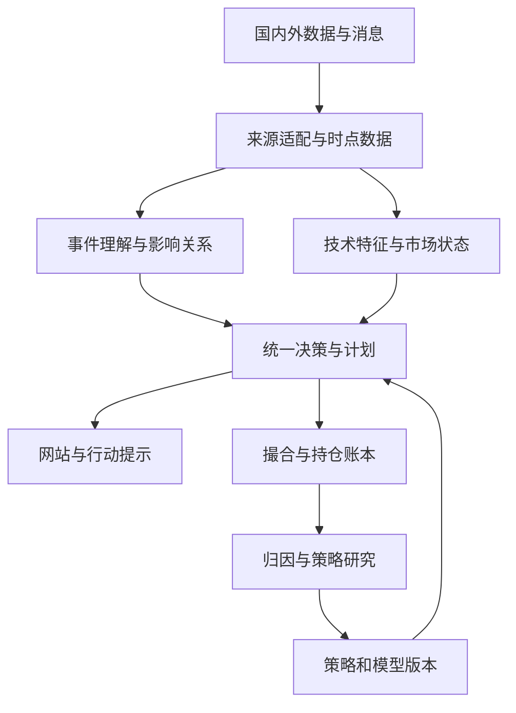

# Pulse A股交易平台完整重写方案 v2

2026年11月10日。完整主文与Word主体一致，详细台账、参考代码和证据原卡见配套包。

# v2 深化设计：共享信息、多策略组合与研究进化

版本 2.0。资料检索与设计截止 2026年11月10日 UTC+8。本文将首版的独立重写规格扩展为可追踪的产品、数据、策略和研究协议；与首版不同的部署取舍已同步改入主规格。

## 1 这次重写要形成什么产品

网站应成为一个连贯的交易研究工作台：先回答当前市场适合什么机会，再按明确期限排序股票；进入个股后解释证据、价格结构、可执行条件和持有计划；已有持仓由账户事实约束操作；所有结果回到研究系统，改进下一轮方法。图表、消息、策略库、回测和账户不是各自给出一份互不一致的答案。

“所有策略取精华”具体指可复用策略组件，不是叠加所有指标、平均所有模型或对买卖意见多数投票。一个完整方案可以由基本面选股、事件催化、技术入场、动态仓位、底仓做T和执行算法组成，条件是职责、时间尺度、库存权利和归因均明确。

交付按四种对象区分：已核实的外部事实、由证据支持的设计决定、待复现的方法候选、已经通过本地验证的参考实现。模型未来变强时，替换能力提供者与模型策略版本；账户记账、数据时间和消息语义保持稳定。

## 2 每项功能和代码为什么存在

建立 ReasonRecord，而不是用大量解释性注释代替设计。每个业务模块、核心类型和策略算子都有 requirement_id、用户可见行为、输入输出、证据claim_id、decision_id、失败语义、替代方案、验证场景和owner。纯样式、生成代码、机械映射可以继承所属模块理由；不要求每个括号和赋值独立附论文。

链路为：用户目标 → 可验证需求 → 数据/规则证据 → 架构决定 → 契约 → 组件/核心符号 → 跨模块测试 → 线上或前向观测。任何新技术必须说明它解决哪一段的具体问题；任何旧代码删除必须说明功能由谁接替、历史资产如何读取。

本次 code_inventory.json 覆盖基线的全部435个受版本管理文件；symbol_inventory.json登记Python AST符号和JS/TS顶层声明。完整清点不等于435个文件都已经逐行证明正确。人工语义审查只对台账中明确标记的路径和审计项作结论，其余保留待验证状态。这样开发Agent能准确接续工作，而不会把自动生成的说明误当成审计证据。

新实现的完成条件包括：功能有理由、数据有定义、实现有契约、结果可复现、跨模块场景通过。用“测试很多”“论文很新”或“模型很强”替代其中任意一项，都不能证明这个功能已完成。

## 3 数据论证与多源交叉校验

每个字段至少声明：instrument_id、定义、单位、价格调整口径、交易会话、event_time、published_at、first_seen_at、available_at、ingested_at、source_id、origin_group、revision、quality_status、适用范围。时间未知就保留未知及取得方式，不能把爬取时间当原始发布时间。

origin_group表示信息的原始产生者。交易所公告、巨潮镜像、媒体转载和三个模型复述，可能仍只有一个原始事实来源；可做传输和解析交叉核对，不能宣称四个独立事实证据。不同券商行情也可能共用上游交易所，校验的独立性要按“原始事实、传输链、解析实现”分别记录。

| 数据对象 | 必须先对齐 | 交叉核验方法 | 差异处理 |
| --- | --- | --- | --- |
| 现价、成交量、成交额 | 证券、币种、股/手、快照时间、累计/区间、会话 | 两个适配器在允许时间窗内比对，交易所或已授权主源优先 | 保留两个Observation及差异；陈旧与单位错分开 |
| 日/分钟K线 | 原始/前后复权、开闭区间、时区、午休、盘后成交 | OHLC关系、量额汇总、跨周期一致性和第二来源抽样 | 发布bar_revision；下游按依赖失效，历史实验固定原快照 |
| 公告和财务 | 发行人、报告期、合并口径、元/万元/亿元、修订版 | 原公告与结构化报表双解析，合计项与会计关系核对 | 原文锚点+解析版本，不用模型补缺数值 |
| 宏观数据 | 首次公布值、修订值、季调口径、发布时刻 | 发布机构原表、日历、第二解析链；保留vintage | 回测只取当时可得版本；无法取得当时预期则不计算惊喜值 |
| 新闻影响 | 原始出处、首发时间、实体、否定/条件、事实/观点 | 原文核对、同事件聚类、反向证据与后续澄清 | 消息可信度与交易方向分开；新事实触发修订 |
| 市场规则 | 市场、板块、品种、渠道、生效区间 | 正式规则+发布通知+业务指南比对 | 正式现行规则优先；不能用多数网页覆盖原始规则 |
| 论文结果 | 正式版/预印本、样本、费用、指标、测试划分 | 论文全文、正式目录、代码/附录相互核对 | 作者报告、本站复现、本站前向结果分别存储 |

每次比较产生 ReconciliationResult：被比较记录、时间和单位变换、容差策略版本、结论matched/disputed/unverifiable、选择理由和证据。容差由字段与供应商精度决定；不能用统一1%掩盖拆股、复权或数量级错误。

消息因果解释使用“事件 → 产业/资金/成本/需求通道 → 行业 → 个股暴露 → 影响期限 → 可证伪条件”。地缘冲突可能同时提高能源企业售价并提高制造业成本；同一事件对不同公司、不同期限可以方向相反。影响边必须带证据与有效期，模型推断边和已确认业务关系分别显示。

## 4 共享数据与消息的正式架构

保留模块化单仓与七个业务领域。按运行性质部署Web/API、采集、特征、消息理解、决策与账户、研究Worker。进程数量由实际并发决定，不要求一开始把每个模块拆成微服务。

这次用户明确要求跨模块、跨项目共享以及独立回放，因此NATS JetStream进入首个完整版本，而不是等待未来才加。PostgreSQL保存业务状态、契约登记、账户账本、outbox/inbox；JetStream传递可回放领域事件；Core NATS或API最新值投影服务高频界面更新。NATS文档明确两种传递语义不同，持久事件消费应能独立前进和重试。[X01]

分析数据采用Parquet对象存储、DuckLake目录/快照及DuckDB/Polars查询。DuckLake官方确认2026年1.0已达到生产可用，支持多个DuckDB实例读写共享数据和快照事务；它不是用来替代业务账户数据库的。[X02][X03] DuckLake不提供业务表主键/外键约束，批次唯一性、成交唯一性与账户约束仍落在PostgreSQL。[X02]

2026官方页面存在不同版本路径和发布日历更新不同步的情况：不把“计划发布”当“已发布”。实现时锁定实际可下载、兼容且通过本站集成测试的DuckDB、DuckLake扩展和规范版本，记录三者组合；Quack远程协议不是第一版必须依赖。该取舍利用已经核实的共享快照能力，不要求引入第二套数据平台。

### 4.1 四类通道及边界

| 通道 | 典型内容 | 保留和消费 | 不能承担的职责 |
| --- | --- | --- | --- |
| 最新状态 | 最新价、页面心跳、当前排序投影 | 可合并旧值；断线后取完整快照 | 成交、计划生效、公告修订的唯一存档 |
| 持久事件 | BarFinalized、NewsObserved、PlanActivated、OrderChanged、FillBooked | JetStream独立durable consumer，至少一次投递，业务幂等 | 把传输去重当跨数据库原子事务 |
| 共享数据查询 | K线、因子矩阵、历史新闻、时点主数据 | DataQuery + snapshot_id，批量Arrow/Parquet引用 | 在总线上搬运巨大DataFrame |
| 长任务 | 补数、研究、模型分析、训练与评估 | Temporal工作流、结果引用、可恢复状态 | 每一个tick启动长工作流或阻塞采集 |

主题遵循 pulse.market.bar.finalized.v1、pulse.event.revised.v1、pulse.plan.activated.v1 等命名；环境和账户路由信息由部署配置与字段明确区分。Envelope沿用definitions.schema.json的字段：CommonObject公共字段，加event_id、event_type、aggregate_id、aggregate_version、occurred_at、recorded_at和payload。producer_version标识生产者；大内容引用放在payload内部，recorded_at是事件持久化时间，原始事实first_seen_at放在被引用Observation中。主题由pulse.{event_type}.v{schema_major}生成；Envelope版本与策略版本不是同一个概念。

同一账户的写入通过account_version串行化；不同账户可以并行。市场数据按证券/来源/会话有序，不建立无意义的“全网消息全局顺序”。对缺失序号、迟到与修订指定重排/重算规则，既保留原始接收顺序，也保留事件发生时间。

### 4.2 写入、发布与恢复

业务状态变化与outbox在同一个短PostgreSQL事务中提交。发布器可重复投递；消费者在同一事务里登记inbox唯一event_id并更新自身业务状态，成功后确认消息。模型请求、文件写入和远端委托不包在长数据库事务里。

DuckLake提交和PostgreSQL登记不是一笔天然的分布式原子事务，即使目录也放在PostgreSQL。数据发布采用显式协议：先登记batch_id；提交带该批次信息的Lake快照；取得snapshot_id与内容摘要；再将DatasetManifest标记READY并写outbox。消费者只读取READY的快照。若Lake已成功而登记失败，恢复器按批次和快照元数据完成登记，不盲目重写同一批；未发布的孤立快照由后续整理处理。不得宣称这个流程已经实现跨库exactly-once。

### 4.3 一个策略不会卡住其他策略

采集、特征、规则、模型、研究使用独立任务队列与并发配额。新闻先保存原文和水位、执行快速规则，再异步送模型；慢模型不会拖住下一条消息的入库。研究可以延迟，实时已生效计划仍由确定性规则继续求值。

按消费者记录lag、最老未处理时间、失败类型与吞吐。重试带有限退避；持续失败任务进入可重放的待处理区，不以“处理成功、结果为空”掩盖失败。积压治理只限于出问题的消费者或数据源。共享数据库与CPU仍存在资源容量，不能承诺数学意义的永不阻塞；通过隔离与实测把单策略故障限制在自身。

## 5 共享特征计算与条件语言

FeatureDefinition声明输入字段、依赖特征、参数、单位、lookback、warmup、时间频率、closed_bar要求、缺失语义、算法版本和执行后端。FeatureRequest只提出所需子图；调度器求依赖闭包，不因为一项策略请求MACD而重算全部因子。

固定snapshot_id仅固定数据版本，不保证其中每一行在历史决策时已经可见。所有历史查询还必须应用decision_as_of和availability_policy，分别约束原始事实、解析特征和模型结果的可用时间。

缓存键必须包含定义与实现摘要、规范参数摘要、依赖闭包摘要、数据快照与修订、输入schema、证券范围与股票池版本、周期、decision_as_of、availability_policy_version、交易日历、会话政策、复权、市场规则和数值政策版本。canonical字段对应contracts/V2_PROTOCOLS.md及参考FeatureKey；正文概览不能省去影响计算的版本。结果采用不可变对象或内容引用，小值参考用副本隔离，避免一个消费者修改后污染其他策略。相同键的并发请求采用single-flight：只执行一次，等待者共享结果；一个等待者取消不能取消其他消费者的计算；失败不永久缓存为成功空结果。跨进程使用唯一任务键、租约和fencing token；健康并发合并请求，故障恢复可能重复计算，但只有持有有效令牌的一份结果能被接受发布。不能以distributed exactly-once compute作无法兑现的承诺；进程内原型不能冒充分布式协调实现。

周、月、季、年线从明确会话的基础数据聚合，当前未收完的周期带is_final=false。基于收盘的规则不得把未完成月线视作最终值。成交价用原始价格，指标可选复权序列，二者引用同一公司行动版本并显式转换。

选股器、预警、回测和计划条件使用同一类型AST：比较、布尔组合、交叉、持续时长、排名、区间和事件修订条件。缺字段为UNKNOWN；UI可以提供探索模式显示未知项，但正式满足条件的候选必须区分TRUE/FALSE/UNKNOWN。阈值、冷却、重新武装、基准时间和触发次数都是策略定义，不藏在前端。

自然语言入口只编译条件并展示解释，例如“最近20个已完成交易日放量突破，且公告首发后30分钟内”。模型不自行解释交易日、数据单位或把缺失的量比设为0。

## 6 策略系统的六层职责

| 层 | 解决的问题 | 标准输出 | 示例 |
| --- | --- | --- | --- |
| 选股 | 哪些股票值得进入候选池 | SelectionSignal：期限、预测分布、证据、有效期 | 价值、成长、趋势、事件、LLM、监督学习 |
| 配置 | 多个候选各占多少资金 | PortfolioTarget：账户目标仓位和资金预算 | 风格分散、机会强度、流动性约束、RL配置 |
| 入场 | 在什么条件下建仓 | EntryProposal：条件AST、数量/仓位建议、失效条件 | 回踩、突破、事件后漂移、分批 |
| 持仓管理 | 已持仓如何调整 | OverlayProposal：相对基准仓位的增减、库存权利 | 做T、网格、再平衡、动态减仓 |
| 执行 | 目标如何变成可成交委托 | ParentOrder/ChildOrder与成交回执 | 限价、时间分片、参与率、执行RL |
| 退出与复盘 | 为什么减仓/结束、结果如何归因 | ExitProposal、Attribution、研究反馈 | 逻辑证伪、持有期、目标达成、机会替换 |

StrategyBlueprint定义可复用方法；StrategyInstance固定参数、资产范围、期限、数据依赖、状态和模型版本。一个策略族可以产生多个实例，但相关实例不会因此获得更多投票权。ComponentRegistry登记选股算子、时机过滤、退出算子、仓位映射和成交算法，使优点可以组合并通过消融试验证明增量。

排名必须在相同目标下比较。五分钟做T机会、未来五日趋势与未来一年价值修复不能放在一个未经校准的总分榜。首页按期限和任务切换，显示预期净收益区间、可行动状态、证据时效和排名变化原因；账户视图可以在统一效用目标下比较资金占用，但保留原始期限。

## 7 多策略如何融合和消除冲突

第一步按功能和期限分组；第二步以时点可得数据把原始输出校准到可比较目标；第三步识别高度相关信号、重复因子和同源新闻；第四步在训练窗口学习或设定可解释组合；第五步在留出样本比较单体、简单等权和复杂融合的增量。

采用分层专家组合：市场状态决定哪些专家有资格参与，专家给出带不确定性的预测或目标，组合器在换手、成本、容量、库存和预算条件下求目标。状态门控、专家权重和阈值只能使用当时已知信息。模型自述confidence不是经频率校准的胜率。

可研究的目标形式为预期收益减去成本、换手与不确定性项，并加入账户硬约束；具体权重和方法由可复现实验选择。RL可以学习配置、持仓动作或执行，每一层分别定义state/action/reward；不要求所有层都换成RL。对事件初始反应、延迟后的可交易漂移和长期基本面变化分别建目标。

唯一调用链是SessionCoordinator合成分析提案 → PortfolioCoordinator结合所有有效策略、已有计划和待成交委托形成账户净目标 → PlanCompiler在最新账户/规则版本上验证并提交TradePlan与PortfolioTarget。真正触发订单时，ExecutionCoordinator再次核验目标、库存与现金，并在短事务内完成预留和OrderIntent/outbox；未来条件计划不因显示“生效”就保证资源已预留。多个会话不能各自绕过组合器直接激活相互覆盖的账户目标。

PortfolioCoordinator是同一真实/模拟账户的唯一物理目标合成者。虚拟sleeve记录核心仓、战术仓、网格和做T的预算及归因；物理现金和证券只有一份。先合成净目标，再生成外部委托；相反意见可抵消或转为内部归因分配，内部转移不伪造成券商成交、不凭空赚差价、不重复收取或豁免费用。

一个简化例子：趋势实例希望从1000股增到1200股，网格实例建议减少100股。只有在组合政策允许且两者针对不同已分配权利时，组合目标才是1100股；若核心仓规则禁止减仓，网格建议会被缩量或拒绝，并记录原因。不能让两个实例分别拿同一笔现金、同一1000股仓位直接下单。

冲突顺序显式配置：已发生的成交入账 → 撤改单与待成交预留更新 → 账户库存与硬约束 → 有效退出/失效计划 → 新配置和入场。晚到模型提案基于旧库存时重新编译，不能覆盖新成交。

## 8 做T、网格与持有计划的精确定义

### 8.1 账户库存是操作前提

对A股普通股票，区分total_qty、sellable_qty、reserved_sell_qty、acquired_today、pending_buy_qty和各sleeve权利。买入后能否当日卖出由品种和适用规则决定；不能因策略叫“做T”就绕过库存规则。2026沪深交易规则仍需按具体品种核验回转例外。[X04][X05]

做T可用已有可卖底仓先卖后买，也可在有现金和旧可卖仓位时先买后卖；后者当日卖出的权利来自旧仓，不能把当天买入数量自动加入sellable_qty。一次买回完成也不等于恢复了当日可卖额度。跨日释放按真实交易日历和账户渠道处理。

现金分cash_available、cash_reserved、cash_settled、cash_withdrawable，另有account_access_channel与cash_reuse_policy。国内普通证券账户卖出资金的可用与可取不同；银行/券商的北向服务政策又可能不同。恒生官方FAQ明确其服务不允许用未交收A股卖款再买A股；此规定只用于该服务配置，不能推广成所有A股账户规则。[X06][X07]

### 8.2 网格定义和生命周期

GridDefinition包含算术/几何间距、锚点来源、上下界、每格数量或预算、最大持仓、现金下限、核心仓下限、买卖费用、最小数量、重新锚定规则和退出条件。自适应网格可依据已知波动率与流动性调整间距，但每次调整产生新版本；未完成网格腿及预留不能被重置后遗忘。

状态为等待触发、买腿/卖腿待成交、部分成交、等待配对、已完成、失效待处理。触及价格只产生候选动作；实际成交取决于订单时点、成交条件、可卖库存、费用与量。一个K线同时跨多格，不能假设每一格都恰好按最有利顺序成交；需要分钟/逐笔回放或明确路径情景。

边界条件包括单边趋势、跳空、停牌、涨跌停、仅一腿成交、撤单未确认、公司行动和网格重置。它们直接改变数量与盈亏计算，是操作定义的一部分，不是额外审批流程。

### 8.3 成本下降与实际利润分别计算

费用模型必须声明最低佣金的归组范围（订单、单次成交、交易日或券商约定），并按实际渠道校验；部分成交按累计应收减已收计增量，撤改单/子订单是否重新触发最低佣金由政策决定。显式区分佣金、税费、价差、冲击和价格滑点，已体现在成交价的滑点不得再重复扣除。参考模型使用传入的假设费用，不宣称实现了全券商费率引擎。

完成等量配对的一次T，现金差额为 q×(卖价−买价)−两腿全部成本。若两腿不等量或只完成一腿，剩余库存继续按统一估值口径计入净值。软件显示的摊薄成本可以下降，但账户总财富不一定相对持续持有提高。

验收同时报告：期末净资产、相同初始资金和持仓的持有基准、策略增量净值、累计费用、交易完成率、最大资金/库存占用、未完成腿价值与机会成本。必要时将期末持仓统一到同一基准后再比较。长线持有和做T组合的收益分开归因，禁止用挑选已完成盈利交易的统计遮掉未实现亏损。

## 9 新闻与大模型对计划的真实作用

消息流水线为采集与原文存档、去重聚类、实体链接、事实抽取、影响通道、受影响证券与策略、增量分析、计划编译和发布。每一层都有时间戳、输入版本和可重算状态。海外夜间和非交易日消息继续采集，开盘前批量重评受影响范围，不按交易时段关闭信息入口。

分析会话固定EvidenceBundle、市场数据快照、规则版本、当前PlanVersion和账户版本。不同Agent按宏观/产业、公司基本面、技术、反证、执行可行性分工；本项目优先增加独立证据和互补角色，并用消融试验比较它们与增加模型调用次数的相对收益；这是一项设计选择，不声称对所有金融任务都有固定强弱关系。相同证据被多个模型复述只能提升解析一致性，不增加事实独立性。

模型输出ImpactProposal和PlanProposal，包含引用、推断链、影响期限、反向解释、失效条件及需补数据。PlanCompiler验证类型、时点、库存、规则、已有订单和预算，生成可执行TradePlan。长期模型分析不阻塞规则执行；消息推断变更和价格微变采用不同重算策略。

用户看到“为什么发生变化”：新增/撤销事实、排名变动、计划差异、旧条件失效原因。模型切换后记录provider、model_id、能力配置、prompt_version、tool_snapshot、输入摘要、输出与延迟；不将用户举例的未来模型名写死成必须存在的API。

## 10 策略库如何优胜劣汰并吸收新研究

StrategyLifecycle沿用唯一枚举discovered、specified、data_ready、screened、validated、shadow、active、paused、retired；可由新数据或新实现重新进入评估。另以implementation_status记录not_implemented/prototype/implemented，以reproduction_status记录not_started/running/reproduced/failed，以health记录healthy/degraded/unavailable，避免把研发里程碑、研究证据和运行健康混为一套状态。论文入库只达到discovered或specified，不能直接赋active。每次晋级都绑定数据快照、费用/成交模型、训练窗口、代码、参数和选择过程。

研究单位是可证伪的Hypothesis。例如“在公告后延迟15分钟才可交易的条件下，新增事件特征是否提高五日净超额收益”，比“LLM策略有没有用”更能判断增量。完整试验记录包含失败、负结果、被淘汰候选和调参次数；不能只保留获胜曲线。

先做简单基线，再做单组件消融、组合互补、跨时期/行业/容量稳定性和前向跟踪。选优使用预登记指标、时间滚动验证、相关候选去重以及重复试验修正；策略数增加时同步增加验证数据需求。DSR/PBO等历史方法作为统计基础保留，2026新方法作为可比较候选，不因为年份新就自动替代。

线上更新分两类：状态更新按已发布策略自动发生；方法或参数发布形成新的ReleaseBundle。模型可以持续建议改进，但训练集、评估集和已用于选择的样本要记账。策略退化时降权、进入shadow或退役，同时保留其历史行为和资产归因；不同市场状态可保留不同专家，不设一个永久总冠军。

发现新论文/方案的任务在系统中按日或周运行：检索源 → 新条目去重 → 版本和正式状态核验 → 方法卡 → 重现任务 → 结果反馈。当前交付的是任务规格和台账，没有声称这些定时任务已在用户服务器部署。

## 11 平台能力如何成为一个连贯网站

平台对标使用公开产品文档、帮助中心和开发接口解释功能，不推断私有内部算法。详细条目见platforms.json；每项能力都有官方来源、读取深度、本站适配、数据依赖和验收。

最终工作台分为：市场与事件雷达、分期限选股、多周期个股、账户与计划、策略实验室、研究证据。不同页面是相同领域对象的投影；图表中一个事件可直接跳到原文、影响关系和计划变更，研究结果可回到触发它的实际数据快照。

建议优先继承多图联动、筛选/回测/预警同一条件定义、事件叠加、布局保存、批量比较、历史回放、组合目标与执行解耦、真实/模拟账本区分。波浪计数、形态自动画线、复杂AI预测等可以加入候选能力，但必须说明数据和可复核输出，不能成为无法验收的宣传栏目。

建议新增的本站能力：消息影响追踪、当前计划与前版差异、策略间意见分歧、账户库存解释、数据覆盖和缺口、相同快照上的模型对比、研究负结果检索。它们由用户闭环需求推导，属于本项目设计建议，不冒称竞品已具备。

## 12 并行Agent开发与完成标准

主控Agent只负责契约、依赖图、验收和集成，不成为所有实现的串行写代码瓶颈。并行工作包分别拥有数据/共享特征、消息理解、策略组合、账户执行、Web、研究评测和运行工程。契约Agent先产出可验证fixture；各工作包依契约独立实现，集成Agent执行跨模块反例。

每个任务包含允许修改范围、输入契约、输出契约、验收命令、证据来源、依赖与交接版本。契约变更通过显式版本和兼容记录传播。开发Agent和独立验证Agent可以使用不同模型；验收以运行行为与证据为准，不以模型自我评价为准。

首个纵向版本同时贯通：一条公告触发影响分析；同一数据快照生成分期限排名；个股展示技术与证据；组合器给出目标；账户预留生成模拟委托；成交更新库存与净值；研究系统对照基线归因。第二批扩展做T与网格、多来源校验、多策略专家组合；第三批引入通过复现的2026方法和持续研究队列。功能可以并行建设，跨层语义必须先统一。

架构追求清晰的领域边界、稳定契约、可追踪数据、可证明的财务不变量以及可替换的模型。这样模型能力和策略数量增长时，项目仍然容易理解、并行开发和持续改进。

## 13 新增跨模块验收场景

以下均为设计验收，只有reference_models/验证日志列出的子集已在本次本地执行。不能把列表本身当作已完成系统测试。

| ID | 场景 | 可观察的通过条件 |
| --- | --- | --- |
| V2-01 | 100个策略健康并发请求同一特征 | 相同键合并计算；100个消费者得到同版本结果；单进程参考测试只启动一次计算 |
| V2-02 | 一个特征等待者取消 | 其他消费者继续取得结果；失败任务允许后续重新请求 |
| V2-03 | 数据修订导致缓存失效 | 新snapshot_id取得新结果，旧实验仍能读取旧结果 |
| V2-04 | 慢模型挂起而行情/新闻继续 | 原文、水位、规则事件继续推进；模型结果稍后成为新修订 |
| V2-05 | 同一业务事件重复投递 | 每个消费者只产生一次业务效果；各消费者进度互不替代 |
| V2-06 | Lake提交成功但登记失败 | 恢复器发布同一batch/snapshot，不重复注入数据 |
| V2-07 | 交易事件不能被UI合并丢弃 | 最新报价可合并，Fill和PlanActivated完整保留并可回放 |
| V2-08 | 两策略同时使用同一现金/库存 | 组合或事务预留后总额不超资源，失效提案得到明确原因 |
| V2-09 | 同账户相反方向目标 | 先净额处理，内部归因不计为外部成交或盈利 |
| V2-10 | 核心仓与网格冲突 | 核心仓下限及sleeve权限保持，网格只能使用被分配数量 |
| V2-11 | 先买后卖做T | 只能使用旧可卖数量，今日买入不增加当天可卖额度 |
| V2-12 | 先卖后买且资金复用政策不同 | 国内可用现金与特定服务未交收限制分别得到正确结果 |
| V2-13 | 网格只成交一腿 | 未完成腿保持状态，库存估值计入总净值 |
| V2-14 | 一个K线跨多格 | 明确路径情景或使用细粒度数据，不选择最有利路径 |
| V2-15 | 费用吃掉价差 | 报告净亏损或无行动，不按毛价差标为有效盈利 |
| V2-16 | 新闻转载三次 | 一个origin_group，不伪造三条独立事实证据 |
| V2-17 | 同一数据不同单位/时间 | 先转换对齐，差异可定位；无法对齐标unverifiable |
| V2-18 | 论文网页摘要与正式PDF冲突 | 保存差异和采用理由，统计结论按权威版本标注 |
| V2-19 | 模型方向识别高但延迟后无收益 | 方向指标与可执行净收益分开，不能直接升级策略 |
| V2-20 | 新方法和简单基线比较 | 共用时点数据、费用、撮合、账户和样本外窗口 |
| V2-21 | 多Agent共享错误来源 | 不按票数提升证据独立性，反证与来源校验保留 |
| V2-22 | 月线尚未完成 | closed_bar规则不触发；UI明确当前月线为临时 |
| V2-23 | 选股/预警/回测相同AST | 在相同快照与时点上得到相同条件结果 |
| V2-24 | 前向策略退化或恢复 | 更新实例状态/权重及版本；历史行为与已发生Fill不可改写 |
| V2-25 | 同一数据快照含未来修订 | 在decision_as_of=t查询时，t后的原文/解析/模型结果不影响t的特征、排名和计划；两个未来不同的数据集产生相同历史结果 |
| V2-26 | 跨进程计算租约到期后旧Worker返回 | 允许重算，但旧fencing token不能覆盖已接受结果；只有一个有效版本发布 |
| V2-27 | 拆单和部分成交计费 | 按已声明归组范围累计最低佣金，已有价格滑点不再扣一次，取消/成交归因可核对 |


# Pulse A股交易研究平台完整重写规格

版本 2.0　研究与设计日期 2026年11月10日 UTC+8

## 1 项目决定与交付目标

采用独立新实现，把国内外信息、市场状态、选股排序、个股计划、执行记录和策略研究连接为同一套系统。新系统从本规格、数据契约和行为样例开始，不导入旧项目业务代码，不以旧目录、类名、评分公式或历史实现作为约束。历史数据、原始消息、实验结果、冻结策略说明和前向记录由独立迁移程序转换，保留来源和原版本。

网站面向用户的核心承诺是：现在关注哪些沪深主板股票，为什么排在前面，什么条件下可以买，已经持有的股票如何处理，什么新信息改变了原计划，以及这些判断后来产生了什么结果。系统持续发现新方法，用统一实验口径比较，自动更新已启用的策略组合。

本规格描述目标产品和实施合同。文中的性能、调度频率和研究通过标准，除明确引用外，均是初始工程目标或待校准配置，不是现有系统实测结果，也不宣称策略收益已获验证。

### 1.1 核心产品能力

| 用户动作 | 系统必须完成的行为 | 可检查的产物 |
| --- | --- | --- |
| 打开首页 | 展示按同一周期和目标排序的候选、当前可行动状态、最新变化和原因 | DecisionSnapshot及其版本 |
| 进入个股 | 同屏展示年季月周日和分钟技术面、消息证据、产业关联、买卖与持有计划 | StockWorkspace绑定同一snapshot_id |
| 出现新消息 | 找到相关持仓与候选，重新评估影响，按需生成计划版本 | EventRevision和PlanVersion差异 |
| 查看持仓 | 区分已有可卖仓位与当日买入仓位，展示计划执行状态 | Position及可卖数量 |
| 查询策略 | 展示原始观点、可执行定义、适用状态、真实检验结果与失败原因 | StrategySpec和ExperimentRun |
| 看系统成绩 | 逐笔还原当时推荐、计划、成交及成本，解释差异 | Decision到Fill到Ledger的完整链 |
| 启用新模型 | 比较同一证据集上的质量、延迟与成本，发布新的模型策略版本 | ModelPolicyVersion及评测记录 |

### 1.2 用户偏好与研究范围

推荐交易池默认只含沪深主板普通A股，排除创业板、科创板、北交所、新股；ST等状态作为配置化排除条件。研究与观察池可以包含ETF、股指期货、A50、港股、美股、日韩市场、利率、汇率和商品，它们可以影响推荐但不会因此进入默认个股交易池。

股价100元、流通市值100亿元、换手充分等历史偏好保留为可配置的偏好档案。阈值、比较运算符、市值口径写入UniversePolicy，不能混淆总市值、流通市值和自由流通市值；价格与市值阈值可以做消融实验。初始配置使用不高于100元与不高于100亿元流通市值，提供启用开关；这不是已验证的最优阈值。

情绪周期、龙头生命周期、伴生龙、题材抱团、跨年、生肖与谐音、重要纪念日、交割日、海外产业映射都进入研究体系。某类方法在某次实验中失败，只降低其证据评级；不能直接固化为永远禁止研究该方法的产品规则。

### 1.3 完整覆盖的可执行定义

不承诺已经穷尽所有网站和影响因素。系统通过来源注册表、因素注册表、策略族目录和覆盖矩阵持续扩展：每一项都标记已连接、部分覆盖、待接入、缺历史、待验证或已启用。用户可以看到已覆盖的来源、延迟、历史起点和缺口；采集不到数据时，不以空数组冒充全网没有消息。

## 2 架构总图与依赖方向

架构采用模块化单仓。领域通过类型契约连接，部署初期包括网站、API、按任务隔离的采集/计算/研究进程、PostgreSQL、Temporal和NATS JetStream。批量数据放Parquet对象存储，使用DuckLake目录与快照管理多写者数据；DuckDB和Polars为分析计算引擎。v2扩展的共享数据与多策略协议见V2_SYSTEM_DESIGN.md。



### 2.1 七个领域

| 领域 | 唯一责任 | 对外输出 | 不应承担的工作 |
| --- | --- | --- | --- |
| data | 来源接入、主数据、时间版本、公司行动、交易日历 | Observation、DatasetManifest | 决定买卖 |
| intelligence | 事实抽取、去重、产业关系和影响假设 | EvidenceEvent、ImpactAssessment | 自行修改账本 |
| market | K线、指标、题材、市场状态与龙头关系 | FeatureSnapshot、MarketState | 从网页临时抓数 |
| decision | 策略选择、排序、计划、更新理由 | DecisionSnapshot、TradePlan | 自建另一套成交计算 |
| execution | 时段规则、库存、订单、成交和账户 | Fill、Position、LedgerEntry | 重新猜测推荐理由 |
| research | 方法发现、实验、比较、晋级、停用、复活 | ExperimentRun、ReleaseBundle | 修改过去的前向记录 |
| assistant | 模型路由、工具、证据包、模型运行记录 | ModelRun、PlanProposal | 隐式拥有其他领域状态 |

网站、REST、SSE和MCP均是这些领域的访问入口。前端没有自己的推荐评分器；任务调度器不复制策略逻辑；回测与在线观察共用策略协议、规则与订单语义。

### 2.2 首发技术选择

| 部分 | 选择与理由 | 后续扩展条件 |
| --- | --- | --- |
| 网站 | React、TypeScript、Vite；服务器查询状态与界面状态分离 | 公开搜索页面确需SEO时增加SSR |
| 图表 | Lightweight Charts；指标由统一内核计算 | 高级绘图需求明确时比较其他图表能力与许可 |
| API与契约 | FastAPI、Pydantic；生成OpenAPI、JSON Schema、TypeScript类型 | 通过兼容性测试升级协议 |
| 领域内核 | Python纯函数、显式状态机、Polars列式计算 | profiler证实热点后在稳定接口内引入Rust等 |
| 事务状态 | PostgreSQL；计划、账本、实验状态和outbox统一事务 | 先索引与分区，再按瓶颈拆服务 |
| 历史数据 | Parquet对象存储、DuckLake快照与PostgreSQL目录，外层DatasetManifest登记发布状态 | 锁定实测兼容版本；多引擎互操作需求明确后再比较Iceberg |
| 研究计算 | DuckDB扫描与Polars lazy；并行研究以独立进程运行 | 并发历史分析确有瓶颈时评估ClickHouse |
| 长流程 | Temporal管理补数、消息分析、回测、训练、模型评估 | 不为每一个tick建立Workflow |
| 事件分发 | NATS JetStream、Postgres事务outbox和消费者inbox；UI最新状态单列 | 跨项目独立回放为首发需求；容量和复制数量按实测配置 |
| 搜索与关系 | Postgres全文检索、关系边表，语义检索按需加pgvector | 特定检索性能不足再选专用引擎 |
| 观测 | OpenTelemetry、结构化日志、业务延迟与质量指标 | 无需首发搭建庞大观测平台 |

NATS JetStream为首发共享消息组件；首发不同时引入Kafka、Redis、ClickHouse、Neo4j、Kubernetes。需要它们时有清晰适配点。版本号在实施时核验稳定发行并写入锁文件；“最新”不等于预发布版本一律进入生产。Lightweight Charts负责绘图，不附带市场数据或技术指标。[T06]

### 2.3 事件驱动的三条路径

热路径由行情和交易时钟驱动，更新K线、指标、触发器和排序，使用已经生效的事件判断，不等待新的模型请求。温路径由新消息、修订和重大行情变化驱动，对受影响证券重新推理并提交计划提案。冷路径持续发现策略、训练模型、回测与复盘，输出可发布版本。

三条路径共享数据与版本，吞吐要求不同。行情每秒更新不等于每秒都要对全市场调用模型；重要消息也不需要等到收盘才改变计划。

## 3 数据时间与存储合同

### 3.1 时间不能折叠为一个字段

| 字段 | 含义 | 使用规则 |
| --- | --- | --- |
| event_time | 事件实际发生时间 | 可以未知，不用发布时间替代 |
| published_at | 来源公布该版本的时间 | 保留源站时区和精度 |
| first_seen_at | 本系统首次看到该版本 | 由采集器写入，禁止回填成源发布时间 |
| ingested_at | 原始材料持久化时间 | 用于采集延迟和恢复 |
| available_at | 当前处理结果可以被下游使用的时间 | 含解析或模型完成时间 |
| effective_from及effective_to | 规则、成分或公司状态的业务有效期 | 与获知时间分别保存 |
| decision_at | 决策真正完成并发布的时间 | 行动不能早于它 |
| exchange_time及sequence | 行情源交易时间和序号 | 重连去重、乱序处理 |

例：09:50发布的公告在10:01抓到，10:01:10解析完成，10:01:25模型完成。09:55的系统实况回放不能看到该公告；10:01:15可以使用原文已提取的规则事实，但不能使用10:01:25才产生的模型判断。历史研究若只有源发布时间，使用明确延迟假设并标成historical_reconstruction，不能冒充当年的真实系统记录。

修订追加新版本。原文纠错、宏观数据修订、股本变化、行业成分和股票名称均保持双时间语义：何时有效，以及系统何时知道。ALFRED的历史已知版本机制可借鉴；当前最新宏观数值不能直接代入过去。[A14]

### 3.2 价格与公司行动

保存不复权OHLCV、成交额、复权因子、分红送配拆并股事件和调整版本。图表可切换不复权、前复权、后复权；撮合用当时可交易的原始价格；收益账本处理现金分红和持股数量变化。图上复权价格不能直接作为券商委托价。

基于价格阈值的历史过滤使用当时不复权价格。涨跌停价优先使用对应交易日的权威字段，再按当时规则和最小价位计算，不能用涨幅大于9.8%统一代替。自由流通市值未知就保持未知，不能以固定比例乘流通市值伪装真实值。股本、行业、市值与退市样本均记录历史版本。

### 3.3 K线与指标一致性

支持1m、5m、15m、30m、60m、日、周、月、季、年周期。聚合以交易所会话边界进行，午休不合成可交易分钟。每根K线有open_time、close_time、is_final、source_granularity和session_scope。尚未收完的周月年K线可展示，但已完成周期策略不得把其最终值提前使用。

MACD、均线、RSI、ATR、KDJ、BOLL、VWAP、量比、换手和价格形态使用同一个特征注册表。指标定义包含参数、预热长度、平滑初始化、缺值规则、复权模式、盘后量额处理、价格单位及版本。前端不另算MACD，研究不复制另一份公式。

2026年7月6日起盘后固定价交易扩展到全部A股与ETF，15:05至15:30撮合；盘后量额在结束后计入全日。因此15:00的竞价收盘快照和15:30后的全日最终量额是不同版本，必须分别可重放。[A01][A02][A04]

### 3.4 数据集快照

DatasetManifest包含文件路径、内容哈希、schema版本、行数、时间范围、来源、修订号、缺失和质量摘要。研究输入引用manifest_id，不引用随时变化的latest目录。多个Parquet分片完成写入后才在Postgres发布manifest；读取者只读已提交manifest。压缩产生新manifest，旧文件在引用释放后才回收。

最少表包括instruments、instrument_states、corporate_actions、market_rules、trading_sessions、raw_documents、document_revisions、events、impact_edges、feature_manifests、strategy_versions、model_policies、decisions、plan_versions、order_intents、fills、ledger_entries、experiments、research_trials、outbox、consumer_inbox。

新闻和研究输入可以进入Parquet；关键计划状态与账本写入事务库。分钟与逐笔原始数据以分区文件为主，不逐条插入交易业务表，也不让每个tick生成一条outbox任务。

## 4 影响因素与信息来源体系

### 4.1 因素本体

| 因素族 | 必须覆盖的研究项 | 转成什么输入 |
| --- | --- | --- |
| 国内流动性与财政 | 利率、降准、逆回购、MLF、信贷、财政支出、国债地方债、税费 | 政策预期差、信用条件、需求与贴现率 |
| 国内宏观 | GDP、CPI、PPI、PMI、工业、社零、社融、货币、地产、进出口 | 首发值、事前预期、修订、行业敏感度 |
| 市场制度 | IPO、融资、减持、回购分红、两融、交易规则、指数调整 | 股票供给、买方能力、制度适用版本 |
| 海外金融条件 | Fed、ECB、BOJ、BOE、通胀就业、美债、美元、CNY及CNH | 全球折现率、风险偏好、汇率暴露 |
| 国际产业映射 | 海外AI芯片云计算、电子、汽车、新能源、药品、航运财报与订单 | 公司产品供应链映射、收入与订单证据 |
| 地缘与贸易 | 关税、制裁、出口管制、冲突、航路、外交谈判 | 供需和成本双向影响、替代链条 |
| 产业与技术 | 规划、补贴、招标、批准、标准、技术突破、产品发布、价格战 | 产业事件强度、兑现节奏、竞争替代 |
| 商品与库存 | 油气煤、金属、锂、农产品、运价、库存、产能 | 价格传导、公司毛利敏感性、供需差 |
| 公司经营与股权 | 业绩预告修正、财报、订单、并购、重组、回购、减持、解禁 | 盈利及供给冲击、事件发生概率 |
| 公司治理与监管 | 董监高、诉讼、审计、问询、立案、停复牌、风险警示 | 事件期限、状态变化、执行可行性 |
| 资金与筹码 | ETF份额和成交、基金持仓、两融、龙虎榜、大宗、外资披露 | 拥挤度、筹码与风格变化 |
| A股情绪 | 涨跌停、连板高度、晋级、炸板、回封、昨日溢价、龙头断板 | 市场及题材状态、生命周期 |
| 技术与量价 | 多周期K线、均线、MACD、RSI、ATR、趋势、换手、波动、VWAP | 排序、触发、持有和退出条件 |
| 订单微观结构 | 价差、深度、订单流、撤单、队列、冲击、竞价供需 | 成交概率、预期滑点、执行策略 |
| 日历与注意力 | 会议、展会、财报季、节假日、交割、季末、热搜、传播分歧 | 可预告事件、拥挤及预期兑现 |
| 叙事与突发 | 生肖谐音、跨年抱团、纪念日、灾害、天气、物流电力中断 | 叙事传播、地理暴露、持续时间 |

这些是候选机制，不是已经成立的涨跌规律。每个因素登记计算定义、来源、可用时间、特征组、与其他因素的相关性、验证状态和复测条件。不要把几十个高度相关的动量指标视为几十份独立证据。

### 4.2 来源覆盖与优先级

P0先连接能支撑完整决策的官方公告、交易日历、行情、公司行动、国内政策、主流快讯和海外宏观；P1补足产业链、媒体传播、策略社区和分钟数据；P2按具体策略需求接入逐笔、复杂商业终端或封闭内容源。

| 来源组 | 具体覆盖 | 接入方式与验收 |
| --- | --- | --- |
| 公司与交易所 | 上交所、深交所、巨潮、公司IR | 列表增量、公告正文和附件；验证版本、时间、代码 |
| 国内政策 | 国务院、央行、财政部、发改委、工信部、商务部、证监会 | 官方页面和发布日程；文号和生效日归并 |
| 宏观产业 | 统计局、海关、能源局、药监、行业协会与产业数据商 | 首发稿与历史数据库分流；验证实际发布时间 |
| 国内财经 | 新华社、财联社、第一财经、同花顺、东财、华尔街见闻、新浪 | 授权feed或已验证公开适配器；实测延迟与完整性 |
| 中文社区 | 雪球、股吧、淘股吧、微博、微信、头条、抖音、B站、小红书、知乎、贴吧 | 平台授权接口、公开可检索页面、指定账号订阅、用户导入 |
| 海外政策宏观 | Fed、ECB、BOJ、BOE、BLS、BEA、FRED与ALFRED | 官方RSS、API与日历；保留历史版本和时区 |
| 海外产业公司 | 公司IR、SEC披露、交易所公告、产品发布与供应链数据 | 实体关系和原文出处；不依赖中文二次转载 |
| 国际媒体发现 | Reuters、Bloomberg、WSJ、FT、CNBC、GDELT | 订阅或可用公开覆盖；发现线索后回读原始材料 |
| 策略与代码 | TradingView、GitHub、Gitee、QuantConnect、arXiv、论文作者站、期刊 | 版本化内容快照、规则抽取、来源及代码许可 |
| 全球社区 | YouTube、Reddit、X、Substack、Medium、论坛 | 官方API、RSS、公开页面、已授权内容 |
| 行情与逐笔 | 交易所信息公司、授权数据商、券商数据能力 | 分清快照、分钟、逐笔成交和订单流 |
| 商品与能源 | EIA、期货交易所、官方行业统计及库存 | 现货期货与库存分别建模，源首发与API延迟分开 |

接口可用性逐源验收。本次核查Tushare文档存在新闻源和独立权限体系，不能据此认为现有token已拥有所有新闻、分钟与公告权限。[A10][A11] 抖音视频搜索有文档与scope，但相关能力页仍有实验及开放条件，登记为待接入能力，不伪装已全量抓取。[A25][A26]

北向实时买卖额和总成交额的官方披露已调整，供应商估算的“实时北向净流入”必须标为估计。ETF放量不能直接认定投资者身份，ETF成交额也不等于净申购。[A07] L2的逐笔和订单关联信息与60秒轮询快照不同，队列策略依赖真实数据能力。[A09]

### 4.3 适配器协议

每个SourceAdapter实现describe_capabilities、poll或subscribe、normalize、checkpoint、health。SourceRegistry登记source_id、ownership、auth_type、coverage、granularity、historical_start、expected_lag、rate_limit、cursor_type、timezone、revision_support、provenance_level和connection_status。

auth_type使用none、api_key、oauth、subscription、session或manual_import；连接状态使用connected、partial、unconfigured、temporarily_unavailable、retired。缺key返回unconfigured，空查询结果是另一种状态。官方API优先；公开网页适配不稳定时替换来源或降级覆盖，不在业务引擎里塞临时抓取逻辑。

调度按信息时效与相关性分配：已有持仓和候选相关事件优先；宏观公布窗口提前启动任务；一般源按增量和配额轮询；海外新闻不因A股休市停采。每日跨零点轮换分区而不中断服务。失败保留可重试项，消费游标不越过未处理项且无补偿记录。

## 5 消息到决策的处理链

### 5.1 标准事件流程

采集原文并保存哈希和版本；抽取事实Claim；做文档级去重和事件级聚合；识别公司、产品、地点、政策与人物实体；建立产业链影响假设；更新事件状态与特征；重算相关候选和持仓；生成或修订计划；推送同一决策快照；将后续价格和事实兑现结果回写评估。

去重不能删除信息价值。同一政策的百篇转载只贡献一个基础事件，但独立作者数、传播增速、媒体层级和社区分歧可以作为独立注意力特征。政策预告、正式文本、实施、修订和澄清要保留父子或替代关系。

### 5.2 影响分析字段

ImpactAssessment包含目标实体、传导路径、方向、强度、有效期、证据、替代解释、预期差、已反映程度及置信度来源。例如油价上涨对上游、炼化、航空的作用不同，不能把“原油上涨”统一打成市场利好。海外芯片企业财报通过实际供货或收入暴露映射到A股，不仅按名称相似或同题材标签关联。

模型置信度与历史校准概率分开。模型输出“高置信”不自动等同80%胜率。每类事件积累后，评价实体识别、方向、时限、价格反应、成本后增量与排名贡献。

### 5.3 动态更新的三个对象

第一类是状态变化：新价格、新消息、热度和市场阶段持续更新。第二类是生效策略的计划输出变化：同一ModelPolicyVersion可以因新事件生成不同买点、退出和持有期。第三类是策略代码、提示模板、模型权重或规则改变：进入研究与发布流程形成新版本。

第二类可自动生效，不逐次人工确认；第三类通过自动评估规则晋级。这样模型能主动决策，运行行为又能被回放与比较。

### 5.4 模型计划编译

模型或规则输出PlanProposal，包含entry_conditions、entry_price_zone、sizing、exit_conditions、holding_horizon、invalidation、expires_at、evidence_ids。PlanCompiler检查引用存在、数据可见时点、单位与最小价位、交易池、时段、可用资金、T+1可卖数量和费用，转换成可执行条件树；不是只做JSON格式校验。

提案可以使用登记过的指标或明确的布尔条件；复杂新逻辑提交StrategyProposal并自动进入研究工作流，不能把自然语言条件直接作为后台可执行代码。模型不会因为需要程序计算而失去决策权，它负责提出计划，计算和成交语义保持可验证。

若一个重大利空出现时股票为当日新买，计划可以立即改变观点和下一可卖时段的退出条件，但不能显示“已卖出”。已有可卖底仓则按相同计划的库存约束生成卖出意图。

## 6 排序与个股工作台

### 6.1 排序需要一个共同目标

短线、波段、长期使用不同预测期限与目标，原始分数不能直接混排。默认首页显示用户当前选择的期限；综合机会榜使用同口径的成本后效用或经过校准的目标，不简单平均1日和60日收益预期。

基本处理顺序为：按时点UniversePolicy得到候选；生成技术、事件、情绪、基本面和成交特征；各策略给出分布或分数；根据事前市场状态组合；估计费用、成交可行性与持仓相关性；排序；再由组合构建器给出仓位和计划。

初始可解释排序可写为utility = expected_net_return - lambda_drawdown * downside_estimate - lambda_turnover * turnover_cost - lambda_concentration * portfolio_overlap。所有项需统一期限和量纲；系数作为可记录配置，经训练或实验决定。没有可校准收益预测时展示“相对排名分”，不能标成上涨概率。

Alpha排名和可行动排名分开：前者表示研究机会，后者结合是否已触发、价差、可成交和账户可用性。“排名第一但涨停买不到”应显示等待/不可成交的原因，而不是虚构成交。入场尚未触发的股票可以留在观察池，不从研究信息中消失。

### 6.2 市场状态与龙头生命周期

MarketState至少包含趋势、流动性、市场广度、波动、情绪、风格、主导题材和海外冲击。对状态输出概率或证据评分，而不是随意硬切牛熊。主导题材和LeaderEpisode记录首次识别、扩散、确认、分歧、高潮、退潮、修复等状态与转移证据。

在线输入只使用当时可知标签；事后用完整行情划分的阶段只能用于研究分组和诊断。研究同时按时间样本外与市场状态、龙头生命周期切片，满足用户关注行情周期的要求，也避免未来标签进入决策。

### 6.3 推荐列表字段

每行至少显示代码名称、rank、分数含义、持有期限、当前价格、研究时点、最新模型分析时点、事件摘要、策略贡献、入场状态、价格区间、计划到期时间、成交数据等级。排名变化解释分成新消息、价格条件、市场状态、策略版本、数据补齐五类。

排序按刷新批次稳定更新；相近分数可采用登记过的排名缓冲，减少每秒跳动。用户打开个股后保留进入时的snapshot_id，同时可以切到最新版本并看到差异，不静默替换旧计划。

### 6.4 个股页面布局

第一屏为股票身份、行情、推荐依据和当前行动。中央为多周期K线与成交量，MACD等指标副图、关键价格位、消息标记和已发生的行动标记共享时间轴。侧栏展示入场条件、分批价格、建议数量、退出条件、持有时间、失效条件与下一次复核。

下方按信息性质展开消息证据和影响链、基本面与估值、题材和产业关联、资金与微观结构、相似历史局面、策略支持与反对、计划版本和历史成绩。可解释性首先展示驱动本次变化的少数事实，完整因素可以继续展开，避免把所有字段堆在一屏。

日、周、月、季、年指标分别展示，至少支持复权切换和未完成K线标记。图表与事件标记使用真实交易时区；源为分钟快照合成时明确标记粒度，不能画成逐笔队列结论。

### 6.5 三种计划状态

观察计划记录为什么关注及等待什么；可行动计划含已满足的触发和有效委托条件；持仓计划记录实际成本、可卖数量、当前观点和退出路径。PlanVersion改变时保存旧版本、变更原因和证据。一次消息可以把观察计划升级为可行动计划，也可以只降低已持仓目标或缩短持有时限。

## 7 A股成交与账本内核

### 7.1 MarketRules

MarketRules按exchange、board、instrument_status、trading_date、session_kind、order_type取有效版本。时段包括开盘竞价、连续交易、午休、收盘竞价、盘后固定价、闭市和临时停牌；支持撤单窗口、价格笼子、涨跌停、数量与最小价位等规则字段。

沪深主板普通股票涨跌幅、风险警示股票在2026年的规则变化、IPO前五个交易日等例外，均来自版本化规则表。主板买入通常按100股整手，零股余额卖出按规则处理；T+1以交易日历和每笔库存来源计算。国内股票型ETF并不因名称为ETF就一律T+0，各品种回转规则分别登记。[A04][A05]

### 7.2 同一执行协议

策略产生OrderIntent，经过规则与库存校验后进入ExecutionAdapter。HistoricalReplay、PaperExecution、BrokerAdapter实现相同协议，Fill驱动账本；信号或委托本身不改变持仓。实际连接券商是独立集成任务，当前交付以研究、提醒和模拟执行为首期范围。

订单状态为created、submitted、acknowledged、partially_filled、filled、cancel_pending、canceled、rejected、expired。撤单请求与晚到成交可以竞争，最终状态按事件序列更新。幂等键至少包含account、order_intent_id及执行模式。

现金、总股数、冻结数量、可卖数量分开。正T和倒T基于已有库存计算，每条腿单独计费用与成交；不能拿当日买入的新库存当天卖出。佣金率、最低佣金、印花税、过户费和滑点均版本化；不将历史主账本的示例100万元当作用户实际资金。

### 7.3 成交数据等级

| 等级 | 数据 | 可以验证 | 不能默认知道 |
| --- | --- | --- | --- |
| D1 | 日线OHLCV | 次日开盘、跨日持有、明确日级规则 | 日内先后顺序、涨停队列 |
| M1 | 真实分钟或明确合成分钟 | 分钟触发、时间窗、近似执行 | 分钟内触价顺序和真实排队位置 |
| T1 | 逐笔成交 | 成交时序、更细延迟与流动性 | 未提供的全量委托和撤单 |
| L2 | 可用的盘口与订单流 | 更细队列与部分成交仿真 | 自身真实队列位置、全部市场冲击 |

只知OHLC而同时触发止盈止损时，记录不确定性，按预先定义的保守顺序或多情景计算；不可取最有利路径。封单、一字板、秒板、滑点、部分成交、停牌和跌停顺延必须进入策略验证。快照触到涨停不等于买单成交。

### 7.4 收益与归因

网页“计划收益”通过该PlanVersion实际回放得到；固定N日开盘到收盘收益可以作为信号评估，字段名称必须说明是signal_return，不与executed_plan_return混同。记录毛收益、净收益、未成交机会、滑点、费用、换手、容量、持有时间、最大不利与有利波动、基准超额和风格暴露。

回测使用研究输入manifest，在线使用实际收到事件日志。二者对相同的冻结输入、模型输出与策略版本应生成一致行动序列；差异按数据、时序、模型版本、撮合和费用归因。

## 8 全网策略发现与实验工厂

### 8.1 策略来源到可执行包

定期和事件触发检索论文、开源项目、脚本、策略文章、视频转录、论坛与指定作者。保存原文版本、作者、发布时间、获知时间、出处和可使用的代码范围。转载或换名称的方法按规范化条件、特征和代码指纹归入同一策略族。

StrategySpec必须写清假设、股票池、信号时钟、入场、退出、持有期限、仓位、成本、参数范围、数据要求、适用状态和失败条件。只有“龙头”“弱转强”“主力吸筹”等描述时，保留原说法并提出可测量定义；每个定义作为独立候选记录，不能当作原作者已给出的完整规则。

策略包由spec.yaml、features、policy、fixtures、provenance与evaluation组成。模型可生成代码，研究runner根据包合同运行；禁止包自行读取未申报的最新数据。参数改变、因子删选、模型提示变化和标签改变都产生trial_id。

### 8.2 首批策略族覆盖

| 大类 | 首批候选族 | 特别验证的问题 |
| --- | --- | --- |
| 趋势与突破 | 均线、MACD、通道、Donchian、箱体、趋势回踩、多周期共振 | 信号滞后、相关性与换手 |
| 反转 | 短期反转、超跌、跳空、均值回复、无利空超跌 | 流动性冲击与基本面恶化分离 |
| 情绪接力 | 首板、二板、换手龙、断板、反包、补位、龙头跟随 | 排队、可成交与生命周期 |
| 题材传播 | 行业扩散、产业链、热点迁移、伴生龙、名称谐音 | 事前识别和重复消息 |
| 量价与微观 | 放量突破、缩量回调、VWAP、订单失衡、竞价、尾盘 | 数据粒度和真实费用 |
| 事件 | 盈利预期差、订单、回购、减持、并购、监管、政策 | 公布时间与价格已反映 |
| 跨市场 | 海外映射、汇率、利率、商品、A/H、期指基差 | 时区、开盘跳空与可交易段 |
| 基本面 | 价值、质量、盈利成长、现金流、红利、资产负债 | 财务公布与修订、行业比较 |
| 因子组合 | 规模、低波、动量、反转、流动性、多因子排序 | 风格匹配后增量 |
| 日历 | 交割、财报季、假日、月末、会议、指数调样、跨年 | 多重比较与实际事前日程 |
| 机器学习 | 树模型、排序学习、时序、多模态、图模型 | 标签、验证切分、信息时间 |
| 模型与RL | 新闻判断、结构化计划、研究代理、仓位RL、执行RL | 模型历史污染、动作空间与训练证据 |
| 退出与组合 | 固定持有、排名缓冲、移动止损、分批、正T倒T、状态路由 | 与入场系统共同评价 |

这里定义研究空间，并不宣称每个家族存在有效超额。机器可读目录提供细分候选；以后新增方法按相同合同接入。

### 8.3 一条最终认证路径

快速向量化计算用于筛选特征和粗测候选；最终晋级全部通过同一事件与执行内核。Qlib可作为日频模型研究适配器，RD-Agent可借鉴自动因子提出和实现，vectorbt可用于快筛，LEAN或NautilusTrader可参考事件与撮合设计，FinRL可用于有明确数据和动作空间的研究；不并存几套互不一致的最终收益真相。[T07][T10][T11][T12][T13][T14][T15][T16]

### 8.4 实验设计

按时间滚动训练、验证和样本外测试；标签持有期重叠时清除跨边界样本，并设置与标签长度及数据延迟对应的隔离。宏观事件同时报告跳空、开盘后、跨日收益，避免把无法在消息后买到的跳空当策略利润。

基准包括可投资基准、同日同市值同波动同行业匹配篮子、随机选股、旧冻结策略及简单低换手策略。分别评估排名、触发器、持有与退出、仓位和整条闭环，不能因为IC提升就宣称买点提升。

阶段分析使用市场状态与LeaderEpisode切片，同时报告时间样本外结果。统计按事件或日期聚类，处理多日收益重叠；大量试验记录总预算及有效独立试验数。DSR、PBO及适合依赖结构的多重检验方法是诊断工具，不是自动盈利证书。[T08][T09]

最终留出集有访问记录。新一轮发现不能反复查看同一留出集调参再叫它样本外。模型处理历史新闻可能从预训练中知道后续结局，因此匿名化和限制证据只能减弱部分污染；真正联网模型决策单独累积前向记录，不伪装无污染的历史实盘。

### 8.5 自动晋级与优胜劣汰

候选状态使用discovered、specified、data_ready、screened、validated、shadow、active、paused、retired。新版本先完成数据时点和执行语义验证，再比较成本后效用及稳定性；满足登记标准自动进入影子账本，达到前向证据目标自动提升权重。不是每条方法都要求人工批准。

晋级标准由EvaluationPolicy版本化，至少包括样本量或有效独立样本、成本后效果、回撤和换手约束、状态覆盖、相对基准增量与多重试验诊断。稀疏事件缺样本时保持探索，不凭几次成功直接提升为主策略。策略族预算避免某一作者或大量相似参数占满实验队列。

线上表现持续变化时，降低权重、暂停或退役；保存失败类别，如数据不足、执行不可行、费用吞噬、过拟合、市场状态不适配、程序错误。复活条件由数据能力升级、状态变化、新理论证据或新模型版本触发，重新走验证，不删除失败历史。

### 8.6 结果如何反馈前端

研究发布包包含strategy_versions、model_policy_versions、feature_versions、universe_policy、execution_model、cost_profile、evaluation_policy及manifest引用。发布使后续决策引用新bundle_id，过去决策和旧冠军账本保持不变。榜单变化可以解释为“新事件导致计划改变”或“研究发布导致模型升级”，二者分开记录。

## 9 模型能力增长与多Agent运行

### 9.1 按能力接模型

模型路由关注结构化输出、工具调用、视觉音频、长上下文、批处理、异步执行、延迟和质量，不把业务绑定到某个型号。GPT-6.1 Aster、Claude Fable 5.1、Opus 5.5作为用户提出的未来能力示例，不在本规格中宣称已经发布或已接通。

ModelRun保存provider、exact_model_id、prompt_version、tool_catalog_version、input_manifest_id、证据ID、输出、延迟、token用量和校验结果。temperature等参数不能保证模型输出可复现，回放使用已保存的实际输出。新模型在固定事件集、失败案例集及前向任务上与旧模型比较后发布。

### 9.2 允许逐步增强自主性

第一阶段模型读证据并提结构化计划；第二阶段可自主检索补充证据、提出并运行研究；第三阶段多个专业Agent在复杂事件上并行提出假设，由统一决策器综合；第四阶段把验证过的模型策略或学习策略直接作为决策模块。所有阶段共享同一TradePlan和执行合同，不因模型增强重写网站和账本。

不必每条新闻都启动多个Agent辩论。规则清晰的结构化公告程序处理，简单事件小任务处理，重大冲突事件再并行分析。按事件的经济相关性、持仓暴露、候选排名和信息新颖度分配预算。

### 9.3 工具面

模型工具至少有search_evidence、read_document_revision、get_market_snapshot、get_instrument_state、query_relationships、compute_features、propose_plan、simulate_plan、propose_strategy、run_experiment、compare_experiments、explain_decision。工具输入输出来自同一契约生成器。MCP服务面向外部Agent暴露能力；只有确实跨独立Agent服务时才增加A2A。[T17][T18]

网页或新闻正文只作为证据内容；执行命令来自已定义工具协议。必要的权限边界集中在数据读取、研究执行和可选券商适配器，不在每层增加人工审批。

### 9.4 模型与工作流重试

Temporal Workflow保持确定性，模型、网络和数据库访问放Activity。Activity使用稳定请求ID记录输入输出；可重放历史时读取已提交的ModelRun，避免再次随机采样改变过去计划。外部调用在“已发出但响应未保存”时可能重复计费，记录不确定状态；不承诺分布式系统天然恰好执行一次。[T01][T02]

## 10 核心契约与事件

### 10.1 共享字段

每个领域对象有schema_version、object_id、created_at、as_of、producer_version、causation_id和correlation_id。可重试写入有稳定idempotency_key。价格用十进制字符串或整数最小价格单位，股数为整数，金额明确币种与精度，收益区分ratio和percent。展示分与概率必须不同字段。

| 契约 | 必填内容 |
| --- | --- |
| Observation | 来源记录、原文版本、四类时间、哈希、内容地址、粒度、质量 |
| EvidenceEvent | 事件类型、事实、实体、证据、关联版本、状态、有效期 |
| ImpactAssessment | 影响对象、路径、方向、期限、预期差、已反映程度、证据 |
| FeatureSnapshot | 标的、时间、特征定义版本、输入manifest、数值和缺失原因 |
| StrategySpec | 假设、来源、股票池、数据要求、信号时钟、入场退出仓位、参数 |
| ModelPolicyVersion | 模型能力约束、提示与工具版本、任务和输出合同、评估政策 |
| DecisionSnapshot | 时间、股票池版本、状态、bundle、候选排名、证据、计划、模型运行 |
| TradePlan | plan_id和version、目标股票、触发、价格、数量、退出、有效期、替代版本 |
| OrderIntent | 计划版本、账户、方向、价格数量、时段、有效方式、幂等键 |
| Fill | 来源成交ID、委托ID、事件时间、价格数量、费用与来源等级 |
| ExperimentRun | 数据集、代码/参数/模型版本、切分、试验族、结果、失败原因 |

### 10.2 标准领域事件

source.observation_received、document.revision_added、event.assessed、features.ready、market_state.changed、decision.published、plan.revised、action.triggered、order.state_changed、fill.recorded、ledger.updated、experiment.completed、strategy.promoted、strategy.paused、model_policy.published。

一个版本化EventEnvelope包含event_id、event_type、aggregate_id、aggregate_version、occurred_at、recorded_at、causation_id、payload和schema_version。相同聚合按版本递增；全系统不要求所有行情事件保持单一全局顺序。

### 10.3 一致性规则

生成DecisionSnapshot、PlanVersion和outbox记录在同一Postgres事务提交。dispatcher可能重复投递；每个消费者以consumer_id和event_id唯一键维护inbox，同一事务完成投影与完成标记。发布快照、动作与账本写入分别幂等，不依赖“消息只投递一次”。PostgreSQL事务隔离与冲突重试规则需要明确，而不能只写事务两个字。[T20]

更新计划带expected_plan_version。模型分析期间如果行情、持仓或已有计划变化，提交前对照依赖版本；只重新计算受影响部分，过时提案不会覆盖更新计划。数据修订产生新事件并纠正后续分析，不改写历史决策。

前端SSE带event_id、snapshot_id和版本；断线后从游标补读，超出保留窗口时重新取完整快照。推送只通知变化，查询API返回权威对象。需要高频双向操作时再增加WebSocket。

## 11 API与页面合同

| 接口 | 行为 |
| --- | --- |
| GET /v1/decisions/latest | 按portfolio与horizon返回最新决策及新鲜度 |
| GET /v1/decisions/{id} | 不变的历史决策与证据 |
| GET /v1/stocks/{id}/workspace | 按snapshot_id组合个股页面 |
| GET /v1/stocks/{id}/bars | timeframe、adjustment、session_scope、as_of与游标 |
| GET /v1/events | 按实体、时间、类型和状态检索 |
| GET /v1/events/{id}/revisions | 原文、事实和影响的版本关系 |
| GET /v1/plans/{id}/versions | 计划沿革及差异 |
| POST /v1/plans/proposals | 提交结构化计划，返回编译结果与版本 |
| GET /v1/portfolios/{id} | 持仓、现金、可卖库存和计划 |
| GET /v1/strategies | 来源、家族、适用状态与生命周期 |
| POST /v1/experiments | 幂等提交实验，返回job_id |
| GET /v1/experiments/{id} | 输入快照、试验、进度、结果和诊断 |
| GET /v1/sources/coverage | 来源状态、延迟、缺失与接入能力 |
| GET /v1/stream | SSE增量与恢复游标 |

响应统一包含as_of、generated_at、data_status、snapshot_id或manifest_id、schema_version。作业接口返回排队状态，不能长时间占用HTTP请求等待训练。只有写操作使用Idempotency-Key；计划写还使用预期版本。错误码区分source_unconfigured、data_unavailable、stale_dependency、insufficient_history、unexecutable_plan、job_failed，客户端有明确展示文案。

首页、个股、组合、事件、策略研究、历史回放、数据覆盖构成主导航。用户点击“为什么排第一”时读取已保存决策依据；额外聊天解释可以补充，但不能覆盖原始推荐理由。

## 12 运行目标与调度

### 12.1 初始服务目标

| 项目 | 初始目标与测量定义 |
| --- | --- |
| 行情到页面 | 有流式授权行情时内部处理p95小于1秒；轮询源另加源更新和轮询延迟 |
| 事件规则处理 | 原文到结构化事实p95小于2秒，不含源首发延迟 |
| 重要消息模型分析 | 优先队列p95目标30秒；保留实际等待与调用分项 |
| 候选重排 | 对受影响池增量处理p95目标1秒；全市场复杂更新另行测量 |
| UI交互 | 2000行候选虚拟化；图表首次可用目标2秒，基于规定硬件压测 |
| 数据可靠性 | 可追溯原文与manifest；重复执行不产生重复计划或Fill |
| 历史研究 | 记录行数、窗口、硬件和策略复杂度再发布吞吐，不无条件承诺毫秒级全市场回测 |

这些目标必须通过实测修订。免费轮询的60秒数据不能在页面上写成毫秒实时。

### 12.2 调度建议

新闻和海外事件全天运行；国内开盘前构建市场和候选快照；集合竞价按规则计算专用特征；盘中处理行情和事件触发；15:00保存竞价收盘版本，15:30以后确认最终量额；盘后同步和研究在数据就绪后触发；夜间补数、策略发现、训练和模型评估并行；周末继续信息采集与较重研究。

使用真实交易日历，新闻采集不复用“是否A股交易日”的停止条件。国际事件以IANA时区转换并考虑夏令时，不能永久把美国CPI或FOMC写成一个固定北京时间。

### 12.3 最少的运行保护

采集失败重试与游标恢复，计划版本冲突，真实数据与演示数据分开，凭证从运行环境读取，账户库存与金额校验，持久化日志和备份恢复。这些是能持续运行和正确记账所需的工程约束，不要求每次采集、推理或研究获得人工批准。

模型暂不可用时，热路径继续使用已完成的事件状态，页面显示分析更新时间；新消息保留待处理。不能把合成行情无缝伪装成实时行情。系统恢复后按持仓、候选、事件时效补处理。

### 12.4 常驻任务与自动研究任务

以下任务是新系统必须实现的执行入口。频率为可覆盖的初始配置；采集间隔不得短于来源实际支持的更新与配额周期。每个任务登记job_id、输入版本、触发来源、幂等键、优先级、游标、重试状态、最近成功时间和产物引用。

| 任务 | 触发与起始调度 | 交付结果 |
| --- | --- | --- |
| market_ingest | 已授权流持续订阅；快照源按能力轮询，交易会话内运行 | 行情记录、水位和断线补齐状态 |
| news_ingest | 全天运行；有增量feed时持续消费，其他源默认每1至5分钟或按发布窗口检查 | 原文、修订、获知时间、可恢复游标 |
| event_assessment | 新原文或修订立即触发；规则先完成，模型独立优先队列 | 事实、影响、ModelRun与失败待办 |
| decision_refresh | 相关事件、特征、账户或发布包变化触发，按受影响实体合并短时重复任务 | DecisionSnapshot和TradePlan新版本 |
| plan_trigger | 常驻处理行情、最终K线、事件可用和交易时钟 | 幂等OrderIntent及行动提示 |
| calendar_refresh | 每日刷新未来事件日历，来源变更时增量刷新；按IANA时区触发 | 国内外发布窗口、已知会议信息与修订 |
| strategy_discovery | 默认每6小时增量检索；可用的仓库或订阅通知即时触发；每周深度补搜 | 版本化来源、去重策略族与待规格化假设 |
| research_runner | 数据和规格就绪即入队；重计算优先盘后或空闲资源，失败继续登记 | ExperimentRun、诊断、影子与晋级候选 |
| evaluation_and_release | 每日闭市数据就绪后评估；重要模型版本按需对照；满足政策时发布 | 权重调整、暂停或复活、ReleaseBundle |
| reconciliation | 服务启动和恢复时运行，并在日终核对未完成任务及账户 | 待处理补偿、账本一致性和覆盖报告 |

长驻采集与触发器由workers进程管理；补数、分析、实验和模型评估使用可恢复工作流。提供统一CLI的run、status、retry、replay子命令以及相同任务的API，参数引用注册的job_id和manifest，避免每个脚本自建一套配置与状态。命令清单是实施要求，本包没有把这些采集与研究任务伪装为已经运行的脚本。

研究预算优先级为持仓与候选相关事件、现有策略失效诊断、证据充分的新候选、一般探索。来源新消息到来可以立刻改变当前计划；新方法则在规格化和实验完成后改变后续发布包，两类更新各有时钟和版本。

## 13 单仓布局与并行开发

### 13.1 目录边界

| 路径 | 所有者与内容 |
| --- | --- |
| apps/web | 前端页面、图表与查询状态 |
| apps/api | REST、SSE、MCP适配与依赖注入 |
| apps/workers | 采集、热计算、Temporal activities与研究runner |
| packages/contracts | 领域DTO、JSON Schema、OpenAPI生成 |
| packages/domain/data | 时点主数据与数据合同 |
| packages/domain/intelligence | 事实、事件、关系和影响 |
| packages/domain/market | 特征、K线和市场状态 |
| packages/domain/decision | 排名、PlanCompiler和策略组合 |
| packages/domain/execution | 规则、订单、撮合与账本 |
| packages/domain/research | 实验、归因、生命周期 |
| packages/model_gateway | 能力发现、模型路由和ModelRun |
| packages/adapters | 来源、Postgres、对象存储、模型提供方等 |
| strategies | 版本化策略包和数据需求 |
| tests/scenarios | 跨领域可复现行为场景 |
| ops | Compose、部署、迁移、备份与运行配置 |
| docs | 架构决策、契约、验收、运行说明 |

domain不能导入apps或具体adapter；端口在使用它的领域定义，adapter实现端口；contracts不依赖运行服务。前端只使用生成类型。共享模块保持小，不能逐渐变成所有功能都往里面放的utils目录。

### 13.2 Agent任务合同

每个任务写明task_id、目标、独占路径、依赖契约、输入样例、验收、产物、待解决接口。每个Agent在独立worktree工作，公共契约由集成负责人维护。改变公共合同须先提交schema diff和消费者迁移，不让多个Agent同时编辑同一个核心文件。

| 工作流 | 独立交付内容 | 依赖 |
| --- | --- | --- |
| A 契约与集成 | 核心DTO、样例、仓库骨架、CI和ADR | 无 |
| B 数据 | 主数据、交易日历、原文时点、manifest和来源适配器 | A |
| C 行情与特征 | K线、指标、题材、市场状态 | A的固定样例；后接B |
| D 消息智能 | 去重、事实、实体、产业关系、影响和模型记录 | A；后接B |
| E 执行 | A股规则、库存、订单、费用、撮合和账本 | A；后接B行情 |
| F 决策 | 排序、PlanCompiler、版本更新和组合约束 | A；后接C D E |
| G 前端 | 推荐与个股工作台、版本差异和数据状态 | A生成客户端与样例 |
| H 研究 | 策略包、发现、实验、评估和发布 | A；后接C E F |
| I 迁移 | 旧数据和实验资产转换；禁止导入旧业务实现 | A B的导入合同 |
| J 验收 | 独立场景验证、故障恢复和发布检查 | A及各交付 |

多人并行的关键是先固定边界与样例，不是所有Agent各做一个看起来完整但无法对接的系统。子任务完成时提交行为变更、测试证据、接口影响和已知未完成项，集成负责人统一合并。

### 13.3 开发顺序

M0确定最小契约、交易池和一条完整样例；M1并行构建数据、行情、消息和执行；M2接通一条真实事件到排序到个股计划到模拟成交的纵向链；M3扩展多周期和研究闭环；M4完成全天调度、来源覆盖和模型评估；M5迁移历史资产并平行运行后切换。

不等到所有数据源和所有策略都接完才交付第一条闭环。每一阶段都是可运行成果，扩展来源、模型和策略不改核心协议。工期依据实际Agent数、数据权限、样本和验证吞吐排定，不把模型强大等同于可以省掉数据等待。

## 14 验收与完成标准

| 编号 | 场景 | 通过条件 |
| --- | --- | --- |
| V01 | 主板推荐池混入创业科创北交样本 | 默认推荐仅沪深主板；研究观察池不被误删 |
| V02 | 09:50发文10:01收到 | 09:55真实回放不可见；模型输出生效时间不提前 |
| V03 | 旧消息修订和十家转载 | 保留版本；事实事件不重复计分，传播特征可更新 |
| V04 | 新消息影响持仓与未持仓候选 | 只重算相关对象，按同一决策快照呈现 |
| V05 | 推荐进入个股和查看历史绩效 | snapshot、plan、strategy、manifest可逐项关联 |
| V06 | 展示计划持有5日而统计默认10日 | 验收必须失败；计划绩效按该版本执行 |
| V07 | 日内同时触价而数据仅为分钟OHLC | 不假装知道顺序，按登记规则计算 |
| V08 | 当日买入后触发卖点 | 可改变计划但无可卖库存时不产生虚假Fill |
| V09 | 一字板买不到和跌停卖不出 | 正确保留未成交/延迟成交及资金库存 |
| V10 | 2026主板ST规则和盘后时段 | 按有效日期选择规则，15:30后最终量额不穿越到15:00 |
| V11 | 模型请求失败和进程重启 | 原文与待处理状态保留，成功项不重复 |
| V12 | 同一任务或Fill重复投递 | 计划、持仓、账本幂等 |
| V13 | 模型分析期间已有计划更新 | 旧expected_version提交被重算或拒绝覆盖 |
| V14 | 周末海外重大消息和跨零点 | 持续采集并正确分区，周一盘前可追溯 |
| V15 | 周月年K未完成或数据修订 | 展示状态清楚，历史信号不使用未来最终值 |
| V16 | 旧策略、快筛和正式回放比较 | 最终认证使用同一执行合同，解释所有差异 |
| V17 | 新策略进行多次参数试验 | trial计数与失败结果完整，留出集访问可追溯 |
| V18 | 新模型替换旧模型 | 固定评测集对比，旧ModelRun仍可回放 |
| V19 | 源未连接或延迟 | 明确状态，无伪造实时数据或静默合成替代 |
| V20 | 账户费用与资金档案变更 | 后续决策引用新版本，过去绩效不被覆写 |
| V21 | 历史公司行动与退市 | 原始价撮合，收益账本正确，时点股票池可还原 |
| V22 | 研究发布与事件即时更新同时发生 | bundle和plan版本链完整，原冠军账本保留 |

产品完成的定义是：用真实已连接来源运行一条可追溯闭环，能够从新闻原文找到影响分析、候选排名、个股计划、模拟或真实记录的成交和最终评估；能够加入一个新数据源、新策略或新模型而不重写这条链。策略盈利是后续持续检验的业务结果，架构验收不能用界面截图或回测曲线代替。

## 15 运行语义的实施默认值

### 15.1 条件树与信号时钟

PlanProposal的条件使用可序列化AST。节点类型为all、any、not、compare、crosses、within_session和event_state。叶子引用登记特征的feature_id及定义版本，或者带单位的常数；compare包含lt、lte、gt、gte、eq，crosses必须指定方向和上一有效观察值。SQL片段、Python表达式和任意eval字符串均不属于条件协议。

每个条件指定clock：quote、bar_close、session_open、event_available或scheduled。bar_close条件只在对应周期is_final时计算；quote条件允许当前未完成周期特征，但在策略要求中明确该语义。缺值产生unknown，布尔求值采用三值逻辑，unknown不得自动变成条件已满足。

触发器状态由plan_id、plan_version、trigger_id、account_id标识。默认crosses与入场条件仅在false或unknown变为true时触发一次；重新武装需要显式rearm规则和cooldown。去重键同时包含状态转移序号，避免持续满足条件时每秒重复下单。持续分批策略另定义max_fires和最小间隔。

holding_period使用unit=trading_sessions或duration；默认从first_fill_at之后开始计满N个交易会话，或明确使用entry_session_inclusive。两种计数不得共用一个无说明的holding_days字段。分批买入是否重新计时由holding_anchor指定，默认不因加仓重置最早持仓的退出时钟。

### 15.2 计划修订与未成交订单

计划v2生效不删除v1已提交的订单或成交。v2标记v1被替代，并给出replace_policy。默认cancel_remaining_and_reconcile：对v1未成交部分发撤单意图，等待撤单确认或晚到Fill；已成交部分保留原始plan_version归属，并纳入当前库存。新计划只对重新计算后的剩余资金、股数提出后续动作。

撤单未确认前，资金与库存预留不能释放，也不能按“预计撤成功”重复分配。若晚到成交发生在v2发布后，仍关联原order_id与v1，更新账本并触发一次v2重编译。replace_policy=keep_existing仅在提案明确表达时使用；涉及账户库存或冲突退出条件时不能默认同时激活两个计划。

### 15.3 账户原子性与事件顺序

每次订单意图提交、成交入账或撤单状态变更，各自在一个短事务中完成适用的账户预留、订单状态、Fill记录、现金与库存以及outbox变更；等待外部成交或撤单确认期间不持有数据库事务。每个账户具有monotonic account_version；写入使用锁或乐观版本比较，失败后重算。组合计划先计算全部目标，再按确定顺序预留，避免多个个股计划各自看到同一笔可用现金。

同一时刻的历史事件优先使用交易所sequence；没有可靠序号时使用保存的接收序列，并记录同时间顺序假设。会话开始先处理交收与已生效公司行动，再处理订单确认/成交，再更新特征和发出新决策；同一行情事件只能推动一次同策略版本状态转移。退出、撤单与新买的冲突优先级由ExecutionPolicy固定，默认先结算已发生Fill，再更新可卖库存，再处理退出，最后考虑新开仓。

每次账本更新可校验cash_available + cash_reserved = cash_total、sellable + locked + other_restricted = total_shares；权益使用现金、持仓原始价估值与应计现金流计算。整手舍入后的剩余资金保留为现金。

### 15.4 慢模型结果的有效性

模型输入分成hard_dependencies与soft_dependencies。计划版本、账户库存、证券状态、市场规则、被引用事实的修订号属于hard；普通报价更新、排名小幅波动属于soft。硬依赖变化要求重新编译或重新推理；软依赖变化在预设价格容忍、时间TTL和信号有效区间内，可用最新行情重算金额与触发条件后提交，不必从头调用模型。

提案包含analysis_as_of、expires_at、max_price_deviation_bps和required_revalidation。编译器每次都检查最新可执行价格与库存，但只在投资判断前提被推翻时触发新推理。这样秒级行情不会使所有30秒模型任务永远过期。不同事件族使用不同TTL，长周期财报分析和秒级竞价计划不共用有效期。

### 15.5 运行期多Agent仲裁

一次复杂事件分析创建AnalysisSession，固定evidence_manifest和decision_context_version。事件Agent、产业Agent、技术Agent可以并行提出结构化假设；各自输出证据ID、作用范围、预测期限、分歧和缺失。它们不得各自直接发布有效交易计划。

SessionCoordinator是唯一计划提案合成者，PlanCompiler是唯一生效入口。截止时间到达时按声明的required_roles和可接受缺项决定发布部分分析、保持旧判断或触发补充分析；不得将未返回Agent的观点编造出来。冲突按证据等级、任务历史校准表现和预先登记的聚合规则处理，不用简单多数票把相关模型输出当独立证据。晚到结果成为新修订，不覆盖已发布版本。

### 15.6 推荐动作与自动研究的默认边界

研究、采集、模型提案、计划重算、纸面执行和版本晋级按已设策略自动运行。首次上线的账户模式为paper；用户以后接入真实券商时，BrokerAdapter使用相同合同并单独配置凭证、账户及执行模式。项目并不因未来可能接券商而在当前每一步增加审批。

回测论文、论坛观点和用户假设都可以进入探索，但不能在界面上混成已验证推荐。探索标签本身不阻止研究，数据不足的候选继续采样并显示进度。

## 16 第一条纵向闭环与启动指令

第一条完整闭环选择沪深主板、一个已连接公告或新闻源、一份可靠日线与分钟行情、两个简单策略和一个模型策略。一个技术策略提供确定性基线，一个事件策略检验消息增量，模型策略使用固定证据包提出结构化计划。三者在相同费用和执行内核下比较，不需要先接入全部社区。

验收样例使用明确标记的示例证券和假设价格：事件在10:01收到，规则在10:01:02产出影响，模型在10:01:25完成提案；排名快照更新，用户进入个股能定位该消息；价格条件满足时模拟成交；当日库存不可卖；后续修订产生新计划；下一交易日按规则退出并回写研究。时间、价格和结果是测试fixture，不是对真实股票的建议。

给主控开发Agent的启动要求：完整读取本规格、contracts和catalogs；在新目录建立独立实现；旧仓只交由迁移Agent读取数据与导出格式，业务实现Agent不得导入或复制旧业务代码；先交付契约与上述纵向fixture，再按第13节分工并行；所有页面、模型工具和研究任务消费同一DecisionSnapshot及PlanVersion；每个阶段提交可运行成果和对应验收证据；遇到缺数据源权限时继续已授权来源并登记缺口，不伪造已连接；完成M5的定义以第14节为准。


# 现有代码审计与已完成修复

## 1 审计结论与依据

现有工程已经积累了战法纯函数、前后端契约、时间切分、部分无前视测试、新闻原始响应与版本记录、库存和排队原型、冻结前向主书及实验档案。最需要改进的部分，是把这些能力接成同一条可追溯的产品链：**原始证据 → 影响分析 → 排名快照 → 交易计划 → 成交与持仓 → 实验反馈**。目前不同入口仍使用不同的策略、价格、费用和记录语义，页面的表现不能直接由某一个实验账本的收益来证明。

建议按 GREENFIELD_SPEC.md 全新实现业务代码，并迁移旧数据和实验资产。以下18项均有可定位的代码依据；其中3项完成窄修复，其余15项纳入重写。P0表示优先建立正确的数据、结果或闭环含义，P1表示需要在相应功能交付前落实，并不意味着增加逐次人工审批。

**审计基线：** Git commit `6f5c57f8df73c58f0340dab6977b95c05d21740c`，Git提交日期2026-11-10，提交说明“sync: 修复实时行情卡死，个股K线改用本地真实日线”。代码来源：[Choysang/tradingview](https://github.com/Choysang/tradingview/tree/6f5c57f8df73c58f0340dab6977b95c05d21740c)。C01–C18中的行号指该基线，路径相对仓库根目录；补丁验证部分另标当前工作区行号。Git提交日期是仓库元数据，审计以提交哈希确定对象。

**审阅范围：** 已读 AGENTS.md 与 docs/ARCHITECTURE.md；按 AGENTS.md 前言将旧架构草案视为历史记录。检查推荐、研究与冻结前向账本、交易与费用、时点数据、行情标准化、新闻录制和告警、日线同步与个股图表。结论区分实现缺陷、架构缺口及已披露建模限制。未声称全仓库每一行均已审计，也未执行生产交易、付费模型调用或对外通知。

| 编号 | 主要问题 | 优先级 | 本次状态 |
| --- | --- | --- | --- |
| C01 | 网页推荐与冻结主书不是同一策略 | P0 | 待按新协议统一并保留独立归因 |
| C02 | 推荐计划与“实盘记录”收益语义不同 | P0 | 待重写 |
| C03 | 推荐入口未统一限制沪深主板 | P1 | 已窄修复；保留旧缓存入口限制 |
| C04 | 同日推荐可覆盖已发布历史 | P1 | 待重写 |
| C05 | 最新证券属性回填历史特征 | P0 | 待时点主数据迁移与补建 |
| C06 | LIVE字段存在未标明估算和默认状态 | P0 | 待重写 |
| C07 | 主板ST后备涨停规则硬编码 | P1 | 待统一规则版本 |
| C08 | 新闻任务并非全天连续采集 | P1 | 待重写 |
| C09 | 分类异常后消息被永久标为完成 | P0 | 已窄修复；模型失败状态另列限制 |
| C10 | 慢模型阻塞同批规则消息 | P1 | 待拆规则与模型任务 |
| C11 | 消息告警未进入推荐和计划更新 | P0 | 待完成产品闭环 |
| C12 | 多个回测入口执行规则不同 | P1 | 待统一执行协议 |
| C13 | 回测期末清仓被用于前向估值 | P1 | 待分开持仓估值与实际成交 |
| C14 | 复权价兼任按股成交和现金记账 | P1 | 待原始价与公司行动账本 |
| C15 | 成本配置与绩效描述多套口径 | P1 | 待版本化费用协议 |
| C16 | 15:05即把当天日线视为完成 | P1 | 已延后到15:30并测试 |
| C17 | 同日新增数据无法使历史缓存失效 | P1 | 待数据版本缓存 |
| C18 | 个股仅日K，缺多周期及详情自动更新 | P1 | 待扩展；现有指标与量能应承认 |

## 2 逐项证据、影响与验收方法

## C01 网页推荐与冻结主账本执行不同的策略

- 类型与优先级：架构缺口，P0。
- 代码证据：`backend/app/playbooks/picks.py:443-458` 从 catalog 战法的轮换验证/fitness 获取权重，再 ensemble_day 排名；`scripts/lab/forward_book.py:28-45` 固定读取 fusion_static40_safe，持有5日、20仓、每日4只、top40和20日净值门控0.25。`backend/app/api/picks.py:10-17` 网站只接前者。
- 具体影响：研究主书的效果不能作为网页推荐的效果；网站排名并非冻结实验的建议清单。两个研究产品本身都可以合理，但缺少显式 policy_id 与单一 DecisionSnapshot，使用户很容易理解成同一策略。
- 改法：统一策略注册与决策快照接口，允许 frozen_baseline 与 adaptive_policy 同时存在、各自独立归因。网站明确显示当前策略版本、信号时间、计划和绩效。不要改写冻结主书去迎合新网站。
- 核实方法：在同一输入快照上分别调用两条路径，比较候选、持有期和门控；统一后同一 policy_id 在 API、回放、前向任务中应得到相同决策哈希。

## C02 推荐卡的买卖计划与所谓实盘记录不是同一口径

- 类型与优先级：产品语义/评测缺陷，P0。
- 代码证据：`backend/app/playbooks/picks.py:347-362` 每只股票携带 lead 战法优化后的 entry、ExitRules、holding_days；但 `backend/app/playbooks/picks.py:648-659` 只传(code,horizon)，用全局 HOLD(short=3,swing=10,long=40，见66行)；`backend/app/playbooks/picks.py:701-709` 存档评测丢弃实际买卖计划。`backend/app/playbooks/picks.py:618-635` 只做次日开盘→固定期末收盘收益。前端 `frontend/src/features/picks/PicksView.tsx:231,255` 标签为“实盘记录”。
- 具体影响：展示持有4日的股票，在波段战绩中可能按10日计算；回踩未成交、止损止盈、分批卖出、跌停卖不出都没有按推荐计划执行。该结果是推荐后固定窗口收益，不能表述为计划执行业绩或券商真实成交。
- 改法：保留并命名 signal_forward_return；新增以不可变 TradePlan/OrderIntent/Fill 为输入的 plan_execution_record；实盘仅指真实执行回报，纸面成交单独命名。
- 核实方法：构造一个持有4日、波段标签、第二日止损的推荐，核对计划收益与固定10日收益分开输出。

## C03 网站推荐未统一过滤沪深主板

- 类型与优先级：实现缺陷，P1，可窄修复。
- 代码证据：`backend/app/playbooks/picks.py:167-175` _eligible 只过滤ST、上市根数、成交额；`backend/app/playbooks/evaluate.py:76-109` context 读取完整 research_panel；例如 `backend/app/playbooks/library.py:113-120` 首板策略本身没有板块限制。与 `scripts/lab/harness.py:45-48,119` 的 LAB_UNIVERSE=main 路径不同。
- 具体影响：仓库包含20cm/30cm股票时，它们可进入网站推荐；这与用户仅沪深主板的核心条件不一致。
- 改法：在推荐共同入口使用证券主数据的 board=='10cm' 筛选，缺失板块不猜；保持名字为A/B的测试数据有效，通过显式board字段表达身份，不靠硬编码测试代码。此项已完成有限补丁，见文末验证记录。长期改用 instrument_type、exchange、board 的完整主数据。
- 核实方法：同分输入主板、创业板、科创板、北交所、ST、新股，确认只有合格主板推荐。回放同样受入口约束。

## C04 已发布推荐会被同日重算覆盖

- 类型与优先级：实现/记录缺口，P1。
- 代码证据：`backend/app/playbooks/picks.py:540-555` force 或数据版本改变时重建同一 trade_date；`backend/app/warehouse/store.py:163-170` write_doc 用 os.replace 覆盖 `<date>.json`；`backend/app/playbooks/picks.py:701-709` 战绩只读取当前文件内容。
- 具体影响：当日早先实际看过的推荐、生成时间与规则可丢失；后续再计算的推荐可能被当作原始发布记录。不是每次必然发生，但实现明确允许。
- 改法：decision_id/revision_id 追加式存储，latest作为投影；保留 published_at、effective_at、input_snapshot_id、policy_version、supersedes。历史绩效引用实际已发布的具体版本。
- 核实方法：同日生成两次不同推荐，两个版本都应可读取，已发布版本绩效不能随latest移动。

## C05 部分历史特征仍用今天的证券主数据

- 类型与优先级：已披露但未解决的时间点数据限制，P0。
- 代码证据：`backend/app/playbooks/panel.py:16-18,166-201` 把最新 securities 按code连到所有历史，cap_est=今天总市值×历史价/最新价；`backend/app/playbooks/crowd.py:82-94` 当前行业成分回连历史，114-120用当前名称建立字辈簇。`backend/app/warehouse/store.py:34-44,135-144` securities唯一键仅code，boards无valid_from/to，扫描只保留最新ingest，没有as_of接口。
- 具体影响：股本变化、行业变更、改名题材、历史上市/退市成分不能精确还原。截断行情测试不会发现“从今天静态表带入过去”的泄漏。README所称“行业成分、市值都按当时的数据”不应覆盖这些近似字段。
- 改法：证券、股本、行业、概念、名称、ST、退市均有有效时间和知识时间；扫描支持known_at。无历史来源时明确字段为proxy并在实验卡暴露，不称精确PIT。
- 核实方法：向主数据加入未来改名/增发/行业调整，固定过去as_of重新查询，历史特征应完全不变。

## C06 LIVE 行情中存在未标识的估算与默认状态

- 类型与优先级：实现缺陷，P0。
- 代码证据：`backend/app/market/live.py:320-342` 将自由流通市值写成流通市值×0.62，将 is_new=False、is_suspended=False，theme_tags固定“A股全市场”。
- 具体影响：用户强调的自由流通盘筛选可把估算当事实；新股/停牌过滤在来源缺失时失效。与“缺失即null、从不估算”的总体说明冲突。
- 改法：真实值、估算值分字段，free_float_cap_source/method可追溯；无数据为unknown；证券主数据补上市日与停复牌状态；筛选明确允许/禁止proxy，不把不同口径混成一列。
- 核实方法：真实快照缺自由流通/上市/停牌字段时，输出unknown而非0.62系数或False；已有真实字段应原样保留。

## C07 实时后备涨停规则仍硬编码主板 ST 5%

- 类型与优先级：规则实现不一致，P1。
- 代码证据：`backend/app/market/simulation.py:25-30` price_limit对主板ST固定5%；`backend/app/market/live.py:324-326,424-428` LIVE标准化复用该函数。腾讯真实涨停价可在 `backend/app/market/live.py:180-207` 覆盖，因此不能声称每条LIVE都错误。另一方面 `backend/app/playbooks/library_factor.py:38` 已记录2026-07-06规则切换日期，表明仓内不同路径已不同步。
- 改法：证券+日期驱动的TradingRules，优先采用交易所发布价；SIM按其模拟日期调用同一规则。规则生效日期及适用范围参见 GREENFIELD_SPEC.md 第3、7节与来源目录中的交易所原文；规则本身也应版本化。
- 核实方法：同一ST标的跨生效日前后、不提供腾讯覆盖时验证涨停价；普通主板/双创/BSE独立校验。

## C08 新闻源叫 7×24 但采集与告警不是全天连续运行

- 类型与优先级：需求缺口，P1。
- 代码证据：`backend/app/warehouse/news.py:54` STOP_AT=22:00，注释任务08:00启动；`backend/app/warehouse/news.py:374-395` 非交易日返回、到时退出；`backend/app/warehouse/news_alerts.py:55-56,696-724` 每30秒判读，非交易日跳过、22:30退出。
- 具体影响：夜间美股、FOMC及周末政策消息无法保证在发生时录到；下次首屏只返回源最近一页，不能保证补齐整段缺口。不能因源名称含724就说系统已7×24。
- 改法：新闻采集使用独立24小时日历与按日期滚动文件；交易时钟只限制下单/策略应用。跨夜和非交易日持续收集，盘前生成变化摘要。
- 核实方法：模拟周六和23:00/跨零点输入，源轮询、归档、事件分析持续运行；交易计划有效期按交易日历等待。

## C09 新闻分类异常被永久标成已处理

- 类型与优先级：实现缺陷，P0，可窄修复。
- 代码证据：`backend/app/warehouse/news_alerts.py:568-574` 先seen.add再safe_judge，再把整个fresh写入alerts_seen；`backend/app/warehouse/news_alerts.py:603-608` 异常返回[]，与成功但中性的[]无区别；读取时 `backend/app/warehouse/news_alerts.py:295-301` 的 raw_messages 原地前移游标，`backend/app/warehouse/news_alerts.py:334` 的 parquet_messages 标part已读。
- 具体影响：一次临时分类错误即永久跳过该消息版本；只移动seen.add还不够，因为输入游标已前移。
- 改法：成功与失败返回值分开；成功项才记录seen；失败时回退这批输入游标，成功项的seen仍保留，下次/重启重读只重试失败项。未来统一inbox状态可显式pending/done/failed。意外分类异常的有限补丁已完成；模型正常返回失败状态的情况仍未覆盖，见文末。
- 核实方法：首条抛一次、第二条成功，验证首条下一轮与重启均能重试、第二条无重复；parquet也覆盖；中性[]应只处理一次。

## C10 规则判读与大模型串行共用一个批处理阻塞链

- 类型与优先级：吞吐架构缺口，P1。
- 代码证据：`backend/app/warehouse/news_alerts.py:572` 对整个fresh串行safe_judge；`backend/app/warehouse/news_alerts.py:450-475` 同步httpx.post，timeout30秒；`backend/app/warehouse/news_alerts.py:573` 要等整批完成才一次写告警。
- 具体影响：批内前面的LLM慢消息会延迟后面的确定性P0规则告警；轮询每30秒不是最大告警延迟。数十条消息需LLM时，积压明显。
- 改法：规则快路立即落库发事件，LLM由独立受限并发任务处理，输出作为新的事件修订。不要在模型调用返回前阻塞规则与UI刷新。
- 核实方法：mock一个慢LLM消息后跟规则P0，规则事件应在模型完成前可见；测真实capture→rule→plan时延而非轮询间隔。

## C11 消息处理结束于告警日志 没有推动排名与计划更新

- 类型与优先级：核心产品闭环缺口，P0。
- 代码证据：`backend/app/warehouse/news_alerts.py:1-24,558-582,619-628` 输出alerts/summary/seen/state日志，无决策事件发布；`backend/app/playbooks/picks.py:443-458` 输入为仓库日线/战法/市场周期，不消费消息判读；现有 `ActionSignal` 在contracts/news.py与测试出现，领域库存/排队主要由 scripts/lab/paper_replay.py 调用。
- 正面核实：`scripts/lab/daily_forward.py:235-259` 已将冻结主书持仓与观察池派生到服务器book.json，新闻→持仓关联并非完全缺失，应该保留。
- 改法：事件映射产生结构化ImpactAssessment，按instrument/theme关联使DecisionSnapshot失效并重算，输出带supersedes的TradePlan；规则在热路执行，模型异步解释及提出变更。
- 核实方法：注入持仓负面公告，观察事件→影响→新计划→网页更新全链trace，旧计划仍可追溯。

## C12 多个回测入口对同一市场规则有不同实现

- 类型与优先级：实现分叉，P1。
- 代码证据：`backend/app/research/backtest.py:45-59` 用9.5%/19.5%/29.5%阈值、未覆盖92开头BSE；`backend/app/warehouse/features.py:18-26,56-68` 用分币涨跌停价和半分容差；`backend/app/playbooks/backtest.py:136-137` floor_lock仅检查开盘和收盘都跌停。`backend/app/playbooks/backtest.py:383` 无论回踩买法是否盘中到价，只要开盘涨停便跳过。
- 具体影响：实验室、组合与盘中回放会给同一策略不同成交；开盘跌停→盘中打开→收盘跌停被当全天锁死；9.5%近涨停也可能被判不可成交。
- 改法：同一ExecutionModel接口按数据粒度实现日线/分钟/逐笔，交易规则与成本统一；有局限的日线执行注明场景范围，不把推断当实际成交。
- 核实方法：提供开盘9.6%但未涨停、跌停开盘中途开板、涨停开盘后回踩等确定轨迹，各引擎应遵循同一声明口径。

## C13 期末强制卖出用于前向主书 会把估值当成交

- 类型与优先级：回测与前向复用的语义问题，P1。
- 代码证据：`backend/app/playbooks/backtest.py:468-472` 最末日无条件按收盘清仓，忽略当日买入/停牌/跌停；`backend/app/research/backtest.py:196-198` 同样；`scripts/lab/forward_book.py:45,53,61-64` 从exit_reason=end反推持仓，NAV使用已扣人工清仓费的末日值。
- 具体影响：终点平仓可以作为回测统计约定，却不能成为前向账户的真实成交状态；持仓市值、未实现损益、实际现金与绩效混在一个结果里。日线次日补进后，昨天曾作为end的人工成交又消失。
- 改法：引擎显式返回open_positions与mark_to_market_nav；终点清仓作为独立研究选项，默认前向关闭，不能绕过T+1与交易日状态。
- 核实方法：最后一天买入或停牌/一字跌停时，前向账户保留持仓，无虚构成交；次日重放昨天NAV不因回测终点变化。

## C14 复权价格同时承担研究信号与按股成交记账

- 类型与优先级：已披露建模限制，P1。
- 代码证据：`backend/app/playbooks/backtest.py:61` 明确输入前复权，`backend/app/playbooks/panel.py:187-203` 只有一套OHLC；`backend/app/playbooks/backtest.py:193-194,401-409` 按其价格计算100股整手、费用与现金；没有逐笔公司行动现金/股数账本。
- 具体影响：调整后历史价格适合指标与收益比较，但不能精确代表当时每手所需现金、实际成交价、价格门槛、分红送转与持仓股数。低价/高分红股票和跨公司行动时期尤需区分。
- 改法：保留原始OHLC、因子/总回报视图和公司行动；撮合记账只用当时未复权价格与股数，指标可选择稳定复权视图。
- 核实方法：构造现金分红和送转事件，现金+原始价×股数的权益守恒，信号视图无伪跳跃，股数不因显示复权发生变化。

## C15 成本与绩效描述之间有多套口径

- 类型与优先级：配置/披露不一致，P1。
- 代码证据：`backend/app/playbooks/backtest.py:28-38` DEFAULT_COSTS=双边2.5bp/卖出5bp/双边5bp滑点/过户0；USER_COSTS=佣金5bp、过户0.1bp；simulate默认DEFAULT_COSTS(149行)。`backend/app/playbooks/picks.py:611-612` 又手写费用因子，并且未包含transfer；冻结主书有意沿用历史DEFAULT。README“成本按真实账户算”描述用户费用。
- 具体影响：网站、冻结基准和后续实验可以有不同成本，但不能显示成单一用户账户成本，也不能只比较不一致费率后的收益。
- 改法：cost_profile_id贯穿实验、决策、计划、成交与报告；冻结基准保留原版本，再并列统一用户成本重算视图；费用直接调用同一函数，按订单金额处理最低佣金。
- 核实方法：相同订单回放每一路径，输出成本构成和profile；声明USER_COSTS的报告不得实际用DEFAULT_COSTS。

## C16 当日日线在15:05被过早视为最终数据

- 类型与优先级：当前交易时段规则与数据完成标志不一致，P1，已窄修复。
- 基线代码证据：`backend/app/warehouse/sync.py:47` 将 SESSION_DONE 固定为15:05；`backend/app/warehouse/sync.py:225-234` 的 session_cut / _complete 因而从15:05起允许存入当日日线。2026年盘后固定价格交易时段以及量额计入口径见 GREENFIELD_SPEC.md 第3、7、12节及官方来源目录。
- 具体影响：15:05至15:30之间，价格已形成但成交量和成交额仍可能变化；过早写入的日线可能被后续特征和推荐当作完成数据。问题是结束边界和数据版本，不能仅用15:00收盘价判断整根日线是否最终完成。
- 已实施改法：当前 `backend/app/warehouse/sync.py:47-49` 将界限设为15:30，保持 session_cut 的UTC到中国标准时间转换；使用同一入口的回填和日常同步共同受益。
- 核实方法：`backend/tests/test_warehouse.py:410-419` 覆盖15:05、15:15、15:29:59及15:30，包含UTC等价输入；同时运行既有完整仓库同步测试。此补丁仅更新当前完成边界，没有把旧周内判断改成完整的历史交易日历。新实现仍应按日期、市场、会话和源数据水位确定 is_final，不能只用一个全历史常量。

## C17 历史图表缓存只按创建日期判断新鲜度

- 类型与优先级：数据更新和缓存失效缺口，P1。
- 代码证据：`backend/app/market/history.py:32-34` 仅检查 DataProvenance.as_of 的日期等于今天；`backend/app/market/history.py:47-55` 一旦命中就直接返回当日缓存。`backend/app/market/history.py:76` 的LIVE面板缓存键包含日期和证券代码集合，不包含数据内容版本；`backend/app/market/history.py:149-157` 的预热同样跳过当天已有缓存。
- 具体影响：上午读入昨日数据后，即使下午仓库新增当天日线或更正同日数据，同一进程仍可能一直返回先前版本。前端手动刷新只重新发请求，无法自动越过服务端的同日缓存。该结论来自命中条件，不代表每次刷新一定陈旧。
- 改法：缓存键包含 instrument、timeframe、adjustment、session_scope 和 dataset_revision；数据发布事件更新最新版本映射。历史as_of查询仍绑定原manifest，不因新数据污染过去。TTL可以用于无版本来源，不能替代仓库已知版本。
- 核实方法：同日先读旧manifest，再导入新增K线和一个修订版本，最新查询应变化，固定旧as_of查询应不变；面板在代码集合不变但数据版本变化时也应失效。

## C18 个股图表已有指标，但缺少多周期工作台与自动同步

- 类型与优先级：用户目标的功能缺口，P1。
- 代码证据：`frontend/src/features/stock/StockSheet.tsx:87-112` 标题固定“日 K”，已提供 MA/BOLL 主图切换与 MACD/KDJ/RSI 副图；`frontend/src/features/stock/KChart.tsx:80-82` 已绘制成交量，`frontend/src/features/stock/KChart.tsx:96-106` 已绘制指标。`frontend/src/features/stock/StockSheet.tsx:122-123` 对详情请求使用 useLive(..., false)，报价请求则保持live；`frontend/src/core/live.ts:85-114` 明确false不随行情sequence刷新；`frontend/src/features/stock/StockSheet.tsx:175` 提供手动刷新。
- 具体影响：现有页面并非没有技术分析。真实缺口是周、月、年等周期选择、完整的数据周期语义，以及报价更新与K线/指标/分析详情更新之间的同步。只打开股票页面，不能保证详情随新消息或数据版本自动变化。
- 改法：按 GREENFIELD_SPEC.md 第3、6、11节实现分钟至年线、完整/未完成状态、复权视图、会话范围、消息标记和计划版本。页面消费 snapshot_id 与增量失效事件；缓存按 C17 的版本更新。周期切换不是对320根日线直接重新贴标签，历史长度和聚合时间边界必须满足所选周期。
- 核实方法：同一证券切换日/周/月/年和分钟周期，检查OHLCV、交易日历、未完成K线及指标种子；新消息或新manifest到达后，详情和计划更新且保留原snapshot可回看。保留现有MA、BOLL、MACD、KDJ、RSI和量能能力的行为验收。

## 3 本次已完成的六文件补丁

补丁位于 `patches/legacy_fixes.patch`，用途是在旧系统继续运行期间修复已复现的有限问题。它不构成新架构的业务实现，也不是复制旧代码进入新仓的模板。

| 文件 | 已完成变更 |
| --- | --- |
| backend/app/playbooks/picks.py | DAY_COLUMNS带入board；推荐统一只接纳已知10cm主板；REPORT_FORMAT从3升到4；更新过滤说明 |
| backend/tests/test_picks.py | 测试证券显式提供board；新增主板/创业板/科创板/北交所/ST/新股/未知板块的行为场景 |
| backend/app/warehouse/news_alerts.py | 保存输入游标；分类异常返回None；成功中性[]和失败分开；只标记成功项；失败批回退raw/parquet游标 |
| backend/tests/test_news_alerts.py | raw/parquet × 同进程/重启四种恢复，验证失败重试、成功和中性消息不重复 |
| backend/app/warehouse/sync.py | 当日日线完成边界15:05改15:30 |
| backend/tests/test_warehouse.py | 新增盘后期间和UTC边界测试，调整旧完成时刻样例 |

### 3.1 验证结果

推荐及新闻先加5个回归场景，在旧实现上观察到5个失败；修复后运行两个对应测试文件，结果为 **201 passed, 1 skipped**。日线同步对应完整测试文件为 **47 passed**。两组共 **248 passed, 1 skipped**，不等同于全仓库测试。跳过项是本地缺少申万行业数据文件的 `test_macro_industries_exist_in_the_sw_table`。

独立审查再运行3个测试入口（新闻入口展开为4个参数场景），得到 **6 passed**；这是对同一补丁的重复窄验证，未累加为254。独立审查还检查了6文件diff与直接调用链，结论为有限范围内通过。`git diff --check` 通过。没有commit、push、部署、生产通知或生产交易。

可复现的测试范围，在仓库根目录且装好项目测试依赖后执行：

```bash
python -m pytest backend/tests/test_picks.py backend/tests/test_news_alerts.py -q
python -m pytest backend/tests/test_warehouse.py -q
```

### 3.2 两个必须保留的补丁边界

**旧报告入口没有统一格式检查。** 当前 `backend/app/playbooks/picks.py:551` 的 generate_report 会检查格式，`backend/app/playbooks/picks.py:571` 的 latest_report 直接读取旧报告；`backend/app/scheduler.py:138` 和 `backend/app/api/notify.py:34` 仍可能优先使用旧报告。因此REPORT_FORMAT升级会使主推荐生成入口重建，但不能宣称所有通知或历史缓存入口立即统一。新架构应对“当前版本”统一新鲜度判断，同时保留历史发布记录，不能批量改写旧推荐。

**模型HTTP失败状态不属于新增异常恢复。** 当前 `backend/app/warehouse/news_alerts.py:650,667` 相关调用路径把网络超时/HTTP失败转换为正常返回状态；在无规则命中时，可能仍成为[]并由step标记完成。新增修复覆盖的是 judge 实际抛出的异常。独立离线MockTransport验证一次ConnectTimeout后，第二次step没有重发模型请求。新架构需分别保存规则完成与模型待分析状态，确保模型暂不可用时继续热路径、稍后补分析；这一机制未在旧系统补丁内实现。

## 4 重写与迁移的直接约束

1. 所有页面、研究、纸面执行共享 DecisionSnapshot、PlanVersion、OrderIntent、Fill 和账本合同，保留signal_return与executed_plan_return的区别。
2. 数据具有真实获知时间与版本；旧近似市值、当前行业回填等资产保留来源和限制，不包装成精确历史PIT数据。
3. 模型按能力接入，实际ModelRun输入输出可回放；确定性规则和行情不等待大模型返回。模型增强通过模块与政策版本增长，不要求重写核心账本。
4. 原始数据、冻结前向主书、实验失败记录、历史推荐和原文版本作为独立资产迁移；冻结策略与新策略分别归因。业务实现从新目录开始，迁移工具可以读取旧格式。
5. 审计发现是验收场景的来源。新实现不需要沿用旧类名、文件树或算法实现，但要能说明C01–C18分别由哪个新合同、场景或明确的待补数据解决。

完整分工、阶段验收与迁移步骤见 IMPLEMENTATION_GUIDE.md；业务目标和运行语义以 GREENFIELD_SPEC.md 为准。


# v2 增量审计：连接方式、共享计算与策略执行

## 1 范围和结论

本轮在同一基线提交6f5c57f8df73c58f0340dab6977b95c05d21740c继续审查，新增C19–C30共12项。连同首版18项，共30项发现。部分是已确认的实现缺陷，部分是旧原型适用范围与新需求之间的差距，不能一概称为生产故障。首版3项局部补丁仍保留，未在本轮重写旧业务系统。

已经存在并应承认的能力包括：带SIM/LIVE来源的行情投影、队列丢旧留新的UI广播、因子依赖排序、纯函数库存账本、覆盖率判定、三种排队成交情景、市场状态研究、Q-learning配置与FQI选股。重写要保留这些研究和产品意图，统一它们的时间、数据、状态与执行语义。

以下路径相对旧仓库根目录；符号锚点与traceability中的文件摘要一起定位证据。静态搜索没有发现调用只说明已搜索范围内未找到，不证明未来或外部项目没有使用。

## C19 UI广播不能直接升级成跨项目业务总线

**证据：** backend/app/core/bus.py 的 Broadcaster 使用进程内订阅集合和maxsize=8队列，满时丢最旧项目；backend/app/api/stream.py 的_encode只输出event/data，没有SSE id或Last-Event-ID回放逻辑。当前消息是刷新心跳和事件数量，不是成交持久记录。

**判断：** 作为UI最新状态通道合理；对跨项目、独立消费、崩溃恢复、成交完整性是架构缺口。多Worker进程不会自动共享这个Python对象。

**新实现：** 保留可合并的UI投影，另建JetStream领域流、PostgreSQL outbox/inbox和快照恢复。验收V2-05、V2-07。不要为了“统一消息”把高频心跳与不可丢的成交混为一类。

## C20 事件带缺少跨重启身份和完整时间

**证据：** core/events.py 的EventTape是长度300的deque；_row_events的id由sequence/code/kind组成，time只含当天时钟；core/engine.py的sequence从0开始，跨SIM/LIVE清空带。EventTape.latest按sequence读取内存尾部。

**判断：** 当前实现适合最近行情变化展示，不能作为历史事件、计划触发和重启后幂等的唯一依据。相同序列在不同进程运行或日期可能重复。

**新实现：** 持久event_id、来源/会话/时间、修订关系及业务aggregate_version；UI截断视图从持久事件投影。保留SpeedGate的重新武装意图，但冷却用声明的交易时间语义，不以当前刷新速度隐式决定分钟数。

## C21 行情更新和所有投影共享长临界区

**证据：** core/engine.py的refresh在同一RLock中采集快照、compute_factors、差分与情绪统计；overview、query和多个聚合函数也在同一锁内扫描、排序并构造响应。main.py的_ticker用to_thread避免阻塞async事件循环，这一点已有处理。

**判断：** 没有在本轮实测出特定毫秒延迟；结论是扩展大量指标、多个Agent和大查询时会竞争同一锁，不能把to_thread等同于数据计算已独立。

**新实现：** 在锁外构建不可变版本快照，以短锁或CAS发布指针；API在同一快照上读；重计算交给共享特征Worker。并行查询不写行情状态；用实际负载衡量延迟和一致性。

## C22 因子注册器会执行全集，缺按需共享与故障边界

**证据：** factors/registry.py的execute_factors遍历所有注册因子并做依赖排序，没有requested集合、参数版本、数据快照键和跨请求缓存；插件发现失败记日志并跳过，依赖缺失/循环使本次完整计算失败。discover_plugins在导入完成前设已发现标记。

**判断：** 已有依赖拓扑，不是完全没有因子框架；但不能保证100个策略共用一次特征计算，也不能明确区分插件不可用和字段不存在。

**新实现：** FeatureDefinition、所需子图、single-flight、版本缓存和每个特征状态；缺依赖影响所属子图，错误明确传播到依赖策略。验收V2-01至03。

## C23 缺失维度重新归一化的说明与部分实现不一致

**证据：** factors/engine.py的scores对seal_to_amount_ratio、seal_success_rate_1y、open_board_count先fill_null(0)，所以数据全缺时score_quality为0且仍被available权重计入。liquidity的volume_ratio也以0补缺；只有最终维度null才被归一化排除。

**判断：** 这会把“未知封板质量”与“已知质量得分0”混为一谈。函数注释声称无数据维度退出计分，但对quality并未完全成立。不是数学加权公式本身错误，而是缺失语义不一致。

**新实现：** 每个维度输出value、coverage和quality；明确部分字段缺失时是否仍可估计，并记录估计政策。缺失与真实零的排序测试必须分别覆盖，不沿用旧固定权重作为新系统默认最优参数。

## C24 心跳时间不能替代行情可获知时间

**证据：** core/engine.py的refresh每次更新_ticked_at；provenance用其输出as_of和trade_date。_acquire可以使用已有且陈旧的live快照，并通过status/detail显示age。当前确实提示陈旧，但主as_of仍是本次处理时间。

**判断：** UI“最近刷新”可以使用这个时间；策略判断或PIT回放若把它理解成数据源时间，就混淆采样、收到与处理时刻。

**新实现：** source_event_time、first_observed_at、processed_at、snapshot_published_at分别记录；页面显示适当时间；计划TTL按真实依赖年龄求值。市场收盘后运行心跳不生成一份新的日线事实。

## C25 覆盖率规则已有实现，但入口统一尚未完成

**证据：** domain/coverage_gate.py提供decide、重试及ok/degraded/refuse；脚本daily_forward.py和forward_monitor.py已有调用，因此不能说从未接入。对backend/app的调用搜索未发现服务调度入口接入；该模块注释也注明未接服务器任务。

**判断：** 这是研究/前向脚本与网站生产链不一致的连接缺口。98%/95%阈值是当前政策参数，不是从金融理论必然导出的常数。

**新实现：** CoveragePolicy随数据集和策略声明必需字段与覆盖；expected来自时点证券状态和日历；数据发布、特征和计划读取同一质量结论。原阈值可作为候选配置，需按具体数据源故障影响校准。

## C26 市场状态研究绕开统一涨跌停规则

**证据：** domain/market_state.py的daily_counts直接按上一根close×1.1再四舍五入推断涨停；函数仅要求主板daily bars，没有规则版本、除权参考价或ST有效期参数。

**判断：** 可作为研究近似，但不覆盖历史规则变化、除权日参考价等情况。它并没有继承domain/board_rules.py中已有的统一规则意图。

**新实现：** 从RuleBook和原始行情取得当日有效限价；历史版本随available_at查询。市场热度分位和失败率仍可保留为候选状态特征，先用精确标签与旧近似做敏感性对照。

## C27 库存纯函数缺少输入边界和订单级预留归属

**证据：** domain/inventory.py 的reserve_buy、reserve_sell、fill和release检查总余额/数量关系，但没有在函数入口统一拒绝负数量、负金额；预留是证券/账户汇总，不携带order_id。contracts/core.py的OrderPlan有正数量验证，但直接调用领域函数不会经过该类型。

**实际复现：** 对示例账户先reserve_buy(100股,1000元)，再直接调用reserve_buy(-50股,-500元)，函数成功返回：可用现金9000→9500，预留现金1000→500，待买100→50。状态仍通过PortfolioState校验。复现见traceability/ledger_negative_input_repro.py；它不代表发现对外API可利用路径。

**新实现：** 保留纯函数、Decimal、sellable与acquired_today分离的优点；入口验证正数量/有效价格/费用，按订单或预留id分配金额与库存，成交幂等落库，跨日由交易日历驱动。原函数只检查next_session字符串变大，不自行验证它是真实交易日，调用者责任要写成契约。新版参考实现覆盖相关库存与资金不变量，完整订单账本仍由开发实现。

## C28 排队情景仍需明确首个快照区间的不确定性

**证据：** domain/queue_fill.py已提供OPTIMISTIC/BASE/PESSIMISTIC，明确10秒快照不能精确恢复排队。_one对跨越arrive的第一段使用整段volume差；_queue_ahead的BASE/PESSIMISTIC使用到达后快照估计排队量，后者还读k+1。

**判断：** 这些是成交估计假设，不能描述成逐笔重建。尤其到达前后混合区间的整段成交量，不全是委托到达后可消耗队列的量；三个情景名称也不能证明覆盖所有真实情况。

**新实现：** 保留情景范围和不确定性；对首区间显式设成交量分配假设，报告敏感性；有逐笔/L2时再使用更精细模型。任何未来快照只能用于事后成交评估，不得返回信号生成器作为当时已知特征。新品种与新费用下重新校准。

## C29 FQI决策阶段使用了下一开盘状态

**证据：** scripts/lab/rl_fqi.py 的policy_book先定义blocked=shift(open_at_limit,-1)，再在生成t时刻target时跳过这些股票并继续选下一名；scripts/lab/book.py的fixed_hold也在排名前加入同类未来开盘mask。book.holdings又在执行阶段检查一次。脚本声明决策使用t收盘、成交下一开盘。

**判断：** 如果target被解释为t收盘已经确定的推荐，这是前视可交易性选择；如果真正含义是下一开盘观察到状态后重选，必须把决策时点、延迟和成交价相应移动。不能同时拥有收盘已知的选股和开盘后观察才知道的可成交性。

**新实现：** 收盘生成与未来状态无关的固定候选/目标；下一时点执行器处理拒单、限价不可达、保留现金或重新规划。构造两份截至t完全一致但t+1开盘不同的数据，t的SignalProposal必须一致。该结论针对这条研究路径，不据此否定仓库所有其他实验。

## C30 RL组合回报近似尚未接到账户执行

**证据：** scripts/lab/rl_alloc.py已正确把训练分箱限定在训练集，动作延迟t+2且持有K天；reward使用prod(1+seg@w)，按选择前后的权重差扣一次COST。区间内每日使用同一w，隐含恒定组合权重；并未逐日生成再平衡委托和跟踪真实现金/库存。book.py也明确卖出总能成交是偏乐观研究简化，最终数字需其他引擎。

**判断：** 这是有价值的配置研究原型，不能把其简化收益直接当多策略真实账户结果。K日持有权重自然漂移与每日再平衡是两种不同可执行政策，成本也不同。

**新实现：** RL输出PortfolioTarget，经统一Coordinator和执行器生成变化；同一目标分别跑固定份额与显式再平衡政策，比较净收益、换手、现金占用及失败成交。训练reward和上线评测尽量共用同一经济含义。

## 2 本轮审计如何进入开发

C19–C24进入数据/消息和特征工作包；C25–C26进入发布质量和市场规则；C27–C30进入账户、统一回放和研究协议。每项都有明确的替代责任，不要求把旧实现逐块缝合。旧脚本、结果和前向记录保存为研究资产，参数与收益结论不自动晋级。

本轮没有重新运行整套首版回归来制造更多计数。首版记录为248项通过、1项数据缺失跳过；本轮新增参考模型的测试数与覆盖范围单列于reference_models/validation.log。两者分别证明局部补丁和新协议样例，不证明完整网站已经上线。


# 主流平台能力继承与产品取舍

核验截止2026年11月10日。对标10个平台、56项公开能力、42个官方来源。54项纳入分期规划、2项先研究；这些数量不是已实现功能数。没有登录收费账户或声称知道私有实现。全部证据、读取边界、接口需求和验收见research/platforms.json。

## 1 平台分别贡献什么

| 平台 | 条目数 | 对本站有用的部分 |
| --- | ---: | --- |
| TradingView | 13 | 图表、脚本、筛选、警报、回放及组合交互 |
| TrendSpider | 6 | 规则共享、多周期叠加、可视扫描与AI辅助 |
| QuantConnect | 6 | 策略角色、组合融合与历史/在线引擎 |
| IBKR TWS | 4 | 联动交易工作台、条件订单及组合情景 |
| 通达信 | 6 | A股公式语义、盘中选股、热点与产业链 |
| 同花顺 / iFinD | 4 | 结构化数据、问财入口及研究查询 |
| 东方财富 Choice | 5 | 资讯与日历接口、条件选股及数据浏览器 |
| 富途牛牛 / Futubull | 5 | 行情订阅、账户交易接口及网格模板 |
| Wind | 4 | 数据服务、跨资产输入及专业质量核对 |
| 雪球 | 3 | 观点、研究组合及外部策略证据口径 |

## 2 必须保留的产品边界

TradingView完整产品、可嵌入图表库和Pine执行环境是不同产品边界。图表交互可以借鉴；多资产组合与账户执行必须由本站统一内核承担。TrendSpider的条件复用与QuantConnect的模块角色支持我们的接口分层选择，但做T/网格还需要有状态持仓政策。数据接口提供某市场行情，不等于同一账户具备该市场交易权限。[TV05][TS01][QC01]

公开能力是来源事实；下面的组合工作台、数据共享和A股适配是本站设计。对于动态网页只读到官方索引片段的条目，保留相应evidence_scope，不描述成已实测接口。

## 3 十二项优先能力的可开发定义

### TS-F03 选股、测试、预警共用可视规则

公开事实：Visual Scripts及同一规则界面可用于回测、扫描和多因素警报。 [TS01]

本站实现：这是最值得继承的交互原则：用户只定义一次条件树，编译为特征查询、历史评估和流式触发。 A股适配：条件类型包含可交易状态、已结算持仓及公告可用时间；前端可视块不能绕过这些字段。

数据与责任：规则AST、特征注册表、类型系统、版本化编译产物；decision。验收：同一输入快照下，选股命中、回测触发和在线警报一致；规则变化统一生成新版本。

### TV-F01 多周期图表与同步分组

公开事实：多图可同步证券、周期、十字光标及时间范围；同一证券可同步绘图。 [TV01]

本站实现：做年/月/周/日/分钟联动工作台；用带 group_id 的选择事件联动，不把全部组件强行绑定。 A股适配：跨午休、节假日及未完结周/月K线明确标识；允许同股不同周期。

数据与责任：标准证券ID、交易日历、带完结标志的多周期 OHLCV、图形对象；market。验收：日/周/月图切换证券同步，周期保持各自设定；指向同一时刻时缺失数据不平移伪对齐。

### QC-F02 多Alpha统一合成

公开事实：多个Alpha可各自输出带名称的Insight，合并后的集合交给组合构建。 [QC02]

本站实现：增加预测期限、校准收益分布、成本、相关性与策略归属；按可比较目标融合，保持分歧可见。 A股适配：短线事件信号和长线价值信号分期限建模；共同生成账户可执行目标。

数据与责任：Alpha预测、期限、校准报告、协方差/相关性、费用估计；decision。验收：高度相关策略不会因数量多就放大同一观点；冲突信号能显示取舍及最终权重。

### IF-F01 统一数据字段与多频查询

公开事实：接口提供基础数据、时间序列、板块报表、宏观、高频与实时行情。 [IF01]

本站实现：DataHub的查询面统一证券集合、字段、时间区间和快照；字段注册说明单位、频率、版本及来源。 A股适配：A股主数据为锚，国际市场和宏观系列作为解释输入；不同频率不强行前向填充为实时值。

数据与责任：字段字典、证券映射、数据版本、查询适配器；data。验收：同一字段在选股、图表、模型上下文中值和单位一致；查询明确返回时效和缺失原因。

### TV-F11 持仓关联新闻与事件日历

公开事实：组合页面提供持仓相关资讯及收益/分红日历等视图。 [TV09]

本站实现：同一 EventRecord 供持仓日历、图表、选股解释和策略触发使用；重要消息到达后按暴露关系重算相关计划。 A股适配：扩展财报、解禁、股东会、回购、停复牌及政策事件；未来预告和已经发生分开。

数据与责任：统一事件表、证券/行业/供应链映射、公告时间、预定时间；intelligence。验收：一个事件在四个页面显示同一来源和版本；仅受影响计划失效重算，其他证券结果可继续使用。

### TV-F06 可恢复的历史交易回放

公开事实：Replay Trading 可设初始资金和费用，并在历史图表上交易；官方说明当前会话结果不持久保存，可导出。 [TV06]

本站实现：建立持久化 ReplaySession，保存时间游标、当时可见消息、计划版本、操作与账本；支持从任一检查点继续。 A股适配：回放切到历史交易日时，只展示当时已公布且已取得的资讯、财务与证券状态。

数据与责任：point-in-time数据快照、行情事件、消息可用时间、持仓账本；research。验收：暂停、退出、恢复后结果一致；未来新闻不能出现在回放侧栏或模型上下文中。

### TV-F04 可解释的策略回测报告

公开事实：策略测试使用模拟撮合；默认按图表OHLC推断柱内路径，也可使用较低周期数据增加细节。 [TV04]

本站实现：成交假设要进入 BacktestSpec；报告展示数据粒度、延迟、成交约束及逐笔原因，图表点击可回到决策输入。 A股适配：通过统一撮合内核应用 T+1、停牌、涨跌停、数量及费用规则；触价不直接等于成交。

数据与责任：原始行情、交易规则版本、费用表、企业行动、订单与成交事件；research。验收：同一模拟引擎在单步回放与批量回测下账本一致；柱内先后无法判定时显示假设，不能伪装成已知成交。

### FU-F01 可视化网格策略模板

公开事实：牛牛量化教程包含网格预设、可视条件、回测和启动/停止。 [FU01]

本站实现：PositionPolicy提供网格模板，明确价格区间、间距、层数、资金、底仓和退出条件；网格只是可组合操作策略。 A股适配：以可卖底仓支持盘中操作；新增买入的结算状态、费用后有效间距及当日累计操作单独计算。

数据与责任：原始价、账户库存、费用、网格状态、订单事件；execution。验收：震荡样例可完成往返；单边上/下行情不无限追加资金；每层订单可追踪且不会重复挂单。

### FU-F02 账户/订单/成交完整接口

公开事实：交易API覆盖账户、资金、持仓、下撤改单与订单/成交回调。 [FU02]

本站实现：定义BrokerAdapter最小接口及能力矩阵；订单意图、券商订单和成交分层存储，真实成交驱动账本。 A股适配：账户及证券的真实交易权限逐项核实；不因支持行情就推断能交易同市场。

数据与责任：账户/持仓、订单ID、成交ID、费用、能力矩阵；execution。验收：部分成交、撤单、拒单及乱序回报可正确更新；重复回调不重复记账。

### TV-F10 持仓导入与收益归因

公开事实：Portfolios支持手工或文件导入交易，显示持仓、收益、费用及基准对比。 [TV09]

本站实现：用成交、现金流、分红等记账事件重建组合；同时展示已实现、未实现、费用、基准超额及策略贡献。 A股适配：按A股企业行动和现金流记账；区分原始成本、摊薄成本与做T净收益。

数据与责任：成交、资金流水、费用、分红送转、基准行情；execution。验收：一次导入可重复执行而不重复记账；收益分解之和与账户净值变化核对一致。

### IB-F03 组合情景分析工作台

公开事实：Risk Navigator可对真实或假设组合查看风险及情景变化。 [IB02]

本站实现：将行业冲击、指数下跌、流动性变化和事件影响施加于当前/拟议组合；比较操作前后暴露。 A股适配：先实现A股行业/风格/集中度及跌停可卖性情景；复杂期权希腊值暂不进入主线。

数据与责任：持仓、行业/风格暴露、情景定义、相关性、流动性；decision。验收：同一场景下能对比当前与拟议组合的变化，列出各持仓贡献和假设。

### XQ-F02 公开策略证据与计算假设

公开事实：官方FAQ说明停牌估值、分红再投入及调仓成交等特定收益计算口径。 [XQ01]

本站实现：任何外部策略先登记数据口径与可复现性；截图/公开组合收益不能直接进入冠军策略排行。 A股适配：重算包含成本、实际可卖、涨跌停及历史成分；缺失依据会标为待补证据。

数据与责任：来源链接、收益口径、策略描述、交易/权重历史；research。验收：每个候选可显示证据等级、缺失项和复现差异；未复现者不被标成已验证策略。

## 4 全部56项能力索引

| 条目 | 能力 | 纳入决定 | 模块 |
| --- | --- | --- | --- |
| TV-F01 | 多周期图表与同步分组 [TV01] | P0 / 规划 | market |
| TV-F02 | 可保存的研究工作区 [TV02] | P1 / 规划 | market |
| TV-F03 | 自定义指标选股与排序 [TV03] | P0 / 规划 | decision |
| TV-F04 | 可解释的策略回测报告 [TV04] | P0 / 规划 | research |
| TV-F05 | 单股策略与组合策略边界 [TV05] | P0 / 规划 | decision |
| TV-F06 | 可恢复的历史交易回放 [TV06] | P0 / 规划 | research |
| TV-F07 | 图表操作计划与订单标记 [TV06] | P1 / 规划 | execution |
| TV-F08 | 指标、事件与成交警报 [TV07] | P0 / 规划 | market |
| TV-F09 | Webhook外部信号入口 [TV08] | P1 / 规划 | data |
| TV-F10 | 持仓导入与收益归因 [TV09] | P0 / 规划 | execution |
| TV-F11 | 持仓关联新闻与事件日历 [TV09] | P0 / 规划 | intelligence |
| TV-F12 | 自选分组与增强列表 [TV10] | P0 / 规划 | market |
| TV-F13 | 可组合研究看板 [TV11] | P0 / 规划 | market |
| TS-F01 | 跨周期指标与结构叠加 [TS01] | P1 / 规划 | market |
| TS-F02 | 自动形态与关键位候选 [TS01] | P2 / 研究 | research |
| TS-F03 | 选股、测试、预警共用可视规则 [TS01] | P0 / 规划 | decision |
| TS-F04 | 动态扫描与智能自选 [TS01] | P1 / 规划 | decision |
| TS-F05 | 多因素动态警报 [TS02] | P1 / 规划 | market |
| TS-F06 | AI研究助手与工具行动 [TS02] | P1 / 规划 | assistant |
| QC-F01 | 分角色策略模块协议 [QC01] | P0 / 规划 | decision |
| QC-F02 | 多Alpha统一合成 [QC02] | P0 / 规划 | decision |
| QC-F03 | 事件时间推进与数据切片 [QC03] | P0 / 规划 | data |
| QC-F04 | 回测与在线逻辑复用 [QC03] | P0 / 规划 | research |
| QC-F05 | 实盘重启与状态恢复 [QC04] | P0 / 规划 | execution |
| QC-F06 | 策略框架与状态策略共存 [QC01] | P0 / 规划 | decision |
| IB-F01 | 行情、研究、账户与订单同屏联动 [IB01] | P0 / 规划 | market |
| IB-F02 | 条件订单与组合订单 [IB03] | P1 / 规划 | execution |
| IB-F03 | 组合情景分析工作台 [IB02] | P1 / 规划 | decision |
| IB-F04 | 面板联动方向与工作区分组 [IB04] | P1 / 规划 | market |
| TD-F01 | 有类型的公式角色 [TD01] | P0 / 规划 | decision |
| TD-F02 | 盘中条件选股与预警 [TD02] | P1 / 规划 | market |
| TD-F03 | 大事热点与行情回顾 [TD03] | P1 / 规划 | intelligence |
| TD-F04 | 产业链研究视图 [TD03] | P1 / 规划 | intelligence |
| TD-F05 | 组合策略统一评测 [TD03] | P0 / 规划 | research |
| TD-F06 | 行情订阅与策略消息接口 [TD04] | P0 / 规划 | data |
| IF-F01 | 统一数据字段与多频查询 [IF01] | P0 / 规划 | data |
| IF-F02 | 问财式自然语言研究入口 [IF01] | P1 / 规划 | assistant |
| IF-F03 | 组合动态与净值分析 [IF01] | P1 / 规划 | execution |
| IF-F04 | 数据能力与策略执行解耦 [IF02] | P0 / 规划 | data |
| CH-F01 | 截面、序列、宏观及订阅接口统一 [CH01] | P0 / 规划 | data |
| CH-F02 | 证券与行业资讯查询 [CH02] | P0 / 规划 | intelligence |
| CH-F03 | 集中交易日历与日期运算 [CH03] | P0 / 规划 | data |
| CH-F04 | 结构化条件选股表达式 [CH04] | P1 / 规划 | decision |
| CH-F05 | 数据浏览器与研究模板 [CH05] | P1 / 规划 | market |
| FU-F01 | 可视化网格策略模板 [FU01] | P1 / 规划 | execution |
| FU-F02 | 账户/订单/成交完整接口 [FU02] | P0 / 规划 | execution |
| FU-F03 | 行情订阅、盘口与逐笔回调 [FU03] | P0 / 规划 | data |
| FU-F04 | 行情订阅额度与生命周期 [FU04] | P1 / 规划 | data |
| FU-F05 | K线复权与时区显式参数 [FU05] | P0 / 规划 | data |
| WI-F01 | 数据入库、API及组件多层交付 [WI01] | P0 / 规划 | data |
| WI-F02 | 宏观、跨资产及另类数据研究 [WI01] | P1 / 规划 | intelligence |
| WI-F03 | 财务与新闻的结构化研究接口 [WI02] | P1 / 规划 | intelligence |
| WI-F04 | 专业研究数据核对工具 [WI01] | P0 / 规划 | data |
| XQ-F01 | 研究组合与调仓时间线 [XQ01] | P1 / 规划 | research |
| XQ-F02 | 公开策略证据与计算假设 [XQ01] | P0 / 规划 | research |
| XQ-F03 | 标的、作者与讨论关联 [XQ02] | P2 / 研究 | intelligence |

每项详细的输入、来源、设计理由和验收由research/platforms.json保留。P0/P1/P2表示本站实施顺序，不是对平台质量的排名。


# 2026论文方法与本站研究路线

截至2026年11月10日，核心证据集为38篇：29篇定向阅读方法、实验或指定附录，7篇仅摘要，2篇摘要及出版方正文节选。没有在本轮执行作者训练或收益回测。正式出版、已录用、Findings、Workshop和预印本在每张卡中分别标记；2026正式发表也可能起源于更早工作。

该集合来自定向系统检索，不能宣称穷尽尚未结束的2026全年。覆盖日志同时保留查过而未找到可核实相关方法的venue、仅题名候选、旧基础方法和未取得全文的项目。全部原始方法卡、查询日志及复现步骤在research/；正文将核心思想逐项映射到本站模块。

## 1 研究证据如何改变设计

第一，因子发现要保存成功与失败经验、检测池内相关性，并检验对组合的新增信息。第二，新闻解释质量、方向识别和延迟后可交易收益是不同目标。第三，LLM历史收益需要检查记忆、风格暴露与当时可得信息。第四，预测、配置和执行分别采用匹配的目标和约束。第五，多Agent的价值由互补信息及成本后增量证明，不用票数替代证据。第六，研究次数与选择过程本身进入评估记录。[AP01][AP06][AP10][AP19][AP23][EP11]

这些是从文献与本项目需求形成的工程取舍。没有一篇论文证明本站在A股全市场已经盈利；也不把某基准的失败结论外推成所有未来模型无效。

## 2 值得先做的六组复现

| 研究组 | 借鉴方法 | 必须检验的本站增量 |
| --- | --- | --- |
| 因子研究 | AlphaBench、AlphaMaster、FactorMiner、AlphaSAGE | 相同搜索预算下，独立信息与成本后样本外组合增量 |
| 消息与事实 | FinRAQ、Fin-RATE、FinAuditing、JFE新闻研究 | 首发与延迟分开；数字正确；消息加入后是否改变可执行结果 |
| 模型验证 | KTD-Fin、AlphaForgeBench、AgenticFinBench | 匿名/记忆控制、重复运行差异、风格归因与冻结前瞻 |
| 配置与路由 | STABLE、决策导向稀疏组合、ReCAP、FineFT、MRC | 加入A股现金/库存/换手约束后是否胜过简单等权与状态规则 |
| 执行与环境 | DASRL、连续时间RL、LOB-Impact、MACE | 真实规则、涨跌停日、部分成交、容量与冲击下的净值和成交质量 |
| 研究晋级与持仓操作 | PROMOTE、RFS可实施前沿、网格研究 | 反复试验记录、净财富而非已实现价差、独立样本验证 |

## 3 核心方法逐篇说明

### AP01 AlphaBench

AlphaBench: Benchmarking Large Language Models in Formulaic Alpha Factor Mining。状态：ICLR 2026 Conference；conference_published_main。阅读：定向全文。[论文原始来源](https://proceedings.iclr.cc/paper_files/paper/2026/hash/4f3820576130a8f796ddbf204c841487-Abstract-Conference.html)。

核心思想：把因子生成、因子质量判断、迭代搜索分开评测；以可执行金融 DSL 和统一回测比较提示、推理配置及搜索范式。

本站映射：先把自然语言研究假说编译为带类型与单位的因子表达式；所有模型调用同一 as-of 数据快照、算子定义和评估服务。语义解释只供研究，不替代收益验证。

关键边界：基准能力不等于策略经济价值。；同一基准反复优化可能耗尽样本外信息；需另设本项目保留集。

### AP02 VTA

Reasoning on Time-Series for Financial Technical Analysis。状态：ICLR 2026 Conference；conference_published_main。阅读：定向全文。[论文原始来源](https://proceedings.iclr.cc/paper_files/paper/2026/hash/68c1b9784d982fa5575bb45ace7bd64e-Abstract-Conference.html)。

核心思想：将价格序列转为文字标注，训练语言推理，再把推理属性作为时间序列骨干的条件；推理奖励与预测误差相关。

本站映射：做技术分析专家：数值指标由统一行情算子计算，模型解释趋势和情景，并输出预测分布、适用周期与反证；与纯时序/树模型按同数据比较。

关键边界：优化 MSE 不自动优化排序与成本后收益。；解释流畅与实际因果归因不是同一指标。

### AP03 FinSearchComp

FinSearchComp: Towards a Realistic, Expert-Level Evaluation of Financial Search and Reasoning。状态：ICLR 2026 Conference；conference_published_main。阅读：定向全文。[论文原始来源](https://proceedings.iclr.cc/paper_files/paper/2026/hash/4d42358702dff82e1436550a05ade260-Abstract-Conference.html)。

核心思想：用实时数据获取、简单历史检索、复杂历史调查三类任务测金融搜索与推理。

本站映射：建立中文金融检索回归集：公告、宏观发布日期、跨公司财务口径、国际事件传导；每题冻结 answer_as_of、证据链接、单位和实体主键。

关键边界：排行榜是特定检索时间/产品配置的快照。；本次未完整核实每项最新问答的截止时刻与网页修订版本。

### AP04 AlphaSAGE

AlphaSAGE: Structure-Aware Alpha Mining via GFlowNets for Robust Exploration。状态：ICLR 2026 Conference；conference_published_main。阅读：定向全文。[论文原始来源](https://proceedings.iclr.cc/paper_files/paper/2026/hash/06115011841a8d500050261c0ac4b1e4-Abstract-Conference.html)。

核心思想：RGCN 编码因子表达式图，GFlowNet 探索多个有价值表达式区域，密集多目标奖励同时考虑预测与多样性。

本站映射：作为因子候选生成器，和 GP/LLM 候选共享 DSL、预算与同一评估器；不能把不同公式文字当成独立经济信号。

关键边界：美国样本止于 2020。；生成分布多样性仍需在本项目用实际收益/暴露相关性检验。

### AP05 AlphaMaster

AlphaMaster: Dual-Chain Feedback for Scalable and Diverse Alpha Factor Discovery。状态：KDD 2026 V.2；conference_published_track_unverified。阅读：摘要。[论文原始来源](https://doi.org/10.1145/3770855.3818120)。

核心思想：生成链与优化链分工，联合 RL、GFlowNet、LLM 符号生成和 GP；用相关性约束减少同质因子。

本站映射：借鉴研究编排：多生成器提供候选，统一评估器筛选，优化器只看训练/验证反馈；公共因子库记录相关簇与替换历史。

关键边界：没有全文验证，暂不能确认回测协议和数据时点。；组合多种生成器本身不证明收益独立。

### AP06 FactorMiner

FactorMiner: A Self-Evolving Agent with Skills and Experience Memory for Financial Alpha Discovery。状态：KDD 2026；conference_published_track_unverified。阅读：定向全文。[论文原始来源](https://kdd2026.kdd.org/papers/)。

核心思想：可执行研究技能加成功/失败经验库；快速 IC 筛选、池内相关性检查、批内去重、完整验证和近邻因子替换。

本站映射：优先实现完整试验台账与失败记忆。日内因子先映射为机会评分；做 T 只使用可卖底仓，长周期选股另外构建目标。数据计算缓存共享，避免各 Agent 重算相同特征。

关键边界：10 分钟预测收益不等于 A 股买入后可同日卖出。；绝对 IC 汇总需与有符号、训练期固定方向的结果分清。

### AP07 Fin-RATE

Fin-RATE: A Real-world Financial Analytics and Tracking Evaluation Benchmark for LLMs on SEC Filings。状态：KDD 2026 Datasets and Benchmarks；conference_published_benchmark。阅读：定向全文。[论文原始来源](https://doi.org/10.1145/3770855.3817528)。

核心思想：区分单文档细节推理、跨企业比较、跨期追踪，并把检索、实体、时间与推理错误拆开。

本站映射：为公告/财务服务建立 entity_id、period、accounting_basis、unit、revision 约束；表格数值由程序复算，跨期比较必须记录重述版本。

关键边界：美国 SEC 与中国财报格式、会计口径不同。；生成题目和评分器也需要人工抽检。

### AP08 FinRAQ

FinRAQ: Financial News Reasoning through Importance Ranking and Socratic Questioning。状态：Findings of EMNLP 2026；findings_published。阅读：定向全文。[论文原始来源](https://aclanthology.org/2026.findings-emnlp.1432/)。

核心思想：NewsRank 以时间图的语义/时间双通道聚合新闻重要性；多空视角使用结构化 Socratic 提问相互检查假设。

本站映射：将消息重要性、方向、持续期分开建模；事件关系进入共享图，给新闻、选股与个股策略共同使用。辩论仅增加新证据或可检验反证时继续，用等预算单 Agent 作对照。

关键边界：网页摘要写 6 股票，正式 PDF 写 21 资产；本记录按 PDF，保留冲突。；资产范围有限、模型训练记忆与历史新闻重叠尚需单独审计。

### AP09 FinEvo

FinEvo: Financial Language Agents Shape the Markets That Evaluate Them。状态：11th FinNLP Workshop 2026；workshop_published。阅读：摘要。[论文原始来源](https://aclanthology.org/2026.finnlp-1.5/)。

核心思想：把新闻驱动的异质金融 Agent 放入连续双向拍卖市场，并通过资本重分配使参与者种群变化。

本站映射：用于策略拥挤、新闻传播与流动性变化的压力实验；保留独立真实历史回放，评估一组策略同时使用后是否抵消收益。

关键边界：模拟内生成的价格不是观察到的真实 A 股价格。；不能从仿真种群胜出直接推断实盘 alpha。

### AP10 KTD-Fin

From Knowing to Doing: A Memory-Controlled Benchmark for LLM Trading Agents on Stock Markets。状态：arXiv；preprint。阅读：定向全文。[论文原始来源](https://arxiv.org/abs/2605.28359)。

核心思想：股票标识和日期匿名化控制历史记忆，再用 Barra 风格归因区分市场、风格和选股贡献。

本站映射：给所有研究保留模型版本/训练截止信息；同时做匿名、原始实体和真正未来的冻结预测。股票排名应展示成本后超额、风格解释和独立选股贡献。

关键边界：不能据此否定有真实新闻和基本面输入的 LLM 增量。；匿名不保证抹除全部训练记忆；只有部分窗口严格晚于锚模型 cutoff。

### AP11 AlphaForgeBench

AlphaForgeBench: Benchmarking End-to-End Trading Strategy Design with Large Language Models。状态：KDD 2026 Datasets and Benchmarks；conference_published_benchmark。阅读：定向全文。[论文原始来源](https://kdd2026.kdd.org/papers/)。

核心思想：把可执行因子与组合策略代码作为研究结果，固定执行环境来区分研究能力与逐次动作波动。

本站映射：保存结构化计划、状态、策略代码版本与输入快照，避免同一信号反复买卖；保留可执行策略和实时 Agent 两条实验路线，统一比较收益增量与动作稳定性。

关键边界：其直接 Agent 实验配置不代表所有具备持仓记忆的未来 Agent。；无费收益不能作为 A 股上架依据。

### AP12 AgenticFinBench

AgenticFinBench: Benchmarking Financial Agents on Diverse Tasks from Real-World Requests。状态：arXiv；preprint。阅读：定向全文。[论文原始来源](https://arxiv.org/abs/2611.04813)。

核心思想：问题专属 rubric 加两阶段原子声明核验，区分缺少轨迹证据与被外部证据反驳。

本站映射：把推荐和个股计划拆为可核查声明：事实、计算结果、推断、情景与动作条件。每项事实指向证据版本，数值附计算口径；跨源冲突保留而非直接平均。

关键边界：样本规模与任务集有限；方差分解不是任意产品的普遍因果比率。；预印本发布仅一周，尚无本项目复现。

### AP13 PRISM-VQ

Vector-Quantized Discrete Latent Factors Meet Financial Priors: Dynamic Cross-Sectional Stock Ranking Prediction for Portfolio Construction。状态：IJCAI 2026 Main Track；conference_published_main。阅读：定向全文。[论文原始来源](https://ijcai.org/proceedings/2026/492)。

核心思想：金融先验因子与 VQ 离散潜变量结合，结构条件 MoE 动态生成因子载荷。

本站映射：进入中短期横截面排名专家池；MoE 路由输出保留状态与解释。先验因子先经 PIT 验证，不把 latent code 直接解释成固定经济因果。

关键边界：5 日重叠收益标签的依赖结构与多重试验需在项目中统一处理。；使用 JKP 因子先验需核对中国市场可用版本和真正可得时间。

### AP14 TransAlpha

TransAlpha: Lightweight Design Empowers Stock Return Forecasting。状态：IJCAI 2026 Main Track；conference_published_main。阅读：定向全文。[论文原始来源](https://ijcai.org/proceedings/2026/580)。

核心思想：横截面去噪、时间注意力门控、聚合与混合损失，降低日内高维因子预测计算量。

本站映射：优先抽取轻量去噪/门控思路，在本项目公开定义的因子上重新训练；作为 15 分钟机会预测，执行由持仓可卖数量、费用及价位确定。

关键边界：专有因子的生成过程限制真实在线复刻；匿名矩阵不等于完整实时数据管线。；简单多空收益不能直接当普通 A 股账户收益。

### AP15 Kronos

Kronos: A Foundation Model for the Language of Financial Markets。状态：AAAI 2026 Technical Track；conference_published_main。阅读：定向全文。[论文原始来源](https://ojs.aaai.org/index.php/AAAI/article/view/39730)。

核心思想：把金融 K 线离散为同时表达价量的 token，使用自回归预训练支撑价格、波动与生成任务。

本站映射：做可替换的价格/波动专家；保留原始数值与交易日语义，不将生成 K 线当未来事实。用概率分布辅助买卖区间和网格间距，和传统波动模型比较。

关键边界：预训练规模不是 A 股未来样本外有效性的证据。；跨交易所时间、复权及训练重叠需要查明。

### AP16 FinRpt

FinRpt: Dataset, Evaluation System and LLM-based Multi-agent Framework for Equity Research Report Generation。状态：AAAI 2026 Technical Track；conference_published_main。阅读：定向全文。[论文原始来源](https://ojs.aaai.org/index.php/AAAI/article/view/37014)。

核心思想：聚合公司、财报、公告、新闻及行情等资料生成研究报告，配套报告评价与专用 Agent 训练。

本站映射：个股页面按证据组织可持续更新的研究档案；事实与计算一次生成、多视图复用，新增公告只重算受影响段落与策略条件。

关键边界：数据时间跨度短，集中在特定行情。；报告生成/评分可能共享模型偏差，需要独立事实审查。

### AP17 TiMi

Trade in Minutes! Rationality-Driven Agentic System for Quantitative Financial Trading。状态：ICLR 2026；conference_accepted_official_catalog。阅读：定向全文。[论文原始来源](https://iclr.cc/Downloads/2026)。

核心思想：语义分析、编程与数学推理 Agent 生成并优化交易程序，降低每次执行对连续大模型推理的依赖。

本站映射：区分低延迟执行程序与随新事件更新的研究计划；重大消息可触发模型重写计划，执行器读取已经版本化的条件与预算，不必每个 tick 重做全链研究。

关键边界：未完整确认 A 股专属成交约束。；代码发布承诺不等同本次确认已公开可运行。

### AP18 Market-JEPA

Joint-Embedding Predictive Learning of Latent Market States in U.S. Equities。状态：ICML 2026 / PMLR 306；conference_published_main。阅读：摘要。[论文原始来源](https://proceedings.mlr.press/v306/mahns26a.html)。

核心思想：把每日无序资产特征编码为一组因子 token，时序 JEPA 学习紧凑市场状态。

本站映射：作为行情状态/专家路由候选特征，与简单波动、涨跌广度和相关性基线比较；同时保留新闻事件通道识别突发变化。

关键边界：关联不等于可利用的方向性 alpha。；全文未读，不能确认其状态标签的所有构造细节。

### AP19 Biased-Consensus

Emergence of Biased Consensus in Multi-Agent LLM Debates。状态：ICML 2026 / PMLR 306；conference_published_main。阅读：摘要。[论文原始来源](https://proceedings.mlr.press/v306/okawa26a.html)。

核心思想：用受控实验与社会动力学模型研究偏差、从众和采样噪声怎样形成多 Agent 共识，并测试异质性。

本站映射：按独立数据、技能和模型家族形成专家；存储最初独立判断后再允许互评。融合权重依据样本外误差相关性、校准和增量，不依据同意人数。

关键边界：未证明所有多数投票或所有辩论都无效。；角色换名不一定产生统计独立信息。

### AP20 Market-Regime-Council

Market Regime Council for Dynamic Credit Assignment in Multi-Agent LLM Decision Systems。状态：NeurIPS 2026 (accepted/in press; exact track unverified)；accepted_in_press_track_unverified。阅读：定向全文。[论文原始来源](https://neurips.cc/Downloads/2026)。

核心思想：三个专家的单体/双体/全体输出用于 Shapley 贡献估计，配合指数加权历史、贝叶斯冷启动和状态权重。

本站映射：作为专家贡献归因与动态权重实验；仅在收益标签已成熟后更新信誉。可对少量策略簇做精确贡献，多策略用近似贡献或分层路由，保留最强单策略对照。

关键边界：加密市场和 A 股规则不同，不能搬运其回报水平。；三个专家的精确 coalition 枚举不能无代价扩大到任意多策略。

### AP21 FinAuditing

FinAuditing: A Financial Taxonomy-Structured Multi-Document Benchmark for Evaluating LLMs。状态：SIGIR 2026 Resource Track；conference_published_resource。阅读：摘要。[论文原始来源](https://doi.org/10.1145/3805712.3808578)。

核心思想：用 XBRL/会计分类结构评测语义匹配、关系抽取和数值一致性，跨文档核对财务事实。

本站映射：财务数据层保存科目、合并/母公司、累计/单季、单位与校验等式；模型负责定位证据和解释，数值关系由可执行计算器校验，结果供所有策略共享。

关键边界：US-GAAP 分类不直接对应中国会计口径。；预印本与正式引用的作者列表有变动；本记录不拼接作者名单。

### AP22 FC4FinQA

Data-Driven Function Calling Improvements in Large Language Model for Online Financial QA。状态：The Web Conference 2026 Industry Track；conference_published_industry。阅读：定向全文。[论文原始来源](https://www2026.thewebconf.org/accepted/industry)。

核心思想：从真实查询构建工具调用样本，用 AugFC 补参数分布盲点，再 SFT/RL 训练函数选择与参数提取。

本站映射：公共工具目录统一名称、输入输出、证券实体与 as_of 参数；选股、新闻、个股和回测都调用同一数据产品。记录错选工具/错单位/错时点样本，持续修复调用能力。

关键边界：私有接口和用户查询不等于可公开复现完整产品。；模型互相同意只是标注线索，仍需真实工具结果核验。

### AP23 JFE-LLM-News

Can ChatGPT forecast stock price movements? Return predictability and large language models。状态：Journal of Financial Economics 184 (2026), 104335；journal_published。阅读：摘要及正文节选。[论文原始来源](https://www.sciencedirect.com/science/article/pii/S0304405X26001066)。

核心思想：用 LLM 新闻标题评分研究初始价格反应与后续漂移，并分析模型规模、消息类型和收益随普及变化。

本站映射：新闻因子分别记录初始解释、发布后漂移与加入数据/推理/下单延迟后的可交易收益；测公司规模、消息类别及流动性分层，避免使用已发生价格反应做买点标签。

关键边界：90% 不是逐只股票可交易买点胜率。；不能把早期 GPT 模型的知识截止当所有新模型的截止。

### EP01 AlphaQuanter

AlphaQuanter: An End-to-End Tool-Augmented Agentic Reinforcement Learning Framework for Stock Trading。状态：Findings of ACL 2026，正式论文；不是 ACL 主会论文；详见原卡。阅读：定向全文。[论文原始来源](https://aclanthology.org/2026.findings-acl.456/)。

核心思想：以 GRPO 训练单个工具调用型语言模型，按需查询行情、基本面、新闻及宏观工具后输出日频买入/卖出/持有。

本站映射：采纳按需工具路由与结构化证据输出；将选股预测和账户下单权限分开。；输入必须带 available_at；同一时点的新闻事实由全站共享，避免每个 Agent 重建不一致消息库。

关键边界：作者明确承认单资产范围、固定工具集合和上下文增长限制。；五只美国大盘股不能验证 A 股全市场选股；新闻字段的原始可见时间及版本需单独复核。

### EP02 STABLE

STABLE: Shift-Tolerant Allocation via Black-Litterman Using Conditional Diffusion Estimates。状态：ICLR 2026，正式会议论文；详见原卡。阅读：定向全文。[论文原始来源](https://proceedings.iclr.cc/paper_files/paper/2026/hash/4d4dbc5c955c5d273eed12d565335068-Abstract-Conference.html)。

核心思想：宏观与个股条件扩散生成收益轨迹，估计联合收益分布，再将均值/协方差信息送入 Black–Litterman 配置。

本站映射：保留分布预测、观点不确定性和宏观信息融合；把最终配置交给统一约束优化器。；宏观数据使用当时发布版本，回测股票池使用历史时点成分；需重做完整时间外测试。

关键边界：按测试期末规模与完整历史选择股票存在事后成分/存活者问题。；标准归一化逆协方差权重表达式没有自动施加 A 股长仓、手数与换手约束。

### EP03 Decision-focused Sparse Portfolio

Decision-focused Sparse Tangent Portfolio Optimization。状态：ICML 2026，PMLR 306 正式论文；详见原卡。阅读：定向全文。[论文原始来源](https://proceedings.mlr.press/v306/jeon26a.html)。

核心思想：将可微稀疏 Sharpe 优化层接入预测模型，以决策损失与预测误差混合训练，并用可微 top-k 选择持股。

本站映射：把可微决策层当可插拔研究实现，与不可微但约束完整的优化器公平比较。；稀疏持股数、行业限额、单股上限和现金缓冲均为显式账户参数。

关键边界：数据池过滤有存活者偏差。；作者代码取当前成分并删除不完整历史，重新下载会随数据版本改变。

### EP04 PSGA/STCO

A Linearly Convergent Proximal Subgradient Algorithm for Sparse Portfolio Optimization with Transaction Cost。状态：ICML 2026，PMLR 306 正式论文；详见原卡。阅读：定向全文。[论文原始来源](https://proceedings.mlr.press/v306/yao26s.html)。

核心思想：以稀疏持股与交易成本构造优化问题，采用差分凸松弛和近端次梯度算法；理论给出特定条件下的线性收敛。

本站映射：采纳成本和稀疏度进入同一目标函数的思想，作为可解释 CPU 基准。；对账成本单位、单边/双边换手和现金权重；保留显式的 no-trade 区域。

关键边界：旧小样本市场集不能验证当前 A 股表现。；Best/BCRP 等事后最优基准只是诊断上界，不能作为可部署竞争者。

### EP05 ReCAP

Regime-Adaptive Continual Learning for Portfolio Management。状态：KDD 2026 正式录用/会议论文；DOI 10.1145/3770855.3817620；详见原卡。阅读：定向全文。[论文原始来源](https://arxiv.org/abs/2606.00143)。

核心思想：ReCAP 用在线状态变化检测器维护市场阶段，保存 PPO 的策略参数增量；门控混合阶段经验，适配新阶段并合并相似增量。

本站映射：用过去信息估计阶段概率，并登记检测延迟、置信度和阶段切换费用。；把任意策略的组合统一为预测或目标权重接口；只有同骨架模型才可以研究参数增量合成。

关键边界：连续上市筛选存在存活者偏差。；代码明确是最小可运行版本，训练规模与完整论文复现存在差别。

### EP06 FineFT

FineFT: Efficient and Risk-Aware Ensemble Reinforcement Learning for Futures Trading。状态：KDD 2026 正式论文；DOI 10.1145/3770854.3780187；思想首次公开于 2025；详见原卡。阅读：定向全文。[论文原始来源](https://arxiv.org/abs/2512.23773)。

核心思想：以选择性 TD 更新训练专家，筛选各状态中表现较好的策略，再用能力/分布外状态路由决定采用哪个专家。

本站映射：采用“符合条件的专家路由”而不是买卖票数相加。；专家输出统一为预期增量收益、持有期限及目标库存；统一组合器处理现金与可卖持仓。

关键边界：24 小时双向杠杆合约与 A 股现金股票交易条件不同。；筛选、路由与评估阶段必须清楚隔离，避免按测试收益选择专家。

### EP07 DigMA

Controllable Financial Market Generation with Diffusion Guided Meta Agent。状态：AAAI 2026 正式论文（DigMA）；DOI 10.1609/aaai.v40i1.37009；首次公开于 2024；详见原卡。阅读：定向全文。[论文原始来源](https://ojs.aaai.org/index.php/AAAI/article/view/37009)。

核心思想：条件扩散生成中间价收益和订单到达参数，再由带经济先验的元 Agent 生成订单流。

本站映射：将生成器作为压力情景和模型训练的补充，不替代真实历史回放。；按时间、股票和未见市场阶段分层留出，并加入 LOB-Impact 式自身订单干预测试。

关键边界：Wind 完整数据受许可约束，公开代码不意味着原数据可任意再分发。；同年股票日随机划分不能证明跨时期泛化。

### EP08 DASRL

Dynamic Action Space Reinforcement Learning for Optimal Trading Execution。状态：AAMAS 2026 Research Track，正式论文；DOI 10.65109/GFLB4392；详见原卡。阅读：定向全文。[论文原始来源](https://ifaamas.org/Proceedings/aamas2026/pdfs/GFLB4392.pdf)。

核心思想：根据当前市场状态缩减执行动作集合，结合自适应探索与经验回放重整，学习大额卖出母单的拆分执行。

本站映射：让 RL 只决定已批准母单的拆分、时机和价格类型，不让执行器重新发明选股方向。；动作可行域来自实时可卖量、涨跌停、交易时段、板块手数和已保留订单。

关键边界：十年前的八股样本且排除涨跌停日，不能验证当前全 A 股执行。；母单数量规模与市场参与率须逐例重核；数据单次回放不一定完整模拟自身冲击。

### EP09 Continuous-time Execution RL

Reinforcement learning for continuous-time optimal execution: actor–critic algorithm and error analysis。状态：Finance and Stochastics 30:597–655，正式期刊论文；不是 JF/JFE/RFS；详见原卡。阅读：定向全文。[论文原始来源](https://link.springer.com/article/10.1007/s00780-026-00589-5)。

核心思想：在熵正则的均值—二次变差执行控制下构造可解析的策略/价值参数化，通过 actor–critic 与重校准学习执行路径。

本站映射：作为有解析结构的 RL 执行基准，与复杂神经网络进行同成本比较。；按 A 股交易时段重新标定波动、冲击和可用库存；午休不能当普通连续交易时段。

关键边界：理论依赖模型、步长及正则假设。；得到的是执行时间表/速率决策，不自动解决真实限价单排队。

### EP10 LOB-Impact

LOB-Impact Benchmark: Emergent Market Impact in Generative Limit Order Book Models。状态：ICAIF 2026 官方名单确认 oral 录用；截至 2026-11-10 会议尚未举行；作者预印本可读；详见原卡。阅读：定向全文。[论文原始来源](https://arxiv.org/abs/2610.27100)。

核心思想：通过向生成订单簿注入母单，并比较可见/隐藏订单干预，测量自身市场冲击和执行后的恢复。

本站映射：把订单干预、冲击恢复和容量响应列为模拟器验收指标。；针对 A 股加入涨跌停、集合竞价、午间停盘与有限可卖量，并按市场状态验证。

关键边界：只有五只美股与一个测试月份。；实验中用测试月校准干预规模用于诊断，不能偷换为实时交易策略可预知参数。

### EP11 PROMOTE

Can We Stop the Backtest Yet? Anytime-Valid Promotion Tests for Adaptive Financial Research Agents。状态：ICAIF 2026 官方名单确认 poster 录用；截至截止日会议未举行；作者预印本；详见原卡。阅读：定向全文。[论文原始来源](https://arxiv.org/abs/2611.03384)。

核心思想：PROMOTE 给新候选登记不可返还的检验预算，只用出生后净收益的有界分数更新 e-process，以控制持续搜索中的错误晋级概率。

本站映射：采纳策略版本、候选出生时刻、数据快照、费用模型及全部淘汰历史的可追溯登记。；区分统计检验预算与账户资金；冠军资金配置不由 e 值机械决定。

关键边界：被检验对象是裁剪后的有界净分数，其条件均值与未裁剪平均收益不是同一命题。；长期累积证据不会自动随优势衰退而失效；直接滚动删除旧乘积破坏原定理。

### EP12 MACE

Realistic Market Impact Modeling for Reinforcement Learning Trading Environments。状态：arXiv 2026 预印本；未核实正式会议/期刊录用；详见原卡。阅读：定向全文。[论文原始来源](https://arxiv.org/abs/2603.29086)。

核心思想：MACE 以可替换执行成本模块比较固定比例费用、Almgren–Chriss 类冲击和衰减冲击，记录交易参与率与换手。

本站映射：优先建设全站共享的费用/滑点/冲击插件；选股、配置、做T与回测使用同一版本。；加入板块、交易通道和券商收费，参数按生效日期而非全历史常数存储。

关键边界：作者承认静态成分的存活者偏差。；“每轮 OOS 评估/选择最佳 OOS Sharpe”与“最终未见2025”需用代码澄清是否不同数据段；不能直接接受完全未触碰的测试集说法。

### EP13 Implementable Efficient Frontier

Machine Learning and the Implementable Efficient Frontier。状态：The Review of Financial Studies 39(10):3035–3078，正式顶级金融期刊；DOI 10.1093/rfs/hhag022；不是2026首次提出；详见原卡。阅读：摘要及正文节选。[论文原始来源](https://academic.oup.com/rfs/article/39/10/3035/8524346)。

核心思想：把机器学习收益预测放入含交易成本与多期持有决策的组合问题，评价可实施有效前沿及经济意义上的特征贡献。

本站映射：将“给现有账户增加多少净收益/效用”作为因子、模型和策略的统一经济检验。；长短周期预测共同服务同一目标库存和交易成本函数；不要让各期限互相高频打架。

关键边界：作者仓库工作论文版本早于最终期刊版，需核对配置差异。；原始金融数据许可与计算资源需要单独落实。

### EP14 Grid Wealth Decomposition

Volatility Harvesting or Inventory Risk? Market-Wide Evidence on Grid Trading in China's Equity ETF Market。状态：SSRN 7429819 工作论文/预印本；未核实正式录用；详见原卡。阅读：摘要。[论文原始来源](https://papers.ssrn.com/sol3/papers.cfm?abstract_id=7429819)。

核心思想：将网格交易和相同初始风险敞口的静态组合比较，重点区分波动收益与额外库存风险。

本站映射：立即采用匹配初始库存/现金的全账户净值比较，不以“已完成网格价差”代替盈利。；将剩余库存按同一时点市价计入；正T、倒T和只完成一条腿均不能隐藏。

关键边界：工作论文且本次只读摘要，不能据此支持任何特定网格收益数字。；经济机制可能受样本 ETF 退出、分红、交易限制与初始敞口定义影响，需阅读全文复核。

### EP15 EDGMGT

Decoupling Grid Triggers from Trade Decisions: A Constrained Event-Driven Reinforcement Learning Architecture for ETF Trading。状态：SSRN 7313639 工作论文/预印本；未核实正式录用；详见原卡。阅读：摘要。[论文原始来源](https://papers.ssrn.com/sol3/papers.cfm?abstract_id=7313639)。

核心思想：EDGMGT 将网格越界作为事件，之后由有动作掩码的 PPO 选择买/卖/持有；不要求每次越界都成交。

本站映射：可以直接采用“触发事件 ≠ 下单命令”的接口。；掩码由全账户可卖量、保留资金和交易规则产生，策略不能自己创建独立钱包。

关键边界：单 ETF、较短测试、摘要读取深度，不支持“RL 网格已经有效”的结论。；可行动作掩码是否阻止全部非法交易，需要代码和账户转移测试。

## 4 多方核验中的具体差异

FinRAQ的Anthology网页摘要写6只股票，正式PDF写21个资产；记录采用PDF并保留冲突。FactorMiner的十分钟预测目标不能自动变成新买A股的十分钟可卖操作。AlphaForgeBench主评估零交易成本，不能直接拿其收益晋级。KTD-Fin的主要设定是价格输入，不能替代新闻增量试验。[AP08][AP06][AP11][AP10]

ICML稀疏组合论文原版尚未包含普通A股账户所需的全部长仓、杠杆和换手约束；AAMAS执行实验排除了涨跌停日；MACE对最终OOS与跨epoch选择OOS的表述有待代码澄清。这些限制决定复现任务如何改写，不是简单给论文贴好坏标签。[EP03][EP08][EP12]

ICAIF官方会议时间为2026年11月14至17日，因此截止日只能标注官方确认录用与可读作者稿，不能说会议已召开。两篇SSRN网格工作未取得全文，只纳入机制研究候选，不补造实验细节。[EP10][EP11][EP14][EP15]

## 5 持续发现与晋级

官方proceedings/作者稿更新后，先按DOI、arXiv版本和规范题名合并，再检查发表状态、公开日期和读深度。每一项思想生成Hypothesis，绑定数据可得性、比较基线、费用、规则和消融。去掉无法复现的收益承诺，保留可验证方法；失败试验进入负结果库。跨源状态不一致时保持disputed，不因自动检索而擅自升级正式状态。

完整发现记录包括query、provider、executed_at、venue/year、命中数、已读/未读、排除理由和下一检查时间。发现服务可以按日/周自动运行；本次没有声称该任务已在服务器持续执行。论文原文术语仅作证据记录，本站线协议名称以contracts/V2_PROTOCOLS.md为准。


# 全新实现、历史资产迁移与并行开发指南

## 1 开发目标与阅读顺序

本项目从独立目录建立新的业务实现。交付目标是一条能够持续运行和追溯的闭环：已连接来源产生原文和行情，系统形成影响分析与推荐排名，个股工作台显示同一版本的交易计划，纸面执行留下订单、成交和库存，研究用这些结果更新后续策略。新增来源、策略或模型应通过既有合同扩展，不改变这条主链。

主控开发Agent先读 GREENFIELD_SPEC.md，特别是第3节时间与数据、第7节执行、第10节契约、第15节运行语义和第16节首条纵向闭环；再读交付包中的契约示例、来源与策略目录、本指南及 CODE_AUDIT.md。规格定义业务行为，本指南定义交付和协作方法。旧仓AGENTS中的历史目录设计不约束新实现。

**业务实现Agent不导入、复制或改名搬运旧业务代码。** 数据迁移Agent可以只读旧仓及用户另行提供的数据目录，理解旧schema、字段和导出格式，并新写转换器。旧算法的想法可以作为有来源的StrategySpec重新描述，经过新协议和新测试实现；不能通过包装旧函数跳过重写。

默认采用模块化单仓，React/TypeScript前端、FastAPI接口、Python领域模块、PostgreSQL事务与outbox/inbox、NATS JetStream共享事件、Parquet与DuckLake快照、DuckDB/Polars分析、Temporal持久工作流。独立消费和回放已是本轮明确需求，因此消息总线进入首发；向量服务、图数据库等按具体功能和实测需要增加。新模型的具体名称不是代码中的业务开关，能力、实际版本和评测记录才是接入条件。

## 2 十个开发角色与独占文件边界

角色表示责任，可以由十个并发Agent、较少Agent分批承担，或由人和Agent协作完成。不要假设某个未来模型已经可调用；任务记录使用实际调用的模型和工具版本。十个角色对应规格第13节A–J，角色间通过冻结契约和样例协作。

| 角色 | 责任 | 起步依赖 | 主要交付 |
| --- | --- | --- | --- |
| A 契约与集成 | 合同、仓库和集成 | 无 | schema、骨架、CI、可运行集成 |
| B 数据 | 来源、时点与持久化 | A | 主数据、原文、manifest |
| C 行情与特征 | K线、指标、市场状态 | A；随后B | 版本化特征与行情视图 |
| D 消息智能 | 事实、影响与模型 | A；随后B | 事件、影响、ModelRun |
| E 执行 | 交易规则、订单与账户 | A；随后B | 模拟成交和统一账本 |
| F 决策 | 排名、计划与编译 | A；随后C/D/E | DecisionSnapshot、PlanVersion |
| G 前端 | 推荐、个股及研究页面 | A生成客户端 | 一致快照的工作台 |
| H 研究 | 策略发现、实验与发布 | A；随后C/E/F | 实验工厂及版本晋级 |
| I 迁移 | 旧数据与历史资产 | A/B导入合同 | 清单、转换器、核对报告 |
| J 验收 | 独立行为与恢复验证 | A及各交付 | 场景集、验收证据 |

### A 契约与集成

独占 `packages/contracts/`、根构建配置和锁文件、`apps/api/`启动与装配文件、`apps/workers/`启动与装配文件、`ops/db/schema/`、`ops/compose/`、`docs/adr/`及CI配置。A不独占各领域路由的业务内容，相关子目录归各领域负责人。

A建立端口和依赖方向，生成OpenAPI/JSON Schema/TypeScript，负责跨模块装配、数据库迁移编号与集成分支。其他角色需要改公共schema时，提交变更提案、兼容性说明和消费者样例，由A落文件；不能多人同时编辑中央契约。数据库表设计由领域负责人提出，正式DDL和迁移序列由A统一维护。

### B 数据

独占 `packages/domain/data/`、`packages/adapters/sources/`、`packages/adapters/persistence/`、`apps/workers/acquisition/`、`apps/api/routes/data/`和对应局部测试。B负责来源能力、真实交易日历、证券时点状态、原文修订、对象存储、分区提交及manifest。

交付必须表达哪些来源已连接、缺授权、失败或缺少历史。被动收到的时间和源发布时间不能合并。数据库适配器不把新schema需求直接散落到其他模块；通过A发布迁移。模型提供商适配器属于D，执行适配器属于E，不进入B的来源目录。

### C 行情与特征

独占 `packages/domain/market/`、`apps/workers/market/`、`apps/api/routes/market/`和局部测试。C负责原始行情标准化、日内会话、分钟至年K聚合、复权分析视图、技术指标、广度、情绪、题材与市场状态。

输入来自B的时点数据，输出FeatureSnapshot及市场状态事件。特征定义必须固定单位、复权方式、种子、缺值、有效时间和最终K线要求。日线与分钟计算不各自复制不同的MACD定义。图表缓存以manifest和周期等维度失效，对C17、C18提供专门验收样例。

### D 消息智能

独占 `packages/domain/intelligence/`、`packages/model_gateway/`、`packages/adapters/models/`、`apps/workers/intelligence/`、`apps/api/routes/events/`和局部测试。D负责文档去重、事实抽取、实体/产业关系、影响分析、模型能力路由及实际输入输出归档。

规则处理状态与模型处理状态分开，模型失败仍保留待分析任务。复杂事件中的专家Agent只提交结构化假设；SessionCoordinator形成唯一PlanProposal，最终生效交给F的PlanCompiler。D不自行发布订单。模型网络调用放Temporal Activity，工作流回放读已保存的ModelRun。

### E 执行

独占 `packages/domain/execution/`、`packages/adapters/execution/`、`apps/workers/execution/`、`apps/api/routes/portfolios/`和局部测试。E负责按日期版本化的MarketRules、费用、资金预留、订单状态、Fill、T+1库存、公司行动与账本。

HistoricalReplay和PaperExecution遵循同一协议。首期完成研究和纸面执行，BrokerAdapter保留稳定端口；未来接真实券商是单独集成任务。每次意图、成交或撤单事件分别在短事务中更新账户，等待外部回报期间不持有数据库事务。E不把信号当成交、不把末日估值当强制清仓。

### F 决策

独占 `packages/domain/decision/`、`apps/workers/decision/`、`apps/api/routes/decisions/`、`apps/api/routes/plans/`和局部测试。F负责股票池、可比期限排序、策略组合、PlanCompiler、条件AST、计划替换和受影响对象的增量重算。

输出不可变DecisionSnapshot与PlanVersion；发布和outbox一起提交。计划编译检查单位、数据能力、库存、规则、版本和有效期。硬依赖变化需要重新编译或推理，普通报价变化在登记容差内快速再校验，避免30秒模型任务永远追不上逐秒行情。F不得在代码里引入第二套撮合或费用公式。

### G 前端

独占 `apps/web/`及其组件、状态和页面测试；生成类型由A提供，G不手改生成文件。G负责推荐榜、个股工作台、组合、事件、策略研究、历史回放与覆盖状态。

推荐卡进入个股时携带snapshot_id，页面中的理由、计划和绩效可追到同一版本。图表支持规格中的周期、指标、量能、事件标记和未完成状态。SSE恢复使用服务端事件游标；缺失数据和未连接来源有实际状态，不填造看似完整的指标。新旧计划差异读取已保存内容，聊天解释不能改写发布依据。

### H 研究

独占 `packages/domain/research/`、`strategies/`、`packages/adapters/research/`、`apps/workers/research/`、`apps/api/routes/research/`和局部测试。H负责策略来源发现、StrategySpec、可执行策略包、试验登记、数据切分、基准、样本外评估、影子运行、权重调整与发布。

快筛可用专门工具，正式认证统一调用E的执行协议。一次参数、特征、提示或标签变更都产生trial记录；失败不能只留终端日志。发布bundle包含模型、策略、特征、股票池、执行、成本、数据和评估政策版本，只影响后续决策。

### I 迁移

独占 `ops/migration/legacy/`、`docs/migration/`及迁移测试样例。I只读旧资产，新写解析、格式转换和核对工具；通过B的导入接口写入新存储，不能绕过manifest或改写原文件。

I可以读取旧格式所需的源代码，但产物中不得包含旧业务实现、旧运行时import或调用旧回测进程的捷径。旧冻结策略以原始证据资产保留；若在新引擎重述算法，建立新policy_id并报告差异，不冒充原账本延续。

### J 验收

独占 `tests/scenarios/`、`ops/checks/`及 `docs/acceptance/`。J按规格V01–V22、v2新增V2-01至V2-27与审计C01–C30建立独立行为场景，重点验证跨模块时间、版本、执行、恢复和显示一致性。

各领域负责人维护自己的单元和局部集成测试，J不成为所有测试的瓶颈。J报告失败的输入、预期、实际输出和责任边界，不自行跨目录修改实现。A负责把修复集成回主链。

任何未分配路径在开工前由A登记唯一所有者。一个Agent承担多个角色时仍保持边界；多人需要改同一文件时先转交任务，不能同时写入。共享函数只有存在明确稳定的领域含义才进入共享包，不设无限扩张的utils目录。

## 3 M0先固定哪些合同

先固定支撑首条闭环的最小版本，不等所有未来功能设计完。A给B–J的起步包必须包含可执行schema、正反例、生成客户端以及以下语义。

第一组是时间和数据。Observation、EvidenceEvent、FeatureSnapshot、DatasetManifest区分事件时间、源发布时间、系统获知时间、处理完成时间、有效区间及as_of。每个数据样例带单位、来源等级、缺值原因和版本。原始可成交价格与复权分析价格分开。

第二组是计划和账户。DecisionSnapshot、TradePlan、OrderIntent、Fill、AccountState共同定义ID、版本、关联、幂等键和金额精度。条件AST按规格15.1实现三值逻辑、clock、crosses、rearm、cooldown和持有期限锚点。规格15.2的撤换规则与15.3的账户原子性必须随样例给出，不能等前端做完再补。

第三组是异步结果。ModelRun、AnalysisSession、ExperimentRun和EventEnvelope定义实际输入输出、证据引用、失败状态、deadline、局部事件序列及发布关系。hard_dependencies与soft_dependencies区分清楚，模型失败不会被等价为“消息已分析且中性”。

M0至少提供八类固定样例：正常主板推荐；非主板排除；消息晚收到；旧消息修订；模型失败后恢复；计划替换遇到晚到成交；两只股票并发占用同一现金；同日行情manifest更新。样例使用明确标识的虚构证券与价格，不能把假数据放进LIVE环境。

冻结的是v0接口与语义，不是禁止变化。改变合同先提交schema diff、样例变化及消费者迁移，再由A发布版本。新增可选字段优先兼容扩展；改变含义必须升级版本，不能靠同名字段偷偷换口径。

## 4 Agent任务合同与集成方法

每项任务进入执行前记录下列内容。任务足够具体，使接手Agent可以从样例开始实现，不必重新猜业务含义。

```yaml
task_id: F-plan-compiler-v0
goal: 把有效PlanProposal编译成唯一版本的纸面执行计划
owner_role: F
owned_paths:
  - packages/domain/decision/
  - apps/workers/decision/
contract_dependencies:
  - TradePlan.v0
  - AccountState.v0
  - MarketRules.v0
input_examples:
  - late_model_with_soft_quote_change
  - replacement_with_late_fill
acceptance:
  - 旧expected_plan_version不能覆盖新计划
  - 连续满足条件不重复触发订单
  - 新计划不提前释放旧单预留
outputs:
  - 实现与局部测试
  - schema变更提案（如需要）
  - 行为说明和未完成项
legacy_access: 禁止导入或复制旧业务代码
```

每个Agent使用独立worktree和任务分支。A先建立骨架并发布同一契约基线，再派发任务；Agent只修改owned_paths，自己的临时文件放各自工作目录。依赖尚未完成时使用合同fixture和端口替身，不能在模块内部临时发明第二份数据模型。

并行按三波推进。第一波A固定M0，同时I清点旧资产、J设计跨域样例。第二波B/C/D/E/G各自基于固定fixture实现，F开始PlanCompiler和排序纯逻辑，H搭实验记录与策略包。第三波A集成真实B输入，F连接C/D/E，H连接执行内核，G替换fixture API，J验证首条纵向闭环。角色数多于运行槽位时优先保持关键路径，不把所有任务切成频繁相互等待的小片段。

每次交付附行为变化、实际测试命令和结果、接口影响、已知未完成项。A先合并契约，再合并独立领域实现，最后合并装配和跨域场景。CI验证依赖方向、生成物一致性及受影响测试；只有具体剩余问题或阶段门槛需要时扩大测试范围。不能以“所有单元测试绿了”替代闭环验收，也不为纯文案改动建立模拟实现的测试。

## 5 六个里程碑与退出条件

里程碑按可运行结果推进，具体工期取决于真实数据权限、历史覆盖、模型调用时延与可用Agent槽位。未来模型能力更强可以减少实现耗时，不能凭空补齐不存在的历史数据。

| 阶段 | 可交付结果 | 退出条件 |
| --- | --- | --- |
| M0 合同与骨架 | 仓库、v0契约、fixture、部署骨架 | 八类样例可校验；所有路径有唯一所有者 |
| M1 四条基础链 | 数据、行情、消息、执行独立运行 | 时点、规则、重试、幂等局部场景通过 |
| M2 第一条闭环 | 新闻到排序、个股、纸面成交和反馈 | 一次事件可全链追溯；故障恢复通过 |
| M3 多周期与研究 | 完整个股工作台、策略实验和发布 | 同一执行协议；计划收益口径一致 |
| M4 持续运行 | 全天采集、恢复、来源覆盖和模型评估 | 周末/跨日/模型故障持续运行且状态真实 |
| M5 迁移与切换 | 资产导入、对照结果、运行交接 | 资产核对完成；V01–V22及V2-01至V2-27通过或明确受数据限制 |

M1不要求所有数据源接齐，要求至少有一个实际可用公告或新闻源、一份可靠日线和分钟行情，以及能提供字段和时间的证券主数据。若分钟权限暂不可得，可先交付日级闭环并明确受限范围；不得把日线插值称为真实分钟后宣布分钟成交验收通过。

M2先完成规格第16节中的技术基线、事件策略和固定证据模型策略。M3再增加策略族与多周期深度。M4的“全天”用实际运行记录验证，不能仅凭cron配置或源名称证明。M5逐项记录具备真实数据的通过项和待补数据项；核心闭环存在阻断项时不得宣称全系统完成。

## 6 第一条纵向闭环的可执行验收

建立一个不依赖实时公网稳定性的完整fixture，并用一条真实已连接来源进行在线冒烟验证。fixture提供全部时间、行情、模型实际输出和账户初始状态，线上验证只证明连接与处理能力；两种证据分别标识。

示例事件在10:01收到，规则于10:01:02产生影响，模型于10:01:25返回结构化提案。模型未完成前，规则结果和最新行情可以继续更新页面。推荐发布后，点击个股能够读取同一decision_id、plan_version、manifest和证据；满足登记买入条件时纸面执行产生Fill，当日新增库存不能被卖出。次日价格触发退出后，费用、持有期和收益回写同一计划的研究记录。

验收还必须改变完成顺序和故障位置：模型先失败后恢复、重复事件投递、发布后进程重启、v2已生效但v1旧单晚到成交、同日数据修订、前端SSE断线恢复。规则完成项不能因模型重试重复报警；历史决策不能被新版本覆盖；账户现金和股数经重放保持一致。

J保存完整场景输入及期望输出，包括原始Observation、事实与影响、FeatureSnapshot、排名、计划AST、意图、成交、账本分录和实验结果。冻结实际ModelRun输出后，回放只改变运行速度和任务完成先后，不应改变已定义的确定性结果。若缺少可靠交易所序号，报告中列明使用的接收顺序和同时间事件假设。

## 7 旧资产迁移：保留事实和失败经验

### 7.1 清点先于转换

I先生成asset_manifest，逐项记录asset_id、原路径、来源主机、类型、字节数、SHA-256、行数或记录数、时间范围、旧schema/代码版本、可用状态和目标映射。仓库代码中定义的路径不等于相应生产数据已经拿到；未随Git克隆的文件标记source_not_exported，取得实际导出后再核对。

必须清点的资产包括原始行情与复权信息、证券主数据、新闻原文和每次修订、研究面板与分数、历史推荐、冻结主书、模型输入输出、成功和失败实验、来源可用性探针、被否定假设及有效测试样例。源数据按只读副本保存，再生成新格式。不要先清理“失败”文件或覆盖旧评分。

旧工程的定位线索包括 `docs/research/ledger/experiments.jsonl`、`docs/research/data/` 与 `scripts/lab/forward_book.py:11-14,28-31` 定义的前向账本位置；日常数据位置由运行配置中的PULSE_DATA_DIR确定。这些仅是清点入口，不能据此宣称生产原始数据已完整迁移。[代码依据：CODE_AUDIT.md C01、C05、C11、C13]

### 7.2 各类资产如何导入

原始行情和新闻保存原始字节、已有时间和哈希，增加导入时间。已有published_at并不自动提供当时first_seen_at；缺失的获知时间标记unknown或有说明的proxy。财务修订、当前证券属性和近似市值同样保留不确定性。转换器不能通过推测把旧数据升级为精确PIT。

冻结主书保留原始规则说明、冻结日期、分数文件哈希、已记录决策、持仓与净值。导入为legacy_frozen命名空间并明确它的历史执行与成本口径。新引擎可以做同输入对照和统一费用的附加视图，但不改写原账本、不替换原冻结策略ID。若原环境仍可运行，它保持为独立遗留基准；新系统消费导出的结果，不把旧运行时嵌入新业务。

实验资产保留每次trial，包括失败、未成交、数据不足、程序错误及留出集访问。迁移时可以规范化字段，但原结论和原输入引用始终可查。只有来源文章或口头规则的实验保留为hypothesis，不能转换成已验证策略。现有无前视、成交和回归样例可以作为新fixture的行为要求，测试实现本身重新编写。

历史推荐导入为不可变legacy_decision。无法知道某次同日覆盖前的旧版本时，明确记录missing_revision，不虚构曾经发布的内容。缺少真实券商回报的记录命名为信号评估或纸面记录，不导入为真实成交。

### 7.3 转换、核对与发布

转换器默认dry-run输出映射和错误；正式导入使用稳定asset_id及输入哈希，重复执行不重复记录。无效记录进入可检查的隔离结果，不静默丢弃。导入批次提交一个manifest，只有文件写完、校验完成且元数据事务提交后，新查询才可看到该批。

核对分三层：字节层检查原文件哈希；结构层核对记录数、时间范围、主键、缺失和schema；语义层核对有限样例的价格、股数、费用、冻结决策与已知实验结果。旧结果与新引擎不同不自动表示迁移错误，差异必须归到数据、规则、成本、时间、模型或原系统实现。不得为了曲线吻合而恢复已经确认错误的行为。

迁移报告列出已导入、缺失、格式无法解析、需要补源的资产以及原因，所有失败仍有对应记录。仅当阻断核心闭环的资产问题解决、关键核对通过，才进入切换。没有理由把“全网所有信息已经齐全”作为可完成的迁移条件。

## 8 并行运行、切换与继续演进

新系统先以独立paper账户运行，旧冻结账本和新策略分开展示。比较对象必须固定policy、manifest、股票池、费用、信号时间和执行等级；不同对象的收益可以并列，不能相减后称为代码改进带来的超额。

对照运行保存排名、触发、未成交、计划修订、账户状态及来源延迟的差异报告。关键闭环、恢复场景和资产核对完成后，切换页面/API入口和调度所有权，避免新旧任务同时写同一账本。切换前保留数据库、对象manifest和运行配置快照；需要回退时恢复路由到原服务，新系统已产生的记录继续保留，避免重试造成重复消费。

切换是独立发布操作，不属于本次文档和补丁交付。今后是否自动部署按当时用户的授权及工作环境执行；当前没有commit、push或部署。日常采集、研究、模型提案、纸面执行和符合登记标准的晋级按规格自动运行，不设置逐次人工批准。

模型升级由D/H共同生成ModelPolicyVersion与对照实验，F仅接收兼容的新政策版本。新模型能够调用更多工具或更长任务时，扩展能力表、预算与工作流，继续使用同一证据、计划和账本协议。复杂事件启用多个专家Agent时遵守统一AnalysisSession、截止时间、唯一合成者和迟到结果修订规则，不能让多个Agent各自产生相互竞争的有效订单。

## 9 最终验收与交接清单

验收以GREENFIELD_SPEC.md的V01–V22及V2_SYSTEM_DESIGN.md的V2-01至V2-27为主线；后者扩展共享计算、多策略账户和论文证据场景。C01/C02/C04对应决策和计划一致性；C05/C14对应时点数据和原始价格；C07/C12/C13/C15/C16对应统一规则、执行与费用；C08–C11对应全天消息和异步恢复；C17/C18对应数据版本与个股工作台；C03/C06对应股票池和真实字段。

最终交接至少提供：能够启动的运行环境；版本化契约及样例；来源覆盖表与真实能力；迁移清单和核对报告；代表性全链trace；实验及失败档案；已执行测试及明确跳过理由；监控、备份恢复和模型升级说明；仍受授权或历史数据限制的功能清单。

页面截图、一次模型漂亮解释和一条优秀回测曲线都不足以替代这些证据。项目的完成标准是能够持续回答“这一条消息在什么时间被系统知道、为何影响这只股票、哪个版本的计划因此改变、实际可以执行什么、最后怎样记账并反馈研究”，并且添加新来源、新策略或新模型时这条解释链仍成立。


## 10 v2增量工作包

M0同时确认SourceReconciliation、FeatureKey、StrategyBlueprint/Instance、SignalProposal、PortfolioTarget和账户渠道资金政策，见contracts/V2_PROTOCOLS.md。M1完成独立消息消费、数据READY发布协议和共享特征；M2贯通净额目标、T+1库存及做T/网格；M3把论文方法卡编译为Hypothesis和可复现实验；M4进行多策略消融、成本和前向验证；M5按平台功能映射及代码理由台账核对完整用户流程。

reference_models为可运行的语义参考，不能代替NATS、PostgreSQL、DuckLake、Temporal或券商集成测试。并行开发团队先复现它所验证的不变量，再扩展真实接口。论文与平台目录中的integrate/adopt均表示开发决定，不表示功能已经上线。


# v2 跨模块协议与实现边界

本文件补充definitions.schema.json的37个种子定义；原Schema和fixture仍按其已有范围验证。下列新协议是实现规格，尚未全部加入可执行JSON Schema，不把文本字段表算作机器已验证。StrategyBlueprint是StrategySpec的定义角色；实现时应扩展/统一StrategySpec，不创建两份竞争的策略真相。StrategyInstance引用该定义的固定版本。

## 1 共同基础

所有金额使用Decimal或十进制定点字符串，现金与价格必须附币种和单位；数量按品种用整数股或明确单位的Decimal，不能在同一字段混用股和手。时间采用有时区UTC存储，展示按交易所时区，交易日来自日历。所有版本引用都有id/version，所有结果都能追溯输入快照和方法版本。

空值表示未知；成功空结果、输入不满足、数据不可得、供应商失败、解析失败和模型失败是不同状态。所有跨模块方法必须定义这些状态，不统一返回空数组。

| 类型 | 核心字段 | 不变量 |
| --- | --- | --- |
| SourceClaim | claim_id、source_id、origin_group、content_hash、source_anchor、published_at、first_seen_at、revision、claim_type | 引用可定位到原文；解析推断和事实分开 |
| ReconciliationResult | reconciliation_id、observation_ids、normalizations、tolerance_policy_version、status、chosen_observation_id、reason | 未对齐单位/时点不判matched；同源转载不增加独立事实数 |
| DatasetRef | dataset_id、snapshot_id、manifest_version、availability_watermark、content_hash、row_count、storage_ref | 只读取READY版本；结果引用不随latest改变 |
| FeatureKey | 定义/实现/参数/依赖闭包摘要、数据快照/修订/schema、证券范围、股票池、周期、decision_as_of、availability_policy、日历/会话/复权/规则/数值政策版本 | 相同键具有同一确定性计算语义；参数规范化版本入定义 |
| FeatureResult | key、status、value_ref、quality、dependencies、computed_at | 失败与成功null分开；依赖修订产生新键 |
| StrategyBlueprint | strategy_id/version、role、horizons、input_requirements、output_type、state_schema、reason_ids、evaluation_protocol | role决定输出语义；不能同时伪装成选股和执行回报 |
| StrategyInstance | instance_id、definition_ref、parameters、universe_ref、account_scope、sleeve_id、policy_refs、state_ref、stage | 发布后不可变；调参形成新版本，旧实验仍可复现 |
| SignalProposal | signal_id、instance_ref、instrument_id、decision_time、horizon、forecast_target、distribution、valid_until、evidence_refs、input_refs | 不携带已执行成交；不同预测目标不得直接排序 |
| OverlayProposal | proposal_id、instance_ref、base_plan_ref、base_account_version、relative_target、inventory_rights、expiry、invalidation | 只有配置的库存/资金权利；旧账户版本需重新编译 |
| PortfolioTarget | target_id/version、account_id、base_account_version、positions、cash_target、contributions、constraints、policy_ref | 同账户物理目标唯一；目标先净额，之后产生订单 |
| Reservation | reservation_id、order_id、account_id、instrument_id、side、remaining_qty、remaining_cash、status | 每个预留只属于一个订单；部分成交按剩余量更新 |
| GridDefinition | grid_id/version、instrument_id、spacing_kind、step、anchor_ref、bounds、per_level_budget、core_floor、cash_floor、reanchor_policy | 事件触发不等于成交；重锚不得丢弃未完成腿 |
| PaperMethodCard | paper_id、canonical_id、version、venue、publication_status_code、publication_status_note、read_depth、method、assumptions、reported_results、reproduction_status | 状态码用于筛选，原始说明和日期另存；作者结果不是本站结果 |
| ReasonRecord | reason_id、requirement_id、claim_refs、decision_ref、component/symbol、alternatives、invariants、tests、owner、status | 未验证状态不得被生成器改成reviewed |

## 2 端口和调用方向

DataQueryService负责证券主数据、行情、公告、财务、公司行动和宏观vintage查询。研究与决策调用必须同时固定snapshot_id、decision_as_of和availability_policy；只有可证明已物化为指定as_of可见视图的数据集，才可由manifest继承后两者。冻结快照可能包含未来修订，不能因此跳过逐时点可见性过滤。探索页面可以显式请求latest，进入研究或计划编译时固定具体版本和时点。

FeatureService.resolve(request)返回FeatureResult或可追踪任务id；只计算依赖闭包。同一数据被新闻Agent、选股策略和研究Worker使用时，读取同一数据服务与目录，不各自拉一份来源网页或重新下载行情。

IntelligenceService.analyze(evidence_bundle, analysis_session)返回ImpactProposal/PlanProposal。DecisionService.compile(proposals, portfolio_snapshot, rulebook)形成TradePlan与PortfolioTarget。ExecutionService.plan_orders(target, account_snapshot)产生OrderIntent；ExecutionService.apply_report(report)记录真实或模拟回执。ResearchService.run(hypothesis, release_bundle, dataset_refs)返回可复现ExperimentRun。

API是这些服务的投影入口：GET /v1/market/state、POST /v1/screeners/query、GET /v1/stocks/{id}/workspace、GET /v1/plans/{id}/versions、GET /v1/portfolios/{id}、POST /v1/experiments。模型工具复用相同应用服务，不再建一套计算结果不同的MCP逻辑。真实路由命名可以统一调整，但唯一业务实现不可复制。

## 3 事件订阅语义

市场、信息、决策和账本事件按领域组织stream，每个独立下游模块拥有自己的durable consumer。同一个模块的多个Worker共享其consumer以分担任务；不能让选股和新闻模块误用同一工作队列并互相抢走对方必需事件。

消息采用显式ack。成功业务事务提交后才ack；处理失败保留可重试状态。传输的去重窗口不是永久业务去重，inbox唯一键与聚合版本负责业务幂等。影响同一账户的订单/成交按account_version处理，发现版本间隙先补齐，不能静默越过。

主要事件包括ObservationIngested、DatasetReady、BarFinalized、BarRevised、EvidenceEventRevised、FeatureReady、SignalProposed、PlanActivated、PortfolioTargetChanged、OrderAccepted、OrderCanceled、FillBooked、ExperimentCompleted、StrategyStageChanged。EventEnvelope的payload schema按event_type注册；首版现有两种Envelope样例只是起点。

实时消费者、历史回放和修订重算使用独立consumer和checkpoint。历史回放禁止重新向生产发布订单，只把相同策略和执行规则接到回放账户。流的保留容量、复制和清理按数据恢复需求实测配置；达到容量时有显式处理状态，不能默默把Fill当可丢报价。

## 4 生命周期与恢复

SourceCursor只在原始数据持久化后推进；规则完成和模型完成分别记录。DatasetManifest经历INGESTING、COMMITTED_UNPUBLISHED、READY或FAILED。Lake快照成功而业务发布失败时，按batch_id恢复同一版本，不通过盲重试制造重复批次。

StrategyInstance按第6节唯一生命周期转换，事件包含依据ExperimentRun与policy_version。TradePlan.state沿用种子Schema的watching、actionable、holding、superseded、expired；draft与compiled描述提案编译阶段，不是计划状态，plan.activated事件也不新增active枚举。替换计划不删除旧订单或成交。网格腿和做T周期单列operation_id，可以跨计划版本延续或按明确政策结束。

## 5 参考实现范围

reference_models/feature_store.py验证单进程异步共享、完整键、失败重试与取消隔离；account_model.py验证单标的现金/库存、订单预留示例、目标净额和做T相对持有的总净值。它们是独立编写的行为样例，未导入旧项目业务代码。

完整实现还需要：PostgreSQL事务与多进程竞争、NATS投递和回放、DuckLake发布恢复、实际日历与公司行动、券商回执去重、资金交收日规则、逐笔成交模型、真实数据源与Web集成。参考测试通过只证明其声明的子集，不替代这些集成验收。


## 6 唯一命名与状态来源

时间字段以主规格第3.1节为准：first_seen_at表示首次获知原始版本，ingested_at表示原始材料持久化，available_at表示处理结果可用；不另设语义相同的first_observed_at。EventEnvelope使用recorded_at表示领域事件持久化，payload承载小字段及内容引用，不把payload_ref平铺成竞争字段。公共生产者字段为producer_version。

现有event_type decision.published、plan.revised及其JSON Schema保持不变；新增market.bar.finalized、market.bar.revised、event.revised、plan.activated、fill.recorded等按注册表扩展。文中CamelCase是概念名称，线协议统一为小写点分event_type，NATS主题由pulse.{event_type}.v{schema_major}唯一生成。API前缀及资源命名以主规格第11节为准，新增接口不得私建第二套/stocks与/instruments同义资源。

StrategyLifecycle唯一枚举：discovered、specified、data_ready、screened、validated、shadow、active、paused、retired。implementation_status、reproduction_status和health分别描述实现、复现及健康，不改变生命周期含义。paused表示按已发布政策暂停运行；degraded只是health值，不是另一种生命周期。


跨进程FeatureJob使用lease_epoch/fencing_token及唯一结果登记：健康并发尽量单算；故障允许重算，旧Worker无权发布覆盖结果。FeePolicy含aggregation_scope、minimum_commission、rounding_policy、effective_range及已收费累计值；费用是否已包含在fill_price或独立fee字段必须可判定。


唯一决策调用顺序为SessionCoordinator → PortfolioCoordinator → PlanCompiler；触发实际订单时由ExecutionCoordinator做最终资源检查并原子预留。计划激活、资源预留和委托成交是三个不同事实；未预留的未来条件计划不得在页面保证立即可成交数量。新缓存实现必须对应reference_models/feature_store.py::FeatureKey的完整语义，并对新增影响因素扩展版本闭包。


# 参考资料与来源索引

以下索引与正文中的A、T、X编号对应。AP、EP为论文卡，TV等为平台证据，已在相应章节给出原始链接，完整索引在research/source_index.json。A为A股规则与信息来源，T为原有架构与研究方法，X为v2新增共享数据与账户渠道资料。来源文档证明规则或接口说明存在，实际接入状态以catalogs/source_catalog.json为准；数据权限、可用历史与延迟由适配器验收记录确定。规则和接口后续变化以原发布方为准。

审计代码证据使用C编号，与本表独立。代码行号绑定基线提交6f5c57f8df73c58f0340dab6977b95c05d21740c，不指向会继续变化的分支。

## A股规则与信息来源

**A01  正式2026规则 2026-07-06生效及部分此前条文继续暂缓**

[原始文档](https://www.sse.com.cn/lawandrules/sselawsrules2025/trade/universal/c/c_20260424_10816492.shtml)。用途：正式2026规则 2026-07-06生效及部分此前条文继续暂缓。

**A02  官方说明ST 5%改10% 盘后固定价扩容**

[原始文档](https://www.sse.com.cn/aboutus/mediacenter/hotandd/c/c_20260424_10816474.shtml)。用途：官方说明ST 5%改10% 盘后固定价扩容。

**A03  深证上〔2026〕551号 2026-07-06生效**

[原始文档](https://investor.szse.cn/lawrules/rule/trade/t20260424_620190.html)。用途：深证上〔2026〕551号 2026-07-06生效。

**A04  正式深交所2026交易规则全文 时段/数量/价格/T+1/盘后**

[原始文档](https://docs.static.szse.cn/www/lawrules/rule/trade/current/W020260424690713155663.pdf)。用途：正式深交所2026交易规则全文 时段/数量/价格/T+1/盘后。

**A05  现行交易时段 主板10% 创业板20%**

[原始文档](https://www.szse.cn/English/services/trading/tradOverview/)。用途：现行交易时段 主板10% 创业板20%。

**A06  沪市A股盘后固定价15:05–15:30**

[原始文档](https://one.sse.com.cn/onething/gptz/)。用途：沪市A股盘后固定价15:05–15:30。

**A07  北向实时买卖及总成交不再提供 季度持股披露**

[原始文档](https://www.hkex.com.hk/News/Market-Communications/2024/2404122news?sc_lang=en)。用途：北向实时买卖及总成交不再提供 季度持股披露。

**A08  2024披露调整实际生效日期**

[原始文档](https://www.hkex.com.hk/-/media/HKEX-Market/News/News-Release/2025/250227news/250227_FY-Results_e.pdf)。用途：2024披露调整实际生效日期。

**A09  L2包含逐笔/订单关联等 专网协议**

[原始文档](https://www.sseinfo.com/services/assortment/level2/)。用途：L2包含逐笔/订单关联等 专网协议。

**A10  news来源 最大1500条 需独立新闻权限**

[原始文档](https://tushare.pro/document/2?doc_id=143)。用途：news来源 最大1500条 需独立新闻权限。

**A11  积分与独立权限分离 分钟/公告/新闻非同一权限**

[原始文档](https://tushare.pro/document/1?doc_id=290)。用途：积分与独立权限分离 分钟/公告/新闻非同一权限。

**A12  2026发布日程 数据库更新与新闻首发有时差**

[原始文档](https://www.stats.gov.cn/sj/fbrc/bnxxfb/)。用途：2026发布日程 数据库更新与新闻首发有时差。

**A13  官方货币政策/讲话/统计RSS**

[原始文档](https://www.federalreserve.gov/feeds/feeds.htm)。用途：官方货币政策/讲话/统计RSS。

**A14  ALFRED当时已知版本 realtime_start/end**

[原始文档](https://fred.stlouisfed.org/docs/api/fred/realtime_period.html)。用途：ALFRED当时已知版本 realtime_start/end。

**A15  FRED API key和参数**

[原始文档](https://fred.stlouisfed.org/docs/api/fred/series.html)。用途：FRED API key和参数。

**A16  BLS官方HTTPS GET/POST JSON数据API**

[原始文档](https://www.bls.gov/audience/developers.htm)。用途：BLS官方HTTPS GET/POST JSON数据API。

**A17  BLS API限制和API可用延迟说明**

[原始文档](https://www.bls.gov/bls/api_features.htm)。用途：BLS API限制和API可用延迟说明。

**A18  EIA APIv2 免费key及接口结构**

[原始文档](https://www.eia.gov/opendata/documentation.php)。用途：EIA APIv2 免费key及接口结构。

**A19  EIA库存报告API可能滞后至两小时 秒级首发另有服务**

[原始文档](https://www.eia.gov/opendata/faqs.php)。用途：EIA库存报告API可能滞后至两小时 秒级首发另有服务。

**A20  GDELT2.0 65语言 15分钟更新**

[原始文档](https://gdeltproject.org/data.html)。用途：GDELT2.0 65语言 15分钟更新。

**A21  YouTube官方API配额机制**

[原始文档](https://developers.google.com/youtube/data/getting-started)。用途：YouTube官方API配额机制。

**A22  Reddit数据API须批准/认证 商业需对应权限**

[原始文档](https://support.reddithelp.com/hc/en-us/articles/14945211791892-Developer-Platform-Accessing-Reddit-Data)。用途：Reddit数据API须批准/认证 商业需对应权限。

**A23  Reddit开发者批准和使用条件**

[原始文档](https://support.reddithelp.com/hc/en-us/articles/16471395473812-Moderation-Bots-Tooling)。用途：Reddit开发者批准和使用条件。

**A24  巨潮公开数据/API/商城入口**

[原始文档](https://www.cninfo.com.cn/new/index?lang=en)。用途：巨潮公开数据/API/商城入口。

**A25  抖音视频搜索接口与scope**

[原始文档](https://developer.open-douyin.com/docs/resource/zh-CN/dop/develop/openapi/douyin-search-capability/)。用途：抖音视频搜索接口与scope。

**A26  抖音搜索能力页面仍标实验不对外开放**

[原始文档](https://partner.open-douyin.com/docs/resource/zh-CN/dop/ability/search-management/item-search)。用途：抖音搜索能力页面仍标实验不对外开放。

**A27  中金所股指期货历史细则背景材料**

[原始文档](https://www.cffex.com.cn/u/cms/www/202003/27165505w3j5.pdf)。用途：2020年历史背景；不得作为2026年当前适用规则，接入时须核验现行规则与交易日历。

**A28  财政部政策发布和政策解读栏目**

[原始文档](https://www.mof.gov.cn/zhengwuxinxi/)。用途：财政部政策发布和政策解读栏目。

**A29  发改委政策通知栏目**

[原始文档](https://www.ndrc.gov.cn/xxgk/zcfb/tz/wap_index.html)。用途：发改委政策通知栏目。

**A30  BLS发布日历 美国东部时区 可订阅ICS**

[原始文档](https://www.bls.gov/schedule/2026/11_sched_list.htm)。用途：BLS发布日历 美国东部时区 可订阅ICS。

## 架构与研究方法

**T01  Temporal Workflow Definition**

[原始文档](https://docs.temporal.io/workflow-definition)。用途：Workflow须确定性；外部API/LLM/DB交互应放Activity。

**T02  Temporal Activity Definition**

[原始文档](https://docs.temporal.io/activity-definition)。用途：Activity会重试、多次执行；幂等由业务端实现。

**T03  NATS JetStream**

[原始文档](https://docs.nats.io/concepts/jetstream)。用途：持久化、回放、至少一次交付、消费者独立进度。

**T04  Polars Lazy API**

[原始文档](https://docs.pola.rs/user-guide/lazy/using/)。用途：整体查询优化、流式与schema检查。

**T05  DuckDB Parquet**

[原始文档](https://duckdb.org/docs/stable/data/parquet/overview)。用途：直接读写Parquet，按列/过滤扫描。

**T06  TradingView Product Comparison**

[原始文档](https://www.tradingview.com/charting-library-docs/latest/getting_started/product-comparison/)。用途：Lightweight Charts不自带行情或指标。

**T07  Qlib PIT**

[原始文档](https://qlib.readthedocs.io/en/latest/advanced/PIT.html)。用途：修订财报版本的时点读取；当前主要季/年因子。

**T08  Bailey & López de Prado DSR paper**

[原始文档](https://www.davidhbailey.com/dhbpapers/deflated-sharpe.pdf)。用途：多重试验选择偏差与非正态修正。

**T09  Bailey et al PBO paper**

[原始文档](https://www.davidhbailey.com/dhbpapers/backtest-prob.pdf)。用途：回测过拟合概率与CSCV方法。

**T10  Microsoft Qlib**

[原始文档](https://github.com/microsoft/qlib)。用途：ML量化研究管线与模型/数据/回测组织。

**T11  Microsoft RD-Agent**

[原始文档](https://github.com/microsoft/RD-Agent)。用途：因子/模型提出、实现与联合研究流程。

**T12  vectorbt**

[原始文档](https://vectorbt.dev/)。用途：数组化批量策略与参数研究；注意免费和PRO能力差别。

**T13  LEAN Trade Fills**

[原始文档](https://www.quantconnect.com/docs/v2/writing-algorithms/reality-modeling/trade-fills/key-concepts)。用途：fill与slippage职责；默认完全成交、部分成交自定义。

**T14  NautilusTrader Backtesting**

[原始文档](https://nautilustrader.io/docs/latest/concepts/backtesting/)。用途：回测共享核心组件，流数据驱动。

**T15  NautilusTrader Fill Models**

[原始文档](https://nautilustrader.io/docs/latest/concepts/backtesting/fill-models/)。用途：book type、触价成交概率、滑点、流动性消耗约束。

**T16  FinRL Training Testing Trading**

[原始文档](https://github.com/AI4Finance-Foundation/FinRL/blob/master/docs/source/finrl_meta/overview.rst)。用途：DRL训练、测试、交易的阶段分离。

**T17  MCP Tools Specification**

[原始文档](https://github.com/modelcontextprotocol/modelcontextprotocol/blob/main/docs/specification/2026-07-28/server/tools.mdx)。用途：工具定义有inputSchema/outputSchema，稳定工具顺序有利缓存。

**T18  A2A Specification**

[原始文档](https://github.com/a2aproject/A2A/blob/main/docs/specification.md)。用途：Agent Card、任务、跨独立Agent系统交互。

**T19  QuantConnect Research Guide**

[原始文档](https://www.quantconnect.com/docs/v2/writing-algorithms/key-concepts/research-guide)。用途：财务发布日期、复权价格、动态股票池与生存偏差。

**T20  PostgreSQL Transaction Isolation**

[原始文档](https://www.postgresql.org/docs/current/transaction-iso.html)。用途：事务隔离含义；作为交易与版本状态库的基础。

## v2共享数据与账户渠道资料

**X01  NATS JetStream事件持久化与独立消费者**

[原始文档](https://docs.nats.io/concepts/jetstream)。用途：区分Core NATS与JetStream；独立消费游标、至少一次投递和回放。。

**X02  DuckLake官方FAQ**

[原始文档](https://ducklake.select/faq)。用途：2026年1.0生产可用声明、多实例共享Parquet和SQL目录；业务表不提供主外键约束。。

**X03  DuckLake事务与快照**

[原始文档](https://ducklake.select/docs/stable/duckdb/advanced_features/transactions)。用途：数据及目录快照隔离、多表事务；不能推导与业务数据库天然跨库原子。。

**X04  上交所2026交易规则发布与正式附件**

[原始文档](https://www.sse.com.cn/lawandrules/sselawsrules2025/trade/universal/c/c_20260424_10816492.shtml)。用途：2026年7月6日生效，按品种与规则版本处理交易。。

**X05  深交所2026交易规则正式PDF**

[原始文档](https://docs.static.szse.cn/www/lawrules/rule/trade/current/W020260424690713155663.pdf)。用途：交收前卖出限制及回转例外、会话和盘后交易规则。。

**X06  恒生A股通服务常见问题**

[原始文档](https://www.hangseng.com/zh-cn/investment/securities-services/stock-connect/faq-stock-connect/)。用途：该服务未交收卖款不可再买A股；只用于特定渠道，不能推广全部账户。。

**X07  东方财富证券投资者教育基础知识**

[原始文档](https://edu.18.cn/CaiFuShuYuan/JiChuZhiShi)。用途：官方索引片段说明国内卖出款可交易使用与可取不同；正文打开遇重定向，接入账户时仍须核对券商政策。。


[A01]: https://www.sse.com.cn/lawandrules/sselawsrules2025/trade/universal/c/c_20260424_10816492.shtml
[A02]: https://www.sse.com.cn/aboutus/mediacenter/hotandd/c/c_20260424_10816474.shtml
[A03]: https://investor.szse.cn/lawrules/rule/trade/t20260424_620190.html
[A04]: https://docs.static.szse.cn/www/lawrules/rule/trade/current/W020260424690713155663.pdf
[A05]: https://www.szse.cn/English/services/trading/tradOverview/
[A06]: https://one.sse.com.cn/onething/gptz/
[A07]: https://www.hkex.com.hk/News/Market-Communications/2024/2404122news?sc_lang=en
[A08]: https://www.hkex.com.hk/-/media/HKEX-Market/News/News-Release/2025/250227news/250227_FY-Results_e.pdf
[A09]: https://www.sseinfo.com/services/assortment/level2/
[A10]: https://tushare.pro/document/2?doc_id=143
[A11]: https://tushare.pro/document/1?doc_id=290
[A12]: https://www.stats.gov.cn/sj/fbrc/bnxxfb/
[A13]: https://www.federalreserve.gov/feeds/feeds.htm
[A14]: https://fred.stlouisfed.org/docs/api/fred/realtime_period.html
[A15]: https://fred.stlouisfed.org/docs/api/fred/series.html
[A16]: https://www.bls.gov/audience/developers.htm
[A17]: https://www.bls.gov/bls/api_features.htm
[A18]: https://www.eia.gov/opendata/documentation.php
[A19]: https://www.eia.gov/opendata/faqs.php
[A20]: https://gdeltproject.org/data.html
[A21]: https://developers.google.com/youtube/data/getting-started
[A22]: https://support.reddithelp.com/hc/en-us/articles/14945211791892-Developer-Platform-Accessing-Reddit-Data
[A23]: https://support.reddithelp.com/hc/en-us/articles/16471395473812-Moderation-Bots-Tooling
[A24]: https://www.cninfo.com.cn/new/index?lang=en
[A25]: https://developer.open-douyin.com/docs/resource/zh-CN/dop/develop/openapi/douyin-search-capability/
[A26]: https://partner.open-douyin.com/docs/resource/zh-CN/dop/ability/search-management/item-search
[A27]: https://www.cffex.com.cn/u/cms/www/202003/27165505w3j5.pdf
[A28]: https://www.mof.gov.cn/zhengwuxinxi/
[A29]: https://www.ndrc.gov.cn/xxgk/zcfb/tz/wap_index.html
[A30]: https://www.bls.gov/schedule/2026/11_sched_list.htm
[T01]: https://docs.temporal.io/workflow-definition
[T02]: https://docs.temporal.io/activity-definition
[T03]: https://docs.nats.io/concepts/jetstream
[T04]: https://docs.pola.rs/user-guide/lazy/using/
[T05]: https://duckdb.org/docs/stable/data/parquet/overview
[T06]: https://www.tradingview.com/charting-library-docs/latest/getting_started/product-comparison/
[T07]: https://qlib.readthedocs.io/en/latest/advanced/PIT.html
[T08]: https://www.davidhbailey.com/dhbpapers/deflated-sharpe.pdf
[T09]: https://www.davidhbailey.com/dhbpapers/backtest-prob.pdf
[T10]: https://github.com/microsoft/qlib
[T11]: https://github.com/microsoft/RD-Agent
[T12]: https://vectorbt.dev/
[T13]: https://www.quantconnect.com/docs/v2/writing-algorithms/reality-modeling/trade-fills/key-concepts
[T14]: https://nautilustrader.io/docs/latest/concepts/backtesting/
[T15]: https://nautilustrader.io/docs/latest/concepts/backtesting/fill-models/
[T16]: https://github.com/AI4Finance-Foundation/FinRL/blob/master/docs/source/finrl_meta/overview.rst
[T17]: https://github.com/modelcontextprotocol/modelcontextprotocol/blob/main/docs/specification/2026-07-28/server/tools.mdx
[T18]: https://github.com/a2aproject/A2A/blob/main/docs/specification.md
[T19]: https://www.quantconnect.com/docs/v2/writing-algorithms/key-concepts/research-guide
[T20]: https://www.postgresql.org/docs/current/transaction-iso.html
[X01]: https://docs.nats.io/concepts/jetstream
[X02]: https://ducklake.select/faq
[X03]: https://ducklake.select/docs/stable/duckdb/advanced_features/transactions
[X04]: https://www.sse.com.cn/lawandrules/sselawsrules2025/trade/universal/c/c_20260424_10816492.shtml
[X05]: https://docs.static.szse.cn/www/lawrules/rule/trade/current/W020260424690713155663.pdf
[X06]: https://www.hangseng.com/zh-cn/investment/securities-services/stock-connect/faq-stock-connect/
[X07]: https://edu.18.cn/CaiFuShuYuan/JiChuZhiShi
[AP01]: https://proceedings.iclr.cc/paper_files/paper/2026/hash/4f3820576130a8f796ddbf204c841487-Abstract-Conference.html
[AP02]: https://proceedings.iclr.cc/paper_files/paper/2026/hash/68c1b9784d982fa5575bb45ace7bd64e-Abstract-Conference.html
[AP03]: https://proceedings.iclr.cc/paper_files/paper/2026/hash/4d42358702dff82e1436550a05ade260-Abstract-Conference.html
[AP04]: https://proceedings.iclr.cc/paper_files/paper/2026/hash/06115011841a8d500050261c0ac4b1e4-Abstract-Conference.html
[AP05]: https://doi.org/10.1145/3770855.3818120
[AP06]: https://kdd2026.kdd.org/papers/
[AP07]: https://doi.org/10.1145/3770855.3817528
[AP08]: https://aclanthology.org/2026.findings-emnlp.1432/
[AP09]: https://aclanthology.org/2026.finnlp-1.5/
[AP10]: https://arxiv.org/abs/2605.28359
[AP11]: https://kdd2026.kdd.org/papers/
[AP12]: https://arxiv.org/abs/2611.04813
[AP13]: https://ijcai.org/proceedings/2026/492
[AP14]: https://ijcai.org/proceedings/2026/580
[AP15]: https://ojs.aaai.org/index.php/AAAI/article/view/39730
[AP16]: https://ojs.aaai.org/index.php/AAAI/article/view/37014
[AP17]: https://iclr.cc/Downloads/2026
[AP18]: https://proceedings.mlr.press/v306/mahns26a.html
[AP19]: https://proceedings.mlr.press/v306/okawa26a.html
[AP20]: https://neurips.cc/Downloads/2026
[AP21]: https://doi.org/10.1145/3805712.3808578
[AP22]: https://www2026.thewebconf.org/accepted/industry
[AP23]: https://www.sciencedirect.com/science/article/pii/S0304405X26001066
[EP01]: https://aclanthology.org/2026.findings-acl.456/
[EP02]: https://proceedings.iclr.cc/paper_files/paper/2026/hash/4d4dbc5c955c5d273eed12d565335068-Abstract-Conference.html
[EP03]: https://proceedings.mlr.press/v306/jeon26a.html
[EP04]: https://proceedings.mlr.press/v306/yao26s.html
[EP05]: https://arxiv.org/abs/2606.00143
[EP06]: https://arxiv.org/abs/2512.23773
[EP07]: https://ojs.aaai.org/index.php/AAAI/article/view/37009
[EP08]: https://ifaamas.org/Proceedings/aamas2026/pdfs/GFLB4392.pdf
[EP09]: https://link.springer.com/article/10.1007/s00780-026-00589-5
[EP10]: https://arxiv.org/abs/2610.27100
[EP11]: https://arxiv.org/abs/2611.03384
[EP12]: https://arxiv.org/abs/2603.29086
[EP13]: https://academic.oup.com/rfs/article/39/10/3035/8524346
[EP14]: https://papers.ssrn.com/sol3/papers.cfm?abstract_id=7429819
[EP15]: https://papers.ssrn.com/sol3/papers.cfm?abstract_id=7313639
[TV01]: https://www.tradingview.com/support/solutions/43000629992-how-to-sync-the-charts-of-my-layout/
[TV02]: https://www.tradingview.com/support/solutions/43000746975-tradingview-layouts-a-quick-guide/
[TV03]: https://www.tradingview.com/support/solutions/43000742436-tradingview-pine-screener-key-features-and-requirements/
[TV04]: https://www.tradingview.com/pine-script-docs/concepts/strategies/
[TV05]: https://www.tradingview.com/pine-script-docs/faq/strategies
[TV06]: https://www.tradingview.com/support/solutions/43000691889-learn-to-trade-on-historical-data/
[TV07]: https://tradingview.com/pine-script-docs/faq/alerts/
[TV08]: https://www.tradingview.com/support/solutions/43000529348-how-to-configure-webhook-alerts/
[TV09]: https://www.tradingview.com/support/solutions/43000760937-tradingview-portfolios-track-your-assets-know-your-trades/
[TV10]: https://www.tradingview.com/support/solutions/43000745825-mastering-the-tradingview-watchlists/
[TV11]: https://www.tradingview.com/support/solutions/43000746464-getting-started-with-supercharts/
[TS01]: https://help.trendspider.com/kb/interface/interface-overview
[TS02]: https://trendspider.com/product/
[QC01]: https://www.quantconnect.com/docs/v2/writing-algorithms/algorithm-framework/overview
[QC02]: https://www.quantconnect.com/docs/v2/writing-algorithms/algorithm-framework/alpha/key-concepts
[QC03]: https://www.quantconnect.com/docs/v2/writing-algorithms/key-concepts/algorithm-engine
[QC04]: https://www.quantconnect.com/docs/v2/writing-algorithms/live-trading/key-concepts
[IB01]: https://www.ibkrguides.com/traderworkstation/mosaic-layout.htm
[IB02]: https://www.ibkrguides.com/traderworkstation/open-risk-navigator.htm
[IB03]: https://www.interactivebrokers.com/docs/tws-api/protobuf/order-condition
[IB04]: https://ibkrguides.com/traderworkstation/color-grouping-linked-panels.htm
[TD01]: https://help.tdx.com.cn/gspt/
[TD02]: https://help.tdx.com.cn/gspt/docs/markdown/tdxgs-gsxt/tdxgs-1d1kngjqe0gck.html
[TD03]: https://www.tdx.com.cn/article/soft_7_66.html
[TD04]: https://help.tdx.com.cn/quant/docs/markdown/ctx.stock.md/
[IF01]: https://quantapi.5ifind.cn/gwstatic/static/ds_web/quantapi-web/
[IF02]: https://quantapi.10jqka.com.cn/gwstatic/static/ds_web/quantapi-web/help-center/faq.html
[CH01]: https://quantapi.eastmoney.com/Manual/CSharp?from=client
[CH02]: https://quantapi.eastmoney.com/Upload/EMQuantAPI_Csharp.html?_=639277105644042728
[CH03]: https://quantapi.eastmoney.com/Upload/EMQuantAPI_Python.html?_=637077181105957032
[CH04]: https://quantapi.eastmoney.com/Upload/EMQuantAPI_Java.pdf?_=637592694454980342
[CH05]: https://choice.eastmoney.com/School/Help
[FU01]: https://www.futunn.com/learn/grid-trading-strategy
[FU02]: https://openapi.futunn.com/futu-api-doc/trade/overview.html
[FU03]: https://openapi.futunn.com/futu-api-doc/quote/overview.html
[FU04]: https://openapi.futunn.com/futu-api-doc/qa/quote.html
[FU05]: https://openapi.futunn.com/futu-api-doc/quote/get-kl.html
[WI01]: https://www.wind.com.cn/portal/zh/WDS/index.html
[WI02]: https://www.wind.com.cn/portal/zh/ClientApi/index.html
[WI03]: https://www.wind.com.cn/portal/zh/WFT/index.html
[XQ01]: https://xueqiu.com/p/faq
[XQ02]: https://www.xueqiu.com/about/faq
