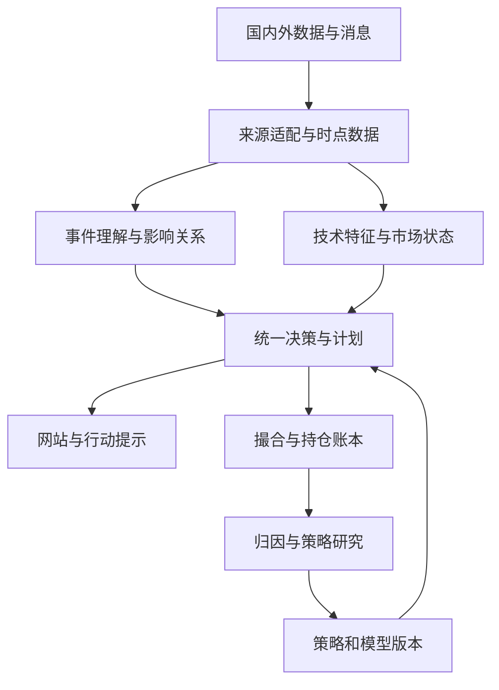

# Pulse A股交易研究平台完整重写规格

版本 2.0　研究与设计日期 2026年11月10日 UTC+8

## 1 项目决定与交付目标

采用独立新实现，把国内外信息、市场状态、选股排序、个股计划、执行记录和策略研究连接为同一套系统。新系统从本规格、数据契约和行为样例开始，不导入旧项目业务代码，不以旧目录、类名、评分公式或历史实现作为约束。历史数据、原始消息、实验结果、冻结策略说明和前向记录由独立迁移程序转换，保留来源和原版本。

网站面向用户的核心承诺是：现在关注哪些沪深主板股票，为什么排在前面，什么条件下可以买，已经持有的股票如何处理，什么新信息改变了原计划，以及这些判断后来产生了什么结果。系统持续发现新方法，用统一实验口径比较，自动更新已启用的策略组合。

本规格描述目标产品和实施合同。文中的性能、调度频率和研究通过标准，除明确引用外，均是初始工程目标或待校准配置，不是现有系统实测结果，也不宣称策略收益已获验证。

### 1.1 核心产品能力

| 用户动作 | 系统必须完成的行为 | 可检查的产物 |
| --- | --- | --- |
| 打开首页 | 展示按同一周期和目标排序的候选、当前可行动状态、最新变化和原因 | DecisionSnapshot及其版本 |
| 进入个股 | 同屏展示年季月周日和分钟技术面、消息证据、产业关联、买卖与持有计划 | StockWorkspace绑定同一snapshot_id |
| 出现新消息 | 找到相关持仓与候选，重新评估影响，按需生成计划版本 | EventRevision和PlanVersion差异 |
| 查看持仓 | 区分已有可卖仓位与当日买入仓位，展示计划执行状态 | Position及可卖数量 |
| 查询策略 | 展示原始观点、可执行定义、适用状态、真实检验结果与失败原因 | StrategySpec和ExperimentRun |
| 看系统成绩 | 逐笔还原当时推荐、计划、成交及成本，解释差异 | Decision到Fill到Ledger的完整链 |
| 启用新模型 | 比较同一证据集上的质量、延迟与成本，发布新的模型策略版本 | ModelPolicyVersion及评测记录 |

### 1.2 用户偏好与研究范围

推荐交易池默认只含沪深主板普通A股，排除创业板、科创板、北交所、新股；ST等状态作为配置化排除条件。研究与观察池可以包含ETF、股指期货、A50、港股、美股、日韩市场、利率、汇率和商品，它们可以影响推荐但不会因此进入默认个股交易池。

股价100元、流通市值100亿元、换手充分等历史偏好保留为可配置的偏好档案。阈值、比较运算符、市值口径写入UniversePolicy，不能混淆总市值、流通市值和自由流通市值；价格与市值阈值可以做消融实验。初始配置使用不高于100元与不高于100亿元流通市值，提供启用开关；这不是已验证的最优阈值。

情绪周期、龙头生命周期、伴生龙、题材抱团、跨年、生肖与谐音、重要纪念日、交割日、海外产业映射都进入研究体系。某类方法在某次实验中失败，只降低其证据评级；不能直接固化为永远禁止研究该方法的产品规则。

### 1.3 完整覆盖的可执行定义

不承诺已经穷尽所有网站和影响因素。系统通过来源注册表、因素注册表、策略族目录和覆盖矩阵持续扩展：每一项都标记已连接、部分覆盖、待接入、缺历史、待验证或已启用。用户可以看到已覆盖的来源、延迟、历史起点和缺口；采集不到数据时，不以空数组冒充全网没有消息。

## 2 架构总图与依赖方向

架构采用模块化单仓。领域通过类型契约连接，部署初期包括网站、API、按任务隔离的采集/计算/研究进程、PostgreSQL、Temporal和NATS JetStream。批量数据放Parquet对象存储，使用DuckLake目录与快照管理多写者数据；DuckDB和Polars为分析计算引擎。v2扩展的共享数据与多策略协议见V2_SYSTEM_DESIGN.md。

### 2.1 七个领域

| 领域 | 唯一责任 | 对外输出 | 不应承担的工作 |
| --- | --- | --- | --- |
| data | 来源接入、主数据、时间版本、公司行动、交易日历 | Observation、DatasetManifest | 决定买卖 |
| intelligence | 事实抽取、去重、产业关系和影响假设 | EvidenceEvent、ImpactAssessment | 自行修改账本 |
| market | K线、指标、题材、市场状态与龙头关系 | FeatureSnapshot、MarketState | 从网页临时抓数 |
| decision | 策略选择、排序、计划、更新理由 | DecisionSnapshot、TradePlan | 自建另一套成交计算 |
| execution | 时段规则、库存、订单、成交和账户 | Fill、Position、LedgerEntry | 重新猜测推荐理由 |
| research | 方法发现、实验、比较、晋级、停用、复活 | ExperimentRun、ReleaseBundle | 修改过去的前向记录 |
| assistant | 模型路由、工具、证据包、模型运行记录 | ModelRun、PlanProposal | 隐式拥有其他领域状态 |

网站、REST、SSE和MCP均是这些领域的访问入口。前端没有自己的推荐评分器；任务调度器不复制策略逻辑；回测与在线观察共用策略协议、规则与订单语义。

### 2.2 首发技术选择

| 部分 | 选择与理由 | 后续扩展条件 |
| --- | --- | --- |
| 网站 | React、TypeScript、Vite；服务器查询状态与界面状态分离 | 公开搜索页面确需SEO时增加SSR |
| 图表 | Lightweight Charts；指标由统一内核计算 | 高级绘图需求明确时比较其他图表能力与许可 |
| API与契约 | FastAPI、Pydantic；生成OpenAPI、JSON Schema、TypeScript类型 | 通过兼容性测试升级协议 |
| 领域内核 | Python纯函数、显式状态机、Polars列式计算 | profiler证实热点后在稳定接口内引入Rust等 |
| 事务状态 | PostgreSQL；计划、账本、实验状态和outbox统一事务 | 先索引与分区，再按瓶颈拆服务 |
| 历史数据 | Parquet对象存储、DuckLake快照与PostgreSQL目录，外层DatasetManifest登记发布状态 | 锁定实测兼容版本；多引擎互操作需求明确后再比较Iceberg |
| 研究计算 | DuckDB扫描与Polars lazy；并行研究以独立进程运行 | 并发历史分析确有瓶颈时评估ClickHouse |
| 长流程 | Temporal管理补数、消息分析、回测、训练、模型评估 | 不为每一个tick建立Workflow |
| 事件分发 | NATS JetStream、Postgres事务outbox和消费者inbox；UI最新状态单列 | 跨项目独立回放为首发需求；容量和复制数量按实测配置 |
| 搜索与关系 | Postgres全文检索、关系边表，语义检索按需加pgvector | 特定检索性能不足再选专用引擎 |
| 观测 | OpenTelemetry、结构化日志、业务延迟与质量指标 | 无需首发搭建庞大观测平台 |

NATS JetStream为首发共享消息组件；首发不同时引入Kafka、Redis、ClickHouse、Neo4j、Kubernetes。需要它们时有清晰适配点。版本号在实施时核验稳定发行并写入锁文件；“最新”不等于预发布版本一律进入生产。Lightweight Charts负责绘图，不附带市场数据或技术指标。[T06]

### 2.3 事件驱动的三条路径

热路径由行情和交易时钟驱动，更新K线、指标、触发器和排序，使用已经生效的事件判断，不等待新的模型请求。温路径由新消息、修订和重大行情变化驱动，对受影响证券重新推理并提交计划提案。冷路径持续发现策略、训练模型、回测与复盘，输出可发布版本。

三条路径共享数据与版本，吞吐要求不同。行情每秒更新不等于每秒都要对全市场调用模型；重要消息也不需要等到收盘才改变计划。

## 3 数据时间与存储合同

### 3.1 时间不能折叠为一个字段

| 字段 | 含义 | 使用规则 |
| --- | --- | --- |
| event_time | 事件实际发生时间 | 可以未知，不用发布时间替代 |
| published_at | 来源公布该版本的时间 | 保留源站时区和精度 |
| first_seen_at | 本系统首次看到该版本 | 由采集器写入，禁止回填成源发布时间 |
| ingested_at | 原始材料持久化时间 | 用于采集延迟和恢复 |
| available_at | 当前处理结果可以被下游使用的时间 | 含解析或模型完成时间 |
| effective_from及effective_to | 规则、成分或公司状态的业务有效期 | 与获知时间分别保存 |
| decision_at | 决策真正完成并发布的时间 | 行动不能早于它 |
| exchange_time及sequence | 行情源交易时间和序号 | 重连去重、乱序处理 |

例：09:50发布的公告在10:01抓到，10:01:10解析完成，10:01:25模型完成。09:55的系统实况回放不能看到该公告；10:01:15可以使用原文已提取的规则事实，但不能使用10:01:25才产生的模型判断。历史研究若只有源发布时间，使用明确延迟假设并标成historical_reconstruction，不能冒充当年的真实系统记录。

修订追加新版本。原文纠错、宏观数据修订、股本变化、行业成分和股票名称均保持双时间语义：何时有效，以及系统何时知道。ALFRED的历史已知版本机制可借鉴；当前最新宏观数值不能直接代入过去。[A14]

### 3.2 价格与公司行动

保存不复权OHLCV、成交额、复权因子、分红送配拆并股事件和调整版本。图表可切换不复权、前复权、后复权；撮合用当时可交易的原始价格；收益账本处理现金分红和持股数量变化。图上复权价格不能直接作为券商委托价。

基于价格阈值的历史过滤使用当时不复权价格。涨跌停价优先使用对应交易日的权威字段，再按当时规则和最小价位计算，不能用涨幅大于9.8%统一代替。自由流通市值未知就保持未知，不能以固定比例乘流通市值伪装真实值。股本、行业、市值与退市样本均记录历史版本。

### 3.3 K线与指标一致性

支持1m、5m、15m、30m、60m、日、周、月、季、年周期。聚合以交易所会话边界进行，午休不合成可交易分钟。每根K线有open_time、close_time、is_final、source_granularity和session_scope。尚未收完的周月年K线可展示，但已完成周期策略不得把其最终值提前使用。

MACD、均线、RSI、ATR、KDJ、BOLL、VWAP、量比、换手和价格形态使用同一个特征注册表。指标定义包含参数、预热长度、平滑初始化、缺值规则、复权模式、盘后量额处理、价格单位及版本。前端不另算MACD，研究不复制另一份公式。

2026年7月6日起盘后固定价交易扩展到全部A股与ETF，15:05至15:30撮合；盘后量额在结束后计入全日。因此15:00的竞价收盘快照和15:30后的全日最终量额是不同版本，必须分别可重放。[A01][A02][A04]

### 3.4 数据集快照

DatasetManifest包含文件路径、内容哈希、schema版本、行数、时间范围、来源、修订号、缺失和质量摘要。研究输入引用manifest_id，不引用随时变化的latest目录。多个Parquet分片完成写入后才在Postgres发布manifest；读取者只读已提交manifest。压缩产生新manifest，旧文件在引用释放后才回收。

最少表包括instruments、instrument_states、corporate_actions、market_rules、trading_sessions、raw_documents、document_revisions、events、impact_edges、feature_manifests、strategy_versions、model_policies、decisions、plan_versions、order_intents、fills、ledger_entries、experiments、research_trials、outbox、consumer_inbox。

新闻和研究输入可以进入Parquet；关键计划状态与账本写入事务库。分钟与逐笔原始数据以分区文件为主，不逐条插入交易业务表，也不让每个tick生成一条outbox任务。

## 4 影响因素与信息来源体系

### 4.1 因素本体

| 因素族 | 必须覆盖的研究项 | 转成什么输入 |
| --- | --- | --- |
| 国内流动性与财政 | 利率、降准、逆回购、MLF、信贷、财政支出、国债地方债、税费 | 政策预期差、信用条件、需求与贴现率 |
| 国内宏观 | GDP、CPI、PPI、PMI、工业、社零、社融、货币、地产、进出口 | 首发值、事前预期、修订、行业敏感度 |
| 市场制度 | IPO、融资、减持、回购分红、两融、交易规则、指数调整 | 股票供给、买方能力、制度适用版本 |
| 海外金融条件 | Fed、ECB、BOJ、BOE、通胀就业、美债、美元、CNY及CNH | 全球折现率、风险偏好、汇率暴露 |
| 国际产业映射 | 海外AI芯片云计算、电子、汽车、新能源、药品、航运财报与订单 | 公司产品供应链映射、收入与订单证据 |
| 地缘与贸易 | 关税、制裁、出口管制、冲突、航路、外交谈判 | 供需和成本双向影响、替代链条 |
| 产业与技术 | 规划、补贴、招标、批准、标准、技术突破、产品发布、价格战 | 产业事件强度、兑现节奏、竞争替代 |
| 商品与库存 | 油气煤、金属、锂、农产品、运价、库存、产能 | 价格传导、公司毛利敏感性、供需差 |
| 公司经营与股权 | 业绩预告修正、财报、订单、并购、重组、回购、减持、解禁 | 盈利及供给冲击、事件发生概率 |
| 公司治理与监管 | 董监高、诉讼、审计、问询、立案、停复牌、风险警示 | 事件期限、状态变化、执行可行性 |
| 资金与筹码 | ETF份额和成交、基金持仓、两融、龙虎榜、大宗、外资披露 | 拥挤度、筹码与风格变化 |
| A股情绪 | 涨跌停、连板高度、晋级、炸板、回封、昨日溢价、龙头断板 | 市场及题材状态、生命周期 |
| 技术与量价 | 多周期K线、均线、MACD、RSI、ATR、趋势、换手、波动、VWAP | 排序、触发、持有和退出条件 |
| 订单微观结构 | 价差、深度、订单流、撤单、队列、冲击、竞价供需 | 成交概率、预期滑点、执行策略 |
| 日历与注意力 | 会议、展会、财报季、节假日、交割、季末、热搜、传播分歧 | 可预告事件、拥挤及预期兑现 |
| 叙事与突发 | 生肖谐音、跨年抱团、纪念日、灾害、天气、物流电力中断 | 叙事传播、地理暴露、持续时间 |

这些是候选机制，不是已经成立的涨跌规律。每个因素登记计算定义、来源、可用时间、特征组、与其他因素的相关性、验证状态和复测条件。不要把几十个高度相关的动量指标视为几十份独立证据。

### 4.2 来源覆盖与优先级

P0先连接能支撑完整决策的官方公告、交易日历、行情、公司行动、国内政策、主流快讯和海外宏观；P1补足产业链、媒体传播、策略社区和分钟数据；P2按具体策略需求接入逐笔、复杂商业终端或封闭内容源。

| 来源组 | 具体覆盖 | 接入方式与验收 |
| --- | --- | --- |
| 公司与交易所 | 上交所、深交所、巨潮、公司IR | 列表增量、公告正文和附件；验证版本、时间、代码 |
| 国内政策 | 国务院、央行、财政部、发改委、工信部、商务部、证监会 | 官方页面和发布日程；文号和生效日归并 |
| 宏观产业 | 统计局、海关、能源局、药监、行业协会与产业数据商 | 首发稿与历史数据库分流；验证实际发布时间 |
| 国内财经 | 新华社、财联社、第一财经、同花顺、东财、华尔街见闻、新浪 | 授权feed或已验证公开适配器；实测延迟与完整性 |
| 中文社区 | 雪球、股吧、淘股吧、微博、微信、头条、抖音、B站、小红书、知乎、贴吧 | 平台授权接口、公开可检索页面、指定账号订阅、用户导入 |
| 海外政策宏观 | Fed、ECB、BOJ、BOE、BLS、BEA、FRED与ALFRED | 官方RSS、API与日历；保留历史版本和时区 |
| 海外产业公司 | 公司IR、SEC披露、交易所公告、产品发布与供应链数据 | 实体关系和原文出处；不依赖中文二次转载 |
| 国际媒体发现 | Reuters、Bloomberg、WSJ、FT、CNBC、GDELT | 订阅或可用公开覆盖；发现线索后回读原始材料 |
| 策略与代码 | TradingView、GitHub、Gitee、QuantConnect、arXiv、论文作者站、期刊 | 版本化内容快照、规则抽取、来源及代码许可 |
| 全球社区 | YouTube、Reddit、X、Substack、Medium、论坛 | 官方API、RSS、公开页面、已授权内容 |
| 行情与逐笔 | 交易所信息公司、授权数据商、券商数据能力 | 分清快照、分钟、逐笔成交和订单流 |
| 商品与能源 | EIA、期货交易所、官方行业统计及库存 | 现货期货与库存分别建模，源首发与API延迟分开 |

接口可用性逐源验收。本次核查Tushare文档存在新闻源和独立权限体系，不能据此认为现有token已拥有所有新闻、分钟与公告权限。[A10][A11] 抖音视频搜索有文档与scope，但相关能力页仍有实验及开放条件，登记为待接入能力，不伪装已全量抓取。[A25][A26]

北向实时买卖额和总成交额的官方披露已调整，供应商估算的“实时北向净流入”必须标为估计。ETF放量不能直接认定投资者身份，ETF成交额也不等于净申购。[A07] L2的逐笔和订单关联信息与60秒轮询快照不同，队列策略依赖真实数据能力。[A09]

### 4.3 适配器协议

每个SourceAdapter实现describe_capabilities、poll或subscribe、normalize、checkpoint、health。SourceRegistry登记source_id、ownership、auth_type、coverage、granularity、historical_start、expected_lag、rate_limit、cursor_type、timezone、revision_support、provenance_level和connection_status。

auth_type使用none、api_key、oauth、subscription、session或manual_import；连接状态使用connected、partial、unconfigured、temporarily_unavailable、retired。缺key返回unconfigured，空查询结果是另一种状态。官方API优先；公开网页适配不稳定时替换来源或降级覆盖，不在业务引擎里塞临时抓取逻辑。

调度按信息时效与相关性分配：已有持仓和候选相关事件优先；宏观公布窗口提前启动任务；一般源按增量和配额轮询；海外新闻不因A股休市停采。每日跨零点轮换分区而不中断服务。失败保留可重试项，消费游标不越过未处理项且无补偿记录。

## 5 消息到决策的处理链

### 5.1 标准事件流程

采集原文并保存哈希和版本；抽取事实Claim；做文档级去重和事件级聚合；识别公司、产品、地点、政策与人物实体；建立产业链影响假设；更新事件状态与特征；重算相关候选和持仓；生成或修订计划；推送同一决策快照；将后续价格和事实兑现结果回写评估。

去重不能删除信息价值。同一政策的百篇转载只贡献一个基础事件，但独立作者数、传播增速、媒体层级和社区分歧可以作为独立注意力特征。政策预告、正式文本、实施、修订和澄清要保留父子或替代关系。

### 5.2 影响分析字段

ImpactAssessment包含目标实体、传导路径、方向、强度、有效期、证据、替代解释、预期差、已反映程度及置信度来源。例如油价上涨对上游、炼化、航空的作用不同，不能把“原油上涨”统一打成市场利好。海外芯片企业财报通过实际供货或收入暴露映射到A股，不仅按名称相似或同题材标签关联。

模型置信度与历史校准概率分开。模型输出“高置信”不自动等同80%胜率。每类事件积累后，评价实体识别、方向、时限、价格反应、成本后增量与排名贡献。

### 5.3 动态更新的三个对象

第一类是状态变化：新价格、新消息、热度和市场阶段持续更新。第二类是生效策略的计划输出变化：同一ModelPolicyVersion可以因新事件生成不同买点、退出和持有期。第三类是策略代码、提示模板、模型权重或规则改变：进入研究与发布流程形成新版本。

第二类可自动生效，不逐次人工确认；第三类通过自动评估规则晋级。这样模型能主动决策，运行行为又能被回放与比较。

### 5.4 模型计划编译

模型或规则输出PlanProposal，包含entry_conditions、entry_price_zone、sizing、exit_conditions、holding_horizon、invalidation、expires_at、evidence_ids。PlanCompiler检查引用存在、数据可见时点、单位与最小价位、交易池、时段、可用资金、T+1可卖数量和费用，转换成可执行条件树；不是只做JSON格式校验。

提案可以使用登记过的指标或明确的布尔条件；复杂新逻辑提交StrategyProposal并自动进入研究工作流，不能把自然语言条件直接作为后台可执行代码。模型不会因为需要程序计算而失去决策权，它负责提出计划，计算和成交语义保持可验证。

若一个重大利空出现时股票为当日新买，计划可以立即改变观点和下一可卖时段的退出条件，但不能显示“已卖出”。已有可卖底仓则按相同计划的库存约束生成卖出意图。

## 6 排序与个股工作台

### 6.1 排序需要一个共同目标

短线、波段、长期使用不同预测期限与目标，原始分数不能直接混排。默认首页显示用户当前选择的期限；综合机会榜使用同口径的成本后效用或经过校准的目标，不简单平均1日和60日收益预期。

基本处理顺序为：按时点UniversePolicy得到候选；生成技术、事件、情绪、基本面和成交特征；各策略给出分布或分数；根据事前市场状态组合；估计费用、成交可行性与持仓相关性；排序；再由组合构建器给出仓位和计划。

初始可解释排序可写为utility = expected_net_return - lambda_drawdown * downside_estimate - lambda_turnover * turnover_cost - lambda_concentration * portfolio_overlap。所有项需统一期限和量纲；系数作为可记录配置，经训练或实验决定。没有可校准收益预测时展示“相对排名分”，不能标成上涨概率。

Alpha排名和可行动排名分开：前者表示研究机会，后者结合是否已触发、价差、可成交和账户可用性。“排名第一但涨停买不到”应显示等待/不可成交的原因，而不是虚构成交。入场尚未触发的股票可以留在观察池，不从研究信息中消失。

### 6.2 市场状态与龙头生命周期

MarketState至少包含趋势、流动性、市场广度、波动、情绪、风格、主导题材和海外冲击。对状态输出概率或证据评分，而不是随意硬切牛熊。主导题材和LeaderEpisode记录首次识别、扩散、确认、分歧、高潮、退潮、修复等状态与转移证据。

在线输入只使用当时可知标签；事后用完整行情划分的阶段只能用于研究分组和诊断。研究同时按时间样本外与市场状态、龙头生命周期切片，满足用户关注行情周期的要求，也避免未来标签进入决策。

### 6.3 推荐列表字段

每行至少显示代码名称、rank、分数含义、持有期限、当前价格、研究时点、最新模型分析时点、事件摘要、策略贡献、入场状态、价格区间、计划到期时间、成交数据等级。排名变化解释分成新消息、价格条件、市场状态、策略版本、数据补齐五类。

排序按刷新批次稳定更新；相近分数可采用登记过的排名缓冲，减少每秒跳动。用户打开个股后保留进入时的snapshot_id，同时可以切到最新版本并看到差异，不静默替换旧计划。

### 6.4 个股页面布局

第一屏为股票身份、行情、推荐依据和当前行动。中央为多周期K线与成交量，MACD等指标副图、关键价格位、消息标记和已发生的行动标记共享时间轴。侧栏展示入场条件、分批价格、建议数量、退出条件、持有时间、失效条件与下一次复核。

下方按信息性质展开消息证据和影响链、基本面与估值、题材和产业关联、资金与微观结构、相似历史局面、策略支持与反对、计划版本和历史成绩。可解释性首先展示驱动本次变化的少数事实，完整因素可以继续展开，避免把所有字段堆在一屏。

日、周、月、季、年指标分别展示，至少支持复权切换和未完成K线标记。图表与事件标记使用真实交易时区；源为分钟快照合成时明确标记粒度，不能画成逐笔队列结论。

### 6.5 三种计划状态

观察计划记录为什么关注及等待什么；可行动计划含已满足的触发和有效委托条件；持仓计划记录实际成本、可卖数量、当前观点和退出路径。PlanVersion改变时保存旧版本、变更原因和证据。一次消息可以把观察计划升级为可行动计划，也可以只降低已持仓目标或缩短持有时限。

## 7 A股成交与账本内核

### 7.1 MarketRules

MarketRules按exchange、board、instrument_status、trading_date、session_kind、order_type取有效版本。时段包括开盘竞价、连续交易、午休、收盘竞价、盘后固定价、闭市和临时停牌；支持撤单窗口、价格笼子、涨跌停、数量与最小价位等规则字段。

沪深主板普通股票涨跌幅、风险警示股票在2026年的规则变化、IPO前五个交易日等例外，均来自版本化规则表。主板买入通常按100股整手，零股余额卖出按规则处理；T+1以交易日历和每笔库存来源计算。国内股票型ETF并不因名称为ETF就一律T+0，各品种回转规则分别登记。[A04][A05]

### 7.2 同一执行协议

策略产生OrderIntent，经过规则与库存校验后进入ExecutionAdapter。HistoricalReplay、PaperExecution、BrokerAdapter实现相同协议，Fill驱动账本；信号或委托本身不改变持仓。实际连接券商是独立集成任务，当前交付以研究、提醒和模拟执行为首期范围。

订单状态为created、submitted、acknowledged、partially_filled、filled、cancel_pending、canceled、rejected、expired。撤单请求与晚到成交可以竞争，最终状态按事件序列更新。幂等键至少包含account、order_intent_id及执行模式。

现金、总股数、冻结数量、可卖数量分开。正T和倒T基于已有库存计算，每条腿单独计费用与成交；不能拿当日买入的新库存当天卖出。佣金率、最低佣金、印花税、过户费和滑点均版本化；不将历史主账本的示例100万元当作用户实际资金。

### 7.3 成交数据等级

| 等级 | 数据 | 可以验证 | 不能默认知道 |
| --- | --- | --- | --- |
| D1 | 日线OHLCV | 次日开盘、跨日持有、明确日级规则 | 日内先后顺序、涨停队列 |
| M1 | 真实分钟或明确合成分钟 | 分钟触发、时间窗、近似执行 | 分钟内触价顺序和真实排队位置 |
| T1 | 逐笔成交 | 成交时序、更细延迟与流动性 | 未提供的全量委托和撤单 |
| L2 | 可用的盘口与订单流 | 更细队列与部分成交仿真 | 自身真实队列位置、全部市场冲击 |

只知OHLC而同时触发止盈止损时，记录不确定性，按预先定义的保守顺序或多情景计算；不可取最有利路径。封单、一字板、秒板、滑点、部分成交、停牌和跌停顺延必须进入策略验证。快照触到涨停不等于买单成交。

### 7.4 收益与归因

网页“计划收益”通过该PlanVersion实际回放得到；固定N日开盘到收盘收益可以作为信号评估，字段名称必须说明是signal_return，不与executed_plan_return混同。记录毛收益、净收益、未成交机会、滑点、费用、换手、容量、持有时间、最大不利与有利波动、基准超额和风格暴露。

回测使用研究输入manifest，在线使用实际收到事件日志。二者对相同的冻结输入、模型输出与策略版本应生成一致行动序列；差异按数据、时序、模型版本、撮合和费用归因。

## 8 全网策略发现与实验工厂

### 8.1 策略来源到可执行包

定期和事件触发检索论文、开源项目、脚本、策略文章、视频转录、论坛与指定作者。保存原文版本、作者、发布时间、获知时间、出处和可使用的代码范围。转载或换名称的方法按规范化条件、特征和代码指纹归入同一策略族。

StrategySpec必须写清假设、股票池、信号时钟、入场、退出、持有期限、仓位、成本、参数范围、数据要求、适用状态和失败条件。只有“龙头”“弱转强”“主力吸筹”等描述时，保留原说法并提出可测量定义；每个定义作为独立候选记录，不能当作原作者已给出的完整规则。

策略包由spec.yaml、features、policy、fixtures、provenance与evaluation组成。模型可生成代码，研究runner根据包合同运行；禁止包自行读取未申报的最新数据。参数改变、因子删选、模型提示变化和标签改变都产生trial_id。

### 8.2 首批策略族覆盖

| 大类 | 首批候选族 | 特别验证的问题 |
| --- | --- | --- |
| 趋势与突破 | 均线、MACD、通道、Donchian、箱体、趋势回踩、多周期共振 | 信号滞后、相关性与换手 |
| 反转 | 短期反转、超跌、跳空、均值回复、无利空超跌 | 流动性冲击与基本面恶化分离 |
| 情绪接力 | 首板、二板、换手龙、断板、反包、补位、龙头跟随 | 排队、可成交与生命周期 |
| 题材传播 | 行业扩散、产业链、热点迁移、伴生龙、名称谐音 | 事前识别和重复消息 |
| 量价与微观 | 放量突破、缩量回调、VWAP、订单失衡、竞价、尾盘 | 数据粒度和真实费用 |
| 事件 | 盈利预期差、订单、回购、减持、并购、监管、政策 | 公布时间与价格已反映 |
| 跨市场 | 海外映射、汇率、利率、商品、A/H、期指基差 | 时区、开盘跳空与可交易段 |
| 基本面 | 价值、质量、盈利成长、现金流、红利、资产负债 | 财务公布与修订、行业比较 |
| 因子组合 | 规模、低波、动量、反转、流动性、多因子排序 | 风格匹配后增量 |
| 日历 | 交割、财报季、假日、月末、会议、指数调样、跨年 | 多重比较与实际事前日程 |
| 机器学习 | 树模型、排序学习、时序、多模态、图模型 | 标签、验证切分、信息时间 |
| 模型与RL | 新闻判断、结构化计划、研究代理、仓位RL、执行RL | 模型历史污染、动作空间与训练证据 |
| 退出与组合 | 固定持有、排名缓冲、移动止损、分批、正T倒T、状态路由 | 与入场系统共同评价 |

这里定义研究空间，并不宣称每个家族存在有效超额。机器可读目录提供细分候选；以后新增方法按相同合同接入。

### 8.3 一条最终认证路径

快速向量化计算用于筛选特征和粗测候选；最终晋级全部通过同一事件与执行内核。Qlib可作为日频模型研究适配器，RD-Agent可借鉴自动因子提出和实现，vectorbt可用于快筛，LEAN或NautilusTrader可参考事件与撮合设计，FinRL可用于有明确数据和动作空间的研究；不并存几套互不一致的最终收益真相。[T07][T10][T11][T12][T13][T14][T15][T16]

### 8.4 实验设计

按时间滚动训练、验证和样本外测试；标签持有期重叠时清除跨边界样本，并设置与标签长度及数据延迟对应的隔离。宏观事件同时报告跳空、开盘后、跨日收益，避免把无法在消息后买到的跳空当策略利润。

基准包括可投资基准、同日同市值同波动同行业匹配篮子、随机选股、旧冻结策略及简单低换手策略。分别评估排名、触发器、持有与退出、仓位和整条闭环，不能因为IC提升就宣称买点提升。

阶段分析使用市场状态与LeaderEpisode切片，同时报告时间样本外结果。统计按事件或日期聚类，处理多日收益重叠；大量试验记录总预算及有效独立试验数。DSR、PBO及适合依赖结构的多重检验方法是诊断工具，不是自动盈利证书。[T08][T09]

最终留出集有访问记录。新一轮发现不能反复查看同一留出集调参再叫它样本外。模型处理历史新闻可能从预训练中知道后续结局，因此匿名化和限制证据只能减弱部分污染；真正联网模型决策单独累积前向记录，不伪装无污染的历史实盘。

### 8.5 自动晋级与优胜劣汰

候选状态使用discovered、specified、data_ready、screened、validated、shadow、active、paused、retired。新版本先完成数据时点和执行语义验证，再比较成本后效用及稳定性；满足登记标准自动进入影子账本，达到前向证据目标自动提升权重。不是每条方法都要求人工批准。

晋级标准由EvaluationPolicy版本化，至少包括样本量或有效独立样本、成本后效果、回撤和换手约束、状态覆盖、相对基准增量与多重试验诊断。稀疏事件缺样本时保持探索，不凭几次成功直接提升为主策略。策略族预算避免某一作者或大量相似参数占满实验队列。

线上表现持续变化时，降低权重、暂停或退役；保存失败类别，如数据不足、执行不可行、费用吞噬、过拟合、市场状态不适配、程序错误。复活条件由数据能力升级、状态变化、新理论证据或新模型版本触发，重新走验证，不删除失败历史。

### 8.6 结果如何反馈前端

研究发布包包含strategy_versions、model_policy_versions、feature_versions、universe_policy、execution_model、cost_profile、evaluation_policy及manifest引用。发布使后续决策引用新bundle_id，过去决策和旧冠军账本保持不变。榜单变化可以解释为“新事件导致计划改变”或“研究发布导致模型升级”，二者分开记录。

## 9 模型能力增长与多Agent运行

### 9.1 按能力接模型

模型路由关注结构化输出、工具调用、视觉音频、长上下文、批处理、异步执行、延迟和质量，不把业务绑定到某个型号。GPT-6.1 Aster、Claude Fable 5.1、Opus 5.5作为用户提出的未来能力示例，不在本规格中宣称已经发布或已接通。

ModelRun保存provider、exact_model_id、prompt_version、tool_catalog_version、input_manifest_id、证据ID、输出、延迟、token用量和校验结果。temperature等参数不能保证模型输出可复现，回放使用已保存的实际输出。新模型在固定事件集、失败案例集及前向任务上与旧模型比较后发布。

### 9.2 允许逐步增强自主性

第一阶段模型读证据并提结构化计划；第二阶段可自主检索补充证据、提出并运行研究；第三阶段多个专业Agent在复杂事件上并行提出假设，由统一决策器综合；第四阶段把验证过的模型策略或学习策略直接作为决策模块。所有阶段共享同一TradePlan和执行合同，不因模型增强重写网站和账本。

不必每条新闻都启动多个Agent辩论。规则清晰的结构化公告程序处理，简单事件小任务处理，重大冲突事件再并行分析。按事件的经济相关性、持仓暴露、候选排名和信息新颖度分配预算。

### 9.3 工具面

模型工具至少有search_evidence、read_document_revision、get_market_snapshot、get_instrument_state、query_relationships、compute_features、propose_plan、simulate_plan、propose_strategy、run_experiment、compare_experiments、explain_decision。工具输入输出来自同一契约生成器。MCP服务面向外部Agent暴露能力；只有确实跨独立Agent服务时才增加A2A。[T17][T18]

网页或新闻正文只作为证据内容；执行命令来自已定义工具协议。必要的权限边界集中在数据读取、研究执行和可选券商适配器，不在每层增加人工审批。

### 9.4 模型与工作流重试

Temporal Workflow保持确定性，模型、网络和数据库访问放Activity。Activity使用稳定请求ID记录输入输出；可重放历史时读取已提交的ModelRun，避免再次随机采样改变过去计划。外部调用在“已发出但响应未保存”时可能重复计费，记录不确定状态；不承诺分布式系统天然恰好执行一次。[T01][T02]

## 10 核心契约与事件

### 10.1 共享字段

每个领域对象有schema_version、object_id、created_at、as_of、producer_version、causation_id和correlation_id。可重试写入有稳定idempotency_key。价格用十进制字符串或整数最小价格单位，股数为整数，金额明确币种与精度，收益区分ratio和percent。展示分与概率必须不同字段。

| 契约 | 必填内容 |
| --- | --- |
| Observation | 来源记录、原文版本、四类时间、哈希、内容地址、粒度、质量 |
| EvidenceEvent | 事件类型、事实、实体、证据、关联版本、状态、有效期 |
| ImpactAssessment | 影响对象、路径、方向、期限、预期差、已反映程度、证据 |
| FeatureSnapshot | 标的、时间、特征定义版本、输入manifest、数值和缺失原因 |
| StrategySpec | 假设、来源、股票池、数据要求、信号时钟、入场退出仓位、参数 |
| ModelPolicyVersion | 模型能力约束、提示与工具版本、任务和输出合同、评估政策 |
| DecisionSnapshot | 时间、股票池版本、状态、bundle、候选排名、证据、计划、模型运行 |
| TradePlan | plan_id和version、目标股票、触发、价格、数量、退出、有效期、替代版本 |
| OrderIntent | 计划版本、账户、方向、价格数量、时段、有效方式、幂等键 |
| Fill | 来源成交ID、委托ID、事件时间、价格数量、费用与来源等级 |
| ExperimentRun | 数据集、代码/参数/模型版本、切分、试验族、结果、失败原因 |

### 10.2 标准领域事件

source.observation_received、document.revision_added、event.assessed、features.ready、market_state.changed、decision.published、plan.revised、action.triggered、order.state_changed、fill.recorded、ledger.updated、experiment.completed、strategy.promoted、strategy.paused、model_policy.published。

一个版本化EventEnvelope包含event_id、event_type、aggregate_id、aggregate_version、occurred_at、recorded_at、causation_id、payload和schema_version。相同聚合按版本递增；全系统不要求所有行情事件保持单一全局顺序。

### 10.3 一致性规则

生成DecisionSnapshot、PlanVersion和outbox记录在同一Postgres事务提交。dispatcher可能重复投递；每个消费者以consumer_id和event_id唯一键维护inbox，同一事务完成投影与完成标记。发布快照、动作与账本写入分别幂等，不依赖“消息只投递一次”。PostgreSQL事务隔离与冲突重试规则需要明确，而不能只写事务两个字。[T20]

更新计划带expected_plan_version。模型分析期间如果行情、持仓或已有计划变化，提交前对照依赖版本；只重新计算受影响部分，过时提案不会覆盖更新计划。数据修订产生新事件并纠正后续分析，不改写历史决策。

前端SSE带event_id、snapshot_id和版本；断线后从游标补读，超出保留窗口时重新取完整快照。推送只通知变化，查询API返回权威对象。需要高频双向操作时再增加WebSocket。

## 11 API与页面合同

| 接口 | 行为 |
| --- | --- |
| GET /v1/decisions/latest | 按portfolio与horizon返回最新决策及新鲜度 |
| GET /v1/decisions/{id} | 不变的历史决策与证据 |
| GET /v1/stocks/{id}/workspace | 按snapshot_id组合个股页面 |
| GET /v1/stocks/{id}/bars | timeframe、adjustment、session_scope、as_of与游标 |
| GET /v1/events | 按实体、时间、类型和状态检索 |
| GET /v1/events/{id}/revisions | 原文、事实和影响的版本关系 |
| GET /v1/plans/{id}/versions | 计划沿革及差异 |
| POST /v1/plans/proposals | 提交结构化计划，返回编译结果与版本 |
| GET /v1/portfolios/{id} | 持仓、现金、可卖库存和计划 |
| GET /v1/strategies | 来源、家族、适用状态与生命周期 |
| POST /v1/experiments | 幂等提交实验，返回job_id |
| GET /v1/experiments/{id} | 输入快照、试验、进度、结果和诊断 |
| GET /v1/sources/coverage | 来源状态、延迟、缺失与接入能力 |
| GET /v1/stream | SSE增量与恢复游标 |

响应统一包含as_of、generated_at、data_status、snapshot_id或manifest_id、schema_version。作业接口返回排队状态，不能长时间占用HTTP请求等待训练。只有写操作使用Idempotency-Key；计划写还使用预期版本。错误码区分source_unconfigured、data_unavailable、stale_dependency、insufficient_history、unexecutable_plan、job_failed，客户端有明确展示文案。

首页、个股、组合、事件、策略研究、历史回放、数据覆盖构成主导航。用户点击“为什么排第一”时读取已保存决策依据；额外聊天解释可以补充，但不能覆盖原始推荐理由。

## 12 运行目标与调度

### 12.1 初始服务目标

| 项目 | 初始目标与测量定义 |
| --- | --- |
| 行情到页面 | 有流式授权行情时内部处理p95小于1秒；轮询源另加源更新和轮询延迟 |
| 事件规则处理 | 原文到结构化事实p95小于2秒，不含源首发延迟 |
| 重要消息模型分析 | 优先队列p95目标30秒；保留实际等待与调用分项 |
| 候选重排 | 对受影响池增量处理p95目标1秒；全市场复杂更新另行测量 |
| UI交互 | 2000行候选虚拟化；图表首次可用目标2秒，基于规定硬件压测 |
| 数据可靠性 | 可追溯原文与manifest；重复执行不产生重复计划或Fill |
| 历史研究 | 记录行数、窗口、硬件和策略复杂度再发布吞吐，不无条件承诺毫秒级全市场回测 |

这些目标必须通过实测修订。免费轮询的60秒数据不能在页面上写成毫秒实时。

### 12.2 调度建议

新闻和海外事件全天运行；国内开盘前构建市场和候选快照；集合竞价按规则计算专用特征；盘中处理行情和事件触发；15:00保存竞价收盘版本，15:30以后确认最终量额；盘后同步和研究在数据就绪后触发；夜间补数、策略发现、训练和模型评估并行；周末继续信息采集与较重研究。

使用真实交易日历，新闻采集不复用“是否A股交易日”的停止条件。国际事件以IANA时区转换并考虑夏令时，不能永久把美国CPI或FOMC写成一个固定北京时间。

### 12.3 最少的运行保护

采集失败重试与游标恢复，计划版本冲突，真实数据与演示数据分开，凭证从运行环境读取，账户库存与金额校验，持久化日志和备份恢复。这些是能持续运行和正确记账所需的工程约束，不要求每次采集、推理或研究获得人工批准。

模型暂不可用时，热路径继续使用已完成的事件状态，页面显示分析更新时间；新消息保留待处理。不能把合成行情无缝伪装成实时行情。系统恢复后按持仓、候选、事件时效补处理。

### 12.4 常驻任务与自动研究任务

以下任务是新系统必须实现的执行入口。频率为可覆盖的初始配置；采集间隔不得短于来源实际支持的更新与配额周期。每个任务登记job_id、输入版本、触发来源、幂等键、优先级、游标、重试状态、最近成功时间和产物引用。

| 任务 | 触发与起始调度 | 交付结果 |
| --- | --- | --- |
| market_ingest | 已授权流持续订阅；快照源按能力轮询，交易会话内运行 | 行情记录、水位和断线补齐状态 |
| news_ingest | 全天运行；有增量feed时持续消费，其他源默认每1至5分钟或按发布窗口检查 | 原文、修订、获知时间、可恢复游标 |
| event_assessment | 新原文或修订立即触发；规则先完成，模型独立优先队列 | 事实、影响、ModelRun与失败待办 |
| decision_refresh | 相关事件、特征、账户或发布包变化触发，按受影响实体合并短时重复任务 | DecisionSnapshot和TradePlan新版本 |
| plan_trigger | 常驻处理行情、最终K线、事件可用和交易时钟 | 幂等OrderIntent及行动提示 |
| calendar_refresh | 每日刷新未来事件日历，来源变更时增量刷新；按IANA时区触发 | 国内外发布窗口、已知会议信息与修订 |
| strategy_discovery | 默认每6小时增量检索；可用的仓库或订阅通知即时触发；每周深度补搜 | 版本化来源、去重策略族与待规格化假设 |
| research_runner | 数据和规格就绪即入队；重计算优先盘后或空闲资源，失败继续登记 | ExperimentRun、诊断、影子与晋级候选 |
| evaluation_and_release | 每日闭市数据就绪后评估；重要模型版本按需对照；满足政策时发布 | 权重调整、暂停或复活、ReleaseBundle |
| reconciliation | 服务启动和恢复时运行，并在日终核对未完成任务及账户 | 待处理补偿、账本一致性和覆盖报告 |

长驻采集与触发器由workers进程管理；补数、分析、实验和模型评估使用可恢复工作流。提供统一CLI的run、status、retry、replay子命令以及相同任务的API，参数引用注册的job_id和manifest，避免每个脚本自建一套配置与状态。命令清单是实施要求，本包没有把这些采集与研究任务伪装为已经运行的脚本。

研究预算优先级为持仓与候选相关事件、现有策略失效诊断、证据充分的新候选、一般探索。来源新消息到来可以立刻改变当前计划；新方法则在规格化和实验完成后改变后续发布包，两类更新各有时钟和版本。

## 13 单仓布局与并行开发

### 13.1 目录边界

| 路径 | 所有者与内容 |
| --- | --- |
| apps/web | 前端页面、图表与查询状态 |
| apps/api | REST、SSE、MCP适配与依赖注入 |
| apps/workers | 采集、热计算、Temporal activities与研究runner |
| packages/contracts | 领域DTO、JSON Schema、OpenAPI生成 |
| packages/domain/data | 时点主数据与数据合同 |
| packages/domain/intelligence | 事实、事件、关系和影响 |
| packages/domain/market | 特征、K线和市场状态 |
| packages/domain/decision | 排名、PlanCompiler和策略组合 |
| packages/domain/execution | 规则、订单、撮合与账本 |
| packages/domain/research | 实验、归因、生命周期 |
| packages/model_gateway | 能力发现、模型路由和ModelRun |
| packages/adapters | 来源、Postgres、对象存储、模型提供方等 |
| strategies | 版本化策略包和数据需求 |
| tests/scenarios | 跨领域可复现行为场景 |
| ops | Compose、部署、迁移、备份与运行配置 |
| docs | 架构决策、契约、验收、运行说明 |

domain不能导入apps或具体adapter；端口在使用它的领域定义，adapter实现端口；contracts不依赖运行服务。前端只使用生成类型。共享模块保持小，不能逐渐变成所有功能都往里面放的utils目录。

### 13.2 Agent任务合同

每个任务写明task_id、目标、独占路径、依赖契约、输入样例、验收、产物、待解决接口。每个Agent在独立worktree工作，公共契约由集成负责人维护。改变公共合同须先提交schema diff和消费者迁移，不让多个Agent同时编辑同一个核心文件。

| 工作流 | 独立交付内容 | 依赖 |
| --- | --- | --- |
| A 契约与集成 | 核心DTO、样例、仓库骨架、CI和ADR | 无 |
| B 数据 | 主数据、交易日历、原文时点、manifest和来源适配器 | A |
| C 行情与特征 | K线、指标、题材、市场状态 | A的固定样例；后接B |
| D 消息智能 | 去重、事实、实体、产业关系、影响和模型记录 | A；后接B |
| E 执行 | A股规则、库存、订单、费用、撮合和账本 | A；后接B行情 |
| F 决策 | 排序、PlanCompiler、版本更新和组合约束 | A；后接C D E |
| G 前端 | 推荐与个股工作台、版本差异和数据状态 | A生成客户端与样例 |
| H 研究 | 策略包、发现、实验、评估和发布 | A；后接C E F |
| I 迁移 | 旧数据和实验资产转换；禁止导入旧业务实现 | A B的导入合同 |
| J 验收 | 独立场景验证、故障恢复和发布检查 | A及各交付 |

多人并行的关键是先固定边界与样例，不是所有Agent各做一个看起来完整但无法对接的系统。子任务完成时提交行为变更、测试证据、接口影响和已知未完成项，集成负责人统一合并。

### 13.3 开发顺序

M0确定最小契约、交易池和一条完整样例；M1并行构建数据、行情、消息和执行；M2接通一条真实事件到排序到个股计划到模拟成交的纵向链；M3扩展多周期和研究闭环；M4完成全天调度、来源覆盖和模型评估；M5迁移历史资产并平行运行后切换。

不等到所有数据源和所有策略都接完才交付第一条闭环。每一阶段都是可运行成果，扩展来源、模型和策略不改核心协议。工期依据实际Agent数、数据权限、样本和验证吞吐排定，不把模型强大等同于可以省掉数据等待。

## 14 验收与完成标准

| 编号 | 场景 | 通过条件 |
| --- | --- | --- |
| V01 | 主板推荐池混入创业科创北交样本 | 默认推荐仅沪深主板；研究观察池不被误删 |
| V02 | 09:50发文10:01收到 | 09:55真实回放不可见；模型输出生效时间不提前 |
| V03 | 旧消息修订和十家转载 | 保留版本；事实事件不重复计分，传播特征可更新 |
| V04 | 新消息影响持仓与未持仓候选 | 只重算相关对象，按同一决策快照呈现 |
| V05 | 推荐进入个股和查看历史绩效 | snapshot、plan、strategy、manifest可逐项关联 |
| V06 | 展示计划持有5日而统计默认10日 | 验收必须失败；计划绩效按该版本执行 |
| V07 | 日内同时触价而数据仅为分钟OHLC | 不假装知道顺序，按登记规则计算 |
| V08 | 当日买入后触发卖点 | 可改变计划但无可卖库存时不产生虚假Fill |
| V09 | 一字板买不到和跌停卖不出 | 正确保留未成交/延迟成交及资金库存 |
| V10 | 2026主板ST规则和盘后时段 | 按有效日期选择规则，15:30后最终量额不穿越到15:00 |
| V11 | 模型请求失败和进程重启 | 原文与待处理状态保留，成功项不重复 |
| V12 | 同一任务或Fill重复投递 | 计划、持仓、账本幂等 |
| V13 | 模型分析期间已有计划更新 | 旧expected_version提交被重算或拒绝覆盖 |
| V14 | 周末海外重大消息和跨零点 | 持续采集并正确分区，周一盘前可追溯 |
| V15 | 周月年K未完成或数据修订 | 展示状态清楚，历史信号不使用未来最终值 |
| V16 | 旧策略、快筛和正式回放比较 | 最终认证使用同一执行合同，解释所有差异 |
| V17 | 新策略进行多次参数试验 | trial计数与失败结果完整，留出集访问可追溯 |
| V18 | 新模型替换旧模型 | 固定评测集对比，旧ModelRun仍可回放 |
| V19 | 源未连接或延迟 | 明确状态，无伪造实时数据或静默合成替代 |
| V20 | 账户费用与资金档案变更 | 后续决策引用新版本，过去绩效不被覆写 |
| V21 | 历史公司行动与退市 | 原始价撮合，收益账本正确，时点股票池可还原 |
| V22 | 研究发布与事件即时更新同时发生 | bundle和plan版本链完整，原冠军账本保留 |

产品完成的定义是：用真实已连接来源运行一条可追溯闭环，能够从新闻原文找到影响分析、候选排名、个股计划、模拟或真实记录的成交和最终评估；能够加入一个新数据源、新策略或新模型而不重写这条链。策略盈利是后续持续检验的业务结果，架构验收不能用界面截图或回测曲线代替。

## 15 运行语义的实施默认值

### 15.1 条件树与信号时钟

PlanProposal的条件使用可序列化AST。节点类型为all、any、not、compare、crosses、within_session和event_state。叶子引用登记特征的feature_id及定义版本，或者带单位的常数；compare包含lt、lte、gt、gte、eq，crosses必须指定方向和上一有效观察值。SQL片段、Python表达式和任意eval字符串均不属于条件协议。

每个条件指定clock：quote、bar_close、session_open、event_available或scheduled。bar_close条件只在对应周期is_final时计算；quote条件允许当前未完成周期特征，但在策略要求中明确该语义。缺值产生unknown，布尔求值采用三值逻辑，unknown不得自动变成条件已满足。

触发器状态由plan_id、plan_version、trigger_id、account_id标识。默认crosses与入场条件仅在false或unknown变为true时触发一次；重新武装需要显式rearm规则和cooldown。去重键同时包含状态转移序号，避免持续满足条件时每秒重复下单。持续分批策略另定义max_fires和最小间隔。

holding_period使用unit=trading_sessions或duration；默认从first_fill_at之后开始计满N个交易会话，或明确使用entry_session_inclusive。两种计数不得共用一个无说明的holding_days字段。分批买入是否重新计时由holding_anchor指定，默认不因加仓重置最早持仓的退出时钟。

### 15.2 计划修订与未成交订单

计划v2生效不删除v1已提交的订单或成交。v2标记v1被替代，并给出replace_policy。默认cancel_remaining_and_reconcile：对v1未成交部分发撤单意图，等待撤单确认或晚到Fill；已成交部分保留原始plan_version归属，并纳入当前库存。新计划只对重新计算后的剩余资金、股数提出后续动作。

撤单未确认前，资金与库存预留不能释放，也不能按“预计撤成功”重复分配。若晚到成交发生在v2发布后，仍关联原order_id与v1，更新账本并触发一次v2重编译。replace_policy=keep_existing仅在提案明确表达时使用；涉及账户库存或冲突退出条件时不能默认同时激活两个计划。

### 15.3 账户原子性与事件顺序

每次订单意图提交、成交入账或撤单状态变更，各自在一个短事务中完成适用的账户预留、订单状态、Fill记录、现金与库存以及outbox变更；等待外部成交或撤单确认期间不持有数据库事务。每个账户具有monotonic account_version；写入使用锁或乐观版本比较，失败后重算。组合计划先计算全部目标，再按确定顺序预留，避免多个个股计划各自看到同一笔可用现金。

同一时刻的历史事件优先使用交易所sequence；没有可靠序号时使用保存的接收序列，并记录同时间顺序假设。会话开始先处理交收与已生效公司行动，再处理订单确认/成交，再更新特征和发出新决策；同一行情事件只能推动一次同策略版本状态转移。退出、撤单与新买的冲突优先级由ExecutionPolicy固定，默认先结算已发生Fill，再更新可卖库存，再处理退出，最后考虑新开仓。

每次账本更新可校验cash_available + cash_reserved = cash_total、sellable + locked + other_restricted = total_shares；权益使用现金、持仓原始价估值与应计现金流计算。整手舍入后的剩余资金保留为现金。

### 15.4 慢模型结果的有效性

模型输入分成hard_dependencies与soft_dependencies。计划版本、账户库存、证券状态、市场规则、被引用事实的修订号属于hard；普通报价更新、排名小幅波动属于soft。硬依赖变化要求重新编译或重新推理；软依赖变化在预设价格容忍、时间TTL和信号有效区间内，可用最新行情重算金额与触发条件后提交，不必从头调用模型。

提案包含analysis_as_of、expires_at、max_price_deviation_bps和required_revalidation。编译器每次都检查最新可执行价格与库存，但只在投资判断前提被推翻时触发新推理。这样秒级行情不会使所有30秒模型任务永远过期。不同事件族使用不同TTL，长周期财报分析和秒级竞价计划不共用有效期。

### 15.5 运行期多Agent仲裁

一次复杂事件分析创建AnalysisSession，固定evidence_manifest和decision_context_version。事件Agent、产业Agent、技术Agent可以并行提出结构化假设；各自输出证据ID、作用范围、预测期限、分歧和缺失。它们不得各自直接发布有效交易计划。

SessionCoordinator是唯一计划提案合成者，PlanCompiler是唯一生效入口。截止时间到达时按声明的required_roles和可接受缺项决定发布部分分析、保持旧判断或触发补充分析；不得将未返回Agent的观点编造出来。冲突按证据等级、任务历史校准表现和预先登记的聚合规则处理，不用简单多数票把相关模型输出当独立证据。晚到结果成为新修订，不覆盖已发布版本。

### 15.6 推荐动作与自动研究的默认边界

研究、采集、模型提案、计划重算、纸面执行和版本晋级按已设策略自动运行。首次上线的账户模式为paper；用户以后接入真实券商时，BrokerAdapter使用相同合同并单独配置凭证、账户及执行模式。项目并不因未来可能接券商而在当前每一步增加审批。

回测论文、论坛观点和用户假设都可以进入探索，但不能在界面上混成已验证推荐。探索标签本身不阻止研究，数据不足的候选继续采样并显示进度。

## 16 第一条纵向闭环与启动指令

第一条完整闭环选择沪深主板、一个已连接公告或新闻源、一份可靠日线与分钟行情、两个简单策略和一个模型策略。一个技术策略提供确定性基线，一个事件策略检验消息增量，模型策略使用固定证据包提出结构化计划。三者在相同费用和执行内核下比较，不需要先接入全部社区。

验收样例使用明确标记的示例证券和假设价格：事件在10:01收到，规则在10:01:02产出影响，模型在10:01:25完成提案；排名快照更新，用户进入个股能定位该消息；价格条件满足时模拟成交；当日库存不可卖；后续修订产生新计划；下一交易日按规则退出并回写研究。时间、价格和结果是测试fixture，不是对真实股票的建议。

给主控开发Agent的启动要求：完整读取本规格、contracts和catalogs；在新目录建立独立实现；旧仓只交由迁移Agent读取数据与导出格式，业务实现Agent不得导入或复制旧业务代码；先交付契约与上述纵向fixture，再按第13节分工并行；所有页面、模型工具和研究任务消费同一DecisionSnapshot及PlanVersion；每个阶段提交可运行成果和对应验收证据；遇到缺数据源权限时继续已授权来源并登记缺口，不伪造已连接；完成M5的定义以第14节为准。
