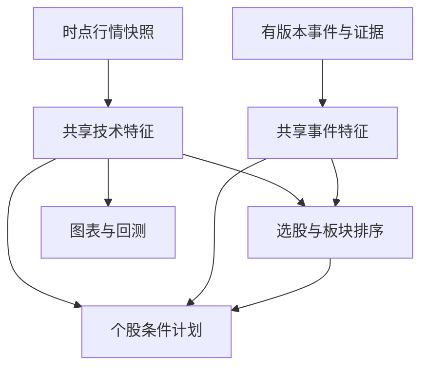

# 特征与策略公共协议

公共合同版本：3.0.0；实施增补：3.1；更新日期：2026-11-11。本文是重写方案的共享工程契约。61 个策略和 105 个因素仍是研究候选，尚未实现、训练、回测、影子运行或证明收益。

## 1. 一个特征结果必须有完整身份

一个 MACD 名称不够区分计算结果。相同参数下，不同股票、周期、复权版本、当时已知数据或实现版本都可能得到不同结果。所有消费者使用同一 `FeatureKey`，不能由榜单、图表和策略各自凭名称建立缓存。

| 维度 | 原因 |
|---|---|
| `feature_id` | 稳定特征身份，不能只用页面显示名。 |
| `definition_version` | 公式、EMA 初始化、MACD 柱是否乘 2 等语义版本。 |
| `implementation_digest` | 实际实现内容身份，不能靠开发分支名代表代码。 |
| `parameter_digest` | 规范 JSON 参数摘要，保留数组顺序并拒绝非有限值。 |
| `instrument_ids` | 有顺序的稳定标的集合；顺序可能影响向量或矩阵输出。 |
| `timeframe` | 例如 1m、1d、1w；行情事件流使用明确事件窗口定义。 |
| `adjustment_mode` | raw 或已定义的复权方式；避免图表口径进入撮合价。 |
| `snapshot_id` | 不可变输入数据快照。 |
| `decision_as_of` | 带时区的决策截止时间，键内统一为 UTC。 |
| `availability_policy_version` | 历史可得性选择规则。 |
| `session_policy_version` | 竞价、连续交易、盘后等时段纳入规则。 |
| `input_revision` | 同一数据集的纠错/补采修订身份。 |
| `input_schema_version` | 输入字段与含义的合同版本。 |
| `dependency_digest` | 上游特征、代码、参数、模型产物和依赖边的闭包摘要。 |
| `universe_policy_version` | 股票池筛选规则版本；与具体成分快照不同。 |
| `calendar_version` | 交易会话、节假日与临时安排。 |
| `adjustment_version` | 公司行动与复权数据版本。 |
| `market_rules_version` | 对象当时适用的交易规则。 |
| `numeric_policy_version` | 精度、舍入与单位转换政策。 |

没有使用的维度也填写显式 `not-applicable`，不通过空值暗中启用默认政策。不同截止时间不会共享一个以未来输入算出的结果；同一时刻的 UTC 和 UTC+8 表达应归一为同一个键。

这 19 维足以表达参考样例要求的身份槽位，**不是“给了这些字符串便自动证明时点正确”**。真实观测模式的查询层仍需过滤 `available_at <= decision_as_of`；显式的历史重建模式改用派生 `policy_usable_at <= decision_as_of`，绑定 `availability_policy_version` 与延迟假设，并标记为研究重建结果。原始/规范记录的 `available_at` 始终是实际完成可用时间，不被改写成公告日期。两种模式都需校验实际输入快照、完成 K 线、当时行业成分和所选政策；上游依赖遗漏了一个模型或原始来源，依赖摘要再长也不完整。

## 2. 依赖图与跨模块复用

每个特征定义登记输入合同、上游特征键、输出合同和单位、计算实现、参数以及可得性规则。调度器拓扑排序并拒绝环，先完成上游再计算下游。模型输出只有实际完成并登记为不可变产物后才能进入依赖图。

所有节点引用相同合同和精确输入版本。图表订阅和策略判断可以共享技术值；这不表示它们使用相同的展示时效或行动权限。个股工作台需继续绑定完整 `release_id`，不能只凭某个缓存里的 MACD 是最新就混入一个更晚的解释。

原文更正、撤稿、公司行动或成分变更使相应依赖闭包失效，形成新快照和新键；旧结果保留供复盘。并行请求只能合并**完整键一致**的计算，不能合并“名字相同但期限、策略目标或来源方法不同”的任务。

外部大模型推理作为有版本的推理产物管理。`latest` 模型别名、未固定提示词和随时变化的检索结果不能充作确定输入。特征计算可读取冻结的推理产物或进行确定性派生；本参考存储器没有实现模型调用、模型训练或供应商调度。

## 3. 数据缺失与 UNKNOWN 是四种不同概念

| 层次 | 受控值 | 用途 |
|---|---|---|
| 字段状态 | `observed / derived / missing / invalid / not_applicable / disputed` | 这个值如何得到，或为何没有值。 |
| 记录质量 | `valid / partial / disputed / invalid` | 记录是否满足其合同。 |
| 新鲜度 | `current / stale / unknown / not_expected` | 是否在该数据集日历和更新预期内。 |
| 条件逻辑 | `TRUE / FALSE / UNKNOWN` | AST 条件能否被确认。 |

旧候选因素中的 `quality_state=unknown` 被替换为：`value=null`、字段 `missing`、记录质量 `partial`、条件 `UNKNOWN`。`unknown` 不再是 `quality_status` 的候选枚举，也不是比率的计量单位。

缺值不等于 0，UNKNOWN 不等于 FALSE。三值逻辑保留：`NOT UNKNOWN=UNKNOWN`、`TRUE AND UNKNOWN=UNKNOWN`、`FALSE AND UNKNOWN=FALSE`、`TRUE OR UNKNOWN=TRUE`。只有最终 TRUE 才满足入场条件。已有持仓和订单按其版本化缺数据政策处理，不能因新特征缺值自动撤销原退出安排或把缺值编成新的买卖动作。

`None` 在参考缓存里可作为已完成计算的结果被缓存；业务层应将其包装成上述有原因的字段/质量结果。若输入后来补齐，必须增加输入修订或快照身份生成新键，而非无限复用原缺值结果。

缺数据代理必须使用另一个已登记特征 ID，并保存代理来源和验证状态。例如只有按成交金额估算的大单量，不能填入某供应商依据原始委托归属定义的同名资金流。

## 4. 单位、向量与流通市值

金额为明确币种的元，股数为 shares，万/亿、百分数、基点和百分点在规范层显式转换。`bps` 对应比率 0.0001，`percentage_point` 对应比率 0.01，`ratio` 是小数比值。相对分值 `dimensionless_score` 不能默认当作概率。

库存的吨与桶不能共用一个没有品种绑定的 physical_units 字符串；产品成本价差必须登记 CNY/具体产品单位；包含 RSI、ATR、波动率的向量必须分别定义分量单位。目录因此在这些尚待绑定的条目使用 `output_unit=null + unit_contract`，运行前必须完成单位登记。概率向量另需类别、归一与校准依据。

默认股票池沿用 **`circulating_market_cap`（流通市值）**，不是自由流通市值。旧字段名 `float_market_cap` 的真实 basis 已是 circulating，因此 v3 只是改为不含糊的字段名。候选阈值仍是未经验证的研究约束，不能被称为最优参数。`shares.float` 等旧逻辑依赖名需映射到有时点的流通股数据，不默换为 investable free-float。

## 5. 六种职责与类型化输出

| 职责 | 拥有的决定 | 输出 | 必须交给下游的内容 |
|---|---|---|---|
| `selection` | 候选集合或同期限同目标排序 | SelectionResult | 账户权重与真实委托 |
| `allocation` | 资产/策略预算和目标仓位 | TargetPortfolio，或明确的策略预算子类型 | 具体触发、拆单与成交 |
| `entry` | 入场、失效条件及适用窗口 | EntryConditionPlan | 可用现金、实际数量、委托合法性 |
| `holding` | 已有持仓上的做 T、网格等调整组件 | InventoryOverlayIntent | 两腿独立成交、T+1 与账户合并记账 |
| `execution` | 已有目标下的拆单、时机和价格 | ExecutionSchedule | 投资方向和目标总量变更 |
| `exit` | 减仓/退出条件与数量意图 | ExitIntent | 当时能否卖出、是否真实成交 |

每个对象都有版本、输入快照、`decision_as_of`、`available_at`、目标、期限、质量、依赖与证据。六类输出不是六种可直接平均的分数。

正式 role 仅为 `selection / allocation / entry / holding / execution / exit`；`holding_overlay` 只能是 holding 下的策略形式或操作标签。61 条目录分别登记 `primary_role` 与 `supporting_roles`。原候选把选股、入场和退出写在同一段时，v3 要求分离角色合同后实现；没有实现的支持角色不被“默认存在”。仓位配置与执行依赖需显式绑定已经验证的组件版本。

一些容易误归类的候选已特别处理：

- S050 先输出 EventImpactAssessment，位于新闻证据到选股特征的路径；模型置信度不能直接当收益概率。
- S051 产出待编译的条件计划，入场/退出分树后由统一编译器验证。
- S052 学习仓位分配；S053 学习已有 OrderIntent 的执行。二者不能共用“强化学习选股”这个模糊名字。
- S054 是固定持有退出基线；S056 是 ATR 退出组件；它们消费另一个入场组件，不自行证明选股优势。
- S058/S059 是已有底仓上的正 T / 倒 T。标签里的 intraday 是覆盖操作窗口，基础仓位的投资期限从上游继承。
- S060 输出策略预算路由，不用回看同一测试段挑出事后赢家，也不把策略裸分数求平均。

## 6. 合法组合与验证

可研究的类型化组合示例：S046 同目标收益排序 → S004 入场条件 → S052 仓位分配 → 附加 S056 退出条件 → 统一 Plan/Intent 编译 → S053 执行。它只表示合同可设计成相接，**并不表示这些候选已经实现或组合收益成立**。

同一股票的 MACD 价格差、RSI 数值、新闻置信度、席位统计和排名序号不能直接平均。合法方式是先登记输入特征含义与单位，采用训练窗拟合的变换和组合器；或将各自输出校准为同一期限、同一目标、同一执行与费用定义下的预测，再使用冻结的组合政策。标准化和权重必须在样本外冻结；共享新闻原稿和相似参数的策略不能当作多份独立证据。

策略路由依次检查市场/会话/角色、所需数据与可得性、精确目标与期限、组件资格、账户约束和组合冲突。未知状态或输入不足采用明确降级或关闭该路由；代码实现和数据接通并不自动使策略从 discovered 变成 active。

## 7. 目录身份与生产 UUID

`catalog_id` 保留 S001—S061，便于读者、任务和证据互相引用。生产 `strategy_id` 使用固定命名空间 UUIDv5，名称为 `strategy/{catalog_id}`；命名空间与算法写在 `strategy_catalog_v3.json.identity_policy`。同一假设更新版本不换稳定身份；全新假设分配新目录号。支持组件可按 `component/{catalog_id}/{role}` 生成独立登记身份。

这些 UUID 是可重复生成的登记键，不代表已经向数据库写入记录，也不代表策略已部署。所有条目仍是 `discovered / not_implemented / unvalidated`，`production_route_enabled=false`。

## 8. 参考实现证明什么

19 项测试证明内存参考样例的键身份、并发共享、失败与取消处理和缓存隔离。它没有实现 105 个因素、61 个策略、依赖图调度器、分布式锁、真实 PIT 查询、模型训练、生产数据库或券商连接。

生产特征服务应把结果与依赖登记在公共 feature_result/manifest 层，以持久任务与公共事件链驱动；本样例可以作为进程内重复计算合并机制的参考。字段更名是本轮新编写参考样例的契约统一，原交易网站的旧业务实现没有被带入。
